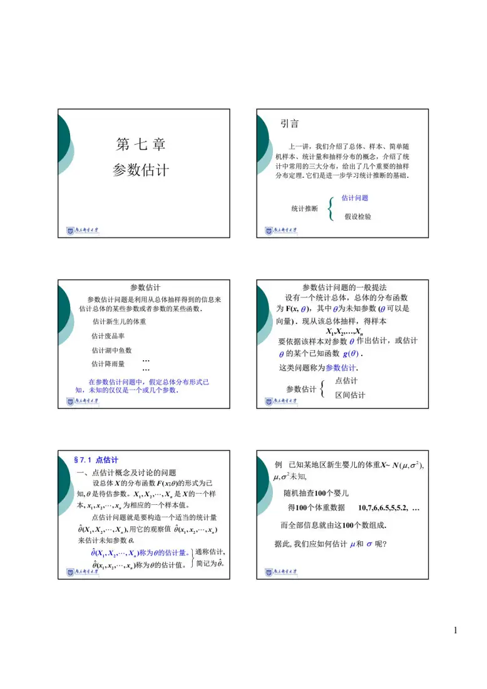
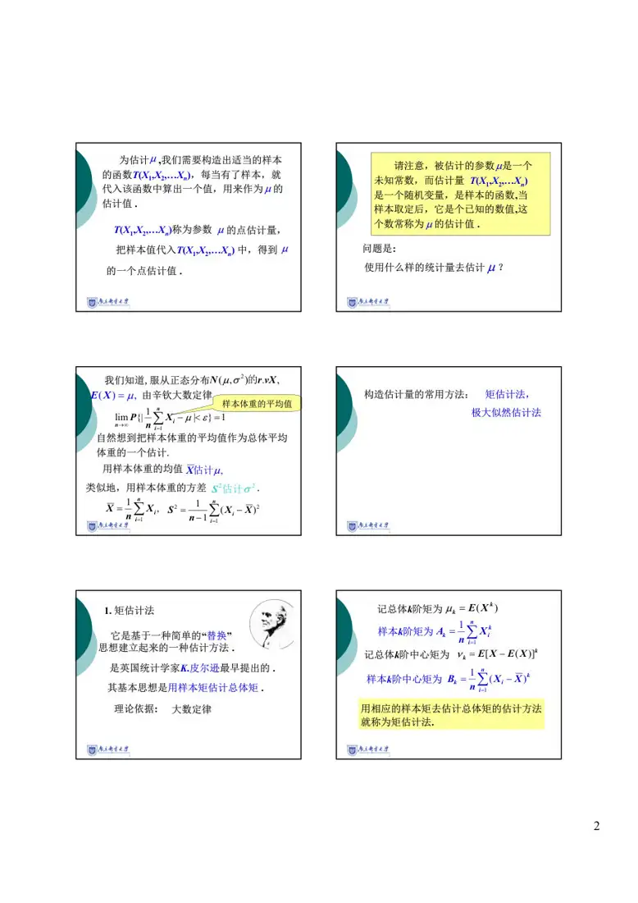
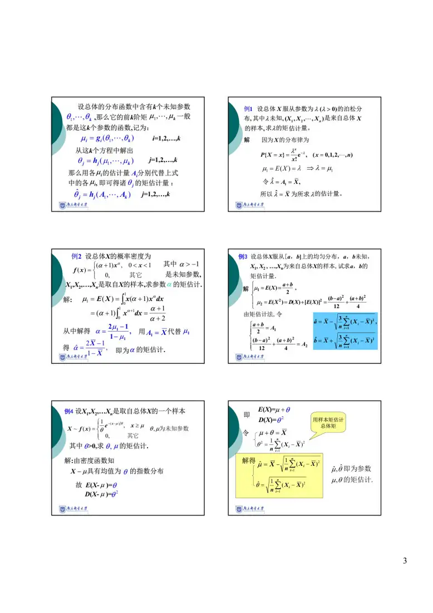
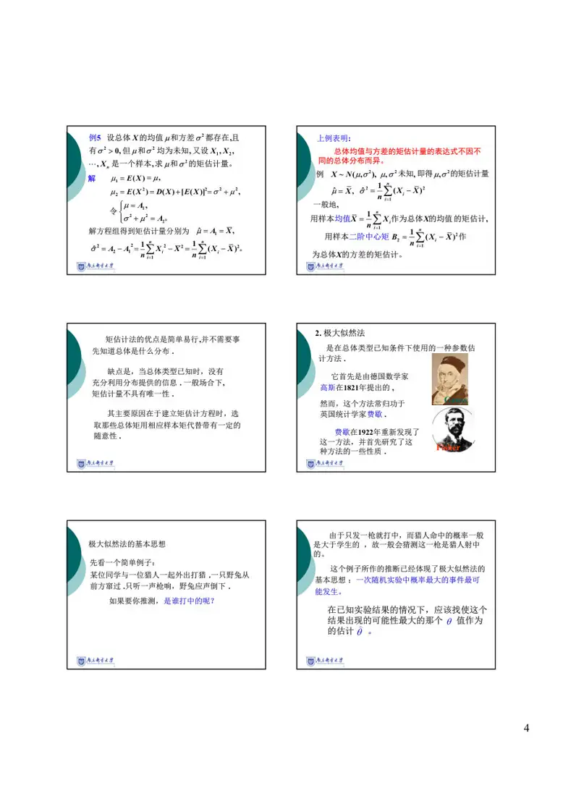
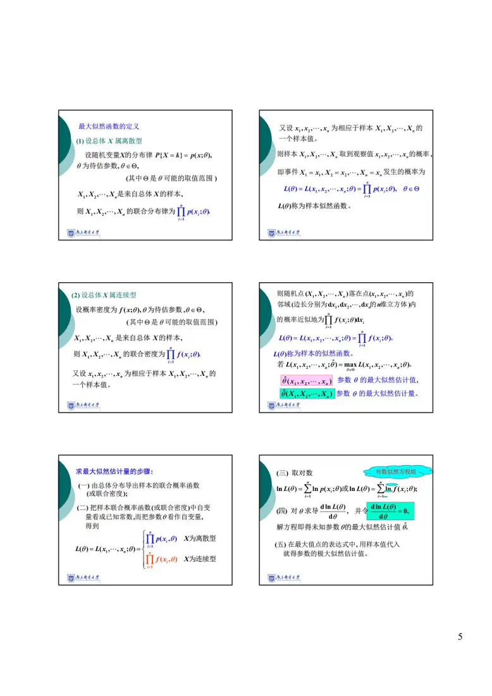
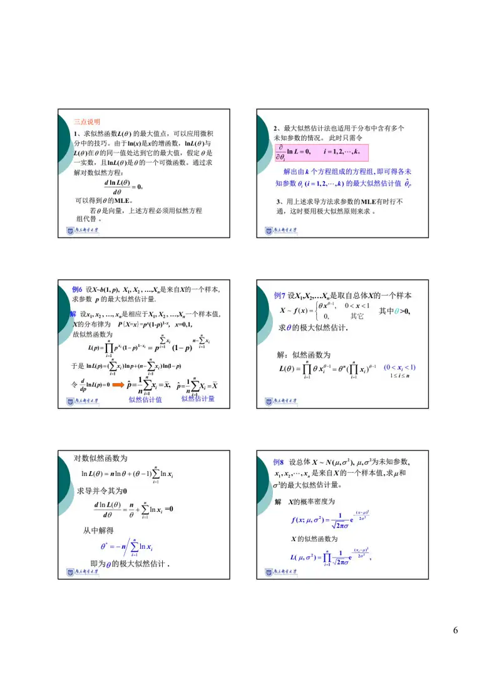
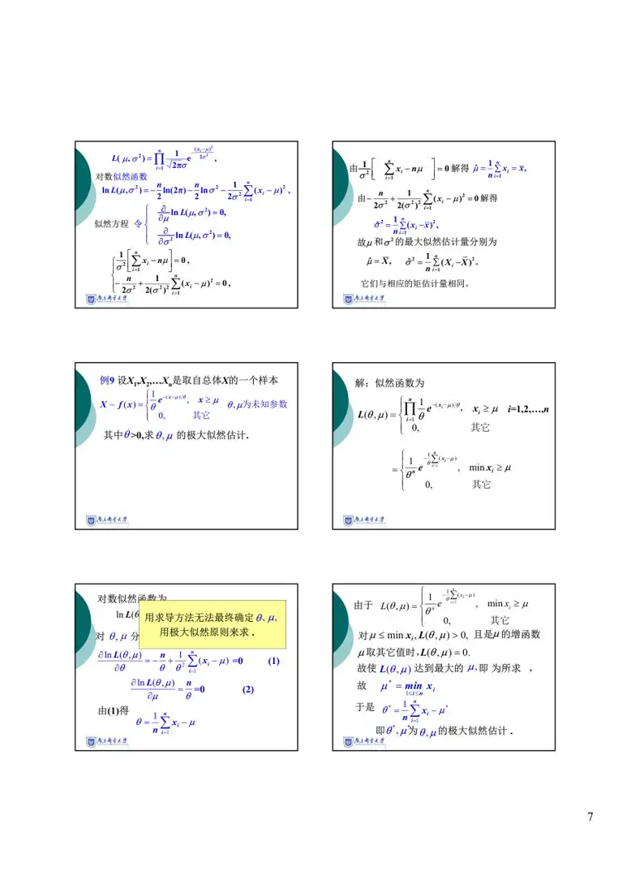

# 《概率论与数理统计》第七章 参数估计（课件）

原件的每一页，下面附识别出的文字。

### ![南京航空航天大学

原文：

参数估计

参数估计问题是利用从总体抽样得到的信息来估计总体的某些参数或者参数的某些函数.

估计新生儿的体重

估计废品率

估计湖中鱼数

估计降雨量

在参数估计问题中，假定总体分布形式已知，未知的仅仅是一个或几个参数.

南京邮电大学
Nanjing University of Physics and Telecommunications

§ 7.1 点估计

一、点估计概念及讨论的问题

设总体 X 的分布函数 $F(x;\theta)$ 的形式为已知, $\theta$ 是待估参数。 $X_{1}, X_{2}, \cdots, X_{n}$ 是 X 的一个样本, $x_{1}, x_{2}, \cdots, x_{n}$ 为相应的一个样本值。

点估计问题就是要构造一个适当的统计量 $\hat{\theta}(X_{1},X_{2},\cdots,X_{n})$ ，用它的观察值 $\hat{\theta}(x_{1},x_{2},\cdots,x_{n})$ 来估计未知参数 $\theta$ 。

$\left.\begin{array}{l}\hat{\theta}(X_{1},X_{2},\dots ,X_{n})\text{称为}\theta \text{的估计量。} \\ \hat{\theta} (x_{1},x_{2},\dots ,x_{n})\text{称为}\theta \text{的估计值。} \end{array}\right\}$ 通称估计，简记为 $\hat{\theta}$

参数估计问题的一般提法

设有一个统计总体，总体的分布函数为 $\mathrm{F}(x,\theta)$ ，其中 $\theta$ 为未知参数（可以是向量）．现从该总体抽样，得样本

$$
X _ {1}, X _ {2}, \dots , X _ {n}
$$

要依据该样本对参数 $\theta$ 作出估计，或估计 $\theta$ 的某个已知函数 $g(\theta)$ 。

这类问题称为参数估计.

参数估计 $\left\{\begin{array}{l} 点估计  \\  区间估计 \end{array}\right.$

$$
\mathbf {1 0 , 7 , 6 , 6 . 5 , 5 , 5 . 2 ,}
$$

第七章
参数估计

引言

上一讲，我们介绍了总体、样本、简单随机样本、统计量和抽样分布的概念，介绍了统计中常用的三大分布，给出了几个重要的抽样分布定理. 它们是进一步学习统计推断的基础.

统计推断

南京航空航天大学
Nanjing University of Physics and Telecommunications

估计问题假设检验

南京邮电大学
Nanjing University of Physics and Telecommunications

$\mu ,\sigma^{2}$

例 已知某地区新生婴儿的体重 $X \sim N(\mu, \sigma^{2})$ , $\mu,\sigma^{2}$ 未知,

随机抽查100个婴儿

得100个体重数据

而全部信息就由这100个数组成.

据此, 我们应如何估计 $\mu$ 和 $\sigma$ 呢?

南京邮电大学
Nanjing University of Physics and Telecommunications

1

### 我们知道, 服从正态分布 $N(\mu,\sigma^{2})$ 的r.vX,

原文：

我们知道, 服从正态分布 $N(\mu,\sigma^{2})$ 的r.vX,

$$
E (X) = \mu ,
$$

$\lim_{n\to\infty}P\left\{\left|\frac{1}{n}\sum_{i=1}^{n}X_{i}-\mu<\varepsilon\right|=1\right.$ 样本体重的平均值

自然想到把样本体重的平均值作为总体平均体重的一个估计.

用样本体重的均值 $\bar{X}$ 估计 $\mu$ ,

类似地，用样本体重的方差 $S^2$ 估计 $\sigma^2$

$$
\overline {{{X}}} = \frac {1}{n} \sum_ {i = 1} ^ {n} X _ {i}, \quad S ^ {2} = \frac {1}{n - 1} \sum_ {i = 1} ^ {n} (X _ {i} - \overline {{{X}}}) ^ {2}
$$

南京邮电大学
Nanjing University of Press and Telecommunications

1. 矩估计法

它是基于一种简单的“替换”思想建立起来的一种估计方法.

是英国统计学家K.皮尔逊最早提出的.

其基本思想是用样本矩估计总体矩.

理论依据：大数定律构造估计量的常用方法： 矩估计法，极大似然估计法例2 设总体 $X$ 的概率密度为

南京邮电大学
Nanjing University of Science and Telecommunications

$T(X_{1},X_{2},\ldots X_{n})$

为估计 $\mu$ ，我们需要构造出适当的样本的函数 $T(X_{1},X_{2},\dots X_{n})$ ，每当有了样本，就代入该函数中算出一个值，用来作为 $\mu$ 的估计值.

μ

$T(X_{1},X_{2},\ldots X_{n})$

$T(X_{1},X_{2},\ldots X_{n})$ 称为参数 $\mu$ 的点估计量，

$T(X_{1},X_{2},\ldots X_{n})$

把样本值代入 $T(X_{1},X_{2},\ldots,X_{n})$ 中，得到 $\mu$ 的一个点估计值.

μ

南京邮电大学
Nanjing University of Physics and Telecommunications

请注意，被估计的参数 $\mu$ 是一个未知常数，而估计量 $T(X_{1},X_{2},\ldots X_{n})$ 是一个随机变量，是样本的函数，当样本取定后，它是个已知的数值，这个数常称为 $\mu$ 的估计值。

$T(X_{1},X_{2},\ldots X_{n})$

μ

问题是:

使用什么样的统计量去估计 $\mu$ ？

南京航空航天大学
Nanjing University of Physics and Telecommunications

μ?

南京邮电大学
Nanjing University of Physics and Telecommunications

记总体 $k$ 阶矩为 $\mu_{k} = E(X^{k})$

样本k阶矩为 $A_{k}=\frac{1}{n}\sum_{i=1}^{n}X_{i}^{k}$

记总体k阶中心矩为 $\nu_{k}=E[X-E(X)]^{k}$

样本k阶中心矩为 $B_{k}=\frac{1}{n}\sum_{i=1}^{n}(X_{i}-\overline{X})^{k}$

用相应的样本矩去估计总体矩的估计方法就称为矩估计法.

南京新電大學
Nanjing University of Physics and Telecommunications

2

### $$

原文：

$f(x)=\left\{\begin{aligned}&(\alpha+1)x^{\alpha},&0<x<1\\ &0,& 其它 \end{aligned}\right.$ 其中 $\alpha>-1$ 是未知参数,

$X_{1},X_{2},\ldots,X_{n}$ 是取自X的样本,求参数 $\alpha$ 的矩估计.

解： $\pmb{\mu}_{1} = E(X) = \int_{0}^{1}x(\alpha +1)x^{\alpha}dx$

$$
= (\alpha + 1) \int_ {0} ^ {1} x ^ {\alpha + 1} d x = \frac {\alpha + 1}{\alpha + 2}
$$

从中解得 $\alpha = \frac{2\mu_1 - 1}{1 - \mu_1}$ ，用 $A_{1} = \overline{X}$ 代替 $\mu_{1}$ 得 $\hat{\alpha} = \frac{2\overline{X} - 1}{1 - \overline{X}}$ ，即为 $\alpha$ 的矩估计.

例4 设 $X_{1}, X_{2}, \ldots, X_{n}$ 是取自总体 $X$ 的一个样本

$X \sim f(x) = \begin{cases} \frac{1}{\theta} e^{-(x - \mu)/\theta}, & x \geq \mu \\ 0, & \text{其它} \end{cases}$ $\theta, \mu$ 为未知参数

其中 $\theta>0,$ 求 $\theta, \mu$ 的矩估计.

解:由密度函数知

$X - \mu$ 具有均值为 $\theta$ 的指数分布

故 $E(X - \mu) = \theta$ $D(X - \mu) = \theta^2$

南京新電大學
Nanjing University of Physics and Telecommunications

例3 设总体 $X$ 服从 $[a, b]$ 上的均匀分布， $a, b$ 未知， $X_{1}, X_{2}, \ldots, X_{n}$ 为来自总体 $X$ 的样本，试求 $a, b$ 的矩估计量.

解 $\left\{\begin{aligned}\mu_{1}&=E(X)=\frac{a+b}{2},\\ \mu_{2}&=E(X^{2})=D(X)+[E(X)]^{2}=\frac{(b-a)^{2}}{12}+\frac{(a+b)^{2}}{4}\end{aligned}\right.$

由矩估计法, 令

$$
\left[ \frac {a + b}{2} = A _ {1} \right.
$$

$$
\hat {a} = \overline {{X}} - \sqrt {\frac {3}{n} \sum_ {i = 1} ^ {n} (X _ {i} - \overline {{X}}) ^ {2}},
$$

$$
\left\{\frac {(b - a) ^ {2}}{1 2} + \frac {(a + b) ^ {2}}{4} = A _ {2} \right.
$$

$$
\hat {b} = \overline {{X}} + \sqrt {\frac {3}{n} \sum_ {i = 1} ^ {n} (X _ {i} - \overline {{X}}) ^ {2}}
$$

用样本矩估计总体矩

$\hat{\mu}, \hat{\theta}$ 即为参数 $\mu, \theta$ 的矩估计.

$\theta_{1},\cdots,\theta_{k}$

设总体的分布函数中含有k个未知参数 $\theta_{1},\cdots,\theta_{k}$ ，那么它的前k阶矩 $\mu_{1},\cdots,\mu_{k}$ 一般都是这k个参数的函数，记为：

$\mu_{1},\cdots,\mu_{k}$ 一

$\mu_{i} = g_{i}(\theta_{1},\dots ,\theta_{k})$ $i = 1,2,\dots,k$

从这 $k$ 个方程中解出

$\theta_{j}=h_{j}(\mu_{1},\cdots,\mu_{k})$

$j = 1,2,\dots,k$

$\cdot \mu_{i}$

$\mu_{i,}$

$A_{i}$

那么用各 $\mu_{i}$ 的估计量 $A_{i}$ 分别代替上式中的各 $\mu_{i}$ , 即可得诸 $\theta_{j}$ 的矩估计量:

$\theta_{j}$

$\hat{\pmb{\theta}}_{j} = \pmb{h}_{j}(A_{1},\dots ,A_{k})\quad j = 1,2,\dots,k$

南京邮电大学
Nanjing University of Physics and Telecommunications

λ (λ > 0)

$(X_{1},X_{2},\dots ,X_{n})$

例1 设总体 X 服从参数为 $\lambda (\lambda > 0)$ 的泊松分布, 其中 $\lambda$ 未知, $(X_{1}, X_{2}, \cdots, X_{n})$ 是来自总体 X 的样本, 求 $\lambda$ 的矩估计量。

解 因为 $X$ 的分布律为

$P\{X = x\} = \frac{\lambda^x}{x!}\mathrm{e}^{-\lambda}, (x = 0,1,2,\dots ,n)$

$\mu_{1} = E(X) = \lambda \Rightarrow \lambda = \mu_{1}$

$\hat{\lambda} = A_{1} = \bar{X},$

令 $\hat{\lambda} = A_{1} = \bar{X}$

$\hat{\lambda} = \bar{X}$

所以 $\hat{\lambda} = \bar{X}$ 为所求 $\lambda$ 的估计量。

南京航空航天大学
Nanjing University of Physics and Telecommunications

南京邮电大学
Nanjing University of Press and Telecommunications

即 $E(X)=\mu+\theta$ $D(X)=\theta^{2}$

令

$\mu + \theta = \overline{X}$

$\theta^2 = \frac{1}{n}\sum_{i = 1}^{n}(X_i - \overline{X})^2$

$\hat{\pmb{\mu}} = \overline{X} -\sqrt{\frac{1}{n}\sum_{i = 1}^{n}(X_{i} - \overline{X})^{2}}$

$\hat{\pmb{\theta}} = \sqrt{\frac{1}{n}\sum_{i = 1}^{n}(X_i - \overline{X})^2}$

南京新電大學
Nanjing University of Private and Telecommunications

3

### 南京邮电大学

原文：

南京邮电大学
Nanjing University of Physics and Telecommunications

矩估计法的优点是简单易行,并不需要事先知道总体是什么分布.

缺点是，当总体类型已知时，没有充分利用分布提供的信息。一般场合下，矩估计量不具有唯一性。

其主要原因在于建立矩估计方程时，选取那些总体矩用相应样本矩代替带有一定的随意性.

南京邮电大学
Nanjing University of Physics and Telecommunications

极大似然法的基本思想

先看一个简单例子：

某位同学与一位猎人一起外出打猎。一只野兔从前方窜过。只听一声枪响，野兔应声倒下。

如果要你推测，是谁打中的呢？

2. 极大似然法

是在总体类型已知条件下使用的一种参数估计方法.

它首先是由德国数学家高斯在1821年提出的，

然而，这个方法常归功于英国统计学家费歇。

费歇在1922年重新发现了这一方法，并首先研究了这种方法的一些性质。

南京新電大學
Nanjing University of Physics and Telecommunications

$\sigma^2 > 0,$

μ

μ

$\sigma^2$

$\sigma^2$

$X_{1}, X_{2}$

例5 设总体 X 的均值 $\mu$ 和方差 $\sigma^{2}$ 都存在, 且有 $\sigma^{2} > 0$ , 但 $\mu$ 和 $\sigma^{2}$ 均为未知, 又设 $X_{1}, X_{2}, \cdots, X_{n}$ 是一个样本, 求 $\mu$ 和 $\sigma^{2}$ 的矩估计量。

$\cdots ,X_{n}$

μ

$\sigma^2$

解 $\mu_{1} = E(X) = \mu ,$

$\mu_{1}=E(X)=\mu,$

$\mu_{2} = E(X^{2}) = D(X) + [E(X)]^{2} = \sigma^{2} + \mu^{2},$

令 $\left\{ \begin{array}{l} \mu = A_{1}, \\ \sigma^{2} + \mu^{2} = A_{2} \circ \end{array} \right.$

解方程组得到矩估计量分别为 $\hat{\mu} = A_{1} = \overline{X}$

$\hat{\mu} = A_{1} = \overline{X}$

$\hat{\sigma}^2 = A_2 - A_1^2 = \frac{1}{n}\sum_{i = 1}^{n}X_i^2 -\overline{X}^2 = \frac{1}{n}\sum_{i = 1}^{n}(X_i - \overline{X})^2.$

上例表明:

总体均值与方差的矩估计量的表达式不因不同的总体分布而异。

$X\sim N(\mu ,\sigma^2),\mu ,\sigma^2$

$\mu ,\sigma^{2}$

$\hat{\mu} = \bar{X},\quad \hat{\sigma}^{2} = \frac{1}{n}\sum_{i = 1}^{n}(X_{i} - \bar{X})^{2}$

例 $X \sim N(\mu, \sigma^2)$ , $\mu, \sigma^2$ 未知, 即得 $\mu, \sigma^2$ 的矩估计量 $\hat{\mu} = \bar{X}$ , $\hat{\sigma}^2 = \frac{1}{n} \sum_{i=1}^{n} (X_i - \bar{X})^2$

用样本均值 $\bar{X} = \frac{1}{n}\sum_{i = 1}^{n}X_{i}$ 作为总体 $X$ 的均值的矩估计，

$= \frac{1}{n}\sum_{i = 1}^{n}$

用样本二阶中心矩 $B_{2} = \frac{1}{n}\sum_{i = 1}^{n}(X_{i} - \bar{X})^{2}$ 作

$B_{2} = \frac{1}{n}\sum_{i = 1}^{n}(X_{i} - \bar{X})^{2}$ 作

为总体X的方差的矩估计。

南京邮电大学
Nanjing University of Posts and Telecommunications

南京邮电大学
Nanjing University of Press and Telecommunications

由于只发一枪就打中，而猎人命中的概率一般是大于学生的，故一般会猜测这一枪是猎人射中的。

这个例子所作的推断已经体现了极大似然法的基本思想：一次随机实验中概率最大的事件最可能发生。

在已知实验结果的情况下，应该找使这个结果出现的可能性最大的那个 $\theta$ 值作为的估计 $\hat{\theta}$ 。

南京邮电大学
Nanjing University of Science and Telecommunications

4

### (2) 设总体 $X$ 属连续型

原文：

(2) 设总体 $X$ 属连续型

设概率密度为 $f(x;\theta)$ ， $\theta$ 为待估参数， $\theta\in\Theta$ ，
(其中 $\Theta$ 是 $\theta$ 可能的取值范围) $X_{1},X_{2},\cdots,X_{n}$ 是来自总体 X 的样本，
则 $X_{1},X_{2},\cdots,X_{n}$ 的联合密度为 $\prod_{i=1}^{n}f(x_{i};\theta)$ .
又设 $x_{1},x_{2},\cdots,x_{n}$ 为相应于样本 $X_{1},X_{2},\cdots,X_{n}$ 的一个样本值。

南京邮电大学
Nanjing University of Physics and Telecommunications

求最大似然估计量的步骤：

(一)由总体分布导出样本的联合概率函数(或联合密度);

(二) 把样本联合概率函数(或联合密度)中自变量看成已知常数,而把参数 $\theta$ 看作自变量,得到

$L(\theta) = L(x_{1},\dots ,x_{n};\theta) = \left\{ \begin{array}{ll}\prod_{i = 1}^{n}p(x_{i},\theta) & X\text{为离散型}\\ \prod_{i = 1}^{n}f(x_{i},\theta) & X\text{为连续型} \end{array} \right.$

南京新電大學
Nanjing University of Physics and Telecommunications

则随机点 $(X_{1},X_{2},\cdots,X_{n})$ 落在点 $(x_{1},x_{2},\cdots,x_{n})$ 的邻域(边长分别为 $dx_{1},dx_{2},\cdots,dx_{n}$ 的n维立方体)内的概率近似地为 $\prod_{i=1}^{n}f(x_{i};\theta)\mathrm{d}x_{i}$ $L(\theta)=L(x_{1},x_{2},\cdots,x_{n};\theta)=\prod_{i=1}^{n}f(x_{i};\theta)$ 。 $L(\theta)$ 称为样本的似然函数。

若 $L(x_{1},x_{2},\cdots,x_{n};\hat{\theta})=\max_{\theta\in\Theta}L(x_{1},x_{2},\cdots,x_{n};\theta)$ 。 $\hat{\theta}(x_{1},x_{2},\cdots,x_{n})$ 参数 $\theta$ 的最大似然估计值， $\hat{\theta}(X_{1},X_{2},\cdots,X_{n})$ 参数 $\theta$ 的最大似然估计量。

(三) 取对数

$\ln L(\theta) = \sum_{i=1}^{n} \ln p(x_i; \theta)$ 或 $\ln L(\theta) = \sum_{i=1}^{n} \ln f(x_i; \theta)$ ;

(四) 对 $\theta$ 求导 $\frac{\mathrm{d}\ln L(\theta)}{\mathrm{d}\theta}$ ，并令 $\frac{\mathrm{d}\ln L(\theta)}{\mathrm{d}\theta} = 0,$ 解方程即得未知参数 $\theta$ 的最大似然估计值 $\hat{\theta}$ 。

(五) 在最大值点的表达式中, 用样本值代入就得参数的极大似然估计值。

南京邮电大学
Nanjing University of Science and Telecommunications

最大似然函数的定义

(1) 设总体 $X$ 属离散型

$P\{X = k\} = p(x;\theta)$

θ ∈ Θ.

设随机变量X的分布律 $P\{X=k\}=p(x;\theta)$ ， $\theta$ 为待估参数, $\theta \in \Theta$ ,
(其中 $\Theta$ 是 $\theta$ 可能的取值范围) $X_{1}, X_{2}, \cdots, X_{n}$ 是来自总体 X 的样本，
则 $X_{1}, X_{2}, \cdots, X_{n}$ 的联合分布律为 $\prod_{i=1}^{n} p(x_{i}; \theta)$ 。

$X_{1}, X_{2}, \cdots, X,$

$X_{1}, X_{2}, \cdots, X_{n}$

$\prod_{i=1}^{n} p(x_i; \theta)$

南京新電大學
Nanjing University of Physics and Telecommunications

$x_{1}, x_{2}, \cdots, x_{n}$

$X_{1}, X_{2}, \cdots, X_{n}$

又设 $x_{1}, x_{2}, \cdots, x_{n}$ 为相应于样本 $X_{1}, X_{2}, \cdots, X_{n}$ 的一个样本值。
则样本 $X_{1}, X_{2}, \cdots, X_{n}$ 取到观察值 $x_{1}, x_{2}, \cdots, x_{n}$ 的概率
即事件 $X_{1}=x_{1}, X_{2}=x_{2}, \cdots, X_{n}=x_{n}$ 发生的概率为 $L(\theta)=L(x_{1},x_{2},\cdots,x_{n};\theta)=\prod_{i=1}^{n}p(x_{i};\theta),\quad\theta\in\Theta$ $L(\theta)$ 称为样本似然函数。

$X_{1}, X_{2}, \cdots, X_{n}$

$x_{1}, x_{2}, \cdots, x_{n}$

$X_{1} = x_{1}, X_{2} = x_{2}, \cdots, X_{n} = x_{n}$

$L(\theta) = L(x_{1},x_{2},\dots ,x_{n};\theta) = \prod_{i = 1}^{n}p(x_{i};\theta),\quad \theta \in \Theta$

$L(\theta)$

南京邮电大学
Nanjing University of Press and Telecommunications

5

### 故似然函数为

原文：

例6 设 $X \sim b(1, p)$ , $X_1, X_2, \ldots, X_n$ 是来自 $X$ 的一个样本, 求参数 $p$ 的最大似然估计量.

解 设 $x_{1}, x_{2}, \ldots, x_{n}$ 是相应于 $X_{1}, X_{2}, \ldots, X_{n}$ 一个样本值， $X$ 的分布律为 $P\{X = x\} = p^{x}(1 - p)^{1 - x}, x = 0, 1,$

故似然函数为

$$
L (p) = \prod_ {i = 1} ^ {n} p ^ {x _ {i}} (1 - p) ^ {1 - x _ {i}} = p ^ {\sum_ {i = 1} ^ {n} x _ {i}} (1 - p) ^ {n - \sum_ {i = 1} ^ {n} x _ {i}}
$$

于是 $\ln L(p) = (\sum_{i=1}^{n} x_i) \ln p + (n - \sum_{i=1}^{n} x_i) \ln(1 - p)$

令 $\frac{d}{dp}\ln L(p)=0$ $\Rightarrow$ $\hat{p}=\frac{1}{n}\sum_{i=1}^{n}x_{i}=\bar{x},\quad\hat{p}=\frac{1}{n}\sum_{i=1}^{n}X_{i}=\bar{X}$ 似然估计值
似然估计量

对数似然函数为

$$
\ln L (\boldsymbol {\theta}) = \boldsymbol {n} \ln \boldsymbol {\theta} + (\boldsymbol {\theta} - 1) \sum_ {i = 1} ^ {n} \ln x _ {i}
$$

求导并令其为0

$$
\frac {d \ln L (\theta)}{d \theta} = \frac {n}{\theta} + \sum_ {i = 1} ^ {n} \ln x _ {i} = 0
$$

从中解得

$$
\theta^ {*} = - n / \sum_ {i = 1} ^ {n} \ln x _ {i}
$$

即为 $\theta$ 的极大似然估计.

南京邮电大学
Nanjing University of Posts and Telecommunications

例7 设 $X_{1}, X_{2}, \ldots, X_{n}$ 是取自总体 $X$ 的一个样本 $X \sim f(x) = \left\{ \begin{array}{ll} \theta x^{\theta - 1}, & 0 < x < 1 \\ 0, & \text{其它} \end{array} \right.$ 其中 $\theta > 0,$

求 $\theta$ 的极大似然估计.

解：似然函数为

$$
L(\boldsymbol {\theta}) = \prod_{i = 1}^{n}\boldsymbol{\theta}  x_{i}^{\boldsymbol{\theta} -1} = \boldsymbol{\theta}^{n}(\prod_{i = 1}^{n}x_{i})^{\boldsymbol{\theta} -1}\quad (0 <   x_{i} <   1)\\ 1\leq i\leq n
$$

$$
f (x; \mu , \sigma^ {2}) = \frac {1}{\sqrt {2 \pi} \sigma} \mathrm{e} ^ {- \frac {(x - \mu) ^ {2}}{2 \sigma^ {2}}}
$$

$X$ 的似然函数为

$$
L (\mu , \sigma^ {2}) = \prod_ {i = 1} ^ {n} \frac {1}{\sqrt {2 \pi} \sigma} \mathrm{e} ^ {- \frac {(x _ {i} - \mu) ^ {2}}{2 \sigma^ {2}}},
$$

三点说明

L(θ)

且 $\ln L(\theta)$

1、求似然函数 $L(\theta)$ 的最大值点，可以应用微积分中的技巧。由于 $\ln (x)$ 是 $x$ 的增函数， $\ln L(\theta)$ 与 $L(\theta)$ 在 $\theta$ 的同一值处达到它的最大值，假定 $\theta$ 是一实数，且 $\ln L(\theta)$ 是 $\theta$ 的一个可微函数。通过求解对数似然方程：

$\ln L(\theta)$

$\frac{d\ln L(\theta)}{d\theta} = 0$

可以得到 $\theta$ 的MLE。

若 $\theta$ 是向量，上述方程必须用似然方程组代替。

南京邮电大学
Nanjing University of Physics and Telecommunications

2、最大似然估计法也适用于分布中含有多个未知参数的情况。此时只需令

$\frac{\partial}{\partial\theta_{i}}\ln L = 0,$

$i = 1,2,\dots ,k_{\circ}$

解出由 k 个方程组成的方程组, 即可得各未知参数 $\theta_{i} (i=1,2,\cdots,k)$ 的最大似然估计值 $\hat{\theta}_{i}$ 。

$\theta_{i}(i=1,2,\cdots,k)$

$\hat{\theta}_{i^{\circ}}$

3、用上述求导方法求参数的MLE有时行不通，这时要用极大似然原则来求。

南京航空航天大学
Nanjing University of Physics and Telecommunications

南京邮电大学
Nanjing University of Physics and Telecommunications

$x_{1}, x_{2}, \cdots, x_{n}$

例8 设总体 $X \sim N(\mu, \sigma^{2})$ , $\mu, \sigma^{2}$ 为未知参数, $x_{1}, x_{2}, \cdots, x_{n}$ 是来自 X 的一个样本值, 求 $\mu$ 和 $\sigma^{2}$ 的最大似然估计量。

解 $X$ 的概率密度为

南京邮电大学
Nanjing University of Science and Telecommunications

6

### 南京邮电大学

原文：

例9 设 $X_{1}, X_{2}, \ldots, X_{n}$ 是取自总体 $X$ 的一个样本

$X \sim f(x) = \begin{cases} \frac{1}{\theta} e^{-(x - \mu) / \theta}, & x \geq \mu \\ 0, & \text{其它} \end{cases}$ $\theta, \mu$ 为未知参数

其中 $\theta > 0$ ，求 $\theta, \mu$ 的极大似然估计。

南京邮电大学
Nanjing University of Posts and Telecommunications

对数似然函数为

$\ln L(\theta)$ 用求导方法无法最终确定 $\theta, \mu,$ 对 $\theta, \mu$ 分 用极大似然原则来求.

$$
\frac {\partial \ln L (\boldsymbol {\theta} , \boldsymbol {\mu})}{\partial \boldsymbol {\theta}} = - \frac {n}{\boldsymbol {\theta}} + \frac {1}{\boldsymbol {\theta} ^ {2}} \sum_ {i = 1} ^ {n} (x _ {i} - \boldsymbol {\mu}) = \mathbf {0}\tag{1}
$$

$$
\frac {\partial \ln L (\boldsymbol {\theta} , \boldsymbol {\mu})}{\partial \boldsymbol {\mu}} = \frac {\boldsymbol {n}}{\boldsymbol {\theta}} = \mathbf {0}\tag{2}
$$

由(1)得 $\theta = \frac{1}{n}\sum_{i = 1}^{n}x_{i} - \mu$

南京新電大學
Nanjing University of Physics and Telecommunications

解：似然函数为

$$
L (\boldsymbol {\theta}, \boldsymbol {\mu}) = \left\{ \begin{array}{c} \prod_ {i = 1} ^ {n} \frac {1}{\boldsymbol {\theta}} e ^ {- (x _ {i} - \boldsymbol {\mu}) / \boldsymbol {\theta}}, \\ 0, \end{array} \right.
$$

$$
x _ {i} \geq \mu \quad i = 1, 2, \dots , n
$$

其它

$$
= \left\{ \begin{array}{c c} { \frac {1}{\theta^ {n}} e ^ {- \frac {1}{\theta} \sum_ {i = 1} ^ {n} (x _ {i} - \mu)},} & {\min x _ {i} \geq \mu} \\ {0,} & {\text {其它}} \end{array} \right.
$$

南京邮电大学
Nanjing University of Physics and Telecommunications

$L(\mu, \sigma^2) = \prod_{i=1}^{n} \frac{1}{\sqrt{2\pi}\sigma} e^{-\frac{(x_i - \mu)^2}{2\sigma^2}}$ ,

对数似然函数

$\ln L(\mu, \sigma^2) = -\frac{n}{2} \ln(2\pi) - \frac{n}{2} \ln \sigma^2 - \frac{1}{2\sigma^2} \sum_{i=1}^{n} (x_i - \mu)^2$

似然方程 令 $\left\{ \begin{array}{ll} \frac{\partial}{\partial\mu}\ln L(\mu, \sigma^2) = 0, \\ \frac{\partial}{\partial\sigma^2}\ln L(\mu, \sigma^2) = 0, \end{array} \right.$

$\left\{ \begin{array}{ll}\frac{\partial}{\partial\mu}\ln L(\mu ,\sigma^2) = 0,\\ \frac{\partial}{\partial\sigma^2}\ln L(\mu ,\sigma^2) = 0, \end{array} \right.$

$\left[\frac{1}{\sigma^2}\left[\sum_{i=1}^{n}x_i - n\mu \right] = 0\right.,$

$\left\{-\frac{n}{2\sigma^2} + \frac{1}{2(\sigma^2)^2}\sum_{i=1}^{n}(x_i - \mu)^2 = 0, \right.$

南京邮电大学
Nanjing University of Press and Telecommunications

$\frac{1}{\sigma^2}\left[\sum_{i=1}^{n} x_i - n\mu \right] = 0$

由 $\frac{1}{\sigma^2}\left[\sum_{i=1}^{n} x_i - n\mu\right] = 0$ 解得 $\hat{\mu} = \frac{1}{n}\sum_{i=1}^{n} x_i = \bar{x},$

$\hat{\mu} = \frac{1}{n}\sum_{i = 1}^{n}x_{i} = \overline{x},$

由 $-\frac{n}{2\sigma^2} + \frac{1}{2(\sigma^2)^2} \sum_{i=1}^{n}(x_i - \mu)^2 = 0$

由 $-\frac{n}{2\sigma^2} + \frac{1}{2(\sigma^2)^2} \sum_{i=1}^{n}(x_i - \mu)^2 = 0$ 解得

$\hat{\sigma}^2 = \frac{1}{n}\sum_{i = 1}^{n}(x_i - \overline{x})^2,$

μ

$\sigma^2$

故 $\mu$ 和 $\sigma^2$ 的最大似然估计量分别为

$\hat{\mu} = \overline{X},\quad \hat{\sigma}^{2} = \frac{1}{n}\sum_{i = 1}^{n}(X_{i} - \overline{X})^{2}$

它们与相应的矩估计量相同。

南京邮电大学
Nanjing University of Press and Telecommunications

由于 $L(\theta, \mu) = \left\{ \begin{array}{ll} \frac{1}{\theta^n} e^{-\frac{1}{\theta}\sum_{i=1}^{n}(x_i - \mu)}, & \min x_i \geq \mu \\ 0, & \text{其它} \end{array} \right.$

$\mu \leq \min x_{i}, L(\theta, \mu) > 0,$

μ

对 $\mu \leq \min x_{i}, L(\theta, \mu) > 0$ ，且是 $\mu$ 的增函数 $\mu$ 取其它值时， $L(\theta, \mu) = 0$ .

故使 $L(\theta, \mu)$ 达到最大的 $\mu$ , 即为所求，

故 $\mu^{*} = \min_{1\leq i\leq n}x_{i}$

于是 $\theta^{*} = \frac{1}{n}\sum_{i = 1}^{n}x_{i} - \mu^{*}$

即 $\theta^{*},\mu^{*}$ 为 $\theta ,\mu$ 的极大似然估计.

7
