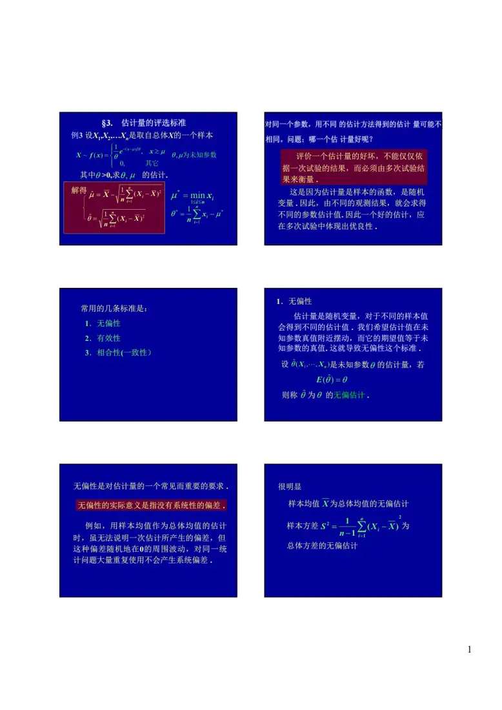
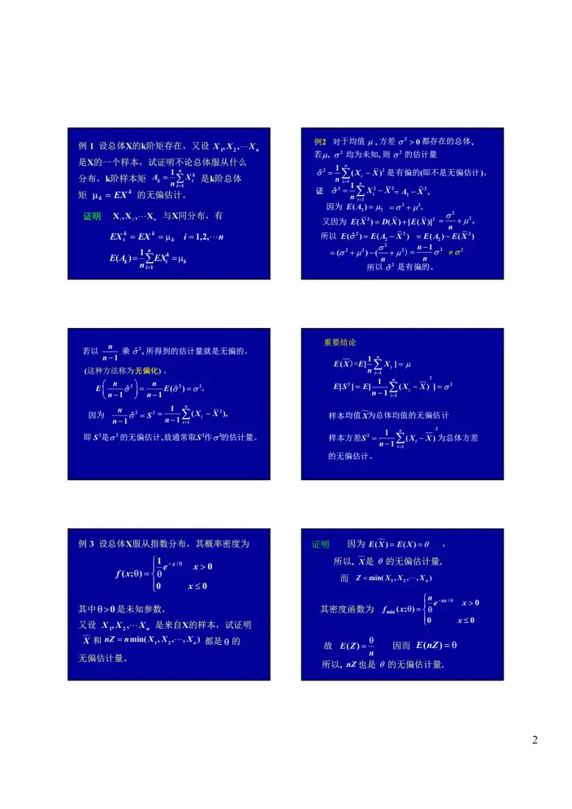
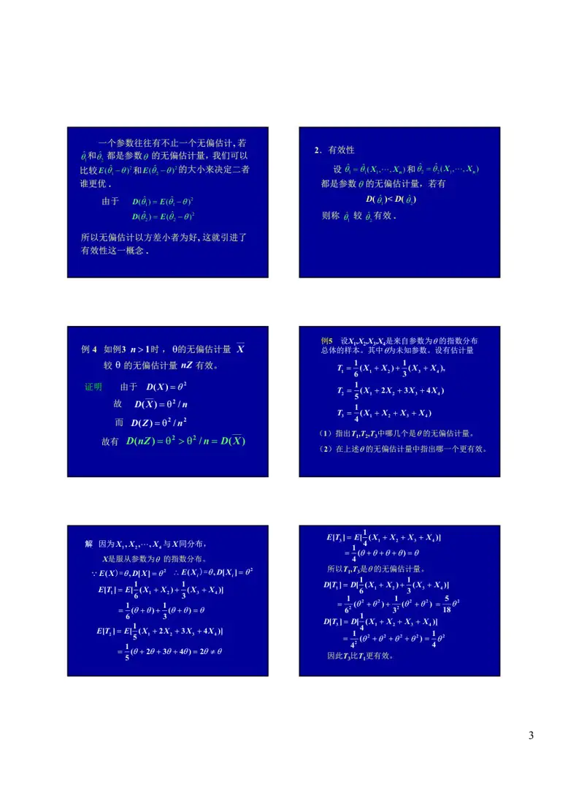
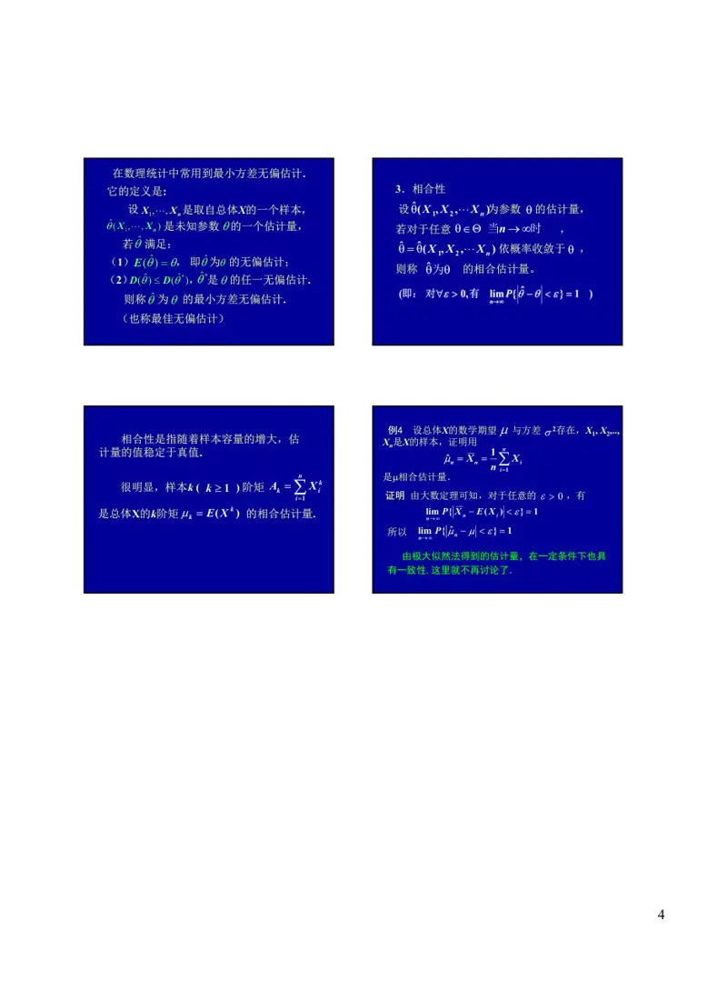

# 《概率论与数理统计》第七章 参数估计：估计量的评选标准（课件）

原件的每一页，下面附识别出的文字。

### §3. 估计量的评选标准

原文：

§3. 估计量的评选标准

例3 设 $X_{1}, X_{2}, \ldots, X_{n}$ 是取自总体 $X$ 的一个样本

$X \sim f(x) = \begin{cases} \frac{1}{\theta} e^{-(x - \mu)/\theta}, & x \geq \mu \\ 0, & \text{其它} \end{cases}$ $\theta, \mu$ 为未知参数

其中 $\theta > 0$ , 求 $\theta, \mu$ 的估计.

$$
\text {解得} \hat {\boldsymbol {\mu}} = \overline {{\boldsymbol {X}}} - \sqrt {\frac {1}{n} \sum_ {i = 1} ^ {n} (X _ {i} - \overline {{\boldsymbol {X}}}) ^ {2}}
$$

$$
\hat {\boldsymbol {\theta}} = \sqrt {\frac {1}{n} \sum_ {i = 1} ^ {n} (X _ {i} - \overline {{X}}) ^ {2}}
$$

$$
\mu^ {*} = \min _ {1 \leq i \leq n} x _ {i}
$$

$$
\theta^ {*} = \frac {1}{n} \sum_ {i = 1} ^ {n} x _ {i} - \mu^ {*}
$$

常用的几条标准是:

1. 无偏性

2. 有效性

3. 相合性(一致性)

无偏性是对估计量的一个常见而重要的要求.

无偏性的实际意义是指没有系统性的偏差.

例如，用样本均值作为总体均值的估计时，虽无法说明一次估计所产生的偏差，但这种偏差随机地在0的周围波动，对同一统计问题大量重复使用不会产生系统偏差。

对同一个参数，用不同的估计方法得到的估计量可能不相同。问题：哪一个估计量好呢？

评价一个估计量的好坏，不能仅仅依据一次试验的结果，而必须由多次试验结果来衡量。

这是因为估计量是样本的函数，是随机变量。因此，由不同的观测结果，就会求得不同的参数估计值。因此一个好的估计，应在多次试验中体现出优良性。

1. 无偏性

估计量是随机变量，对于不同的样本值会得到不同的估计值．我们希望估计值在未知参数真值附近摆动，而它的期望值等于未知参数的真值.这就导致无偏性这个标准.

设 $\hat{\theta}(X_{1},\cdots,X_{n})$ 是未知参数 $\theta$ 的估计量，若

$$
E (\hat {\theta}) = \theta
$$

则称 $\hat{\theta}$ 为 $\theta$ 的无偏估计.

很明显

样本均值 $\overline{X}$ 为总体均值的无偏估计

样本方差 $S^2 = \frac{1}{n - 1}\sum_{i = 1}^{n}(X_i - \overline{X})^2$ 为

总体方差的无偏估计

1

### 证明 $X_{1}, X_{2}, \cdots X_{n}$ 与X同分布，有

原文：

例 1 设总体X的k阶矩存在，又设 $X_{1}, X_{2}, \cdots, X_{n}$ 是X的一个样本，试证明不论总体服从什么分布，k阶样本矩 $A_{k} = \frac{1}{n} \sum_{i=1}^{n} X_{i}^{k}$ 是k阶总体矩 $\mu_{k} = EX^{k}$ 的无偏估计。

证明 $X_{1}, X_{2}, \cdots X_{n}$ 与X同分布，有

$$
E X _ {i} ^ {k} = E X ^ {k} = \mu_ {k} i = 1, 2, \dots n
$$

$$
E (A _ {k}) = \frac {1}{n} \sum_ {i = 1} ^ {n} E X _ {i} ^ {k} = \mu_ {k}
$$

若以 $\frac{n}{n - 1}$ 乘 $\hat{\sigma}^2$ ，所得到的估计量就是无偏的。

(这种方法称为无偏化)。

$$
E \left(\frac {n}{n - 1} \hat {\sigma} ^ {2}\right) = \frac {n}{n - 1} E (\hat {\sigma} ^ {2}) = \sigma^ {2} 。
$$

因为 $\frac{n}{n - 1}\hat{\sigma}^2 = S^2 = \frac{1}{n - 1}\sum_{i = 1}^{n}(X_i - \bar{X}^2),$

即 $S^2$ 是 $\sigma^2$ 的无偏估计，故通常取 $S^2$ 作 $\sigma^2$ 的估计量。

例 3 设总体X服从指数分布，其概率密度为

$$
f (x; \theta) = \left\{ \begin{array}{l l} \frac {1}{\theta} e ^ {- x / \theta} & x > 0 \\ 0 & x \leq 0 \end{array} \right.
$$

其中 $\theta > 0$ 是未知参数，

又设 $X_{1}, X_{2}, \cdots X_{n}$ 是来自X的样本，试证明

$\overline{X}$ 和 $nZ=n\min(X_{1},X_{2},\cdots,X_{n})$ 都是 $\theta$ 的

无偏估计量。

例2 对于均值 $\mu$ ，方差 $\sigma^2 > 0$ 都存在的总体，

若 $\mu, \sigma^2$ 均为未知, 则 $\sigma^2$ 的估计量

$\hat{\sigma}^{2} = \frac{1}{n}\sum_{i = 1}^{n}(X_{i} - \bar{X})^{2}$ 是有偏的(即不是无偏估计)。

证 $\hat{\sigma}^2 = \frac{1}{n}\sum_{i = 1}^{n}X_i^2 -\bar{X} ^2 = A_2 - \bar{X} ^2,$

因为 $E(A_{2})=\mu_{2}=\sigma^{2}+\mu^{2}$ ,

又因为 $E(\bar{X}^{2})=D(\bar{X})+[E(\bar{X})]^{2}=\frac{\sigma^{2}}{n}+\mu^{2}$ ,

所以 $E(\hat{\sigma}^2) = E(A_2 - \bar{X}^2) = E(A_2) - E(\bar{X}^2)$

$$
= (\sigma^ {2} + \mu^ {2}) - \left(\frac {\sigma^ {2}}{n} + \mu^ {2}\right) = \frac {n - 1}{n} \sigma^ {2} \neq \sigma^ {2}   \text {所以} \hat {\sigma} ^ {2} \text {是有偏的。}
$$

重要结论

$$
E (\overline {{{X}}}) = E [ \frac {1}{n} \sum_ {i = 1} ^ {n} X _ {i} ] = \mu
$$

$$
E [ S ^ {2} ] = E \left[ \frac {1}{n - 1} \sum_ {i = 1} ^ {n} \left(X _ {i} - \overline {{X}}\right) ^ {2} \right] = \sigma^ {2}
$$

样本均值 $\overline{X}$ 为总体均值的无偏估计

样本方差 $S^{2}=\frac{1}{n-1}\sum_{i=1}^{n}(X_{i}-\overline{X})^{2}$ 为总体方差

的无偏估计。

因为 $E(\overline{X}) = E(X) = \theta$

所以， $\overline{X}$ 是 $\theta$ 的无偏估计量.

$$
\text { 而 } Z = \min (X _ {1}, X _ {2}, \dots , X _ {n})
$$

其密度函数为 $f_{\min}(x;\theta)=\left\{\begin{aligned}\frac{n}{\theta}e^{-nx/\theta}&\quad x>0\\ 0&\quad x\leq0\end{aligned}\right.$

故 $E(Z) = \frac{\theta}{n}$ 因而 $E(nZ) = \theta$

所以, $nZ$ 也是 $\theta$ 的无偏估计量.

2

### $$

原文：

一个参数往往有不止一个无偏估计, 若 $\hat{\theta}_{1}$ 和 $\hat{\theta}_{2}$ 都是参数 $\theta$ 的无偏估计量, 我们可以比较 $E(\hat{\theta}_{1}-\theta)^{2}$ 和 $E(\hat{\theta}_{2}-\theta)^{2}$ 的大小来决定二者谁更优.

由于 $D(\hat{\theta}_1) = E(\hat{\theta}_1 - \theta)^2$

$$
D (\hat {\boldsymbol {\theta}} _ {2}) = E (\hat {\boldsymbol {\theta}} _ {2} - \boldsymbol {\theta}) ^ {2}
$$

所以无偏估计以方差小者为好, 这就引进了有效性这一概念.

例4如例3 $n > 1$ 时， $\theta$ 的无偏估计量 $\overline{X}$ 较 $\theta$ 的无偏估计量 $nZ$ 有效。

证明 由于 $D(X) = \theta^2$

故 $D(\overline{X}) = \theta^2 / n$

而 $D(Z) = \theta^2 / n^2$

故有 $D(nZ)=\theta^{2}>\theta^{2}/n=D(\overline{X})$

解 因为 $X_{1}, X_{2}, \cdots, X_{4}$ 与 $X$ 同分布，

$X$ 是服从参数为 $\theta$ 的指数分布。

$$
\because E (X) = \theta , D [ X ] = \theta^ {2} \quad \therefore E \left(X _ {i}\right) = \theta , D \left[ X _ {i} \right] = \theta^ {2}
$$

$$
\begin{array}{r l} E [ T _ {1} ] & = E \left[ \frac {1}{6} (X _ {1} + X _ {2}) + \frac {1}{3} (X _ {3} + X _ {4}) \right] \\ & = \frac {1}{6} (\theta + \theta) + \frac {1}{3} (\theta + \theta) = \theta \end{array}
$$

$$
\begin{array}{r l} E [ T _ {2} ] & = E \left[ \frac {1}{5} \left(X _ {1} + 2 X _ {2} + 3 X _ {3} + 4 X _ {4}\right) \right] \\ & = \frac {1}{5} (\theta + 2 \theta + 3 \theta + 4 \theta) = 2 \theta \neq \theta \end{array}
$$

2. 有效性

设 $\hat{\theta}_{1}=\hat{\theta}_{1}(X_{1},\cdots,X_{n})$ 和 $\hat{\theta}_{2}=\hat{\theta}_{2}(X_{1},\cdots,X_{n})$

都是参数 $\theta$ 的无偏估计量，若有

$$
D (\hat {\theta} _ {1}) <   D (\hat {\theta} _ {2})
$$

则称 $\hat{\theta}_1$ 较 $\hat{\theta}_2$ 有效.

例5 设 $X_{1}, X_{2}, X_{3}, X_{4}$ 是来自参数为 $\theta$ 的指数分布总体的样本。其中 $\theta$ 为未知参数。设有估计量

$$
T _ {1} = \frac {1}{6} (X _ {1} + X _ {2}) + \frac {1}{3} (X _ {3} + X _ {4}),
$$

$$
T _ {2} = \frac {1}{5} \left(X _ {1} + 2 X _ {2} + 3 X _ {3} + 4 X _ {4}\right)
$$

$$
T _ {3} = \frac {1}{4} (X _ {1} + X _ {2} + X _ {3} + X _ {4})
$$

(1) 指出 $T_{1}, T_{2}, T_{3}$ 中哪几个是 $\theta$ 的无偏估计量。

(2) 在上述 $\theta$ 的无偏估计量中指出哪一个更有效。

$E[T_3] = E[\frac{1}{4} (X_1 + X_2 + X_3 + X_4)]$ $= \frac{1}{4} (\theta +\theta +\theta +\theta) = \theta$

所以 $T_{1}, T_{3}$ 是 $\theta$ 的无偏估计量。

$$
\begin{array}{r l} D [ T _ {1} ] & = D \left[ \frac {1}{6} \left(X _ {1} + X _ {2}\right) + \frac {1}{3} \left(X _ {3} + X _ {4}\right) \right] \\ & = \frac {1}{6 ^ {2}} \left(\theta^ {2} + \theta^ {2}\right) + \frac {1}{3 ^ {2}} \left(\theta^ {2} + \theta^ {2}\right) = \frac {5}{1 8} \theta^ {2} \end{array}
$$

$$
\begin{array}{r l} D [ T _ {3} ] & = D \left[ \frac {1}{4} (X _ {1} + X _ {2} + X _ {3} + X _ {4}) \right] \\ & = \frac {1}{4 ^ {2}} (\theta^ {2} + \theta^ {2} + \theta^ {2} + \theta^ {2}) = \frac {1}{4} \theta^ {2} \end{array}
$$

因此 $T_{3}$ 比 $T_{1}$ 更有效。

3

### 在数理统计中常用到最小方差无偏估计.它的定义是:

原文：

在数理统计中常用到最小方差无偏估计.它的定义是:

设 $X_{1},\cdots,X_{n}$ 是取自总体 X 的一个样本， $\hat{\theta}(X_{1},\cdots,X_{n})$ 是未知参数 $\theta$ 的一个估计量，若 $\hat{\theta}$ 满足：

(1) $E(\hat{\theta}) = \theta$ ，即 $\hat{\theta}$ 为 $\theta$ 的无偏估计；

(2) $D(\hat{\theta}) \leq D(\hat{\theta}^{*})$ ， $\hat{\theta}^{*}$ 是 $\theta$ 的任一无偏估计.

则称 $\hat{\theta}$ 为 $\theta$ 的最小方差无偏估计.

(也称最佳无偏估计)

相合性是指随着样本容量的增大，估计量的值稳定于真值.

很明显，样本 $k(k \geq 1)$ 阶矩 $A_{k} = \sum_{i=1}^{n} X_{i}^{k}$ 是总体X的 $k$ 阶矩 $\mu_{k} = E(X^{k})$ 的相合估计量.

3. 相合性

设 $\hat{\theta}(X_{1},X_{2},\cdots,X_{n})$ 为参数 $\theta$ 的估计量，

若对于任意 $\theta \in \Theta$ 当 $n\to \infty$ 时

$\hat{\theta}=\hat{\theta}(X_{1},X_{2},\cdots X_{n})$ 依概率收敛于 $\theta$ ，

则称 $\hat{\theta}$ 为 $\theta$ 的相合估计量。

(即：对 $\forall\varepsilon>0$ ,有 $\lim_{n\to\infty}P\left|\hat{\theta}-\theta\right|<\varepsilon\}=1$ )

例4 设总体 $X$ 的数学期望 $\mu$ 与方差 $\sigma^2$ 存在， $X_1, X_2, \ldots, X_n$ 是 $X$ 的样本，证明用

$$
\hat {\mu} _ {n} = \overline {{X}} _ {n} = \frac {1}{n} \sum_ {i = 1} ^ {n} X _ {i}
$$

是 $\mu$ 相合估计量.

证明 由大数定理可知，对于任意的 $\varepsilon > 0$ ，有

$\lim_{n\to \infty}P\{\left|\overline{X}_n - E(X_i)\right| <   \varepsilon \} = 1$

所以 $\lim_{n\to \infty}P\{\left|\hat{\mu}_n - \mu \right| <   \varepsilon \} = 1$

由极大似然法得到的估计量，在一定条件下也具有一致性, 这里就不再讨论了.

4
