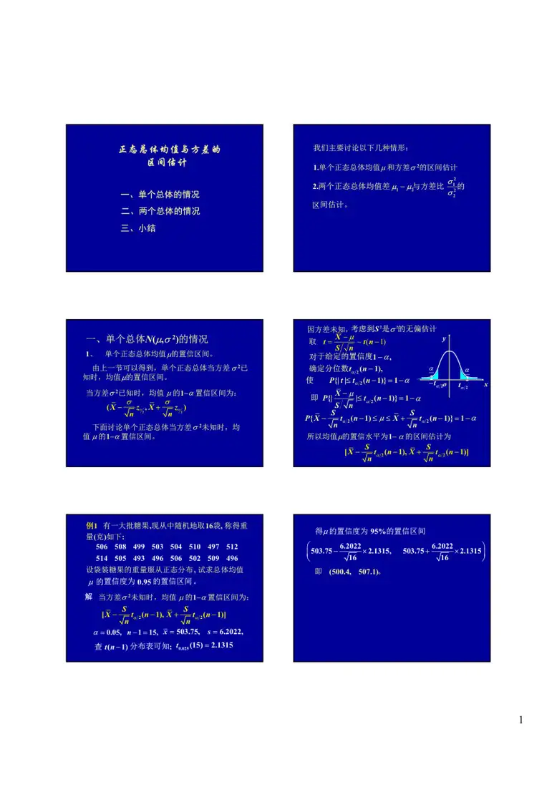
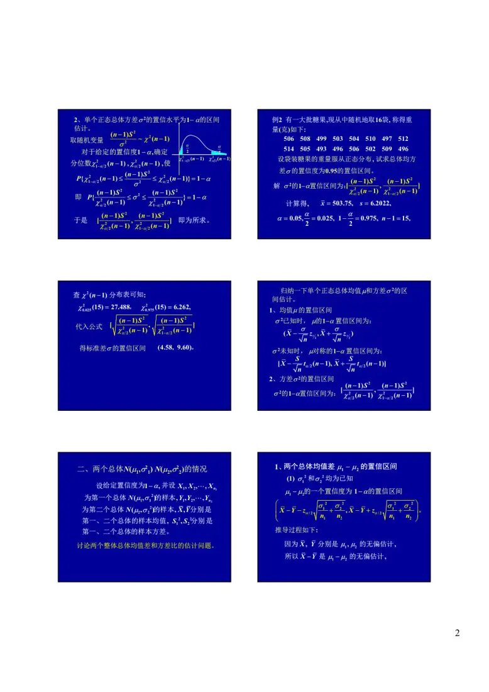
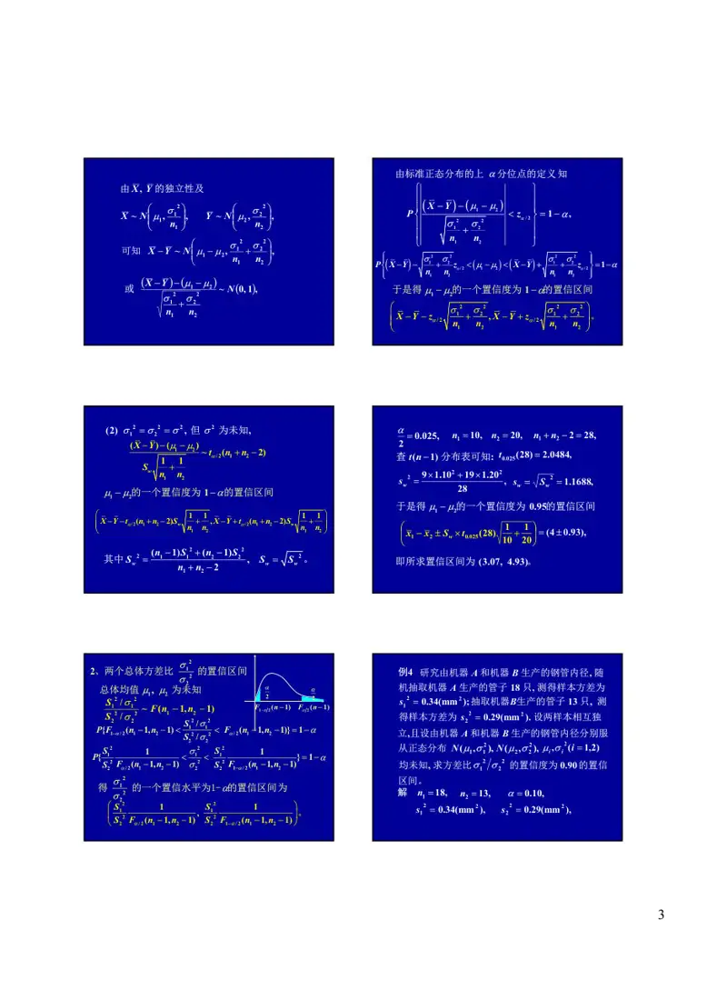
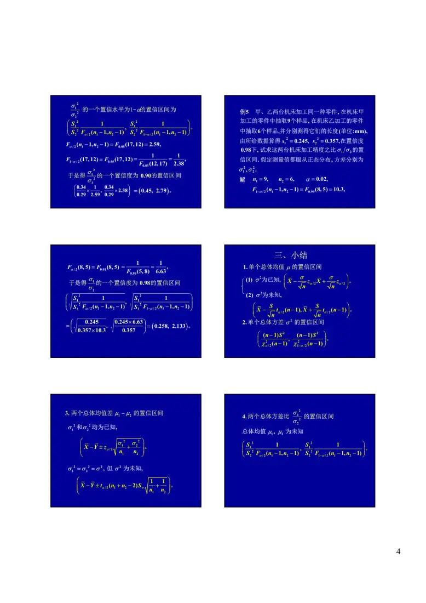
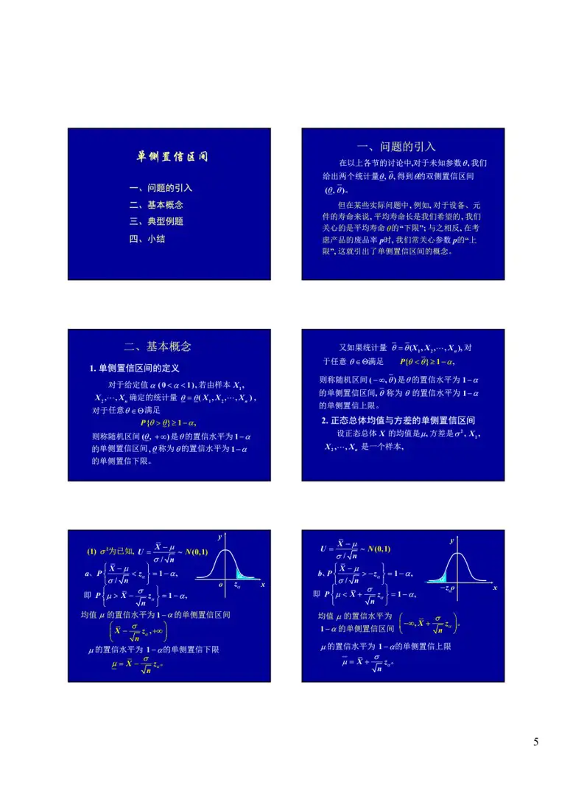
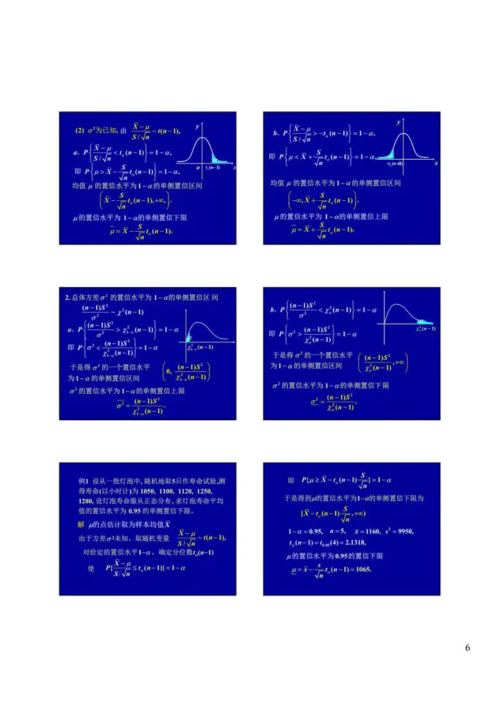

# 《概率论与数理统计》第七章 正态总体均值与方差的区间估计（课件）

原件的每一页，下面附识别出的文字。

### 正态总体均值与方差的区间估计

原文：

正态总体均值与方差的区间估计

一、单个总体的情况

二、两个总体的情况

三、小结

一、单个总体 $N(\mu,\sigma^{2})$ 的情况

1、单个正态总体均值 $\mu$ 的置信区间。

由上一节可以得到，单个正态总体当方差 $\sigma^2$ 已知时，均值 $\mu$ 的置信区间。

当方差 $\sigma^2$ 已知时，均值 $\mu$ 的 $1 - \alpha$ 置信区间为：

$$
(\bar {X} - \frac {\sigma}{\sqrt {n}} z _ {\alpha / 2}, \bar {X} + \frac {\sigma}{\sqrt {n}} z _ {\alpha / 2})
$$

下面讨论单个正态总体当方差 $\sigma^2$ 未知时，均值 $\mu$ 的 $1 - \alpha$ 置信区间。

例1 有一大批糖果,现从中随机地取16袋,称得重量(克)如下:

506 508 499 503 504 510 497 512

514 505 493 496 506 502 509 496

设袋装糖果的重量服从正态分布, 试求总体均值 $\mu$ 的置信度为 0.95 的置信区间。

解 当方差 $\sigma^2$ 未知时，均值 $\mu$ 的 $1 - \alpha$ 置信区间为：

$$
[ \bar {X} - \frac {S}{\sqrt {n}} t _ {\alpha / 2} (n - 1), \bar {X} + \frac {S}{\sqrt {n}} t _ {\alpha / 2} (n - 1) ]
$$

$$
\alpha = 0. 0 5, n - 1 = 1 5, \overline {{x}} = 5 0 3. 7 5, s = 6. 2 0 2 2,
$$

查 $t(n - 1)$ 分布表可知： $t_{0.025}(15) = 2.1315$

我们主要讨论以下几种情形：

1.单个正态总体均值 $\mu$ 和方差 $\sigma^2$ 的区间估计

2.两个正态总体均值差 $\mu_{1} - \mu_{2}$ 与方差比 $\frac{\sigma_1^2}{\sigma_2^2}$ 的

区间估计。

因方差未知，考虑到 $S^2$ 是 $\sigma^2$ 的无偏估计

取 $t = \frac{X - \mu}{S / \sqrt{n}}\sim t(n - 1)$

对于给定的置信度 $1 - \alpha$

确定分位数 $t_{\alpha/2}(n-1)$ ,

$$
P \{| t | \leq t _ {\alpha / 2} (n - 1) \} = 1 - \alpha
$$

即 $P\{\left|\frac{\bar{X} - \mu}{S / \sqrt{n}}\right| \leq t_{\alpha / 2}(n - 1)\} = 1 - \alpha$

$$
P \{\bar {X} - \frac {S}{\sqrt {n}} t _ {\alpha / 2} (n - 1) \leq \mu \leq \bar {X} + \frac {S}{\sqrt {n}} t _ {\alpha / 2} (n - 1) \} = 1 - \alpha
$$

所以均值 $\mu$ 的置信水平为 $1 - \alpha$ 的区间估计为

$$
[ \bar {X} - \frac {S}{\sqrt {n}} t _ {\alpha / 2} (n - 1), \bar {X} + \frac {S}{\sqrt {n}} t _ {\alpha / 2} (n - 1) ]
$$

得 $\mu$ 的置信度为 $95\%$ 的置信区间

503.75 - $\frac{6.2022}{\sqrt{16}}$ × 2.1315, $503.75 + \frac{6.2022}{\sqrt{16}}$ × 2.1315

即 (500.4, 507.1)。

1

### 查 $\chi^2 (n - 1)$ 分布表可知：

原文：

2、单个正态总体方差 $\sigma^2$ 的置信水平为 $1 - \alpha$ 的区间估计。取随机变量 $\frac{(n - 1)S^2}{\sigma^2}\sim \chi^2 (n - 1)$ 对于给定的置信度 $1 - \alpha$ ，确定分位数 $\chi_{1 - \alpha /2}^2 (n - 1),\chi_{\alpha /2}^2 (n - 1)$ ，使 $P\{\chi_{1 - \alpha /2}^{2}(n - 1)\leq \frac{(n - 1)S^{2}}{\sigma^{2}}\leq \chi_{\alpha /2}^{2}(n - 1)\} = 1 - \alpha$ 即 $P\{\frac{(n - 1)S^2}{\chi_{\alpha /2}^2(n - 1)}\leq \sigma^2\leq \frac{(n - 1)S^2}{\chi_{1 - \alpha /2}^2(n - 1)}\} = 1 - \alpha$ 于是 $[\frac{(n - 1)S^2}{\chi_{\alpha /2}^2(n - 1)},\frac{(n - 1)S^2}{\chi_{1 - \alpha /2}^2(n - 1)}]$ 即为所求。

查 $\chi^2 (n - 1)$ 分布表可知：

$\chi^{2}_{0.025}(15) = 27.488,\quad \chi^{2}_{0.975}(15) = 6.262,$

代入公式 $\left[\sqrt{\frac{(n-1)S^{2}}{\chi_{\alpha/2}^{2}(n-1)}},\sqrt{\frac{(n-1)S^{2}}{\chi_{1-\alpha/2}^{2}(n-1)}}\right]$

得标准差 $\sigma$ 的置信区间 (4.58, 9.60)。

二、两个总体 $N(\mu_{1},\sigma_{1}^{2})N(\mu_{2},\sigma_{2}^{2})$ 的情况

设给定置信度为 $1-\alpha$ ，并设 $X_{1},X_{2},\cdots,X_{n_{1}}$ 为第一个总体 $N(\mu_{1},\sigma_{1}^{2})$ 的样本， $Y_{1},Y_{2},\cdots,Y_{n_{2}}$ 为第二个总体 $N(\mu_{2},\sigma_{2}^{2})$ 的样本， $\bar{X},\bar{Y}$ 分别是第一、二个总体的样本均值， $S_{1}^{2},S_{2}^{2}$ 分别是第一、二个总体的样本方差。

讨论两个整体总体均值差和方差比的估计问题。

例2 有一大批糖果,现从中随机地取16袋,称得重量(克)如下:
506 508 499 503 504 510 497 512
514 505 493 496 506 502 509 496
设袋装糖果的重量服从正态分布,试求总体均方差σ的置信度为0.95的置信区间。
解 σ²的1-α置信区间为: $\left[\frac{(n-1)S^2}{\chi_{\alpha/2}^2(n-1)},\frac{(n-1)S^2}{\chi_{1-\alpha/2}^2(n-1)}\right]$ 计算得， $\bar{x}=503.75,\quad s=6.2022,$ $\alpha=0.05,\frac{\alpha}{2}=0.025,\quad1-\frac{\alpha}{2}=0.975,\quad n-1=15,$

归纳一下单个正态总体均值 $\mu$ 和方差 $\sigma^2$ 的区间估计。

1、均值 $\mu$ 的置信区间

$\sigma^2$ 已知时， $\mu$ 的 $1 - \alpha$ 置信区间为：

$$
(\bar {X} - \frac {\sigma}{\sqrt {n}} z _ {\alpha / 2}, \bar {X} + \frac {\sigma}{\sqrt {n}} z _ {\alpha / 2})
$$

$\sigma^2$ 未知时， $\mu$ 对称的 $1 - \alpha$ 置信区间为：

$$
[ \bar {X} - \frac {S}{\sqrt {n}} t _ {\alpha / 2} (n - 1), \bar {X} + \frac {S}{\sqrt {n}} t _ {\alpha / 2} (n - 1) ]
$$

2、方差 $\sigma^2$ 的置信区间 $\sigma^2$ 的 $1 - \alpha$ 置信区间为： $\left[\frac{(n - 1)S^2}{\chi_{\alpha / 2}^2(n - 1)},\frac{(n - 1)S^2}{\chi_{1 - \alpha /2}^2(n - 1)}\right]$

1、两个总体均值差 $\mu_{1}-\mu_{2}$ 的置信区间
(1) $\sigma_{1}^{2}$ 和 $\sigma_{2}^{2}$ 均为已知 $\mu_{1}-\mu_{2}$ 的一个置信度为 $1-\alpha$ 的置信区间

$$
\left(\bar {X} - \bar {Y} - z _ {\alpha / 2} \sqrt {\frac {\sigma_ {1} ^ {2}}{n _ {1}} + \frac {\sigma_ {2} ^ {2}}{n _ {2}}}, \bar {X} - \bar {Y} + z _ {\alpha / 2} \sqrt {\frac {\sigma_ {1} ^ {2}}{n _ {1}} + \frac {\sigma_ {2} ^ {2}}{n _ {2}}}\right) 。
$$

推导过程如下:

因为 $\bar{X},\bar{Y}$ 分别是 $\mu_1,\mu_2$ 的无偏估计，所以 $\bar{X} -\bar{Y}$ 是 $\mu_{1} - \mu_{2}$ 的无偏估计，由 $X, Y$ 的独立性及

2

### $$

原文：

可知 $\overline{X} -\overline{Y}\sim N\left(\mu_{1} - \mu_{2},\frac{\sigma_{1}^{2}}{n_{1}} +\frac{\sigma_{2}^{2}}{n_{2}}\right),$

$$
\text {或} \frac {\left(\overline {{{X}}} - \overline {{{Y}}}\right) - \left(\mu_ {1} - \mu_ {2}\right)}{\sqrt {\frac {\sigma_ {1} ^ {2}}{n _ {1}} + \frac {\sigma_ {2} ^ {2}}{n _ {2}}}} \sim N (0, 1),
$$

(2) $\sigma_{1}^{2} = \sigma_{2}^{2} = \sigma^{2}$ , 但 $\sigma^{2}$ 为未知, $\frac{(\bar{X} - \bar{Y}) - (\mu_{1} - \mu_{2})}{S_{w}\sqrt{\frac{1}{n_{1}} + \frac{1}{n_{2}}}} \sim t_{\alpha / 2}(n_{1} + n_{2} - 2)$ $\mu_{1} - \mu_{2}$ 的一个置信度为 $1 - \alpha$ 的置信区间 $\left(\bar{X} - \bar{Y} - t_{\alpha / 2}(n_{1} + n_{2} - 2)S_{w}\sqrt{\frac{1}{n_{1}} + \frac{1}{n_{2}}}, \bar{X} - \bar{Y} + t_{\alpha / 2}(n_{1} + n_{2} - 2)S_{w}\sqrt{\frac{1}{n_{1}} + \frac{1}{n_{2}}}\right)$ 其中 $S_{w}^{2} = \frac{(n_{1} - 1)S_{1}^{2} + (n_{2} - 1)S_{2}^{2}}{n_{1} + n_{2} - 2}, S_{w} = \sqrt{S_{w}^{2}}$ 。

2、两个总体方差比 $\frac{\sigma_1^2}{\sigma_2^2}$ 的置信区间总体均值 $\mu_1, \mu_2$ 为未知 $\frac{S_1^2 / \sigma_1^2}{S_2^2 / \sigma_2^2} \sim F(n_1 - 1, n_2 - 1)$ $P\{F_{1-\alpha/2}(n_1 - 1, n_2 - 1) < \frac{S_1^2 / \sigma_1^2}{S_2^2 / \sigma_2^2} < F_{\alpha/2}(n_1 - 1, n_2 - 1)\} = 1 - \alpha$ $P\{\frac{S_1^2}{S_2^2} \frac{1}{F_{\alpha/2}(n_1 - 1, n_2 - 1)} < \frac{\sigma_1^2}{\sigma_2^2} < \frac{S_1^2}{S_2^2} \frac{1}{F_{1-\alpha/2}(n_1 - 1, n_2 - 1)}\} = 1 - \alpha$ 得 $\frac{\sigma_1^2}{\sigma_2^2}$ 的一个置信水平为 $1 - \alpha$ 的置信区间为 $\left(\frac{S_1^2}{S_2^2} \frac{1}{F_{\alpha/2}(n_1 - 1, n_2 - 1)}, \frac{S_1^2}{S_2^2} \frac{1}{F_{1-\alpha/2}(n_1 - 1, n_2 - 1)}\right)$ .

由标准正态分布的上 $\alpha$ 分位点的定义知 $P\left\{\frac{\left(\bar{X} - \bar{Y}\right) - \left(\mu_1 - \mu_2\right)}{\sqrt{\frac{\sigma_1^2}{n_1} + \frac{\sigma_2^2}{n_2}}}\right| <   z_{\alpha /2}\Bigg\} = 1 - \alpha ,$ $P\left\{\left(\bar{X} -\bar{Y}\right) - \sqrt{\frac{\sigma_1^2}{n_1} + \frac{\sigma_2^2}{n_2}} z_{\alpha /2} <   (\mu_1 - \mu_2) <   (\bar{X} -\bar{Y}) + \sqrt{\frac{\sigma_1^2}{n_1} + \frac{\sigma_2^2}{n_2}} z_{\alpha /2}\right\} = 1 - \alpha$ 于是得 $\mu_1 - \mu_2$ 的一个置信度为 $1 - \alpha$ 的置信区间 $\left(\bar{X} -\bar{Y} -z_{\alpha /2}\sqrt{\frac{\sigma_1^2}{n_1} + \frac{\sigma_2^2}{n_2}},\bar{X} -\bar{Y} +z_{\alpha /2}\sqrt{\frac{\sigma_1^2}{n_1} + \frac{\sigma_2^2}{n_2}}\right).$

$\frac{\alpha}{2}=0.025,\quad n_{1}=10,\quad n_{2}=20,\quad n_{1}+n_{2}-2=28,$ 查 $t(n-1)$ 分布表可知： $t_{0.025}(28)=2.0484,$ $s_{w}^{2}=\frac{9\times1.10^{2}+19\times1.20^{2}}{28},\quad s_{w}=\sqrt{S_{w}^{2}}=1.1688,$ 于是得 $\mu_{1}-\mu_{2}$ 的一个置信度为 0.95 的置信区间 $\left(\bar{x}_{1}-\bar{x}_{2}\pm S_{w}\times t_{0.025}(28)\sqrt{\frac{1}{10}+\frac{1}{20}}\right)=(4\pm0.93),$ 即所求置信区间为(3.07,4.93)。

例4 研究由机器 A 和机器 B 生产的钢管内径, 随机抽取机器 A 生产的管子 18 只, 测得样本方差为 $s_{1}^{2}=0.34(\mathrm{mm}^{2})$ ; 抽取机器 B 生产的管子 13 只, 测得样本方差为 $s_{2}^{2}=0.29(\mathrm{mm}^{2})$ . 设两样本相互独立, 且设由机器 A 和机器 B 生产的钢管内径分别服从正态分布 $N(\mu_{1},\sigma_{1}^{2}), N(\mu_{2},\sigma_{2}^{2}), \mu_{i}, \sigma_{i}^{2}(i=1,2)$ 均未知, 求方差比 $\sigma_{1}^{2}/\sigma_{2}^{2}$ 的置信度为 0.90 的置信区间。
解 $n_{1}=18,\quad n_{2}=13,\quad \alpha=0.10,$ $s_{1}^{2}=0.34(\mathrm{mm}^{2}),\quad s_{2}^{2}=0.29(\mathrm{mm}^{2}),$

3

### 的一个置信水平为 $1 - \alpha$ 的置信区间为

原文：

的一个置信水平为 $1 - \alpha$ 的置信区间为

$$
\left(\frac {S _ {1} ^ {2}}{S _ {2} ^ {2}} \frac {1}{F _ {\alpha / 2} (n _ {1} - 1 , n _ {2} - 1)}, \frac {S _ {1} ^ {2}}{S _ {2} ^ {2}} \frac {1}{F _ {1 - \alpha / 2} (n _ {1} - 1 , n _ {2} - 1)}\right) 。
$$

$$
F _ {\alpha / 2} (n _ {1} - 1, n _ {2} - 1) = F _ {0. 0 5} (1 7, 1 2) = 2. 5 9,
$$

$$
F _ {1 - \alpha / 2} (1 7, 1 2) = F _ {0. 9 5} (1 7, 1 2) = \frac {1}{F _ {0 . 0 5} (1 2 , 1 7)} = \frac {1}{2 . 3 8},
$$

于是得 $\frac{\sigma_1^2}{\sigma_2^2}$ 的一个置信度为0.90的置信区间

$$
\left(\frac {0 . 3 4}{0 . 2 9} \times \frac {1}{2 . 5 9}, \frac {0 . 3 4}{0 . 2 9} \times 2. 3 8\right) = (0. 4 5, 2. 7 9) 。
$$

$$
F _ {\alpha / 2} (8, 5) = F _ {0. 0 1} (8, 5) = \frac {1}{F _ {0 . 9 9} (5 , 8)} = \frac {1}{6 . 6 3},
$$

于是得 $\frac{\sigma_1}{\sigma_2}$ 的一个置信度为0.98的置信区间

$$
\left(\sqrt {\frac {S _ {1} ^ {2}}{S _ {2} ^ {2}} \frac {1}{F _ {\alpha / 2} (n _ {1} - 1 , n _ {2} - 1)}}, \sqrt {\frac {S _ {1} ^ {2}}{S _ {2} ^ {2}} \frac {1}{F _ {1 - \alpha / 2} (n _ {1} - 1 , n _ {2} - 1)}}\right)
$$

$\left(\sqrt{\frac{0.245}{0.357 \times 10.3}}, \sqrt{\frac{0.245 \times 6.63}{0.357}}\right) = (0.258, 2.133)$ 。

3. 两个总体均值差 $\mu_{1} - \mu_{2}$ 的置信区间 $\sigma_{1}^{2}$ 和 $\sigma_{2}^{2}$ 均为已知，

$$
\left(\bar {X} - \bar {Y} \pm z _ {\alpha / 2} \sqrt {\frac {\sigma_ {1} ^ {2}}{n _ {1}} + \frac {\sigma_ {2} ^ {2}}{n _ {2}}}\right) 。
$$

$\sigma_{1}^{2} = \sigma_{2}^{2} = \sigma^{2}$ ，但 $\sigma^2$ 为未知，

$$
\left(\bar {X} - \bar {Y} \pm t _ {\alpha / 2} \left(n _ {1} + n _ {2} - 2\right) S _ {w} \sqrt {\frac {1}{n _ {1}} + \frac {1}{n _ {2}}}\right) 。
$$

例5 甲、乙两台机床加工同一种零件，在机床甲加工的零件中抽取9个样品，在机床乙加工的零件中抽取6个样品，并分别测得它们的长度(单位：mm)，由所给数据算得 $s_1^2 = 0.245$ ， $s_2^2 = 0.357$ ，在置信度0.98下，试求这两台机床加工精度之比 $\sigma_1 / \sigma_2$ 的置信区间。假定测量值都服从正态分布，方差分别为 $\sigma_1^2, \sigma_2^2$ 。

解 $n_1 = 9, \quad n_2 = 6, \quad \alpha = 0.02,$

$$
F _ {1 - \alpha / 2} (n _ {1} - 1, n _ {2} - 1) = F _ {0. 9 9} (8, 5) = 1 0. 3,
$$

三、小结

1. 单个总体均值 $\mu$ 的置信区间

(1) $\sigma^2$ 为已知,

$$
\left(\bar {X} - \frac {\sigma}{\sqrt {n}} z _ {\alpha / 2} \bar {X} + \frac {\sigma}{\sqrt {n}} z _ {\alpha / 2}\right) 。
$$

(2) $\sigma^2$ 为未知，

$$
\left(\bar {X} - \frac {S}{\sqrt {n}} t _ {\alpha / 2} (n - 1), \bar {X} + \frac {S}{\sqrt {n}} t _ {\alpha / 2} (n - 1)\right) 。
$$

2. 单个总体方差 $\sigma^2$ 的置信区间

$$
\left(\frac {(n - 1) S ^ {2}}{\chi_ {\alpha / 2} ^ {2} (n - 1)}, \frac {(n - 1) S ^ {2}}{\chi_ {1 - \alpha / 2} ^ {2} (n - 1)}\right) 。
$$

4. 两个总体方差比 $\frac{\sigma_1^2}{\sigma_2^2}$ 的置信区间

总体均值 $\mu_{1},\mu_{2}$ 为未知

$$
\left(\frac {S _ {1} ^ {2}}{S _ {2} ^ {2}} \frac {1}{F _ {\alpha / 2} (n _ {1} - 1 , n _ {2} - 1)}, \frac {S _ {1} ^ {2}}{S _ {2} ^ {2}} \frac {1}{F _ {1 - \alpha / 2} (n _ {1} - 1 , n _ {2} - 1)}\right) 。
$$

4

### 单侧置信区间

原文：

单侧置信区间

一、问题的引入

二、基本概念

三、典型例题

四、小结

二、基本概念

1. 单侧置信区间的定义

对于给定值 $\alpha(0<\alpha<1)$ ，若由样本 $X_{1}, X_{2}, \cdots, X_{n}$ 确定的统计量 $\underline{\theta}=\underline{\theta}(X_{1},X_{2},\cdots,X_{n})$ ，对于任意 $\theta\in\Theta$ 满足

$$
P \{\theta > \underline {{\theta}} \} \geq 1 - \alpha ,
$$

则称随机区间 $(\underline{\theta}, +\infty)$ 是 $\theta$ 的置信水平为 $1 - \alpha$ 的单侧置信区间， $\underline{\theta}$ 称为 $\theta$ 的置信水平为 $1 - \alpha$ 的单侧置信下限。

(1) $\sigma^2$ 为已知, $U = \frac{\bar{X} - \mu}{\sigma / \sqrt{n}} \sim N(0,1)$

a、 $P\left\{\frac{\bar{X} - \mu}{\sigma / \sqrt{n}} < z_{\alpha}\right\} = 1 - \alpha ,$

即 $P\left\{\mu >\bar{X} -\frac{\sigma}{\sqrt{n}} z_{\alpha}\right\} = 1 - \alpha ,$

均值 $\mu$ 的置信水平为 $1 - \alpha$ 的单侧置信区间

$$
\left(\bar {X} - \frac {\sigma}{\sqrt {n}} z _ {\alpha}, + \infty\right)
$$

$\mu$ 的置信水平为 $1 - \alpha$ 的单侧置信下限

$$
\underline {{\mu}} = \bar {X} - \frac {\sigma}{\sqrt {n}} z _ {\alpha^ {\circ}}
$$

一、问题的引入

在以上各节的讨论中,对于未知参数 $\theta$ , 我们给出两个统计量 $\theta, \overline{\theta}$ , 得到 $\theta$ 的双侧置信区间 $(\underline{\theta}, \overline{\theta})$ 。

但在某些实际问题中, 例如, 对于设备、元件的寿命来说, 平均寿命长是我们希望的, 我们关心的是平均寿命 $\theta$ 的“下限”; 与之相反, 在考虑产品的废品率 $p$ 时, 我们常关心参数 $p$ 的“上限”, 这就引出了单侧置信区间的概念。

又如果统计量 $\bar{\theta}=\bar{\theta}(X_{1},X_{2},\cdots,X_{n})$ ，对于任意 $\theta\in\Theta$ 满足 $P\{\theta<\bar{\theta}\}\geq1-\alpha,$

则称随机区间 $(-\infty, \overline{\theta})$ 是 $\theta$ 的置信水平为 $1 - \alpha$ 的单侧置信区间， $\overline{\theta}$ 称为 $\theta$ 的置信水平为 $1 - \alpha$ 的单侧置信上限。

2. 正态总体均值与方差的单侧置信区间设正态总体 X 的均值是 $\mu$ ，方差是 $\sigma^{2}$ ， $X_{1}$ ， $X_{2}, \cdots, X_{n}$ 是一个样本，

$$
U = \frac {\bar {X} - \mu}{\sigma / \sqrt {n}} \sim N (0, 1)
$$

$$
b \setminus P \left\{\frac {\bar {X} - \mu}{\sigma / \sqrt {n}} > - z _ {\alpha} \right\} = 1 - \alpha ,
$$

即 $P\left\{\mu < \bar{X} + \frac{\sigma}{\sqrt{n}} z_{\alpha}\right\} = 1 - \alpha ,$

均值 $\mu$ 的置信水平为 $1 - \alpha$ 的单侧置信区间 $\left(-\infty, \bar{X} + \frac{\sigma}{\sqrt{n}} z_{\alpha}\right)$ 。

$\mu$ 的置信水平为 $1 - \alpha$ 的单侧置信上限

$$
\overline {{\mu}} = \bar {X} + \frac {\sigma}{\sqrt {n}} z _ {\alpha} \circ
$$

5

### $$

原文：

(2) $\sigma^2$ 为已知, 由 $\frac{\bar{X} - \mu}{S / \sqrt{n}} \sim t(n - 1)$ ,

$a, P\left\{\frac{\bar{X} - \mu}{S / \sqrt{n}} < t_{\alpha}(n - 1)\right\} = 1 - \alpha,$

$$
P \left\{\mu > \bar {X} - \frac {S}{\sqrt {n}} t _ {\alpha} (n - 1) \right\} = 1 - \alpha ,
$$

均值 $\mu$ 的置信水平为 $1 - \alpha$ 的单侧置信区间

$$
\left(\bar {X} - \frac {S}{\sqrt {n}} t _ {\alpha} (n - 1), + \infty ,\right) 。
$$

$\mu$ 的置信水平为 $1 - \alpha$ 的单侧置信下限

$$
\overline {{\mu}} = \bar {X} - \frac {S}{\sqrt {n}} t _ {\alpha} (n - 1) _ {\circ}
$$

2.总体方差 $\sigma^2$ 的置信水平为 $1 - \alpha$ 的单侧置信区间

$$
\frac {(n - 1) S ^ {2}}{\sigma^ {2}} \sim \chi^ {2} (n - 1)
$$

$$
P \left\{\frac {(n - 1) S ^ {2}}{\sigma^ {2}} > \chi_ {1 - \alpha} ^ {2} (n - 1) \right\} = 1 - \alpha
$$

即 $P\left\{\sigma^{2}<\frac{(n-1)S^{2}}{\chi_{1-\alpha}^{2}(n-1)}\right\}=1-\alpha$

于是得 $\sigma^2$ 的一个置信水平

为 $1 - \alpha$ 的单侧置信区间

$$
\chi_ {1 - \alpha} ^ {2} (n - 1)
$$

$$
\left(0, \frac {(n - 1) S ^ {2}}{\chi_ {1 - \alpha} ^ {2} (n - 1)}\right)
$$

$\sigma^2$ 的置信水平为 $1 - \alpha$ 的单侧置信上限 $\overline{\sigma^2} = \frac{(n - 1)S^2}{\chi_{1 - \alpha}^2(n - 1)}.$

例1 设从一批灯泡中, 随机地取5只作寿命试验, 测得寿命(以小时计)为 1050, 1100, 1120, 1250, 1280, 设灯泡寿命服从正态分布, 求灯泡寿命平均值的置信水平为 0.95 的单侧置信下限。

解 $\mu$ 的点估计取为样本均值 $\bar{X}$

由于方差 $\sigma^2$ 未知，取随机变量

$$
\frac {\bar {X} - \mu}{S / \sqrt {n}} \sim t (n - 1),
$$

对给定的置信水平 $1-\alpha$ ，确定分位数 $t_{\alpha}(n-1)$

使 $P\{\frac{\bar{X} - \mu}{S / \sqrt{n}}\leq t_{\alpha}(n - 1)\} = 1 - \alpha$

b、 $P\left\{\frac{\bar{X}-\mu}{S/\sqrt{n}}>-t_{\alpha}(n-1)\right\}=1-\alpha,$

即 $P\left\{\mu < \bar{X} + \frac{S}{\sqrt{n}} t_{\alpha}(n - 1)\right\} = 1 - \alpha,$

均值 $\mu$ 的置信水平为 $1 - \alpha$ 的单侧置信区间

$$
\left(- \infty , \bar {X} + \frac {S}{\sqrt {n}} t _ {\alpha} (n - 1)\right) 。
$$

$\mu$ 的置信水平为 $1 - \alpha$ 的单侧置信上限

$$
\overline {{\mu}} = \bar {X} + \frac {S}{\sqrt {n}} t _ {\alpha} (n - 1) _ {\circ}
$$

b、 $P\left\{\frac{(n - 1)S^2}{\sigma^2} < \chi_\alpha^2 (n - 1)\right\} = 1 - \alpha$

即 $P\left\{\sigma^2 >\frac{(n - 1)S^2}{\chi_\alpha^2(n - 1)}\right\} = 1 - \alpha$

$\chi_{\alpha}^{2}(n - 1)$

于是得 $\sigma^2$ 的一个置信水平为 $1 - \alpha$ 的单侧置信区间

$$
\left. \frac {(n - 1) S ^ {2}}{\chi_ {\alpha} ^ {2} (n - 1)}, + \infty\right)
$$

$\sigma^2$ 的置信水平为 $1 - \alpha$ 的单侧置信下限

$$
\underline {{\sigma^ {2}}} = \frac {(n - 1) S ^ {2}}{\chi_ {\alpha} ^ {2} (n - 1)} 。
$$

$$
P \{\mu \geq \bar {X} - t _ {\alpha} (n - 1) \frac {S}{\sqrt {n}} \} = 1 - \alpha
$$

于是得到 $\mu$ 的置信水平为 $1 - \alpha$ 的单侧置信下限为

$$
[ \bar {X} - t _ {\alpha} (n - 1) \frac {S}{\sqrt {n}}, + \infty)
$$

$$
1 - \alpha = 0. 9 5, \quad n = 5, \quad \overline {{x}} = 1 1 6 0, s ^ {2} = 9 9 5 0,
$$

$$
t _ {\alpha} (n - 1) = t _ {0. 0 5} (4) = 2. 1 3 1 8,
$$

$\mu$ 的置信水平为0.95的置信下限

$$
\underline {{\mu}} = \bar {x} - \frac {s}{\sqrt {n}} t _ {\alpha} (n - 1) = 1 0 6 5 。
$$

6
