# 《概率论与数理统计》第九章 随机过程引论（课件）

原件的每一页，下面附识别出的文字。

### 第九章 随机过程引论

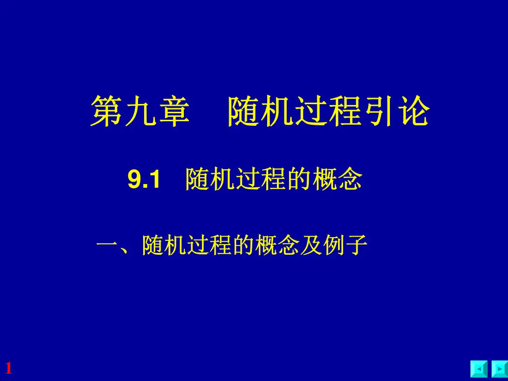

原文：

第九章 随机过程引论

9.1 随机过程的概念

一、随机过程的概念及例子

1

### 第 2 页

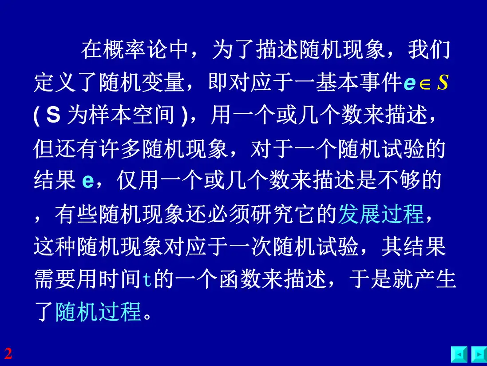

原文：

在概率论中，为了描述随机现象，我们定义了随机变量，即对应于一基本事件 $e \in S$ (S 为样本空间)，用一个或几个数来描述，但还有许多随机现象，对于一个随机试验的结果 e，仅用一个或几个数来描述是不够的，有些随机现象还必须研究它的发展过程，这种随机现象对应于一次随机试验，其结果需要用时间 t 的一个函数来描述，于是就产生了随机过程。

2

### 第 3 页

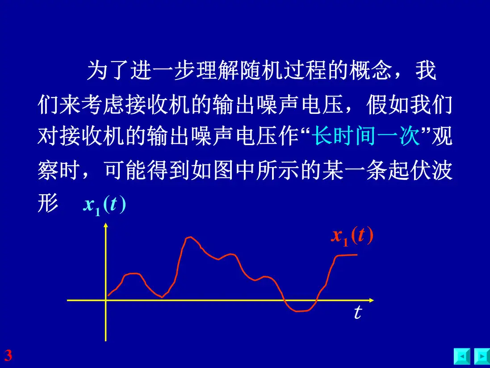

原文：

为了进一步理解随机过程的概念，我们来考虑接收机的输出噪声电压，假如我们对接收机的输出噪声电压作“长时间一次”观察时，可能得到如图中所示的某一条起伏波形 $x_{1}(t)$

3

### 第 4 页

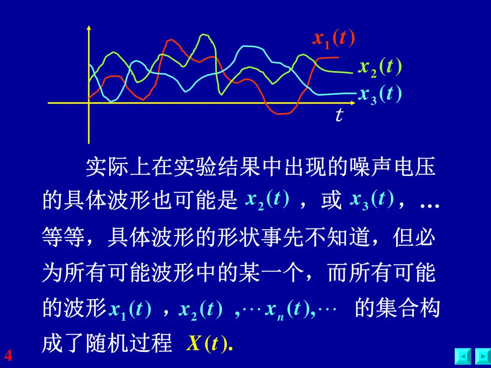

原文：

实际上在实验结果中出现的噪声电压的具体波形也可能是 $x_{2}(t)$ ，或 $x_{3}(t)$ ，…等等，具体波形的形状事先不知道，但必为所有可能波形中的某一个，而所有可能的波形 $x_{1}(t)$ ， $x_{2}(t)$ ，… $x_{n}(t)$ ，… 的集合构成了随机过程 $X(t)$ .

4

### 第 5 页

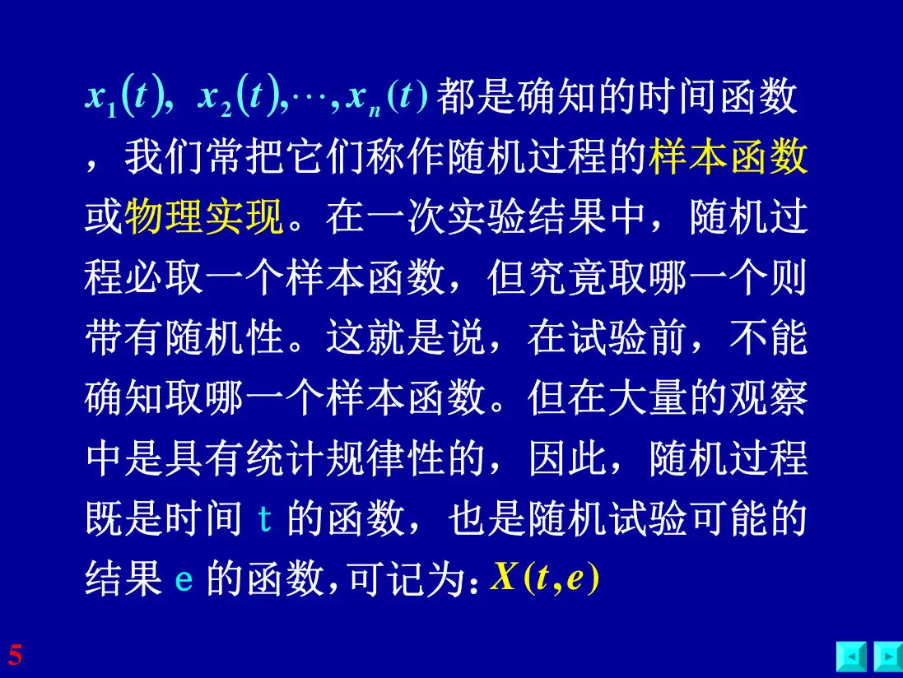

原文：

$x_{1}(t), x_{2}(t), \cdots, x_{n}(t)$ 都是确知的时间函数，我们常把它们称作随机过程的样本函数或物理实现。在一次实验结果中，随机过程必取一个样本函数，但究竟取哪一个则带有随机性。这就是说，在试验前，不能确知取哪一个样本函数。但在大量的观察中是具有统计规律性的，因此，随机过程既是时间 t 的函数，也是随机试验可能的结果 e 的函数，可记为： $X(t,e)$

5

### 类似于随机变量的定义，可给出随机过程的两个定义：

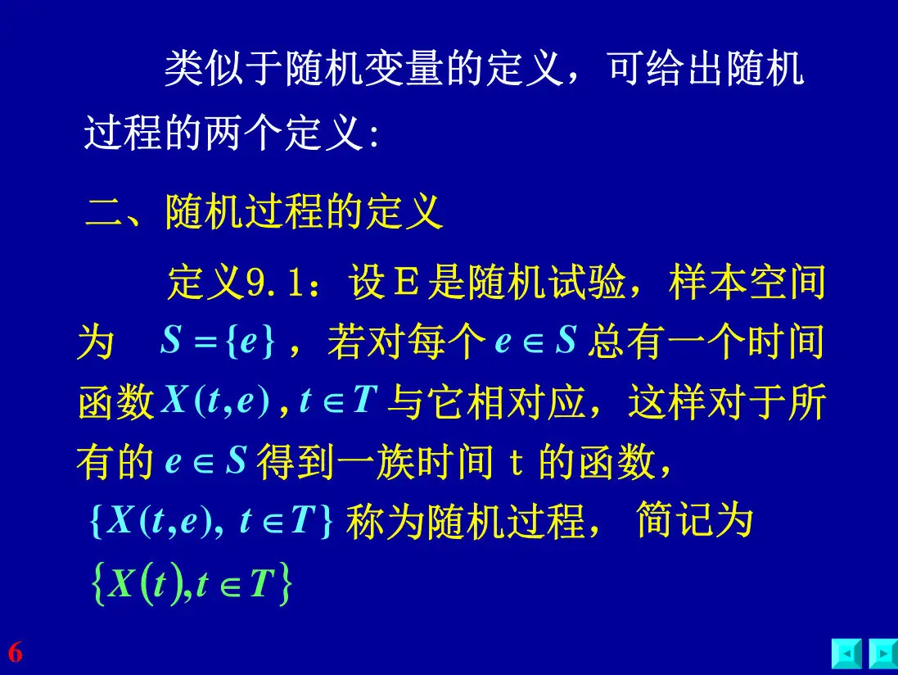

原文：

类似于随机变量的定义，可给出随机过程的两个定义：

二、随机过程的定义

定义9.1: 设 E 是随机试验, 样本空间为 $S = \{e\}$ , 若对每个 $e \in S$ 总有一个时间函数 $X(t, e)$ , $t \in T$ 与它相对应, 这样对于所有的 $e \in S$ 得到一族时间 $t$ 的函数, $\{X(t, e), t \in T\}$ 称为随机过程, 简记为 $\{X(t), t \in T\}$

6

### $X(t)$ 族中的每一个函数称为这个随机过程的样本函数或样本曲线。

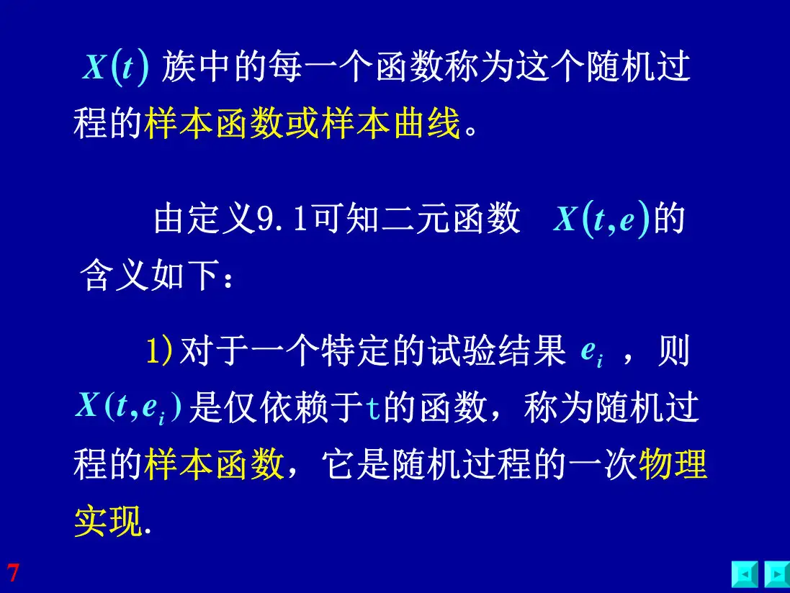

原文：

$X(t)$ 族中的每一个函数称为这个随机过程的样本函数或样本曲线。

由定义9.1可知二元函数 $X(t, e)$ 的含义如下:

1) 对于一个特定的试验结果 $e_{i}$ ，则 $X(t, e_{i})$ 是仅依赖于 t 的函数，称为随机过程的样本函数，它是随机过程的一次物理实现.

7

### 第 8 页

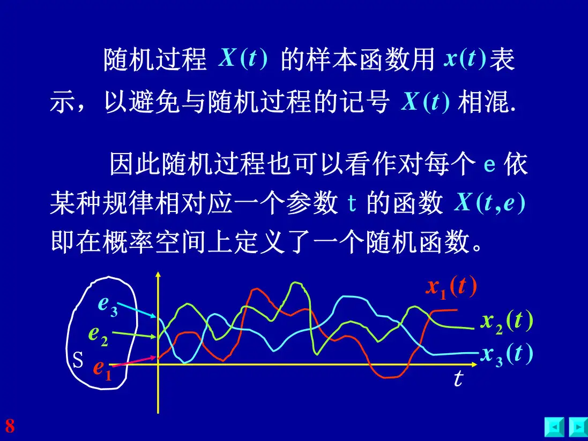

原文：

随机过程 $X(t)$ 的样本函数用 $x(t)$ 表示, 以避免与随机过程的记号 $X(t)$ 相混.

因此随机过程也可以看作对每个 e 依某种规律相对应一个参数 t 的函数 $X(t, e)$ 即在概率空间上定义了一个随机函数。

8

### 第 9 页

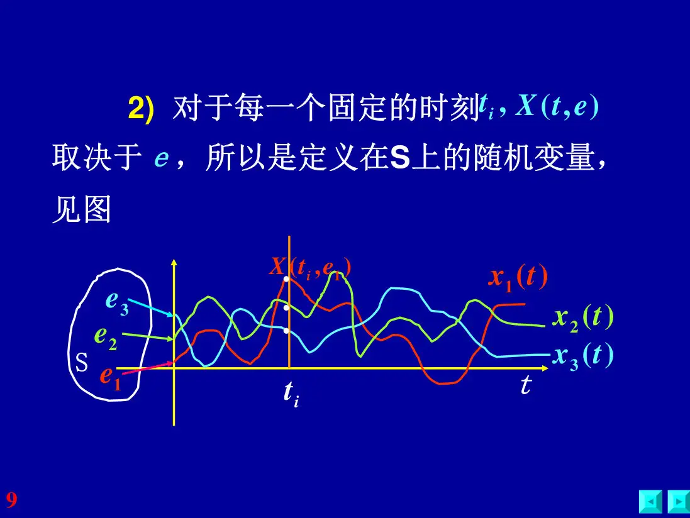

原文：

2) 对于每一个固定的时刻 $t_i, X(t, e)$ 取决于 $e$ ，所以是定义在 $\mathbf{S}$ 上的随机变量，见图

9

### 10

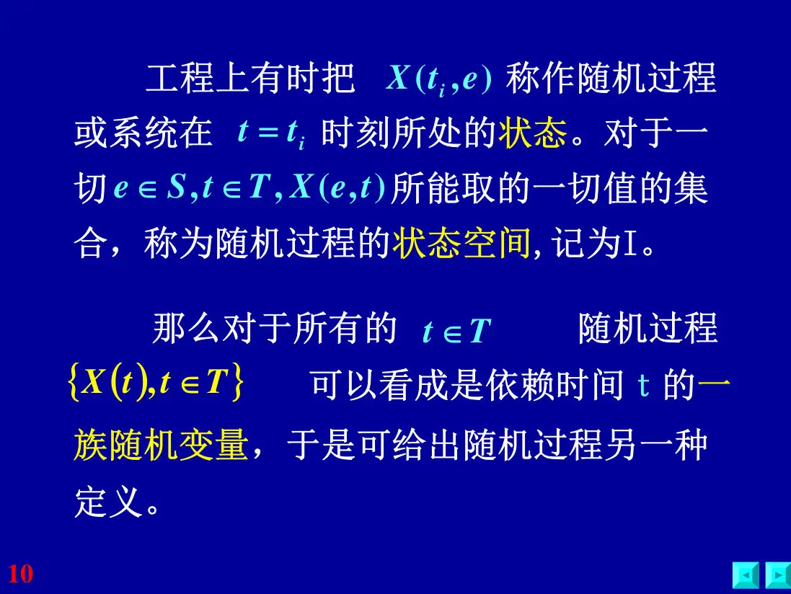

原文：

工程上有时把 $X(t_{i}, e)$ 称作随机过程或系统在 $t = t_{i}$ 时刻所处的状态。对于一切 $e \in S, t \in T, X(e, t)$ 所能取的一切值的集合，称为随机过程的状态空间，记为 I。

那么对于所有的 $t \in T$ 随机过程 $\{X(t), t \in T\}$ 可以看成是依赖时间 $t$ 的一族随机变量，于是可给出随机过程另一种定义。

10

### 称 $T$ 为时间参数集，称 $X(t)$ 为时刻 $t$ 时过程的状态，

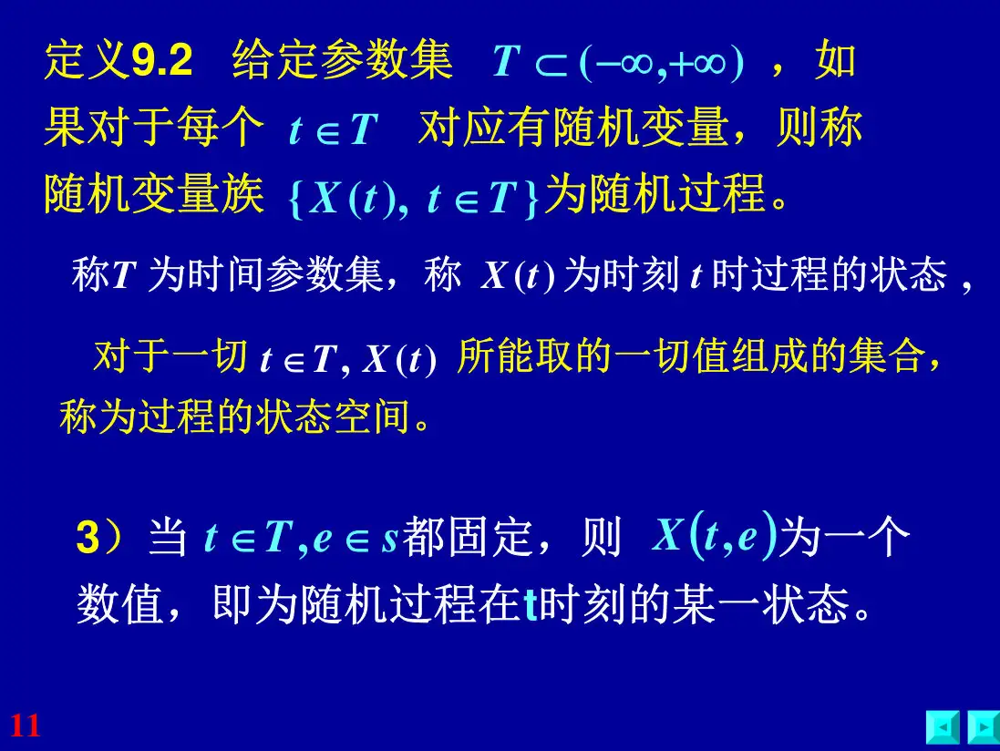

原文：

定义9.2 给定参数集 $T \subset (-\infty, +\infty)$ ，如果对于每个 $t \in T$ 对应有随机变量，则称随机变量族 $\{X(t), t \in T\}$ 为随机过程。

称 $T$ 为时间参数集，称 $X(t)$ 为时刻 $t$ 时过程的状态，

对于一切 $t \in T, X(t)$ 所能取的一切值组成的集合，称为过程的状态空间。

3) 当 $t \in T, e \in s$ 都固定，则 $X(t, e)$ 为一个数值，即为随机过程在 $\mathbf{t}$ 时刻的某一状态。

11

### 三、随机过程的分类随机过程可以根据其状态空间和参数集的连续或离散进行分类

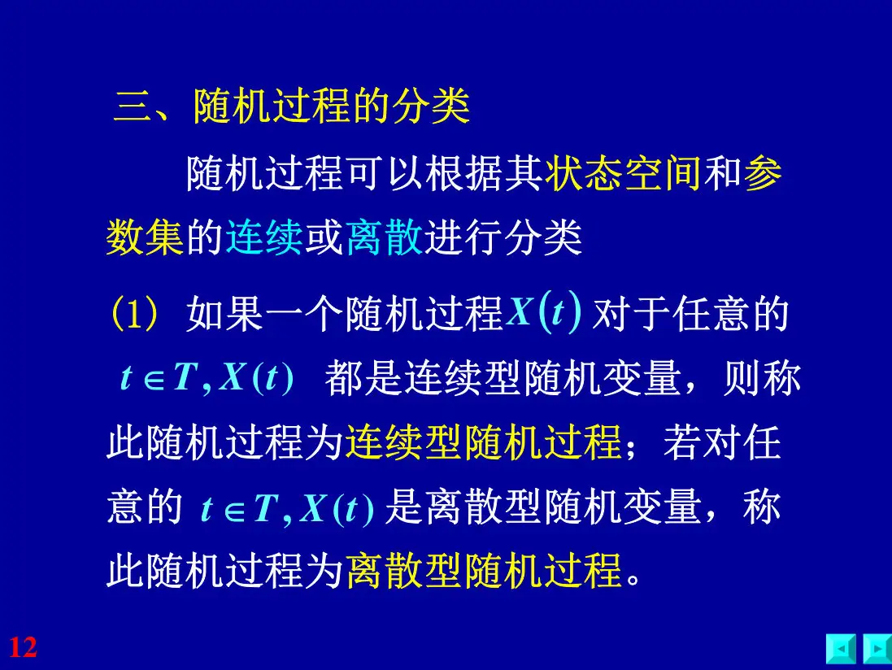

原文：

三、随机过程的分类随机过程可以根据其状态空间和参数集的连续或离散进行分类

(1) 如果一个随机过程 $X(t)$ 对于任意的 $t \in T, X(t)$ 都是连续型随机变量，则称此随机过程为连续型随机过程；若对任意的 $t \in T, X(t)$ 是离散型随机变量，称此随机过程为离散型随机过程。

12

### 13

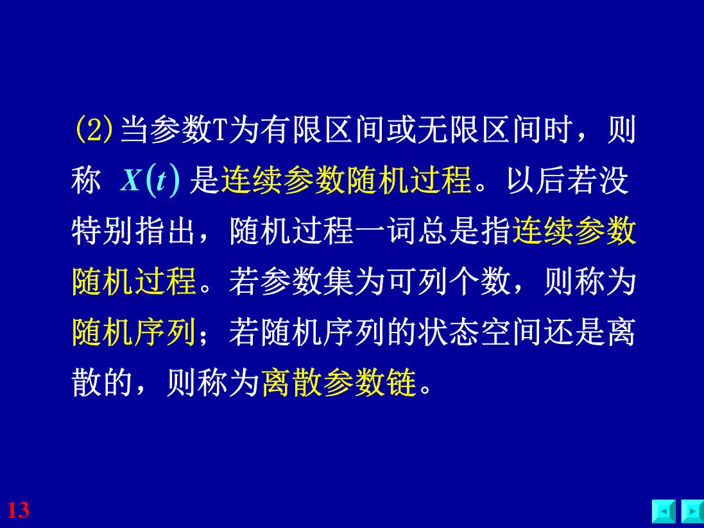

原文：

(2) 当参数T为有限区间或无限区间时, 则称 $X(t)$ 是连续参数随机过程。以后若没特别指出, 随机过程一词总是指连续参数随机过程。若参数集为可列个数, 则称为随机序列; 若随机序列的状态空间还是离散的, 则称为离散参数链。

13

### 参数集

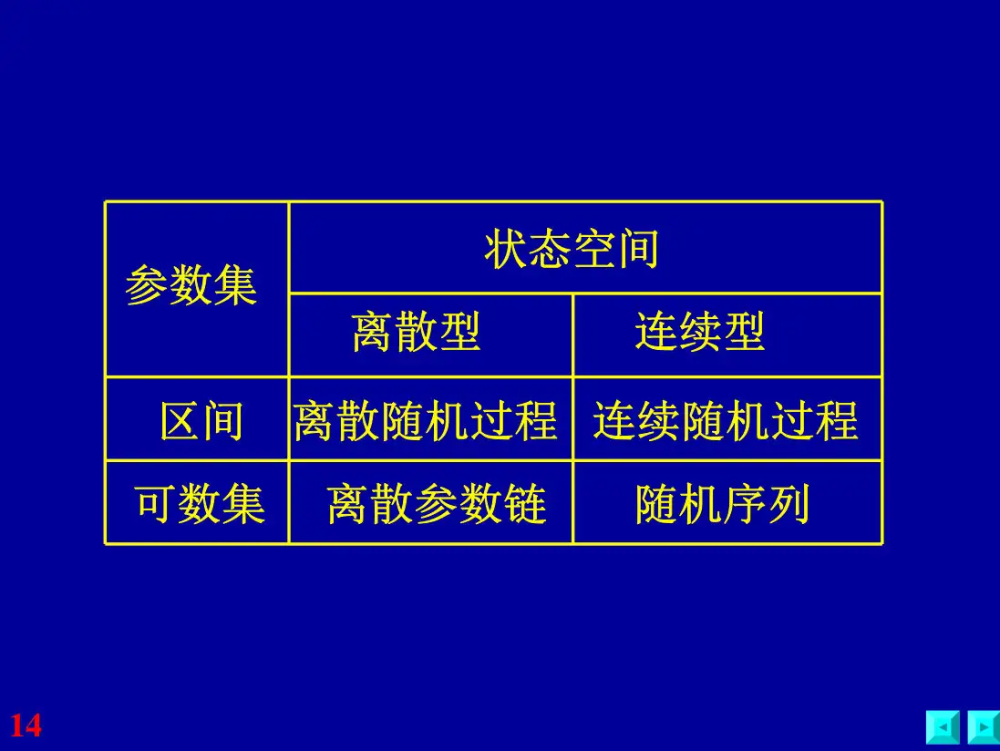

原文：

参数集

区间

可数集

状态空间

离散型

离散随机过程

离散参数链

连续型

连续随机过程

随机序列

14

### 四、随机过程的例子

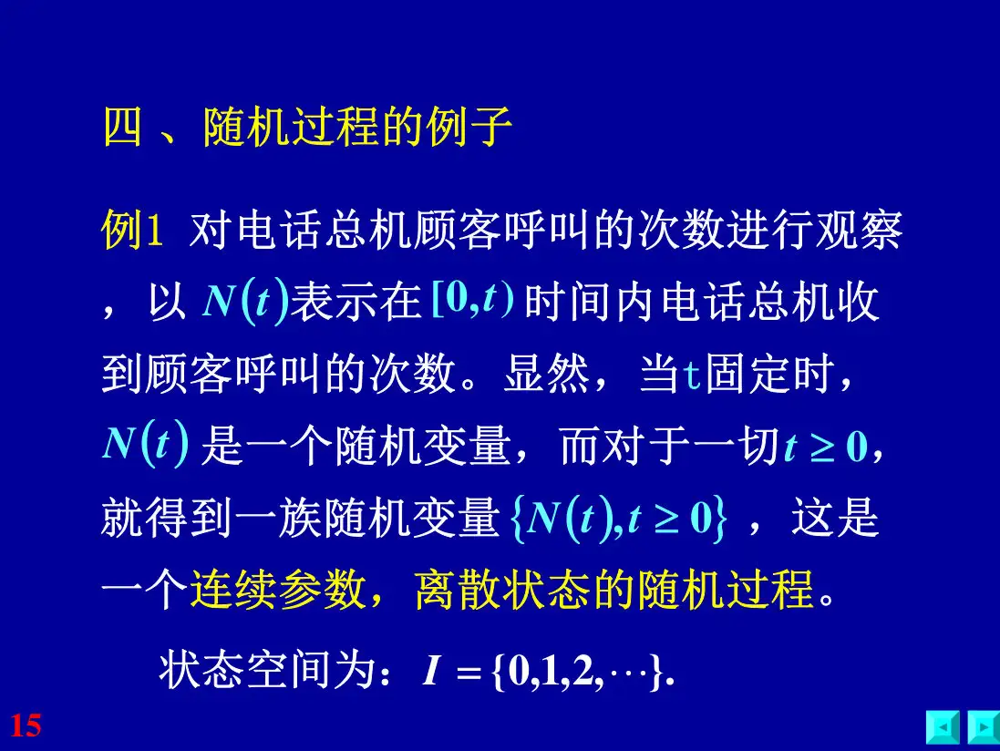

原文：

四、随机过程的例子

例1 对电话总机顾客呼叫的次数进行观察，以 $N(t)$ 表示在 $[0, t)$ 时间内电话总机收到顾客呼叫的次数。显然，当t固定时， $N(t)$ 是一个随机变量，而对于一切 $t \geq 0$ ，就得到一族随机变量 $\{N(t), t \geq 0\}$ ，这是一个连续参数，离散状态的随机过程。

状态空间为： $I=\{0,1,2,\cdots\}$ .

15

### 16

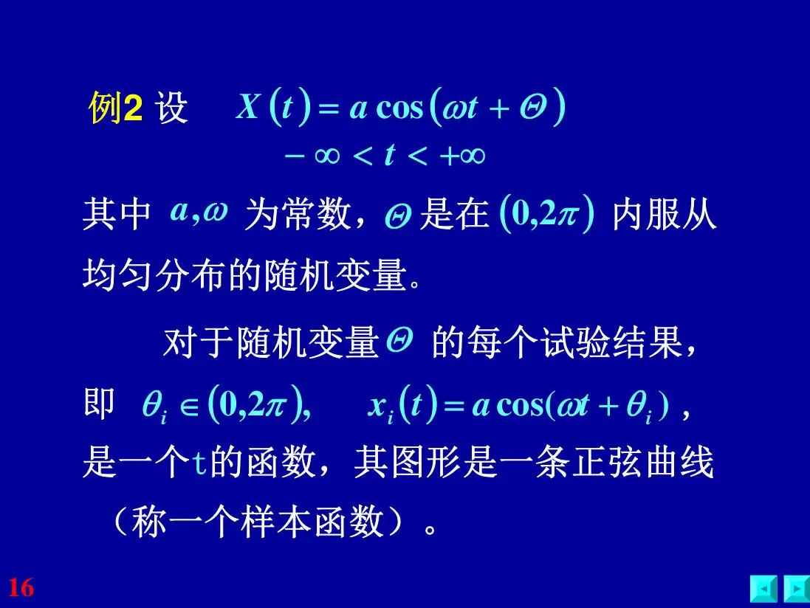

原文：

例2 设 $X(t) = a \cos (\omega t + \Theta)$ $-\infty < t < +\infty$

其中 $a, \omega$ 为常数， $\Theta$ 是在 $(0,2\pi)$ 内服从均匀分布的随机变量。

对于随机变量 $\Theta$ 的每个试验结果，即 $\theta_{i} \in (0,2\pi)$ ， $x_{i}(t) = a \cos(\omega t + \theta_{i})$ ，是一个 $t$ 的函数，其图形是一条正弦曲线（称一个样本函数）。

16

### 17

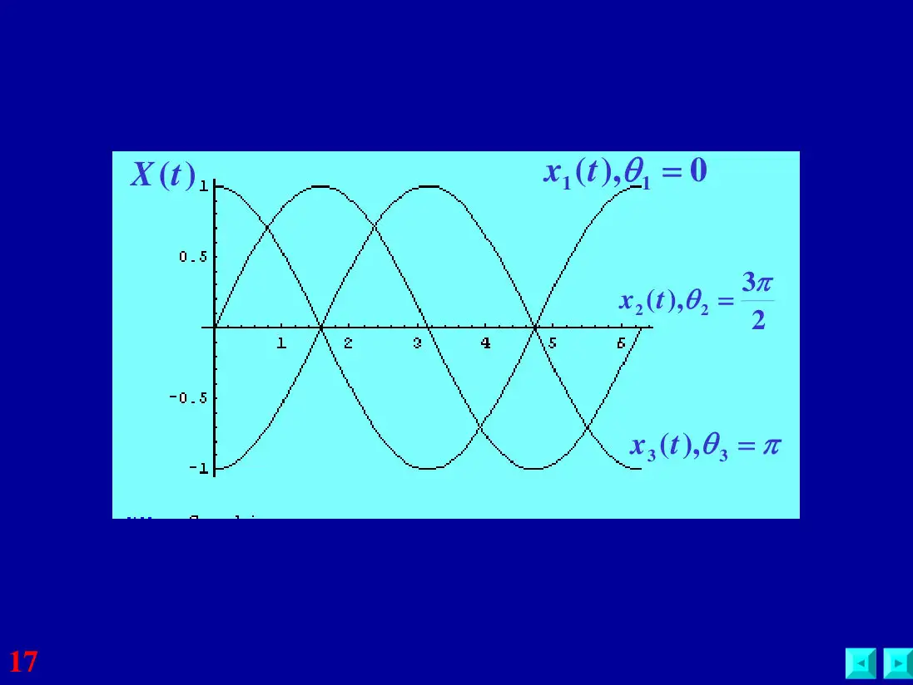

原文：

17

### 对于固定的时刻 $t_{i} \in T$ ,

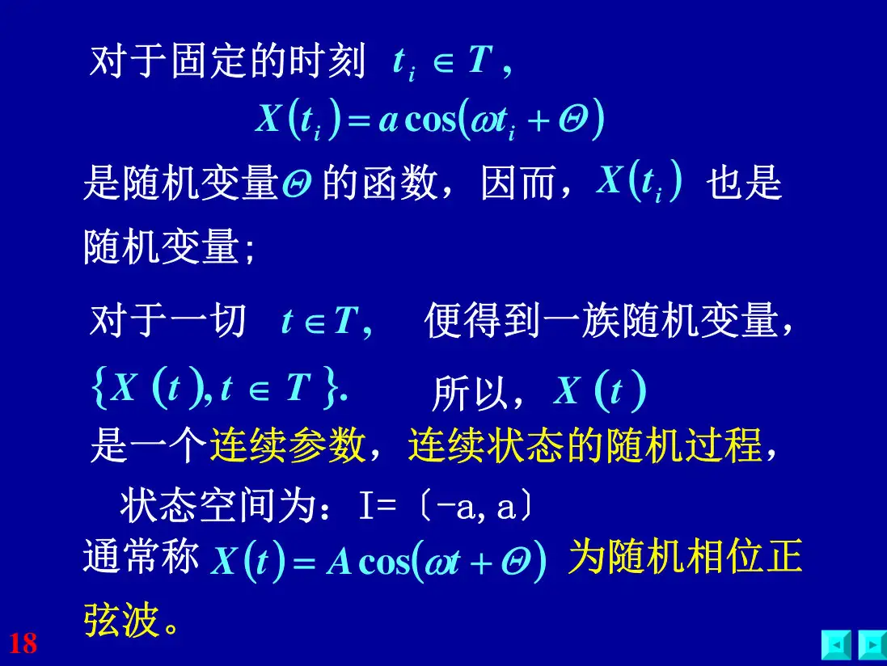

原文：

对于固定的时刻 $t_{i} \in T$ ,

$$
X \left(t _ {i}\right) = a \cos \left(\omega t _ {i} + \Theta\right)
$$

是随机变量 $\Theta$ 的函数，因而， $X(t_{i})$ 也是随机变量；

对于一切 $t \in T$ ，便得到一族随机变量，

$\{X(t), t \in T\}$ . 所以， $X(t)$ 是一个连续参数，连续状态的随机过程，

状态空间为: I=(-a, a)
通常称 $X(t)=A\cos(\omega t+\Theta)$ 为随机相位正弦波。

18

### 例3 利用抛掷一枚硬币的试验，定义

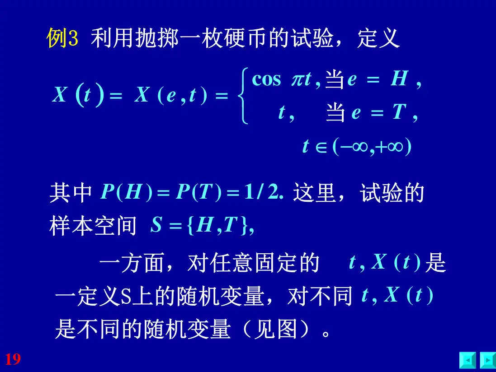

原文：

例3 利用抛掷一枚硬币的试验，定义

$$
X (t) = X (e, t) = \left\{ \begin{array}{c} \cos \pi t, \text {当} e = H, \\ t, \quad \text {当} e = T, \\ t \in (- \infty , + \infty) \end{array} \right.
$$

其中 $P(H)=P(T)=1/2$ . 这里，试验的样本空间 $S=\{H,T\}$ ,

一方面，对任意固定的 $t, X(t)$ 是一定义S上的随机变量，对不同 $t, X(t)$ 是不同的随机变量（见图）。

19

### 所以 $\{X(t), t \in T\}$ 是一族随机变量，即它是一随机过程。

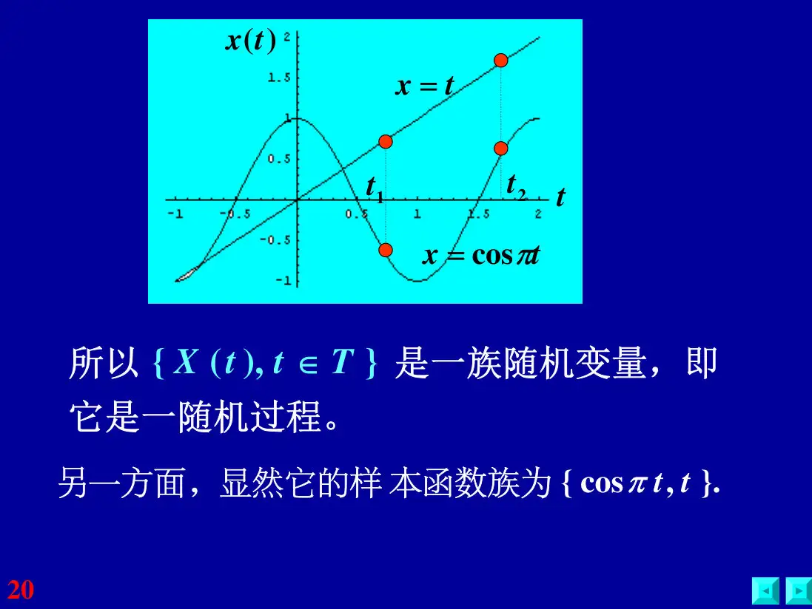

原文：

所以 $\{X(t), t \in T\}$ 是一族随机变量，即它是一随机过程。

另一方面，显然它的样本函数族为 $\{\cos\pi t, t\}$ .

20

### 9.2 随机过程的统计描述

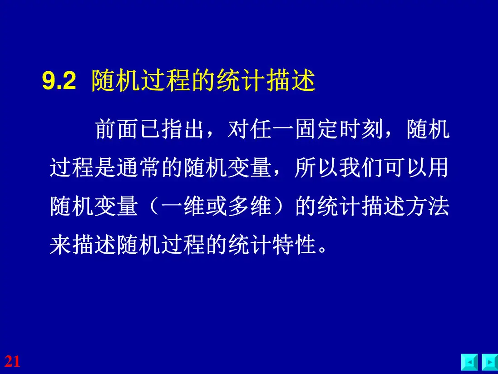

原文：

9.2 随机过程的统计描述

前面已指出，对任一固定时刻，随机过程是通常的随机变量，所以我们可以用随机变量（一维或多维）的统计描述方法来描述随机过程的统计特性。

21

### (一) 随机过程的分布函数族

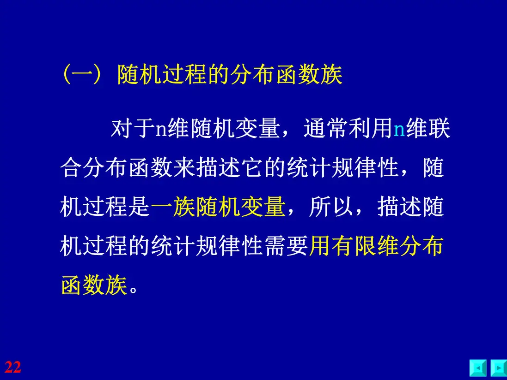

原文：

(一) 随机过程的分布函数族

对于n维随机变量，通常利用n维联合分布函数来描述它的统计规律性，随机过程是一族随机变量，所以，描述随机过程的统计规律性需要用有限维分布函数族。

22

### 23

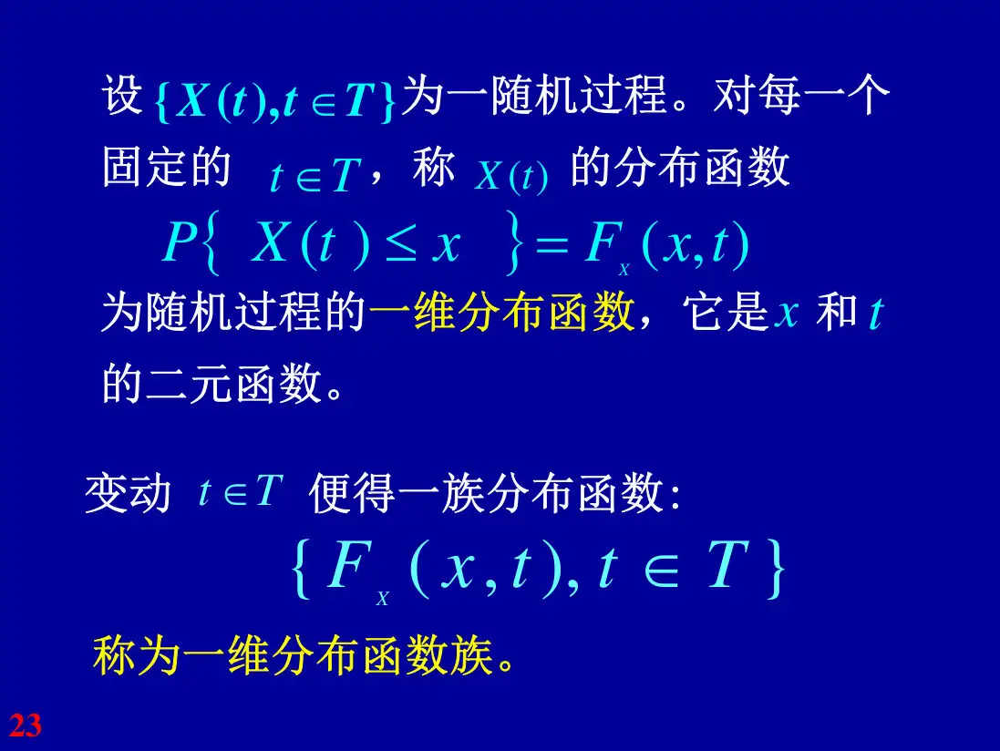

原文：

设 $\{X(t), t \in T\}$ 为一随机过程。对每一个固定的 $t \in T$ ，称 $X(t)$ 的分布函数 $P\{X(t) \leq x\} = F_x(x, t)$ 为随机过程的一维分布函数，它是 $x$ 和 $t$ 的二元函数。

变动 $t \in T$ 便得一族分布函数: $\{F_{x}(x, t), t \in T\}$ 称为一维分布函数族。

23

### 24

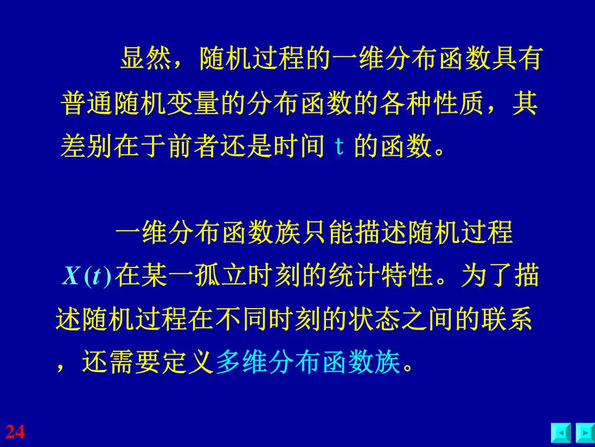

原文：

显然，随机过程的一维分布函数具有普通随机变量的分布函数的各种性质，其差别在于前者还是时间 t 的函数。

一维分布函数族只能描述随机过程 $X(t)$ 在某一孤立时刻的统计特性。为了描述随机过程在不同时刻的状态之间的联系，还需要定义多维分布函数族。

24

### 25

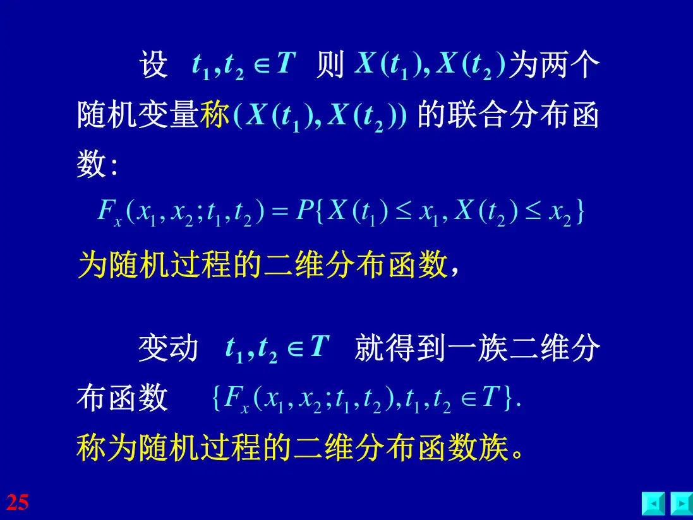

原文：

设 $t_{1}, t_{2} \in T$ 则 $X(t_{1}), X(t_{2})$ 为两个随机变量称 $(X(t_{1}), X(t_{2}))$ 的联合分布函数：

$F_{x}(x_{1},x_{2};t_{1},t_{2})=P\{X(t_{1})\leq x_{1},X(t_{2})\leq x_{2}\}$ 为随机过程的二维分布函数，

变动 $t_1, t_2 \in T$ 就得到一族二维分布函数 $\{F_x(x_1, x_2; t_1, t_2), t_1, t_2 \in T\}$ . 称为随机过程的二维分布函数族。

25

### $$

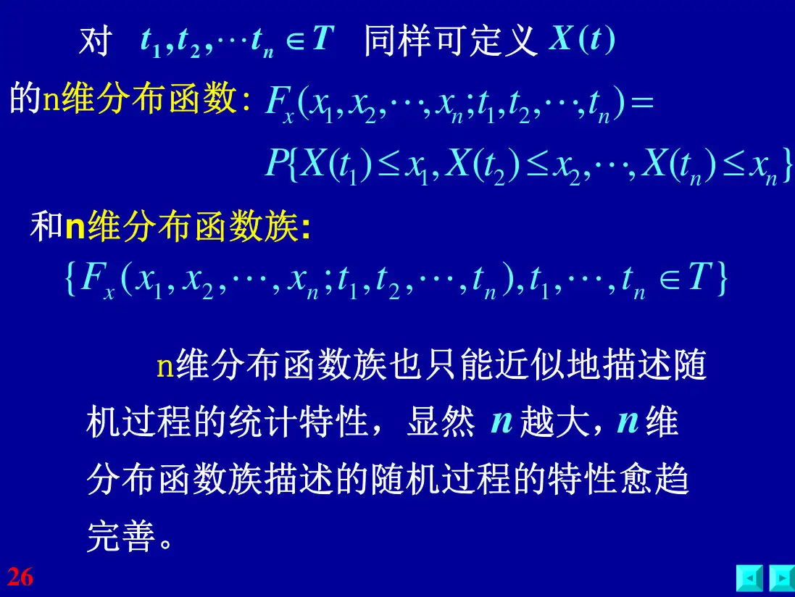

原文：

对 $t_{1}, t_{2}, \cdots, t_{n} \in T$ 同样可定义 $X(t)$

的n维分布函数： $F_{x}(x_{1},x_{2},\cdots,x_{n};t_{1},t_{2},\cdots,t_{n})=$

$$
P \{X (t _ {1}) \leq x _ {1}, X (t _ {2}) \leq x _ {2}, \dots , X (t _ {n}) \leq x _ {n} \}
$$

和n维分布函数族:

$$
\{F _ {x} (x _ {1}, x _ {2}, \dots , x _ {n}; t _ {1}, t _ {2}, \dots , t _ {n}), t _ {1}, \dots , t _ {n} \in T \}
$$

n维分布函数族也只能近似地描述随机过程的统计特性，显然 n 越大，n 维分布函数族描述的随机过程的特性愈趋完善。

26

### $$

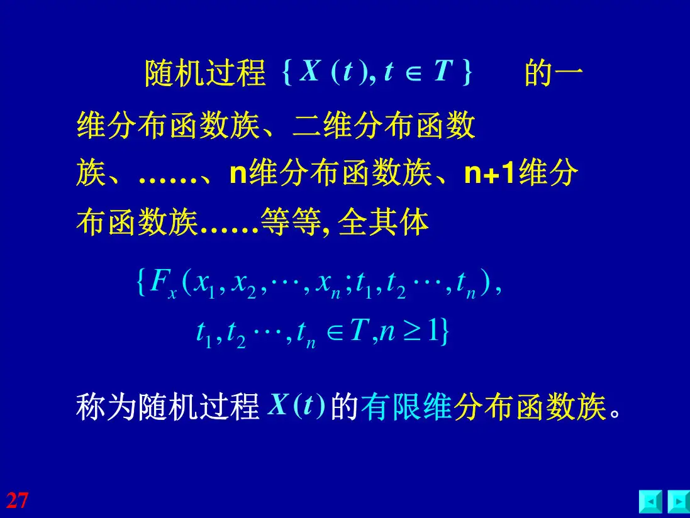

原文：

随机过程 $\{X(t), t \in T\}$ 的一维分布函数族、二维分布函数族、……、n维分布函数族、n+1维分布函数族……等等, 全其体

$$
\{F _ {x} (x _ {1}, x _ {2}, \dots , x _ {n}; t _ {1}, t _ {2} \dots , t _ {n}),
$$

$$
\left. t _ {1}, t _ {2} \dots , t _ {n} \in T, n \geq 1 \right\}
$$

称为随机过程 $X(t)$ 的有限维分布函数族。

27

### 28

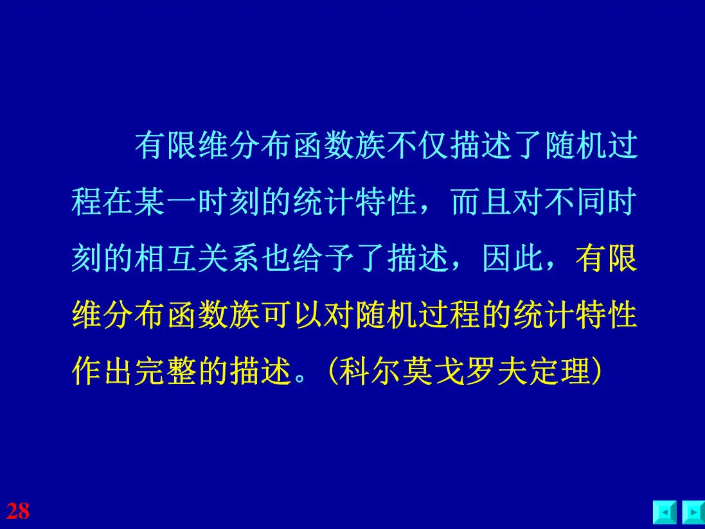

原文：

有限维分布函数族不仅描述了随机过程在某一时刻的统计特性，而且对不同时刻的相互关系也给予了描述，因此，有限维分布函数族可以对随机过程的统计特性作出完整的描述。(科尔莫戈罗夫定理)

28

### (二) 随机过程的数字特征

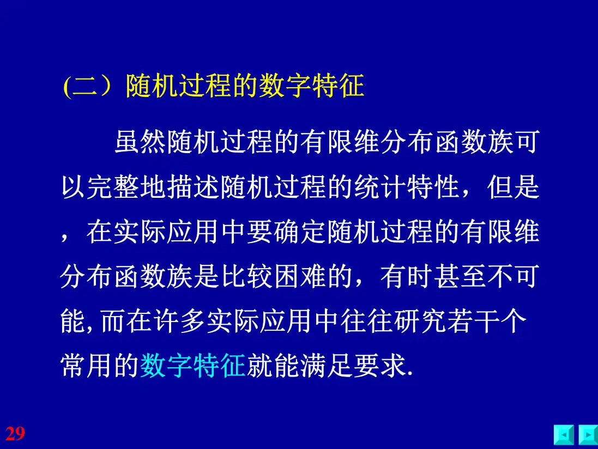

原文：

(二) 随机过程的数字特征

虽然随机过程的有限维分布函数族可以完整地描述随机过程的统计特性，但是，在实际应用中要确定随机过程的有限维分布函数族是比较困难的，有时甚至不可能,而在许多实际应用中往往研究若干个常用的数字特征就能满足要求.

29

### 下面，我们仿照对随机变量的研究方法讨论几个重要的数字特征。

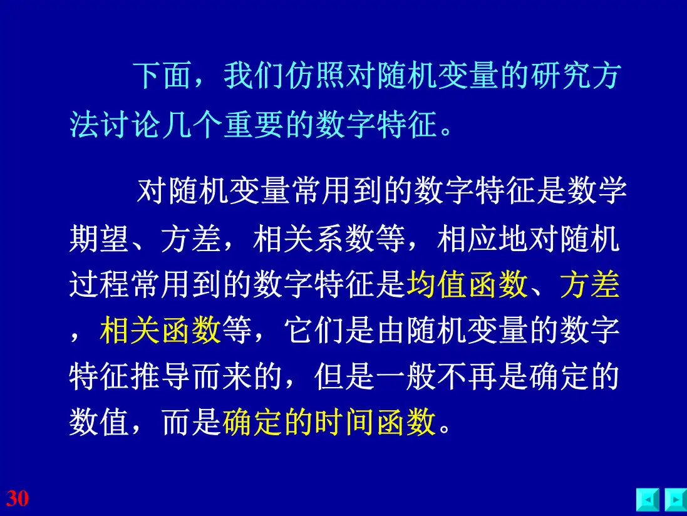

原文：

下面，我们仿照对随机变量的研究方法讨论几个重要的数字特征。

对随机变量常用到的数字特征是数学期望、方差，相关系数等，相应地对随机过程常用到的数字特征是均值函数、方差，相关函数等，它们是由随机变量的数字特征推导而来的，但是一般不再是确定的数值，而是确定的时间函数。

30

### （一）均值函数

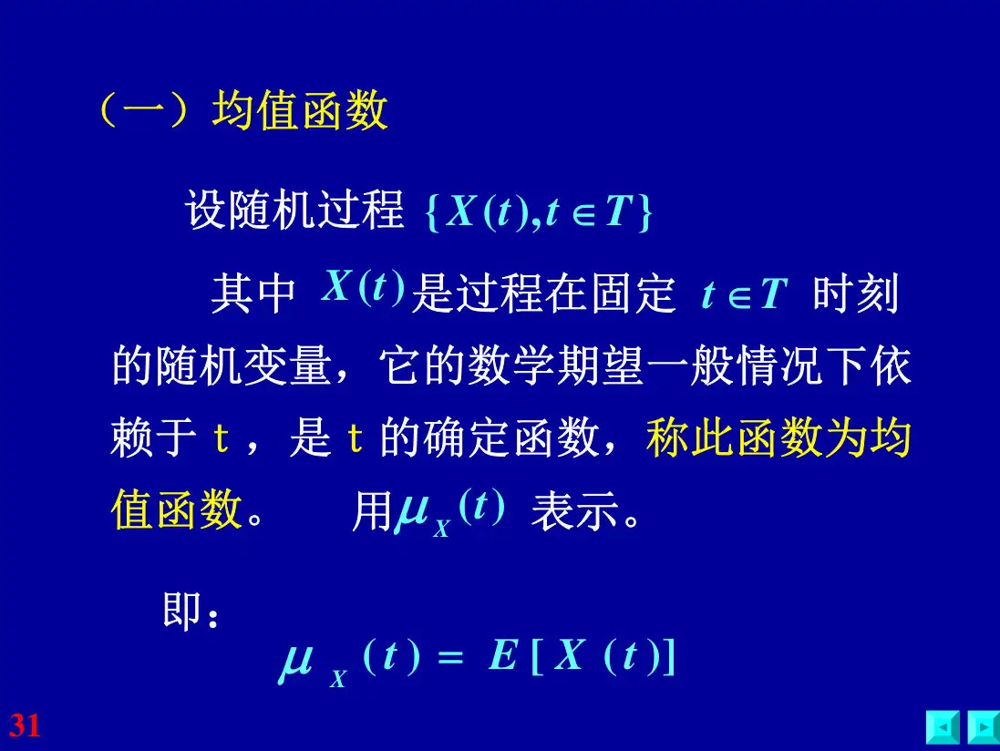

原文：

（一）均值函数

设随机过程 $\{X(t), t \in T\}$

其中 $X(t)$ 是过程在固定 $t \in T$ 时刻的随机变量，它的数学期望一般情况下依赖于 $t$ ，是 $t$ 的确定函数，称此函数为均值函数。用 $\mu_X(t)$ 表示。

即：

$$
\mu_ {X} (t) = E [ X (t) ]
$$

31

### 32

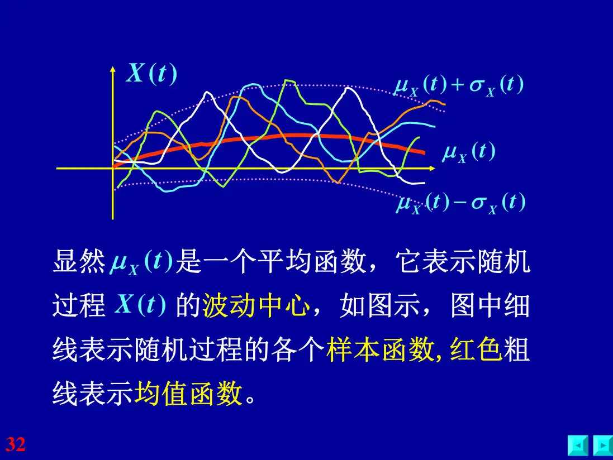

原文：

显然 $\mu_{X}(t)$ 是一个平均函数，它表示随机过程 $X(t)$ 的波动中心，如图示，图中细线表示随机过程的各个样本函数, 红色粗线表示均值函数。

32

### （二）均方值函数与方差函数

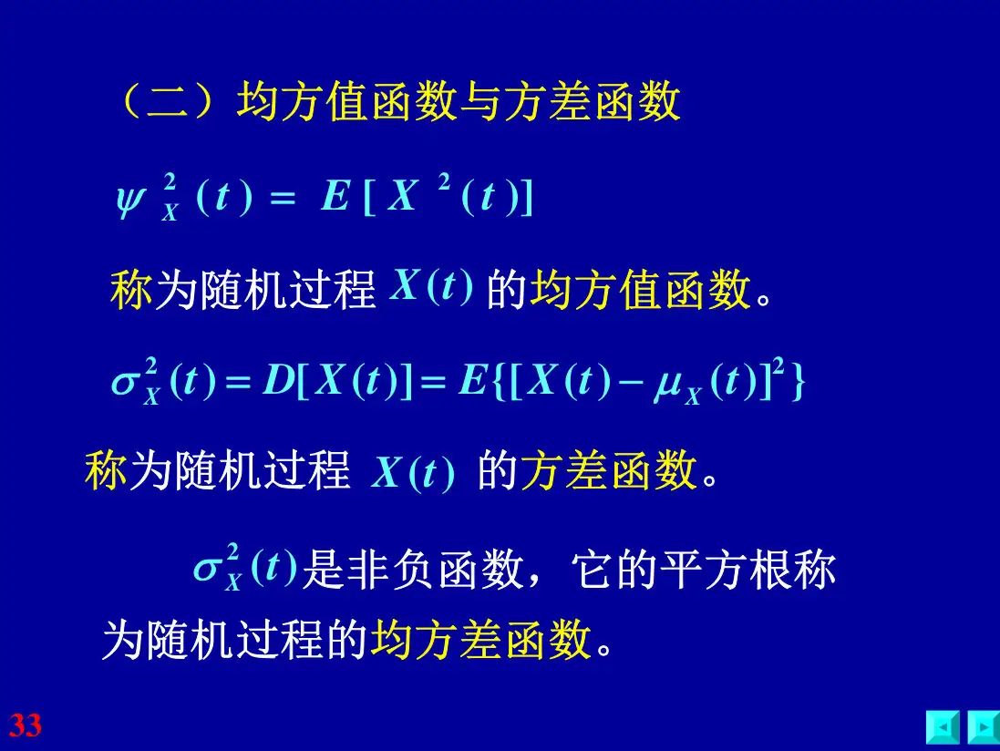

原文：

（二）均方值函数与方差函数

$$
\psi_ {X} ^ {2} (t) = E \left[ X ^ {2} (t) \right]
$$

称为随机过程 $X(t)$ 的均方值函数。

$\sigma_{X}^{2}(t) = D[X(t)] = E\{[X(t) - \mu_{X}(t)]^{2}\}$ 称为随机过程 $X(t)$ 的方差函数。

$\sigma_{X}^{2}(t)$ 是非负函数，它的平方根称为随机过程的均方差函数。

33

### 34

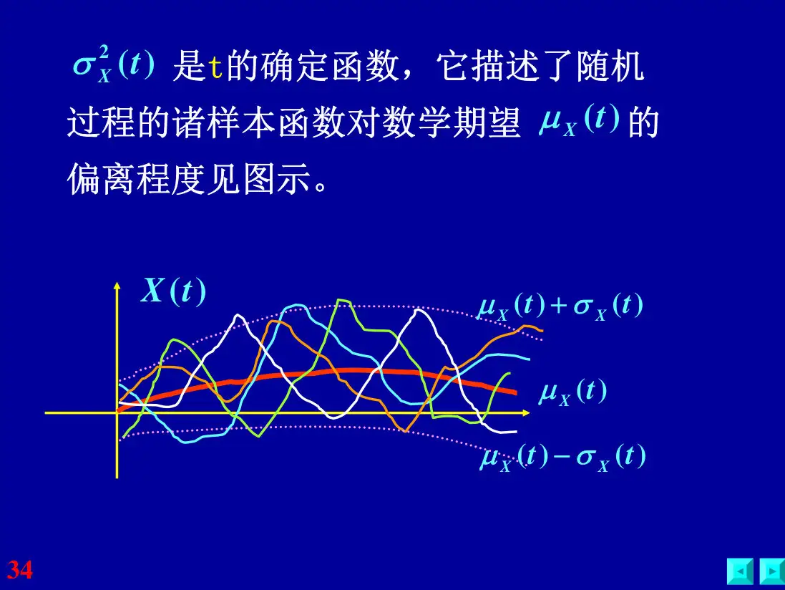

原文：

$\sigma_{X}^{2}(t)$ 是 $t$ 的确定函数，它描述了随机过程的诸样本函数对数学期望 $\mu_{X}(t)$ 的偏离程度见图示。

34

### （三）自相关函数

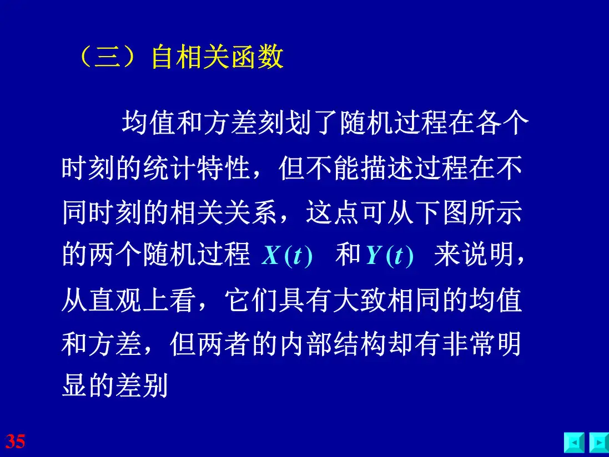

原文：

（三）自相关函数

均值和方差刻划了随机过程在各个时刻的统计特性，但不能描述过程在不同时刻的相关关系，这点可从下图所示的两个随机过程 $X(t)$ 和 $Y(t)$ 来说明，从直观上看，它们具有大致相同的均值和方差，但两者的内部结构却有非常明显的差别

35

### 具有相同数学期望和方差的两个不同的随机过程

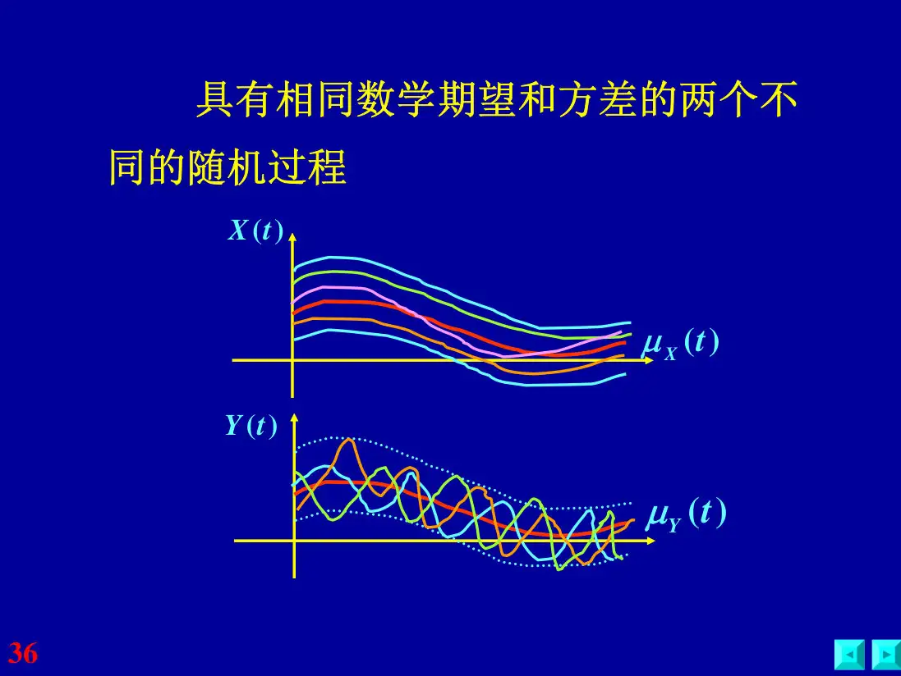

原文：

具有相同数学期望和方差的两个不同的随机过程

36

### 因此，必须引入描述随机过程在不同时刻之间相关程度的数字特征。

原文：

因此，必须引入描述随机过程在不同时刻之间相关程度的数字特征。

自相关函数（简称相关函数）就是用来描述随机过程两个不同时刻状态之间内在联系的重要数字特征。

37

### $$

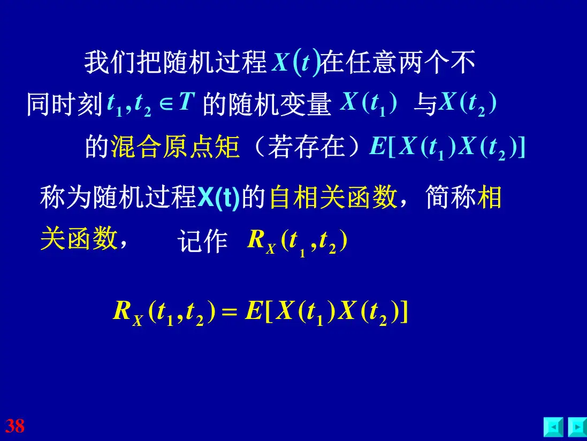

原文：

我们把随机过程 $X(t)$ 在任意两个不同时刻 $t_1, t_2 \in T$ 的随机变量 $X(t_1)$ 与 $X(t_2)$ 的混合原点矩（若存在） $E[X(t_1)X(t_2)]$ 称为随机过程 $X(t)$ 的自相关函数，简称相关函数，记作 $R_X(t_1, t_2)$

$$
R _ {X} \left(t _ {1}, t _ {2}\right) = E \left[ X \left(t _ {1}\right) X \left(t _ {2}\right) \right]
$$

38

### 若取 $t_{1}=t_{2}=t$ ，则有

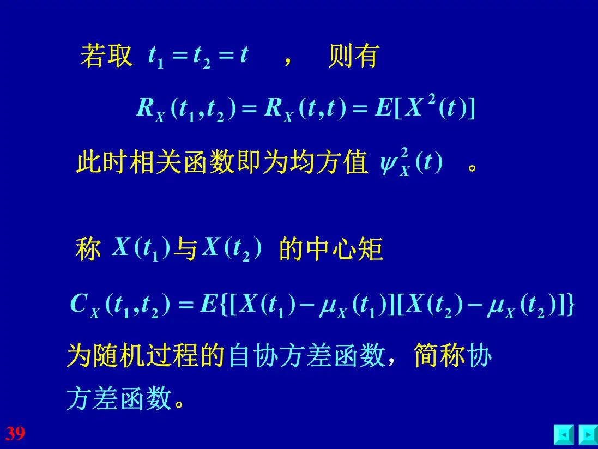

原文：

若取 $t_{1}=t_{2}=t$ ，则有

$$
R _ {X} (t _ {1}, t _ {2}) = R _ {X} (t, t) = E [ X ^ {2} (t) ]
$$

此时相关函数即为均方值 $\psi_{X}^{2}(t)$ 。

称 $X(t_{1})$ 与 $X(t_{2})$ 的中心矩

$C_{X}(t_{1},t_{2})=E\{[X(t_{1})-\mu_{X}(t_{1})][X(t_{2})-\mu_{X}(t_{2})]\}$ 为随机过程的自协方差函数，简称协方差函数。

39

### 随机过程数字特征之间的关系:

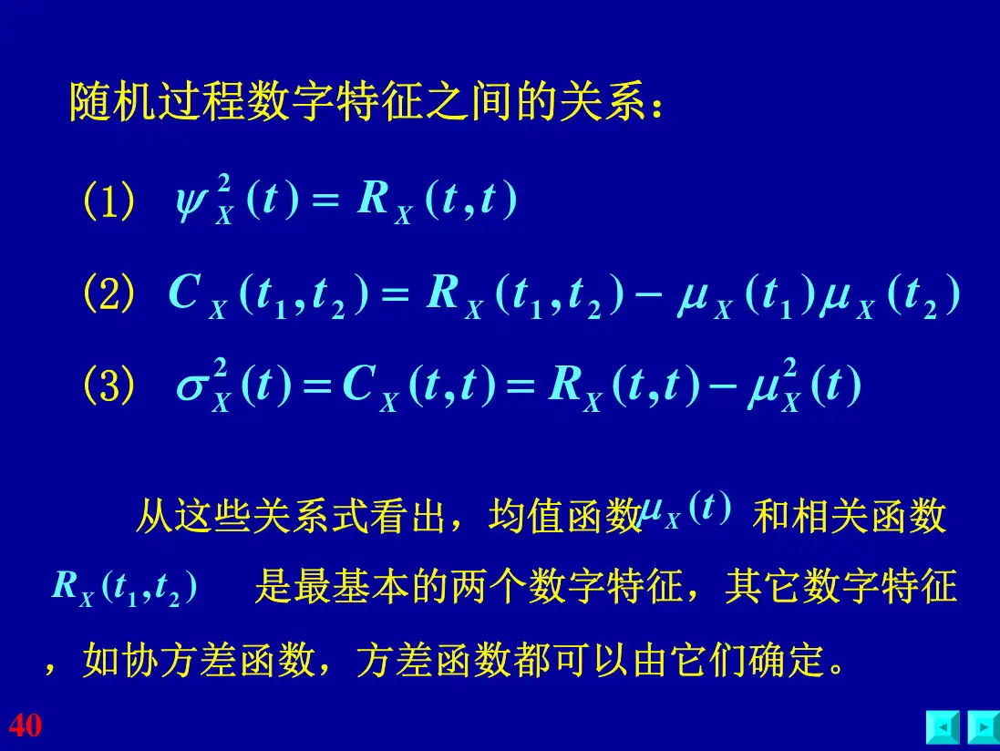

原文：

随机过程数字特征之间的关系:

(1) $\psi_{X}^{2}(t)=R_{X}(t,t)$

(2) $C_{X}(t_{1},t_{2}) = R_{X}(t_{1},t_{2}) - \mu_{X}(t_{1})\mu_{X}(t_{2})$

(3) $\sigma_{X}^{2}(t) = C_{X}(t,t) = R_{X}(t,t) - \mu_{X}^{2}(t)$

从这些关系式看出，均值函数 $\mu_{X}(t)$ 和相关函数 $R_{X}(t_{1}, t_{2})$ 是最基本的两个数字特征，其它数字特征，如协方差函数，方差函数都可以由它们确定。

40

### 例1: 若随机过程

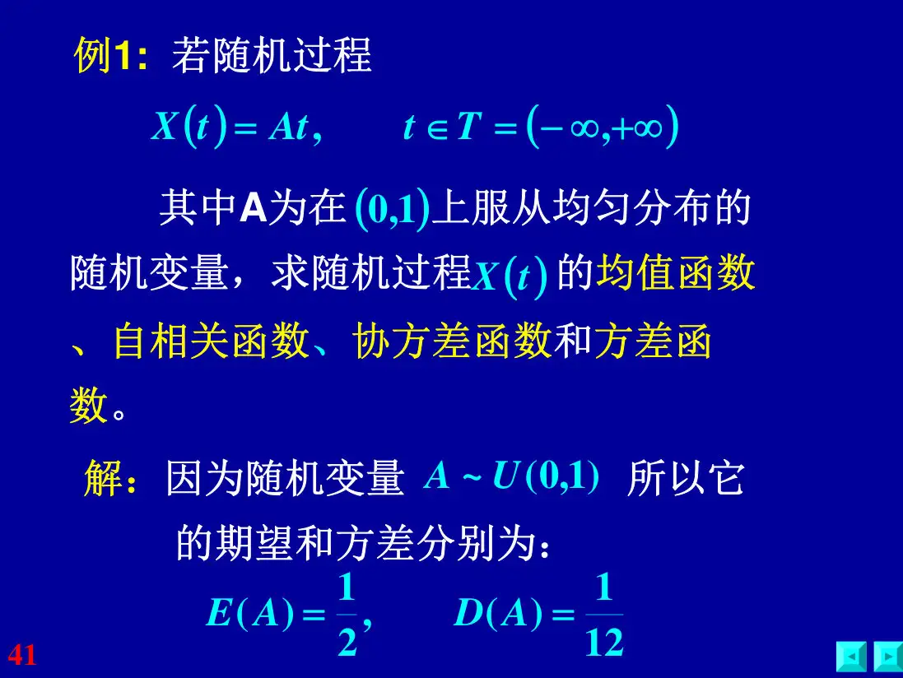

原文：

例1: 若随机过程

$$
X (t) = A t, \quad t \in T = (- \infty , + \infty)
$$

其中A为在(0,1)上服从均匀分布的随机变量，求随机过程 $X(t)$ 的均值函数、自相关函数、协方差函数和方差函数。

解: 因为随机变量 $A \sim U(0,1)$ 所以它的期望和方差分别为: $E(A) = \frac{1}{2}, D(A) = \frac{1}{12}$

41

### (1) 均值函数

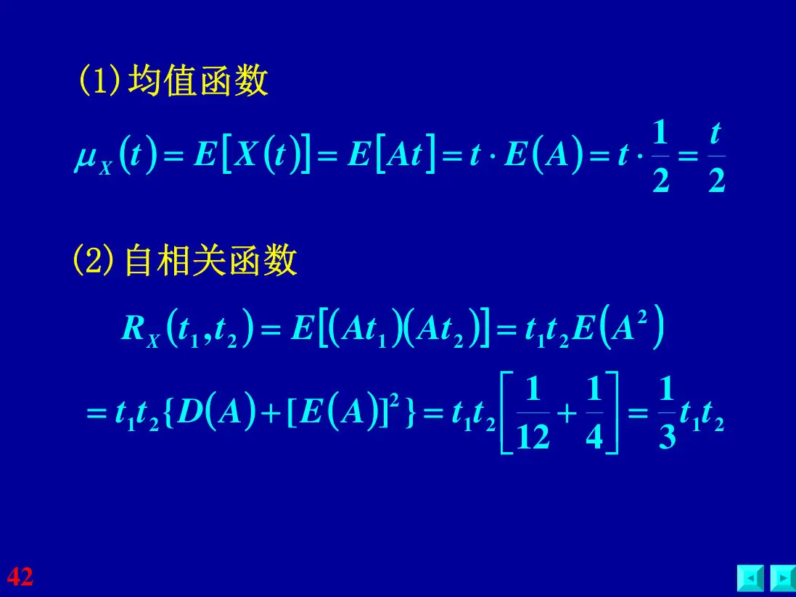

原文：

(1) 均值函数

$$
\mu_ {X} (t) = E [ X (t) ] = E [ A t ] = t \cdot E (A) = t \cdot \frac {1}{2} = \frac {t}{2}
$$

(2) 自相关函数

$$
\begin{array}{c} R _ {X} (t _ {1}, t _ {2}) = E [ (A t _ {1}) (A t _ {2}) ] = t _ {1} t _ {2} E (A ^ {2}) \\ = t _ {1} t _ {2} \{D (A) + [ E (A) ] ^ {2} \} = t _ {1} t _ {2} \left[ \frac {1}{1 2} + \frac {1}{4} \right] = \frac {1}{3} t _ {1} t _ {2} \end{array}
$$

42

### (3) 协方差函数

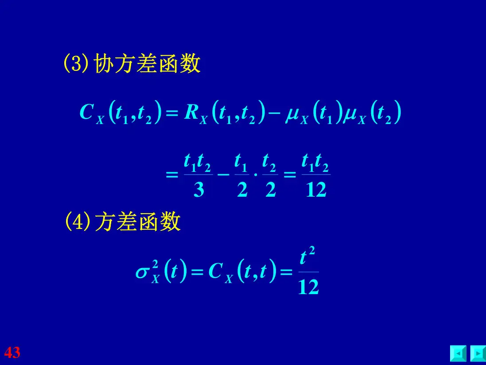

原文：

(3) 协方差函数

$$
\begin{array}{r l} C _ {X} (t _ {1}, t _ {2}) & = R _ {X} (t _ {1}, t _ {2}) - \mu_ {X} (t _ {1}) \mu_ {X} (t _ {2}) \\ & = \frac {t _ {1} t _ {2}}{3} - \frac {t _ {1}}{2} \cdot \frac {t _ {2}}{2} = \frac {t _ {1} t _ {2}}{1 2} \end{array}
$$

(4) 方差函数

$$
\sigma_ {X} ^ {2} (t) = C _ {X} (t, t) = \frac {t ^ {2}}{1 2}
$$

43

### 例2 若随机过程

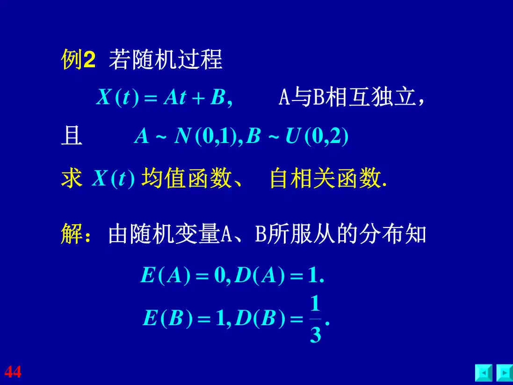

原文：

例2 若随机过程

$X(t)=At+B,$ A与B相互独立，

且 $A \sim N(0,1), B \sim U(0,2)$

求 $X(t)$ 均值函数、自相关函数.

解：由随机变量A、B所服从的分布知

$$
E (A) = 0, D (A) = 1.
$$

$$
E (B) = 1, D (B) = \frac {1}{3}.
$$

44

### (1) 均值函数:

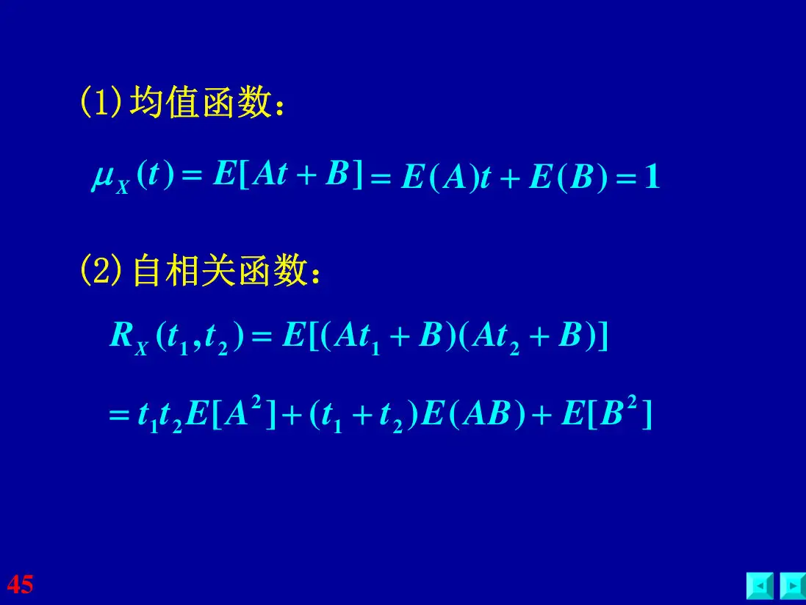

原文：

(1) 均值函数:

$$
\mu_ {X} (t) = E [ A t + B ] = E (A) t + E (B) = 1
$$

(2) 自相关函数:

$$
R _ {X} (t _ {1}, t _ {2}) = E [ (A t _ {1} + B) (A t _ {2} + B) ]
$$

$$
= t _ {1} t _ {2} E [ A ^ {2} ] + (t _ {1} + t _ {2}) E (A B) + E [ B ^ {2} ]
$$

45

### 而 $E(A^2) = D(A) + [E(A)]^2 = 1$

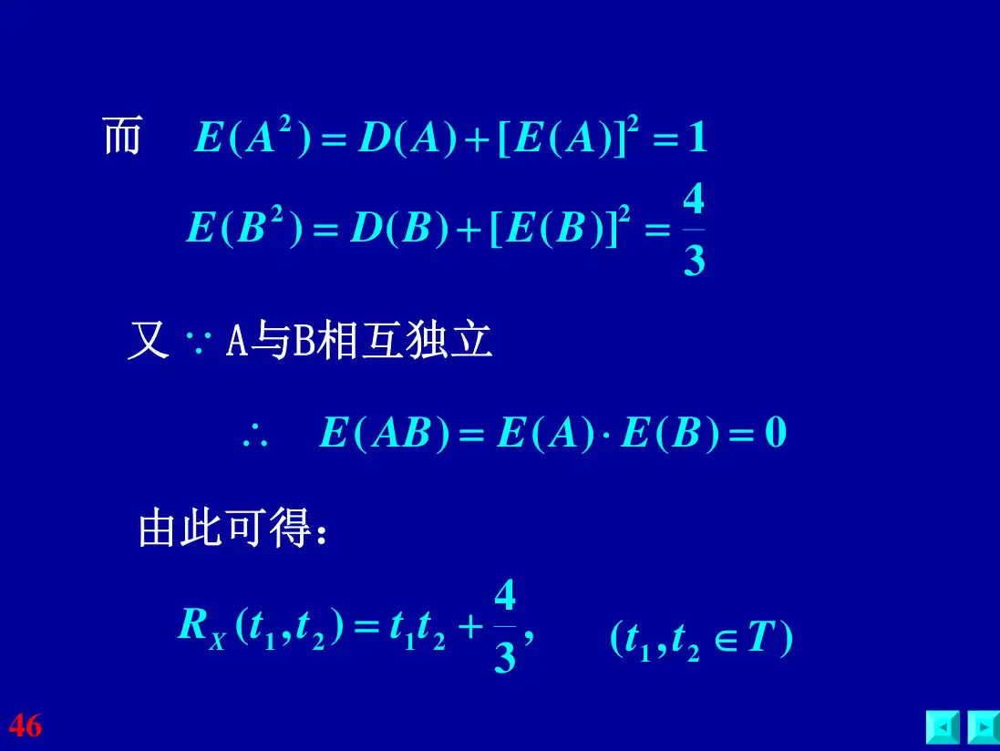

原文：

而 $E(A^2) = D(A) + [E(A)]^2 = 1$

$$
E (B ^ {2}) = D (B) + [ E (B) ] ^ {2} = \frac {4}{3}
$$

又∵A与B相互独立

∴ $E(AB) = E(A) \cdot E(B) = 0$

由此可得:

$$
R _ {X} \left(t _ {1}, t _ {2}\right) = t _ {1} t _ {2} + \frac {4}{3}, \quad \left(t _ {1}, t _ {2} \in T\right)
$$

46

### 47

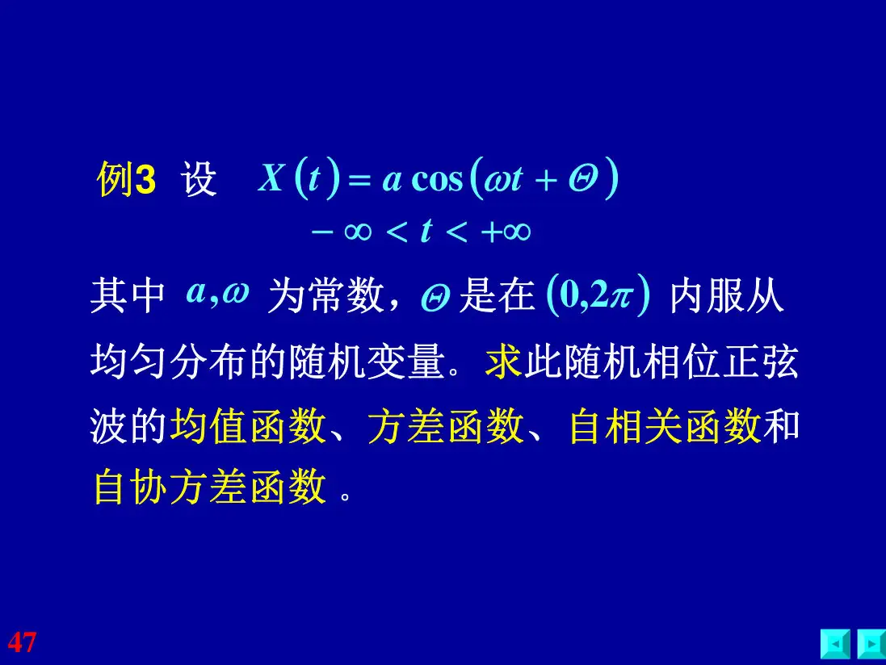

原文：

例3 设 $X(t) = a \cos (\omega t + \Theta)$ $-\infty < t < +\infty$

其中 $a, \omega$ 为常数， $\Theta$ 是在 $(0,2\pi)$ 内服从均匀分布的随机变量。求此随机相位正弦波的均值函数、方差函数、自相关函数和自协方差函数。

47

### 解: 由题设 $\Theta$ 的概率密度为

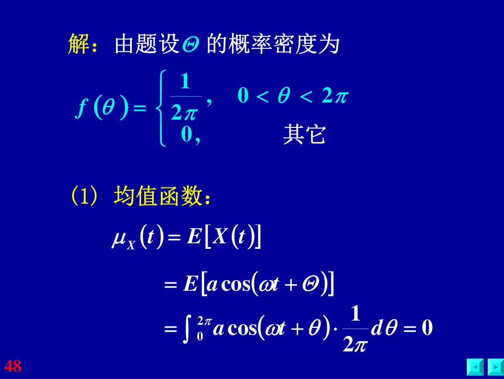

原文：

解: 由题设 $\Theta$ 的概率密度为

$$
f (\theta) = \left\{ \begin{array}{c c} \frac {1}{2 \pi}, & 0 <   \theta <   2 \pi \\ 0, & \text {其它} \end{array} \right.
$$

(1) 均值函数:

$$
\begin{array}{r l} \mu_ {X} (t) & = E [ X (t) ] \\ & = E [ a \cos (\omega t + \Theta) ] \\ & = \int_ {0} ^ {2 \pi} a \cos (\omega t + \theta) \cdot \frac {1}{2 \pi} d \theta = 0 \end{array}
$$

48

### (2) 自相关函数:

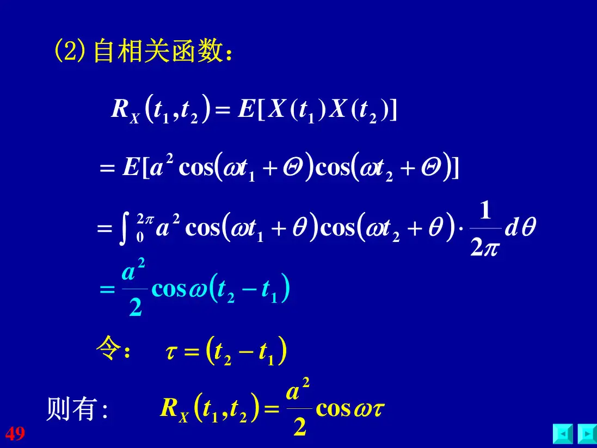

原文：

(2) 自相关函数:

$$
\begin{array}{r l} & R _ {X} (t _ {1}, t _ {2}) = E [ X (t _ {1}) X (t _ {2}) ] \\ & = E [ a ^ {2} \cos (\omega t _ {1} + \Theta) \cos (\omega t _ {2} + \Theta) ] \\ & = \int_ {0} ^ {2 \pi} a ^ {2} \cos (\omega t _ {1} + \theta) \cos (\omega t _ {2} + \theta) \cdot \frac {1}{2 \pi} d \theta \\ & = \frac {a ^ {2}}{2} \cos \omega (t _ {2} - t _ {1}) \end{array}
$$

令： $\tau = (t_{2} - t_{1})$

则有: $R_{X}(t_{1}, t_{2}) = \frac{a^{2}}{2} \cos \omega \tau$

49

### (3)协方差函数:

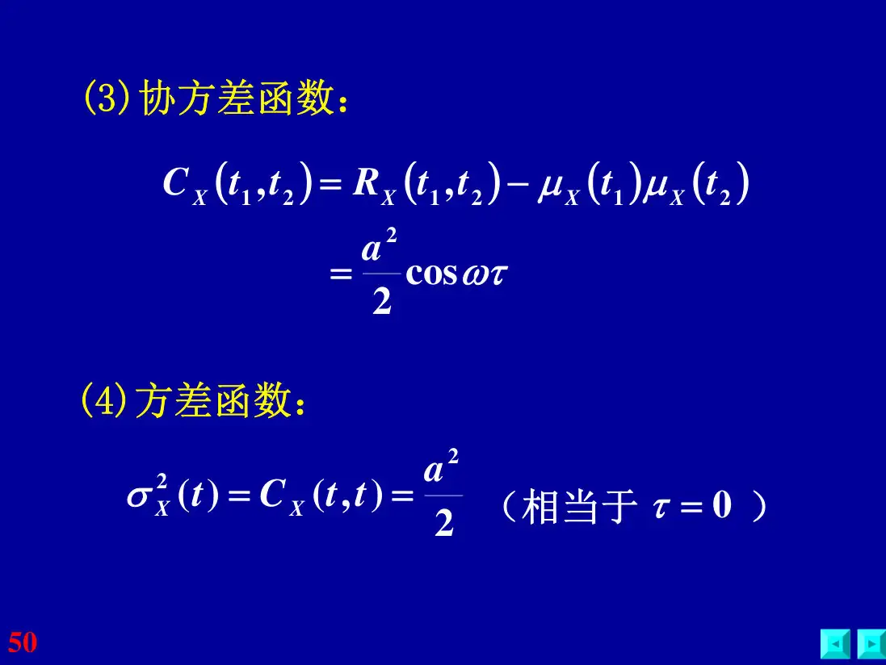

原文：

(3)协方差函数:

$$
\begin{array}{r l} C _ {X} (t _ {1}, t _ {2}) & = R _ {X} (t _ {1}, t _ {2}) - \mu_ {X} (t _ {1}) \mu_ {X} (t _ {2}) \\ & = \frac {a ^ {2}}{2} \cos \omega \tau \end{array}
$$

(4) 方差函数:

$$
\sigma_ {X} ^ {2} (t) = C _ {X} (t, t) = \frac {a ^ {2}}{2} \quad (\text {相当于} \tau = 0)
$$

50
