# 《概率论与数理统计》第二章 随机变量及其分布（课件）

原件的每一页，下面附识别出的文字。

### 2. 随机变量的引入

原文：

2. 随机变量的引入

实例1 抛掷骰子,观察出现的点数.

则有

$S = \{1, 2, 3, 4, 5, 6\}$

样本点本身就是数量

$$
X (e) = e
$$

恒等变换

$$
X (1) = 1, X (2) = 2, X (3) = 3, X (4) = 4, X (5) = 5, X (6) = 6,
$$

$$
P \{X = i \} = \frac {1}{6}, (i = 1, 2, 3, 4, 5, 6) _ {\circ}
$$

即有 $X$ (正面向上) $= 1$ ， $X$ (反面向上) $= 0$ 。

$X(e) = \left\{ \begin{array}{ll}1, & e = \text{正面向上},\\ 0, & e = \text{反面向上。} \end{array} \right.$

这样便将非数量的 $S = \{$ 正面向上，反面向上}数量化了。

且 $P\{X = i\} = \frac{1}{2}, (i = 0,1)$ 。

南京邮电大学
Nanjing University of Private and Telecommunications

实例2 抛掷一枚硬币,会出现正面向上与反面向上两种可能结果。

$S = \{$ 正面向上、反面向上}

将 $S$ 数量化

非数量

可采用下列方法

第二章 随机变量及其分布

第一节 随机变量

一、随机变量的引入

二、随机变量的概念

三、小结

一、随机变量的引入

我们知道随机事件是由基本事件构成的，前面所给出的定义无论是基本事件还是随机事件都是用文字叙述给出，这有两个缺憾：一是非常繁琐，二是尽管事件可以看成子集（样本空间的子集）但是文字叙述却不符合数学的研究特点，因此为了更深入地研究随机现象，我们就需要将随机试验的结果数量化，也就是用某一变量取得各种不同的数值来描述随机试验的结果，这样就引进了随机变量的概念。

南京邮电大学
Heiping University of Posts and Telecommunications

南京邮电大学
Nanjing University of Physics and Telecommunications

二、随机变量的概念

$S = \{e\}$

1. 定义 设 $E$ 是随机试验, 它的样本空间是 $S = \{e\}$ 。如果对于每一个 $e \in S$ , 有一个实数 $X(e)$ 与之对应, 这样就得到一个定义在 $S$ 上的单值实值函数 $X(e)$ , 称 $X(e)$ 为随机变量。

随机变量是定义在样本空的实值集函数,它与普通的实函数有本质的区别. 一方面它的取值是随机的,而它取每一个可能值都有一定的概率; 另一方面它的定义域是样本空间S, 而S不一定是实数集.

南京邮电大学
Nanjing University of Physics and Telecommunications

$^{6}R$

### 是一个随机变量。

原文：

实例6 某地铁站每隔5分钟有一辆汽车通过，如果某人到达该地铁站的时刻是随机的，则 $X(e) =$ 此人的等车时间，

是一个随机变量。

且 $X(e)$ 的所有可能取值为：[0,5]。

实例7 随机变量 X 为“灯泡的寿命”。则 X 的取值范围为 $[0, +\infty)$ 。

南京邮电大学
Nanjing University of Physics and Telecommunications

三、小结

1. 概率论是从数量上来研究随机现象内在规律性的，因此为了方便有力的研究随机现象，就需将随机事件数量化，把一些非数量表示的随机事件用数字表示时，就建立起了随机变量的概念。因此随机变量是定义在样本空间上的一种特殊的函数。

2. 随机变量的分类: 离散型、连续型。

3.随机变量的分类

离散型 非离散型

连续型 其它

(1)离散型 随机变量所取的可能值是有限多个或无限可列个, 叫做离散型随机变量。

(2)连续型 随机变量所取的可能值可以连续地充满某个区间,叫做连续型随机变量。

南京新電大學
Nanjing University of Private and Telecommunications

南京邮电大学
Nanjing University of Physics and Telecommunications

实例3 设盒中有5个球(2白3黑), 从中任抽3个, 则 $X(e) =$ 抽得的白球数

是一个随机变量. 且 $X(e)$ 的所有可能取值为: 0, 1, 2。

实例4 设某射手每次射击打中目标的概率是0.8, 现该射手射了30次, 则 $X(e)=$ 射中目标的次数

是一个随机变量. 且 $X(e)$ 的所有可能取值为: 0, 1, 2, 3, …, 30。

实例5 设某射手每次射击打中目标的概率是0.8, 现该射手不断向目标射击, 直到击中目标为止, 则

$X(e) =$ 所需射击次数

是一个随机变量。

且 $X(e)$ 的所有可能取值为：

1, 2, 3, … 。

南京航空航天大学
Nanjing University of Physics and Telecommunications

南京邮电大学
Nanjing University of Physics and Telecommunications

第二节 离散型随机变及其分布律

一、离散型随机变量的分布律

二、常见离散型随机变量的概率分布

三、小结

### 离散型随机变量的分布律也可表示为

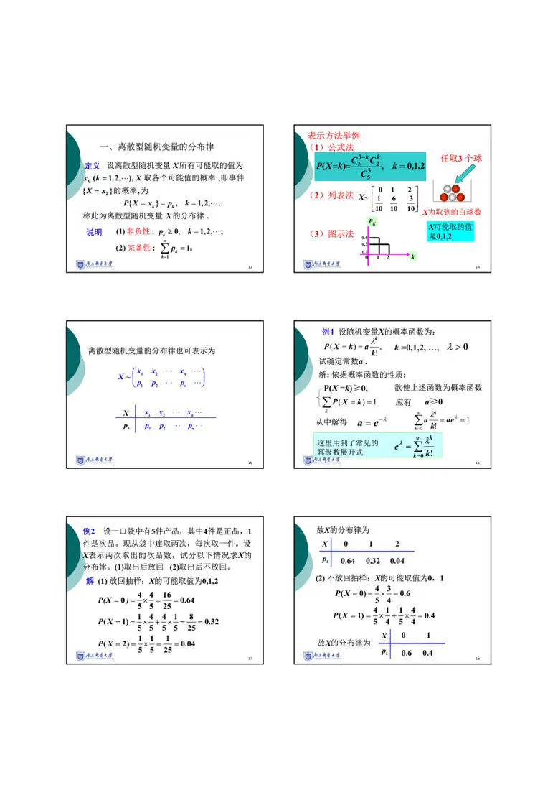

原文：

离散型随机变量的分布律也可表示为

$$
X \sim \left( \begin{array}{c c c c c} x _ {1} & x _ {2} & \dots & x _ {n} & \dots \\ p _ {1} & p _ {2} & \dots & p _ {n} & \dots \end{array} \right)
$$

南京邮电大学
Nanjing University of Posts and Telecommunications
<table><tr><td>X</td><td> $x_{1}$ </td><td> $x_{2}$ </td><td> $\cdots$ </td><td> $x_{n}$  $\cdots$ </td></tr><tr><td> $p_{k}$ </td><td> $p_{1}$ </td><td> $p_{2}$ </td><td> $\cdots$ </td><td> $p_{n}$  $\cdots$ </td></tr></table>

例2 设一口袋中有5件产品，其中4件是正品，1件是次品。现从袋中连取两次，每次取一件。设X表示两次取出的次品数，试分以下情况求X的分布律。(1)取出后放回 (2)取出后不放回。

解 (1) 放回抽样: $X$ 的可能取值为 0,1,2

$$
P (X = 0) = \frac {4}{5} \times \frac {4}{5} = \frac {1 6}{2 5} = 0. 6 4
$$

$$
P (X = 1) = \frac {1}{5} \times \frac {4}{5} + \frac {4}{5} \times \frac {1}{5} = \frac {8}{2 5} = 0. 3 2
$$

$$
P (X = 2) = \frac {1}{5} \times \frac {1}{5} = \frac {1}{2 5} = 0. 0 4
$$

南京邮电大学
Nanjing University of Posts and Telecommunications

<table><tr><td colspan="2">例1 设随机变量X的概率函数为:</td></tr><tr><td colspan="2">P(X=k)=aλk/k!, k=0,1,2,..., λ&gt;0</td></tr><tr><td colspan="2">试确定常数a.</td></tr><tr><td colspan="2">解:依据概率函数的性质:</td></tr><tr><td colspan="2">{P(X=k)≥0, 欲使上述函数为概率函数</td></tr><tr><td colspan="2">∑kP(X=k)=1 应有 a≥0</td></tr><tr><td>从中解得 a=e-λ</td><td>∑k=0∞aλk/k! = ae^λ = 1</td></tr><tr><td>这里用到了常见的幂级数展开式</td><td>e^λ = ∑k=0∞λk/k!</td></tr></table>

$$
P (X = 0) = \frac {4}{5} \times \frac {3}{4} = 0. 6
$$

$$
P (X = 1) = \frac {4}{5} \times \frac {1}{4} + \frac {1}{5} \times \frac {4}{4} = 0. 4
$$

一、离散型随机变量的分布律

$(k=1,2,\cdots)$

定义 设离散型随机变量 X 所有可能取的值为 $x_{k} (k=1,2,\cdots)$ ，X 取各个可能值的概率，即事件 $\{X=x_{k}\}$ 的概率，为

$\{X = x_{k}\}$

$P\{X=x_{k}\}=p_{k},\quad k=1,2,\cdots.$

称此为离散型随机变量 $X$ 的分布律.

说明 (1) 非负性： $p_{k} \geq 0, k = 1, 2, \cdots;$

$p_{k}\geq 0,\quad k = 1,2,\dots ;$

南京邮电大学
Nanjing University of Press and Telecommunications

(2) 完备性： $\sum_{k=1}^{\infty} p_k = 1$ 。

$\sum_{k=1}^{\infty} p_k = 1$

13

表示方法举例

(1) 公式法

$P(X = k) = \frac{C_3^{3 - k}C_2^k}{C_5^3},\quad k = 0,1,2$

(2) 列表法 $X \sim \begin{bmatrix} 0 & 1 & 2 \\ \frac{1}{10} & \frac{6}{10} & \frac{3}{10} \end{bmatrix}$

任取3个球

南京邮电大学
Nanjing University of Physics and Telecommunications

$X\sim \left[ \begin{array}{ccc}0 & 1 & 2\\ \frac{1}{10} & \frac{6}{10} & \frac{3}{10} \end{array} \right]$

(3) 图示法

$P_{K}$ 0.6
0.3
0.1
k
1
2

$X$ 为取到的白球数

X可能取的值是0,1,2

14

南京邮电大学
Nanjing University of Press and Telecommunications

故 $X$ 的分布律为

$p_{k}$

X 0 1 2 $p_{k}$ 0.64 0.32 0.04

(2) 不放回抽样： $X$ 的可能取值为0，1

故X的分布律为 $\frac{X}{p_{k}}$ 0 1
南立新学大学

### 二、常见离散型随机变量的概率分布

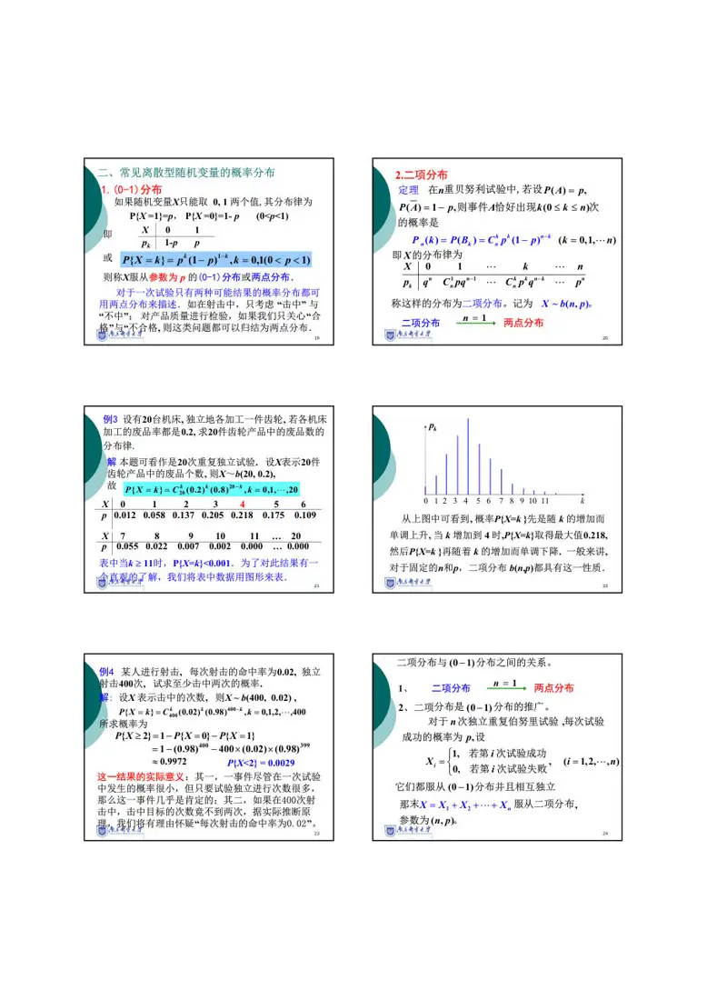

原文：

二、常见离散型随机变量的概率分布

1. (0-1) 分布

如果随机变量X只能取0,1两个值,其分布律为

$$
\begin{array}{c c c} \mathrm{P} \{X = 1 \} = p, & \mathrm{P} \{X = 0 \} = 1 - p & (0 <   p <   1) \\ X & 0 & 1 \\ \hline p _ {k} & 1 - p & p \end{array}
$$

$$
P \{X = k \} = p ^ {k} (1 - p) ^ {1 - k}, k = 0, 1 (0 <   p <   1)
$$

则称X服从参数为p的(0-1)分布或两点分布.

对于一次试验只有两种可能结果的概率分布都可用两点分布来描述。如在射击中，只考虑“击中”与“不中”；对产品质量进行检验，如果我们只关心“合格”与“不合格，则这类问题都可以归结为两点分布。

例3 设有20台机床, 独立地各加工一件齿轮, 若各机床加工的废品率都是0.2, 求20件齿轮产品中的废品数的分布律.

解 本题可看作是20次重复独立试验。设X表示20件齿轮产品中的废品个数，则 $X\sim b(20,0.2)$ ,

故 $P\{X=k\}=C_{20}^{k}(0.2)^{k}(0.8)^{20-k}, k=0,1,\cdots,20$

<table><tr><td>X</td><td>0</td><td>1</td><td>2</td><td>3</td><td>4</td><td>5</td><td>6</td></tr><tr><td>p</td><td>0.012</td><td>0.058</td><td>0.137</td><td>0.205</td><td>0.218</td><td>0.175</td><td>0.109</td></tr><tr><td>X</td><td>7</td><td>8</td><td>9</td><td>10</td><td>11</td><td>...</td><td>20</td></tr><tr><td>p</td><td>0.055</td><td>0.022</td><td>0.007</td><td>0.002</td><td>0.000</td><td>...</td><td>0.000</td></tr></table>

例4 某人进行射击，每次射击的命中率为0.02，独立射击400次，试求至少击中两次的概率.

解：设 $X$ 表示击中的次数，则 $X \sim b(400, 0.02)$ ，

$$
P \{X = k \} = C _ {4 0 0} ^ {k} (0. 0 2) ^ {k} (0. 9 8) ^ {4 0 0 - k}, k = 0, 1, 2, \dots , 4 0 0
$$

所求概率为

$$
\begin{array}{r l} P \{X \geq 2 \} & = 1 - P \{X = 0 \} - P \{X = 1 \} \\ & = 1 - (0. 9 8) ^ {4 0 0} - 4 0 0 \times (0. 0 2) \times (0. 9 8) ^ {3 9 9} \\ & \approx 0. 9 9 7 2 \quad P \{X <   2 \} = 0. 0 0 2 9 \end{array}
$$

这一结果的实际意义：其一，一事件尽管在一次试验中发生的概率很小，但只要试验独立进行次数很多，那么这一事件几乎是肯定的；其二，如果在400次射击中，击中目标的次数竟不到两次，据实际推断原理，我们将有理由怀疑“每次射击的命中率为0.02”。

2.二项分布

定理 在 $n$ 重贝努利试验中, 若设 $P(A) = p$ , $P(\overline{A}) = 1 - p$ , 则事件 $A$ 恰好出现 $k(0 \leq k \leq n)$ 次的概率是

$$
P _ {n} (k) = P \left(B _ {k}\right) = C _ {n} ^ {k} p ^ {k} (1 - p) ^ {n - k} \quad (k = 0, 1, \dots n)
$$

即 $X$ 的分布律为

$$
\begin{array}{c c c c c c c} X & 0 & 1 & \dots & k & \dots & n \\ \hline p _ {k} & q ^ {n} & C _ {n} ^ {1} p q ^ {n - 1} & \dots & C _ {n} ^ {k} p ^ {k} q ^ {n - k} & \dots & p ^ {n} \end{array}
$$

称这样的分布为二项分布。记为 $X \sim b(n, p)$ 。二项分布 $\xrightarrow{n = 1}$ 两点分布

从上图中可看到, 概率 $P\{X=k\}$ 先是随 k 的增加而单调上升, 当 k 增加到 4 时, $P\{X=k\}$ 取得最大值 0.218, 然后 $P\{X=k\}$ 再随着 k 的增加而单调下降. 一般来讲, 对于固定的 n 和 p, 二项分布 $b(n,p)$ 都具有这一性质.

二项分布与(0-1)分布之间的关系。

1、二项分布 $\xrightarrow{n=1}$ 两点分布

2、二项分布是(0-1)分布的推广。

对于 n 次独立重复伯努里试验,每次试验成功的概率为 p, 设

$$
X _ {i} = \left\{ \begin{array}{l l} 1, & \text {若第} i \text {次试验成功} \\ 0, & \text {若第} i \text {次试验失败} \end{array} , \right.
$$

$$
(i = 1, 2, \dots , n)
$$

它们都服从(0-1)分布并且相互独立

那末 $X=X_{1}+X_{2}+\cdots+X_{n}$ 服从二项分布，

参数为 $(n,p)$ 。

南京邮电大学
Nanjing University of Press and Telecommunications

20

### 南京邮电大学

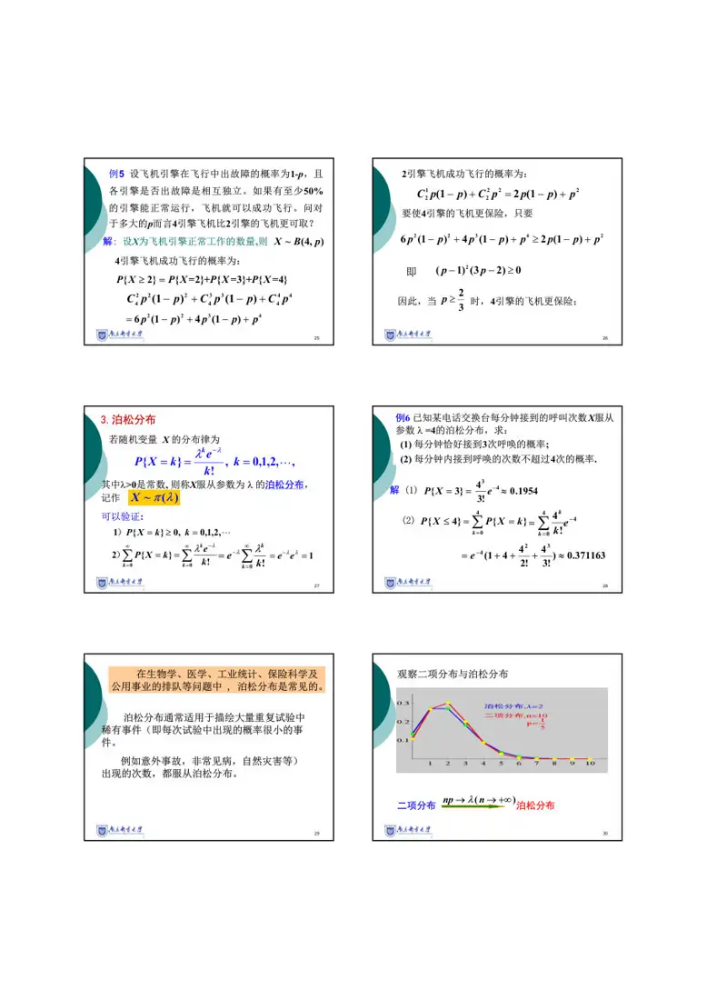

原文：

南京邮电大学
Nanjing University of Press and Telecommunication

3. 泊松分布

若随机变量 $X$ 的分布律为

$$
P \{X = k \} = \frac {\lambda^ {k} e ^ {- \lambda}}{k !}, k = 0, 1, 2, \dots ,
$$

其中 $\lambda > 0$ 是常数, 则称 $X$ 服从参数为 $\lambda$ 的泊松分布,

记作 $X\sim \pi (\lambda)$

可以验证:

1) $P\{X=k\}\geq0,\ k=0,1,2,\cdots$

$$
2) \sum_ {k = 0} ^ {\infty} P \{X = k \} = \sum_ {k = 0} ^ {\infty} \frac {\lambda^ {k} e ^ {- \lambda}}{k !} = e ^ {- \lambda} \sum_ {k = 0} ^ {\infty} \frac {\lambda^ {k}}{k !} = e ^ {- \lambda} e ^ {\lambda} = 1
$$

南京邮电大学
Nanjing University of Physics and Telecommunications

在生物学、医学、工业统计、保险科学及公用事业的排队等问题中，泊松分布是常见的。

泊松分布通常适用于描绘大量重复试验中稀有事件（即每次试验中出现的概率很小的事件。

例如意外事故，非常见病，自然灾害等)出现的次数，都服从泊松分布。

例6 已知某电话交换台每分钟接到的呼叫次数 $X$ 服从参数 $\lambda = 4$ 的泊松分布，求：

(1) 每分钟恰好接到3次呼唤的概率;

(2) 每分钟内接到呼唤的次数不超过4次的概率.

解 (1) $P\{X = 3\} = \frac{4^3}{3!} e^{-4}\approx 0.1954$

$$
\begin{array}{r l} P \{X \leq 4 \} & = \sum_ {k = 0} ^ {4} P \{X = k \} = \sum_ {k = 0} ^ {4} \frac {4 ^ {k}}{k !} e ^ {- 4} \\ & = e ^ {- 4} (1 + 4 + \frac {4 ^ {2}}{2 !} + \frac {4 ^ {3}}{3 !}) \approx 0. 3 7 1 1 6 3 \end{array} \tag {2}
$$

30

例5 设飞机引擎在飞行中出故障的概率为1-p，且各引擎是否出故障是相互独立。如果有至少50%的引擎能正常运行，飞机就可以成功飞行。问对于多大的p而言4引擎飞机比2引擎的飞机更可取？

1-p

解：设 $X$ 为飞机引擎正常工作的数量，则 $X \sim B(4, p)$

$X\sim B(4,p)$

4引擎飞机成功飞行的概率为：

$P\{X \geq 2\} = P\{X = 2\} + P\{X = 3\} + P\{X = 4\}$

$C_4^2 p^2 (1 - p)^2 + C_4^3 p^3 (1 - p) + C_4^4 p^4$

$= 6p^{2}(1 - p)^{2} + 4p^{3}(1 - p) + p^{4}$

25

2引擎飞机成功飞行的概率为：

$C_2^1 p(1 - p) + C_2^2 p^2 = 2p(1 - p) + p^2$

要使4引擎的飞机更保险，只要

$6p^{2}(1 - p)^{2} + 4p^{3}(1 - p) + p^{4}\geq 2p(1 - p) + p^{2}$

南京邮电大学
Nanjing University of Private and Telecommunications

$(p - 1)^{2}(3p - 2)\geq 0$

$p\geq \frac{2}{3}$

因此，当 $p \geq \frac{2}{3}$ 时，4引擎的飞机更保险；

26

南京邮电大学
Nanjing University of Posts and Telecommunications

28

观察二项分布与泊松分布

泊松分布, $\lambda=2$ 二项分布, $n=10$ $p=\frac{1}{5}$

二项分布 $np \rightarrow \lambda (n \rightarrow +\infty)$ 泊松分布

南京新電大學
Nanjing University of Private and Telecommunications

南京新電大學
Nanjing University of Physics and Telecommunications

### 解 $X$ 所取的可能值是 $1,2,3,\dots$ 。

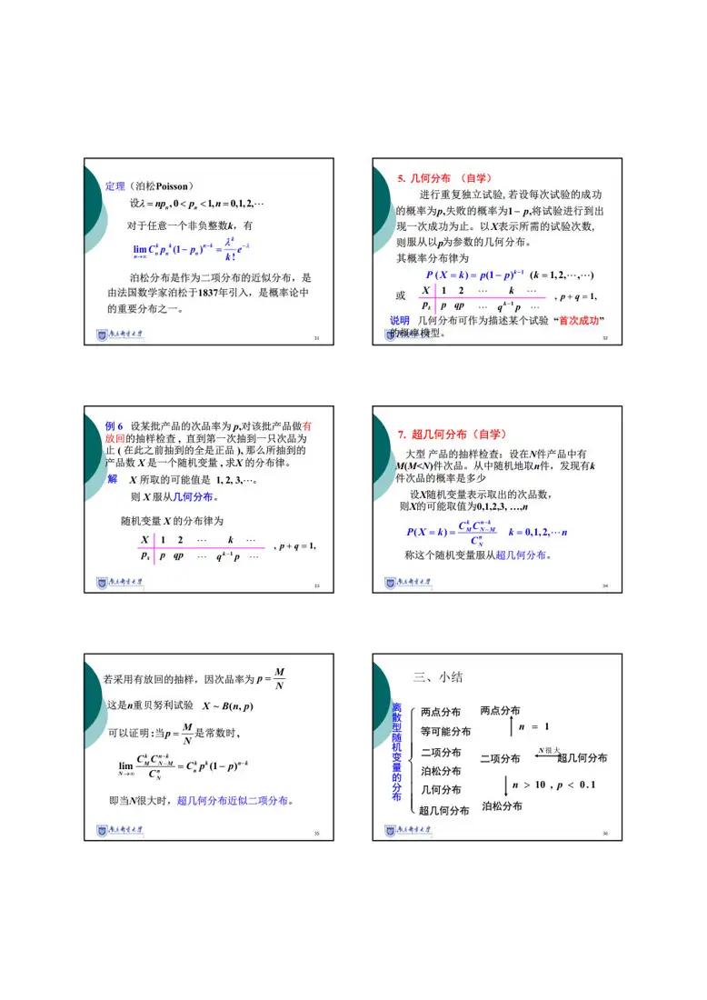

原文：

例6 设某批产品的次品率为 $p$ ，对该批产品做有放回的抽样检查，直到第一次抽到一只次品为止（在此之前抽到的全是正品），那么所抽到的产品数 $X$ 是一个随机变量，求 $X$ 的分布律。

解 $X$ 所取的可能值是 $1,2,3,\dots$ 。

则 $X$ 服从几何分布。

随机变量 $X$ 的分布律为

$$
\begin{array}{c c c c c c} X & 1 & 2 & \dots & k & \dots \\ \hline p _ {k} & p & q p & \dots & q ^ {k - 1} p & \dots \end{array} , p + q = 1,
$$

南京邮电大学
Nanjing University of Physics and Telecommunications

若采用有放回的抽样，因次品率为 $p = \frac{M}{N}$

这是 $n$ 重贝努利试验 $X \sim B(n, p)$

可以证明: 当 $p = \frac{M}{N}$ 是常数时,

$$
\lim _ {N \rightarrow \infty} \frac {C _ {M} ^ {k} C _ {N - M} ^ {n - k}}{C _ {N} ^ {n}} = C _ {n} ^ {k} p ^ {k} (1 - p) ^ {n - k}
$$

即当 $N$ 很大时，超几何分布近似二项分布。

南京新電大學
Nanjing University of Physics and Telecommunications

7. 超几何分布（自学）

大型产品的抽样检查：设在 $N$ 件产品中有 $M(M < N)$ 件次品。从中随机地取 $n$ 件，发现有 $k$ 件次品的概率是多少

设X随机变量表示取出的次品数，则X的可能取值为0,1,2,3,...,n

$$
P (X = k) = \frac {C _ {M} ^ {k} C _ {N - M} ^ {n - k}}{C _ {N} ^ {n}} \quad k = 0, 1, 2, \dots n
$$

称这个随机变量服从超几何分布。

两点分布

二项分布 $\xleftarrow{N\text{很大}}$ 超几何分布

$$
\Big \downarrow n > 1 0, p <   0. 1
$$

泊松分布

南京邮电大学
Nanjing University of Physics and Telecommunications

31

32

定理（泊松Poisson）

设 $\lambda=np_{n},0<p_{n}<1,n=0,1,2,\cdots$

对于任意一个非负整数 $k$ ，有

$\lim_{n\to \infty}C_n^k p_n^k (1 - p_n)^{n - k} = \frac{\lambda^k}{k!} e^{-\lambda}$

泊松分布是作为二项分布的近似分布，是由法国数学家泊松于1837年引入，是概率论中的重要分布之一。

5. 几何分布 （自学）

p,

进行重复独立试验, 若设每次试验的成功的概率为 $p$ , 失败的概率为 $1 - p$ , 将试验进行到出现一次成功为止。以 $X$ 表示所需的试验次数, 则服从以 $p$ 为参数的几何分布。

1-p,

说明 几何分布可作为描述某个试验 “首次成功” 的概率模型。

其概率分布律为

或

$P(X=k)=p(1-p)^{k-1}\quad(k=1,2,\cdots,\cdots)$

$X\left| \begin{array}{cccccc}1 & 2 & \cdots & k & \cdots \\ p_k & p & qp & \cdots & q^{k - 1}p & \cdots \end{array} \right., p + q = 1,$

南京邮电大学
Nanjing University of Physics and Telecommunications

三、小结

两点分布

离散型随机变量的分布

等可能分布

二项分布

泊松分布

几何分布

超几何分布

南京新電大學
Nanjing University of Private and Telecommunications

### 二项分布与泊松分布之间的关系.

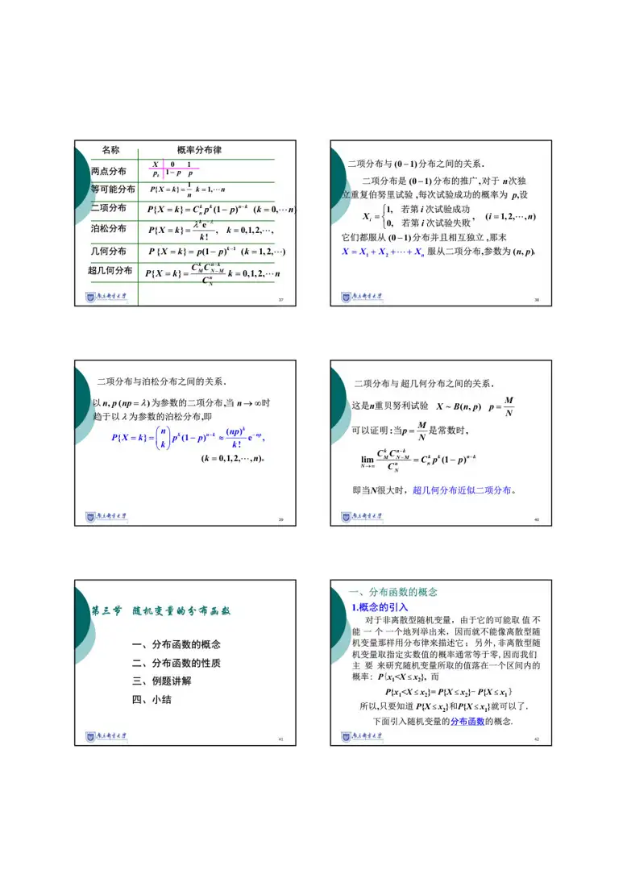

原文：

<table><tr><td>名称</td><td>概率分布律</td></tr><tr><td>两点分布</td><td> $\frac{X}{p_k}$   $\begin{array}{c|cc}  & 0 & 1 \\ 1 - p &  & p \end{array}$ </td></tr><tr><td>等可能分布</td><td> $P\{X=k\}=\frac{1}{n} k=1,\cdots n$ </td></tr><tr><td>二项分布</td><td> $P\{X=k\}=C_n^k p^k(1-p)^{n-k} (k=0,\cdots n$ </td></tr><tr><td>泊松分布</td><td> $P\{X=k\}=\frac{\lambda^k e^{-\lambda}}{k!}, \quad k=0,1,2,\cdots,$ </td></tr><tr><td>几何分布</td><td> $P\{X=k\}=p(1-p)^{k-1} (k=1,2,\cdots)$ </td></tr><tr><td>超几何分布</td><td> $P\{X=k\}=\frac{C_M^k C_{N-M}^{n-k}}{C_N^n} k=0,1,2,\cdots n$ </td></tr></table>

二项分布与泊松分布之间的关系.

以 $n, p (np = \lambda)$ 为参数的二项分布, 当 $n \to \infty$ 时趋于以 $\lambda$ 为参数的泊松分布, 即

$$
P \{X = k \} = \binom {n} {k} p ^ {k} (1 - p) ^ {n - k} \approx \frac {(n p) ^ {k}}{k !} \mathrm{e} ^ {- n p},
$$

$$
(k = 0, 1, 2, \dots , n) _ {\circ}
$$

二项分布与超几何分布之间的关系.

这是 $n$ 重贝努利试验 $X \sim B(n, p) \quad p = \frac{M}{N}$

可以证明: 当 $p=\frac{M}{N}$ 是常数时,

$$
\lim _ {N \rightarrow \infty} \frac {C _ {M} ^ {k} C _ {N - M} ^ {n - k}}{C _ {N} ^ {n}} = C _ {n} ^ {k} p ^ {k} (1 - p) ^ {n - k}
$$

即当 $N$ 很大时，超几何分布近似二项分布。

南京邮电大学
Nanjing University of Physics and Telecommunications

第三节 随机变量的分布函数

一、分布函数的概念

二、分布函数的性质

三、例题讲解

四、小结

$$
P \{x _ {1} <   X \leq x _ {2} \} = P \{X \leq x _ {2} \} - P \{X \leq x _ {1} \}
$$

下面引入随机变量的分布函数的概念.

南京邮电大学
Nanjing University of Science and Telecommunications

南京新電大學
Nanjing University of Private and Telecommunications

38

X 0 1 $p_{k}$ 1-p p

$P\{X=k\}=\frac{1}{n}\ k=1,\cdots n$

$P\{X = k\} = C_n^k p^k (1 - p)^{n - k}$ $(k = 0,\dots n)$

$P\{X = k\} = \frac{C_M^k C_{N - M}^{n - k}}{C_N^n} k = 0,1,2,\dots n$

$P\{X = k\} = p(1 - p)^{k - 1}$ $(k = 1,2,\dots)$

$P\{X = k\} = \frac{\lambda^k\mathrm{e}^{-\lambda}}{k!},\quad k = 0,1,2,\dots ,$

二项分布与 $(0 - 1)$ 分布之间的关系.

二项分布是(0-1)分布的推广,对于n次独立重复伯努里试验,每次试验成功的概率为p,设

$X_{i}=\left\{\begin{aligned}&1,& 若第 i 次试验成功\\ &0,& 若第 i 次试验失败,\end{aligned}\right.$

p,

它们都服从 $(0-1)$ 分布并且相互独立, 那末 $X = X_{1} + X_{2} + \cdots + X_{n}$ 服从二项分布, 参数为 $(n, p)$ .

$X = X_{1} + X_{2} + \dots +X_{n}$

$(i=1,2,\cdots,n)$

(n,p)

南京邮电大学
Nanjing University of Press and Telecommunications

一、分布函数的概念

1. 概念的引入

对于非离散型随机变量，由于它的可能取值不能一个一个地列举出来，因而就不能像离散型随机变量那样用分布律来描述它；另外，非离散型随机变量取指定实数值的概率通常等于零，因而我们主要来研究随机变量所取的值落在一个区间内的概率： $P\{x_{1}<X\leq x_{2}\}$ ，而

所以, 只要知道 $P\{X \leq x_{2}\}$ 和 $P\{X \leq x_{1}\}$ 就可以了.

### 证明 $F(x) = P\{X \leq x\}$ , 当 $x$ 越来越小时,

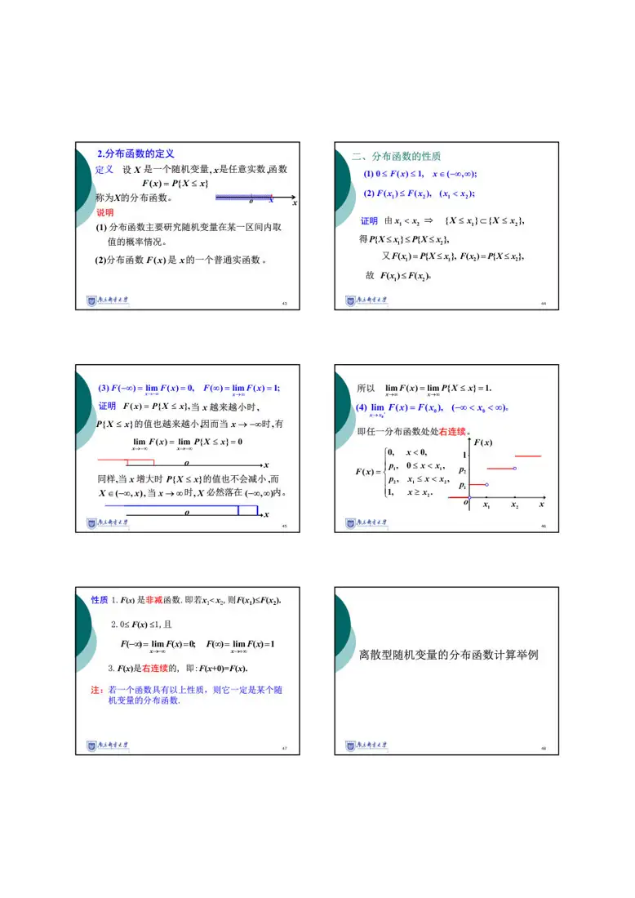

原文：

(3) $F(-\infty) = \lim_{x \to -\infty} F(x) = 0, \quad F(\infty) = \lim_{x \to \infty} F(x) = 1;$

证明 $F(x) = P\{X \leq x\}$ , 当 $x$ 越来越小时,

$P\{X \leq x\}$ 的值也越来越小因而当 $x \to -\infty$ 时, 有

$$
\lim _ {x \rightarrow - \infty} F (x) = \lim _ {x \rightarrow - \infty} P \{X \leq x \} = 0
$$

同样,当 x 增大时 $P\{X \leq x\}$ 的值也不会减小,而 $X \in (-\infty, x)$ , 当 $x \to \infty$ 时, X 必然落在 $(-\infty, \infty)$ 内。

性质 1. $F(x)$ 是非减函数. 即若 $x_{1}<x_{2}$ ，则 $F(x_{1})\leq F(x_{2})$ .

2. $0 \leq F(x) \leq 1$ , 且

$$
F (- \infty) = \lim _ {x \rightarrow - \infty} F (x) = 0; \quad F (\infty) = \lim _ {x \rightarrow + \infty} F (x) = 1
$$

3. $F(x)$ 是右连续的，即： $F(x + 0) = F(x)$ .

注：若一个函数具有以上性质，则它一定是某个随机变量的分布函数.

所以 $\lim_{x\to \infty}F(x) = \lim_{x\to \infty}P\{X\leq x\} = 1.$

(4) $\lim_{x\to x_0^+}F(x) = F(x_0),(-\infty < x_0 < \infty)$ 。

即任一分布函数处处右连续。

$$
F (x) = \left\{ \begin{array}{l l} 0, & x <   0, \\ p _ {1}, & 0 \leq x <   x _ {1}, \\ p _ {2}, & x _ {1} \leq x <   x _ {2}, \\ 1, & x \geq x _ {2}. \end{array} \right.
$$

南京新電大學
Nanjing University of Physics and Telecommunications

南京新電大學
Nanjing University of Physics and Telecommunications

43

南京新電大學
Nanjing University of Private and Telecommunications

2.分布函数的定义

定义 设 $X$ 是一个随机变量, $x$ 是任意实数, 函数

$F(x) = P\{X\leq x\}$

称为 $X$ 的分布函数。

说明

(1) 分布函数主要研究随机变量在某一区间内取值的概率情况。

(2)分布函数 $F(x)$ 是 $x$ 的一个普通实函数。

二、分布函数的性质

(1) $0 \leq F(x) \leq 1, x \in (-\infty, \infty)$ ;

$0 \leq F(x) \leq 1, \quad x \in (-\infty, \infty)$ ;

(2) $F(x_{1})\leq F(x_{2}),\quad (x_{1} <   x_{2});$

$F(x_{1})\leq F(x_{2}),\quad (x_{1} <   x_{2});$

$x_{1} <   x_{2}\Rightarrow \{X\leq x_{1}\} \subset \{X\leq x_{2}\}$

证明 由 $x_{1} < x_{2} \Rightarrow \{X \leq x_{1}\} \subset \{X \leq x_{2}\}$ ,

得 $P\{X \leq x_1\} \leq P\{X \leq x_2\}$ ,

$P\{X \leq x_1\} \leq P\{X \leq x_2\}$ ,

又 $F(x_{1}) = P\{X\leq x_{1}\} ,F(x_{2}) = P\{X\leq x_{2}\} ,$

故 $F(x_{1})\leq F(x_{2})$

$F(x_{1})\leq F(x_{2})$

南京邮电大学
Nanjing University of Press and Telecommunications

离散型随机变量的分布函数计算举例

南京邮电大学
Nanjing University of Science and Telecommunications

### 例1 判别下列函数是否为某随机变量的分布函数.

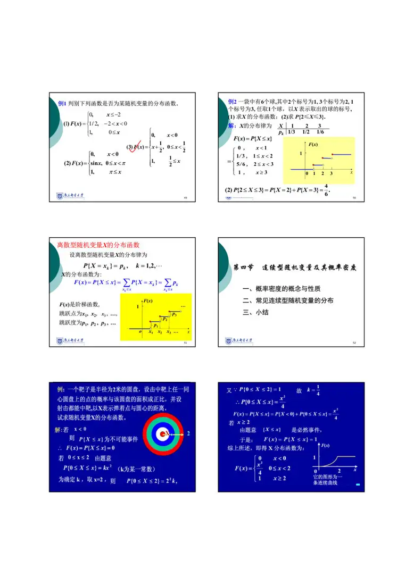

原文：

例1 判别下列函数是否为某随机变量的分布函数.

$$
(1) F (x) = \left\{ \begin{array}{l l} 0, & x \leq - 2 \\ 1 / 2, & - 2 <   x <   0 \\ 1, & 0 \leq x \end{array} \right.
$$

$$
(2) F (x) = \left\{ \begin{array}{l l} 0, & x <   0 \\ \sin x, & 0 \leq x <   \pi \\ 1, & \pi \leq x \end{array} \right.
$$

$$
(3) F (x) = \left\{ \begin{array}{l l} 0, & x <   0 \\ x + \frac {1}{2}, & 0 \leq x <   \frac {1}{2} \\ 1, & \frac {1}{2} \leq x \end{array} \right.
$$

南京邮电大学
Nanjing University of Physics and Telecommunications

离散型随机变量 $X$ 的分布函数

设离散型随机变量 $X$ 的分布律为

$$
P \{X = x _ {k} \} = p _ {k}, \quad k = 1, 2, \dots
$$

$X$ 的分布函数为：

$$
F (x) = P \{X \leq x \} = \sum_ {x _ {k} \leq x} P \{X = x _ {k} \} = \sum_ {x _ {k} \leq x} p _ {k}
$$

$F(x)$ 是阶梯函数，  
跳跃点为 $x_{1}, x_{2}, x_{3}, \ldots,$ 跳跃度为 $p_{1}, p_{2}, p_{3}, \ldots$

南京邮电大学
Nanjing University of Physics and Telecommunications

例：一个靶子是半径为2米的圆盘，设击中靶上任一同心圆盘上的点的概率与该圆盘的面积成正比，并设射击都能中靶，以X表示弹着点与圆心的距离，试求随机变量X的分布函数。

解:若 x < 0

则 $P\{X \leq x\}$ 为不可能事件

$$
\therefore F (x) = P \{X \leq x \} = 0
$$

若 $0 \leq x \leq 2$ 由题意

$P\{0 \leq X \leq x\} = kx^2$ （k为某一常数）

为确定 $\mathbf{k}$ ，取 $\mathbf{x} = 2$ ，则 $P\{0\leq X\leq 2\} = 2^2 k,$ 例2 一袋中有6个球,其中2个标号为1,3个标号为2,1个标号为3,任取1个球,以X表示取出的球的标号,(1)求X的分布函数;(2)求 $P\{2 \leqslant X \leqslant 3\}$ .

解： $X$ 的分布律为

$$
F (x) = P \{X \leq x \}
$$

$$
\begin{array}{c c c c} X & 1 & 2 & 3 \\ \hline p _ {k} & 1 / 3 & 1 / 2 & 1 / 6 \end{array}
$$

$$
= \left\{ \begin{array}{l l} 0, & x <   1 \\ 1 / 3, & 1 \leq x <   2 \\ 5 / 6, & 2 \leq x <   3 \\ 1, & x \geq 3 \end{array} \right.
$$

$$
P \{2 \leq X \leq 3 \} = P \{X = 2 \} + P \{X = 3 \} = \frac {4}{6}. \tag {2}
$$

第四节 连续型随机变量及其概率密度

一、概率密度的概念与性质

二、常见连续型随机变量的分布

三、小结

故 $k = \frac{1}{4}$

它的图形为条连续曲线

49

南京邮电大学
Nanjing University of Press and Telecommunications

52

又 $\because P\{0\leq X\leq 2\} = 1$

$\therefore P\{0 \leq X \leq x\} = \frac{x^2}{4}$

$F(x)=P\{X\leq x\}=P\{X<0\}+P\{0\leq X\leq x\}=\frac{x^{2}}{4}$ 若 $x \geq 2$

由题意 $\{X\leq x\}$ 是必然事件，

50

于是： $F(x) = P\{X\leq x\} = 1$

综上所述，即得X分布函数为：

$F(x) = \left\{ \begin{array}{ll}0 & x <   0\\ \frac{x^2}{4} & 0\leq x <   2\\ 1 & x\geq 2 \end{array} \right.$

### $$

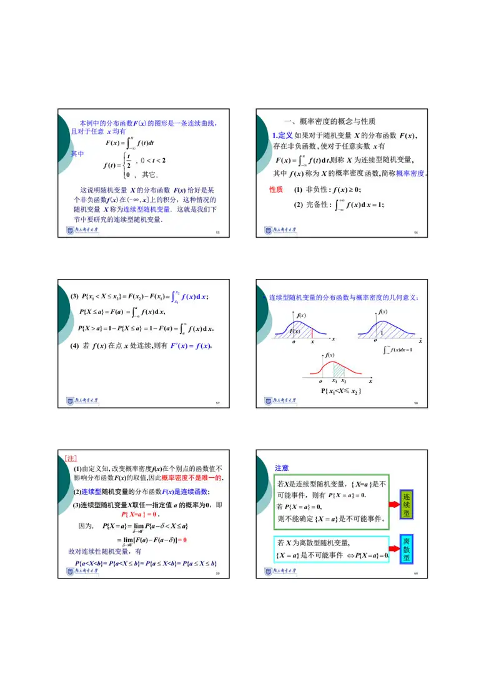

原文：

(3) $P\{x_{1} < X \leq x_{2}\} = F(x_{2}) - F(x_{1}) = \int_{x_{1}}^{x_{2}} f(x) \, \mathrm{d}x;$

$$
P \{X \leq a \} = F (a) = \int_ {- \infty} ^ {a} f (x) d x,
$$

$$
P \{X > a \} = 1 - P \{X \leq a \} = 1 - F (a) = \int_ {a} ^ {\infty} f (x) \mathrm{d} x _ {\circ}
$$

(4) 若 $f(x)$ 在点 $x$ 处连续, 则有 $F'(x) = f(x)$ 。

南京邮电大学
Nanjing University of Physics and Telecommunications

[注]

(1)由定义知, 改变概率密度 $f(x)$ 在个别点的函数值不影响分布函数 $F(x)$ 的取值, 因此概率密度不是唯一的.

(2)连续型随机变量的分布函数 $F(x)$ 是连续函数；

(3)连续型随机变量 $X$ 取任一指定值 $a$ 的概率为0，即 $P\{X = a\} = 0$

因为， $P\{X = a\} = \lim_{\delta \to 0^{+}}P\{a - \delta < X\leq a\}$ $= \lim_{\delta \to 0^{+}}[F(a) - F(a - \delta)] = 0$

故对连续性随机变量，有

$$
P \{a <   X <   b \} = P \{a <   X \leq b \} = P \{a \leq X <   b \} = P \{a \leq X \leq b \}
$$

连续型随机变量的分布函数与概率密度的几何意义：

$$
\mathrm{P} \left\{x _ {1} <   X \leqslant x _ {2} \right\}
$$

南京邮电大学
Nanjing University of Press and Telecommunications

注意

若 $X$ 是连续型随机变量， $\{X = a\}$ 是不可能事件，则有 $P\{X = a\} = 0.$ 若 $P\{X = a\} = 0,$

则不能确定 $\{X = a\}$ 是不可能事件。

若 $X$ 为离散型随机变量，

$\{X = a\}$ 是不可能事件 $\Leftrightarrow P\{X = a\} = 0$

58

南京邮电大学
Nanjing University of Physics and Telecommunications

55

56

本例中的分布函数 $F(x)$ 的图形是一条连续曲线，且对于任意 $x$ 均有

$F(x)$

$F(x) = \int_{-\infty}^{x}f(t)dt$

其中

$f(t) = \left\{ \begin{array}{ll}\frac{t}{2} & ,0 <   t <   2\\ 0 & ,\text{其它}. \end{array} \right.$

这说明随机变量 $X$ 的分布函数 $F(x)$ 恰好是某个非负函数 $f(x)$ 在 $(- \infty, x]$ 上的积分，这种情况的随机变量 $X$ 称为连续型随机变量。这就是我们下节中要研究的连续型随机变量。

$F(x)$

$(- \infty, x]$

一、概率密度的概念与性质

1. 定义 如果对于随机变量 $X$ 的分布函数 $F(x)$ , 存在非负函数, 使对于任意实数 $x$ 有

$F(x)$

$F(x) = \int_{-\infty}^{x}f(t)\mathrm{d}t$

$F(x)=\int_{-\infty}^{x}f(t)\mathrm{d}t$ ,则称X为连续型随机变量,

$f(x)$

其中 $f(x)$ 称为 X 的概率密度函数, 简称概率密度。

性质 (1) 非负性: $f(x) \geq 0$ ;

(2) 完备性: $\int_{-\infty}^{+\infty} f(x) \mathrm{d}x = 1$ ;

$f(x)\geq 0$

$\int_{-\infty}^{+\infty}f(x)\mathrm{d}x = 1;$

### 例1 设连续型随机变量 $X$ 具有概率密度函数

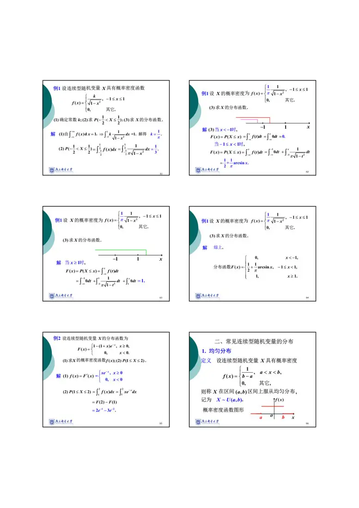

原文：

例1 设连续型随机变量 $X$ 具有概率密度函数

$$
f (x) = \left\{ \begin{array}{l l} \frac {k}{\sqrt {1 - x ^ {2}}}, & - 1 \leq x \leq 1 \\ 0, & \text {其它}. \end{array} \right.
$$

(1) 确定常数 $k$ ; (2) 求 $P(-\frac{1}{2} < X \leq \frac{1}{2})$ ; (3) 求 $X$ 的分布函数.

解 (1) 由 $\int_{-\infty}^{+\infty} f(x) \, \mathrm{d}x = 1$ , $\Rightarrow \int_{-1}^{1} k \frac{1}{\sqrt{1 - x^2}} dx = 1$ . 解得 $k = \frac{1}{\pi}$ .

$$
P (- \frac {1}{2} <   X \leq \frac {1}{2}) = \int_ {- \frac {1}{2}} ^ {\frac {1}{2}} f (x) d x = \int_ {- \frac {1}{2}} ^ {\frac {1}{2}} \frac {1}{\pi \sqrt {1 - x ^ {2}}} d x = \frac {1}{3}. \tag {2}
$$

南京新電大學
Nanjing University of Physics and Telecommunications

例1 设 $X$ 的概率密度为 $f(x) = \begin{cases} \frac{1}{\pi} \frac{1}{\sqrt{1 - x^2}}, & -1 \leq x \leq 1 \\ 0, & \text{其它}. \end{cases}$

(3) 求 $X$ 的分布函数.

$$
\text {   x   } - 1 \quad 1 \quad \text {   x   }
$$

解 当 $x \geq 1$ 时，

$$
\begin{array}{r l} F (x) & = P (X \leq x) = \int_ {- \infty} ^ {x} f (t) d t \\ & = \int_ {- \infty} ^ {- 1} 0 d t + \int_ {- 1} ^ {1} \frac {1}{\pi \sqrt {1 - t ^ {2}}} d t + \int_ {1} ^ {x} 0 d t = 1. \end{array}
$$

南京邮电大学
Nanjing University of Physics and Telecommunications

例2 设连续型随机变量 $X$ 的分布函数为

$$
F (x) = \left\{ \begin{array}{c c} 1 - (1 + x) e ^ {- x}, & x \geq 0, \\ 0, & x <   0. \end{array} \right.
$$

(1) 求 $X$ 的概率密度函数 $f(x)$ ; (2) $P(1 \leq X \leq 2)$ .

解 (1) $f(x) = F'(x) = \begin{cases} xe^{-x}, & x \geq 0 \\ 0, & x < 0 \end{cases}$

$$
\begin{array}{r l} (2) P (1 \leq X \leq 2) & = \int_ {1} ^ {2} f (x) d x = \int_ {1} ^ {2} x e ^ {- x} d x \\ & = F (2) - F (1) \\ & = 2 e ^ {- 1} - 3 e ^ {- 2}. \end{array}
$$

例1 设 $X$ 的概率密度为 $f(x) = \begin{cases} \frac{1}{\pi} \frac{1}{\sqrt{1 - x^2}}, & -1 \leq x \leq 1 \\ 0, & \text{其它}. \end{cases}$

(3) 求 $X$ 的分布函数.

$$
- 1 \quad 1 \quad x
$$

解 (3) 当 $x < -1$ 时,

$$
\begin{array}{r l} & {F (x) = P (X \leq x) =  \int_ {- \infty} ^ {x} f (t) d t =  \int_ {- \infty} ^ {x} 0 d t = 0.} \\ & {\text {当} - 1 \leq x <   1 \text {时},} \end{array}
$$

$$
F (x) = P (X \leq x) = \int_ {- \infty} ^ {x} f (t) d t = \int_ {- \infty} ^ {- 1} 0 d t + \int_ {- 1} ^ {x} \frac {1}{\pi \sqrt {1 - t ^ {2}}} d t
$$

$$
= \frac {1}{2} + \frac {1}{\pi} \arcsin x.
$$

例1设 $X$ 的概率密度为 $f(x) = \begin{cases} \frac{1}{\pi}\frac{1}{\sqrt{1 - x^2}}, & -1 \leq x \leq 1 \\ 0, & \text{其它}. \end{cases}$

(3) 求 $X$ 的分布函数.

解 综上，

分布函数 $F(x)=\left\{\begin{array}{l l}0,&x<-1,\\ \frac{1}{2}+\frac{1}{\pi}\arcsin x,&-1\leq x<1,\\ 1,&x\geq1.\end{array}\right.$

二、常见连续型随机变量的分布

$$
f (x) = \left\{ \begin{array}{l l} \frac {1}{b - a}, & a <   x <   b, \\ 0, & \text {其它}, \end{array} \right.
$$

63

62

南京邮电大学
Nanjing University of Press and Telecommunications

1. 均匀分布

定义 设连续型随机变量 $X$ 具有概率密度

则称 X 在区间 $(a,b)$ 区间上服从均匀分布，

记为 $X \sim U(a, b)$ 。

概率密度函数图形

南京邮电大学
Nanjing University of Science and Telecommunications

### 解 因为 $X \sim U[2, 5]$ ，所以 $X$ 的概率密度函数为

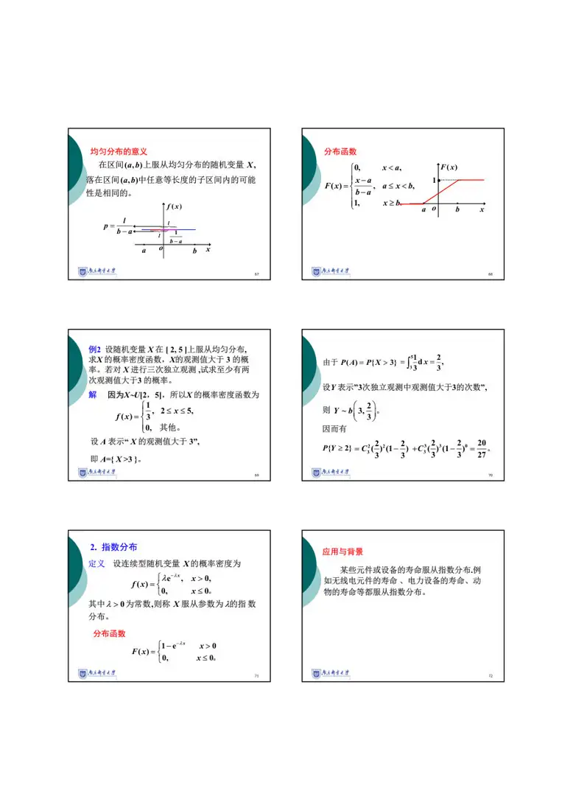

原文：

例2 设随机变量 $X$ 在 $[2,5]$ 上服从均匀分布，求 $X$ 的概率密度函数， $X$ 的观测值大于3的概率。若对 $X$ 进行三次独立观测，试求至少有两次观测值大于3的概率。

解 因为 $X \sim U[2, 5]$ ，所以 $X$ 的概率密度函数为

$$
f (x) = \left\{ \begin{array}{l l} \frac {1}{3}, & 2 \leq x \leq 5, \\ 0, & \text {其他。} \end{array} \right.
$$

设 A 表示“X 的观测值大于 3”，

即 $A = \{X > 3\}$ 。

南京邮电大学
Nanjing University of Physics and Telecommunications

2. 指数分布

定义 设连续型随机变量 $X$ 的概率密度为

$$
f (x) = \left\{ \begin{array}{l l} \lambda \mathrm{e} ^ {- \lambda x}, & x > 0, \\ 0, & x \leq 0 _ {\circ} \end{array} \right.
$$

其中 $\lambda > 0$ 为常数, 则称 $X$ 服从参数为 $\lambda$ 的指数分布。

分布函数

$$
F (x) = \left\{ \begin{array}{l l} 1 - \mathrm{e} ^ {- \lambda x} & x > 0 \\ 0, & x \leq 0 _ {\circ} \end{array} \right.
$$

南京新電大學
Nanjing University of Physics and Telecommunications

由于 $P(A) = P\{X > 3\} = \int_{3}^{5}\frac{1}{3}\mathrm{d}x = \frac{2}{3},$

设Y表示”3次独立观测中观测值大于3的次数”，

则 $Y \sim b\left(3, \frac{2}{3}\right)$ 。

因而有

$$
P \{Y \geq 2 \} = C _ {3} ^ {2} (\frac {2}{3}) ^ {2} (1 - \frac {2}{3}) + C _ {3} ^ {3} (\frac {2}{3}) ^ {3} (1 - \frac {2}{3}) ^ {0} = \frac {2 0}{2 7} 。
$$

72

南京邮电大学
Nanjing University of Public and Telecommunications

68

均匀分布的意义

(a,b)

(a,b)

67

在区间 $(a,b)$ 上服从均匀分布的随机变量 $X$ 落在区间 $(a,b)$ 中任意等长度的子区间内的可能性是相同的。

$p = \frac{l}{b - a}$ $f(x)$ $l$ $\frac{1}{b - a}$

分布函数

$F(x) = \left\{ \begin{array}{l}0,\\ \frac{x - a}{b - a},\\ 1, \end{array} \right.$

$x < a,$

南京航空航天大学
Nanjing University of Physics and Telecommunications

$a \leq x < b,$

$F(x)$ 1
a o b x

南京邮电大学
Nanjing University of Press and Telecommunications

应用与背景

某些元件或设备的寿命服从指数分布.例如无线电元件的寿命、电力设备的寿命、动物的寿命等都服从指数分布。

南京邮电大学
Nanjing University of Physics and Telecommunications

### 南京邮电大学

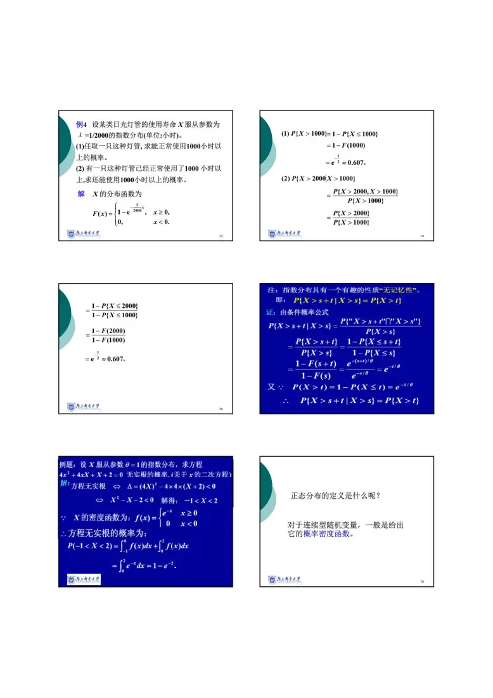

原文：

南京邮电大学
Nanjing University of Physics and Telecommunications

$$
= \frac {1 - P \{X \leq 2 0 0 0 \}}{1 - P \{X \leq 1 0 0 0 \}}
$$

$$
= \frac {1 - F (2 0 0 0)}{1 - F (1 0 0 0)}
$$

$$
= \mathrm{e} ^ {- \frac {1}{2}} \approx 0. 6 0 7 。
$$

南京邮电大学
Nanjing University of Physics and Telecommunications

例题：设 $X$ 服从参数 $\theta = 1$ 的指数分布，求方程

$4x^{2}+4xX+X+2=0$ 无实根的概率.(关于 x 的二次方程)
解: 方程无实根 $\Leftrightarrow$ $\Delta=(4X)^{2}-4\times4\times(X+2)<0$

$$
X - 2 <   0
$$

∵ X 的密度函数为： $f(x)=\left\{\begin{aligned}e^{-x}&\quad x\geq0\\ 0&\quad x<0\end{aligned}\right.$ ∴方程无实根的概率为： $P(-1<X<2)=\int_{-1}^{0}f(x)dx+\int_{0}^{2}f(x)dx$ $=\int_{0}^{2}e^{-x}dx=1-e^{-2}.$

注：指数分布具有一个有趣的性质“无记忆性”。即： $P\{X > s + t \mid X > s\} = P\{X > t\}$

证：由条件概率公式

$P\{X > s + t \mid X > s\} = \frac{P\{"X > s + t'\cap\}"X > s''\}}{P\{X > s\}}$ $= \frac{P\{X > s + t\}}{P\{X > s\}} = \frac{1 - P\{X \leq s + t\}}{1 - P\{X \leq s\}}$ $= \frac{1 - F(s + t)}{1 - F(s)} = \frac{e^{-(s + t) / \theta}}{e^{-s / \theta}} = e^{-t / \theta}$ 又 $\because P(X > t) = 1 - P(X \leq t) = e^{-t / \theta}$ $\therefore P\{X > s + t \mid X > s\} = P\{X > t\}$

正态分布的定义是什么呢？

对于连续型随机变量，一般是给出它的概率密度函数。

南京新電大學
Nanjing University of Private and Telecommunications

例4 设某类日光灯管的使用寿命 X 服从参数为 $\lambda = 1/2000$ 的指数分布(单位: 小时)。

(1)任取一只这种灯管,求能正常使用1000小时以上的概率。

(2) 有一只这种灯管已经正常使用了1000小时以上, 求还能使用1000小时以上的概率。

解 $X$ 的分布函数为

$F(x) = \left\{ \begin{array}{ll}1 - \mathrm{e}^{-\frac{1}{2000} x}, & x\geq 0,\\ 0, & x <   0. \end{array} \right.$

73

(1) $P\{X > 1000\} = 1 - P\{X \leq 1000\}$ $= 1 - F(1000)$ $= \mathrm{e}^{-\frac{1}{2}} \approx 0.607$ 。

(2) $P\{X > 2000|X > 1000\}$ $= \frac{P\{X > 2000,X > 1000\}}{P\{X > 1000\}}$ $= \frac{P\{X > 2000\}}{P\{X > 1000\}}$

南京邮电大学
Nanjing University of Private and Telecommunication

74

### 二、正态分布 $N(\mu, \sigma^2)$ 的图形特点

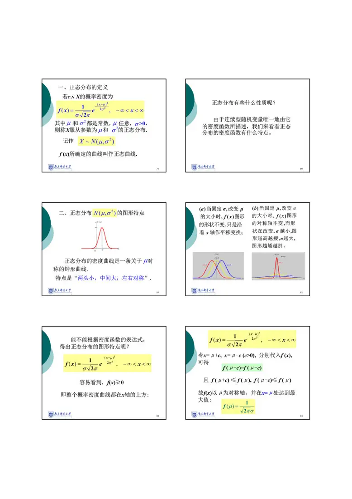

原文：

二、正态分布 $N(\mu, \sigma^2)$ 的图形特点

正态分布的密度曲线是一条关于 $\mu$ 对称的钟形曲线.

特点是“两头小，中间大，左右对称”

能不能根据密度函数的表达式，得出正态分布的图形特点呢？

$$
f (x) = \frac {1}{\sigma \sqrt {2 \pi}} e ^ {- \frac {(x - \mu) ^ {2}}{2 \sigma^ {2}}}, - \infty <   x <   \infty
$$

容易看到， $f(x)\geqslant 0$

即整个概率密度曲线都在 $x$ 轴的上方；

(a)当固定 $\sigma$ ，改变 $\mu$ 的大小时， $f(x)$ 图形的形状不变，只是沿着 $x$ 轴作平移变换；

(b)当固定 $\mu$ ，改变 $\sigma$ 的大小时， $f(x)$ 图形的对称轴不变，而形状在改变， $\sigma$ 越小，图形越高越瘦， $\sigma$ 越大，图形越矮越胖。

$$
f (\mu + c) = f (\mu - c)
$$

$$
f (\mu) = \frac {1}{\sqrt {2 \pi} \sigma}
$$

南京邮电大学
Nanjing University of Physics and Telecommunications

79

南京航空航天大学
Nanjing University of Physics and Telecommunications

80

一、正态分布的定义

$f(x)$ 所确定的曲线叫作正态曲线.

若r.v $X$ 的概率密度为

$f(x) = \frac{1}{\sigma\sqrt{2\pi}} e^{-\frac{(x - \mu)^2}{2\sigma^2}}, -\infty < x < \infty$

记作 $X \sim N(\mu, \sigma^2)$

$X\sim N(\mu ,\sigma^{2})$

$\sigma^2$

其中 $\mu$ 和 $\sigma^{2}$ 都是常数， $\mu$ 任意， $\sigma>0$ ，则称 X 服从参数为 $\mu$ 和 $\sigma^{2}$ 的正态分布.

μ

$\sigma^{2}$

$\sigma >0$

南京邮电大学
Nanjing University of Physics and Telecommunications

正态分布有些什么性质呢？

由于连续型随机变量唯一地由它的密度函数所描述，我们来看看正态分布的密度函数有什么特点。

南京邮电大学
Nanjing University of Physics and Telecommunications

82

$f(x) = \frac{1}{\sigma\sqrt{2\pi}} e^{-\frac{(x - \mu)^2}{2\sigma^2}}, -\infty < x < \infty$

$x = \mu + c, x = \mu - c (c > 0)$ ,

令 $x=\mu+c,\quad x=\mu-c\quad(c>0)$ ，分别代入 $f(x)$ ，可得

且 $f(\mu + c) \leqslant f(\mu), f(\mu - c) \leqslant f(\mu)$

故 $f(x)$ 以 $\mu$ 为对称轴，并在 $x=\mu$ 处达到最大值：

南京新電大學
Nanjing University of Private and Telecommunications

### 根据对密度函数的分析，也可初步画出正态分布的概率密度曲线图。

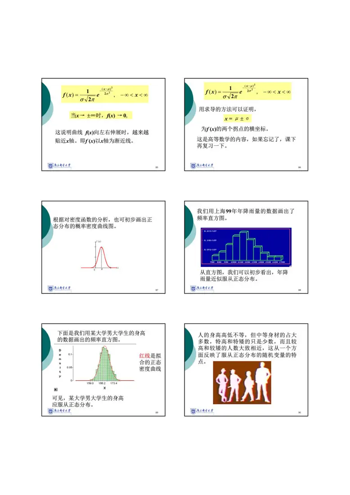

原文：

根据对密度函数的分析，也可初步画出正态分布的概率密度曲线图。

下面是我们用某大学男大学生的身高的数据画出的频率直方图。

红线是拟合的正态密度曲线

可见，某大学男大学生的身高应服从正态分布。

我们用上海99年年降雨量的数据画出了频率直方图。

南京航空航天大学
Nanjing University of Physics and Telecommunications

85

南京航空航天大学
Nanjing University of Physics and Telecommunications

86

$f(x) = \frac{1}{\sigma\sqrt{2\pi}} e^{-\frac{(x - \mu)^2}{2\sigma^2}}, -\infty < x < \infty$

当 $x \to \pm \infty$ 时， $f(x) \to 0$

这说明曲线 $f(x)$ 向左右伸展时，越来越贴近 x 轴。即 $f(x)$ 以 x 轴为渐近线。

$f(x) = \frac{1}{\sigma\sqrt{2\pi}} e^{-\frac{(x - \mu)^2}{2\sigma^2}}, -\infty < x < \infty$

用求导的方法可以证明，

$\boldsymbol{x} = \mu \pm \sigma$

为 $f(x)$ 的两个拐点的横坐标。

这是高等数学的内容，如果忘记了，课下再复习一下。

南京邮电大学
Nanjing University of Physics and Telecommunications

88

人的身高高低不等，但中等身材的占大多数，特高和特矮的只是少数，而且较高和较矮的人数大致相近，这从一个方面反映了服从正态分布的随机变量的特点。

南京邮电大学
Nanjing University of Physics and Telecommunications

90

### $$

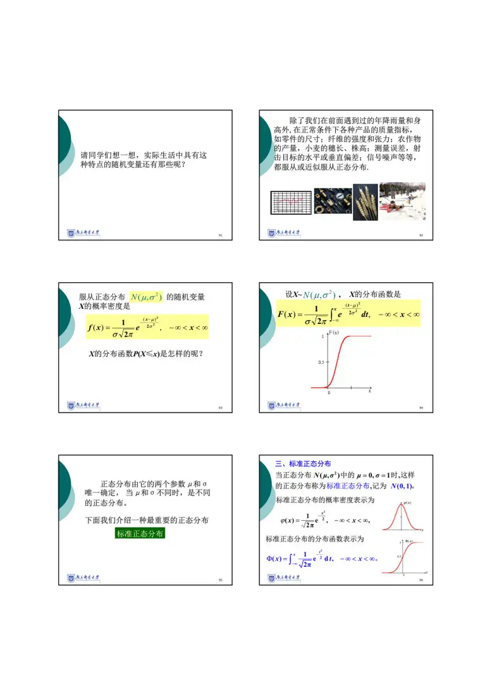

原文：

服从正态分布 $N(\mu, \sigma^2)$ 的随机变量 $X$ 的概率密度是

$$
f (x) = \frac {1}{\sigma \sqrt {2 \pi}} e ^ {- \frac {(x - \mu) ^ {2}}{2 \sigma^ {2}}}, - \infty <   x <   \infty
$$

$X$ 的分布函数 $P(X \leqslant x)$ 是怎样的呢？

正态分布由它的两个参数 $\mu$ 和 $\sigma$ 唯一确定，当 $\mu$ 和 $\sigma$ 不同时，是不同的正态分布。

下面我们介绍一种最重要的正态分布标准正态分布

设 $X \sim N(\mu, \sigma^2)$ ， $X$ 的分布函数是

$$
F (x) = \frac {1}{\sigma \sqrt {2 \pi}} \int_ {- \infty} ^ {x} e ^ {- \frac {(t - \mu) ^ {2}}{2 \sigma^ {2}}} d t,
$$

$$
\infty <   \boldsymbol {x} <   \infty
$$

三、标准正态分布

当正态分布 $N(\mu,\sigma^{2})$ 中的 $\mu=0,\sigma=1$ 时, 这样的正态分布称为标准正态分布, 记为 $N(0,1)$ 。

标准正态分布的概率密度表示为

$$
\varphi (x) = \frac {1}{\sqrt {2 \pi}} \mathrm{e} ^ {- \frac {x ^ {2}}{2}}, - \infty <   x <   \infty ,
$$

标准正态分布的分布函数表示为

$$
\Phi (x) = \int_ {- \infty} ^ {x} \frac {1}{\sqrt {2 \pi}} \mathrm{e} ^ {- \frac {t ^ {2}}{2}} \mathrm{d} t, - \infty <   x <   \infty 。
$$

南京邮电大学
Nanjing University of Physics and Telecommunications

南京新電大學
Nanjing University of Physics and Telecommunications

B

请同学们想一想，实际生活中具有这种特点的随机变量还有那些呢？

南京邮电大学
Nanjing University of Physics and Telecommunications

91

除了我们在前面遇到过的年降雨量和身高外，在正常条件下各种产品的质量指标，如零件的尺寸；纤维的强度和张力；农作物的产量，小麦的穗长、株高；测量误差，射击目标的水平或垂直偏差；信号噪声等等，都服从或近似服从正态分布.

The image contains three unrelated images: a line graph with a red fluctuating line, mechanical tools and weights, and a close-up of wheat stalks and snowboarders. The right image is too blurry to recognize any text content.

南京邮电大学
Nanjing University of Private and Telecommunication

92

### 证明 $Z = \frac{X - \mu}{\sigma}$ 的分布函数为

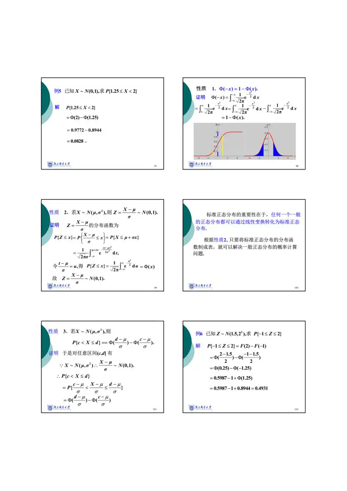

原文：

性质 2、若 $X \sim N(\mu, \sigma^2)$ , 则 $Z = \frac{X - \mu}{\sigma} \sim N(0, 1)$ 。
证明 $Z = \frac{X - \mu}{\sigma}$ 的分布函数为

$$
\begin{array}{r l} P \{Z \leq x \} & = P \left\{\frac {X - \mu}{\sigma} \leq x \right\} = P \{X \leq \mu + \sigma x \} \\ & = \frac {1}{\sqrt {2 \pi} \sigma} \int_ {- \infty} ^ {\mu + \sigma x} e ^ {- \frac {(t - \mu) ^ {2}}{2 \sigma^ {2}}} d t, \end{array}
$$

令 $\frac{t - \mu}{\sigma} = u$ ，得 $P\{Z\leq x\} = \frac{1}{\sqrt{2\pi}}\int_{-\infty}^{x}\mathrm{e}^{-\frac{u^2}{2}}\mathrm{d}u = \Phi (x)$

故 $Z = \frac{X - \mu}{\sigma}\sim N(0,1)$ 。

性质 3、若 $X \sim N(\mu, \sigma^2)$ , 则

$$
P \{c <   X \leq d \} = \Phi (\frac {d - \mu}{\sigma}) - \Phi (\frac {c - \mu}{\sigma}) _ {\circ}
$$

证明 于是对任意区间 $(c,d]$ 有

$$
\begin{array}{r l} & {\because X \sim N (\mu , \sigma^ {2}) \therefore \frac {X - \mu}{\sigma} \sim N (0, 1) _ {\circ}} \\ & {\therefore P \{c <   X \leq d \}} \\ & {\quad = P \{\frac {c - \mu}{\sigma} <   \frac {X - \mu}{\sigma} \leq \frac {d - \mu}{\sigma} \}} \\ & {\quad = \Phi (\frac {d - \mu}{\sigma}) - \Phi (\frac {c - \mu}{\sigma})} \end{array}
$$

南京邮电大学
Nanjing University of Physics and Telecommunications

标准正态分布的重要性在于，任何一个一般的正态分布都可以通过线性变换转化为标准正态分布.

根据性质2, 只要将标准正态分布的分布函数制成表, 就可以解决一般正态分布的概率计算问题.

$$
\begin{array}{l} P \{- 1 \leq Z \leq 2 \} = F (2) - F (- 1) \\ = \Phi (\frac {2 - 1 . 5}{2}) - \Phi (\frac {- 1 - 1 . 5}{2}) \\ = \Phi (0. 2 5) - \Phi (- 1. 2 5) \\ = 0. 5 9 8 7 - 1 + \Phi (1. 2 5) \\ = 0. 5 9 8 7 - 1 + 0. 8 9 4 4 = 0. 4 9 3 1 \end{array}
$$

南京邮电大学
Nanjing University of Physics and Telecommunications

南京航空航天大学
Nanjing University of Physics and Telecommunications

97

南京航空航天大学
Nanjing University of Physics and Telecommunications

98

例5 已知 $X \sim N(0,1)$ , 求 $P\{1.25 \leq X < 2\}$

$X\sim N(\mathbf{0},\mathbf{1}),$

$P\{1.25 \leq X < 2\}$

解 $P\{1.25 \leq X < 2\}$ $= \Phi(2) - \Phi(1.25)$ $= 0.9772 - 0.8944$ $= 0.0828$ 。

性质 1、 $\Phi(-x)=1-\Phi(x)$ 。

$\Phi(-x)=1-\Phi(x)$ 。

证明 $\Phi (-x) = \int_{-\infty}^{-x}\frac{1}{\sqrt{2\pi}}\mathrm{e}^{-\frac{x}{2}}\mathrm{d}x$

$\Phi (-x) = \int_{-\infty}^{-x}\frac{1}{\sqrt{2\pi}}\mathrm{e}^{-\frac{x}{2}}\mathrm{d}x$

$= \int_{x}^{\infty}\frac{1}{\sqrt{2\pi}}\mathrm{e}^{-\frac{x^{2}}{2}}\mathrm{d}x = \int_{-\infty}^{\infty}\frac{1}{\sqrt{2\pi}}\mathrm{e}^{-\frac{x^{2}}{2}}\mathrm{d}x - \int_{-\infty}^{x}\frac{1}{\sqrt{2\pi}}\mathrm{e}^{-\frac{x^{2}}{2}}\mathrm{d}x$ $= 1 - \Phi (x)$ 。

$\Phi(x)$ and $\varphi(x)$

南京邮电大学
Nanjing University of Press and Telecommunications

例6 已知 $Z \sim N(1.5, 2^2)$ , 求 $P\{-1 \leq Z \leq 2\}$

解

### 三、小结

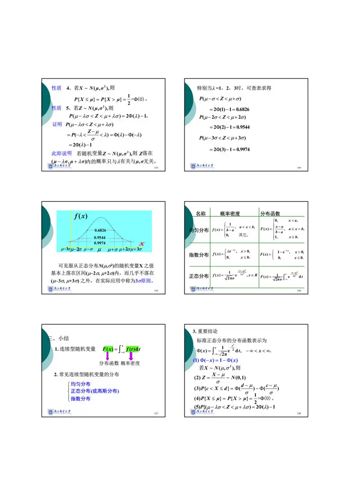

原文：

此即说明 若随机变量 $Z \sim N(\mu, \sigma^2)$ , 则 $Z$ 落在 $(\mu - \lambda \sigma, \mu + \lambda \sigma)$ 内的概率只与 $\lambda$ 有关与 $\mu, \sigma$ 无关。

可见服从正态分布 $N(\mu, \sigma^2)$ 的随机变量X之值基本上落在区间 $(\mu - 2\sigma, \mu + 2\sigma)$ 内，而几乎不落在 $(\mu - 3\sigma, \mu + 3\sigma)$ 之外，在实际应用中称为 $3\sigma$ 原则。

三、小结

1. 连续型随机变量

$$
F (x) = \int_ {- \infty} ^ {x} f (t) \mathrm{d} t
$$

分布函数 概率密度

2. 常见连续型随机变量的分布

均匀分布

正态分布(或高斯分布)

指数分布

<table><tr><td>名称</td><td>概率密度</td><td>分布函数</td></tr><tr><td>均匀分布</td><td colspan="2"> $f(x)=\begin{cases}\frac{1}{b-a},&a\( F(x)=\begin{cases}0,&x\( x\( \leq x\( \geq b_{o}$  \\\frac{-a}{b-a},&amp;a\leq x $\geq b_{o}$  \\\frac{-a}{b-a},&amp;a\leq x $\geq b_{o}$  \\\frac{-a}{b-a},&amp;a\leq x $\geq b_{o}$  \\\frac{-a}{b-a},&amp;a\leq x $\geq b_{o}$  \\\frac{-a}{b-a},&amp;a&lt; a,\\\frac{-a}{b-a},&amp;a\leq x $\geq b_{o}$  \\\frac{-a}{b-a},&amp;a\leq x $\geq b_{o}$  \\\frac{-a}{b-a},&amp;a&lt; a,\\\frac{-a}{b-a},&amp;a\leq x $\geq b_{o}$  \\\frac{-a}{b-a},&amp;a&lt; a,\\\frac{-a}{b-a},&amp;a&lt; a&lt; b,\\frac{-a}{b-a},&amp;a&lt; a&lt; b&lt; b,\\frac{-a}{b-a},&amp;a&lt; a&lt; b&lt; b&lt; b,\\frac{-a}{b-a},&amp;a&lt; a&lt; b&lt; b&lt; b,\\frac{-a}{b-a},&amp;a&lt; a&lt; b&lt; b&lt; b,\\frac{-a}{b-a},&amp;a&lt; a&lt; b&lt; b&lt; b,\\frac{-a}{b-a},&amp;a&lt; a&lt; b&lt; b&lt; b,\\frac{-a}{b-a},&amp;a&lt; a&lt; b&lt; b&lt; b.\\frac{-a}{b-a},&amp;a&lt; a&lt; b&lt; b&lt; b,\\frac{-a}{b-a},&amp;a&lt; a&lt; b&lt; b&lt; b,\\frac{-a}{b-a},&amp;a&lt; a&lt; b&lt; b&lt; b,\\frac{-a}{b-a},&amp;a&lt; a&lt; b&lt; b&lt; b,\\frac{-a}{b-a},&amp;a&lt; a&lt; b&lt; b&lt; b,\\frac{-a&lt; a&lt; b&lt; b&lt; b&lt; b,\\frac{-a&lt; a&lt; b&lt; b&lt; b&lt; b,\\frac{-a&lt; a&lt; b&lt; b&lt; b&lt; b,\\frac{-a&lt; a&lt; b&lt; b&lt; b&lt; b,\\frac{-a&lt; a&lt; b&lt; b&lt; b&lt; b,\\frac{-a&lt; a&lt; b&lt; b&lt; b&lt; b,\\frac{-a&lt; a&lt; b&lt; b&lt; b&lt; b,\\frac {-a&lt; a&lt; b&lt; b&lt; b&lt; b&lt; b,\\frac {-a&lt; a&lt; b&lt; b&lt; b&lt; b&lt; b,\\frac {-a&lt; a&lt; b&lt; b&lt; b&lt; b&lt; b,\\frac {-a&lt; a&lt; b&lt; b&lt; b&lt; b&lt; b,\\frac {-a&lt; a&lt; b&lt; b&lt; b&lt; b&lt; b,\\frac {-a&lt; a&lt; b&lt; b&lt; b&lt; b&lt; b,\\frac {-a&lt; - a&lt; b&lt; b&lt; b&lt; b&lt; b,\\frac {-a&lt; - a&lt; b&lt; b&lt; b&lt; b&lt; b,\\frac {-a&lt; - a&lt; b&lt; b&lt; b&lt; b&lt; b,\\frac {-a&lt; - a&lt; b&lt; b&lt; b&lt; b&lt; b,\\frac {-a&lt; - a&lt; b&lt; b&lt; b&lt; b&lt; b,\\frac {-a&lt; - a&lt; b&lt; b&lt; b&lt; b,\\frac {-a&lt; - a&lt; b&lt; b&lt; b&lt; b&lt; b,\\frac {-a&lt; - a&lt; b&lt; b&lt; b&lt; b&lt; b,\\frac {-a&lt; - a&lt; b&lt; b&lt; b&lt; b&lt; b,\\frac {-a&lt; - a&lt; b&lt; b&lt; b&lt; b&lt; b,\\frac {-a&lt; - a&lt; b&lt; b&lt; b&lt; b&lt; b, \\frac {-a&lt; - a&lt; b&lt; b&lt; b&lt; b&lt; b,\\frac {-a&lt; - a&lt; b&lt; b&lt; b&lt; b&lt; b,\\frac {-a&lt; - a&lt; b&lt; b&lt; b&lt; b&lt; b,\\frac {-a&lt; - a&lt; b&lt; b&lt; b&lt; b&lt; b,\\frac {-a&lt; - a&lt; b&lt; b&lt; b&lt; b&lt; b,\\frac {-a&lt; - a&lt; b&lt; i&lt; i&lt; i&lt; i&lt; i&lt; i&lt; i&lt; i&lt; i&lt; i&lt; i&lt; i&lt; i&lt; i&lt; i&lt; i&lt; i&lt; i&lt; i&lt; i&lt; i&lt; i&lt; i&lt; i&lt; i&lt; i&lt; i&lt; i&lt; i&lt; i&lt; i&lt; i&lt; i&lt; i&lt; i&lt; i&lt; i&lt; i&lt; i&lt; i&lt; i&lt; i&lt; i&lt; i&lt; i&lt; i&lt; i&lt; i&lt; i&lt; i&lt; 106</td></tr><tr><td>指数分布</td><td> $f(x)=\begin{cases}\lambda e^{-\lambda x},&x>0,\\0,&x\leq 0_{o}\end{cases}$ </td><td> $F(x)=\begin{cases}1-e^{-\lambda x},&x>0,\\0,&x\leq 0_{o}\end{cases}$ </td></tr><tr><td>正态分布</td><td> $f(x)=\frac{1}{\sqrt{2\pi}\sigma}e^{-\frac{(x-\mu)^{2}}{2\sigma^{2}}},x\in R$ </td><td> $F(x)=\frac{1}{\sqrt{2\pi}\sigma}\int_{-\infty}^{x}e^{-\frac{(t-\mu)^{2}}{2\sigma^{2}}}dt$ </td></tr></table>

3.重要结论

标准正态分布的分布函数表示为

$$
\Phi (x) = \int_ {- \infty} ^ {x} \frac {1}{\sqrt {2 \pi}} \mathrm{e} ^ {- \frac {t ^ {2}}{2}} \mathrm{d} t, - \infty <   x <   \infty .
$$

$$
(1) \Phi (- x) = 1 - \Phi (x)
$$

若 $X \sim N(\mu, \sigma^{2})$ ，则

(2) $Z = \frac{X - \mu}{\sigma}\sim N(\mathbf{0},1)$

$$
(3) P \{c <   X \leq d \} = \Phi (\frac {d - \mu}{\sigma}) - \Phi (\frac {c - \mu}{\sigma})
$$

(4) $P\{X \leq \mu\} = P\{X > \mu\} = \frac{1}{2} = \Phi(0)$ 。

$$
(5) P \{(\mu - \lambda \sigma <   Z <   \mu + \lambda \sigma) = 2 \Phi (\lambda) - 1
$$

108

性质 4、若 $X \sim N(\mu, \sigma^2)$ , 则

$X\sim N(\mu ,\sigma^2)$

$P\{X \leq \mu\} = P\{X > \mu\} = \frac{1}{2} = \Phi(0)$ 。

性质 5、若 $Z \sim N(\mu, \sigma^2)$ , 则

$Z \sim N(\mu, \sigma^2)$ ,

$P(\mu - \lambda \sigma < Z < \mu + \lambda \sigma) = 2\Phi(\lambda) - 1$ 。

$P(\mu - \lambda \sigma < Z < \mu + \lambda \sigma)$

证明 $P(\mu -\lambda \sigma <  Z <   \mu +\lambda \sigma)$ $= P(-\lambda <  \frac{Z - \mu}{\sigma} <  \lambda) = \Phi (\lambda) - \Phi (-\lambda)$ $= 2\Phi (\lambda) - 1$

$(\mu-\lambda\sigma,\mu+\lambda\sigma$ 南京新電大學
Nanjing University of Physics and Telecommunications

$Z\sim N(\mu ,\sigma^2)$

μ,

特别当 $\lambda = 1$ ，2，3时，可查表求得

$P(\mu -\sigma <  Z <   \mu +\sigma)$

$= 2\Phi (1) - 1 = 0.6826$ $P(\mu -2\sigma <  Z <   \mu +2\sigma)$ $= 2\Phi (2) - 1 = 0.9544$

$P(\mu -3\sigma <  Z <   \mu +3\sigma)$

$= 2\Phi (3) - 1 = 0.9974$

南京航空航天大学
Nanjing University of Physics and Telecommunications

104

### 第五节 随机变量的函数的分布

原文：

第五节 随机变量的函数的分布

一、离散型随机变量的函数的分布

二、连续型随机变量的函数的分布

三、小结

例1 设随机变量 $X$ 的分布律为

<table><tr><td>X</td><td>-1</td><td>0</td><td>1</td><td>2</td><td>3</td></tr><tr><td> $p_k$ </td><td>1/5</td><td>1/10</td><td>1/10</td><td>3/10</td><td>3/10</td></tr></table>

求 (1) $Y = X - 1$ (2) $Y = -2X$ (3) $Y = X^2$ 分布律。

<table><tr><td>解: X</td><td>-1</td><td>0</td><td>1</td><td>2</td><td>3</td></tr><tr><td>X-1</td><td>-2</td><td>-1</td><td>0</td><td>1</td><td>2</td></tr><tr><td>-2X</td><td>2</td><td>0</td><td>-2</td><td>-4</td><td>-6</td></tr><tr><td> $X^2$ </td><td></td><td>0</td><td>1</td><td>4</td><td>9</td></tr><tr><td> $p_k$ </td><td></td><td>1/10</td><td>3/10</td><td>3/10</td><td>3/10</td></tr></table>

一、离散型随机变量的函数的分布

设 $f(x)$ 是定义在随机变量 $X$ 的一切可能值 $x$ 的集合上的函数，若随机变量 $Y$ 随着 $X$ 取值 $x$ 的值而取 $y = f(x)$ 的值，则称随机变量 $Y$ 为随机变量 $X$ 的函数，记作 $Y = f(X)$

问题

如何根据已知的随机变量 $X$ 的分布求得随机变量 $Y = f(X)$ 的分布？

南京邮电大学
Nanjing University of Physics and Telecommunications

南京邮电大学
Nanjing University of Private and Telecommunications

109

110

3. 正态分布是概率论中最重要的分布

正态分布有极其广泛的实际背景,例如测量误差,人的生理特征尺寸如身高、体重等,正常情况下生产的产品尺寸:直径、长度、重量高度,炮弹的弹落点的分布等,都服从或近似服从正态分布.可以说,正态分布是自然界和社会现象中最为常见的一种分布,一个变量如果受到大量微小的、独立的随机因素的影响,那么这个变量一般是一个正态随机变量。

另一方面,有些分布(如二项分布、泊松分布)的极限分布是正态分布.所以,无论在实践中,还是在理论上,正态分布是概率论中最重要的一种分布.

n=500, p=0.01 $\frac{1}{\sqrt{npq}} \varphi^{\frac{k-np}{knpq}}$ $\frac{n^{2}q^{-k}}{k^{2}q^{-k}}$

二项分布向正态分布的转换

n=1000, p=0.01 $\frac{1}{\sqrt{\mathrm{npq}}}\cdot \frac{\mathrm{p}^{-1}}{\sqrt{\mathrm{npq}}}\cdot \frac{\mathrm{k}-\mathrm{np}}{\mathrm{k}^{n}\cdot \mathrm{q}^{-k}}$

n=10000, p=0.005 $\frac{1}{\sqrt{npq}}\varphi^k\frac{k-np}{\sqrt{npq}}$

南京邮电大学
Nanjing University of Press and Telecommunications

离散型随机变量的函数的分布

如果 $X$ 是离散型随机变量, 其函数 $Y = g(X)$ 也是离散型随机变量若 $X$ 的分布律为

$p_{k}$

X $x_{1}$ $x_{2}$ $\cdots$ $x_{k}$ $\cdots$ $p_{k}$ $p_{1}$ $p_{2}$ $\cdots$ $p_{k}$ $\cdots$

$Y = g(X)$

则 $Y = g(X)$ 的分布律为

$Y = g(X)$

$Y = g(X)$ $g(x_{1})$ $g(x_{2})$ $\cdots$ $g(x_{k})$ $\cdots$ $p_{k}$ $p_{1}$ $p_{2}$ $\cdots$ $p_{k}$ $\cdots$

$p_{k}$

$g(x_{k})$

若 $g(x_{k})$ 中有值相同的,应将相应的 $p_{k}$ 合并。

### 例3 设随机变量 $X$ 的概率密度为

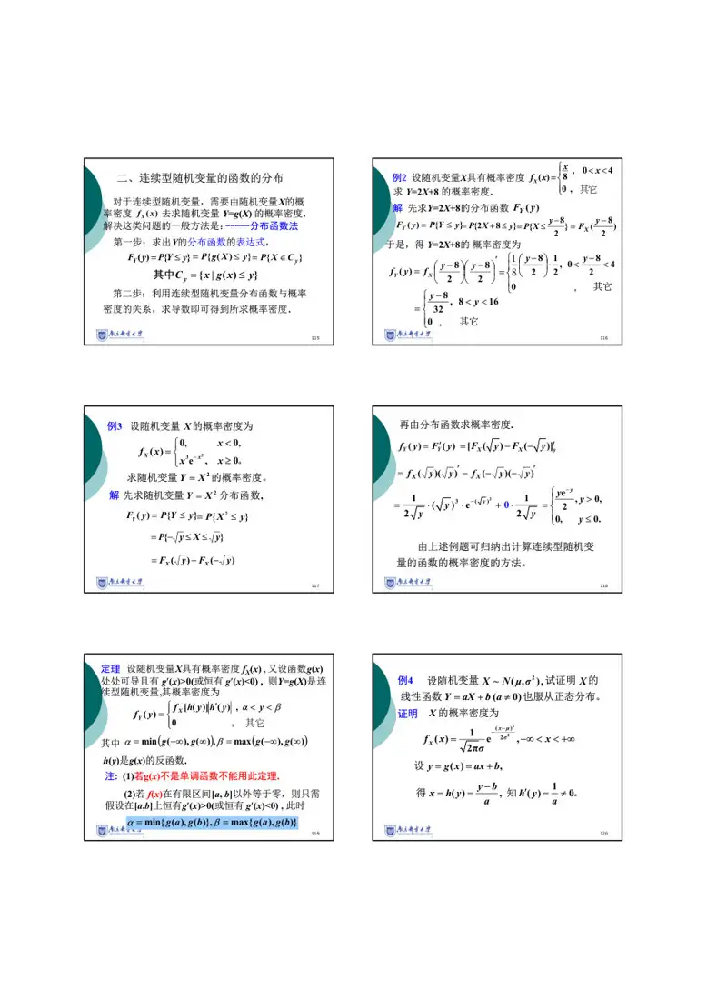

原文：

例3 设随机变量 $X$ 的概率密度为

$$
f _ {X} (x) = \left\{ \begin{array}{l l} 0, & x <   0, \\ x ^ {3} \mathrm{e} ^ {- x ^ {2}}, & x \geq 0. \end{array} \right.
$$

求随机变量 $Y = X^2$ 的概率密度。

解 先求随机变量 $Y = X^2$ 分布函数，

$$
\begin{array}{r l} F _ {Y} (y) & = P \{Y \leq y \} = P \{X ^ {2} \leq y \} \\ & = P \{- \sqrt {y} \leq X \leq \sqrt {y} \} \\ & = F _ {X} (\sqrt {y}) - F _ {X} (- \sqrt {y}) \end{array}
$$

南京邮电大学
Nanjing University of Posts and Telecommunications

定理 设随机变量 $X$ 具有概率密度 $f_{X}(x)$ ，又设函数 $g(x)$ 处处可导且有 $g'(x) > 0$ (或恒有 $g'(x) < 0$ )，则 $Y = g(X)$ 是连续型随机变量, 其概率密度为

$$
f _ {Y} (y) = \left\{ \begin{array}{l l} f _ {X} [ h (y) ] \big | h ^ {\prime} (y) \big |, & a <   y <   \beta \\ 0, & \text {其它} \end{array} \right.
$$

其中 $\alpha = \min \bigl (g(-\infty), g(\infty)\bigr), \beta = \max \bigl (g(-\infty), g(\infty)\bigr)$

$h(y)$ 是 $g(x)$ 的反函数.

注：(1)若 $g(x)$ 不是单调函数不能用此定理.

(2) 若 $f(x)$ 在有限区间 $[a, b]$ 以外等于零，则只需假设在 $[a, b]$ 上恒有 $g'(x) > 0$ (或恒有 $g'(x) < 0$ )，此时

$$
\alpha = \min \{g (a), g (b) \}, \beta = \max \{g (a), g (b) \}
$$

再由分布函数求概率密度.

$$
f _ {Y} (y) = F _ {Y} ^ {\prime} (y) = \left[ F _ {X} (\sqrt {y}) - F _ {X} (- \sqrt {y}) \right] _ {y} ^ {\prime}
$$

$$
= f _ {X} (\sqrt {y}) (\sqrt {y}) ^ {\prime} - f _ {X} (- \sqrt {y}) (- \sqrt {y}) ^ {\prime}
$$

$$
= \frac {1}{2 \sqrt {y}} \cdot (\sqrt {y}) ^ {3} \cdot \mathrm{e} ^ {- (\sqrt {y}) ^ {2}} + 0 \cdot \frac {1}{2 \sqrt {y}} = \left\{ \begin{array}{l l} \frac {y \mathrm{e} ^ {- y}}{2}, & y > 0, \\ 0, & y \leq 0. \end{array} \right.
$$

由上述例题可归纳出计算连续型随机变量的函数的概率密度的方法。

$$
f _ {X} (x) = \frac {1}{\sqrt {2 \pi} \sigma} \mathrm{e} ^ {- \frac {(x - \mu) ^ {2}}{2 \sigma^ {2}}}, - \infty <   x <   + \infty
$$

二、连续型随机变量的函数的分布

$f_{X}(x)$

对于连续型随机变量，需要由随机变量X的概率密度 $f_{X}(x)$ 去求随机变量 $Y=g(X)$ 的概率密度.解决这类问题的一般方法是：——分布函数法

$Y = g(X)$

第一步：求出 $Y$ 的分布函数的表达式，

$F_{Y}(y) = P\{Y\leq y\} = P\{g(X)\leq y\} = P\{X\in C_{y}\}$

其中 $C_y = \{x\mid g(x)\leq y\}$

$C_y = \{x\mid g(x)\leq y\}$

第二步：利用连续型随机变量分布函数与概率密度的关系，求导数即可得到所求概率密度.

南京邮电大学
Nanjing University of Press and Telecommunication

115

$Y = 2X + 8$

例2 设随机变量 $X$ 具有概率密度 $f_{X}(x) = \begin{cases} \frac{x}{8}, & 0 < x < 4 \\ 0, & \text{其它} \end{cases}$ 求 $Y = 2X + 8$ 的概率密度.

$Y = 2X + 8$

解 先求 $Y = 2X + 8$ 的分布函数 $F_{Y}(y)$

$f_{X}(x) = \left\{ \begin{array}{ll}\frac{x}{8}, & 0 <   x <   4\\ 0, & \text{其它} \end{array} \right.$

$F_{Y}(y)$

$F_{Y}(y) = P\{Y \leq y\} = P\{2X + 8 \leq y\} = P\{X \leq \frac{y - 8}{2}\} = F_{X}\left(\frac{y - 8}{2}\right)$

$Y = 2X + 8$

于是，得 $Y = 2X + 8$ 的概率密度为

南京新電大學
Nanjing University of Private and Telecommunication

$f_{Y}(y) = f_{X}\left(\frac{y - 8}{2}\right)\left(\frac{y - 8}{2}\right)^{\prime} = \begin{cases} \frac{1}{8}\left(\frac{y - 8}{2}\right) \cdot \frac{1}{2}, & 0 < \frac{y - 8}{2} < 4 \\ 0, & \text{其它} \end{cases}$ $= \begin{cases} \frac{y - 8}{32}, & 8 < y < 16 \\ 0, & \text{其它} \end{cases}$

116

南京邮电大学
Nanjing University of Physics and Telecommunications

118

例4 设随机变量 $X \sim N(\mu, \sigma^2)$ , 试证明 $X$ 的线性函数 $Y = aX + b (a \neq 0)$ 也服从正态分布。证明 $X$ 的概率密度为

设 $y = g(x) = ax + b,$

得 $x = h(y) = \frac{y - b}{a}$ ，知 $h'(y) = \frac{1}{a} \neq 0$ 。

南京邮电大学
Nanjing University of Science and Telecommunications

### 当 $0 < y < 1$ 时，

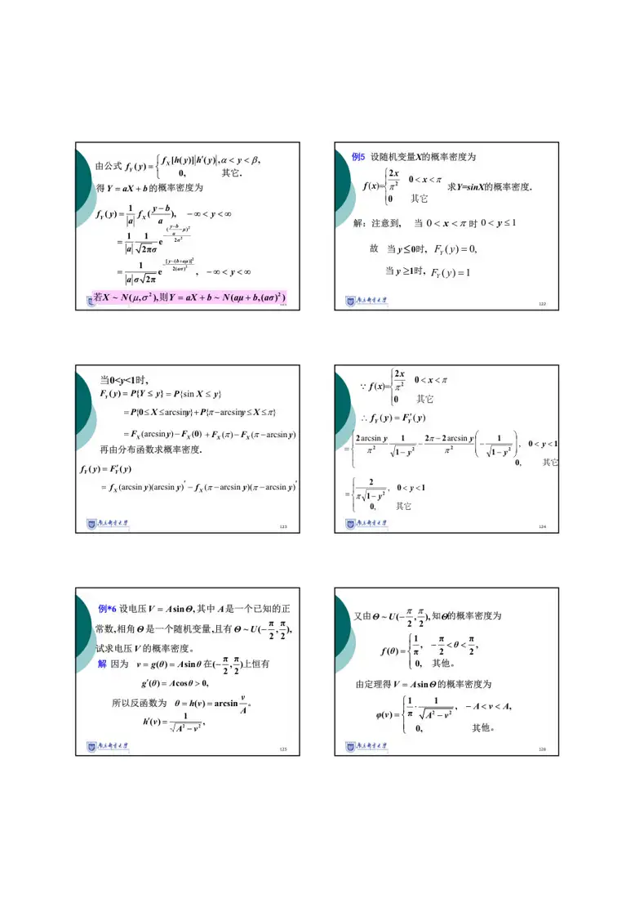

原文：

若 $X \sim N(\mu, \sigma^2)$ , 则 $Y = aX + b \sim N(a\mu + b, (a\sigma)^2)$

当 $0 < y < 1$ 时，

$$
\begin{array}{r l} F _ {y} (y) & = P \{Y \leq y \} = P \{\sin X \leq y \} \\ & = P \{\mathbf {0} \leq X \leq \arcsin y \} + P \{\pi - \arcsin y \leq X \leq \pi \} \\ & = F _ {X} (\arcsin y) - F _ {X} (\mathbf {0}) + F _ {X} (\pi) - F _ {X} (\pi - \arcsin y) \end{array}
$$

再由分布函数求概率密度.

$$
\begin{array}{r l} f _ {Y} (y) & = F _ {Y} ^ {\prime} (y) \\ & = f _ {X} (\arcsin y) (\arcsin y) ^ {\prime} - f _ {X} (\pi - \arcsin y) (\pi - \arcsin y) ^ {\prime} \end{array}
$$

南京邮电大学
Nanjing University of Physics and Telecommunications

例\*6 设电压 $V = A \sin \Theta$ ，其中 $A$ 是一个已知的正常数，相角 $\Theta$ 是一个随机变量，且有 $\Theta \sim U\left(-\frac{\pi}{2}, \frac{\pi}{2}\right)$ ，试求电压 $V$ 的概率密度。

解 因为 $v = g(\theta) = A\sin \theta$ 在 $(- \frac{\pi}{2}, \frac{\pi}{2})$ 上恒有

$$
g ^ {\prime} (\theta) = A \cos \theta > 0,
$$

所以反函数为 $\theta = h(v) = \arcsin \frac{v}{A}$ 。

$$
h ^ {\prime} (v) = \frac {1}{\sqrt {A ^ {2} - v ^ {2}}},
$$

南京新電大學
Nanjing University of Physics and Telecommunications

$$
\because f (x) = \left\{ \begin{array}{l l} \frac {2 x}{\pi^ {2}} & 0 <   x <   \pi \\ 0 & \text {其它} \end{array} \right.
$$

$$
\therefore f _ {Y} (y) = F _ {Y} ^ {\prime} (y)
$$

$$
\left\{ \begin{array}{l} \frac {2 \arcsin y}{\pi^ {2}} \frac {1}{\sqrt {1 - y ^ {2}}} - \frac {2 \pi - 2 \arcsin y}{\pi^ {2}} \left(- \frac {1}{\sqrt {1 - y ^ {2}}}\right), \\ 0, \end{array} \right.
$$

$$
\mathbf {0} <   y <   \mathbf {1}
$$

$$
= \left\{ \begin{array}{c l} { \frac {2}{\pi \sqrt {1 - y ^ {2}}},} & {\mathbf {0} <   y <   \mathbf {1}} \\ {\mathbf {0},} & {\text {其它}} \end{array} \right.
$$

南京邮电大学
Nanjing University of Press and Telecommunications

又由 $\Theta \sim U(-\frac{\pi}{2},\frac{\pi}{2})$ ，知 $\Theta$ 的概率密度为

$$
f (\theta) = \left\{ \begin{array}{l l} \frac {1}{\pi}, & - \frac {\pi}{2} <   \theta <   \frac {\pi}{2}, \\ 0, & \text {其他。} \end{array} \right.
$$

由定理得 $V = A\sin \Theta$ 的概率密度为

$$
\varphi (v) = \left\{ \begin{array}{c c} { \frac {1}{\pi} \cdot \frac {1}{\sqrt {A ^ {2} - v ^ {2}}},} & {- A <   v <   A,} \\ {0,} & {\text {其他。}} \end{array} \right.
$$

南京邮电大学
Nanjing University of Science and Telecommunications

由公式 $f_{Y}(y) = \left\{ \begin{array}{c} f_{X}[h(y)]|h'(y)|, \alpha < y < \beta, \\ 0, \quad \text{其它}. \end{array} \right.$

$f_{Y}(y) = \left\{ \begin{array}{cc} f_{X}[h(y)]|h'(y)|, & \alpha < y < \beta, \\ 0, & \text{其它}. \end{array} \right.$

得 $Y = aX + b$ 的概率密度为

$Y = aX + b$

$f_{Y}(y) = \frac{1}{|a|} f_{X}\left(\frac{y - b}{a}\right), -\infty <  y <   \infty$ $= \frac{1}{|a|}\frac{1}{\sqrt{2\pi}\sigma}\mathrm{e}^{-\frac{\left(\frac{y - b}{a} - \mu\right)^{2}}{2\sigma^{2}}}$ $= \frac{1}{|a|\sigma\sqrt{2\pi}}\mathrm{e}^{\frac{-[y - (b + a\mu)]^2}{2(a\sigma)^2}}, - \infty <  y <   \infty$

$X \sim N(\mu, \sigma^2)$ ,

$Y = aX + b \sim N(a\mu + b, (a\sigma)^2)$

例5 设随机变量 $X$ 的概率密度为

$f(x)=\left\{\begin{aligned}&\frac{2x}{\pi^{2}}&0<x<\pi\\ &0& 其它\end{aligned}\right.$

$f(x)=\left\{\begin{aligned}&\frac{2x}{\pi^{2}}&0<x<\pi\\ &0& 其它\end{aligned}\right.$ 求Y=sinX的概率密度.

$0 <   x <   \pi$

解：注意到，当 $0 < x < \pi$ 时 $0 < y \leq 1$

$0 <   y\leq 1$

故 当 $y \leq 0$ 时， $F_{Y}(y) = 0$

$y \leq 0$ 时， $F_{Y}(y) = 0,$

当 $y \geq 1$ 时， $F_{Y}(y) = 1$

南京邮电大学
Nanjing University of Physics and Telecommunications

122

### 南京邮电大学

原文：

南京邮电大学
Nanjing University of Physics and Telecommunications

第二章 随机变量及其分布

习题课

一、重点与难点

二、主要内容

三、典型例题

南京邮电大学
Nanjing University of Physics and Telecommunications

二、主要内容

一、重点与难点

1.重点

(0-1)分布、二项分布和泊松分布的分布律

正态分布、均匀分布和指数分布的分布函数、密度函数及有关区间概率的计算

2.难点

连续型随机变量的概率密度函数的求法

随机变量

130

129

小结

1. 离散型随机变量的函数的分布

$Y = g(X)$

若 $Y = g(X)$ 且 $X$ 的分布律为：

X

$x_{1}$

$p_{k}$

$x_{2}$

$x_{k}$

$p_{1}$

X $x_{1}$ $x_{2}$ $\cdots$ $x_{k}$ $\cdots$ $p_{k}$ $p_{1}$ $p_{2}$ $\cdots$ $p_{k}$ $\cdots$

$p_{2}$

$p_{k}$

$Y = g(X)$

则 $Y = g(X)$ 的分布律为

$Y = g(X)$

$p_{k}$

$Y = g(X)$ $g(x_{1})$ $g(x_{2})$ $\cdots$ $g(x_{k})$ $\cdots$ $p_{k}$ $p_{1}$ $p_{2}$ $\cdots$ $p_{k}$ $\cdots$

$g(x_{2})$

$p_{1}$

$g(x_{k})$

$p_{2}$

$p_{k}$

127

2. 连续型随机变量的函数的分布

$F_{Y}(y) = P\{Y\leq y\} = P\{g(X)\leq y\}$

方法1 $F_{Y}(y) = P\{Y \leq y\} = P\{g(X) \leq y\}$ $= \int_{g(x) \leq y} f_{X}(x) \, \mathrm{d}x, (-\infty < x < +\infty),$

再对 $F_{Y}(y)$ 求导得到 $Y$ 的密度函数 $f_{Y}(y)$ .

$F_{Y}(y)$

南京航空航天大学
Nanjing University of Physics and Telecommunications

$f_{Y}(y)$

$f_{Y}(y)=\left\{\begin{aligned}f_{X}[h(y)]&|h'(y)|,\alpha<y<\beta,\\ 0,& 其他。\end{aligned}\right.$

注意条件。

128

131

南京邮电大学
Nanjing University of Physics and Telecommunications

定义 设 $E$ 是随机试验, 它的样本空间是 $S = \{e\}$ . 如果对于每一个 $e \in S$ , 有一个实数 $X(e)$ 与之对应, 这样就得到一个定义在 $S$ 上的单值实值函数 $X(e)$ , 称随机变量。

(1)随机变量与普通的函数不同

随机变量是一个函数,但它与普通的函数有着本质的差别,普通函数是定义在实数轴上的,而随机变量是定义在样本空间上的(样本空间的元素不一定是实数).

南京邮电大学
Nanjing University of Press and Telecommunications

132

### 离散型随机变量的分布律

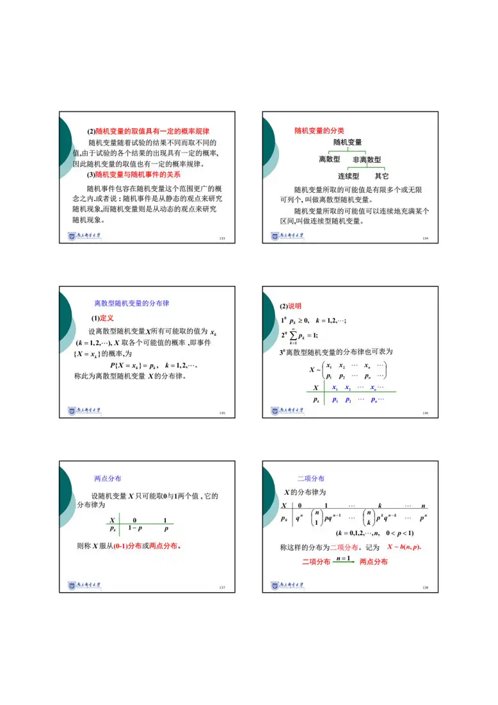

原文：

离散型随机变量的分布律

(1)定义

设离散型随机变量X所有可能取的值为 $x_{k}$ $(k=1,2,\cdots)$ ，X取各个可能值的概率，即事件 $\{X=x_{k}\}$ 的概率，为

$$
P \{X = x _ {k} \} = p _ {k}, \quad k = 1, 2, \dots 。
$$

称此为离散型随机变量 $X$ 的分布律。

南京邮电大学
Nanjing University of Posts and Telecommunications

两点分布

设随机变量 $X$ 只可能取0与1两个值，它的分布律为

$$
\begin{array}{c c c} X & \mathbf {0} & 1 \\ \hline p _ {k} & 1 - p & p \end{array}
$$

则称 $X$ 服从(0-1)分布或两点分布。

(2)说明

$$
1 ^ {0} p _ {k} \geq 0, k = 1, 2, \dots ;
$$

$$
2 ^ {0} \sum_ {k = 1} ^ {\infty} p _ {k} = 1;
$$

$3^{0}$ 离散型随机变量的分布律也可表为

$$
X \sim \left( \begin{array}{c c c c c} x _ {1} & x _ {2} & \dots & x _ {n} & \dots \\ p _ {1} & p _ {2} & \dots & p _ {n} & \dots \end{array} \right)
$$

$$
\begin{array}{c c c c c} X & x _ {1} & x _ {2} & \dots & x _ {n} \dots \\ \hline p _ {k} & p _ {1} & p _ {2} & \dots & p _ {n} \dots \end{array}
$$

$$
(k = 0, 1, 2, \dots , n, \quad 0 <   p <   1)
$$

二项分布 $\xrightarrow{n = 1}$ 两点分布

南京邮电大学
Nanjing University of Science and Telecommunications

南京邮电大学
Nanjing University of Physics and Telecommunications

133

134

(2)随机变量的取值具有一定的概率规律

南京邮电大学
Nanjing University of Private and Telecommunications

随机变量随着试验的结果不同而取不同的值,由于试验的各个结果的出现具有一定的概率,因此随机变量的取值也有一定的概率规律。

(3)随机变量与随机事件的关系

随机事件包容在随机变量这个范围更广的概念之内。或者说：随机事件是从静态的观点来研究随机现象，而随机变量则是从动态的观点来研究随机现象。

随机变量的分类

随机变量

随机变量
离散型 非离散型
连续型 其它

随机变量所取的可能值是有限多个或无限可列个, 叫做离散型随机变量。

随机变量所取的可能值可以连续地充满某个区间,叫做连续型随机变量。

南京邮电大学
Nanjing University of Press and Telecommunications

二项分布

$X$ 的分布律为

X | 0 1 ... k ... n
p\_k | q^n (n) p q^{n-1} ... (n) p^k q^{n-k} ... p^n

称这样的分布为二项分布。记为 $X \sim b(n, p)$ .

### (3)性质

原文：

(3)性质

$$
1 ^ {0} 0 \leq F (x) \leq 1, (- \infty , \infty);
$$

$$
2 ^ {0} F (x _ {1}) \leq F (x _ {2}), (x _ {1} <   x _ {2});
$$

$$
3 ^ {0} F (- \infty) = \lim _ {x \rightarrow - \infty} F (x) = 0, F (\infty) = \lim _ {x \rightarrow \infty} F (x) = 1;
$$

$$
4 ^ {0} \lim _ {x \rightarrow x _ {0} ^ {+}} F (x) = F (x _ {0}), (- \infty <   x _ {0} <   \infty);
$$

即任一分布函数处处右连续。

南京邮电大学
Nanjing University of Physics and Telecommunications

连续型随机变量的概率密度

(1)定义

如果对于随机变量 X 的分布函数 $F(x)$ ，存在非负函数，使对于任意实数 x 有

$$
F (x) = \int_ {- \infty} ^ {x} f (t) \mathrm{d} t,
$$

则称 $X$ 为连续型随机变量, 其中 $f(x)$ 称为 $X$ 的概率密度函数, 简称概率密度。

(4)重要公式

$$
P \{a <   X \leq b \} = F (b) - F (a),
$$

$$
P \{X > a \} = 1 - F (a) 。
$$

离散型随机变量的分布函数

$$
F (x) = P \{X \leq x \} = \sum_ {x _ {i} \leq x} p _ {k} \circ
$$

南京新電大學
Nanjing University of Physics and Telecommunications

南京邮电大学
Nanjing University of Physics and Telecommunications

139

南京邮电大学
Nanjing University of Private and Telecommunications

140

泊松分布

设随机变量所有可能取的值为0,1,2,…，而取各个值的概率为

0,1,2,…

$P\{X = k\} = \frac{\lambda^k\mathrm{e}^{-\lambda}}{k!},\quad k = 0,1,2,\dots ,$

其中 $\lambda > 0$ 是常数. 则称 $X$ 服从参数为 $\lambda$ 的泊松分布, 记为 $X \sim \pi(\lambda)$ 。

$\lambda > 0$

$X\sim \pi (\lambda)$

随机变量的分布函数

(1)定义

设 $X$ 是一个随机变量, $x$ 是任意实数, 函数

分布函数 $F(x)$ 是 $x$ 的一个普通实函数。

$F(x)$

$F(x) = P\{X\leq x\}$

称为 $X$ 的分布函数。

分布函数主要研究随机变量在某一区间内取值的概率情况。

(2)说明

南京邮电大学
Nanjing University of Physics and Telecommunications

(2)性质

$1^{0} f(x) \geq 0;$

$2^{\mathrm{o}}\int_{-\infty}^{+\infty}f(x)\mathrm{d}x = 1.$

$3^{0} P\{x_{1}<X \leq x_{2}\}=F(x_{2})-F(x_{1})=\int_{x_{1}}^{x_{2}}f(x)\mathrm{d}x_{0}$

$4^{\circ}$ 若 $f(x)$ 在点 $x$ 处连续，则有 $F'(x) = f(x)$ 。

南京邮电大学
Nanjing University of Physics and Telecommunications

### (2)分布函数

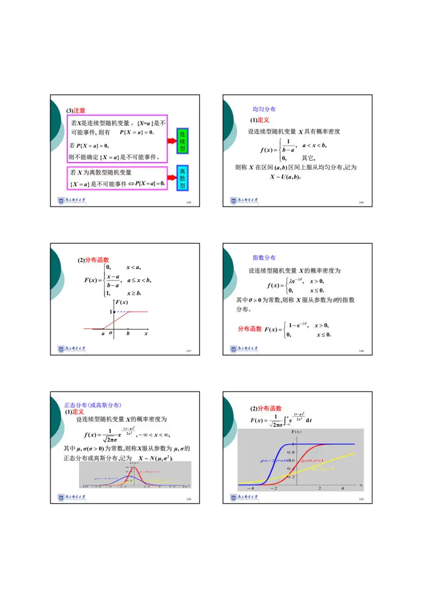

原文：

(2)分布函数

$$
F (x) = \left\{ \begin{array}{l l} 0, & x <   a, \\ \frac {x - a}{b - a}, & a \leq x <   b, \\ 1, & x \geq b _ {\circ} \end{array} \right.
$$

正态分布(或高斯分布)

(1)定义

设连续型随机变量 $X$ 的概率密度为

$$
f (x) = \frac {1}{\sqrt {2 \pi} \sigma} \mathrm{e} ^ {- \frac {(x - \mu) ^ {2}}{2 \sigma^ {2}}}, - \infty <   x <   \infty ,
$$

其中 $\mu,\sigma(\sigma>0)$ 为常数,则称 X 服从参数为 $\mu,\sigma$ 的正态分布或高斯分布,记为 $X\sim N(\mu,\sigma^{2})$ .

指数分布

设连续型随机变量 $X$ 的概率密度为

$$
f (x) = \left\{ \begin{array}{l l} \lambda \mathrm{e} ^ {- \lambda \theta}, & x > 0, \\ 0, & x \leq 0. \end{array} \right.
$$

其中 $\theta > 0$ 为常数, 则称 $X$ 服从参数为 $\theta$ 的指数分布。

分布函数 $F(x) = \left\{ \begin{array}{ll}1 - \mathrm{e}^{-\lambda \theta}, & x > 0,\\ 0, & x\leq 0. \end{array} \right.$

南京邮电大学
Nanjing University of Public and Telecommunications

145

(3)注意

若X是连续型随机变量， $\{X=a\}$ 是不可能事件，则有 $P\{X=a\}=0$ .

$\{X = a\}$

$P\{X = a\} = 0.$

$P\{X = a\} = 0,$

则不能确定 $\{X = a\}$ 是不可能事件。

$\{X = a\}$

若 $X$ 为离散型随机变量

$\{X = a\}$

$\{X = a\}$ 是不可能事件 $\Leftrightarrow P\{X = a\} = 0$ 。

$\Leftrightarrow P\{X = a\} = 0$

均匀分布

(1)定义

设连续型随机变量 $X$ 具有概率密度

$f(x) = \left\{ \begin{array}{ll}\frac{1}{b - a}, & a <   x <   b,\\ 0, & \text{其它}, \end{array} \right.$

则称 X 在区间 $(a,b)$ 区间上服从均匀分布, 记为 $X \sim U(a, b)$ 。

南京航空航天大学
Nanjing University of Physics and Telecommunications

$X \sim U(a, b)$

146

南京邮电大学
Nanjing University of Press and Telecommunications

(2)分布函数

$F(x) = \frac{1}{\sqrt{2\pi}\sigma}\int_{-\infty}^{x}\mathrm{e}^{-\frac{(t - \mu)^2}{2\sigma^2}}\mathrm{d}t$

F(x)
μ=-2, σ=0
μ=0, σ=1
μ=2, σ=4

南京邮电大学
Nanjing University of Science and Telecommunications

148

150

### (4)重要公式

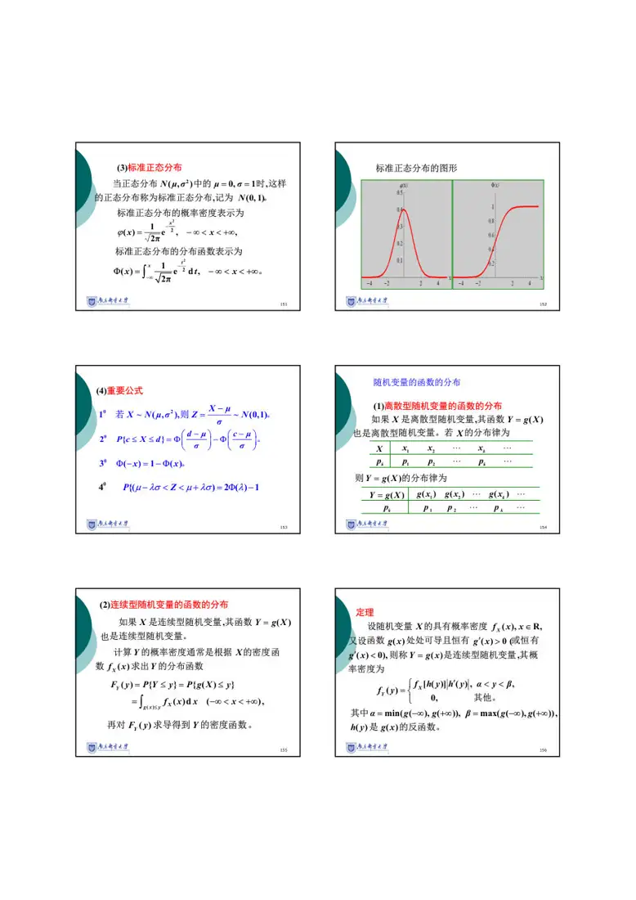

原文：

(4)重要公式

$1^{0}$ 若 $X \sim N(\mu, \sigma^{2})$ , 则 $Z = \frac{X - \mu}{\sigma} \sim N(0, 1)$ 。

$$
2 ^ {0} \quad P \{c \leq X \leq d \} = \Phi \left(\frac {d - \mu}{\sigma}\right) - \Phi \left(\frac {c - \mu}{\sigma}\right) 。
$$

$3^{0}$ $\Phi (-x) = 1 - \Phi (x)$

$4^{0}$ $P\{(\mu - \lambda \sigma < Z < \mu + \lambda \sigma) = 2\Phi(\lambda) - 1$

(2)连续型随机变量的函数的分布

如果 X 是连续型随机变量, 其函数 $Y = g(X)$ 也是连续型随机变量。

计算 $Y$ 的概率密度通常是根据 $X$ 的密度函数 $f_{X}(x)$ 求出 $Y$ 的分布函数

$$
\begin{array}{l} F _ {Y} (y) = P \{Y \leq y \} = P \{g (X) \leq y \} \\ = \int_ {g (x) \leq y} f _ {X} (x) \mathrm{d} x (- \infty <   x <   + \infty), \end{array}
$$

再对 $F_{Y}(y)$ 求导得到 $Y$ 的密度函数。

南京新電大學
Nanjing University of Physics and Telecommunications

随机变量的函数的分布

(1)离散型随机变量的函数的分布

如果 $X$ 是离散型随机变量, 其函数 $Y = g(X)$ 也是离散型随机变量。若 $X$ 的分布律为

南京邮电大学
Nanjing University of Physics and Telecommunications
<table><tr><td>X</td><td> $x_{1}$ </td><td> $x_{2}$ </td><td> $\cdots$ </td><td> $x_{k}$ </td><td> $\cdots$ </td></tr><tr><td> $p_{k}$ </td><td> $p_{1}$ </td><td> $p_{2}$ </td><td> $\cdots$ </td><td> $p_{k}$ </td><td> $\cdots$ </td></tr></table>

则 $Y = g(X)$ 的分布律为

<table><tr><td> $Y = g(X)$ </td><td> $g(x_1)$ </td><td> $g(x_2)$ </td><td> $\cdots$ </td><td> $g(x_k)$ </td><td> $\cdots$ </td></tr><tr><td> $p_k$ </td><td> $p_1$ </td><td> $p_2$ </td><td> $\cdots$ </td><td> $p_k$ </td><td> $\cdots$ </td></tr></table>

南京邮电大学
Nanjing University of Press and Telecommunications

151

152

$\Phi (x) = \int_{-\infty}^{x}\frac{1}{\sqrt{2\pi}}\mathrm{e}^{-\frac{t^2}{2}}\mathrm{d}t,\quad -\infty <  x <   + \infty .$

(3)标准正态分布

当正态分布 $N(\mu,\sigma^{2})$ 中的 $\mu=0,\sigma=1$ 时, 这样的正态分布称为标准正态分布, 记为 $N(0,1)$ 。

$N(\mu ,\sigma^{2})$

$\mu = 0, \sigma = 1$

$\varphi (x) = \frac{1}{\sqrt{2\pi}}\mathrm{e}^{-\frac{x^2}{2}}, - \infty <  x <   + \infty ,$

$N(0,1)$

标准正态分布的概率密度表示为

标准正态分布的分布函数表示为

标准正态分布的图形

φ(x)
Φ(x)
x

南京邮电大学
Nanjing University of Press and Telecommunications

定理

$g^{\prime}(x) <   0)$

设随机变量 X 的具有概率密度 $f_{X}(x), x \in \mathbb{R}$ ，又设函数 $g(x)$ 处处可导且恒有 $g'(x) > 0$ (或恒有 $g'(x) < 0$ )，则称 $Y = g(x)$ 是连续型随机变量，其概率密度为

$f_{Y}(y) = \left\{ \begin{array}{ll}f_{X}[h(y)]|h'(y)|, & a < y < \beta ,\\ 0, & \text{其他。} \end{array} \right.$

$\alpha=\min(g(-\infty),g(+\infty)),\beta=\max(g(-\infty),g(+\infty))$

h(y)

g(x)

其中 $\alpha=\min(g(-\infty),g(+\infty))$ , $\beta=\max(g(-\infty),g(+\infty))$ , $h(y)$ 是 $g(x)$ 的反函数。

南京邮电大学
Nanjing University of Science and Telecommunications
