# 《概率论与数理统计》第八章 假设检验（课件）

原件的每一页，下面附识别出的文字。

### 第八章 假设检验

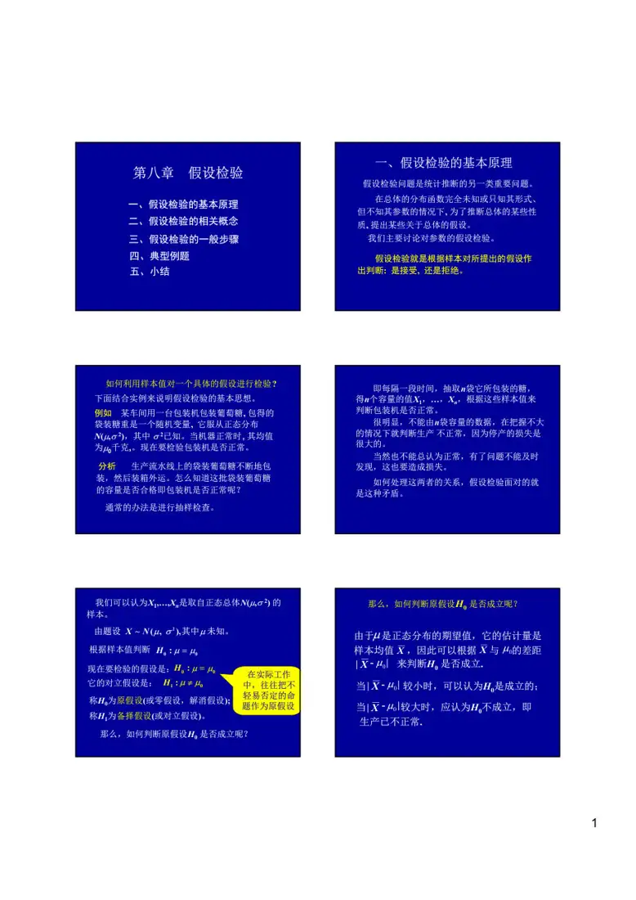

原文：

第八章 假设检验

一、假设检验的基本原理

二、假设检验的相关概念

三、假设检验的一般步骤

四、典型例题

五、小结

如何利用样本值对一个具体的假设进行检验？下面结合实例来说明假设检验的基本思想。例如某车间用一台包装机包装葡萄糖，包得的袋装糖重是一个随机变量，它服从正态分布 $N(\mu, \sigma^2)$ ，其中 $\sigma^2$ 已知。当机器正常时，其均值为 $\mu_0$ 千克。现在要检验包装机是否正常。

分析 生产流水线上的袋装葡萄糖不断地包装，然后装箱外运。怎么知道这批袋装葡萄糖的容量是否合格即包装机是否正常呢？

通常的办法是进行抽样检查。

我们可以认为 $X_{1},\ldots ,X_{n}$ 是取自正态总体 $N(\mu ,\sigma^2)$ 的样本。

由题设 $X \sim N(\mu, \sigma^{2})$ ，其中 $\mu$ 未知。

根据样本值判断 $H_0: \mu = \mu_0$

现在要检验的假设是： $H_0:\mu = \mu_0$

它的对立假设是： $H_{1}:\mu \neq \mu_{0}$

称 $H_{0}$ 为原假设(或零假设，解消假设); 称 $H_{1}$ 为备择假设(或对立假设)。

在实际工作中，往往把不轻易否定的命题作为原假设

那么，如何判断原假设 $H_0$ 是否成立呢？

一、假设检验的基本原理

假设检验问题是统计推断的另一类重要问题。

在总体的分布函数完全未知或只知其形式、但不知其参数的情况下,为了推断总体的某些性质,提出某些关于总体的假设。

我们主要讨论对参数的假设检验。

假设检验就是根据样本对所提出的假设作出判断：是接受，还是拒绝。

即每隔一段时间，抽取 $n$ 袋它所包装的糖，得 $n$ 个容量的值 $X_{1},\ldots ,X_{n}$ ，根据这些样本值来判断包装机是否正常。

很明显，不能由 $n$ 袋容量的数据，在把握不大的情况下就判断生产不正常，因为停产的损失是很大的。

当然也不能总认为正常，有了问题不能及时发现，这也要造成损失。

如何处理这两者的关系，假设检验面对的就是这种矛盾。

那么，如何判断原假设 $H_0$ 是否成立呢？

由于 $\mu$ 是正态分布的期望值，它的估计量是样本均值 $\overline{X}$ ，因此可以根据 $\overline{X}$ 与 $\mu_0$ 的差距 $|\overline{X} - \mu_0|$ 来判断 $H_0$ 是否成立.

当 $|\overline{X} -\mu_0|$ 较小时，可以认为 $H_{0}$ 是成立的；

当 $|\overline{X} - \mu_0|$ 较大时，应认为 $H_0$ 不成立，即生产已不正常.

1

### 较大、较小是一个相对的概念，合理的界限在何处？应由什么原则来确定？

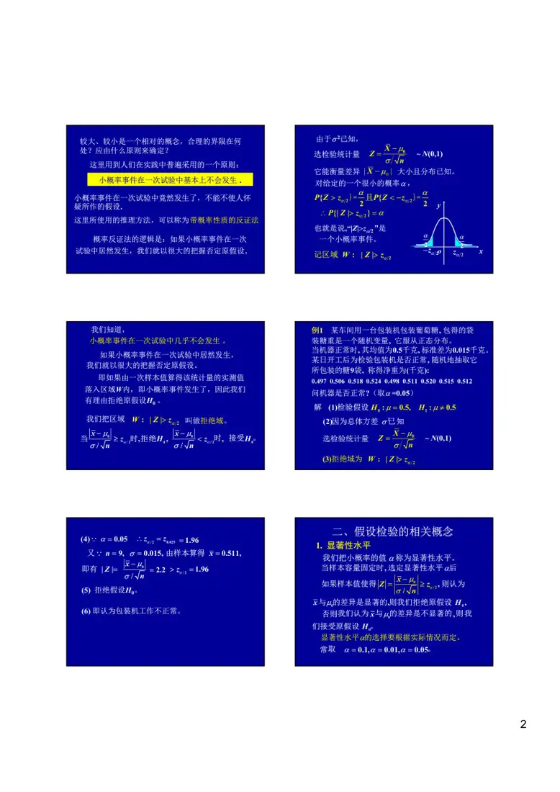

原文：

较大、较小是一个相对的概念，合理的界限在何处？应由什么原则来确定？

这里用到人们在实践中普遍采用的一个原则：

小概率事件在一次试验中基本上不会发生.

小概率事件在一次试验中竟然发生了，不能不使人怀疑所作的假设.

这里所使用的推理方法，可以称为带概率性质的反证法

概率反证法的逻辑是：如果小概率事件在一次试验中居然发生，我们就以很大的把握否定原假设.

我们知道，

小概率事件在一次试验中几乎不会发生。

如果小概率事件在一次试验中居然发生，我们就以很大的把握否定原假设。

即如果由一次样本值算得该统计量的实测值落入区域 $W$ 内，即小概率事件发生了，因此我们有理由拒绝原假设 $H_0$ 。

我们把区域 $W: |Z| > z_{\alpha / 2}$ 叫做拒绝域。

当 $\frac{\left|\overline{x}-\mu_{0}\right|}{\sigma/\sqrt{n}}\geq z_{\alpha/2}$ 时,拒绝 $H_{0}$ , $\frac{\left|\overline{x}-\mu_{0}\right|}{\sigma/\sqrt{n}}<z_{\alpha/2}$ 时,接受 $H_{0}$ 。

(4) $\alpha = 0.05$ $\therefore z_{\alpha /2} = z_{0.025} = 1.96$

又∵ n=9, $\sigma=0.015$ , 由样本算得 $\bar{x}=0.511$ ,

即有 $|Z| = \frac{|\overline{x} - \mu_0|}{\sigma / \sqrt{n}} = 2.2 > z_{\alpha / 2} = 1.96$

(5) 拒绝假设 $H_{0}$ 。

(6) 即认为包装机工作不正常。

由于 $\sigma^2$ 已知，

选检验统计量 $Z = \frac{\bar{X} - \mu_0}{\sigma / \sqrt{n}} \sim N(0,1)$

它能衡量差异 $|\overline{X} - \mu_0|$ 大小且分布已知。

对给定的一个很小的概率 $\alpha$ ，

$$
P \{Z > z _ {\alpha / 2} \} = \frac {\alpha}{2} \text {且} P \{Z <   - z _ {\alpha / 2} \} = \frac {\alpha}{2}
$$

$\therefore P\{|Z| > z_{\alpha /2}\} = \alpha$

也就是说，“ $|Z| > z_{\alpha /2}$ ”是一个小概率事件。

记区域 $W: |Z| > z_{\alpha / 2}$

例1 某车间用一台包装机包装葡萄糖, 包得的袋

当机器正常时, 其均值为0.5千克, 标准差为0.015千克。某日开工后为检验包装机是否正常, 随机地抽取它所包装的精2代, 称得净重为(千克)

所包装的糖9袋，称得净重为(千克):

0.497 0.506 0.518 0.524 0.498 0.511 0.520 0.515 0.512

问机器是否正常？（取 $\alpha = 0.05$ ）

解 (1)检验假设 $H_{0}:\mu = 0.5$ ， $H_{1}:\mu \neq 0.5$

(2)因为总体方差 $\sigma$ 已知

选检验统计量 $Z = \frac{\bar{X} - \mu_0}{\sigma / \sqrt{n}} \sim N(0,1)$

(3)拒绝域为 $W: |Z| > z_{\alpha / 2}$

二、假设检验的相关概念

1. 显著性水平

我们把小概率的值 $\alpha$ 称为显著性水平。当样本容量固定时，选定显著性水平 $\alpha$ 后

如果样本值使得 $|Z| = \left|\frac{\bar{x} - \mu_0}{\sigma / \sqrt{n}}\right| \geq z_{\alpha / 2}$ ，则认为

$\bar{x}$ 与 $\mu_{0}$ 的差异是显著的,则我们拒绝原假设 $H_{0}$ ,

否则我们认为 $\bar{x}$ 与 $\mu_0$ 的差异是不显著的，则我们接受原假设 $H_{0}$ 。

显著性水平 $\alpha$ 的选择要根据实际情况而定。

常取 $\alpha = 0.1, \alpha = 0.01, \alpha = 0.05$ 。

2

### 如果显著性水平 $\alpha$ 取得很小，则拒绝域也会

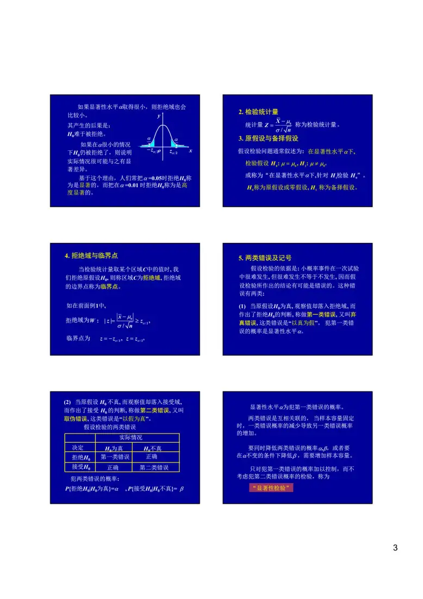

原文：

如果显著性水平 $\alpha$ 取得很小，则拒绝域也会

比较小。

其产生的后果是： $H_{0}$ 难于被拒绝。

如果在 $\alpha$ 很小的情况下 $H_0$ 仍被拒绝了，则说明实际情况很可能与之有显著差异。

基于这个理由，人们常把 $\alpha = 0.05$ 时拒绝 $H_{0}$ 称为是显著的，而把在 $\alpha = 0.01$ 时拒绝 $H_{0}$ 称为是高度显著的。

4. 拒绝域与临界点

当检验统计量取某个区域 $C$ 中的值时，我们拒绝原假设 $H_0$ ，则称区域 $C$ 为拒绝域，拒绝域的边界点称为临界点。

如在前面例1中，

拒绝域为 $W$ ： $|z| = \frac{|\overline{x} - \mu_0|}{\sigma / \sqrt{n}} \geq z_{\alpha / 2}$

临界点为 $z = -z_{\alpha /2}, z = z_{\alpha /2}$

(2) 当原假设 $H_{0}$ 不真, 而观察值却落入接受域, 而作出了接受 $H_{0}$ 的判断, 称做第二类错误, 又叫取伪错误, 这类错误是“以假为真”。

假设检验的两类错误

实际情况

决定

$H_{0}$ 为真

拒绝 $H_0$

$H_{0}$ 不真

第一类错误

正确

接受 $H_0$

正确

第二类错误

犯两类错误的概率：

$P\{\text{拒绝}H_0|H_0 \text{为真}\} = \alpha$ ， $P\{\text{接受}H_0|H_0 \text{不真}\} = \beta$

2. 检验统计量

统计量 $Z=\frac{\bar{X}-\mu_{0}}{\sigma/\sqrt{n}}$ 称为检验统计量。

3. 原假设与备择假设

假设检验问题通常叙述为：在显著性水平 $\alpha$ 下，

检验假设 $H_0: \mu = \mu_0, H_1: \mu \neq \mu_0$ 。

或称为“在显著性水平 $\alpha$ 下, 针对 $H_{1}$ 检验 $H_{0}$ ”。

$H_{0}$ 称为原假设或零假设, $H_{1}$ 称为备择假设。

5. 两类错误及记号

假设检验的依据是: 小概率事件在一次试验中很难发生, 但很难发生不等于不发生, 因而假设检验所作出的结论有可能是错误的。这种错误有两类:

(1) 当原假设 $H_0$ 为真, 观察值却落入拒绝域, 而作出了拒绝 $H_0$ 的判断, 称做第一类错误, 又叫弃真错误, 这类错误是“以真为假”。犯第一类错误的概率是显著性水平 $\alpha$ 。

显著性水平 $\alpha$ 为犯第一类错误的概率。

两类错误是互相关联的，当样本容量固定时，一类错误概率的减少导致另一类错误概率的增加。

要同时降低两类错误的概率 $\alpha,\beta$ ，或者要在 $\alpha$ 不变的条件下降低 $\beta$ ，需要增加样本容量。

只对犯第一类错误的概率加以控制，而不考虑犯第二类错误概率的检验，称为

“显著性检验”

3

### 6. 显著性检验

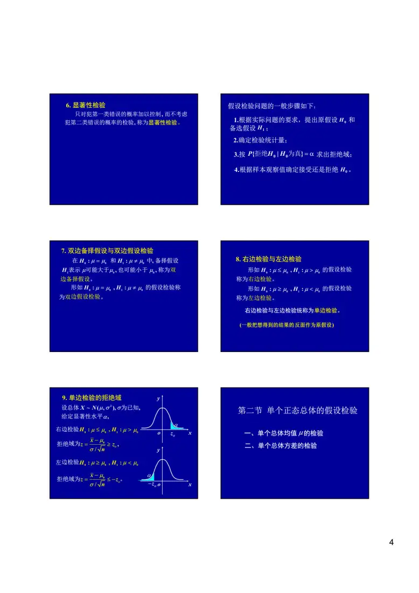

原文：

6. 显著性检验

只对犯第一类错误的概率加以控制,而不考虑犯第二类错误的概率的检验,称为显著性检验。

假设检验问题的一般步骤如下：

1. 根据实际问题的要求，提出原假设 $H_{0}$ 和备选假设 $H_{1}$ ;

3. 按 $P\{拒绝H_{0} \mid H_{0}$ 为真 $\} = \alpha$ 求出拒绝域;

2. 确定检验统计量;

4. 根据样本观察值确定接受还是拒绝 $H_{0}$ 。

7. 双边备择假设与双边假设检验

在 $H_0: \mu = \mu_0$ 和 $H_1: \mu \neq \mu_0$ 中, 备择假设 $H_1$ 表示 $\mu$ 可能大于 $\mu_0$ , 也可能小于 $\mu_0$ , 称为双边备择假设。

形如 $H_{0}:\mu=\mu_{0},H_{1}:\mu\neq\mu_{0}$ 的假设检验称为双边假设检验。

8. 右边检验与左边检验

形如 $H_{0}:\mu\leq\mu_{0},H_{1}:\mu>\mu_{0}$ 的假设检验称为右边检验。

形如 $H_0: \mu \geq \mu_0, H_1: \mu < \mu_0$ 的假设检验称为左边检验。

右边检验与左边检验统称为单边检验。

(一般把想得到的结果的反面作为原假设)

9. 单边检验的拒绝域

设总体 $X \sim N(\mu, \sigma^{2})$ , $\sigma$ 为已知,
给定显著性水平 $\alpha$ ,

右边检验 $H_{0}:\mu \leq \mu_{0},H_{1}:\mu >\mu_{0}$

拒绝域为 $z = \frac{\bar{x} - \mu_0}{\sigma / \sqrt{n}} \geq z_\alpha$

左边检验 $H_{0}:\mu \geq \mu_{0},H_{1}:\mu <  \mu_{0}$

拒绝域为 $z = \frac{\bar{x} - \mu_0}{\sigma / \sqrt{n}} \leq -z_\alpha$ 。

第二节 单个正态总体的假设检验

一、单个总体均值 $\mu$ 的检验

二、单个总体方差的检验一、单个总体 $N(\mu,\sigma^{2})$ 均值 $\mu$ 的检验
1、 $\sigma^{2}$ 为已知，关于 $\mu$ 的检验（Z检验）
在上节中讨论过正态总体 $N(\mu,\sigma^{2})$ 当 $\sigma^{2}$ 为已知时，关于 $\mu=\mu_{0}$ 的检验问题：
(1) 假设检验 $H_{0}: \mu = \mu_{0}, H_{1}: \mu \neq \mu_{0}$ ;
(2) 假设检验 $H_{0}: \mu \leq \mu_{0}, H_{1}: \mu > \mu_{0}$ ;
(3) 假设检验 $H_{0}: \mu \geq \mu_{0}, H_{1}: \mu < \mu_{0}$ .
选择统计量 $Z = \frac{\bar{X} - \mu_{0}}{\sigma / \sqrt{n}} \sim N(0,1)$ ，用来确定拒绝域的，这种检验法称为 Z 检验法。

4

### 10.4 10.6 10.1 10.4 10.5 10.3 10.3 10.2

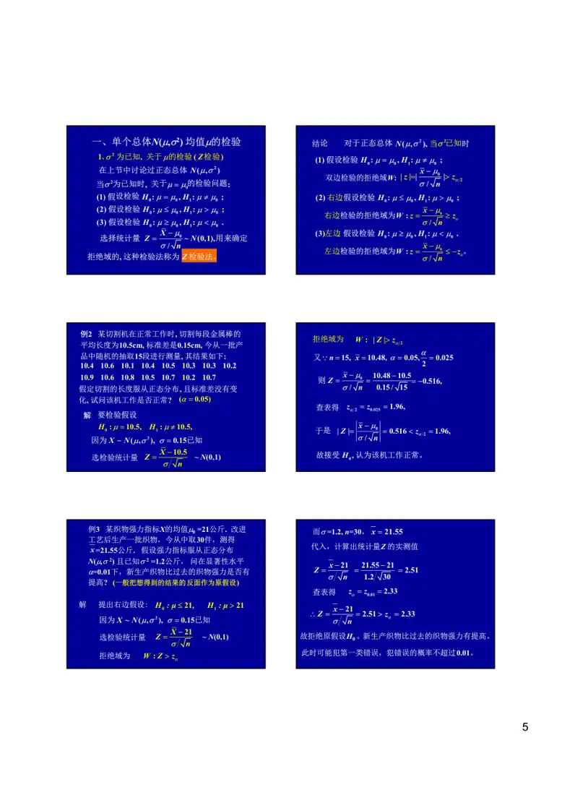

原文：

例2 某切割机在正常工作时, 切割每段金属棒的平均长度为10.5cm, 标准差是0.15cm, 今从一批产品中随机的抽取15段进行测量, 其结果如下:
10.4 10.6 10.1 10.4 10.5 10.3 10.3 10.2
10.9 10.6 10.8 10.5 10.7 10.2 10.7

假定切割的长度服从正态分布, 且标准差没有变化, 试问该机工作是否正常? ( $\alpha = 0.05$ )

解 要检验假设

$$
H _ {0}: \mu = 1 0. 5, \quad H _ {1}: \mu \neq 1 0. 5,
$$

因为 $X \sim N(\mu, \sigma^2)$ , $\sigma = 0.15$ 已知

选检验统计量 $Z=\frac{\bar{X}-10.5}{\sigma/\sqrt{n}}\sim N(0,1)$

例3 某织物强力指标 $X$ 的均值 $\mu_0 = 21$ 公斤. 改进工艺后生产一批织物, 今从中取30件, 测得 $\overline{x} = 21.55$ 公斤. 假设强力指标服从正态分布 $N(\mu, \sigma^2)$ 且已知 $\sigma^2 = 1.2$ 公斤, 问在显著性水平 $\alpha = 0.01$ 下, 新生产织物比过去的织物强力是否有提高? (一般把想得到的结果的反面作为原假设)

解 提出右边假设： $H_0:\mu \leq 21$ ， $H_{1}:\mu >21$

因为 $X \sim N(\mu, \sigma^2)$ , $\sigma = 0.15$ 已知

选检验统计量 $Z=\frac{\bar{X}-21}{\sigma/\sqrt{n}}\sim N(0,1)$

拒绝域为 $W:Z > z_{\alpha}$

结论 对于正态总体 $N(\mu, \sigma^2)$ , 当 $\sigma^2$ 已知时

(1) 假设检验 $H_{0}: \mu = \mu_{0}, H_{1}: \mu \neq \mu_{0}$ ;

双边检验的拒绝域 $W: |z| = \left|\frac{\bar{x} - \mu_0}{\sigma / \sqrt{n}}\right| > z_{\alpha / 2}$

(2) 右边假设检验 $H_{0}: \mu \leq \mu_{0}, H_{1}: \mu > \mu_{0}$ ;

右边检验的拒绝域为 $W: z = \frac{\bar{x} - \mu_0}{\sigma / \sqrt{n}} \geq z_\alpha$

(3)左边 假设检验 $H_0: \mu \geq \mu_0, H_1: \mu < \mu_0$

左边检验的拒绝域为 $W: z = \frac{\bar{x} - \mu_0}{\sigma / \sqrt{n}} \leq -z_\alpha$ 。

拒绝域为 $W: |Z| > z_{\alpha / 2}$ 又 $\because n = 15, \bar{x} = 10.48, \alpha = 0.05, \frac{\alpha}{2} = 0.025$ 则 $Z = \frac{\bar{x} - \mu_0}{\sigma / \sqrt{n}} = \frac{10.48 - 10.5}{0.15 / \sqrt{15}} = -0.516,$ 查表得 $z_{\alpha / 2} = z_{0.025} = 1.96,$ 于是 $|Z| = \left|\frac{\bar{x} - \mu_0}{\sigma / \sqrt{n}}\right| = 0.516 < z_{\alpha / 2} = 1.96,$ 故接受 $H_0$ ，认为该机工作正常。

而 $\sigma = 1.2, n = 30, x = 21.55$

代入，计算出统计量 $Z$ 的实测值

$$
Z = \frac {\bar {x} - 2 1}{\sigma / \sqrt {n}} = \frac {2 1 . 5 5 - 2 1}{1 . 2 / \sqrt {3 0}} = 2. 5 1
$$

查表得 $z_{\alpha} = z_{0.01} = 2.33$

$$
\therefore Z = \frac {x - 2 1}{\sigma / \sqrt {n}} = 2. 5 1 > z _ {\alpha} = 2. 3 3
$$

故拒绝原假设 $H_0$ 。新生产织物比过去的织物强力有提高。

此时可能犯第一类错误，犯错误的概率不超过0.01。

5

### 2、 $\sigma^{2}$ 为未知，关于 $\mu$ 的检验（t检验）

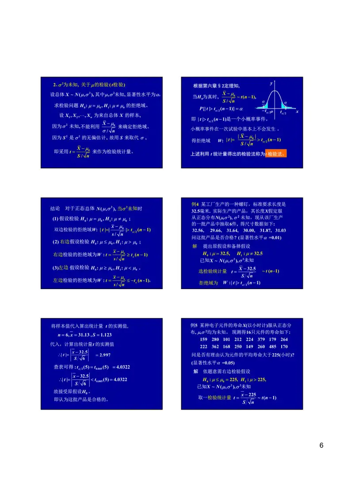

原文：

2、 $\sigma^{2}$ 为未知，关于 $\mu$ 的检验（t检验）

设总体 $X \sim N(\mu, \sigma^{2})$ ，其中 $\mu, \sigma^{2}$ 未知，显著性水平为 $\alpha$ 。

求检验问题 $H_{0}: \mu = \mu_{0}, H_{1}: \mu \neq \mu_{0}$ 的拒绝域。

设 $X_{1}, X_{2}, \cdots, X_{n}$ 为来自总体 X 的样本，因为 $\sigma^{2}$ 未知，不能利用 $\frac{\bar{X} - \mu_{0}}{\sigma / \sqrt{n}}$ 来确定拒绝域。

因为 $S^{2}$ 是 $\sigma^{2}$ 的无偏估计，故用 S 来取代 $\sigma$ ，即采用 $t = \frac{\bar{X} - \mu_{0}}{S / \sqrt{n}}$ 来作为检验统计量。

结论 对于正态总体 $N(\mu,\sigma^{2})$ ，当 $\sigma^{2}$ 未知时
(1) 假设检验 $H_{0}: \mu = \mu_{0}, H_{1}: \mu \neq \mu_{0}$ ;
双边检验的拒绝域W: $|t|=\left|\frac{\bar{x}-\mu_{0}}{s/\sqrt{n}}\right|>t_{\alpha/2}(n-1)$ (2) 右边假设检验 $H_{0}:\mu\leq\mu_{0},H_{1}:\mu>\mu_{0}$ 右边检验的拒绝域为 $W:t=\frac{\bar{x}-\mu_{0}}{s/\sqrt{n}}\geq t_{a}(n-1)$ (3)左边 假设检验 $H_{0}:\mu\geq\mu_{0},H_{1}:\mu<\mu_{0}$ 左边检验的拒绝域为 $W:t=\frac{\bar{x}-\mu_{0}}{s/\sqrt{n}}\leq-t_{a}(n-1)$ 。

将样本值代入算出统计量 t 的实测值,

$$
n = 6, \bar {x} = 3 1. 1 3, S = 1. 1 2 3
$$

代入，计算出统计量 $t$ 的实测值

$$
= 2. 9 9 7
$$

查表可得: $t_{\alpha/2}(5)=t_{0.005}(5)=4.0322$

$\therefore |t| = \left|\frac{\overline{x} - 32.5}{S / \sqrt{6}}\right| < t_{0.005}(5) = 4.0322$

故接受原假设 $H_0$ 。

即认为这批产品是合格的。

根据第六章 § 2定理知,

当 $H_{0}$ 为真时， $\frac{\bar{X}-\mu_{0}}{S/\sqrt{n}}\sim t(n-1),$

$P\{|t| > t_{\alpha /2}(n - 1)\} = \alpha$

即 $|t| > t_{\alpha /2}(n - 1)$ 是一个小概率事件。

小概率事件在一次试验中基本上不会发生。

得拒绝域 $W: |t| = \frac{|\bar{X} - \mu_0|}{S / \sqrt{n}} > t_{\alpha / 2}(n - 1)$

上述利用 $t$ 统计量得出的检验法称为 $t$ 检验法。

例4 某工厂生产的一种螺钉，标准要求长度是32.5毫米．实际生产的产品，其长度X假定服从正态分布 $N(\mu,\sigma^{2}),\sigma^{2}$ 未知，现从该厂生产的一批产品中抽取6件，得尺寸数据如下：32.56，29.66，31.64，30.00，31.87，31.03问这批产品是否合格？(显著性水平 $\alpha=0.01$ )

解 提出原假设和备择假设 $H_{0}:\mu=32.5,\quad H_{1}:\mu\neq32.5$ 已知 $X\sim N(\mu,\sigma^{2}),\sigma^{2}$ 未知
选检验统计量 $t=\frac{\bar{X}-32.5}{S/\sqrt{n}}\sim t(n-1)$ 拒绝域为 $W:|t|>t_{\alpha/2}(n-1)$

例5 某种电子元件的寿命X(以小时计)服从正态分布, $\mu,\sigma^{2}$ 均为未知。现测得16只元件的寿命如下:

159 280 101 212 224 379 179 264

222 362 168 250 149 260 485 170

问是否有理由认为元件的平均寿命大于225(小时)? (显著性水平 $\alpha=0.05$ )

解 依题意需右边检验假设

$$
H _ {0}: \mu \leq \mu_ {0} = 2 2 5, H _ {1}: \mu > 2 2 5,
$$

已知 $X \sim N(\mu, \sigma^2), \sigma^2$ 未知

取一检验统计量 $t = \frac{\overline{x} - 225}{S / \sqrt{n}}\sim t(n - 1)$

6

### 此右边检验的拒绝域为 $W: t > t_{\alpha}(n - 1)$

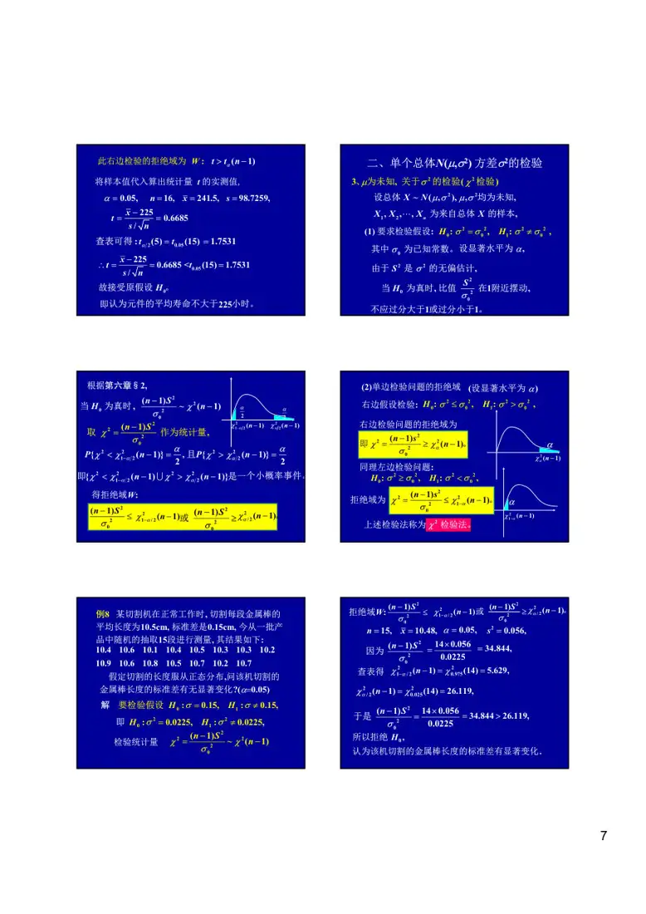

原文：

此右边检验的拒绝域为 $W: t > t_{\alpha}(n - 1)$

将样本值代入算出统计量 t 的实测值, $\alpha=0.05,\quad n=16,\quad\bar{x}=241.5,\quad s=98.7259,$ $t=\frac{\bar{x}-225}{s/\sqrt{n}}=0.6685$ 查表可得： $t_{\alpha/2}(5)=t_{0.05}(15)=1.7531$ $\therefore t=\frac{\bar{x}-225}{s/\sqrt{n}}=0.6685<t_{0.05}(15)=1.7531$ 故接受原假设 $H_{0}$ 。
即认为元件的平均寿命不大于225小时。

根据第六章§2,
当 $H_0$ 为真时, $\frac{(n-1)S^2}{\sigma_0^2} \sim \chi^2(n-1)$ 取 $\chi^2 = \frac{(n-1)S^2}{\sigma_0^2}$ 作为统计量, $P\{\chi^2 < \chi_{1-\alpha/2}^2(n-1)\} = \frac{\alpha}{2}$ , 且 $P\{\chi^2 > \chi_{\alpha/2}^2(n-1)\} = \frac{\alpha}{2}$ 即 $\{\chi^2 < \chi_{1-\alpha/2}^2(n-1) \cup \chi^2 > \chi_{\alpha/2}^2(n-1)\}$ 是一个小概率事件。
得拒绝域 $W$ : $\frac{(n-1)S^2}{\sigma_0^2} \leq \chi_{1-\alpha/2}^2(n-1)$ 或 $\frac{(n-1)S^2}{\sigma_0^2} \geq \chi_{\alpha/2}^2(n-1)$ .

例8 某切割机在正常工作时, 切割每段金属棒的平均长度为10.5cm, 标准差是0.15cm, 今从一批产品中随机的抽取15段进行测量, 其结果如下:
10.4 10.6 10.1 10.4 10.5 10.3 10.3 10.2
10.9 10.6 10.8 10.5 10.7 10.2 10.7

假定切割的长度服从正态分布,问该机切割的金属棒长度的标准差有无显著变化? $(\alpha=0.05)$ 解 要检验假设 $H_{0}:\sigma=0.15,\quad H_{1}:\sigma\neq0.15,$ 即 $H_{0}:\sigma^{2}=0.0225,\quad H_{1}:\sigma^{2}\neq0.0225,$ 检验统计量 $\chi^{2}=\frac{(n-1)S^{2}}{\sigma_{0}^{2}}\sim\chi^{2}(n-1)$

二、单个总体 $N(\mu, \sigma^2)$ 方差 $\sigma^2$ 的检验

3、 $\mu$ 为未知，关于 $\sigma^{2}$ 的检验( $\chi^{2}$ 检验)
设总体 $X \sim N(\mu, \sigma^{2})$ , $\mu, \sigma^{2}$ 均为未知, $X_{1},X_{2},\cdots,X_{n}$ 为来自总体 X 的样本,

(1) 要求检验假设: $H_{0}: \sigma^{2} = \sigma_{0}^{2}, H_{1}: \sigma^{2} \neq \sigma_{0}^{2}$ , 其中 $\sigma_{0}$ 为已知常数。设显著水平为 $\alpha$ , 由于 $S^{2}$ 是 $\sigma^{2}$ 的无偏估计, 当 $H_{0}$ 为真时, 比值 $\frac{S^{2}}{\sigma_{0}^{2}}$ 在1附近摆动, 不应过分大于1或过分小于1。

(2)单边检验问题的拒绝域 (设显著水平为 $\alpha$ )

右边假设检验： $H_{0}\colon \sigma^{2}\leq \sigma_{0}^{2},\quad H_{1}\colon \sigma^{2} > \sigma_{0}^{2},$

右边检验问题的拒绝域为

即 $\chi^{2}=\frac{(n-1)s^{2}}{\sigma_{0}^{2}}\geq\chi_{\alpha}^{2}(n-1)$ 。

同理左边检验问题: $H_{0}:\sigma^{2}\geq\sigma_{0}^{2},\quad H_{1}:\sigma^{2}<\sigma_{0}^{2},$

拒绝域为 $\chi^2 = \frac{(n - 1)s^2}{\sigma_0^2}\leq \chi_{1 - \alpha}^2 (n - 1)$

上述检验法称为 $\chi^2$ 检验法。

拒绝域 $W: \frac{(n - 1)S^2}{\sigma_0^2} \leq \chi_{1 - \alpha / 2}^2 (n - 1)$ 或 $\frac{(n - 1)S^2}{\sigma_0^2} \geq \chi_{\alpha / 2}^2 (n - 1)$ 。 $n = 15, \quad \overline{x} = 10.48, \quad \alpha = 0.05, \quad s^2 = 0.056,$ 因为 $\frac{(n - 1)S^2}{\sigma_0^2} = \frac{14 \times 0.056}{0.0225} = 34.844,$ 查表得 $\chi_{1 - \alpha / 2}^2 (n - 1) = \chi_{0.975}^2 (14) = 5.629,$ $\chi_{\alpha / 2}^2 (n - 1) = \chi_{0.025}^2 (14) = 26.119,$ 于是 $\frac{(n - 1)S^2}{\sigma_0^2} = \frac{14 \times 0.056}{0.0225} = 34.844 > 26.119,$ 所以拒绝 $H_0$ ，认为该机切割的金属棒长度的标准差有显著变化。

7

### 第三节 两个正态总体的假设检验

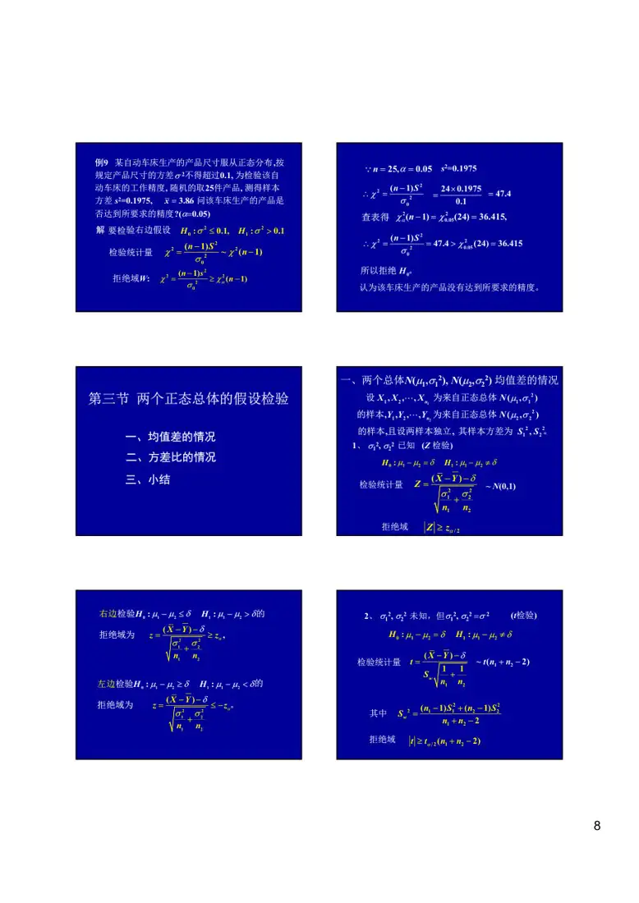

原文：

例9 某自动车床生产的产品尺寸服从正态分布,按规定产品尺寸的方差 $\sigma^{2}$ 不得超过0.1,为检验该自动车床的工作精度,随机的取25件产品,测得样本方差 $s^{2}=0.1975,\quad\bar{x}=3.86$ 问该车床生产的产品是否达到所要求的精度? $(\alpha=0.05)$

解 要检验右边假设 $H_{0}:\sigma^{2}\leq0.1,\quad H_{1}:\sigma^{2}>0.1$

检验统计量 $\chi^2 = \frac{(n - 1)S^2}{\sigma_0^2}\sim \chi^2 (n - 1)$

拒绝域 $W$ ： $\chi^2 = \frac{(n - 1)s^2}{\sigma_0^2}\geq \chi_\alpha^2 (n - 1)$

第三节 两个正态总体的假设检验

一、均值差的情况

二、方差比的情况

三、小结

右边检验 $H_{0}:\mu_{1} - \mu_{2}\leq \delta$ $H_{1}:\mu_{1} - \mu_{2} > \delta$ 的

拒绝域为 $z = \frac{(\bar{X} - \bar{Y}) - \delta}{\sqrt{\frac{\sigma_1^2}{n_1} + \frac{\sigma_2^2}{n_2}}}\geq z_\alpha ,$

左边检验 $H_{0}:\mu_{1} - \mu_{2}\geq \delta$ $H_{1}:\mu_{1} - \mu_{2} <   \delta$ 的

拒绝域为

$$
z = \frac {(\bar {X} - \bar {Y}) - \delta}{\sqrt {\frac {\sigma_ {1} ^ {2}}{n _ {1}} + \frac {\sigma_ {2} ^ {2}}{n _ {2}}}} \leq - z _ {\alpha^ {\circ}}
$$

$$
\because n = 2 5, \alpha = 0. 0 5 \quad s ^ {2} = 0. 1 9 7 5
$$

$$
\therefore \chi^ {2} = \frac {(n - 1) S ^ {2}}{\sigma_ {0} ^ {2}} = \frac {2 4 \times 0 . 1 9 7 5}{0 . 1} = 4 7. 4
$$

查表得 $\chi_{\alpha}^{2}(n - 1) = \chi_{0.05}^{2}(24) = 36.415,$

$$
\therefore \chi^ {2} = \frac {(n - 1) S ^ {2}}{\sigma_ {0} ^ {2}} = 4 7. 4 > \chi_ {0. 0 5} ^ {2} (2 4) = 3 6. 4 1 5
$$

所以拒绝 $H_0$ 。

认为该车床生产的产品没有达到所要求的精度。

一、两个总体 $N(\mu_1, \sigma_1^2), N(\mu_2, \sigma_2^2)$ 均值差的情况

设 $X_{1}, X_{2}, \cdots, X_{n_{1}}$ 为来自正态总体 $N(\mu_{1}, \sigma_{1}^{2})$ 的样本， $Y_{1}, Y_{2}, \cdots, Y_{n_{2}}$ 为来自正态总体 $N(\mu_{2}, \sigma_{2}^{2})$ 的样本，且设两样本独立，其样本方差为 $S_{1}^{2}, S_{2}^{2}$ 。1、 $\sigma_{1}^{2}, \sigma_{2}^{2}$ 已知 (Z 检验)

$$
H _ {0}: \mu_ {1} - \mu_ {2} = \delta \quad H _ {1}: \mu_ {1} - \mu_ {2} \neq \delta
$$

检验统计量 $Z = \frac{(\bar{X} - \bar{Y}) - \delta}{\sqrt{\frac{\sigma_1^2}{n_1} + \frac{\sigma_2^2}{n_2}}}\sim N(0,1)$

拒绝域 $|Z|\geq z_{\alpha /2}$

2、 $\sigma_{1}^{2},\sigma_{2}^{2}$ 未知，但 $\sigma_{1}^{2},\sigma_{2}^{2}=\sigma^{2}$ (t检验)

$$
H _ {0}: \mu_ {1} - \mu_ {2} = \delta \quad H _ {1}: \mu_ {1} - \mu_ {2} \neq \delta
$$

检验统计量 $t=\frac{(\bar{X}-\bar{Y})-\delta}{S_{w}\sqrt{\frac{1}{n_{1}}+\frac{1}{n_{2}}}}\sim t(n_{1}+n_{2}-2)$

其中 $S_{w}^{2}=\frac{(n_{1}-1)S_{1}^{2}+(n_{2}-1)S_{2}^{2}}{n_{1}+n_{2}-2}$

拒绝域 $|t|\geq t_{\alpha /2}(n_1 + n_2 - 2)$

8

### $$

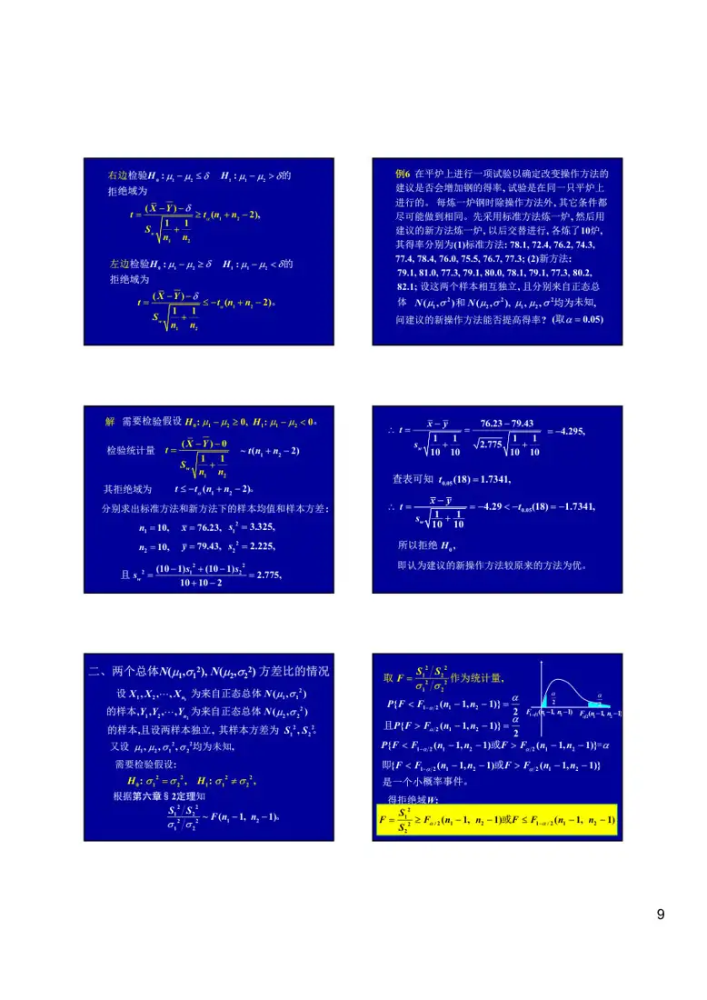

原文：

右边检验 $H_{0}:\mu_{1}-\mu_{2}\leq\delta$ $H_{1}:\mu_{1}-\mu_{2}>\delta$ 的拒绝域为

$$
t = \frac {(\bar {X} - \bar {Y}) - \delta}{S _ {w} \sqrt {\frac {1}{n _ {1}} + \frac {1}{n _ {2}}}} \geq t _ {a} (n _ {1} + n _ {2} - 2),
$$

左边检验 $H_{0}:\mu_{1} - \mu_{2}\geq \delta$ $H_{1}:\mu_{1} - \mu_{2} <   \delta$ 的拒绝域为

$$
t = \frac {(\bar {X} - \bar {Y}) - \delta}{S _ {w} \sqrt {\frac {1}{n _ {1}} + \frac {1}{n _ {2}}}} \leq - t _ {\alpha} (n _ {1} + n _ {2} - 2) 。
$$

解 需要检验假设 $H_0: \mu_1 - \mu_2 \geq 0, H_1: \mu_1 - \mu_2 < 0$ 。

检验统计量 $t = \frac{(\bar{X} - \bar{Y}) - 0}{S_w\sqrt{\frac{1}{n_1} + \frac{1}{n_2}}}\sim t(n_1 + n_2 - 2)$

其拒绝域为 $t \leq -t_{\alpha}(n_{1} + n_{2} - 2)$ 。

分别求出标准方法和新方法下的样本均值和样本方差：

$$
n _ {1} = 1 0, \quad \overline {{x}} = 7 6. 2 3, \quad s _ {1} ^ {2} = 3. 3 2 5,
$$

$$
n _ {2} = 1 0, \quad \overline {{y}} = 7 9. 4 3, s _ {2} ^ {2} = 2. 2 2 5,
$$

$$
\text {且} s _ {w} ^ {2} = \frac {(1 0 - 1) s _ {1} ^ {2} + (1 0 - 1) s _ {2} ^ {2}}{1 0 + 1 0 - 2} = 2. 7 7 5,
$$

二、两个总体 $N(\mu_{1},\sigma_{1}^{2}),N(\mu_{2},\sigma_{2}^{2})$ 方差比的情况设 $X_{1},X_{2},\cdots,X_{n_{1}}$ 为来自正态总体 $N(\mu_{1},\sigma_{1}^{2})$ 的样本, $Y_{1},Y_{2},\cdots,Y_{n_{2}}$ 为来自正态总体 $N(\mu_{2},\sigma_{2}^{2})$ 的样本,且设两样本独立,其样本方差为 $S_{1}^{2},S_{2}^{2}$ 。又设 $\mu_{1},\mu_{2},\sigma_{1}^{2},\sigma_{2}^{2}$ 均为未知,需要检验假设: $H_{0}\colon\sigma_{1}^{2}=\sigma_{2}^{2},H_{1}\colon\sigma_{1}^{2}\neq\sigma_{2}^{2},$ 根据第六章§2定理知 $\frac{S_{1}^{2}/S_{2}^{2}}{\sigma_{1}^{2}/\sigma_{2}^{2}}\sim F(n_{1}-1,n_{2}-1)$ 。

例6 在平炉上进行一项试验以确定改变操作方法的建议是否会增加钢的得率, 试验是在同一只平炉上进行的。每炼一炉钢时除操作方法外, 其它条件都尽可能做到相同。先采用标准方法炼一炉, 然后用建议的新方法炼一炉, 以后交替进行, 各炼了10炉, 其得率分别为(1)标准方法: 78.1, 72.4, 76.2, 74.3, 77.4, 78.4, 76.0, 75.5, 76.7, 77.3; (2)新方法: 79.1, 81.0, 77.3, 79.1, 80.0, 78.1, 79.1, 77.3, 80.2, 82.1; 设这两个样本相互独立, 且分别来自正态总体 $N(\mu_1, \sigma^2)$ 和 $N(\mu_2, \sigma^2)$ , $\mu_1, \mu_2, \sigma^2$ 均为未知, 问建议的新操作方法能否提高得率? (取 $\alpha = 0.05$ )

$$
\therefore t = \frac {\bar {x} - \bar {y}}{s _ {w} \sqrt {\frac {1}{1 0} + \frac {1}{1 0}}} = \frac {7 6 . 2 3 - 7 9 . 4 3}{\sqrt {2 . 7 7 5} \sqrt {\frac {1}{1 0} + \frac {1}{1 0}}} = - 4. 2 9 5,
$$

查表可知 $t_{0.05}(18) = 1.7341,$

$$
\therefore t = \frac {\bar {x} - \bar {y}}{s _ {w} \sqrt {\frac {1}{1 0} + \frac {1}{1 0}}} = - 4. 2 9 <   - t _ {0. 0 5} (1 8) = - 1. 7 3 4 1,
$$

所以拒绝 $H_0$

即认为建议的新操作方法较原来的方法为优。

取 $F = \frac{S_{1}^{2}/S_{2}^{2}}{\sigma_{1}^{2}/\sigma_{2}^{2}}$ 作为统计量， $P\{F < F_{1-\alpha/2}(n_{1}-1, n_{2}-1)\} = \frac{\alpha}{2}$ 且 $P\{F > F_{\alpha/2}(n_{1}-1, n_{2}-1)\} = \frac{\alpha}{2}$ $P\{F < F_{1-\alpha/2}(n_{1}-1, n_{2}-1)$ 或 $F > F_{\alpha/2}(n_{1}-1, n_{2}-1)=\alpha$ 即 $\{F < F_{1-\alpha/2}(n_{1}-1, n_{2}-1)$ 或 $F > F_{\alpha/2}(n_{1}-1, n_{2}-1)\}$ 是一个小概率事件。

$$
F = \frac {S _ {1} ^ {2}}{S _ {2} ^ {2}} \geq F _ {\alpha / 2} (n _ {1} - 1, n _ {2} - 1) \text {或} F \leq F _ {1 - \alpha / 2} (n _ {1} - 1, n _ {2} - 1)
$$

9

### $$

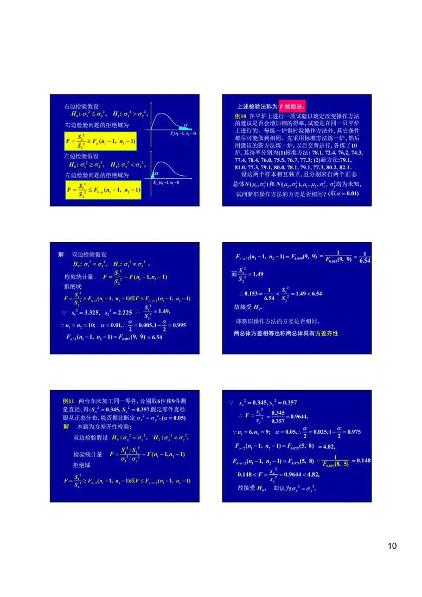

原文：

右边检验假设 $H_{0}: \sigma_{1}^{2} \leq \sigma_{2}^{2}, H_{1}: \sigma_{1}^{2} > \sigma_{2}^{2}$ ,
右边检验问题的拒绝域为 $F = \frac{S_{1}^{2}}{S_{2}^{2}} \geq F_{\alpha}(n_{1}-1, n_{2}-1)$ 左边检验假设 $H_{0}: \sigma_{1}^{2} \geq \sigma_{2}^{2}, H_{1}: \sigma_{1}^{2} < \sigma_{2}^{2}$ ,
左边检验问题的拒绝域为 $F = \frac{S_{1}^{2}}{S_{2}^{2}} \leq F_{1-\alpha}(n_{1}-1, n_{2}-1)$

解 双边检验假设 $H_{0}:\sigma_{1}^{2}=\sigma_{2}^{2},\quad H_{1}:\sigma_{1}^{2}\neq\sigma_{2}^{2}$ 检验统计量 $F=\frac{S_{1}^{2}}{S_{2}^{2}}\sim F(n_{1}-1,n_{2}-1)$ 拒绝域 $F=\frac{S_{1}^{2}}{S_{2}^{2}}\geq F_{\alpha/2}(n_{1}-1,n_{2}-1)$ 或 $F\leq F_{1-\alpha/2}(n_{1}-1,n_{2}-1)$ $\because s_{1}^{2}=3.325,\quad s_{2}^{2}=2.225\quad\therefore\quad\frac{S_{1}^{2}}{S_{2}^{2}}=1.49,$ $\because n_{1}=n_{2}=10;\quad\alpha=0.01,\therefore\frac{\alpha}{2}=0.005,1-\frac{\alpha}{2}=0.995$ $F_{\alpha/2}(n_{1}-1,n_{2}-1)=F_{0.005}(9,9)=6.54$

例1 两台车床加工同一零件, 分别取6件和9件测量直径, 得: $S_{x}^{2}=0.345$ , $S_{y}^{2}=0.357$ 假定零件直径服从正态分布, 能否据此断定 $\sigma_{x}^{2}=\sigma_{y}^{2}$ 。( $\alpha=0.05$ ) 解 本题为方差齐性检验:

双边检验假设 $H_{0}:\sigma_{x}^{2}=\sigma_{y}^{2},\quad H_{1}:\sigma_{x}^{2}\neq\sigma_{y}^{2}$

$$
F = \frac {S _ {1} ^ {2} / S _ {2} ^ {2}}{\sigma_ {1} ^ {2} / \sigma_ {2} ^ {2}} \sim F (n _ {1} - 1, n _ {2} - 1)
$$

$$
F = \frac {S _ {1} ^ {2}}{S _ {2} ^ {2}} \geq F _ {\alpha / 2} (n _ {1} - 1, n _ {2} - 1) \text {或} F \leq F _ {1 - \alpha / 2} (n _ {1} - 1, n _ {2} - 1)
$$

上述检验法称为 $F$ 检验法。

例10 在平炉上进行一项试验以确定改变操作方法的建议是否会增加钢的得率, 试验是在同一只平炉上进行的。每炼一炉钢时除操作方法外, 其它条件都尽可能做到相同。先采用标准方法炼一炉, 然后用建议的新方法炼一炉, 以后交替进行, 各炼了10炉, 其得率分别为(1)标准方法: 78.1, 72.4, 76.2, 74.3, 77.4, 78.4, 76.0, 75.5, 76.7, 77.3; (2)新方法: 79.1, 81.0, 77.3, 79.1, 80.0, 78.1, 79.1, 77.3, 80.2, 82.1。

设这两个样本相互独立,且分别来自两个正态总体 $N(\mu_{1},\sigma_{1}^{2})$ 和 $N(\mu_{2},\sigma_{2}^{2}),\mu_{1},\mu_{2},\sigma_{1}^{2},\sigma_{2}^{2}$ 均为未知,试问新旧操作方法的方差是否相同?(取 $\alpha=0.01$ )

$$
F _ {1 - \alpha / 2} \left(n _ {1} - 1, n _ {2} - 1\right) = F _ {0. 9 9 5} (9, 9) = \frac {1}{F _ {0 . 0 0 5} (9 , 9)} = \frac {1}{6 . 5 4}
$$

$$
\frac {S _ {1} ^ {2}}{S _ {2} ^ {2}} = 1. 4 9
$$

故接受 $H_0$ 。

$$
\therefore 0. 1 5 3 = \frac {1}{6 . 5 4} <   \frac {S _ {1} ^ {2}}{S _ {2} ^ {2}} = 1. 4 9 <   6. 5 4
$$

即新旧操作方法的方差是否相同。

两总体方差相等也称两总体具有方差齐性。

$\because s_{x}^{2} = 0.345, s_{y}^{2} = 0.357$ $\therefore F = \frac{s_x^2}{s_y^2} = \frac{0.345}{0.357} = 0.9644,$ $\because n_1 = 6, n_2 = 9; \alpha = 0.05, \therefore \frac{\alpha}{2} = 0.025, 1 - \frac{\alpha}{2} = 0.975$ $F_{\alpha / 2}(n_1 - 1, n_2 - 1) = F_{0.025}(5, 8) = 4.82,$ $F_{1 - \alpha /2}(n_1 - 1, n_2 - 1) = F_{0.975}(5, 8) = \frac{1}{F_{0.025}(8, 5)} = 0.148$ $0.148 < F = \frac{s_x^2}{s_y^2} = 0.9644 < 4.82,$ 故接受 $H_0$ ，即认为 $\sigma_x^2 = \sigma_y^2$ 。

10

### 再验证 $\mu_{x}=\mu_{y}$ ,

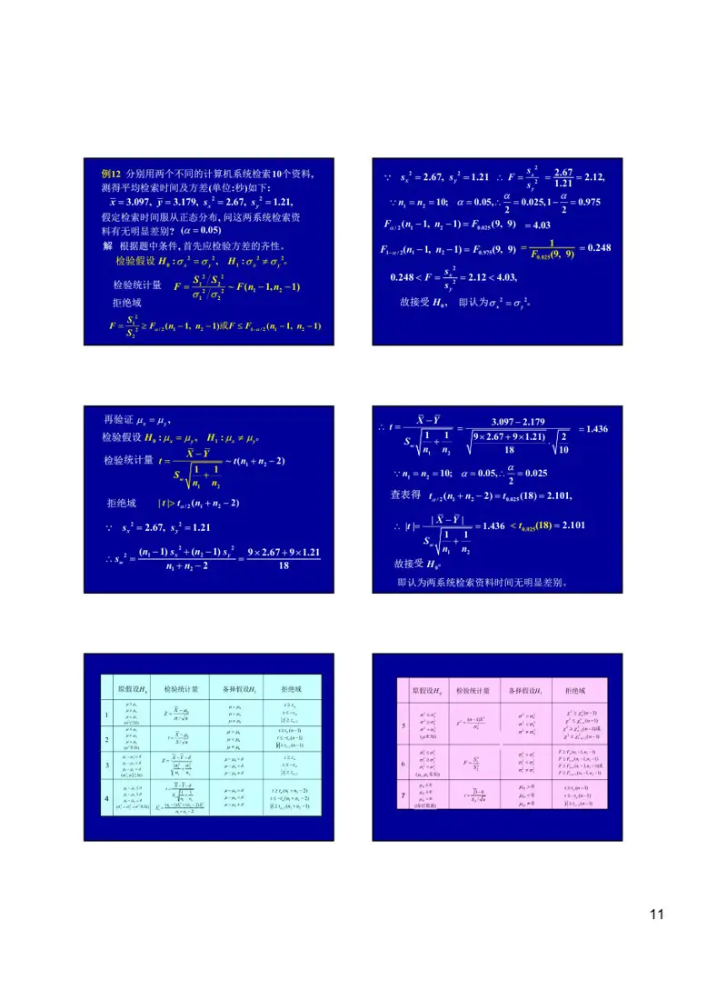

原文：

例12 分别用两个不同的计算机系统检索10个资料，测得平均检索时间及方差(单位:秒)如下： $\bar{x}=3.097,\quad\bar{y}=3.179,\quad s_{x}^{2}=2.67,\quad s_{y}^{2}=1.21,$ 假定检索时间服从正态分布，问这两系统检索资料有无明显差别？ $(\alpha=0.05)$ 解 根据题中条件，首先应检验方差的齐性。
检验假设 $H_{0}:\sigma_{x}^{2}=\sigma_{y}^{2},\quad H_{1}:\sigma_{x}^{2}\neq\sigma_{y}^{2}$ 检验统计量 $F=\frac{S_{1}^{2}/S_{2}^{2}}{\sigma_{1}^{2}/\sigma_{2}^{2}}\sim F(n_{1}-1,n_{2}-1)$ 拒绝域 $F=\frac{S_{1}^{2}}{S_{2}^{2}}\geq F_{\alpha/2}(n_{1}-1,n_{2}-1)$ 或 $F\leq F_{1-\alpha/2}(n_{1}-1,n_{2}-1)$

再验证 $\mu_{x}=\mu_{y}$ ,
检验假设 $H_{0}:\mu_{x}=\mu_{y},\quad H_{1}:\mu_{x}\neq\mu_{y}$ 检验统计量 $t=\frac{\bar{X}-\bar{Y}}{S_{w}\sqrt{\frac{1}{n_{1}}+\frac{1}{n_{2}}}}\sim t(n_{1}+n_{2}-2)$ 拒绝域 $\left|t\right\rangle t_{\alpha/2}(n_{1}+n_{2}-2)$ $\because s_{x}^{2}=2.67,\quad s_{y}^{2}=1.21$ $\therefore s_{w}^{2}=\frac{(n_{1}-1)s_{x}^{2}+(n_{2}-1)s_{y}^{2}}{n_{1}+n_{2}-2}=\frac{9\times2.67+9\times1.21}{18}$ $\because s_{x}^{2}=2.67, s_{y}^{2}=1.21 \therefore F=\frac{s_{x}^{2}}{s_{y}^{2}}=\frac{2.67}{1.21}=2.12,$ $\because n_{1}=n_{2}=10; \quad \alpha=0.05, \therefore \frac{\alpha}{2}=0.025, 1-\frac{\alpha}{2}=0.975$ $F_{\alpha/2}(n_{1}-1, n_{2}-1)=F_{0.025}(9, 9) =4.03$ $F_{1-\alpha/2}(n_{1}-1, n_{2}-1)=F_{0.975}(9, 9)=\frac{1}{F_{0.025}(9, 9)}=0.248$ $0.248<F=\frac{s_{x}^{2}}{s_{y}^{2}}=2.12<4.03,$ 故接受 $H_{0}$ , 即认为 $\sigma_{x}^{2}=\sigma_{y}^{2}$ 。

<table><tr><td></td><td>原假设 $H_0$ </td><td>检验统计量</td><td>备择假设 $H_1$ </td><td>拒绝域</td></tr><tr><td>1</td><td> $\mu \leq \mu_0$  $\mu \geq \mu_0$  $\mu = \mu_0$ ( $\sigma$ 已知)</td><td> $Z = \frac{\overline{X} - \mu_0}{\sigma / \sqrt{n}}$ </td><td> $\mu > \mu_0$  $\mu < \mu_0$  $\mu \neq \mu_0$ </td><td> $z \geq z_\alpha$  $z \leq -z_\alpha$  $|\zeta| \geq z_{n/2}$ </td></tr><tr><td>2</td><td> $\mu \leq \mu_0$  $\mu \geq \mu_0$  $\mu = \mu_0$ ( $\sigma^2$ 未知)</td><td> $t = \frac{\overline{X} - \mu_0}{S / \sqrt{n}}$ </td><td> $\mu > \mu_0$  $\mu < \mu_0$  $\mu \neq \mu_0$ </td><td> $t \geq t_a(n-1)$  $t \leq -t_a(n-1)$  $||t|| \geq t_{a/2}(n-1)$ </td></tr><tr><td>3</td><td> $\mu_t - \mu_2 \leq \delta$  $\mu_t - \mu_3 \geq \delta$  $\mu_t - \mu_5 = \delta$ ( $\sigma_1^*, \sigma_2$ 已知)</td><td> $Z = \frac{\overline{X} - \overline{Y} - \delta}{\sqrt{\frac{\sigma_1^* + \sigma_2^*}{n_1}} + \frac{\sigma_3^*}{n_2}} }$ </td><td> $\mu - \mu_0 > \delta$  $\mu - \mu_0 < \delta$  $\mu - \mu_0 \neq \delta$ </td><td> $z \geq z_\alpha$  $z \leq -z_\alpha$  $||z|| \geq z_{n/2}$ </td></tr><tr><td>4</td><td> $\mu_t - \mu_3 \leq \delta$  $\mu_t - \mu_5 \geq \delta$  $\mu_t - \mu_7 = \delta$ ( $\sigma_1^* = \sigma_2^* = \sigma^*$ 未知)</td><td> $t = \frac{\overline{X} - \overline{Y} - \delta}{S_x \sqrt{\frac{1 + 1}{n_1 + \frac{1}{n_2}}}}$  $S_x^2 = \frac{(n_1 - 1)S_y^2 + (n_2 - 2)S_z^2}{n_1 + n_2 - 2}$ </td><td> $\mu - \mu_0 > \delta$  $\mu - \mu_0 < \delta$  $\mu - \mu_0 \neq \delta$ </td><td> $t \geq t_a(n_1 + n_2 - 2)$  $t \leq -t_a(n_1 + n_2 - 2)$  $||t|| \geq t_{a/2}(n_1 + n_2 - 1)$ </td></tr></table>

$\therefore t = \frac{\overline{X} - \overline{Y}}{S_w\sqrt{\frac{1}{n_1} + \frac{1}{n_2}}} = \frac{3.097 - 2.179}{\sqrt{\frac{9\times 2.67 + 9\times 1.21)}{18}\cdot\sqrt{\frac{2}{10}}} = 1.436$ $\because n_{1} = n_{2} = 10;\quad \alpha = 0.05,\therefore \frac{\alpha}{2} = 0.025$ 查表得 $t_{\alpha /2}(n_1 + n_2 - 2) = t_{0.025}(18) = 2.101,$ $\therefore |t| = \frac{|\overline{X} - \overline{Y}|}{S_w\sqrt{\frac{1}{n_1} + \frac{1}{n_2}}} = 1.436 <   t_{0.025}(18) = 2.101$ 故接受 $H_0^{\circ}$ 即认为两系统检索资料时间无明显差别。

<table><tr><td></td><td>原假设 $H_0$ </td><td>检验统计量</td><td>备择假设 $H_1$ </td><td>拒绝域</td></tr><tr><td>5</td><td> $\sigma^2 \leq \sigma_0^2$  $\sigma^2 \geq \sigma_0^2$  $\sigma^2 = \sigma_0^2$ (μ未知)</td><td> $\chi^2 = \frac{(n-1)S^2}{\sigma_0^2}$ </td><td> $\sigma^2 > \sigma_0^2$  $\sigma^2 < \sigma_0^2$  $\sigma^2 \neq \sigma_0^2$ </td><td> $\chi^2 \geq \chi_{a}^2 (n-1)$  $\chi^2 \leq \chi_{a-2}^2 (n-1)$  $\chi^2 \geq \chi_{a-2}^2 (n-1)$ 或 $\chi^2 \leq \chi_{a-2}^2 (n-1)$ </td></tr><tr><td>6</td><td> $\sigma^2 \leq \sigma_0^2$  $\sigma_0^2 \geq \sigma_0^2$  $\sigma_1^2 = \sigma_1^2$ ( $\mu_1, \mu_2$ 未知)</td><td> $F = \frac{S_1^2}{S_2^2}$ </td><td> $\sigma_1^2 > \sigma_2^2$  $\sigma_1^2 < \sigma_2^2$  $\sigma_1^2 \neq \sigma_2^2$ </td><td> $F \geq F_a(n_1-1,n_2-1)$  $F \leq F_{a-2}(n_1-1,n_2-1)$  $F \geq F_{a-2}(n_1-1,n_2-1)$ 或 $F \geq F_{1-a-2}(n_1-1,n_2-1)$ </td></tr><tr><td>7</td><td> $\mu_0 \leq 0$  $\mu_0 \geq 0$  $\mu_0 = 0$ (成对数据)</td><td> $t = \frac{\overline{D}-0}{S_D/\sqrt{n}}$ </td><td> $\mu_D > 0$  $\mu_D < 0$  $\mu_D \neq 0$ </td><td> $t \geq t_a(n-1)$  $t \leq -t_a(n-1)$  $|t| \geq t_{a-2}(n-1)$ </td></tr></table>

11
