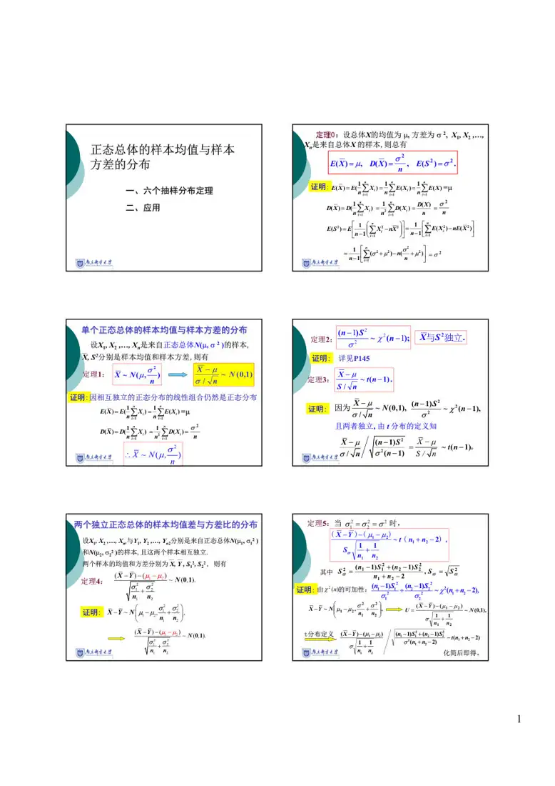
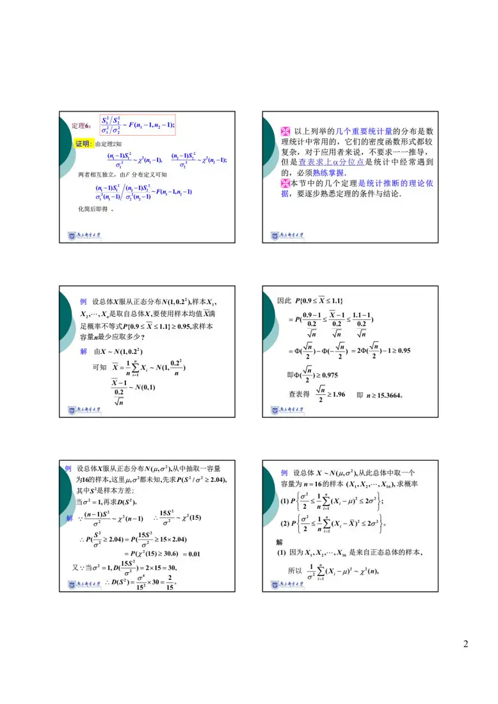
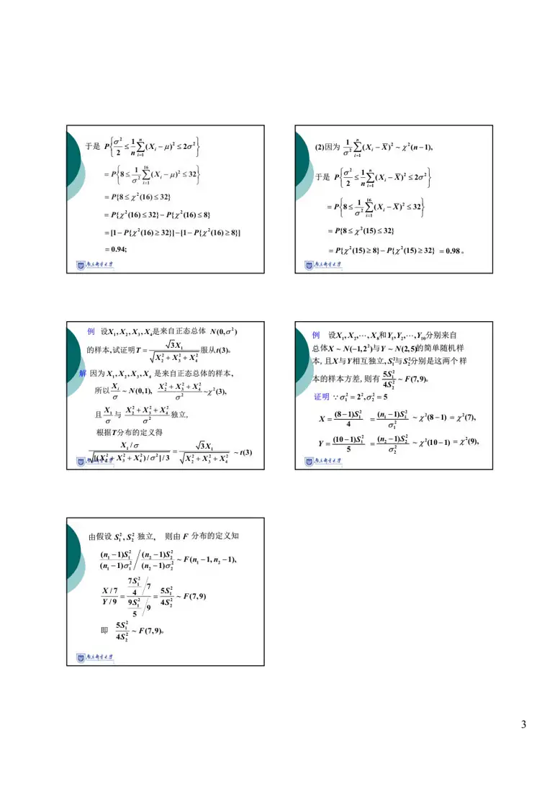

# 《概率论与数理统计》第六章 样本及抽样分布（课件）

原件的每一页，下面附识别出的文字。

### 正态总体的样本均值与样本方差的分布

原文：

正态总体的样本均值与样本方差的分布

一、六个抽样分布定理

二、应用

南京邮电大学
Nanjing University of Physics and Telecommunications

单个正态总体的样本均值与样本方差的分布设 $X_{1}, X_{2}, \ldots, X_{n}$ 是来自正态总体 $N(\mu, \sigma^{2})$ 的样本， $\overline{X}, S^{2}$ 分别是样本均值和样本方差，则有

定理1: $\overline{X} \sim N(\mu, \frac{\sigma^{2}}{n})$ $\Longrightarrow$ $\frac{\overline{X} - \mu}{\sigma / \sqrt{n}} \sim N(0,1)$

证明: 因相互独立的正态分布的线性组合仍然是正态分布

$$
E (\bar {X}) = E \left(\frac {1}{n} \sum_ {i = 1} ^ {n} X _ {i}\right) = \frac {1}{n} \sum_ {i = 1} ^ {n} E (X _ {i}) = \mu
$$

$$
D (\bar {X}) = D \left(\frac {1}{n} \sum_ {i = 1} ^ {n} X _ {i}\right) = \frac {1}{n ^ {2}} \sum_ {i = 1} ^ {n} D (X _ {i}) = \frac {\sigma^ {2}}{n}
$$

南京航空航天大学 $\therefore \bar{X} \sim N(\mu, \frac{\sigma^{2}}{n})$

两个独立正态总体的样本均值差与方差比的分布

设 $X_{1}, X_{2}, \ldots, X_{n1}$ 与 $Y_{1}, Y_{2}, \ldots, Y_{n2}$ 分别是来自正态总体 $N(\mu_{1}, \sigma_{1}^{2})$ 和 $N(\mu_{2}, \sigma_{2}^{2})$ 的样本，且这两个样本相互独立.

两个样本的均值和方差分别为 $\overline{X},\overline{Y},S_1^2,S_2^2$ ，则有

定理4:

$$
\frac {(\bar {X} - \bar {Y}) - (\boldsymbol {\mu} _ {1} - \boldsymbol {\mu} _ {2})}{\sqrt {\frac {\boldsymbol {\sigma} _ {1} ^ {2}}{\boldsymbol {n} _ {1}} + \frac {\boldsymbol {\sigma} _ {2} ^ {2}}{\boldsymbol {n} _ {2}}}} \sim N (\mathbf {0}, \mathbf {1}).
$$

证明： $\overline{X} -\overline{Y}\sim N\left(\pmb{\mu}_{1} - \pmb{\mu}_{2},\frac{\pmb{\sigma}_{1}^{2}}{\pmb{n}_{1}} +\frac{\pmb{\sigma}_{2}^{2}}{\pmb{n}_{2}}\right),$

$$
\frac {(\bar {X} - \bar {Y}) - (\pmb {\mu} _ {1} - \pmb {\mu} _ {2})}{\sqrt {\frac {\pmb {\sigma} _ {1} ^ {2}}{n _ {1}} + \frac {\pmb {\sigma} _ {2} ^ {2}}{n _ {2}}}} \sim N (\mathbf {0}, \mathbf {1}).
$$

南京新電大學
Nanjing University of Physics and Telecommunications

定理0：设总体 $X$ 的均值为 $\mu, \text{方差为} \sigma^2, X_1, X_2, \ldots, X_n$ 是来自总体 $X$ 的样本，则总有

$$
\boxed {E (\bar {X}) = \mu , \quad D (\bar {X}) = \frac {\sigma^ {2}}{n}, \quad E (S ^ {2}) = \sigma^ {2}.}
$$

证明： $E(\overline{X})=E(\frac{1}{n}\sum_{i=1}^{n}X_{i})=\frac{1}{n}\sum_{i=1}^{n}E(X_{i})=\frac{1}{n}\sum_{i=1}^{n}E(X)=\mu$

$$
D (\bar {X}) = D \left(\frac {1}{n} \sum_ {i = 1} ^ {n} X _ {i}\right) = \frac {1}{n ^ {2}} \sum_ {i = 1} ^ {n} D (X _ {i}) = \frac {D (X)}{n} = \frac {\sigma^ {2}}{n}
$$

$$
E \left(S ^ {2}\right) = E \left[ \frac {1}{n - 1} \left(\sum_ {i = 1} ^ {n} X _ {i} ^ {2} - n \bar {X} ^ {2}\right) \right] = \frac {1}{n - 1} \left[ \sum_ {i = 1} ^ {n} E \left(X _ {i} ^ {2}\right) - n E \left(\bar {X} ^ {2}\right) \right]
$$

$$
= \frac {1}{n - 1} \left[ \sum_ {i = 1} ^ {n} (\sigma^ {2} + \mu^ {2}) - n (\frac {\sigma^ {2}}{n} + \mu^ {2}) \right] = \sigma^ {2}
$$

定理2: $\frac{(n-1)S^{2}}{\sigma^{2}}\sim\chi^{2}(n-1);$ $\bar{X}$ 与 $S^{2}$ 独立.

证明： 详见P145

定理3: $\frac{\overline{X} - \mu}{S / \sqrt{n}} \sim t(n - 1)$ .

证明：因为 $\frac{\bar{X} - \mu}{\sigma / \sqrt{n}} \sim N(0,1), \frac{(n - 1)S^2}{\sigma^2} \sim \chi^2 (n - 1)$ ，且两者独立，由 $t$ 分布的定义知

$$
\frac {\bar {X} - \mu}{\sigma / \sqrt {n}} / \sqrt {\frac {(n - 1) S ^ {2}}{\sigma^ {2} (n - 1)}} = \frac {\bar {X} - \mu}{S / \sqrt {n}} \sim t (n - 1) _ {\circ}
$$

定理5：当 $\sigma_1^2 = \sigma_2^2 = \sigma^2$ 时，

$$
\frac {(\bar {X} - \bar {Y}) - (\mu_ {1} - \mu_ {2})}{S _ {\varpi} \sqrt {\frac {1}{n _ {1}} + \frac {1}{n _ {2}}}} \sim t (n _ {1} + n _ {2} - 2),
$$

其中 $S_{\varpi}^{2} = \frac{(n_{1} - 1)S_{1}^{2} + (n_{2} - 1)S_{2}^{2}}{n_{1} + n_{2} - 2}, S_{\varpi} = \sqrt{S_{\varpi}^{2}}$

证明：由 $\chi^{2}(n)$ 的可加性： $\frac{(n_{1}-1)S_{1}^{2}}{\sigma_{1}^{2}}+\frac{(n_{2}-1)S_{2}^{2}}{\sigma_{2}^{2}}\sim\chi^{2}(n_{1}+n_{2}-2),$

$$
\overline {{{X}}} - \overline {{{Y}}} \sim N \left(\mu_ {1} - \mu_ {2}, \frac {\sigma^ {2}}{n _ {1}} + \frac {\sigma^ {2}}{n _ {2}}\right), \Longrightarrow U = \frac {(\overline {{{X}}} - \overline {{{Y}}}) - (\mu_ {1} - \mu_ {2})}{\sigma \sqrt {\frac {1}{n _ {1}} + \frac {1}{n _ {2}}}} \sim N (0, 1),
$$

t分布定义 $\frac{(\bar{X}-\bar{Y})-(\mu_{1}-\mu_{2})}{\sigma\sqrt{\frac{1}{n_{1}}+\frac{1}{n_{2}}}}/\sqrt{\frac{(n_{1}-1)S_{1}^{2}+(n_{2}-1)S_{2}^{2}}{\sigma^{2}(n_{1}+n_{2}-2)}}\sim t(n_{1}+n_{2}-2)$ 化简后即得。

1

### 解 由 $X \sim N(1,0.2^2)$

原文：

例 设总体X服从正态分布 $N(1,0.2^{2})$ ，样本 $X_{1}, X_{2}, \cdots, X_{n}$ 是取自总体X，要使用样本均值 $\overline{X}$ 满足概率不等式 $P\{0.9 \leq \overline{X} \leq 1.1\} \geq 0.95$ ，求样本容量n最少应取多少？

解 由 $X \sim N(1,0.2^2)$

可知 $\overline{X} = \frac{1}{n}\sum_{i = 1}^{n}X_{i}\sim N(1,\frac{\mathbf{0}.2^{2}}{n})$

$$
\frac {\overline {{X}} - 1}{\frac {0 . 2}{\sqrt {n}}} \sim N (0, 1)
$$

南京邮电大学
Nanjing University of Posts and Telecommunications

例 设总体 $X$ 服从正态分布 $N(\mu, \sigma^2)$ , 从中抽取一容量为16的样本, 这里 $\mu, \sigma^2$ 都未知, 先求 $P(S^2 / \sigma^2 \geq 2.04)$ , 其中 $S^2$ 是样本方差;

当 $\sigma^2 = 1$ ，再求 $D(S^2)$ 。

解 $\because \frac{(n - 1)S^2}{\sigma^2}\sim \chi^2 (n - 1)\quad \therefore \frac{15S^2}{\sigma^2}\sim \chi^2 (15)$

$$
\begin{array}{r l} \therefore P (\frac {S ^ {2}}{\sigma^ {2}} \geq 2. 0 4) & = P (\frac {1 5 S ^ {2}}{\sigma^ {2}} \geq 1 5 \times 2. 0 4) \\ & = P (\chi^ {2} (1 5) \geq 3 0. 6) = 0. 0 1 \end{array}
$$

又∵当 $\sigma^{2}=1,D(\frac{15S^{2}}{\sigma^{2}})=2\times15=30,$

南京邮电大学 ∴ $D(S^{2})=\frac{\sigma^{4}}{15^{2}}\times30=\frac{2}{15}$

因此 $P\{0.9 \leq \overline{X} \leq 1.1\}$

$$
= P (\frac {0 . 9 - 1}{\frac {0 . 2}{\sqrt {n}}} \leq \frac {\overline {{X}} - 1}{\frac {0 . 2}{\sqrt {n}}} \leq \frac {1 . 1 - 1}{\frac {0 . 2}{\sqrt {n}}})
$$

$$
= \Phi (\frac {\sqrt {n}}{2}) - \Phi (- \frac {\sqrt {n}}{2}) = 2 \Phi (\frac {\sqrt {n}}{2}) - 1 \geq 0. 9 5
$$

即 $\Phi (\frac{\sqrt{n}}{2})\geq 0.975$

查表得 $\frac{\sqrt{n}}{2} \geq 1.96$ 即 $n \geq 15.3664$ 。

定理6: $\frac{S_{1}^{2}/S_{2}^{2}}{\sigma_{1}^{2}/\sigma_{2}^{2}}\sim F(n_{1}-1,n_{2}-1);$

$\frac{S_1^2 / S_2^2}{\sigma_1^2 / \sigma_2^2} \sim F(n_1 - 1, n_2 - 1)$ ;

证明：由定理2知

$\frac{(n_1 - 1)S_1^2}{\sigma_1^2}\sim \chi^2 (n_1 - 1),$

$\frac{(n_2 - 1)S_2^2}{\sigma_2^2}\sim \chi^2 (n_2 - 1);$

两者相互独立，由 $F$ 分布定义可知

$\frac{(n_1 - 1)S_1^2}{\sigma_1^2(n_1 - 1)}\Bigg / \frac{(n_2 - 1)S_2^2}{\sigma_2^2(n_2 - 1)}\sim F(n_1 - 1,n_2 - 1)$

化简后即得。

南京邮电大学
Nanjing University of Physics and Telecommunications

以上列举的几个重要统计量的分布是数理统计中常用的，它们的密度函数形式都较复杂，对于应用者来说，不要求一一推导，但是查表求上 $\alpha$ 分位点是统计中经常遇到的，必须熟练掌握.

本节中的几个定理是统计推断的理论依据，要逐步熟悉定理的条件与结论.

南京航空航天大学
Nanjing University of Physics and Telecommunications

南京邮电大学
Nanjing University of Physics and Telecommunications

例 设总体 $X \sim N(\mu, \sigma^{2})$ ，从此总体中取一个容量为 n = 16 的样本 $(X_{1}, X_{2}, \cdots, X_{16})$ ，求概率

(1) $P\left\{\frac{\sigma^{2}}{2} \leq \frac{1}{n} \sum_{i=1}^{n} (X_{i} - \mu)^{2} \leq 2\sigma^{2}\right\}$ ;

$P\left\{\frac{\sigma^2}{2}\leq \frac{1}{n}\sum_{i = 1}^{n}(X_i - \mu)^2\leq 2\sigma^2\right\};$

(2) $P\left\{\frac{\sigma^2}{2} \leq \frac{1}{n}\sum_{i=1}^{n}(X_i - \bar{X})^2 \leq 2\sigma^2\right\}$ 。

解

(1) 因为 $X_{1}, X_{2}, \cdots, X_{16}$ 是来自正态总体的样本，

所以 $\frac{1}{\sigma^2}\sum_{i = 1}^{n}(X_i - \mu)^2\sim \chi^2 (n),$

南京邮电大学
Nanjing University of Physics and Telecommunications

2

### $$

原文：

$$
\begin{array}{r l} {\text {于是}} & {P \Bigg \{\frac {\sigma^ {2}}{2} \leq \frac {1}{n}  \sum_ {i = 1} ^ {n} (X _ {i} - \mu) ^ {2} \leq 2 \sigma^ {2} \Bigg \}} \\ & {\quad = P \Bigg \{8 \leq \frac {1}{\sigma^ {2}}  \sum_ {i = 1} ^ {1 6} (X _ {i} - \mu) ^ {2} \leq 3 2 \Bigg \}} \\ & {\quad = P \{8 \leq \chi^ {2} (1 6) \leq 3 2 \}} \\ & {\quad = P \{\chi^ {2} (1 6) \leq 3 2 \} - P \{\chi^ {2} (1 6) \leq 8 \}} \\ & {\quad = [ 1 - P \{\chi^ {2} (1 6) \geq 3 2 \} ] - [ 1 - P \{\chi^ {2} (1 6) \geq 8 \} ]} \\ & {\quad = 0. 9 4;} \end{array}
$$

南京邮电大学
Nanjing University of Physics and Telecommunications

例 设 $X_{1}, X_{2}, X_{3}, X_{4}$ 是来自正态总体 $N(0, \sigma^{2})$

的样本,试证明 $T=\frac{\sqrt{3}X_{1}}{\sqrt{X_{2}^{2}+X_{3}^{2}+X_{4}^{2}}}$ 服从 $t(3)$ 。

解 因为 $X_{1}, X_{2}, X_{3}, X_{4}$ 是来自正态总体的样本，

所以 $\frac{X_i}{\sigma} \sim N(0,1)$ , $\frac{X_2^2 + X_3^2 + X_4^2}{\sigma^2} \sim \chi^2(3)$ ,

且 $\frac{X_1}{\sigma}$ 与 $\frac{X_2^2 + X_3^2 + X_4^2}{\sigma^2}$ 独立，

根据 $T$ 分布的定义得

$$
\frac {X _ {1} / \sigma}{\sqrt {\left[ \left(X _ {2} ^ {2} + X _ {3} ^ {2} + X _ {4} ^ {2}\right) / \sigma^ {2} \right] / 3}} = \frac {\sqrt {3} X _ {1}}{\sqrt {X _ {2} ^ {2} + X _ {3} ^ {2} + X _ {4} ^ {2}}} \sim t (3)
$$

由假设 $S_{1}^{2}, S_{2}^{2}$ 独立，则由 $\pmb{F}$ 分布的定义知

$$
\frac {(n _ {1} - 1) S _ {1} ^ {2}}{(n _ {1} - 1) \sigma_ {1} ^ {2}} / \frac {(n _ {2} - 1) S _ {2} ^ {2}}{(n _ {2} - 1) \sigma_ {2} ^ {2}} \sim F (n _ {1} - 1, n _ {2} - 1),
$$

$$
\frac {X / 7}{Y / 9} = \frac {\frac {7 S _ {1} ^ {2}}{4} / 7}{\frac {9 S _ {1} ^ {2}}{5} / 9} = \frac {5 S _ {1} ^ {2}}{4 S _ {2} ^ {2}} \sim F (7, 9)
$$

即 $\frac{5S_1^2}{4S_2^2} \sim F(7,9)$ 。

南京新電大學
Nanjing University of Physics and Telecommunications

(2)因为 $\frac{1}{\sigma^2}\sum_{i = 1}^{n}(X_i - \overline{X})^2\sim \chi^2 (n - 1),$

$$
\begin{array}{r l} & {\text {于是} P \Bigg \{\frac {\sigma^ {2}}{2} \leq \frac {1}{n}  \sum_ {i = 1} ^ {n} (X _ {i} - \overline {{{X}}}) ^ {2} \leq 2 \sigma^ {2} \Bigg \}} \\ & {\qquad = P \Bigg \{8 \leq \frac {1}{\sigma^ {2}}  \sum_ {i = 1} ^ {1 6} (X _ {i} - \overline {{{X}}}) ^ {2} \leq 3 2 \Bigg \}} \\ & {\qquad = P \{8 \leq \chi^ {2} (1 5) \leq 3 2 \}} \\ & {\qquad = P \{\chi^ {2} (1 5) \geq 8 \} - P \{\chi^ {2} (1 5) \geq 3 2 \} = 0. 9 8.} \end{array}
$$

南京航空航天大学
Nanjing University of Physics and Telecommunications

例 设 $X_{1}, X_{2}, \cdots, X_{8}$ 和 $Y_{1}, Y_{2}, \cdots, Y_{10}$ 分别来自

总体 $X \sim N(-1, 2^2)$ 与 $Y \sim N(2, 5)$ 的简单随机样本，且 $X$ 与 $Y$ 相互独立， $S_1^2$ 与 $S_2^2$ 分别是这两个样

本的样本方差, 则有 $\frac{5S_1^2}{4S_2^2} \sim F(7,9)$ 。

证明 $\because \sigma_1^2 = 2^2, \sigma_2^2 = 5$

$$
X = \frac {(8 - 1) S _ {1} ^ {2}}{4} = \frac {(n _ {1} - 1) S _ {1} ^ {2}}{\sigma_ {1} ^ {2}} \sim \chi^ {2} (8 - 1) = \chi^ {2} (7),
$$

$$
Y = \frac {(1 0 - 1) S _ {1} ^ {2}}{5} = \frac {(n _ {2} - 1) S _ {2} ^ {2}}{\sigma_ {2} ^ {2}} \sim \chi^ {2} (1 0 - 1) = \chi^ {2} (9),
$$

南京邮电大学
Nanjing University of Press and Telecommunications

3
