# 《概率论与数理统计》第四章 随机变量的数字特征（课件）

原件的每一页，下面附识别出的文字。

### 南京邮电大学

原文：

由此可见在随机变量的研究中，常常需要去研究某些与随机变量有关的，能反映随机变量重要特征的“数”，我们把这种“数”称作随机变量的数字特征。这些数字特征中最常用的是数学期望、方差、协方差和相关系数等.

南京邮电大学
Nanjing University of Physics and Telecommunications

例1 设甲、乙两射手在同样条件下进行射击，其命中环数是一随机变量，分别记为 $X$ 、 $Y$ ，并具有如下分布律

<table><tr><td>X</td><td>10</td><td>9</td><td>8</td><td>7</td></tr><tr><td> $P_{k}$ </td><td>0.6</td><td>0.1</td><td>0.2</td><td>0.1</td></tr></table>

试问甲、乙两射手的射击水平哪个较高？

<table><tr><td>Y</td><td>10</td><td>9</td><td>8</td><td>7</td></tr><tr><td> $P_{k}$ </td><td>0.4</td><td>0.3</td><td>0.1</td><td>0.2</td></tr></table>

$$
\begin{array}{r l} \text {解} & \frac {1}{1 0 0} (1 0 \times 6 0 + 9 \times 1 0 + 8 \times 2 0 + 7 \times 1 0) \quad \frac {1}{1 0 0} (1 0 \times 4 0 + 9 \times 3 0 + 8 \times 1 0 + 7 \times 2 0) \\ & = 1 0 \times 0. 6 + 9 \times 0. 1 + 8 \times 0. 2 + 7 \times 0. 1 = 1 0 \times 0. 4 + 9 \times 0. 3 + 8 \times 0. 1 + 7 \times 0. 2 \\ & = 9. 2 (\text {环}) = 8. 9 (\text {环}) \end{array}
$$

由此可见，射手甲的射击水平略高与射手乙的射击水平。

第一节 数学期望

一、数学期望的概念

二、数学期望的性质

三、随机变量函数的数学期望

四、小结

南京邮电大学
Nanjing University of Physics and Telecommunications

第四章 随机变量的数字特征

一个随机变量的性质，完全由它的分布函数所确定，或者说是由它的概率分布密度函数、分布律所确定，但在实际问题中，常常很难求出概率分布函数，另一方面，在某些问题中也并不需要知道其概率分布，只要能给出表征随机变量概率分布的某些数字就够了。

南京邮电大学
Nanjing University of Press and Telecommunications

例如：

1. 评定某工厂生产的一批灯泡的质量，一般是评定灯泡的寿命，寿命是随机变量，通常只需知这批灯泡的平均寿命以及相对于这个平均寿命的偏离程度就够了。

南京邮电大学
Nanjing University of Press and Telecommunications

2. 钢厂生产的一批钢锭，它的含碳量和其硬度有密切的关系，因此，除了掌握含碳量和平均硬度，还有必要了解含碳量与硬度之间的联系，特别希望知道彼此有无线性关系。

一、一维随机变量数学期望的定义

数学期望是最基本的数字特征，数学期望是能够体现随机变量取值的平均数。由此得到数学期望的定义。

南京邮电大学
Nanjing University of Science and Telecommunications

### 2. 连续型随机变量数学期望的定义

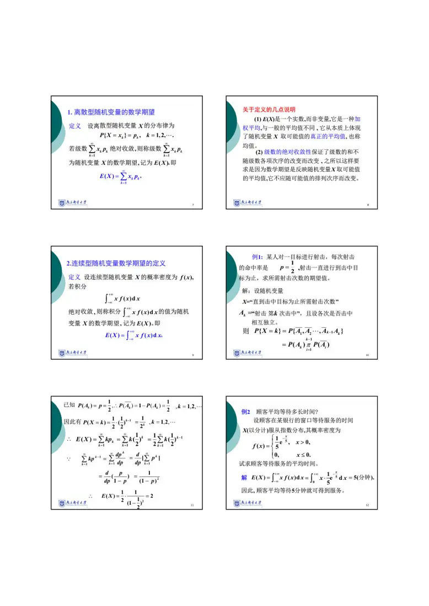

原文：

2. 连续型随机变量数学期望的定义

定义 设连续型随机变量 X 的概率密度为 $f(x)$ ,
若积分

$$
\int_ {- \infty} ^ {+ \infty} x f (x) \mathrm{d} x
$$

绝对收敛, 则称积分 $\int_{-\infty}^{+\infty} x f(x) \, dx$ 的值为随机变量 X 的数学期望, 记为 $E(X)$ 。即

$$
E (X) = \int_ {- \infty} ^ {+ \infty} x f (x) d x _ {\circ}
$$

南京邮电大学
Nanjing University of Physics and Telecommunications

已知 $P(A_{k}) = p = \frac{1}{2},\therefore P(\overline{A_{k}}) = 1 - P(A_{k}) = \frac{1}{2}$ ， $k = 1,2,$

因此有 $P(X=k)=\frac{1}{2}\cdot\left(\frac{1}{2}\right)^{k-1}=\frac{1}{2^{k}}$ , $k=1,2,\cdots$

$$
\therefore E (X) = \sum_ {k = 1} ^ {\infty} k p _ {k} = \sum_ {k = 1} ^ {\infty} k \left(\frac {1}{2}\right) ^ {k} = \frac {1}{2} \sum_ {k = 1} ^ {\infty} k \left(\frac {1}{2}\right) ^ {k - 1}
$$

$$
\begin{array}{r l} \sum_ {k = 1} ^ {\infty} k p ^ {k - 1} & = \sum_ {k = 1} ^ {\infty} \frac {d p ^ {k}}{d p} = \frac {d}{d p} [ \sum_ {k = 1} ^ {\infty} p ^ {k} ] \\ & = \frac {d}{d p} (\frac {p}{1 - p}) = \frac {1}{(1 - p) ^ {2}} \end{array}
$$

$$
E (X) = \frac {1}{2} \cdot \frac {1}{(1 - \frac {1}{2}) ^ {2}} = 2
$$

南京邮电大学
Nanjing University of Physics and Telecommunications

例1：某人对一目标进行射击，每次射击的命中率是 $p = \frac{1}{2}$ ，射击一直进行到击中目标为止，求所需射击次数的期望值。

解：设随机变量

$X =$ “直到击中目标为止所需射击次数”

$A_{k}=$ “射击第k次击中”，且设各次是否击中相互独立。

则 $P\{X=k\}=P\{\overline{A_{1}},\overline{A_{2}}\cdots,\overline{A}_{k-1}A_{k}\}$

$$
= P (A _ {k}) \prod_ {i = 1} ^ {k - 1} P (\overline {{A _ {i}}})
$$

南京邮电大学
Nanjing University of Physics and Telecommunications

例2 顾客平均等待多长时间？

设顾客在某银行的窗口等待服务的时间X(以分计)服从指数分布,其概率密度为

$$
f (x) = \left\{ \begin{array}{l l} \frac {1}{5} \mathrm{e} ^ {- \frac {x}{5}}, & x > 0, \\ 0, & x \leq 0. \end{array} \right.
$$

试求顾客等待服务的平均时间。

解 $E(X) = \int_{-\infty}^{+\infty} x f(x) \mathrm{d}x = \int_{0}^{+\infty} x \cdot \frac{1}{5} \mathrm{e}^{-\frac{x}{5}} \mathrm{d}x = 5$ (分钟).

因此, 顾客平均等待5分钟就可得到服务。

南京邮电大学
Nanjing University of Physics and Telecommunications

10

8

1. 离散型随机变量的数学期望

定义 设离散型随机变量 $X$ 的分布律为

$P\{X=x_{k}\}=p_{k},\quad k=1,2,\cdots.$

$\sum_{k = 1}^{\infty}x_kp_k$

若级数 $\sum_{k=1}^{\infty} x_k p_k$ 绝对收敛，则称级数 $\sum_{k=1}^{\infty} x_k p_k$ 为随机变量 $X$ 的数学期望，记为 $E(X)$ 。即

$\sum_{k = 1}^{\infty}x_kp_k$

$E(X)$

$E(X) = \sum_{k=1}^{\infty} x_k p_k\circ$

南京新電大學
Nanjing University of Physics and Telecommunications

关于定义的几点说明

(1) $E(X)$ 是一个实数, 而非变量, 它是一种加权平均, 与一般的平均值不同, 它从本质上体现了随机变量 $X$ 取可能值的真正的平均值, 也称均值。

(2) 级数的绝对收敛性保证了级数的和不随级数各项次序的改变而改变, 之所以这样要求是因为数学期望是反映随机变量 $X$ 取可能值的平均值, 它不应随可能值的排列次序而改变。

南京新電大學
Nanjing University of Private and Telecommunications

### $$

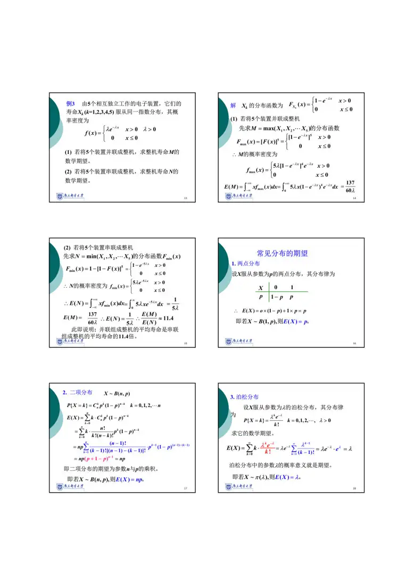

原文：

例3 由5个相互独立工作的电子装置，它们的寿命 $X_{k}(k = 1,2,3,4,5)$ 服从同一指数分布，其概率密度为

$$
f (x) = \left\{ \begin{array}{c c c} \lambda e ^ {- \lambda x} & x > 0 & \lambda > 0 \\ 0 & x \leq 0 \end{array} \right.
$$

(1) 若将5个装置并联成整机，求整机寿命 $M$ 的数学期望。

(2) 若将5个装置串联成整机，求整机寿命 $N$ 的数学期望。

南京新電大學
Nanjing University of Physics and Telecommunications

(2) 若将5个装置串联成整机

先求 $N=\min(X_{1},X_{2},\cdots X_{5})$ 的分布函数 $F_{\min}(x)$

$$
F _ {\min} (x) = 1 - [ 1 - F (x) ] ^ {5} = \left\{ \begin{array}{c c} 1 - e ^ {- 5 \lambda x} & x > 0 \\ 0 & x \leq 0 \end{array} \right.
$$

∴ N 的概率密度为 $f_{\min}(x)=\left\{\begin{aligned}5\lambda e^{-5\lambda x}&\quad x>0\\ 0&\quad x\leq0\end{aligned}\right.$

$$
\therefore E (N) = \int_ {- \infty} ^ {+ \infty} x f _ {\min} (x) d x = \int_ {0} ^ {\infty} 5 \lambda x e ^ {- 5 \lambda x} d x = \frac {1}{5 \lambda}
$$

$$
E (M) = \frac {1 3 7}{6 0 \lambda} \therefore E (N) = \frac {1}{5 \lambda} \therefore \frac {E (M)}{E (N)} \approx 1 1. 4
$$

此即说明：并联组成整机的平均寿命是串联组成整机的平均寿命的11.4倍。

2. 二项分布 $X \sim B(n, p)$

$$
P \{X = k \} = C _ {n} ^ {k} p ^ {k} (1 - p) ^ {n - k} \quad k = 0, 1, 2, \dots n
$$

$$
\begin{array}{l} E (X) = \sum_ {k = 0} ^ {n} k \cdot C _ {n} ^ {k} p ^ {k} (1 - p) ^ {n - k} \\ = \sum_ {k = 0} ^ {n} k \cdot \frac {n !}{k ! (n - k) !} p ^ {k} (1 - p) ^ {n - k} \\ = n p \sum_ {k = 1} ^ {n} \frac {(n - 1) !}{(k - 1) ! [ (n - 1) - (k - 1) ] !} \cdot p ^ {k - 1} (1 - p) ^ {(n - 1) - (k - 1)} \\ = n p (p + 1 - p) ^ {n - 1} = n p \end{array}
$$

即二项分布的期望为参数 $n$ 与 $p$ 的乘积。

即若 $X \sim B(n, p)$ ，则 $E(X) = np$ 。

解 $X_{k}$ 的分布函数为 $F_{X_k}(x) = \begin{cases} 1 - e^{-\lambda x} & x > 0 \\ 0 & x \leq 0 \end{cases}$

(1) 若将5个装置并联成整机

先求 $M=\max(X_{1},X_{2},\cdots X_{5})$ 的分布函数

$$
F _ {\max} (x) = [ F (x) ] ^ {5} = \left\{ \begin{array}{c c} {[ 1 - e ^ {- \lambda x} ] ^ {5}} & x > 0 \\ 0 & x \leq 0 \end{array} \right.
$$

$\therefore M$ 的概率密度为

$$
f _ {\max} (x) = \left\{ \begin{array}{l l} 5 \lambda [ 1 - e ^ {- \lambda x} ] ^ {4} e ^ {- \lambda x} & x > 0 \\ 0 & x \leq 0 \end{array} \right.
$$

$$
E (M) = \int_ {- \infty} ^ {+ \infty} x f _ {\max} (x) d x = \int_ {0} ^ {+ \infty} 5 \lambda x (1 - e ^ {- \lambda x}) ^ {4} e ^ {- \lambda x} d x = \frac {1 3 7}{6 0 \lambda}
$$

常见分布的期望

1. 两点分布

设 $X$ 服从参数为 $p$ 的两点分布，其分布律为

<table><tr><td>X</td><td>0</td><td>1</td></tr><tr><td>p</td><td>1-p</td><td>p</td></tr></table>

$$
\therefore E (X) = o \times (1 - p) + 1 \times p = p
$$

即若 $X \sim B(1, p)$ ，则 $E(X) = p$ 。

13

南京邮电大学
Nanjing University of Press and Telecommunications

3. 泊松分布

设 $X$ 服从参数为 $\lambda$ 的泊松分布，其分布律

为

$P\{X = k\} = \frac{\lambda^k e^{-\lambda}}{k!}\quad k = 0,1,2,\dots ,\quad \lambda >0$

求它的数学期望。

$E(X) = \sum_{k=0}^{\infty} k \cdot \frac{\lambda^k e^{-\lambda}}{k!} = \lambda e^{-\lambda} \sum_{k=1}^{\infty} \frac{\lambda^{k-1}}{(k-1)!} = \lambda e^{-\lambda} \cdot e^{\lambda} = \lambda$

泊松分布中的参数 $\lambda$ 的概率意义就是期望。

$X\sim \pi (\lambda)$

即若 $X \sim \pi(\lambda)$ ，则 $E(X) = \lambda$ 。

南京邮电大学
Nanjing University of Press and Telecommunications

### 4.均匀分布

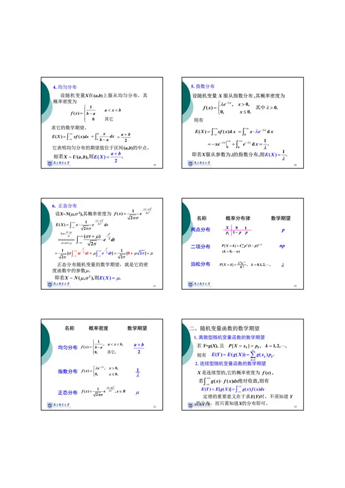

原文：

4.均匀分布

设随机变量 $X$ 在 $(a,b)$ 上服从均匀分布，其概率密度为

$$
f (x) = \left\{ \begin{array}{c c} { \frac {1}{b - a}} & {\quad a <   x <   b} \\ {0} & {\quad \text {其它}} \end{array} \right.
$$

求它的数学期望。

$$
E (X) = \int_ {- \infty} ^ {+ \infty} x f (x) d x = \int_ {a} ^ {b} \frac {x}{b - a} d x = \frac {a + b}{2}
$$

它表明均匀分布的期望值位于区间 $(a,b)$ 的中点。

即若 $X \sim U(a, b)$ , 则 $E(X) = \frac{a + b}{2}$ 。

南京邮电大学
Nanjing University of Press and Telecommunications

6. 正态分布

设 $X \sim N(\mu, \sigma^2)$ , 其概率密度为 $f(x) = \frac{1}{\sqrt{2\pi}\sigma} e^{-\frac{(x - \mu)^2}{2\sigma^2}}$

$$
E (X) = \int_ {- \infty} ^ {+ \infty} x \cdot \frac {1}{\sqrt {2 \pi} \sigma} e ^ {- \frac {(x - \mu) ^ {2}}{2 \sigma^ {2}}} d x
$$

$$
\frac {\mathrm{令} t = \frac {x - \mu}{\sigma}}{x = \sigma t + \mu} = \int_ {- \infty} ^ {+ \infty} \frac {(\sigma t + \mu)}{\sqrt {2 \pi}} \cdot e ^ {- \frac {t ^ {2}}{2}} d t
$$

$$
= \frac {1}{\sqrt {2 \pi}} \left[ \sigma \int_ {- \infty} ^ {+ \infty} t e ^ {- \frac {t ^ {2}}{2}} d t + \mu \int_ {- \infty} ^ {+ \infty} e ^ {- \frac {t ^ {2}}{2}} d t \right] = \frac {1}{\sqrt {2 \pi}} [ 0 + \mu \sqrt {2 \pi} ] = \mu
$$

正态分布随机变量的数学期望，就是它的密度函数中的参数 $\mu$ 。

即若 $X \sim N(\mu, \sigma^{2})$ ，则 $E(X) = \mu$ 。

南京邮电大学
Nanjing University of Physics and Telecommunications

名称 概率密度

数学期望

均匀分布 $f(x) = \left\{ \begin{array}{ll}\frac{1}{b - a}, & a <   x <   b,\\ 0, & \text{其它}, \end{array} \right.$ $\frac{a + b}{2}$

指数分布 $f(x) = \left\{ \begin{array}{ll}\lambda \mathrm{e}^{-\lambda x}, & x > 0,\\ 0, & x\leq 0. \end{array} \right.$ $\frac{1}{\lambda}$

正态分布 $f(x) = \frac{1}{\sqrt{2\pi}\sigma}\mathrm{e}^{-\frac{(x - \mu)^2}{2\sigma^2}},x\in R$

南京新電大學
Nanjing University of Physics and Telecommunications

5. 指数分布

设随机变量 X 服从指数分布, 其概率密度为

$f(x) = \left\{ \begin{array}{ll}\lambda e^{-\lambda x}, & x > 0,\\ 0, & x\leq 0. \end{array} \right.$ 其中 $\lambda >0$

则有

$$
\begin{array}{r l} E (X) & = \int_ {- \infty} ^ {+ \infty} x f (x) \mathrm{d} x = \int_ {0} ^ {+ \infty} x \cdot \lambda e ^ {- \lambda x} \mathrm{d} x \\ & = - x e ^ {- \lambda x} \Big | _ {0} ^ {+ \infty} + \int_ {0} ^ {+ \infty} e ^ {- \lambda x} \mathrm{d} x = \frac {1}{\lambda}. \end{array}
$$

即若X服从参数为 $\lambda$ 的指数分布,则 $E(X)=\frac{1}{\lambda}$ 。

<table><tr><td>名称</td><td>概率分布律</td><td>数学期望</td></tr><tr><td>两点分布</td><td> $\frac{X}{p_k} \left| \begin{array}{cc} 0 & 1 \\ 1 - p & p \end{array} \right.$ </td><td> $p$ </td></tr><tr><td>二项分布</td><td> $P\{X=k\}=C_n^k p^k (1-p)^{n-k}$  $(k=0,\cdots n)$ </td><td> $np$ </td></tr><tr><td>泊松分布</td><td> $P\{X=k\}=\frac{\lambda^k e^{-\lambda}}{k!}, \quad k=0,1,2,\cdots,$ </td><td> $\lambda$ </td></tr></table>

二、随机变量函数的数学期望

1. 离散型随机变量函数的数学期望

若 $Y=g(X)$ ，且 $P\{X=x_{k}\}=p_{k},\quad k=1,2,\cdots,$

则有 $E(Y) = E(g(X)) = \sum_{k=1}^{\infty} g(x_k) p_k$ 。

2. 连续型随机变量函数的数学期望

X 是连续型的, 它的概率密度为 $f(x)$ ,

若 $\int_{-\infty}^{+\infty} g(x) \cdot f(x) dx$ 绝对收敛, 则有

$$
E (Y) = E [ g (X) ] = \int_ {- \infty} ^ {+ \infty} g (x) f (x) d x
$$

定理的重要意义在于求 $E(Y)$ 时，不须知道 $Y$ 的分布，而只需知道 $X$ 的分布即可。

20

19

### 收益 $Y$ 是 $X$ 的函数：

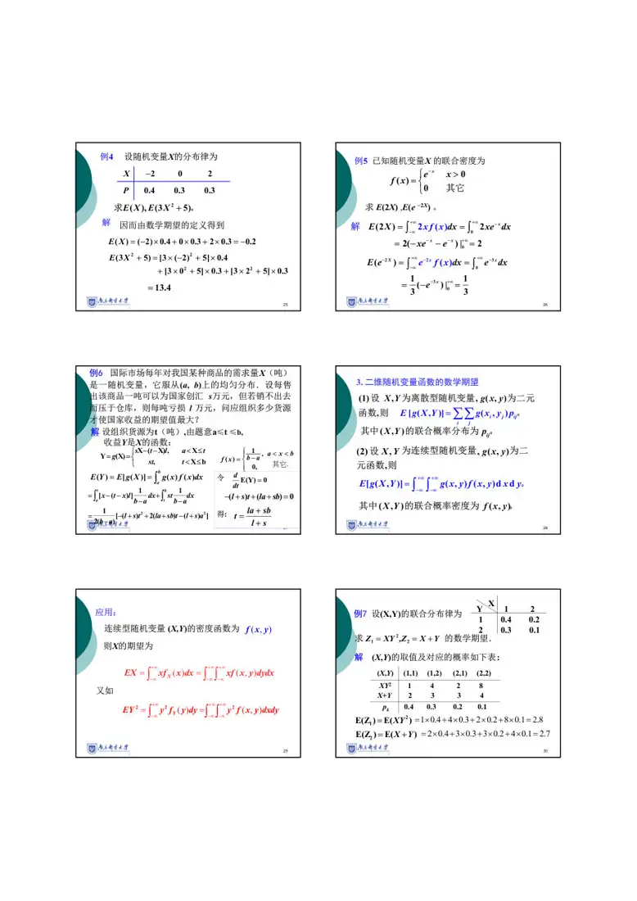

原文：

例6 国际市场每年对我国某种商品的需求量 $X$ （吨）是一随机变量，它服从 $(a, b)$ 上的均匀分布。设每售出该商品一吨可以为国家创汇 $s$ 万元，但若销不出去而压于仓库，则每吨亏损 $l$ 万元，问应组织多少货源才使国家收益的期望值最大？

解设组织货源为t（吨），由题意 $a \leqslant t \leqslant b$

收益 $Y$ 是 $X$ 的函数：

$$
\mathrm{Y} = g (\mathrm{X}) = \left\{ \begin{array}{c c} s \mathrm{X} - (t - \mathrm{X}) l, & a <   \mathrm{X} \leq t \\ s t, & t <   \mathrm{X} \leq \mathrm{b} \end{array} \right.
$$

$$
f (x) = \left\{ \begin{array}{c c} {{ \frac {1}{b - a},}} & {{a <   x <   b}} \\ {{0,}} & {{\text {其它}.}} \end{array} \right.
$$

$$
E (Y) = E [ g (X) ] = \int_ {a} ^ {b} g (x) f (x) d x
$$

令 $\frac{d}{dt}\mathbf{E}(\mathbf{Y}) = 0$

$$
= \int_ {a} ^ {t} [ x - (t - x) l ] \frac {1}{b - a} d x + \int_ {t} ^ {b} s t \frac {1}{b - a} d x
$$

$$
- (l + s) t + (l a + s b) = 0
$$

$$
= \frac {1}{2 (b - a)} [ - (l + s) t ^ {2} + 2 (l a + s b) t - (l + s) a ^ {2} ]
$$

得: $t = \frac{la + sb}{l + s}$

应用：

连续型随机变量 $(X,Y)$ 的密度函数为 $f(x,y)$ 则 $X$ 的期望为

$$
E X = \int_ {- \infty} ^ {+ \infty} x f _ {X} (x) d x = \int_ {- \infty} ^ {+ \infty} \int_ {- \infty} ^ {+ \infty} x f (x, y) d y d x
$$

又如

$$
E Y ^ {2} = \int_ {- \infty} ^ {+ \infty} y ^ {2} f _ {Y} (y) d y = \int_ {- \infty} ^ {+ \infty} \int_ {- \infty} ^ {+ \infty} y ^ {2} f (x, y) d x d y
$$

南京邮电大学
Nanjing University of Press and Telecommunications

3. 二维随机变量函数的数学期望

(1) 设 X, Y 为离散型随机变量, $g(x, y)$ 为二元函数, 则 $E[g(X, Y)] = \sum_{i} \sum_{j} g(x_i, y_j) p_{ij}$ 其中 $(X,Y)$ 的联合概率分布为 $p_{ij}$

(2) 设 $X, Y$ 为连续型随机变量, $g(x, y)$ 为二元函数, 则

$$
E [ g (X, Y) ] = \int_ {- \infty} ^ {+ \infty} \int_ {- \infty} ^ {+ \infty} g (x, y) f (x, y) d x d y _ {\circ}
$$

其中 $(X,Y)$ 的联合概率密度为 $f(x,y)$ 。

南京邮电大学
Nanjing University of Press and Telecommunications

求 $Z_{1} = XY^{2}, Z_{2} = X + Y$ 的数学期望.

<table><tr><td>X Y</td><td>1</td><td>2</td></tr><tr><td>1</td><td>0.4</td><td>0.2</td></tr><tr><td>2</td><td>0.3</td><td>0.1</td></tr></table>

解 $(X,Y)$ 的取值及对应的概率如下表：

<table><tr><td>(X,Y)</td><td>(1,1)</td><td>(1,2)</td><td>(2,1)</td><td>(2,2)</td></tr><tr><td> $XY^2$ </td><td>1</td><td>4</td><td>2</td><td>8</td></tr><tr><td>X+Y</td><td>2</td><td>3</td><td>3</td><td>4</td></tr><tr><td> $p_k$ </td><td>0.4</td><td>0.3</td><td>0.2</td><td>0.1</td></tr></table>

$$
\mathbf {E} \left(\mathbf {Z} _ {1}\right) = \mathbf {E} \left(X Y ^ {2}\right) = 1 \times 0. 4 + 4 \times 0. 3 + 2 \times 0. 2 + 8 \times 0. 1 = 2. 8
$$

$$
\mathbf {E} \left(\mathbf {Z} _ {2}\right) = \mathbf {E} (X + Y) = 2 \times 0. 4 + 3 \times 0. 3 + 3 \times 0. 2 + 4 \times 0. 1 = 2. 7
$$

南京邮电大学
Nanjing University of Posts and Telecommunications

26

例4 设随机变量 $X$ 的分布律为

X -2 0 2 P 0.4 0.3 0.3

求 $E(X), E(3X^{2}+5)$ 。

$E(X), E(3X^{2} + 5)$

解 因而由数学期望的定义得到

$E(X) = (-2)\times 0.4 + 0\times 0.3 + 2\times 0.3 = -0.2$

$E(3X^{2} + 5) = [3\times (-2)^{2} + 5]\times 0.4$ $+[3\times 0^2 +5]\times 0.3 + [3\times 2^2 +5]\times 0.3$ $= 13.4$

南京邮电大学
Nanjing University of Private and Telecommunications

25

例5 已知随机变量 $X$ 的联合密度为

$f(x) = \left\{ \begin{array}{ll}e^{-x} & x > 0\\ 0 & \text{其它} \end{array} \right.$

$E(2X), E(e^{-2X})$

求 $E(2X), E(e^{-2X})$ 。

$E(2X) = \int_{-\infty}^{+\infty} 2xf(x)dx = \int_{0}^{+\infty} 2xe^{-x}dx$ $= 2(-xe^{-x} - e^{-x})|_{0}^{+\infty} = 2$

$E(e^{-2X}) = \int_{-\infty}^{+\infty}e^{-2x}f(x)dx = \int_0^{+\infty}e^{-3x}dx$ $= \frac{1}{3} (-e^{-3x})|_0^{+\infty} = \frac{1}{3}$

南京邮电大学
Nanjing University of Physics and Telecommunications

28

### $$

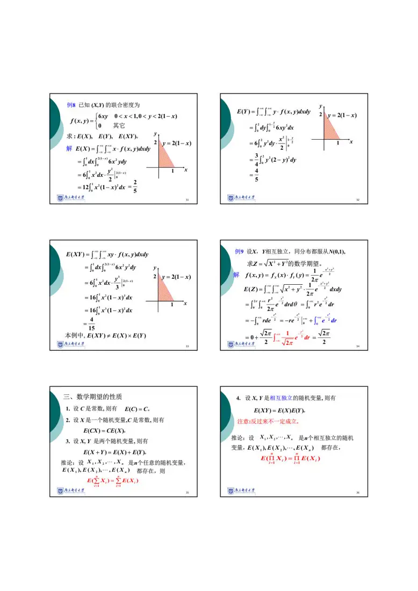

原文：

$$
\begin{array}{r l} E (X Y) & = \int_ {- \infty} ^ {+ \infty} \int_ {- \infty} ^ {+ \infty} x y \cdot f (x, y) d x d y \\ & = \int_ {0} ^ {1} d x \int_ {0} ^ {2 (1 - x)} 6 x ^ {2} y ^ {2} d y \\ & = 6 \int_ {0} ^ {1} x ^ {2} d x \cdot \frac {y ^ {3}}{3} \Big | _ {0} ^ {2 (1 - x)} \\ & = 1 6 \int_ {0} ^ {1} x ^ {2} (1 - x) ^ {3} d x \\ & = 1 6 \int_ {0} ^ {1} x ^ {3} (1 - x) ^ {2} d x \\ & = \frac {4}{1 5} \end{array}
$$

本例中, $E(XY) \neq E(X) \times E(Y)$

南京邮电大学
Nanjing University of Press and Telecommunications

三、数学期望的性质

1. 设 $C$ 是常数, 则有 $E(C) = C$ 。

2. 设 $X$ 是一个随机变量, $C$ 是常数, 则有

$$
E (C X) = C E (X) _ {\circ}
$$

3. 设 X, Y 是两个随机变量, 则有

$$
E (X + Y) = E (X) + E (Y) 。
$$

推论：设 $X_{1}, X_{2}, \cdots, X_{n}$ 是 n 个任意的随机变量， $E(X_{1}), E(X_{2}), \cdots, E(X_{n})$ 都存在，则

$$
E (\sum_ {i = 1} ^ {n} X _ {i}) = \sum_ {i = 1} ^ {n} E (X _ {i})
$$

南京邮电大学
Nanjing University of Press and Telecommunications

例9 设 $X$ ， $Y$ 相互独立，同分布都服从 $N(0,1)$ ，

解

求 $Z=\sqrt{X^{2}+Y^{2}}$ 的数学期望。

$$
\begin{array}{r l} & f (x, y) = f _ {X} (x) \cdot f _ {Y} (y) = \frac {1}{2 \pi} e ^ {- \frac {x ^ {2} + y ^ {2}}{2}} \\ & E (Z) = \int_ {- \infty} ^ {+ \infty} \int_ {- \infty} ^ {+ \infty} \sqrt {x ^ {2} + y ^ {2}} \cdot \frac {1}{2 \pi} e ^ {- \frac {x ^ {2} + y ^ {2}}{2}} d x d y \\ & = \int_ {0} ^ {2 \pi} \int_ {0} ^ {+ \infty} \frac {r ^ {2}}{2 \pi} e ^ {- \frac {r ^ {2}}{2}} d r d \theta = \int_ {0} ^ {+ \infty} r ^ {2} e ^ {- \frac {r ^ {2}}{2}} d r \\ & = - \int_ {0} ^ {+ \infty} r d e ^ {- \frac {r ^ {2}}{2}} = - r e ^ {- \frac {r ^ {2}}{2}} | _ {0} ^ {+ \infty} + \int_ {0} ^ {+ \infty} e ^ {- \frac {r ^ {2}}{2}} d r \\ & = 0 + \frac {\sqrt {2 \pi}}{2} \int_ {- \infty} ^ {+ \infty} \frac {1}{\sqrt {2 \pi}} e ^ {- \frac {r ^ {2}}{2}} d r = \frac {\sqrt {2 \pi}}{2} \end{array}
$$

4. 设 $X, Y$ 是相互独立的随机变量, 则有

$$
E (X Y) = E (X) E (Y) 。
$$

注意:反过来不一定成立.

推论：设 $X_{1}, X_{2}, \cdots, X_{n}$ 是 n 个相互独立的随机

变量， $E(X_{1}),E(X_{2}),\cdots,E(X_{n})$ 都存在，

$$
E (\prod_ {i = 1} ^ {n} X _ {i}) = \prod_ {i = 1} ^ {n} E (X _ {i})
$$

例8 已知 $(X,Y)$ 的联合密度为

$f(x,y) = \left\{ \begin{array}{ll}6xy & 0 <   x <   1,0 <   y <   2(1 - x)\\ 0 & \text{其它} \end{array} \right.$

求： $E(X)$ ， $E(Y)$ ， $E(XY)$ 。

$E(X), \quad E(Y), \quad E(XY)$

解 $E(X)=\int_{-\infty}^{+\infty}\int_{-\infty}^{+\infty}x\cdot f(x,y)dx dy$ $=\int_{0}^{1}dx\int_{0}^{2(1-x)}6x^{2}ydy$ $=6\int_{0}^{1}x^{2}dx\cdot\frac{y^{2}}{2}\bigg|_{0}^{2(1-x)}$ $=12\int_{0}^{1}x^{2}(1-x)^{2}dx=\frac{2}{5}$

南京邮电大学
Nanjing University of Public and Telecommunications

y = 2(1 - x)
dy
1

31

32

$E(Y) = \int_{-\infty}^{+\infty}\int_{-\infty}^{+\infty}y\cdot f(x,y)dxdy$ $= \int_0^2 dy\int_0^{1 - \frac{y}{2}}6xy^2 dx$ $= 6\int_0^2 y^2 dy\cdot \frac{x^2}{2}\bigg|_{0}^{1 - \frac{y}{2}}$ $= \frac{3}{4}\int_0^2 y^2 (2 - y)^2 dy$ $= \frac{4}{5}$

y = 2(1 - x)
2
1

南京新電大學
Nanjing University of Private and Telecommunications

### 南京邮电大学

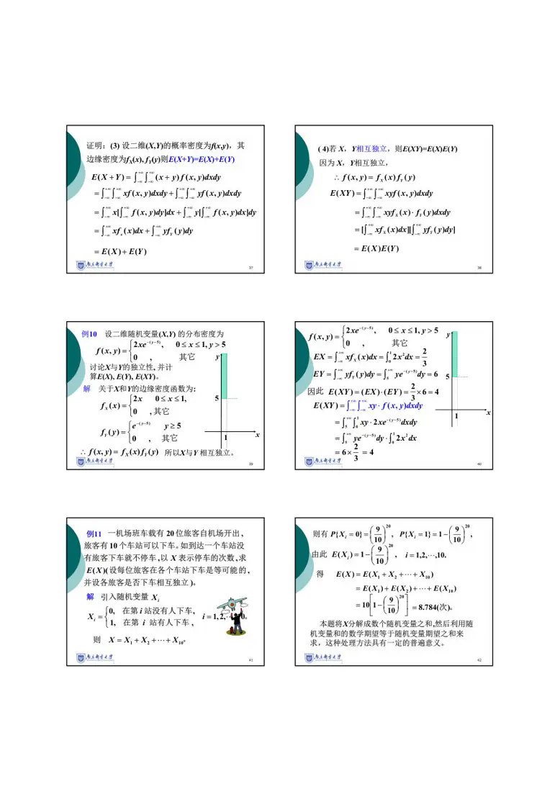

原文：

南京邮电大学
Nanjing University of Physics and Telecommunications

例10 设二维随机变量 $(X,Y)$ 的分布密度为

$$
f (x, y) = \left\{ \begin{array}{l} 2 x e ^ {- (y - 5)}, \\ 0, \end{array} \right.
$$

$$
0 \leq x \leq 1, y > 5
$$

其它

讨论X与Y的独立性, 并计算 $E(X)$ , $E(Y)$ , $E(XY)$ 。

解 关于 $X$ 和 $Y$ 的边缘密度函数为:

$$
f _ {x} (x) = \left\{ \begin{array}{l l} 2 x & 0 \leq x \leq 1, \\ 0 & , \text {其它} \end{array} \right.
$$

$$
f _ {Y} (y) = \left\{ \begin{array}{l l} e ^ {- (y - 5)} & y \geq 5 \\ 0, & \text {其它} \end{array} \right.
$$

∴ $f(x,y)=f_{X}(x)f_{Y}(y)$ 所以 X 与 Y 相互独立。

例11 一机场班车载有20位旅客自机场开出，旅客有10个车站可以下车。如到达一个车站没有旅客下车就不停车，以 $X$ 表示停车的次数，求 $E(X)$ （设每位旅客在各个车站下车是等可能的，并设各旅客是否下车相互独立）。

解 引入随机变量 $X_{i}$

$X_{i}=\left\{\begin{aligned}&0,& 在第 i 站没有人下车,\\ &1,& 在第 i 站有人下车,\end{aligned}\right.$

则 $X = X_{1} + X_{2} + \cdots + X_{10}$

南京新電大學
Nanjing University of Physics and Telecommunications

$$
0 \leq x \leq 1, y > 5
$$

$$
f (x, y) = \left\{ \begin{array}{l} 2 x e ^ {- (y - 5)}, \\ 0, \end{array} \right.
$$

其它

$$
E X = \int_ {- \infty} ^ {+ \infty} x f _ {x} (x) d x = \int_ {0} ^ {1} 2 x ^ {2} d x = \frac {2}{3}
$$

$$
E Y = \int_ {- \infty} ^ {+ \infty} y f _ {Y} (y) d y = \int_ {5} ^ {+ \infty} y e ^ {- (y - 5)} d y = 6
$$

因此 $E(XY)=(EX)\cdot(EY)=\frac{2}{3}\times6=4$

$$
\begin{array}{r l} E (X Y) & = \int_ {- \infty} ^ {+ \infty} \int_ {- \infty} ^ {+ \infty} x y \cdot f (x, y) d x d y \\ & = \int_ {5} ^ {+ \infty} \int_ {0} ^ {1} x y \cdot 2 x e ^ {- (y - 5)} d x d y \\ & = \int_ {5} ^ {+ \infty} y e ^ {- (y - 5)} d y \cdot \int_ {0} ^ {1} 2 x ^ {2} d x \\ & = 6 \times \frac {2}{3} = 4 \end{array}
$$

则有 $P\{X_i = 0\} = \left(\frac{9}{10}\right)^{20}, P\{X_i = 1\} = 1 - \left(\frac{9}{10}\right)^{20},$

由此 $E(X_{i})=1-\left(\frac{9}{10}\right)^{20}$ ， $i=1,2,\cdots,10.$

得

$$
\begin{array}{r l} E (X) & = E (X _ {1} + X _ {2} + \dots + X _ {1 0}) \\ & = E (X _ {1}) + E (X _ {2}) + \dots + E (X _ {1 0}) \\ & = 1 0 \left[ 1 - \left(\frac {9}{1 0}\right) ^ {2 0} \right] = 8. 7 8 4 (\text {次}) 。 \end{array}
$$

本题将X分解成数个随机变量之和,然后利用随机变量和的数学期望等于随机变量期望之和来求，这种处理方法具有一定的普遍意义。

南京邮电大学
Nanjing University of Press and Telecommunications

证明：(3) 设二维 $(X, Y)$ 的概率密度为 $f(x, y)$ ，其边缘密度为 $f_{X}(x), f_{Y}(y)$ 则 $E(X + Y) = E(X) + E(Y)$

$f_{X}(x), f_{Y}(y)$

为 $f(x,y)$

$E(X + Y) = E(X) + E(Y)$

$E(X + Y) = \int_{-\infty}^{+\infty}\int_{-\infty}^{+\infty}(x + y)f(x,y)dxdy$ $= \int_{-\infty}^{+\infty}\int_{-\infty}^{+\infty}xf(x,y)dxdy + \int_{-\infty}^{+\infty}\int_{-\infty}^{+\infty}yf(x,y)dxdy$ $= \int_{-\infty}^{+\infty}x[\int_{-\infty}^{+\infty}f(x,y)dy]dx + \int_{-\infty}^{+\infty}y[\int_{-\infty}^{+\infty}f(x,y)dx]dy$ $= \int_{-\infty}^{+\infty}xf_x(x)dx + \int_{-\infty}^{+\infty}yf_Y(y)dy$ $= E(X) + E(Y)$

37

(4)若 $X$ ， $Y$ 相互独立，则 $E(XY) = E(X)E(Y)$

$E(XY) = E(X)E(Y)$

因为 $X$ ，Y相互独立，

$\therefore f(x,y) = f_X(x)f_Y(y)$ $E(XY) = \int_{-\infty}^{+\infty}\int_{-\infty}^{+\infty}xyf(x,y)dxdy$ $= \int_{-\infty}^{+\infty}\int_{-\infty}^{+\infty}xyf_X(x)\cdot f_Y(y)dxdy$ $= [\int_{-\infty}^{+\infty}xf_X(x)dx][\int_{-\infty}^{+\infty}yf_Y(y)dy]$ $= E(X)E(Y)$

南京邮电大学
Nanjing University of Posts and Telecommunications

38

### 随机变量函数的数学期望

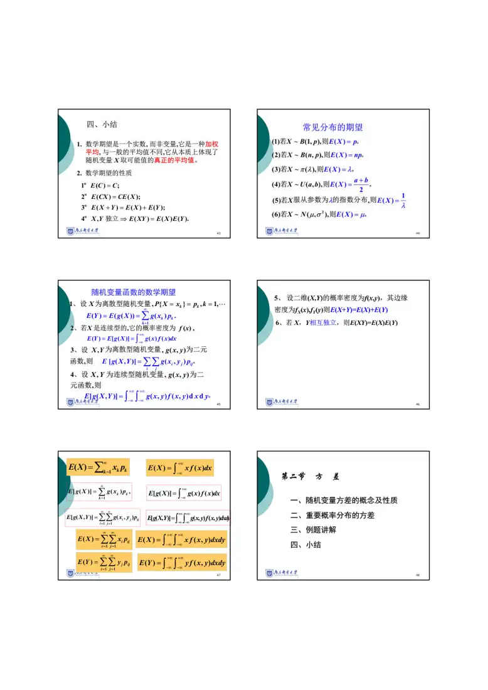

原文：

随机变量函数的数学期望

1、设 X 为离散型随机变量, $P\{X=x_{k}\}=p_{k},k=1,\cdots$

$$
E (Y) = E (g (X)) = \sum_ {k = 1} ^ {\infty} g \left(x _ {k}\right) p _ {k}.
$$

2、若X是连续型的,它的概率密度为 $f(x)$ ,

$$
E (Y) = E [ g (X) ] = \int_ {- \infty} ^ {+ \infty} g (x) f (x) d x
$$

3、设 $X, Y$ 为离散型随机变量， $g(x, y)$ 为二元

函数,则 $E[g(X,Y)]=\sum_{i}\sum_{j}g(x_{i},y_{j})p_{ij}$

4、设 X, Y 为连续型随机变量, $g(x, y)$ 为二元函数, 则

$E[g(X,Y)] = \int_{-\infty}^{+\infty}\int_{-\infty}^{+\infty}g(x,y)f(x,y)\mathrm{d}x\mathrm{d}y.$

$$
E (X) = \sum_ {k = 1} ^ {\infty} x _ {k} p _ {k}
$$

$$
E (X) = \int_ {- \infty} ^ {+ \infty} x f (x) d x
$$

$$
E [ g (X) ] = \sum_ {k = 1} ^ {\infty} g \left(x _ {k}\right) p _ {k},
$$

$$
E [ g (X) ] = \int_ {- \infty} ^ {+ \infty} g (x) f (x) d x
$$

$$
E [ g (X, Y) ] = \sum_ {i = 1} ^ {\infty} \sum_ {j = 1} ^ {\infty} g \left(x _ {i}, y _ {j}\right) p _ {i j}
$$

$$
E [ g (X, Y) ] = \int_ {- \infty} ^ {+ \infty} \int_ {- \infty} ^ {+ \infty} g (x, y) f (x, y) d x d y
$$

$$
E (X) = \sum_ {i = 1} ^ {\infty} \sum_ {j = 1} ^ {\infty} x _ {i} p _ {i j} \quad E (X) = \int_ {- \infty} ^ {+ \infty} \int_ {- \infty} ^ {+ \infty} x f (x, y) d x d y
$$

$$
E (Y) = \sum_ {i = 1} ^ {\infty} \sum_ {j = 1} ^ {\infty} y _ {j} p _ {i j}
$$

$$
E (Y) = \int_ {- \infty} ^ {+ \infty} \int_ {- \infty} ^ {+ \infty} y f (x, y) d x d y
$$

5、设二维 $(X,Y)$ 的概率密度为 $f(x,y)$ ，其边缘

密度为 $f_{X}(x),f_{Y}(y)$ 则 $E(X+Y)=E(X)+E(Y)$

6、若 $X$ ， $Y$ 相互独立，则 $E(XY) = E(X)E(Y)$

南京邮电大学
Nanjing University of Science and Telecommunications

四、小结

1. 数学期望是一个实数, 而非变量, 它是一种加权平均, 与一般的平均值不同, 它从本质上体现了随机变量 $X$ 取可能值的真正的平均值。

2. 数学期望的性质

$1^{0} E(C) = C;$

$E(C) = C;$

$2^{0} E(CX) = CE(X);$

$E(CX) = CE(X);$

$3^{0} E(X + Y) = E(X) + E(Y);$

$E(X + Y) = E(X) + E(Y);$

$4^{\circ} X, Y$ 独立 $\Rightarrow E(XY) = E(X)E(Y)$ .

南京邮电大学
Nanjing University of Physics and Telecommunications

43

常见分布的期望

$X \sim B(1, p)$ ,

(1)若 $X \sim B(1, p)$ ，则 $E(X) = p$ 。

$E(X) = p_{\circ}$

$X \sim B(n, p)$ ,

(2)若 $X \sim B(n, p)$ ，则 $E(X) = np$ 。

$E(X) = np_{\circ}$

$X\sim \pi (\lambda),$

(3)若 $X \sim \pi(\lambda)$ , 则 $E(X) = \lambda$ 。

$E(X) = \lambda_{\circ}$

$X\sim U(a,b),$

(4)若 $X \sim U(a, b)$ , 则 $E(X) = \frac{a + b}{2}$ 。

$E(X) = \frac{a + b}{2}$

(5)若X服从参数为 $\lambda$ 的指数分布,则 $E(X)=\frac{1}{\lambda}$

$X \sim N(\mu, \sigma^2)$ .

(6)若 $X \sim N(\mu, \sigma^2)$ , 则 $E(X) = \mu$ 。

$E(X) = \frac{1}{\lambda}$

南京航空航天大学
Nanjing University of Physics and Telecommunications

$E(X) = \mu_{\circ}$

南京邮电大学
Nanjing University of Press and Telecommunications

第二节 方差

一、随机变量方差的概念及性质

二、重要概率分布的方差

三、例题讲解

四、小结

### 是否可以用一个指标来衡量一个随机变量离开它的期望值 $E(X)$ 的偏离程度？

原文：

是否可以用一个指标来衡量一个随机变量离开它的期望值 $E(X)$ 的偏离程度？

若 $X$ 是要讨论的随机变量， $E(X)$ 是它的期望值，这时 $\left|X - E(X)\right|$ 就衡量了随机变量 $X$ 和它的期望值 $E(X)$ 之间偏差的大小。但是绝对值运算有许多不便之处，人们便用 $\left|X - E(X)\right|^2$ 去衡量这个偏差。但 $\left|X - E(X)\right|^2$ 是一个随机变量，应该用它的平均值，即用

$$
\boldsymbol {E} \left(\left| \boldsymbol {X} - \boldsymbol {E} (\boldsymbol {X}) \right| ^ {2}\right)
$$

这个数值来衡量X离开它的平均值 $E(X)$ 的偏离程度，为此，引入下述定义

南京邮电大学
Nanjing University of Press and Telecommunications

方差的意义

方差是一个常用来体现随机变量 $X$ 取值分散程度的量。

如果 $D(X)$ 值大, 表示 X 取值分散程度大, $E(X)$ 的代表性差。

如果 $D(X)$ 值小，则表示 X 的取值比较集中，以 $E(X)$ 作为随机变量的代表性好。

$D(X)$ 是刻画X取值分散程度的一个量。

一、随机变量方差的概念及性质

1. 方差的定义

设 X 是一个随机变量, 若 $E\{[X-E(X)]^{2}\}$ 存在, 则称 $E\{[X-E(X)]^{2}\}$ 为 X 的方差, 记为 $D(X)$ 或 $\operatorname{Var}(X)$ , 即…

$$
D (X) = \operatorname{Var} (X) = E \left\{\left[ X - E (X) \right] ^ {2} \right\} 。
$$

称 $\sqrt{D(X)}$ 为标准差或均方差，记为 $\sigma(X)$ 。

$$
D (X) = \sum_ {k = 1} ^ {+ \infty} [ x _ {k} - E (X) ] ^ {2} p _ {k} 。
$$

52

期望值 $E(X)$ 是代表随机变量取值的集中程度的“数量指标”，反应了随机变量的平均值，但数学期望毕竟只能反映平均值，有很大的局限性。在某些场合，仅仅知道平均值是不够的。以手表的日走时误差为例：

49

如果有甲乙两种牌号的手表，它们的日走时误差分别为 $X_{1}$ 和 $X_{2}$ ，各具有如下的分布列：

$X_{2}$

$X_{1}$

$\left( \begin{array}{ccc}X_{1} & -1 & 0 & 1\\ p_{k} & 0.1 & 0.8 & 0.1 \end{array} \right)$

南京邮电大学
Nanjing University of Physics and Telecommunications

$\left( \begin{array}{cccccc}X_{2} & -2 & -1 & 0 & 1 & 2\\ p_{k} & 0.1 & 0.2 & 0.4 & 0.2 & 0.1 \end{array} \right)$

$E(X_{1}) = E(X_{2}) = 0$

问题：如何判断两种手表的优劣？

50

南京邮电大学
Nanjing University of Press and Telecommunications

2. 随机变量方差的计算

(1) 利用定义计算

离散型随机变量的方差

其中 $P\{X=x_{k}\}=p_{k}, k=1,2,\cdots$ 是 X 的分布律。

连续型随机变量的方差

$D(X) = \int_{-\infty}^{+\infty}[x - E(X)]^2 f(x)\mathrm{d}x$

其中 $f(x)$ 为 $X$ 的概率密度。

### 例2 设随机变量 $X$ 具有概率密度

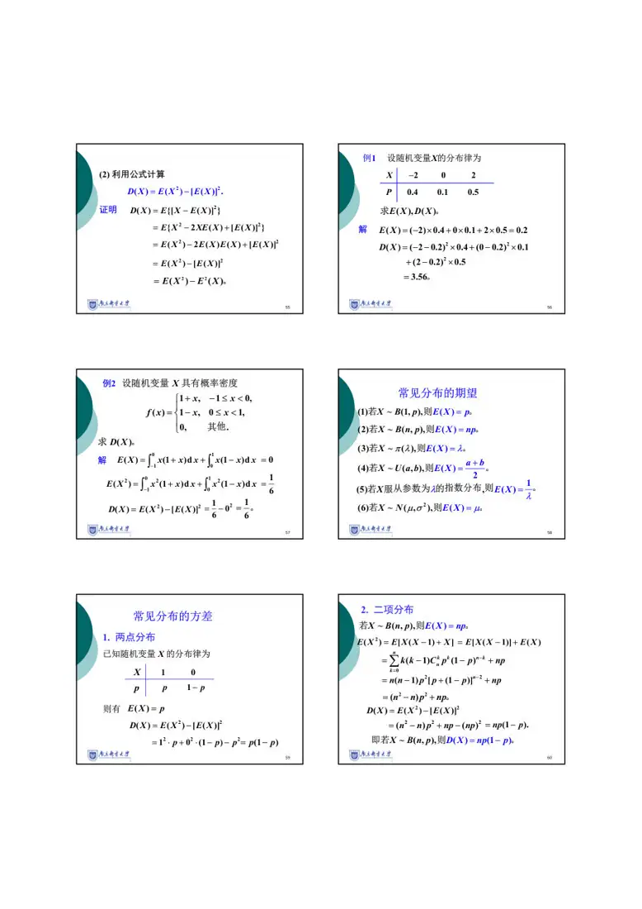

原文：

例2 设随机变量 $X$ 具有概率密度

$$
f (x) = \left\{ \begin{array}{l l} 1 + x, & - 1 \leq x <   0, \\ 1 - x, & 0 \leq x <   1, \\ 0, & \text {其他}. \end{array} \right.
$$

求 $D(X)$ 。

解 $E(X) = \int_{-1}^{0}x(1 + x)\mathrm{d}x + \int_0^1 x(1 - x)\mathrm{d}x = 0$

$$
E \left(X ^ {2}\right) = \int_ {- 1} ^ {0} x ^ {2} (1 + x) d x + \int_ {0} ^ {1} x ^ {2} (1 - x) d x = \frac {1}{6}
$$

$$
D (X) = E \left(X ^ {2}\right) - [ E (X) ] ^ {2} = \frac {1}{6} - 0 ^ {2} = \frac {1}{6} 。
$$

南京邮电大学
Nanjing University of Physics and Telecommunications

常见分布的方差

1. 两点分布

已知随机变量 $X$ 的分布律为

<table><tr><td>X</td><td>1</td><td>0</td></tr><tr><td>p</td><td>p</td><td>1-p</td></tr></table>

则有 $E(X) = p$

$$
\begin{array}{r l} D (X) & = E \left(X ^ {2}\right) - [ E (X) ] ^ {2} \\ & = 1 ^ {2} \cdot p + 0 ^ {2} \cdot (1 - p) - p ^ {2} = p (1 - p) \end{array}
$$

南京新電大學
Nanjing University of Physics and Telecommunications

常见分布的期望

(1)若 $X \sim B(1, p)$ ，则 $E(X) = p$ 。

(2)若 $X \sim B(n, p)$ ，则 $E(X) = np$ 。

(3)若 $X \sim \pi(\lambda)$ , 则 $E(X) = \lambda$ 。

(4)若 $X \sim U(a, b)$ ，则 $E(X) = \frac{a + b}{2}$ 。

(5)若X服从参数为 $\lambda$ 的指数分布,则 $E(X)=\frac{1}{\lambda}$ 。

(6)若 $X\sim N(\mu,\sigma^{2})$ ，则 $E(X)=\mu_{0}$

南京邮电大学
Nanjing University of Press and Telecommunications

2. 二项分布

若 $X \sim B(n, p)$ ，则 $E(X) = np$ 。

$$
\begin{array}{l} E (X ^ {2}) = E [ X (X - 1) + X ] = E [ X (X - 1) ] + E (X) \\ \qquad = \sum_ {k = 0} ^ {n} k (k - 1) C _ {n} ^ {k} p ^ {k} (1 - p) ^ {n - k} + n p \\ \qquad = n (n - 1) p ^ {2} [ p + (1 - p) ] ^ {n - 2} + n p \\ \qquad = (n ^ {2} - n) p ^ {2} + n p _ {\circ} \\ D (X) = E (X ^ {2}) - [ E (X) ] ^ {2} \\ \qquad = (n ^ {2} - n) p ^ {2} + n p - (n p) ^ {2} = n p (1 - p). \end{array}
$$

即若 $X \sim B(n, p)$ ，则 $D(X) = np(1 - p)$ 。

南京邮电大学
Nanjing University of Private and Telecommunications

(2) 利用公式计算

$D(X) = E(X^{2}) - [E(X)]^{2}$ .

证明

$D(X) = E\{[X - E(X)]^2\}$ $= E\{X^2 - 2XE(X) + [E(X)]^2\}$ $= E(X^2) - 2E(X)E(X) + [E(X)]^2$ $= E(X^2) - [E(X)]^2$ $= E(X^2) - E^2(X)$ .

南京新電大學
Nanjing University of Physics and Telecommunications

55

例1 设随机变量 $X$ 的分布律为

X -2 0 2 P 0.4 0.1 0.5

$E(X),D(X)$

求 $E(X), D(X)$ 。

解

南京邮电大学
Nanjing University of Physics and Telecommunications

$D(X) = (-2 - 0.2)^{2}\times 0.4 + (0 - 0.2)^{2}\times 0.1$ $+ (2 - 0.2)^{2}\times 0.5$ $= 3.56_{\circ}$

### 5. 指数分布

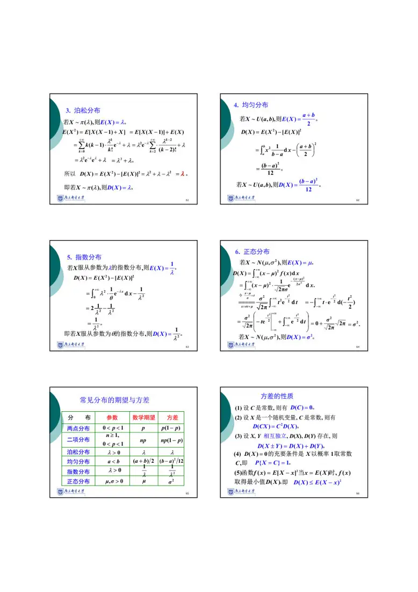

原文：

5. 指数分布

若X服从参数为 $\lambda$ 的指数分布,则 $E(X)=\frac{1}{\lambda}$ 。

$$
\begin{array}{r l} D (X) & = E \left(X ^ {2}\right) - [ E (X) ] ^ {2} \\ & = \int_ {0} ^ {+ \infty} \lambda^ {2} \cdot \frac {1}{\theta} \mathrm{e} ^ {- \lambda x} \mathrm{d} x - \frac {1}{\lambda^ {2}} \\ & = 2 \frac {1}{\lambda^ {2}} - \frac {1}{\lambda^ {2}} \\ & = \frac {1}{\lambda^ {2}} 。 \end{array}
$$

即若X服从参数为 $\theta$ 的指数分布,则 $D(X)=\frac{1}{\lambda^{2}}$ 。

常见分布的期望与方差

<table><tr><td>分布</td><td>参数</td><td>数学期望</td><td>方差</td></tr><tr><td>两点分布</td><td>0 &lt; p &lt; 1</td><td>p</td><td>p(1 - p)</td></tr><tr><td>二项分布</td><td>n ≥ 1,0 &lt; p &lt; 1</td><td>np</td><td>np(1 - p)</td></tr><tr><td>泊松分布</td><td>λ &gt; 0</td><td>λ</td><td>λ</td></tr><tr><td>均匀分布</td><td>a &lt; b</td><td>(a + b)/2</td><td>(b - a)2/12</td></tr><tr><td>指数分布</td><td>λ &gt; 0</td><td> $\frac{1}{\lambda}$ </td><td> $\frac{1}{\lambda^2}$ </td></tr><tr><td>正态分布</td><td>μ,σ &gt; 0</td><td>μ</td><td>σ2</td></tr></table>

南京邮电大学
Nanjing University of Public and Telecommunications

6. 正态分布

若 $X \sim N(\mu, \sigma^{2})$ ，则 $E(X) = \mu$ 。

$$
\begin{array}{r l} & {D (X) = \int_ {- \infty} ^ {+ \infty} (x - \mu) ^ {2} f (x) \mathbf {d} x} \\ & {\quad = \int_ {- \infty} ^ {+ \infty} (x - \mu) ^ {2} \cdot \frac {1}{\sqrt {2 \pi} \sigma} \mathrm{e} ^ {- \frac {(x - \mu) ^ {2}}{2 \sigma^ {2}}} \mathbf {d} x.} \\ & {\quad \frac {\text {令} \frac {x - \mu}{\sigma} = t}{x = \sigma t + \mu} \frac {\sigma^ {2}}{\sqrt {2 \pi}} \int_ {- \infty} ^ {+ \infty} t ^ {2} \mathrm{e} ^ {- \frac {t ^ {2}}{2}} \mathbf {d} t = - \int_ {- \infty} ^ {+ \infty} t \cdot \mathrm{e} ^ {- \frac {t ^ {2}}{2}} \mathbf {d} (- \frac {t ^ {2}}{2})} \\ & {\quad = \frac {\sigma^ {2}}{\sqrt {2 \pi}} \left(- t \mathrm{e} ^ {- \frac {t ^ {2}}{2}} \Bigg | _ {- \infty} ^ {+ \infty} + \int_ {- \infty} ^ {+ \infty} \mathrm{e} ^ {- \frac {t ^ {2}}{2}} \mathbf {d} t\right) = 0 + \frac {\sigma^ {2}}{\sqrt {2 \pi}} \sqrt {2 \pi} = \sigma^ {2}.} \\ & {\quad \text {若} X \sim N (\mu , \sigma^ {2}), \text {则} D (X) = \sigma^ {2}.} \end{array}
$$

方差的性质

$$
D (X \pm Y) = D (X) + D (Y) 。
$$

南京邮电大学
Nanjing University of Physics and Telecommunications

3. 泊松分布

$X\sim \pi (\lambda)$

若 $X \sim \pi(\lambda)$ ，则 $E(X) = \lambda$ 。

$E(X) = \lambda$

$E(X^{2}) = E[X(X - 1) + X] = E[X(X - 1)] + E(X)$ $= \sum_{k = 0}^{+\infty}k(k - 1)\cdot \frac{\lambda^k}{k!}\mathrm{e}^{-\lambda} + \lambda = \lambda^2\mathrm{e}^{-\lambda}\sum_{k = 2}^{+\infty}\cdot \frac{\lambda^{k - 2}}{(k - 2)!} +\lambda$ $= \lambda^2\mathrm{e}^{-\lambda}\mathrm{e}^\lambda +\lambda = \lambda^2 +\lambda .$

$D(X) = E(X^2) - [E(X)]^2 = \lambda^2 +\lambda -\lambda^2 = \lambda .$

所以 $D(X)=E(X^{2})-[E(X)]^{2}=\lambda^{2}+\lambda-\lambda^{2}=\lambda$ 。

$X\sim \pi (\lambda)$

即若 $X \sim \pi(\lambda)$ ，则 $D(X) = \lambda$ 。

$D(X) = \lambda_{\circ}$

南京邮电大学
Nanjing University of Physics and Telecommunications

61

4. 均匀分布

$X\sim U(a,b)$

若 $X \sim U(a, b)$ ，则 $E(X) = \frac{a + b}{2}$ 。

$E(X) = \frac{a + b}{2}$ 。

$D(X) = E(X^2) - [E(X)]^2$ $= \int_{a}^{b}x^{2}\frac{1}{b - a}\mathrm{d}x - \left(\frac{a + b}{2}\right)^{2}\\ = \frac{(b - a)^{2}}{12}$

南京邮电大学
Nanjing University of Private and Telecommunication

$\sim U(a,b)$

若 $X \sim U(a, b)$ , 则 $D(X) = \frac{(b - a)^2}{12}$ 。

$D(X) = \frac{(b - a)^{2}}{12}$

62

(1) 设 $C$ 是常数, 则有 $D(C) = 0$ 。

(2) 设 X 是一个随机变量, C 是常数, 则有 $D(CX) = C^{2}D(X)$ 。

(3) 设 $X, Y$ 相互独立, $D(X), D(Y)$ 存在, 则

$D(X) = 0$

(4) $D(X) = 0$ 的充要条件是 $X$ 以概率1取常数 $C$ ，即 $P\{X = C\} = 1$

(5)函数 $f(x)=E[X-x]^{2}$ 当 $x=E(X)$ 时, $f(x)$

取得最小值 $D(X)$ 。即 $D(X) \leq E(X - x)^{2}$

南京邮电大学
Nanjing University of Press and Telecommunications

### 南京邮电大学

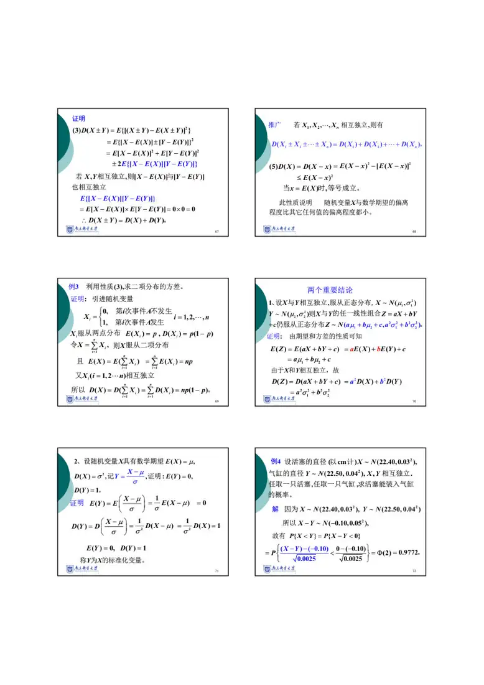

原文：

南京邮电大学
Nanjing University of Press and Telecommunications

例3 利用性质(3),求二项分布的方差。

证明：引进随机变量

$X_{i}=\left\{\begin{aligned}&0,& 第i次事件A不发生\\ &1,& 第i次事件A发生\end{aligned}\right.i=1,2,\cdots,n$

$$
E (X _ {i}) = p, D (X _ {i}) = p (1 - p)
$$

令 $X = \sum_{i=1}^{n} X_i$ ，则 $X$ 服从二项分布

且 $E(X) = E(\sum_{i=1}^{n} X_i) = \sum_{i=1}^{n} E(X_i) = np$

又 $X_{i}(i=1,2\cdots n)$ 相互独立

所以 $D(X)=D(\sum_{i=1}^{n}X_{i})=\sum_{i=1}^{n}D(X_{i})=np(1-p)$ 。

2、设随机变量 $X$ 具有数学期望 $E(X) = \mu$ ,

$D(X) = \sigma^2$ ，记 $Y = \frac{X - \mu}{\sigma}$ ，证明： $E(Y) = 0,$

$D(Y) = 1$

证明 $E(Y) = E\left(\frac{X - \mu}{\sigma}\right) = \frac{1}{\sigma} E(X - \mu) = 0$

$$
D (Y) = D \left(\frac {X - \mu}{\sigma}\right) = \frac {1}{\sigma^ {2}} D (X - \mu) = \frac {1}{\sigma^ {2}} D (X) = 1
$$

$$
E (Y) = 0, D (Y) = 1
$$

称 $Y$ 为 $X$ 的标准化变量。

南京邮电大学
Nanjing University of Press and Telecommunications

两个重要结论

1、设 $X$ 与 $Y$ 相互独立，服从正态分布， $X \sim N(\mu_1, \sigma_2^2)$ $Y \sim N(\mu_2, \sigma_2^2)$ 则 $X$ 与 $Y$ 的任一线性组合 $Z = aX + bY + c$ 仍服从正态分布 $Z \sim N(a\mu_1 + b\mu_2 + c, a^2\sigma_1^2 + b^2\sigma_2^2)$ 。证明：由期望和方差的性质可知

$$
\begin{array}{r l} E (Z) = E (a X + b Y + c) & = a E (X) + b E (Y) + c \\ & = a \mu_ {1} + b \mu_ {2} + c \end{array}
$$

由于 $X$ 和 $Y$ 相互独立，故

$$
\begin{array}{r l} D (Z) & = D (a X + b Y + c) = a ^ {2} D (X) + b ^ {2} D (Y) \\ & = a ^ {2} \sigma_ {1} ^ {2} + b ^ {2} \sigma_ {2} ^ {2} \end{array}
$$

例4 设活塞的直径 (以 cm 计) $X \sim N(22.40, 0.03^{2})$ ，气缸的直径 $Y \sim N(22.50, 0.04^{2})$ ，X, Y 相互独立。任取一只活塞，任取一只气缸，求活塞能装入气缸的概率。

解 因为 $X \sim N(22.40, 0.03^2)$ , $Y \sim N(22.50, 0.04^2)$

所以 $X - Y \sim N(-0.10, 0.05^2)$ ,

故有 $P\{X < Y\} = P\{X - Y < 0\}$

$$
= P \left\{\frac {(X - Y) - (- 0 . 1 0)}{\sqrt {0 . 0 0 2 5}} <   \frac {0 - (- 0 . 1 0)}{\sqrt {0 . 0 0 2 5}} \right\} = \Phi (2) = 0. 9 7 7 2 。
$$

南京邮电大学
Nanjing University of Science and Telecommunications

证明

(3) $D(X \pm Y) = E\{[(X \pm Y) - E(X \pm Y)]^2\}$ $= E\{[X - E(X)] \pm [Y - E(Y)]\}^2$ $= E[X - E(X)]^2 + E[Y - E(Y)]^2$ $\pm 2E\{[X - E(X)][Y - E(Y)]\}$

$X - E(X)$ 与 $[Y - E(Y)]$

若 $X, Y$ 相互独立, 则 $[X - E(X)]$ 与 $[Y - E(Y)]$ 也相互独立

$E\{[X - E(X)][Y - E(Y)]\}$ $= E[X - E(X)]\times E[Y - E(Y)] = 0\times 0 = 0$ $\therefore D(X\pm Y) = D(X) + D(Y)\circ$

$X_{1}, X_{2}, \cdots, X_{n}$

推广 若 $X_{1}, X_{2}, \cdots, X_{n}$ 相互独立, 则有

$D(X_{1} \pm X_{2} \pm \dots \pm X_{n}) = D(X_{1}) + D(X_{2}) + \dots + D(X_{n})$ 。

67

(5) $D(X)=D(X-x)=E(X-x)^{2}-[E(X-x)]^{2}$ $\leq E(X-x)^{2}$

$x = E(X$

当 $x = E(X)$ 时，等号成立。

南京邮电大学
Nanjing University of Private and Telecommunications

此性质说明 随机变量 $X$ 与数学期望的偏离程度比其它任何值的偏离程度都小。

68

### 例5 设连续型随机变量 $X$ 的概率密度为

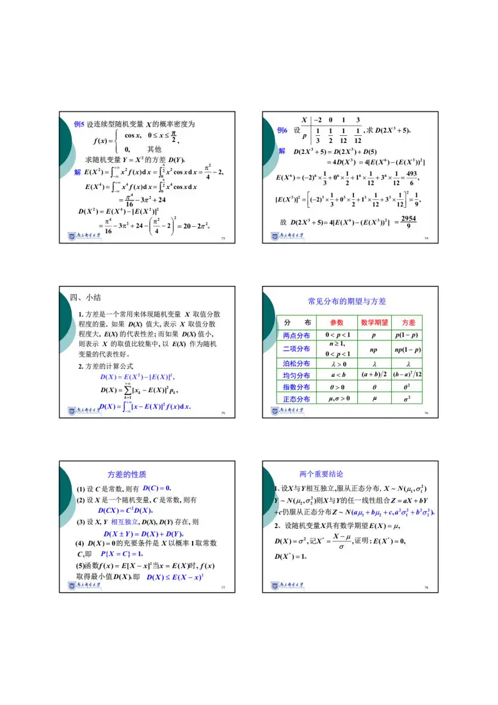

原文：

例5 设连续型随机变量 $X$ 的概率密度为

$$
f (x) = \left\{ \begin{array}{l l} & \cos x, \quad 0 \leq x \leq \frac {\pi}{2}, \\ & 0, \quad \text {其他} \end{array} \right.
$$

求随机变量 $Y = X^2$ 的方差 $D(Y)$ 。

$$
E \left(X ^ {2}\right) = \int_ {- \infty} ^ {+ \infty} x ^ {2} f (x) d x = \int_ {0} ^ {\frac {\pi}{2}} x ^ {2} \cos x d x = \frac {\pi^ {2}}{4} - 2,
$$

$$
\begin{array}{r l} E (X ^ {4}) & = \int_ {- \infty} ^ {+ \infty} x ^ {4} f (x) \mathrm{d} x = \int_ {0} ^ {\frac {\pi}{2}} x ^ {4} \cos x \mathrm{d} x \\ & = \frac {\pi^ {4}}{1 6} - 3 \pi^ {2} + 2 4 \end{array}
$$

$$
D (X ^ {2}) = E (X ^ {4}) - [ E (X ^ {2}) ] ^ {2}
$$

$$
= \frac {\pi^ {4}}{1 6} - 3 \pi^ {2} + 2 4 - \left(\frac {\pi^ {2}}{4} - 2\right) ^ {2} = 2 0 - 2 \pi^ {2} 。
$$

2. 方差的计算公式

四、小结

1. 方差是一个常用来体现随机变量 $X$ 取值分散程度的量. 如果 $D(X)$ 值大, 表示 $X$ 取值分散程度大, $E(X)$ 的代表性差; 而如果 $D(X)$ 值小, 则表示 $X$ 的取值比较集中, 以 $E(X)$ 作为随机变量的代表性好。

故 $D(2X^{3} + 5) = 4[E(X^{6}) - (E(X^{3}))^{2}] = \frac{2954}{9}$

南京邮电大学 $D(X) = \int_{-\infty}^{+\infty}[x - E(X)]^2 f(x)\mathrm{d}x.$

$$
[ E (X ^ {3}) ] ^ {2} = \left[ (- 2) ^ {3} \times \frac {1}{3} + 0 ^ {3} \times \frac {1}{2} + 1 ^ {3} \times \frac {1}{1 2} + 3 ^ {3} \times \frac {1}{1 2} \right] ^ {2} = \frac {1}{9},
$$

$$
\begin{array}{l} D (X) = E (X ^ {2}) - [ E (X) ] ^ {2}, \\ D (X) = \sum_ {k = 1} ^ {+ \infty} [ x _ {k} - E (X) ] ^ {2} p _ {k}, \end{array}
$$

方差的性质

(1) 设 C 是常数, 则有 $D(C)=0$ .

南京邮电大学
Nanjing University of Private and Telecommunication

(2) 设 $X$ 是一个随机变量, $C$ 是常数, 则有

$$
D (C X) = C ^ {2} D (X) _ {\circ}
$$

(3) 设 $X, Y$ 相互独立, $D(X), D(Y)$ 存在, 则 $D(X \pm Y) = D(X) + D(Y)$ 。

(4) $D(X) = 0$ 的充要条件是 $X$ 以概率1取常数 $C$ ，即 $P\{X = C\} = 1$

例6 设 $\frac{X}{p}$ $\begin{vmatrix}-2 & 0 & 1 & 3 \\ \frac{1}{3} & \frac{1}{2} & \frac{1}{12} & \frac{1}{12}\end{vmatrix}$ ，求 $D(2X^{3}+5)$ 。

$$
E (X ^ {6}) = (- 2) ^ {6} \times \frac {1}{3} + 0 ^ {6} \times \frac {1}{2} + 1 ^ {6} \times \frac {1}{1 2} + 3 ^ {6} \times \frac {1}{1 2} = \frac {4 9 3}{6},
$$

(5)函数 $f(x)=E[X-x]^{2}$ 当 $x=E(X)$ 时, $f(x)$

$$
\begin{array}{r l} D (2 X ^ {3} + 5) & = D (2 X ^ {3}) + D (5) \\ & = 4 D (X ^ {3}) = 4 [ E (X ^ {6}) - (E (X ^ {3})) ^ {2} ] \end{array}
$$

取得最小值 $D(X)$ 即 $D(X) \leq E(X - x)^2$

常见分布的期望与方差

<table><tr><td>分布</td><td>参数</td><td>数学期望</td><td>方差</td></tr><tr><td>两点分布</td><td>0 &lt; p &lt; 1</td><td>p</td><td>p(1 - p)</td></tr><tr><td>二项分布</td><td>n ≥ 1,0 &lt; p &lt; 1</td><td>np</td><td>np(1 - p)</td></tr><tr><td>泊松分布</td><td>λ &gt; 0</td><td>λ</td><td>λ</td></tr><tr><td>均匀分布</td><td>a &lt; b</td><td>(a + b)/2</td><td>(b - a)2/12</td></tr><tr><td>指数分布</td><td>θ &gt; 0</td><td>θ</td><td>θ2</td></tr><tr><td>正态分布</td><td>μ,σ &gt; 0</td><td>μ</td><td>σ2</td></tr></table>

两个重要结论

$$
E (X) = \mu ,
$$

73

南京邮电大学
Nanjing University of Press and Telecommunications

$\sim N(\mu_2,\sigma_2^2)$

1、设X与Y相互独立,服从正态分布, $X\sim N(\mu_{1},\sigma_{1}^{2})$ $Y \sim N(\mu_{2}, \sigma_{2}^{2})$ 则 X 与 Y 的任一线性组合 $Z = aX + bY + c$ 仍服从正态分布 $Z \sim N(a\mu_{1} + b\mu_{2} + c, a^{2}\sigma_{1}^{2} + b^{2}\sigma_{2}^{2})$ 。

$D(X) = \sigma^2$

$D(X) = \sigma^2$ ，记 $X^{*} = \frac{X - \mu}{\sigma}$ ，证明： $E(X^{*}) = 0,$

$D(X^{*}) = 1$

南京新電大學
Nanjing University of Private and Telecommunications

### 、协方差与相关系数的概念及性质

原文：

、协方差与相关系数的概念及性质

1. 问题的提出

对于二维随机变量 $(X,Y)$ ，数学期望 $E(X)$ 、 $E(Y)$ 只反映了 $X$ 与 $Y$ 各自的平均值，方差 $D(X)$ 、 $D(Y)$ 只反映了 $X$ 与 $Y$ 各自离开均值的偏离程度，它们对 $X$ 与 $Y$ 之间的相互联系不提供任何信息。

我们希望有一个数字特征能够在一定程度上反映X与Y的之间相互关系。

南京邮电大学
Nanjing University of Physics and Telecommunications

协方差的定义

量 $E\{[X - E(X)][Y - E(Y)]\}$ 称为随机变量 $X$ 与 $Y$ 的协方差。记为 $\operatorname{Cov}(X,Y)$ ，即

$$
C o v (X, Y) = E \{[ X - E (X) ] [ Y - E (Y) ] \} _ {\circ}
$$

从而有

$$
D (X \pm Y) = D (X) + D (Y) \pm 2 C o v (X, Y)
$$

由方差的性质

$$
D (X \pm Y)
$$

$$
= D (X) + D (Y) \pm 2 E \{[ X - E (X) ] [ Y - E (Y) ] \}
$$

如果 $X$ 与 $Y$ 独立，则

$$
E \{[ X - E (X) ] [ Y - E (Y) ] \} = 0
$$

这意味着当 $E\{[X - E(X)][Y - E(Y)]\} \neq 0$ 时， $X$ 与 $Y$ 不相互独立

也说明 $E\{[X - E(X)][Y - E(Y)]\}$ 在一定程度上反映了 $X$ 与 $Y$ 的相互联系。

因此，我们引入协方差的定义：

协方差的计算公式

南京邮电大学
Nanjing University of Press and Telecommunications

80

79

南京航空航天大学
Nanjing University of Physics and Telecommunications

契比雪夫不等式

$P\{|X - E(X)| \geq \varepsilon\} \leq \frac{D(X)}{\varepsilon^2}$

$\Leftrightarrow P\{|X - E(X)| < \varepsilon\} \geq 1 - \frac{D(X)}{\varepsilon^2}$ 。

第三节 协方差及相关系数

一、协方差与相关系数的概念及性质

三、小结

二、相关系数的意义

82

$Cov(X,Y)=E(XY)-E(X)E(Y);$

证明： $Cov(X,Y)=E\{[X-E(X)][Y-E(Y)]\}$

$= E[XY - XE(Y) - YE(X) + E(X)E(Y)]$

$= E[XY] - E(X)E(Y) - E(Y)E(X) + E(X)E(Y)$

$= E(XY) - E(X)E(Y)$

南京新電大學
Nanjing University of Private and Telecommunications

### 相关系数的定义

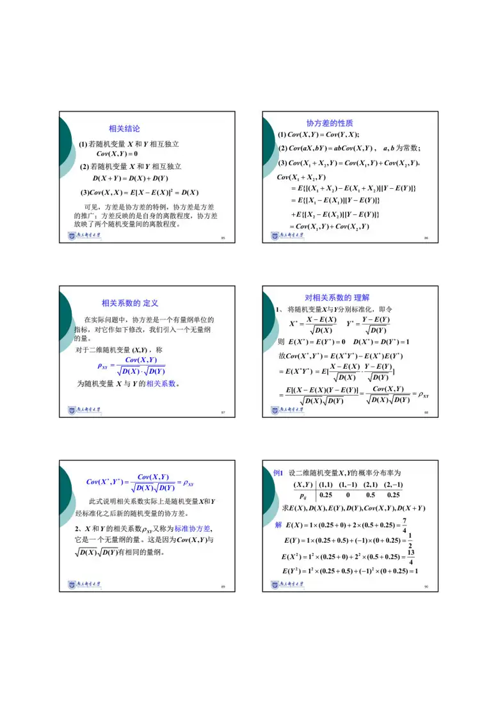

原文：

相关系数的定义

在实际问题中，协方差是一个有量纲单位的指标，对它作如下修改，我们引入一个无量纲的量。

对于二维随机变量 $(X,Y)$ ，称

$$
\rho_ {X Y} = \frac {\operatorname{Cov} (X , Y)}{\sqrt {D (X)} \cdot \sqrt {D (Y)}}
$$

为随机变量 $X$ 与 $Y$ 的相关系数。

南京邮电大学
Nanjing University of Physics and Telecommunications

$$
C o v (X ^ {*}, Y ^ {*}) = \frac {C o v (X , Y)}{\sqrt {D (X)} \sqrt {D (Y)}} = \rho_ {X Y}
$$

此式说明相关系数实际上是随机变量X和Y经标准化之后新的随机变量的协方差。

2、X 和 Y 的相关系数 $\rho_{XY}$ 又称为标准协方差，它是一个无量纲的量。这是因为 $Cov(X,Y)$ 与 $\sqrt{D(X)}\sqrt{D(Y)}$ 有相同的量纲。

对相关系数的理解

1、将随机变量 $X$ 与 $Y$ 分别标准化，即令

$$
X ^ {*} = \frac {X - E (X)}{\sqrt {D (X)}} \quad Y ^ {*} = \frac {Y - E (Y)}{\sqrt {D (Y)}}
$$

则 $E(X^{*}) = E(Y^{*}) = 0$ $D(X^{*}) = D(Y^{*}) = 1$

$$
\mathrm{故} C o v (X ^ {*}, Y ^ {*}) = E (X ^ {*} Y ^ {*}) - E (X ^ {*}) E (Y ^ {*})
$$

$$
= E (X ^ {*} Y ^ {*}) = E [ \frac {X - E (X)}{\sqrt {D (X)}} \cdot \frac {Y - E (Y)}{\sqrt {D (Y)}} ]
$$

$$
= \frac {E [ (X - E (X) (Y - E (Y) ]}{\sqrt {D (X)} \sqrt {D (Y)}} = \frac {\operatorname{Cov} (X , Y)}{\sqrt {D (X)} \sqrt {D (Y)}} = \rho_ {X Y}
$$

南京邮电大学
Nanjing University of Press and Telecommunications

上海银行

南京新電大學
Nanjing University of Physics and Telecommunications

相关结论

(1) 若随机变量 $X$ 和 $Y$ 相互独立 $\operatorname{Cov}(X, Y) = 0$

(2) 若随机变量 $X$ 和 $Y$ 相互独立

$D(X + Y) = D(X) + D(Y)$

(3) $Cov(X,X)=E[X-E(X)]^{2}=D(X)$

可见，方差是协方差的特例，协方差是方差的推广；方差反映的是自身的离散程度，协方差放映了两个随机变量间的离散程度。

南京邮电大学
Nanjing University of Private and Telecommunication

85

协方差的性质

(1) $Cov(X,Y) = Cov(Y,X)$ ;

$Cov(X,Y)=Cov(Y,X);$

$Cov(aX,bY) = abCov(X,Y)$

(2) $Cov(aX,bY)=abCov(X,Y)$ ，a,b为常数；

(3) $Cov(X_1 + X_2, Y) = Cov(X_1, Y) + Cov(X_2, Y)$ .

$= E\{[X_1 - E(X_1)][Y - E(Y)]\}$

$+E\{[X_{2}-E(X_{2})][Y-E(Y)]\}$

$= Cov(X_{1},Y) + Cov(X_{2},Y)$

南京邮电大学 Nanjing University of Physics and Telecommunications

86

例1 设二维随机变量 $X, Y$ 的概率分布率为

$(X,Y)$ (1,1) (1,-1) (2,1) (2,-1) $p_{ij}$ 0.25 0 0.5 0.25

求 $E(X), D(X), E(Y), D(Y), Cov(X, Y), D(X + Y)$

$E(X) = 1\times (0.25 + 0) + 2\times (0.5 + 0.25) = \frac{7}{4}$

$E(Y) = 1\times (0.25 + 0.5) + (-1)\times (0 + 0.25) = \frac{1}{2}$

$E(X^{2}) = 1^{2}\times (0.25 + 0) + 2^{2}\times (0.5 + 0.25) = \frac{13}{4}$

$E(Y^{2}) = 1^{2}\times (0.25 + 0.5) + (-1)^{2}\times (0 + 0.25) = 1$

南京邮电大学
Nanjing University of Science and Telecommunications

### 南京邮电大学

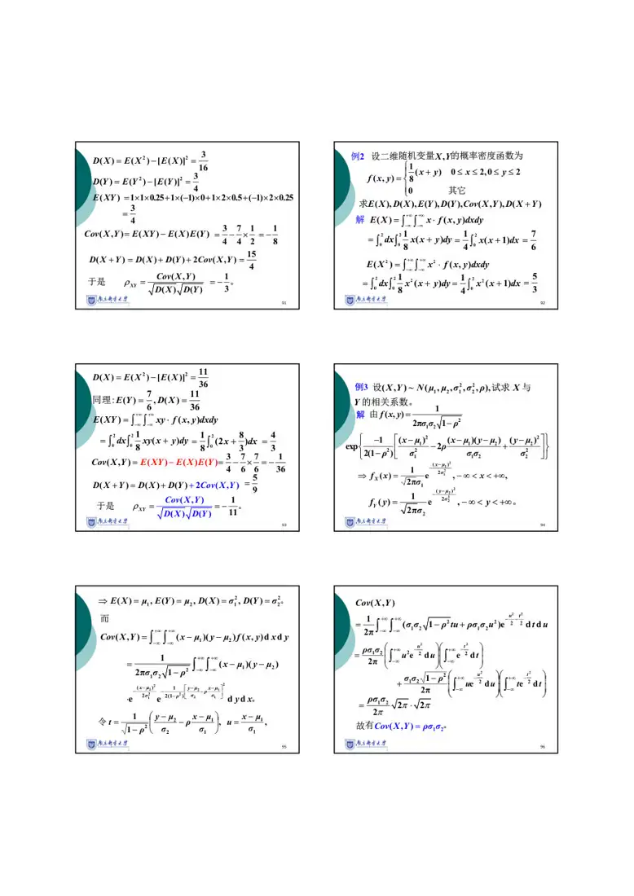

原文：

南京邮电大学
Nanjing University of Physics and Telecommunications

$$
D (X) = E \left(X ^ {2}\right) - [ E (X) ] ^ {2} = \frac {1 1}{3 6}
$$

同理: $E(Y)=\frac{7}{6},D(X)=\frac{11}{36}$

$$
\begin{array}{r l} & E (X Y) = \int_ {- \infty} ^ {+ \infty} \int_ {- \infty} ^ {+ \infty} x y \cdot f (x, y) d x d y \\ & = \int_ {0} ^ {2} d x \int_ {0} ^ {2} \frac {1}{8} x y (x + y) d y = \frac {1}{8} \int_ {0} ^ {2} (2 x + \frac {8}{3}) d x = \frac {4}{3} \\ & C o v (X, Y) = E (X Y) - E (X) E (Y) = \frac {3}{4} - \frac {7}{6} \times \frac {7}{6} = - \frac {1}{3 6} \\ & D (X + Y) = D (X) + D (Y) + 2 C o v (X, Y) = \frac {5}{9} \end{array}
$$

南京邮电大学
Nanjing University of Posts and Telecommunications

于是 $\rho_{XY} = \frac{Cov(X,Y)}{\sqrt{D(X)}\sqrt{D(Y)}} = -\frac{1}{11}$

$$
\Rightarrow E (X) = \mu_ {1}, E (Y) = \mu_ {2}, D (X) = \sigma_ {1} ^ {2}, D (Y) = \sigma_ {2} ^ {2} 。
$$

而

$$
\begin{array}{r l} C o v (X, Y) & = \int_ {- \infty} ^ {+ \infty} \int_ {- \infty} ^ {+ \infty} (x - \mu_ {1}) (y - \mu_ {2}) f (x, y) d x d y \\ & = \frac {1}{2 \pi \sigma_ {1} \sigma_ {2} \sqrt {1 - \rho^ {2}}} \int_ {- \infty} ^ {+ \infty} \int_ {- \infty} ^ {+ \infty} (x - \mu_ {1}) (y - \mu_ {2}) \\ & \cdot e ^ {- \frac {(x - \mu_ {1}) ^ {2}}{2 \sigma_ {1} ^ {2}}} e ^ {- \frac {1}{2 (1 - \rho^ {2})} \left[ \frac {y - \mu_ {2}}{\sigma_ {2}} - \frac {x - \mu_ {1}}{\sigma_ {1}} \right] ^ {2}} d y d x. \end{array}
$$

$$
\text {令} t = \frac {1}{\sqrt {1 - \rho^ {2}}} \Bigg (\frac {y - \mu_ {2}}{\sigma_ {2}} - \rho \frac {x - \mu_ {1}}{\sigma_ {1}} \Bigg), u = \frac {x - \mu_ {1}}{\sigma_ {1}},
$$

南京新電大學
Nanjing University of Physics and Telecommunications

例3 设 $(X,Y) \sim N(\mu_1, \mu_2, \sigma_1^2, \sigma_2^2, \rho)$ , 试求 $X$ 与 $Y$ 的相关系数。

解 由 $f(x,y)=\frac{1}{2\pi\sigma_{1}\sigma_{2}\sqrt{1-\rho^{2}}}$

$$
\exp \left\{\frac {- 1}{2 \left(1 - \rho^ {2}\right)} \left[ \frac {\left(x - \mu_ {1}\right) ^ {2}}{\sigma_ {1} ^ {2}} - 2 \rho \frac {\left(x - \mu_ {1}\right) \left(y - \mu_ {2}\right)}{\sigma_ {1} \sigma_ {2}} + \frac {\left(y - \mu_ {2}\right) ^ {2}}{\sigma_ {2} ^ {2}} \right] \right\}
$$

$$
\Rightarrow f _ {X} (x) = \frac {1}{\sqrt {2 \pi} \sigma_ {1}} \mathrm{e} ^ {- \frac {(x - \mu_ {1}) ^ {2}}{2 \sigma_ {1} ^ {2}}}, - \infty <   x <   + \infty ,
$$

$$
f _ {Y} (y) = \frac {1}{\sqrt {2 \pi} \sigma_ {2}} \mathrm{e} ^ {- \frac {(y - \mu_ {2}) ^ {2}}{2 \sigma_ {2} ^ {2}}}, - \infty <   y <   + \infty 。
$$

南京邮电大学
Nanjing University of Press and Telecommunications

$$
C o v (X, Y)
$$

$$
\begin{array}{l} = \frac {1}{2 \pi} \int_ {- \infty} ^ {+ \infty} \int_ {- \infty} ^ {+ \infty} (\sigma_ {1} \sigma_ {2} \sqrt {1 - \rho^ {2}} t u + \rho \sigma_ {1} \sigma_ {2} u ^ {2}) e ^ {- \frac {u ^ {2}}{2} - \frac {t ^ {2}}{2}} d t d u \\ = \frac {\rho \sigma_ {1} \sigma_ {2}}{2 \pi} \left(\int_ {- \infty} ^ {+ \infty} u ^ {2} e ^ {- \frac {u ^ {2}}{2}} d u\right) \left(\int_ {- \infty} ^ {+ \infty} e ^ {- \frac {t ^ {2}}{2}} d t\right) \\ + \frac {\sigma_ {1} \sigma_ {2} \sqrt {1 - \rho^ {2}}}{2 \pi} \left(\int_ {- \infty} ^ {+ \infty} u e ^ {- \frac {u ^ {2}}{2}} d u\right) \left(\int_ {- \infty} ^ {+ \infty} t e ^ {- \frac {t ^ {2}}{2}} d t\right) \\ = \frac {\rho \sigma_ {1} \sigma_ {2}}{2 \pi} \sqrt {2 \pi} \cdot \sqrt {2 \pi} \end{array}
$$

故有 $Cov(X,Y)=\rho\sigma_{1}\sigma_{2}$

南京新電大學
Nanjing University of Private and Telecommunications

$D(X) = E(X^2) - [E(X)]^2 = \frac{3}{16}$

$D(Y) = E(Y^2) - [E(Y)]^2 = \frac{3}{4}$

$E(XY) = 1 \times 1 \times 0.25 + 1 \times (-1) \times 0 + 1 \times 2 \times 0.5 + (-1) \times 2 \times 0.25$ $= \frac{3}{4}$

$Cov(X,Y) = E(XY) - E(X)E(Y) = \frac{3}{4} -\frac{7}{4}\times \frac{1}{2} = -\frac{1}{8}$

$D(X + Y) = D(X) + D(Y) + 2Cov(X,Y) = \frac{15}{4}$

于是

$\rho_{XY} = \frac{Cov(X,Y)}{\sqrt{D(X)}\sqrt{D(Y)}} = -\frac{1}{3}$

91

例2 设二维随机变量 $X, Y$ 的概率密度函数为

$f(x,y) = \left\{ \begin{array}{ll}\frac{1}{8} (x + y) & 0\leq x\leq 2,0\leq y\leq 2\\ 0 & \text{其它} \end{array} \right.$

求 $E(X), D(X), E(Y), D(Y), Cov(X, Y), D(X + Y)$

解 $E(X) = \int_{-\infty}^{+\infty}\int_{-\infty}^{+\infty}x\cdot f(x,y)dxdy$ $= \int_0^2 dx\int_0^2\frac{1}{8} x(x + y)dy = \frac{1}{4}\int_0^2 x(x + 1)dx = \frac{7}{6}$

$E(X^{2}) = \int_{-\infty}^{+\infty}\int_{-\infty}^{+\infty}x^{2}\cdot f(x,y)dxdy$

$= \int_{0}^{2}dx\int_{0}^{2}\frac{1}{8} x^{2}(x + y)dy = \frac{1}{4}\int_{0}^{2}x^{2}(x + 1)dx = \frac{5}{3}$

南京邮电大学
Nanjing University of Physics and Telecommunications

### $$

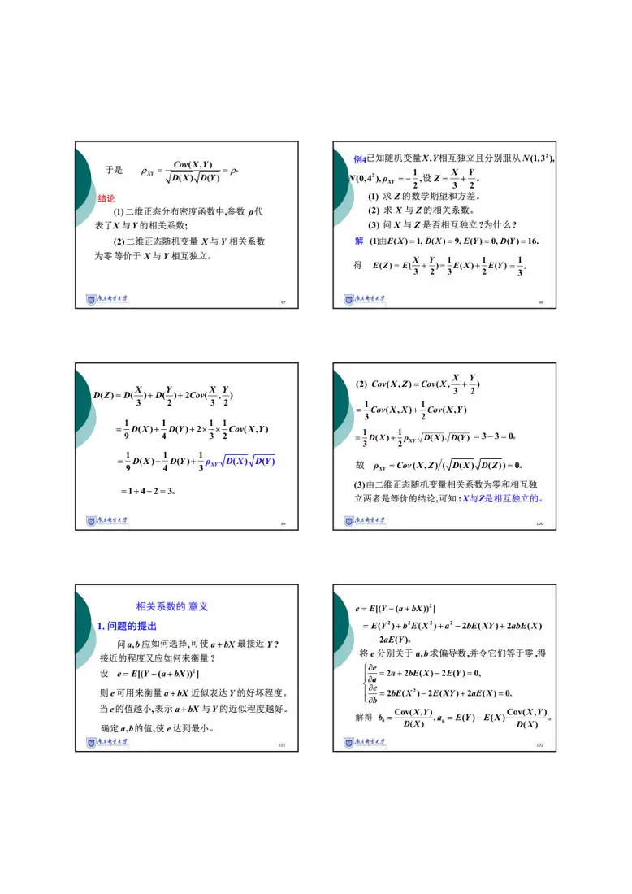

原文：

$$
\begin{array}{r l} D (Z) & = D \left(\frac {X}{3}\right) + D \left(\frac {Y}{2}\right) + 2 C o v \left(\frac {X}{3}, \frac {Y}{2}\right) \\ & = \frac {1}{9} D (X) + \frac {1}{4} D (Y) + 2 \times \frac {1}{3} \times \frac {1}{2} C o v (X, Y) \\ & = \frac {1}{9} D (X) + \frac {1}{4} D (Y) + \frac {1}{3} \rho_ {X Y} \sqrt {D (X)} \sqrt {D (Y)} \\ & = 1 + 4 - 2 = 3. \end{array}
$$

南京邮电大学
Nanjing University of Physics and Telecommunications

相关系数的意义

1. 问题的提出

问 a, b 应如何选择, 可使 $a + bX$ 最接近 Y? 接近的程度又应如何来衡量?

设 $e = E[(Y - (a + bX))^2]$

则 $e$ 可用来衡量 $a + bX$ 近似表达 $Y$ 的好坏程度。当 $e$ 的值越小，表示 $a + bX$ 与 $Y$ 的近似程度越好。确定 $a, b$ 的值，使 $e$ 达到最小。

南京邮电大学
Nanjing University of Posts and Telecommunications

$$
(2) C o v (X, Z) = C o v (X, \frac {X}{3} + \frac {Y}{2})
$$

$$
= \frac {1}{3} C o v (X, X) + \frac {1}{2} C o v (X, Y)
$$

$$
= \frac {1}{3} D (X) + \frac {1}{2} \rho_ {X Y} \sqrt {D (X)} \sqrt {D (Y)} = 3 - 3 = 0 。
$$

$$
\text {故} \rho_ {X Y} = C o v (X, Z) / (\sqrt {D (X)} \sqrt {D (Z)}) = 0 _ {\circ}
$$

(3)由二维正态随机变量相关系数为零和相互独立两者是等价的结论,可知:X与Z是相互独立的。

南京新電大學
Nanjing University of Physics and Telecommunications

97

98

于是 $\rho_{XY} = \frac{Cov(X,Y)}{\sqrt{D(X)}\sqrt{D(Y)}} = \rho_0$

$\rho_{XY} = \frac{Cov(X,Y)}{\sqrt{D(X)}\sqrt{D(Y)}} = \rho_{\circ}$

结论

(1)二维正态分布密度函数中,参数 $\rho$ 代表了 X 与 Y 的相关系数;

$\rho$ 代

(2)二维正态随机变量 $X$ 与 $Y$ 相关系数为零等价于 $X$ 与 $Y$ 相互独立。

例4已知随机变量 $X, Y$ 相互独立且分别服从 $N(1, 3^2)$ ,

$N(0,4^{2}),\rho_{XY} = -\frac{1}{2}$

$N(0,4^{2}),\rho_{XY} = -\frac{1}{2}$ 设 $Z = \frac{X}{3} +\frac{Y}{2}$

$N(1,3^{2})$

$Z = \frac{X}{3} +\frac{Y}{2}$

(1) 求 $Z$ 的数学期望和方差。

(2) 求 $X$ 与 $Z$ 的相关系数。

得 $E(Z) = E\left(\frac{X}{3} +\frac{Y}{2}\right) = \frac{1}{3} E(X) + \frac{1}{2} E(Y) = \frac{1}{3}$

$E(Z) = E(\frac{X}{3} +\frac{Y}{2}) = \frac{1}{3} E(X) + \frac{1}{2} E(Y) = \frac{1}{3}$

(3) 问 $X$ 与 $Z$ 是否相互独立? 为什么?

解 (1)由 $E(X)=1,D(X)=9,E(Y)=0,D(Y)=16.$

$E(X)=1, D(X)=9, E(Y)=0, D(Y)=16.$

南京邮电大学
Nanjing University of Press and Telecommunications

$e = E[(Y - (a + bX))^2]$ $= E(Y^{2}) + b^{2}E(X^{2}) + a^{2} - 2bE(XY) + 2abE(X)$ $-2aE(Y)$

将 $e$ 分别关于 $a, b$ 求偏导数，并令它们等于零，得

解得 $b_{0} = \frac{\mathrm{Cov}(X,Y)}{D(X)}, a_{0} = E(Y) - E(X)\frac{\mathrm{Cov}(X,Y)}{D(X)}$ 。

南京邮电大学
Nanjing University of Science and Telecommunications

### $$

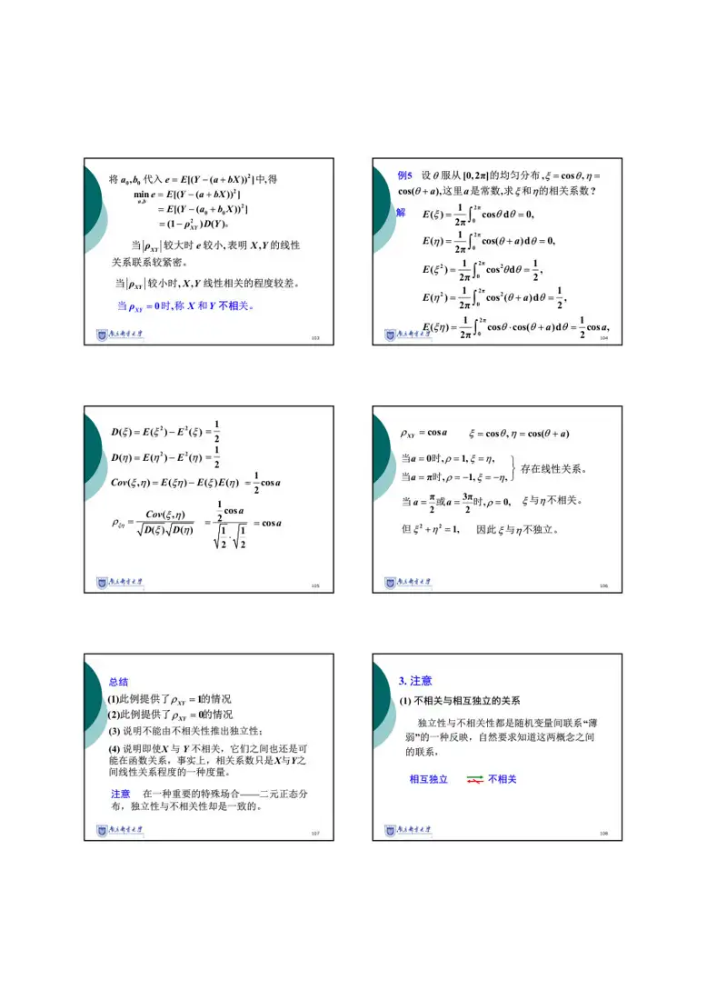

原文：

$$
D (\xi) = E \left(\xi^ {2}\right) - E ^ {2} (\xi) = \frac {1}{2}
$$

$$
D (\eta) = E \left(\eta^ {2}\right) - E ^ {2} (\eta) = \frac {1}{2}
$$

$$
C o v (\xi , \eta) = E (\xi \eta) - E (\xi) E (\eta) = \frac {1}{2} \cos a
$$

$$
\rho_ {\xi \eta} = \frac {C o v (\xi , \eta)}{\sqrt {D (\xi)} \sqrt {D (\eta)}} = \frac {\frac {1}{2} \cos a}{\sqrt {\frac {1}{2}} \cdot \sqrt {\frac {1}{2}}} = \cos a
$$

南京邮电大学
Nanjing University of Posts and Telecommunications

总结

(1)此例提供了 $\rho_{XY} = 1$ 的情况

(2)此例提供了 $\rho_{XY} = 0$ 的情况

(3) 说明不能由不相关性推出独立性；

(4) 说明即使 X 与 Y 不相关，它们之间也还是可能在函数关系，事实上，相关系数只是 X 与 Y 之间线性关系程度的一种度量。

注意 在一种重要的特殊场合——二元正态分布，独立性与不相关性却是一致的。

南京新電大學
Nanjing University of Physics and Telecommunications

$$
E (\xi \eta) = \frac {1}{2 \pi} \int_ {0} ^ {2 \pi} \cos \theta \cdot \cos (\theta + a) d \theta = \frac {1}{2} \cos a, _ {1 0 4}
$$

$$
\rho_ {X Y} = \cos a
$$

$$
\xi = \cos \theta , \eta = \cos (\theta + a)
$$

当 $a = 0$ 时， $\rho = 1,\xi = \eta ,$ 当 $a = \pi$ 时， $\rho = -1,\xi = -\eta ,$ 存在线性关系。

当 $a = \frac{\pi}{2}$ 或 $a = \frac{3\pi}{2}$ 时， $\rho = 0$ ， $\xi$ 与 $\eta$ 不相关。

但 $\xi^2 +\eta^2 = 1$ ，因此 $\xi$ 与 $\eta$ 不独立。

南京邮电大学
Nanjing University of Physics and Telecommunications

103

$a_0,b_0$

将 $a_0, b_0$ 代入 $e = E[(Y - (a + bX))^2]$ 中，得

$e = E[(Y - (a + bX))^2]$

$\min_{a,b}e = E[(Y - (a + bX))^2]$ $= E[(Y - (a_0 + b_0X))^2 ]$ $= (1 - \rho_{XY}^{2})D(Y)\circ$

$\left|\rho_{XY}\right.$

当 $\left|\rho_{XY}\right|$ 较大时e较小,表明X,Y的线性关系联系较紧密。

$\left|\rho_{XY}\right|$

当 $\left|\rho_{XY}\right|$ 较小时，X,Y线性相关的程度较差。

$\rho_{XY} = 0$

当 $\rho_{XY} = 0$ 时, 称 $X$ 和 $Y$ 不相关。

$\cos (\theta +a)$

例5 设 $\theta$ 服从 $[0,2\pi]$ 的均匀分布， $\xi = \cos \theta, \eta = \cos (\theta + a)$ ，这里 $a$ 是常数，求 $\xi$ 和 $\eta$ 的相关系数？

解

[0,2π]

$\xi = \cos \theta, \eta =$

$E(\xi) = \frac{1}{2\pi}\int_{0}^{2\pi}\cos \theta \mathrm{d}\theta = 0,$

$E(\eta) = \frac{1}{2\pi}\int_{0}^{2\pi}\cos (\theta +a)\mathrm{d}\theta = 0,$

$E(\xi^2) = \frac{1}{2\pi}\int_0^{2\pi}\cos^2\theta \mathrm{d}\theta = \frac{1}{2},$

$E(\eta^2) = \frac{1}{2\pi}\int_{0}^{2\pi}\cos^2 (\theta +a)\mathrm{d}\theta = \frac{1}{2},$

南京邮电大学
Nanjing University of Press and Telecommunications

106

3. 注意

(1) 不相关与相互独立的关系

独立性与不相关性都是随机变量间联系“薄弱”的一种反映，自然要求知道这两概念之间的联系，

相互独立 不相关

南京邮电大学
Nanjing University of Science and Telecommunications

108

### 第四节 矩、协方差矩阵

原文：

第四节 矩、协方差矩阵

一、基本概念

二、 $n$ 维正态变量的性质

三、小结

南京邮电大学
Nanjing University of Physics and Telecommunications

2. 说明

(1) 以上数字特征都是随机变量函数的数学期望；

(2)随机变量 $X$ 的数学期望 $E(X)$ 是 $X$ 的一阶原点矩,方差为二阶中心矩,协方差

$\operatorname{Cov}(X,Y)$ 是 $X$ 与 $Y$ 的二阶混合中心矩；

(3) 在实际应用中, 高于 4 阶的矩很少使用。

三阶中心矩 $E\{[X-E(X)]^{3}\}$ 主要用来衡量随机变量的分布是否有偏。

四阶中心矩 $E\{[X - E(X)]^4\}$ 主要用来衡量随机变量的分布在均值附近的陡峭程度如何。

一、基本概念

1. 定义设 X 和 Y 是随机变量, 若 $E(X^{k})$ , k = 1, 2, … 存在, 称它为 X 的 k 阶原点矩, 简称 k 阶矩。

$$
E \{[ X - E (X) ] ^ {k} \}, \quad k = 2, 3, \dots
$$

存在,称它为 X 的 k 阶中心矩。

若 $E(X^{k}Y^{l}),\quad k,l=1,2,\cdots$

存在,称它为 X 和 Y 的 $k+l$ 阶混合矩。

若 $E\{[X-E(X)]^{k}[Y-E(Y)]^{l}\}$ ， $k,l=1,2,\cdots$ 存在，称它为 X 和 Y 的 $k+l$ 阶混合中心矩。

$$
\begin{array}{r l} & g (t) = E [ (X + t Y) ^ {2} ] \\ & \qquad = E (X ^ {2}) + 2 t E (X Y) + t ^ {2} E (Y ^ {2}) \geq 0 \end{array}
$$

$$
\Delta = 4 [ E (X Y) ] ^ {2} - 4 E (X ^ {2}) \cdot E (Y ^ {2}) \leq 0
$$

$$
\therefore \quad [ E (X Y) ] ^ {2} \leq E (X ^ {2}) \cdot E (Y ^ {2})
$$

南京邮电大学
Nanjing University of Physics and Telecommunications

109

南京航空航天大学
Nanjing University of Physics and Telecommunications

110

(2) 不相关的充要条件

当 $\rho_{XY} = 0$ 时，称 $X$ 和 $Y$ 不相关。

$\rho_{XY} = 0$

对 $X$ 、 $Y$ ，下列事实是等价的：

$1^{0}$ $X,Y$

$1^{0}$ $X,Y$ 不相关 $\Leftrightarrow \rho_{XY} = 0;$

$\Rightarrow \rho_{XY} = 0;$

$2^{0}$ $X,Y$ 不相关 $\Leftrightarrow Cov(X,Y) = 0;$

$\Leftrightarrow Cov(X,Y) = 0;$

$3^{0} X,Y$

$4^{\circ}$ $X,Y$ 不相关 $\Leftrightarrow D(X\pm Y) = D(X) + D(Y)$

$3^{0}$ $X,Y$ 不相关 $\Leftrightarrow E(XY) = E(X)E(Y)$ 。

$\Leftrightarrow D(X \pm Y) = D(X) + D(Y)$

$\Leftrightarrow E(XY) = E(X)E(Y)$ 。

相关系数的性质

$\left|\rho_{XY}\right| \leq 1$ 。

(1) $\left|\rho_{XY}\right|\leq1$ 。

$\left|\rho_{XY}\right| = 1$

(2) $\left|\rho_{XY}\right|=1$ 的充要条件是:存在常数a,b使

a,b

$P\{Y = a + bX\} = 1$

南京邮电大学
Nanjing University of Press and Telecommunications

例6 柯西-许瓦兹(Cauchy-Schwarz)不等式

设 $X$ 与 $Y$ 是两个随机变量，若 $E(X^{2}), E(Y^{2})$ 存在，则 $[E(XY)]^{2} \leq E(X^{2}) \cdot E(Y^{2})$

证明 考虑实变量 $t$ 的二次函数

南京邮电大学
Nanjing University of Posts and Telecommunications

南京邮电大学
Nanjing University of Physics and Telecommunications

### $$

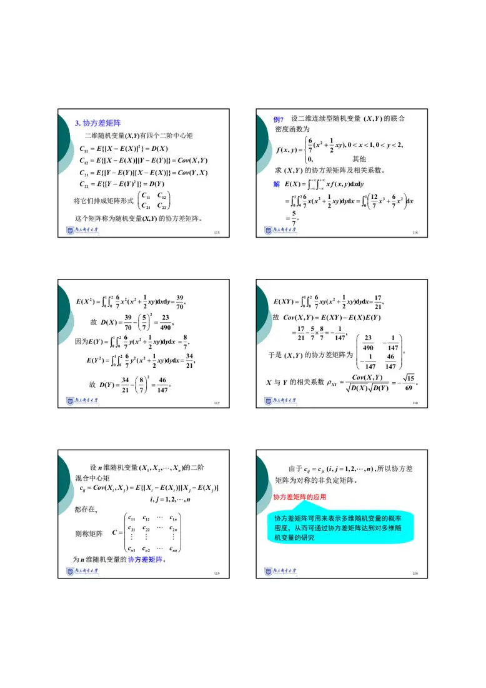

原文：

$$
E (X ^ {2}) = \int_ {0} ^ {1} \int_ {0} ^ {2} \frac {6}{7} x ^ {2} (x ^ {2} + \frac {1}{2} x y) \mathrm{d} x \mathrm{d} y = \frac {3 9}{7 0},
$$

$$
\text {故} D (X) = \frac {3 9}{7 0} - \left(\frac {5}{7}\right) ^ {2} = \frac {2 3}{4 9 0},
$$

因为 $E(Y)=\int_{0}^{1}\int_{0}^{2}\frac{6}{7}y(x^{2}+\frac{1}{2}xy)\mathrm{d}y\mathrm{d}x=\frac{8}{7},$

$$
E \left(Y ^ {2}\right) = \int_ {0} ^ {1} \int_ {0} ^ {2} \frac {6}{7} y ^ {2} \left(x ^ {2} + \frac {1}{2} x y\right) d y d x = \frac {3 4}{2 1},
$$

故 $D(Y) = \frac{34}{21} -\left(\frac{8}{7}\right)^2 = \frac{46}{147}$

南京邮电大学
Nanjing University of Posts and Telecommunications

设 n 维随机变量 $(X_{1}, X_{2}, \cdots, X_{n})$ 的二阶

混合中心矩

$$
c _ {i j} = \operatorname{Cov} \left(X _ {i}, X _ {j}\right) = E \left\{\left[ X _ {i} - E \left(X _ {i}\right) \right] \left[ X _ {j} - E \left(X _ {j}\right) \right] \right.
$$

$$
i, j = 1, 2, \dots , n
$$

都存在，

则称矩阵 $C=\begin{pmatrix}c_{11}&c_{12}&\cdots&c_{1n}\\c_{21}&c_{22}&\cdots&c_{2n}\\\vdots&\vdots&&\vdots\\c_{n1}&c_{n2}&\cdots&c_{nn}\end{pmatrix}$

为 $n$ 维随机变量的协方差矩阵。

南京新電大學
Nanjing University of Physics and Telecommunications

$$
E (X Y) = \int_ {0} ^ {1} \int_ {0} ^ {2} \frac {6}{7} x y \left(x ^ {2} + \frac {1}{2} x y\right) d y d x = \frac {1 7}{2 1},
$$

故 $Cov(X,Y) = E(XY) - E(X)E(Y)$

$$
= \frac {1 7}{2 1} - \frac {5}{7} \times \frac {8}{7} = - \frac {1}{1 4 7},
$$

于是 $(X,Y)$ 的协方差矩阵为 $\begin{pmatrix}\frac{23}{490}&-\frac{1}{147}\\-\frac{1}{147}&\frac{46}{147}\end{pmatrix}$ 。

X 与 Y 的相关系数 $\rho_{XY} = \frac{Cov(X,Y)}{\sqrt{D(X)}\sqrt{D(Y)}} = -\frac{\sqrt{15}}{69}$ 。

由于 $c_{ij}=c_{ji}(i,j=1,2,\cdots,n)$ ，所以协方差矩阵为对称的非负定矩阵。

协方差矩阵的应用

协方差矩阵可用来表示多维随机变量的概率密度，从而可通过协方差矩阵达到对多维随机变量的研究

3. 协方差矩阵

二维随机变量 $(X,Y)$ 有四个二阶中心矩

$C_{11} = E\{[X - E(X)]^2\} = D(X)$

$C_{12} = E\{[X - E(X)][Y - E(Y)]\} = Cov(X,Y)$

$C_{21} = E\{[Y - E(Y)][X - E(X)]\} = Cov(Y,X)$

$C_{22} = E\{[Y - E(Y)^2 ]\} = D(Y)$

将它们排成矩阵形式 $\begin{pmatrix} C_{11} & C_{12} \\ C_{21} & C_{22} \end{pmatrix}$

$\left( \begin{array}{ll}C_{11} & C_{12}\\ C_{21} & C_{22} \end{array} \right)$

这个矩阵称为随机变量 $(X,Y)$ 的协方差矩阵。

$(X,Y)$

南京邮电大学
Nanjing University of Physics and Telecommunications

115

例7 设二维连续型随机变量 $(X,Y)$ 的联合密度函数为

$f(x,y)=\left\{\begin{aligned}&\frac{6}{7}(x^{2}+\frac{1}{2}xy),0<x<1,0<y<2,\\ &0,\quad 其他 \end{aligned}\right.$

求 $(X,Y)$ 的协方差矩阵及相关系数。

南京邮电大学
Nanjing University of Private and Telecommunication

$E(X) = \int_{-\infty}^{+\infty}\int_{-\infty}^{+\infty}xf(x,y)\mathrm{d}x\mathrm{d}y$ $= \int_0^1\int_0^2\frac{6}{7} x(x^2 +\frac{1}{2} xy)\mathrm{d}y\mathrm{d}x = \int_0^1\left(\frac{12}{7} x^3 +\frac{6}{7} x^2\right)\mathrm{d}x$ $= \frac{5}{7}\circ$

116

南京新電大學
Nanjing University of Private and Telecommunications

### 由于

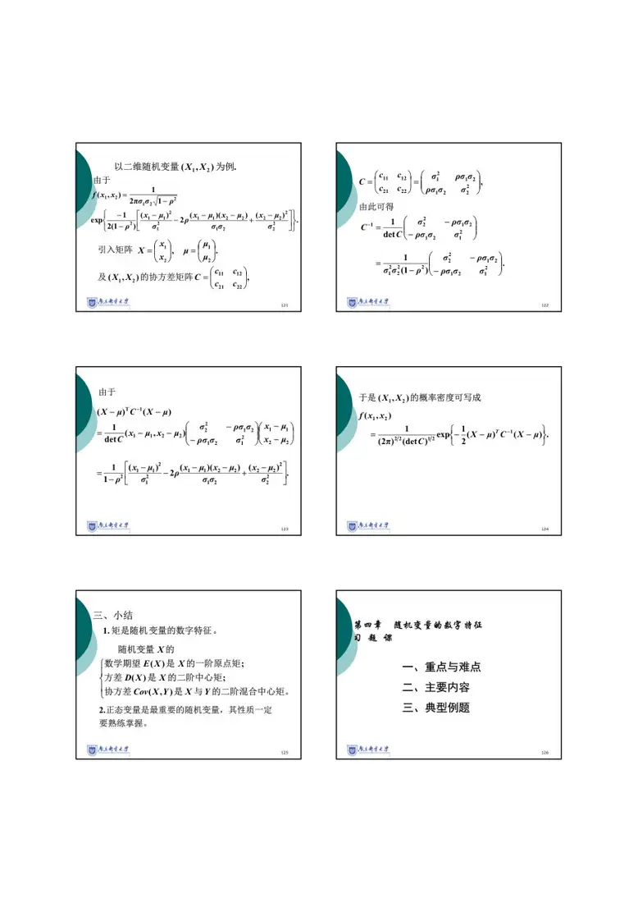

原文：

由于

$$
(X - \mu) ^ {\mathrm{T}} C ^ {- 1} (X - \mu)
$$

$$
= \frac {1}{\det C} (x _ {1} - \mu_ {1}, x _ {2} - \mu_ {2}) \left( \begin{array}{c c} \sigma_ {2} ^ {2} & - \rho \sigma_ {1} \sigma_ {2} \\ - \rho \sigma_ {1} \sigma_ {2} & \sigma_ {1} ^ {2} \end{array} \right) \binom {x _ {1} - \mu_ {1}} {x _ {2} - \mu_ {2}}
$$

$$
= \frac {1}{1 - \rho^ {2}} \left[ \frac {\left(x _ {1} - \mu_ {1}\right) ^ {2}}{\sigma_ {1} ^ {2}} - 2 \rho \frac {\left(x _ {1} - \mu_ {1}\right) \left(x _ {2} - \mu_ {2}\right)}{\sigma_ {1} \sigma_ {2}} + \frac {\left(x _ {2} - \mu_ {2}\right) ^ {2}}{\sigma_ {2} ^ {2}} \right].
$$

于是 $(X_{1},X_{2})$ 的概率密度可写成

$$
f (x _ {1}, x _ {2})
$$

$$
= \frac {1}{(2 \pi) ^ {2 / 2} (\det C) ^ {1 / 2}} \exp \left\{- \frac {1}{2} (X - \mu) ^ {T} C ^ {- 1} (X - \mu) \right\}.
$$

南京邮电大学
Nanjing University of Press and Telecommunications

三、小结

1. 矩是随机变量的数字特征。

随机变量 $X$ 的

数学期望 $E(X)$ 是 $X$ 的一阶原点矩；

2. 正态变量是最重要的随机变量，其性质一定要熟练掌握。

协方差 $Cov(X,Y)$ 是 $X$ 与 $Y$ 的二阶混合中心矩。

方差 $D(X)$ 是 $X$ 的二阶中心矩；

一、重点与难点

二、主要内容

三、典型例题

以二维随机变量 $(X_{1},X_{2})$ 为例.

$(X_{1},X_{2})$

由于

$f(x_{1},x_{2}) = \frac{1}{2\pi\sigma_{1}\sigma_{2}\sqrt{1 - \rho^{2}}}$

$\exp \left\{\frac{-1}{2(1 - \rho^2)}\left[\frac{(x_1 - \mu_1)^2}{\sigma_1^2} - 2\rho \frac{(x_1 - \mu_1)(x_2 - \mu_2)}{\sigma_1\sigma_2} + \frac{(x_2 - \mu_2)^2}{\sigma_2^2}\right]\right\}.$

引入矩阵 $X = \begin{pmatrix} x_1 \\ x_2 \end{pmatrix}, \quad \mu = \begin{pmatrix} \mu_1 \\ \mu_2 \end{pmatrix}$ .

$X = \binom{x_1}{x_2},\quad \mu = \binom{\mu_1}{\mu_2}.$

$(X_{1},X_{2})$

及 $(X_{1},X_{2})$ 的协方差矩阵 $C = \left( \begin{array}{ll}c_{11} & c_{12}\\ c_{21} & c_{22} \end{array} \right),$

南京邮电大学
Nanjing University of Physics and Telecommunications

$C = \left( \begin{array}{cc}c_{11} & c_{12}\\ c_{21} & c_{22} \end{array} \right),$

121

122

$C = \begin{pmatrix} c_{11} & c_{12}\\ c_{21} & c_{22} \end{pmatrix} = \begin{pmatrix} \sigma_1^2 & \rho \sigma_1\sigma_2\\ \rho \sigma_1\sigma_2 & \sigma_2^2 \end{pmatrix},$

由此可得

$C^{-1} = \frac{1}{\operatorname*{det}C}\left( \begin{array}{cc}\sigma_{2}^{2} & -\rho \sigma_{1}\sigma_{2}\\ -\rho \sigma_{1}\sigma_{2} & \sigma_{1}^{2} \end{array} \right)$

南京航空航天大学
Nanjing University of Physics and Telecommunications

$= \frac{1}{\sigma_1^2\sigma_2^2(1 - \rho^2)}\left( \begin{array}{cc}\sigma_2^2 & -\rho \sigma_1\sigma_2\\ -\rho \sigma_1\sigma_2 & \sigma_1^2 \end{array} \right).$

南京邮电大学
Nanjing University of Physics and Telecommunications

第四章 随机变量的数字特征

习题课

南京邮电大学
Nanjing University of Science and Telecommunications

### 离散型随机变量的数学期望

原文：

离散型随机变量的数学期望

设离散型随机变量 $X$ 的分布律为

$$
P \{X = x _ {k} \} = p _ {k}, \quad k = 1, 2, \dots 。
$$

若级数 $\sum_{k=1}^{\infty} x_k p_k$ 绝对收敛，

则称级数 $\sum_{k=1}^{\infty} x_k p_k$ 为随机变量 $X$ 的数学期望,

记为 $E(X)$ ，即 $E(X) = \sum_{k=1}^{\infty} x_k p_k$ 。

随机变量函数的数学期望

离散型随机变量函数的数学期望为

若 $Y = g(X)$ ，且 $P\{X = x_{k}\} = p_{k}, (k = 1, 2, \cdots)$

则有 $E(g(X)) = \sum_{k=1}^{\infty} g(x_k) p_k$ 。

则有 若 $X$ 是连续型的, 它的分布密度为 $f(x)$ ,

$$
E (g (X)) = \int_ {- \infty} ^ {+ \infty} g (x) f (x) d x _ {\circ}
$$

连续型随机变量的数学期望

X 是连续型随机变量, 它的概率密度为 $f(x)$ ,

若积分 $\int_{-\infty}^{+\infty} x f(x) \, \mathrm{d}x$ 绝对收敛，

则称此积分值为连续型随机变量 $X$ 的数学期望，记为 $E(X)$ ，

即 $E(X) = \int_{-\infty}^{+\infty}xf(x)\mathrm{d}x$ 。

$$
E (X + Y) = E (X) + E (Y).
$$

南京新電大學 Nanjing University of Physics and Telecommunications

132

130

南京邮电大学
Nanjing University of Physics and Telecommunications

127

128

一、重点与难点

1.重点

数学期望的性质和计算

方差的性质和计算

相关系数的性质和计算

2.难点

数字特征的计算

南京邮电大学
Nanjing University of Private and Telecommunication

二、主要内容

二维随机变量的数学期望
数学期望
高效型 连续型 性质
随机变量函数的数学期望

随机变量函数的数学期望

方差 → 定义
    → 计算
    → 性质
    ↓ 协方差与相关系数 → 定义
    → 协方差的性质
    → 相关系数定理

协方差的性质

南京邮电大学
Nanjing University of Press and Telecommunications

数学期望的性质

1. 设 $C$ 是常数，则有 $E(C) = C$ .

2. 设 $X$ 是一个随机变量, $C$ 是常数, 则有 $E(CX) = CE(X)$ .

3. 设 $X, Y$ 是两个随机变量，则有

4. 设 $X, Y$ 是相互独立的随机变量，则有 $E(XY) = E(X)E(Y)$ .

南京邮电大学
Nanjing University of Science and Telecommunications

### 方差的定义

原文：

$E(Y)=\left\{\begin{aligned}&\sum_{i}\sum_{j}y_{i}p_{ij},&(X,Y)的概率分布为p_{ij};\\&\int_{-\infty}^{+\infty}\int_{-\infty}^{+\infty}yf(x,y)\mathrm{d}x\mathrm{d}y,(X,Y)的密度为f(x,y)。\end{aligned}\right.$

方差的定义

设 $X$ 是一个随机变量，若 $E\{[X - E(X)]^2\}$ 存在，则称 $E\{[X - E(X)]^2\}$ 是 $X$ 的方差，记作 $D(X)$ 或 $\operatorname {Var}(X),$ 即 $D(X) = \operatorname {Var}(X) = E\{[X - E(X)]^2\}$ 称 $\sqrt{D(X)}$ 为标准差或均方差，记为 $\sigma (X)$

南京邮电大学
Nanjing University of Physics and Telecommunications

方差的性质

1. 设 $C$ 是常数，则有 $D(C) = 0$ 。

2. 设 X 是一个随机变量, C 是常数, 则有 $D(CX) = C^{2}D(X)$ 。

3. 设 X, Y 相互独立, $D(X)$ , $D(Y)$ 存在, 则 $D(X \pm Y) = D(X) + D(Y)$ 。

4. $D(X) = 0$ 的充要条件是 $X$ 以概率1取常数 $C$ ，即 $P\{X = C\} = 1$

方差的计算

$$
D (X) = E \left(X ^ {2}\right) - [ E (X) ] ^ {2} 。
$$

离散型随机变量的方差

$$
D (X) = \sum_ {k = 1} ^ {\infty} \left[ x _ {k} - E (X) \right] ^ {2} p _ {k},
$$

其中 $P\{X=x_{k}\}=p_{k}, k=1,2,\cdots$ 是 X 的分布律。
连续型随机变量的方差

$$
D (X) = \int_ {- \infty} ^ {+ \infty} [ x - E (X) ] ^ {2} f (x) d x
$$

其中 $f(x)$ 为概率密度。

协方差与相关系数的定义

称 $\rho_{XY} = \frac{Cov(X,Y)}{\sqrt{D(X)}\cdot\sqrt{D(Y)}}$ 为随机变量 $X$ 与 $Y$ 的相关系数。

135

138

二维随机变量的数学期望

设 $(X,Y)$ 为二维随机变量, 若 $E(X), E(Y)$ 都存在, 则其期望值定义为

$E(X), E(Y)$

$E(X) = \left\{ \begin{array}{ll}\sum_{i}\sum_{j}x_{i}p_{ij}, & (X\\ \int_{-\infty}^{+\infty}\int_{-\infty}^{+\infty}xf(x,y)\mathrm{d}x\mathrm{d}y \end{array} \right.$

$E(X)=\left\{\begin{aligned}&\sum_{i}\sum_{j}x_{i}p_{ij},&(X,Y)\text{的概率分布为}p_{ij};\\&\int_{-\infty}^{+\infty}\int_{-\infty}^{+\infty}xf(x,y)\mathrm{d}x\mathrm{d}y&(X,Y)\text{的密度为}f(x,y)。\end{aligned}\right.$ 同理可得

$p_{ij}$ ;

$f(x,y)$

$E(Y) = \left\{ \begin{array}{ll}\sum_{i}\sum_{j}y_{i}p_{ij},\\ \int_{-\infty}^{+\infty}\int_{-\infty}^{+\infty}yf(x \end{array} \right.$

$p_{ij}$ ;

$f(x,y)$

$E[g(X,Y)] = \sum_{i}\sum_{j}g(x_{i},y_{j})p_{ij}$

$g(x,y)$

1. 若 X, Y 为离散型随机变量, $g(x, y)$ 是二元函数,
则 $E[g(X,Y)]=\sum_{i}\sum_{j}g(x_{i},y_{j})p_{ij}$ ,
当 $(X,Y)$ 的联合概率分布为 $p_{ij}$ 。

南京邮电大学
Nanjing University of Press and Telecommunications

$p_{ij}$

g(x,y)

2. 若 $X, Y$ 为连续型随机变量, $g(x, y)$ 是二元函数, 则 $E[g(X, Y)] = \int_{-\infty}^{+\infty} \int_{-\infty}^{+\infty} g(x, y)f(x, y)\mathrm{d}x\mathrm{d}y$ 当 $(X, Y)$ 的联合分布密度为 $f(x, y)$ 。

$E[g(X,Y)] = \int_{-\infty}^{+\infty}\int_{-\infty}^{+\infty}g(x,y)f(x,y)\mathrm{d}x\mathrm{d}y$

$f(x,y)$

134

南京邮电大学
Nanjing University of Press and Telecommunications

136

$E\{[X - E(X)][Y - E(Y)]\}$ 称为随机变量 $X$ 与 $Y$ 的协方差，记为 $\operatorname{Cov}(X,Y)$ ，

$Cov(X,Y)=E\{[X-E(X)][Y-E(Y)]\}$

南京邮电大学
Nanjing University of Science and Telecommunications

### 南京邮电大学

原文：

南京邮电大学
Nanjing University of Press and Telecommunications

139

南京邮电大学
Nanjing University of Private and Telecommunications

140

协方差的性质

1. $Cov(X,Y)=Cov(Y,X)$ 。

$Cov(X,Y)=Cov(Y,X)$

3. $Cov(X_{1}+X_{2},Y)=Cov(X_{1},Y)+Cov(X_{2},Y)$

$Cov(aX,bY) = abCov(X,Y)$

2. $Cov(aX, bY) = abCov(X, Y)$ (a, b 为常数)

相关系数定理

(1) $\left|\rho_{XY}\right|\leq1$ 。

$\left|\rho_{XY}\right| \leq 1$ 。

$\left|\rho_{XY}\right| = 1$

$P\{Y = a + bX\} = 1$ 。

(2) $\left|\rho_{XY}\right|=1$ 的充要条件是:存在常数a,b使 $P\{Y=a+bX\}=1$ 。

a,b
