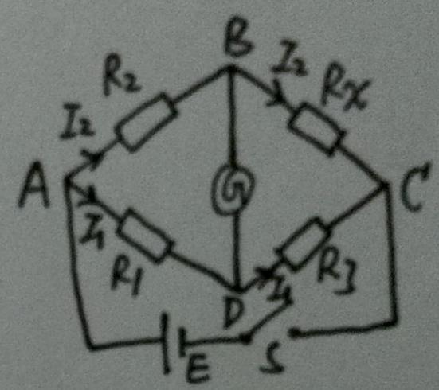

# 2015-2016学年第二学期《物理实验(上)》期末考试复习提要

原件经识别和整理；“参考解答”是我们补的。

## 必考试说明

(1) 题型：选择题、填空题、计算题、作图题

(2) 考试内容：误差理论，以第一次课为主要内容

(3) 复习资料

① 课本《绪论》部分 1-24 页全部内容；
② "实验者根据处理焦点知识梳理"两项纸；
③ 第一次理论课《物理实验(绪论)》PPT 内容；
④ 本学期 7 个实验自处理结果正确表达。

(4) 特别强调

① 读懂题干意思，按要求认真细致规范答题；
② 必须带计算器、铅笔、橡皮擦、刻度尺等。

## 本学期做的 7 个实验

一、迈克尔逊干涉仪的调整和使用 (534)
二、分光计的调节和棱镜顶角的测定 (572)
三、扭摆法测钠体及转动惯量 (427)
四、受迫振动的研究 (429)
五、示波器的调整和使用 (418)
六、双臂电桥测量低电阻 (417)
七、惠斯通电桥测电阻 (416)

## 一、迈克尔逊干涉仪的调整和使用

(1) 公式：

$$\lambda = \frac{1}{N} \cdot 2 \Delta d$$

$$u_{\lambda} = \overline{\lambda} \cdot \sqrt{\left(\frac{u_{N}}{N}\right)^2 + \left(\frac{u_{\Delta d}}{\Delta d}\right)^2}$$

其中 $\frac{u_N}{N} = 1\%$，$u_{B \Delta d} = 0.00005 \text{ mm}$。

$$E_{\lambda} = \frac{|\overline{\lambda} - \lambda_\text{理论}|}{\lambda_\text{理论}} \times 100\%$$

其中 $\lambda_\text{理论} = 632.8 \text{ nm}$。

(2) 求：

$$\left\{\begin{array}{l}\lambda=\overline{\lambda}\pm u_{\lambda}=(638\pm16)\ \text{nm}\\E_{\lambda}=0.9\%\end{array}\right.$$

## 二、分光计的调节和棱镜顶角的测定

(1) 公式：

$$A = \frac{\phi}{2} = \frac{1}{4}\left(10\frac{1}{2} - 9\frac{1}{2} + 10\frac{1}{6} - 9\frac{1}{6}\right)$$

$$U_A = \sqrt{U_{AA}^2 + U_{BA}^2}$$

其中 $U_{BA} = 1'$，

$$U_{AA} = 5 \times \frac{t}{\sqrt{n}} = \sqrt{\frac{1}{3-1} \sum_{i=1}^{3} (A_i - \overline{A})^2} \times 2.48$$

$$E_A = \frac{|\overline{A} - A_\text{标准}|}{A_\text{标准}} \times 100\%$$

(2) 求：

$$\left\{\begin{array}{l} A = \overline{A} \pm U_{A} = 60^{\circ}3' \pm 3' \\ E_{A} = 0.09\% \end{array}\right.$$

## 三、扭摆法测物体转动惯量

(1) 公式：

$$\left\{\begin{array}{l}\text{扭转常数 } k=4 \pi^{2} \frac{I_{1}^{\prime}}{\overline{T}_{1}^{2}-\overline{T}_{0}^{2}} \\ \text{转动惯量理论值 } I_{1}^{\prime}, I_{2}^{\prime}, I_{4}^{\prime}, I_{5}^{\prime}, I^{\prime} \\ \text{转动惯量实验值 } I_{0}, I_{1}, I_{2}, I_{4}, I\end{array}\right.$$

百分差：

| 项目 | 塑料圆柱 | 金属圆筒 | 金属细杆 |
|---|---|---|---|
| 百分差 | 1.0% | 1.5% | 0.5% |

| $x$ (cm) | 5.00 | 10.00 | 15.00 | 20.00 | 25.00 |
|---|---|---|---|---|---|
| 百分差 | 2.7% | 2.3% | 1.4% | 1.5% | 1.5% |

## 四、受迫振动的研究

(1) 公式：

$$\left\{\begin{array}{l} \omega_{0}=2\pi/T_{0} \\ \beta=\frac{\ln(\theta_{mi}/\theta_{mi+5})}{5T} \\ \frac{\omega}{\omega_{0}}=\frac{T_{0}}{T} \end{array}\right.$$

(2) 求：$\beta = 0.0594\ \text{s}^{-1}$

(3) 数据处理：作自由振荡下的 $\theta_m - T$ 曲线图；
作强迫振荡下的一幅频（$\theta_m - \frac{\omega}{\omega_0}$）曲线图；
作强迫振荡下的一幅频（$\phi - \frac{\omega}{\omega_0}$）曲线图。

## 五、示波器的调整和使用

(1) 公式：

$$V_{p} = \frac{V_{p-p}}{2} = \sqrt{2}V$$

$$T = 1/f$$

$$V_{p-p} = D_y \times \text{垂直挡位值}$$

$$T = D_x \times \text{水平挡位值}$$

$$N_x : N_y = f_y : f_x$$

(2) 求：$V$、$T$、利萨如图形

$$\frac{1 \times 1008}{1000 \cdot 000} = (\text{相信差为 } 0^{\circ})$$

## 六、双臂电桥测量低电阻

(1) 公式：

$$R_x = \frac{R}{R_1} R_s$$

$$\rho = \frac{\pi d^2 R_x}{4L}$$

$$U_\rho = \overline{\rho} \sqrt{4\left(\frac{U_d}{d}\right)^2 + \left(\frac{U_{Rx}}{R_x}\right)^2 + \left(\frac{U_L}{L}\right)^2}$$

其中 $U_L = U_{BL} = \Delta_\text{仪} = 0.4\ \text{mm}$，$\frac{U_{Rx}}{R_x} = 0.05\%$，$U_{Bd} = \Delta_\text{仪} = 0.004\ \text{mm}$，

$$U_{Ad} = 5 \times \frac{t}{\sqrt{n}} = \sqrt{\frac{1}{5-1} \sum_{i=1}^{5} (d_i - \overline{d})^2} \times 1.24$$

$$U_d = \sqrt{U_{Ad}^2 + U_{Bd}^2}$$

(2) 求：

$$\left\{\begin{array}{l} R_{x} = \begin{cases} 5.911 \times 10^{-4} \\ 1.179 \times 10^{-3} \end{cases} \ (\text{200.0 mm 长铜棒}) \\ \rho = \bar{\rho} \pm u_{\rho} = (1.7721 \pm 0.0079) \times 10^{-8}\ \Omega\cdot\text{m} \end{array}\right.$$

## 七、惠斯通电桥测电阻

(1) 公式：

$$R_x = \frac{R_2}{R_1} R_3$$

(2) 求：

$$\left\{\begin{array}{l} R_{x1} = 30.6\ \Omega \\ R_{x2} = 1493\ \Omega \end{array}\right.$$

## 相对不确定度、相对误差（百分差）的正确表达

首位有效数字 $\geq 5$，取一位有效数字；
首位有效数字 $< 5$，取两位有效数字。

只可能出现的结果：

|  |  |  |  |  |
|---|---|---|---|---|
| 9% | 4.9% | 0.49% | 0.049% | 0.0049% |
| 8% |  | 0.48% | 0.048% |  |
| 7% | 1.0% |  |  |  |
| 6% | 0.9% | 0.10% | 0.010% |  |
| 5% | 0.8% | 0.09% | 0.009% |  |
|  | 0.7% | 0.08% | 0.008% |  |
|  | 0.6% | 0.07% | 0.007% |  |
|  | 0.5% | 0.06% | 0.006% |  |
|  |  | 0.05% | 0.005% |  |

我们的口号是：

快乐做实验

开心过暑假
