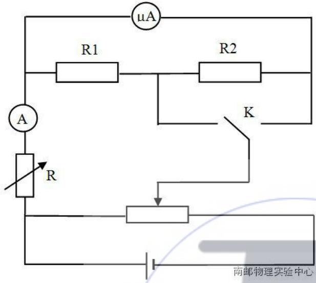
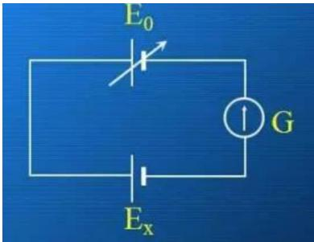

# 南京邮电大学《物理实验》期末实验总结与复习要点

原件经识别和整理；“参考解答”是我们补的。

# 南京邮电大学《物理实验》期末实验总结与复习要点

本资料由识别工具读取并整理，基于学生（“室友”）的实测经验总结。内容涵盖电表改装、等厚干涉、声速测量、电位差计、转动惯量、分光计、介电常数及迈克尔孙干涉仪等实验的考点、操作要点及注意事项。

## 一、电表改装

### 选择 1

**题目背景与要求：**
不用补偿法测 $R_g$，直接给定 $R_g = 2000 \, \Omega$。两个量程改为 $2\text{mA}$ 和 $8\text{mA}$。需要掌握如何改装，并根据给定公式求 $R_1$ 和 $R_2$ 的理论值。

**操作要点：**
1. **电路连接**：老师会在黑板上给出实物图，需根据实物图画电路图。线路连接中滑动变阻器改成了可调电阻 $R$。
   
2. **满偏校准**：对两个量程进行校准，记录 $R_1$ 和 $R_2$ 的实验值。

**知识点：** 电表改装

## 二、等厚干涉（牛顿环）

知识点：[实验报告的内容（含实验内容与步骤等）](../../../topics/大学物理实验/实验报告内容.md)、[直接测量量的有效数字读数原则（游标卡尺、角游标尺、螺旋测微器、数字表头）](../../../topics/大学物理实验/直接测量量读数原则.md)、[有效数字的运算法则（加减运算与乘除运算）](../../../topics/大学物理实验/有效数字运算法则.md)

### 简答 1

**题目：**
牛顿环是等厚干涉还是等倾干涉？

**答案：**
等厚干涉。

知识点：[物理实验课的基本程序（预习、实验进行、写报告）](../../../topics/大学物理实验/实验课基本程序.md)

### 计算 1

**题目与操作：**
1. 给定厚度 $d$ 和波长 $\lambda$，写出光程差公式。
2. 测量第 4、9、14、19、24、29 条暗纹的读数。
3. **数据处理**：不需要作图，直接代入给定公式出结果。无需计算不确定度。
4. **关键步骤**：关键是调出牛顿环，老师可能会检查。通常测量第 5 条和第 15 条暗纹（或类似间隔的两条），利用公式直接计算。

**知识点：** 等厚干涉

## 三、声速测量

知识点：[直接测量量的有效数字读数原则（游标卡尺、角游标尺、螺旋测微器、数字表头）](../../../topics/大学物理实验/直接测量量读数原则.md)、[有效数字的运算法则（加减运算与乘除运算）](../../../topics/大学物理实验/有效数字运算法则.md)、[测量的分类（直接测量与间接测量）](../../../topics/大学物理实验/测量的分类.md)

### 简答 2

**题目：**
发生共振时信号发生器的频率是多少？

**答案：**
约 $37\text{kHz}$ 左右。调节小数点后一两位，注意单位。

知识点：[物理实验课的基本程序（预习、实验进行、写报告）](../../../topics/大学物理实验/实验课基本程序.md)、[测量与单位（含国际单位制重新定义）](../../../topics/大学物理实验/测量与单位.md)

### 计算 2

**题目与操作：**
1. **数据记录**：测四个共振点坐标读数 $L_1, L_2, L_3, L_4$。所有读书记录格式为 $x.xxx\,\text{cm}$（如 $6.688\,\text{cm}$）。
2. **逐差法计算**：
   - 第一个空为 $L_3 - L_1$
   - 第二个空为 $L_4 - L_2$
   - 结果大约在 $0.94$ 左右。
3. **公式推导**：推倒公式 $V = \Delta L \cdot f$。
4. **相位法（李萨如图形）**：调出一个李萨如图形（一三象限或二四象限的直线），记录读数 $L$。

**知识点：** 声速测量

## 四、电位差计实验

知识点：[有效数字的运算法则（加减运算与乘除运算）](../../../topics/大学物理实验/有效数字运算法则.md)、[直接测量量的有效数字读数原则（游标卡尺、角游标尺、螺旋测微器、数字表头）](../../../topics/大学物理实验/直接测量量读数原则.md)、[有效数字的概念与定义](../../../topics/大学物理实验/有效数字概念.md)

### 简答 3

**题目：**
1. 画出补偿法原理图（记得有箭头）。
2. 电源数据很重要，电流记得调至 $0$。

**操作要点：**
1. **校正系数**：随机给某一个校正系数（听说有人做过 2 个，但通常只做一个）。待测电压为 $1.2\text{V}$（随机给）。
2. **数据测量**：测几组实验数据带入公式填表。
3. **公式**：只有三个公式，带进去求一下即可。
4. **不确定度**：没让求不确定度。

**电路图示意：**

**补充说明：**
*   该实验不需要记复杂电路图，连接好电路后测一组数据即可。
*   定标长度要自己背公式计算，待测电动势测出来即可，只有一组数据不求平均值。

**知识点：** 电位差计

## 五、转动惯量（扭摆法）

知识点：[实验报告的内容（含实验内容与步骤等）](../../../topics/大学物理实验/实验报告内容.md)、[直接测量量的有效数字读数原则（游标卡尺、角游标尺、螺旋测微器、数字表头）](../../../topics/大学物理实验/直接测量量读数原则.md)、[有效数字的运算法则（加减运算与乘除运算）](../../../topics/大学物理实验/有效数字运算法则.md)

### 计算 3

**题目与操作：**
1. **测量**：用游标卡尺测量塑料圆柱的直径。
2. **周期测量**：测量空平台的 $10T$ 和加了塑料圆柱的 $10T$。
3. **计算**：
   - 利用圆柱直径 $R$ 和已给出的公式算出转动惯量 $I$。
   - 计算不确定度 $U$（注意计算方法，曾有同学误算为圆柱的不确定度）。
   - 计算扭转系数（有公式）。

**注意：**
此实验比较麻烦，舍友反馈容易出错（GG），需仔细查看不确定度的计算公式。

**知识点：** 转动惯量

## 六、分光计

知识点：[直接测量量的有效数字读数原则（游标卡尺、角游标尺、螺旋测微器、数字表头）](../../../topics/大学物理实验/直接测量量读数原则.md)、[有效数字的运算法则（加减运算与乘除运算）](../../../topics/大学物理实验/有效数字运算法则.md)、[测量的分类（直接测量与间接测量）](../../../topics/大学物理实验/测量的分类.md)

### 简答 4

**操作要点：**
1. **调节**：主要调节前面的平行光管，使光线平行，以及调节俯仰角。前面的和中间的部分不用动。
2. **测量顶角**：使用以前的方法。
3. **公式**：$\theta = \frac{1}{4} (|左 - 左'| + |右 - 右'|)$。
4. **原子光谱**：没听人说考原子光谱，但若有相关题目，绿光的波长应该是已知的。测出一级干涉的“斯塔左”、“斯塔右”数据，代入公式 $d \sin \theta = k \lambda$ 计算光栅常数 $d$。

**知识点：** 分光计

## 七、介电常数

知识点：[实验报告的内容（含实验内容与步骤等）](../../../topics/大学物理实验/实验报告内容.md)、[测量的分类（直接测量与间接测量）](../../../topics/大学物理实验/测量的分类.md)

### 计算 4

**题目与操作：**
1. **考核范围**：只考图解法求空气的介电常数。测量初始厚度和薄片厚度，不考薄片的介电常数。
2. **步骤**：
   - 记录下本来的误差。
   - 测 5 组 $D$（电容值），误差自己算进去，$D$ 的大小试卷说了算。
   - 作图 $1/D - C$。
   - 求出斜率 $k$，除以 $S$（面积）就是要求的介电常数 $\varepsilon_r$（大概 $8.4\,\text{pF/m}$，此处单位可能指代数值关系，具体依公式而定）。

**知识点：** 介电常数

## 八、迈克尔孙干涉仪

知识点：[有效数字的运算法则（加减运算与乘除运算）](../../../topics/大学物理实验/有效数字运算法则.md)

### 简答 5

**操作要点：**
1. **读数**：迈克尔孙有三个刻度盘要读，一定别忘了。
2. **调节**：最重要的是调出干涉条纹和读对数。老师到时候会改读的环数（按照试卷来）。
3. **数据记录**：
   - 先画迈克尔孙光路图（5分）。
   - 调出图，老师检查（10分）。
   - 表格填写（15分）：实验时通常是每 100 数一条，这次只要 30。
   - 波长计算（10分）：波长公式已给出。
4. **仪器状态**：最后写好了，老师还要看仪器转旋钮时波纹动不动，如果不动，把试卷交了就结束。

**知识点：** 迈克尔孙干涉仪

知识点：[直接测量量的有效数字读数原则（游标卡尺、角游标尺、螺旋测微器、数字表头）](../../../topics/大学物理实验/直接测量量读数原则.md)、[实验报告的内容（含实验内容与步骤等）](../../../topics/大学物理实验/实验报告内容.md)、[有效数字的运算法则（加减运算与乘除运算）](../../../topics/大学物理实验/有效数字运算法则.md)
