# 《大学物理实验》绪论（课件）

原件的每一页，下面附识别出的文字。

### 大学物理实验绪论

原文：

大学物理实验绪论

迟逢逢

邮箱：ffchi@njupt.edu.cn

大学物理实验绪论

### 第一部分物理实验课的基本程序

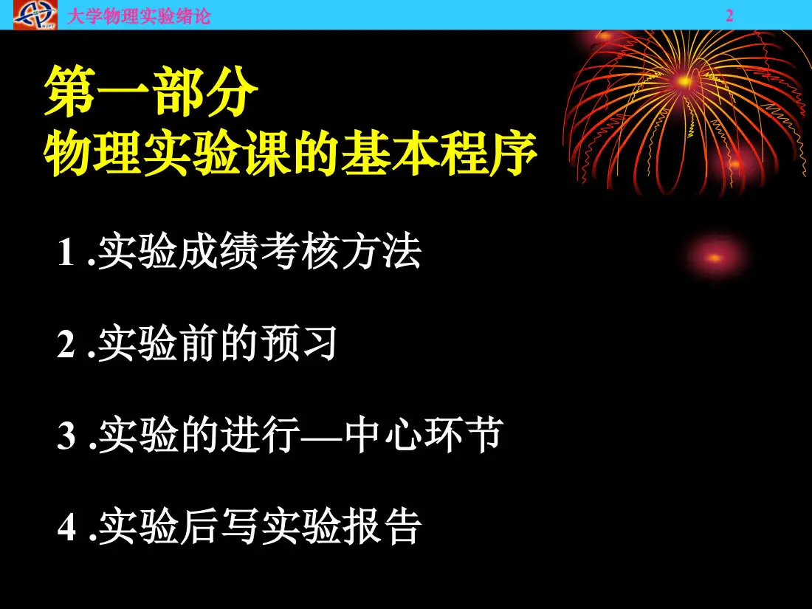

原文：

第一部分物理实验课的基本程序

1 .实验成绩考核方法

2 .实验前的预习

3 .实验的进行—中心环节

4 .实验后写实验报告

大学物理实验绪论

### 1 .成绩考核

原文：

1 .成绩考核

占比：1、期末考试40%，笔试，内容：误差理论+具体实验

2、平时成绩60%，主要考核实验操作，实验报告实验素养纪律等

实验规范：

1、要求课前带预习报告到课堂

2、不迟到，不旷课，学生按照学号就坐，

3、课堂秩序井然，做完实验要收拾并保持仪器桌面整洁

4、不抄袭数据或实验报告

5、按时在下次课前交报告(按照学号排好)

6、缺课补课需要跟班重新上课，并老师签字认可

7、实践周不停课，确实需要调整的需要提前和老师沟通

大学物理实验绪论

### 2 .实验前的预习完成预习报告内容：

原文：

2 .实验前的预习完成预习报告内容：

①实验名称；

②实验目的；

③实验仪器 (型号、规格等) ；

④实验原理：在理解的基础上，用简短的文字扼要阐述实验原理，切忌照抄。包含主要原理公式及简要说明，画出必要的原理图、电路图或光路图；

未预习或未写好预习报告者，老师有权

停止其实验或实验成绩降一档！

大学物理实验绪论

### 3 .实验的进行—中心环节

原文：

3 .实验的进行—中心环节

老师检查预习报告

交上次实验报告(班长收齐，按学号排好)

听老师讲解实验原理及注意事项等

按操作规程使用仪器，禁止私自搬挪调换仪器

如实记录实验原始数据，数据记录在实验报告的原

始数据记录页面上（在实验报告的最后一页）

原始数据必须给教师审阅后签字！离开实验室前，

要整理好所用的实验仪器，做好清洁工作。

大学物理实验绪论

### 4、实验后写实验报告

原文：

4、实验后写实验报告

要养成按时处理实验数据和交报告的习惯，对原始数据进行处理和分析，得出实验结果并进行不确定度评估和讨论。

大学物理实验绪论

### 实验报告的内容包括：

原文：

实验报告的内容包括：

1、 实验名称

2、实验目的

3、实验仪器

4、实验原理

5、实验内容与步骤

6、实验数据记录及处理

7、讨论与分析。

此部分在实验前进行（预习报告）

此部分在实验后进行，

紧接着“实验原理”写

大学物理实验绪论

### 实验内容与步骤：

原文：

实验内容与步骤：

重点写出“做什么，怎么做”实验数据记录及处理：

(1)重新规范合理地画出正式数据的表格

（应与“原始数据的记录表格”不同）

(2)实验数据处理结果要求写在实验报告册的“

实验数据处理”页面上

大学物理实验绪论

### 物理实验教学中心2023/2024学年第二学期教师安排表

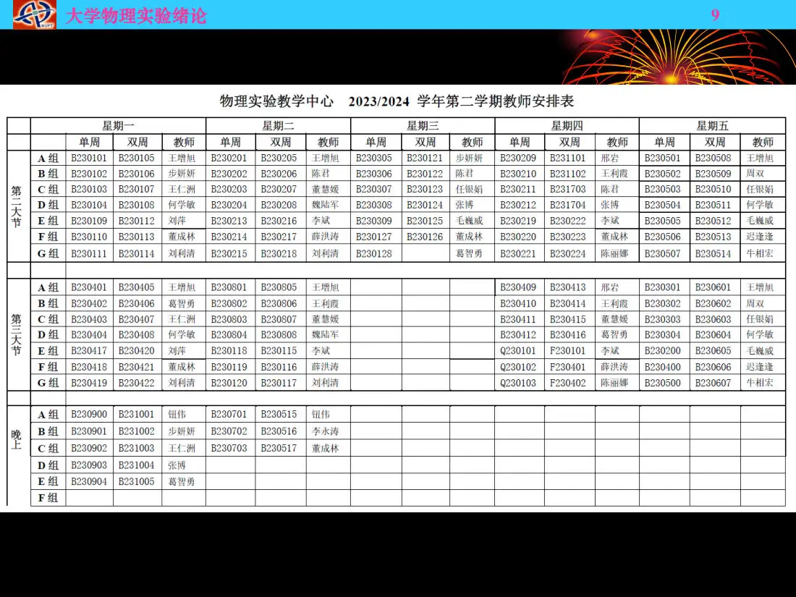

原文：

物理实验教学中心2023/2024学年第二学期教师安排表
<table><tr><td></td><td colspan="4">星期一</td><td colspan="3">星期二</td><td colspan="3">星期三</td><td colspan="3">星期四</td><td colspan="3">星期五</td></tr><tr><td></td><td></td><td>单周</td><td>双周</td><td>教师</td><td>单周</td><td>双周</td><td>教师</td><td>单周</td><td>双周</td><td>教师</td><td>单周</td><td>双周</td><td>教师</td><td>单周</td><td>双周</td><td>教师</td></tr><tr><td rowspan="7">第二节</td><td>A组</td><td>B230101</td><td>B230105</td><td>王增旭</td><td>B230201</td><td>B230205</td><td>王增旭</td><td>B230305</td><td>B230121</td><td>步妍妍</td><td>B230209</td><td>B231101</td><td>邢岩</td><td>B230501</td><td>B230508</td><td>王增旭</td></tr><tr><td>B组</td><td>B230102</td><td>B230106</td><td>步妍妍</td><td>B230202</td><td>B230206</td><td>陈君</td><td>B230306</td><td>B230122</td><td>陈君</td><td>B230210</td><td>B231102</td><td>王利霞</td><td>B230502</td><td>B230509</td><td>周双</td></tr><tr><td>C组</td><td>B230103</td><td>B230107</td><td>王仁洲</td><td>B230203</td><td>B230207</td><td>董慧媛</td><td>B230307</td><td>B230123</td><td>任银娟</td><td>B230211</td><td>B231703</td><td>陈君</td><td>B230503</td><td>B230510</td><td>任银娟</td></tr><tr><td>D组</td><td>B230104</td><td>B230108</td><td>何学敏</td><td>B230204</td><td>B230208</td><td>魏陆军</td><td>B230308</td><td>B230124</td><td>张博</td><td>B230212</td><td>B231704</td><td>张博</td><td>B230504</td><td>B230511</td><td>何学敏</td></tr><tr><td>E组</td><td>B230109</td><td>B230112</td><td>刘萍</td><td>B230213</td><td>B230216</td><td>李斌</td><td>B230309</td><td>B230125</td><td>毛巍威</td><td>B230219</td><td>B230222</td><td>李斌</td><td>B230505</td><td>B230512</td><td>毛巍威</td></tr><tr><td>F组</td><td>B230110</td><td>B230113</td><td>董成林</td><td>B230214</td><td>B230217</td><td>薛洪涛</td><td>B230127</td><td>B230126</td><td>董成林</td><td>B230220</td><td>B230223</td><td>董成林</td><td>B230506</td><td>B230513</td><td>迟逢逢</td></tr><tr><td>G组</td><td>B230111</td><td>B230114</td><td>刘利清</td><td>B230215</td><td>B230218</td><td>刘利清</td><td>B230128</td><td></td><td>葛智勇</td><td>B230221</td><td>B230224</td><td>陈丽娜</td><td>B230507</td><td>B230514</td><td>牛相宏</td></tr><tr><td></td><td></td><td colspan="15"></td></tr><tr><td rowspan="7">第三节</td><td>A组</td><td>B230401</td><td>B230405</td><td>王增旭</td><td>B230801</td><td>B230805</td><td>王增旭</td><td></td><td></td><td></td><td>B230409</td><td>B230413</td><td>邢岩</td><td>B230301</td><td>B230601</td><td>王增旭</td></tr><tr><td>B组</td><td>B230402</td><td>B230406</td><td>葛智勇</td><td>B230802</td><td>B230806</td><td>王利霞</td><td></td><td></td><td></td><td>B230410</td><td>B230414</td><td>王利霞</td><td>B230302</td><td>B230602</td><td>周双</td></tr><tr><td>C组</td><td>B230403</td><td>B230407</td><td>王仁洲</td><td>B230803</td><td>B230807</td><td>董慧媛</td><td></td><td></td><td></td><td>B230411</td><td>B230415</td><td>董慧媛</td><td>B230303</td><td>B230603</td><td>任银娟</td></tr><tr><td>D组</td><td>B230404</td><td>B230408</td><td>何学敏</td><td>B230804</td><td>B230808</td><td>魏陆军</td><td></td><td></td><td></td><td>B230412</td><td>B230416</td><td>葛智勇</td><td>B230304</td><td>B230604</td><td>何学敏</td></tr><tr><td>E组</td><td>B230417</td><td>B230420</td><td>刘萍</td><td>B230118</td><td>B230115</td><td>李斌</td><td></td><td></td><td></td><td>Q230101</td><td>F230101</td><td>李斌</td><td>B230200</td><td>B230605</td><td>毛巍威</td></tr><tr><td>F组</td><td>B230418</td><td>B230421</td><td>董成林</td><td>B230119</td><td>B230116</td><td>薛洪涛</td><td></td><td></td><td></td><td>Q230102</td><td>F230401</td><td>薛洪涛</td><td>B230400</td><td>B230606</td><td>迟逢逢</td></tr><tr><td>G组</td><td>B230419</td><td>B230422</td><td>刘利清</td><td>B230120</td><td>B230117</td><td>刘利清</td><td></td><td></td><td></td><td>Q230103</td><td>F230402</td><td>陈丽娜</td><td>B230500</td><td>B230607</td><td>牛相宏</td></tr><tr><td></td><td></td><td colspan="15"></td></tr><tr><td rowspan="6">晚上</td><td>A组</td><td>B230900</td><td>B231001</td><td>钮伟</td><td>B230701</td><td>B230515</td><td>钮伟</td><td></td><td></td><td></td><td></td><td></td><td></td><td></td><td></td><td></td></tr><tr><td>B组</td><td>B230901</td><td>B231002</td><td>步妍妍</td><td>B230702</td><td>B230516</td><td>李永涛</td><td></td><td></td><td></td><td></td><td></td><td></td><td></td><td></td><td></td></tr><tr><td>C组</td><td>B230902</td><td>B231003</td><td>王仁洲</td><td>B230703</td><td>B230517</td><td>董成林</td><td></td><td></td><td></td><td></td><td></td><td></td><td></td><td></td><td></td></tr><tr><td>D组</td><td>B230903</td><td>B231004</td><td>张博</td><td></td><td></td><td></td><td></td><td></td><td></td><td></td><td></td><td></td><td></td><td></td><td></td></tr><tr><td>E组</td><td>B230904</td><td>B231005</td><td>葛智勇</td><td></td><td></td><td></td><td></td><td></td><td></td><td></td><td></td><td></td><td></td><td></td><td></td></tr><tr><td>F组</td><td></td><td></td><td></td><td></td><td></td><td></td><td></td><td></td><td></td><td></td><td></td><td></td><td></td><td></td><td></td></tr></table>

大学物理实验绪论

### 二. 实验内容：

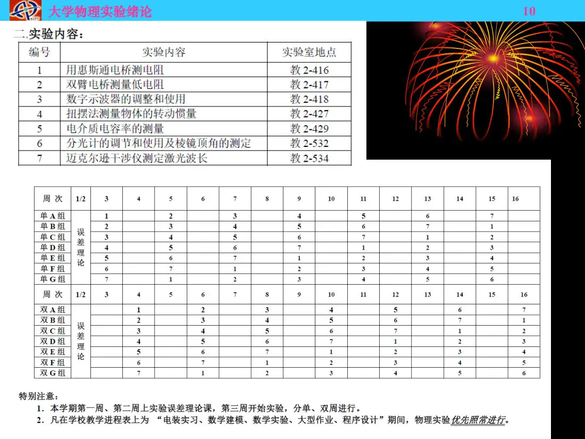

原文：

二. 实验内容：

<table><tr><td>编号</td><td>实验内容</td><td>实验室地点</td></tr><tr><td>1</td><td>用惠斯通电桥测电阻</td><td>教2-416</td></tr><tr><td>2</td><td>双臂电桥测量低电阻</td><td>教2-417</td></tr><tr><td>3</td><td>数字示波器的调整和使用</td><td>教2-418</td></tr><tr><td>4</td><td>扭摆法测量物体的转动惯量</td><td>教2-427</td></tr><tr><td>5</td><td>电介质电容率的测量</td><td>教2-429</td></tr><tr><td>6</td><td>分光计的调节和使用及棱镜顶角的测定</td><td>教2-532</td></tr><tr><td>7</td><td>迈克尔逊干涉仪测定激光波长</td><td>教2-534</td></tr></table>

<table><tr><td>周次</td><td>1/2</td><td>3</td><td>4</td><td>5</td><td>6</td><td>7</td><td>8</td><td>9</td><td>10</td><td>11</td><td>12</td><td>13</td><td>14</td><td>15</td><td>16</td></tr><tr><td>单A组</td><td rowspan="7">误差理论</td><td>1</td><td></td><td>2</td><td></td><td>3</td><td></td><td>4</td><td></td><td>5</td><td></td><td>6</td><td></td><td>7</td><td></td></tr><tr><td>单B组</td><td>2</td><td></td><td>3</td><td></td><td>4</td><td></td><td>5</td><td></td><td>6</td><td></td><td>7</td><td></td><td>1</td><td></td></tr><tr><td>单C组</td><td>3</td><td></td><td>4</td><td></td><td>5</td><td></td><td>6</td><td></td><td>7</td><td></td><td>1</td><td></td><td>2</td><td></td></tr><tr><td>单D组</td><td>4</td><td></td><td>5</td><td></td><td>6</td><td></td><td>7</td><td></td><td>1</td><td></td><td>2</td><td></td><td>3</td><td></td></tr><tr><td>单E组</td><td>5</td><td></td><td>6</td><td></td><td>7</td><td></td><td>1</td><td></td><td>2</td><td></td><td>3</td><td></td><td>4</td><td></td></tr><tr><td>单F组</td><td>6</td><td></td><td>7</td><td></td><td>1</td><td></td><td>2</td><td></td><td>3</td><td></td><td>4</td><td></td><td>5</td><td></td></tr><tr><td>单G组</td><td>7</td><td></td><td>1</td><td></td><td>2</td><td></td><td>3</td><td></td><td>4</td><td></td><td>5</td><td></td><td>6</td><td></td></tr><tr><td>周次</td><td>1/2</td><td>3</td><td>4</td><td>5</td><td>6</td><td>7</td><td>8</td><td>9</td><td>10</td><td>11</td><td>12</td><td>13</td><td>14</td><td>15</td><td>16</td></tr><tr><td>双A组</td><td rowspan="7">误差理论</td><td></td><td>1</td><td></td><td>2</td><td></td><td>3</td><td></td><td>4</td><td></td><td>5</td><td></td><td>6</td><td></td><td>7</td></tr><tr><td>双B组</td><td></td><td>2</td><td></td><td>3</td><td></td><td>4</td><td></td><td>5</td><td></td><td>6</td><td></td><td>7</td><td></td><td>1</td></tr><tr><td>双C组</td><td></td><td>3</td><td></td><td>4</td><td></td><td>5</td><td></td><td>6</td><td></td><td>7</td><td></td><td>1</td><td></td><td>2</td></tr><tr><td>双D组</td><td></td><td>4</td><td></td><td>5</td><td></td><td>6</td><td></td><td>7</td><td></td><td>1</td><td></td><td>2</td><td></td><td>3</td></tr><tr><td>双E组</td><td></td><td>5</td><td></td><td>6</td><td></td><td>7</td><td></td><td>1</td><td></td><td>2</td><td></td><td>3</td><td></td><td>4</td></tr><tr><td>双F组</td><td></td><td>6</td><td></td><td>7</td><td></td><td>1</td><td></td><td>2</td><td></td><td>3</td><td></td><td>4</td><td></td><td>5</td></tr><tr><td>双G组</td><td></td><td>7</td><td></td><td>1</td><td></td><td>2</td><td></td><td>3</td><td></td><td>4</td><td></td><td>5</td><td></td><td>6</td></tr></table>
特别注意： 1. 本学期第一周、第二周上实验误差理论课，第三周开始实验，分单、双周进行。 2. 凡在学校教学进程表上为“电装实习、数学建模、数学实验、大型作业、程序设计”期间，物理实验优先照常进行。

大学物理实验绪论

10

### 第二部分

原文：

第二部分

测量误差与不确定度评定

大学物理实验绪论

### 一、测量与单位

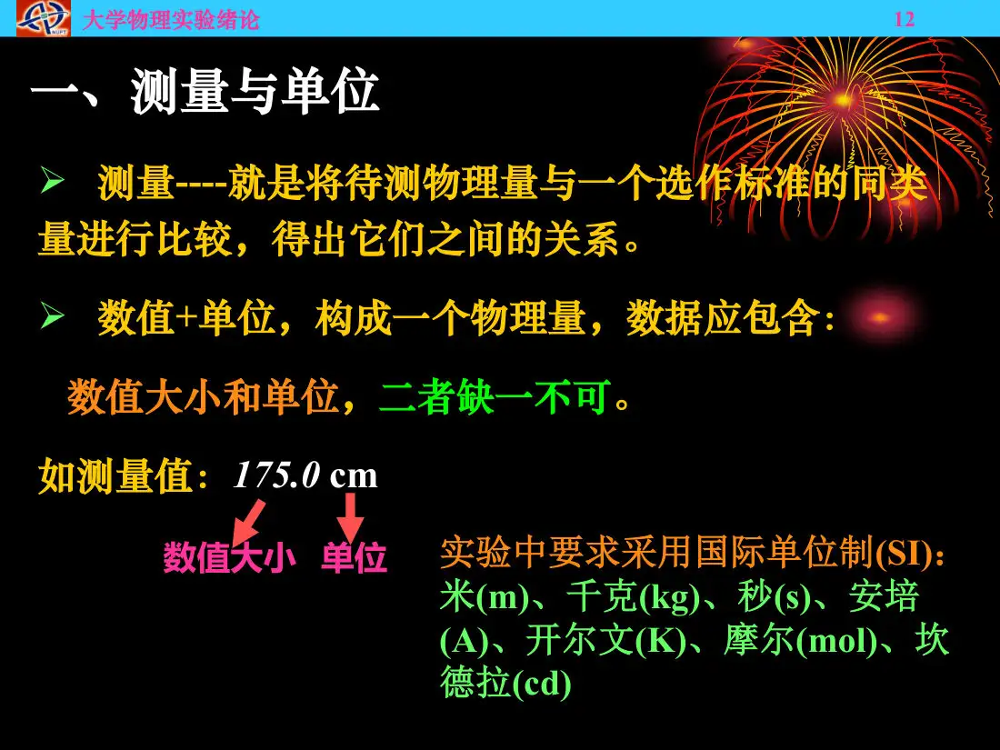

原文：

一、测量与单位

测量----就是将待测物理量与一个选作标准的同类量进行比较，得出它们之间的关系。

数值+单位，构成一个物理量，数据应包含：数值大小和单位，二者缺一不可。

如测量值：175.0 cm

数值大小 单位

实验中要求采用国际单位制(SI)：米(m)、千克(kg)、秒(s)、安培(A)、开尔文(K)、摩尔(mol)、坎德拉(cd)

大学物理实验绪论

12

### 国际单位制重新定义

原文：

国际单位制重新定义

2018年11月16日，第26届国际计量大会通过了关于修订国际单位制的决议。国际单位制七个基本单位中的四个，即质量单位“千克”、电流单位“安培”热力学温度单位“开尔文”和物质的量单位“摩尔”将分别改由普朗克常数、基本电荷、玻尔兹曼常数和阿伏伽德罗常数来定义；另外三个基本单位，即时间单位“秒”、长度单位“米”和发光强度单位“坎德拉”的定义将保持不变，但是定义的表达方式会有一定改变，以与修订后的四个基本单位的新定义表达方式保持一致。

自此，七个基本单位将全部通过不变的自然常数来定义，用这些不变的常数作为测量基础，意味着这些单位的定义在未来也是可靠的、不变的。

中国计量科学研究院 https://www.nim.ac.cn/520/node/3.html

大学物理实验绪论

13

### 二、测量的分类

原文：

二、测量的分类

按测量过程分：

直接测量

间接测量

直接测量----将待测量与定标的测量仪器或量具比较，直接读出待测物理量的量值。

间接测量----有些无法用仪表或量具直接测量的物理量只能通过对一些相关物理量的直接测量，再通过这些物理量间的一定的函数关系求出待测量的大小。

大学物理实验绪论

14

### 例：测量圆柱体的密度

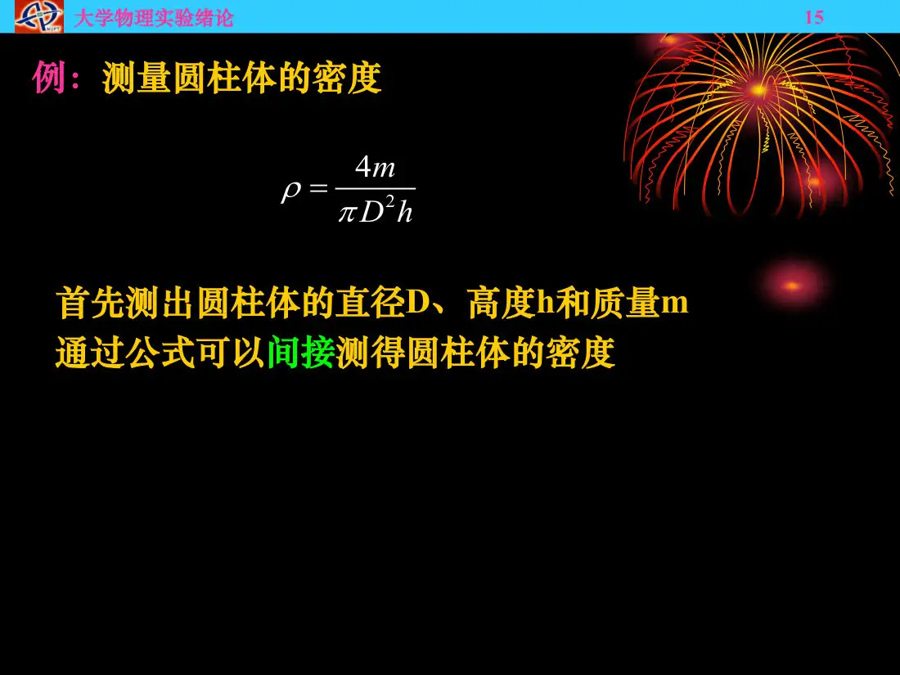

原文：

例：测量圆柱体的密度

$$
\rho = \frac {4 m}{\pi D ^ {2} h}
$$

首先测出圆柱体的直径D、高度h和质量m通过公式可以间接测得圆柱体的密度

大学物理实验绪论

### 三、有效数字的概念

原文：

三、有效数字的概念

测量值存在误差是不可避免的，因而测量值包含了准确数字和欠准数字。 我们将准确数字和欠准数字总称为有效数字。

在大学物理实验中，通常只取一位欠准数字。因此有效数字由若干位准确数字和一位欠准数字组成。

有效数字不仅反映了待测量的大小，正确书写的有效数字还可以反映测量的精确程度。

大学物理实验绪论

16

### 1).有效数字定义：

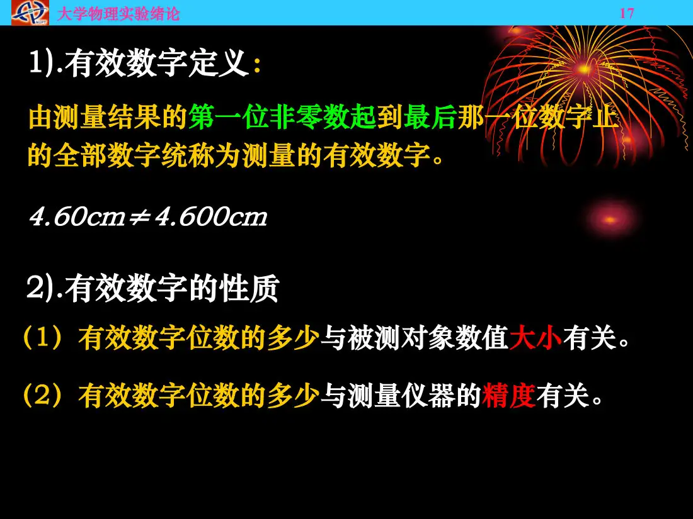

原文：

1).有效数字定义：

由测量结果的第一位非零数起到最后那一位数字止的全部数字统称为测量的有效数字。

4.60cm≠4.600cm

2).有效数字的性质

（1）有效数字位数的多少与被测对象数值大小有关。

（2）有效数字位数的多少与测量仪器的精度有关。

大学物理实验绪论

17

### 例如：用不同精度的量具测同一物体的长度。

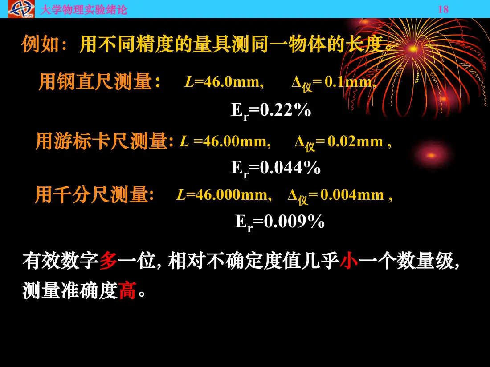

原文：

例如：用不同精度的量具测同一物体的长度。

用钢直尺测量： $1 0 0 \div 1 0 0 0 0 0 0 0$ $\Delta x = 0$ .1mm,

$$
\mathrm{E} _ {\mathrm{r}} = 0.22 \%
$$

用游标卡尺测量: $1 0 0 = 1 0 0 0 0 0 0 0 0 0$ $\scriptstyle \mathbf { A } = ( 1 , \mathbf { A } ) = \mathbf { A } ( 1 , \mathbf { A } ) = \mathbf { A }$ $1 0 0 = 1 1 0 0 ( c m )$

用千分尺测量: $1 0 = 1 0 0 0 0 0 0 0 0 0 0$ $\pmb { \mathrm { A } } \pmb { \mathrm { v } } \pmb { \mathrm { = } } \pmb { \mathrm { ( 1 ) } } \pmb { \mathrm { ( 1 ) } } \pmb { \mathrm { ( 1 ) } } \pmb { \mathrm { ( 1 ) } } \pmb { \mathrm { ( 1 ) } } \pmb { \mathrm { ( 1 ) } }$ $1 0 0 = ( 1 1 1 1 ) \times 2 = 1 1 0 ( 1 )$

有效数字多一位, 相对不确定度值几乎小一个数量级,测量准确度高。

大学物理实验绪论

18

### （3）有效数字位数与小数点的位置、单位换算无关。

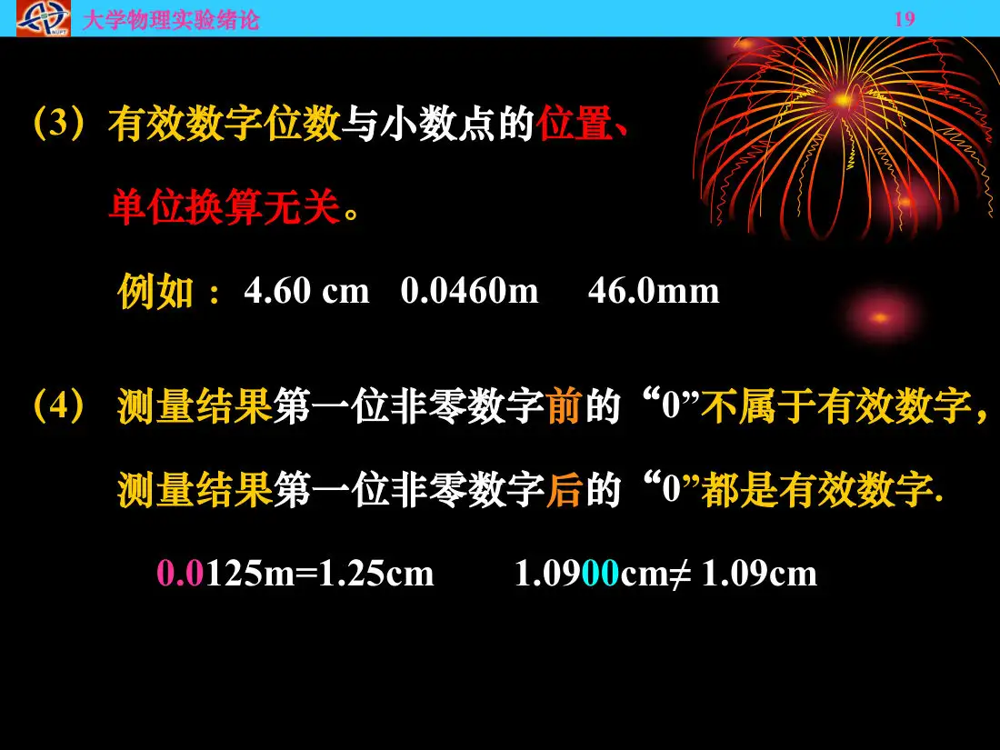

原文：

（3）有效数字位数与小数点的位置、单位换算无关。

例如 ：4.60 cm 0.0460m 46.0mm

（4） 测量结果第一位非零数字前的 $\mathcal { G }$ 不属于有效数字，测量结果第一位非零数字后的 $\textcircled { 1 }$ 都是有效数字.

0.0125m=1.25cm 1.0900cm≠ 1.09cm

大学物理实验绪论

### 3). 科学记数法

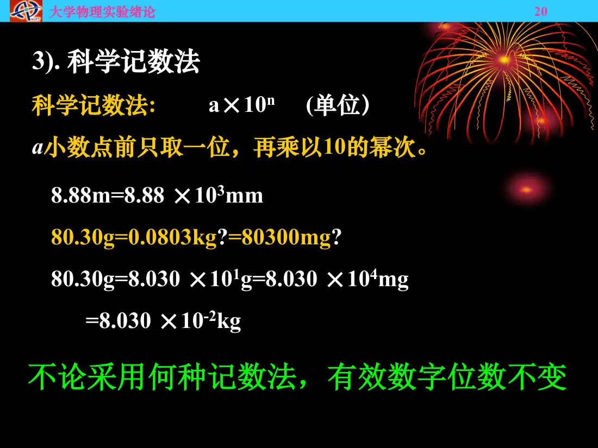

原文：

3). 科学记数法

科学记数法: $\bf \delta Q \bf \delta m ^ { \mathrm { B } }$ (单位）

a小数点前只取一位，再乘以10的幂次。

$1 0 0 \times 2 0 = 1 1 1 1 1 0 ( c m ^ { 3 } )$ $( 3 ) 3 . 1 1 \div ( 1 ) ( 1 + 2 ) ( 1 8 ) \cdots ( 3 ) ( 1 8 ) ( 1 1 ) ( 1 1 ) ( 2 )$ $( 1 ) A ^ { \prime } ( 1 ) = A ^ { \prime } ( 1 ) A ^ { \prime } ( 1 ) = A ^ { \prime } ( 1 ) A ^ { \prime } ( 1 ) = A ^ { \prime } ( 1 ) A ^ { \prime } ( 1 ) = A ^ { \prime } ( 1 ) B ^ { \prime } ( 1 ) = A ^ { \prime } ( 1 ) B ^ { \prime } ( 1 ) = 0$ $\mathbf { 0 . 8 0 1 8 1 0 8 3 6 } \mathbf { 0 . 2 } \mathbf { 1 . 0 } \mathbf { 1 . 0 } = \mathbf { 0 . 0 }$

不论采用何种记数法，有效数字位数不变

大学物理实验绪论

### 4). 有效数字的修约规则

原文：

4). 有效数字的修约规则

•根据GB8017-87规定的数值修约规则，测量结果尾数的修约原则是：四舍六入五凑偶。

• 即小于5者舍，大于5者入，等于5者把尾数凑成偶数。(5后非零则进1，5后全零凑成偶)

五凑偶是对4舍6入的补充,说的是尾数的第一位是5的情况，（1）5后全是0,看5前面的一位数,若是奇数,则加1凑偶,若是偶数,则舍去5，（2）若5后非0,则进1

21

大学物理实验绪论

### 例题:2.49999保留一位有效数字。

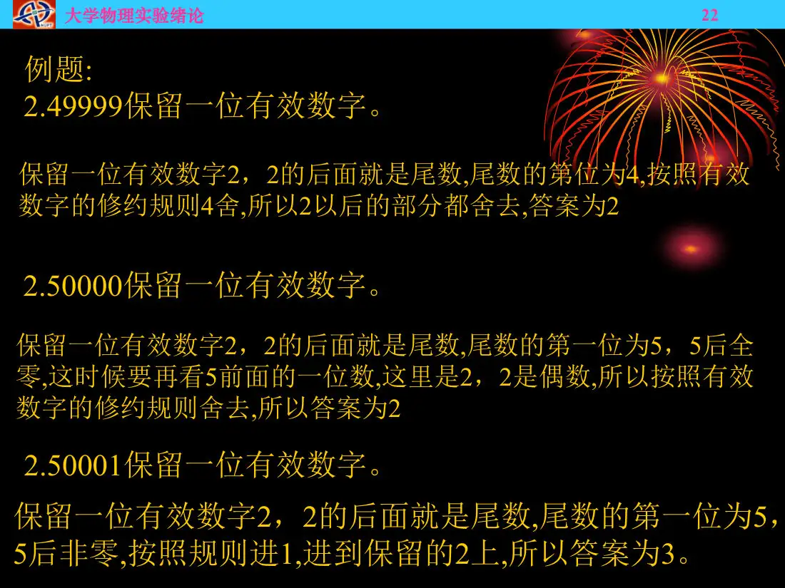

原文：

例题:2.49999保留一位有效数字。

保留一位有效数字2，2的后面就是尾数,尾数的第位为4,按照有效数字的修约规则4舍,所以2以后的部分都舍去,答案为2

2.50000保留一位有效数字。

保留一位有效数字2，2的后面就是尾数,尾数的第一位为5，5后全零,这时候要再看5前面的一位数,这里是2，2是偶数,所以按照有效数字的修约规则舍去,所以答案为2

2.50001保留一位有效数字。

保留一位有效数字2，2的后面就是尾数,尾数的第一位为5，5后非零,按照规则进1,进到保留的2上,所以答案为3。

大学物理实验绪论

22

### 6.28271 取4位有效数字为 6.283

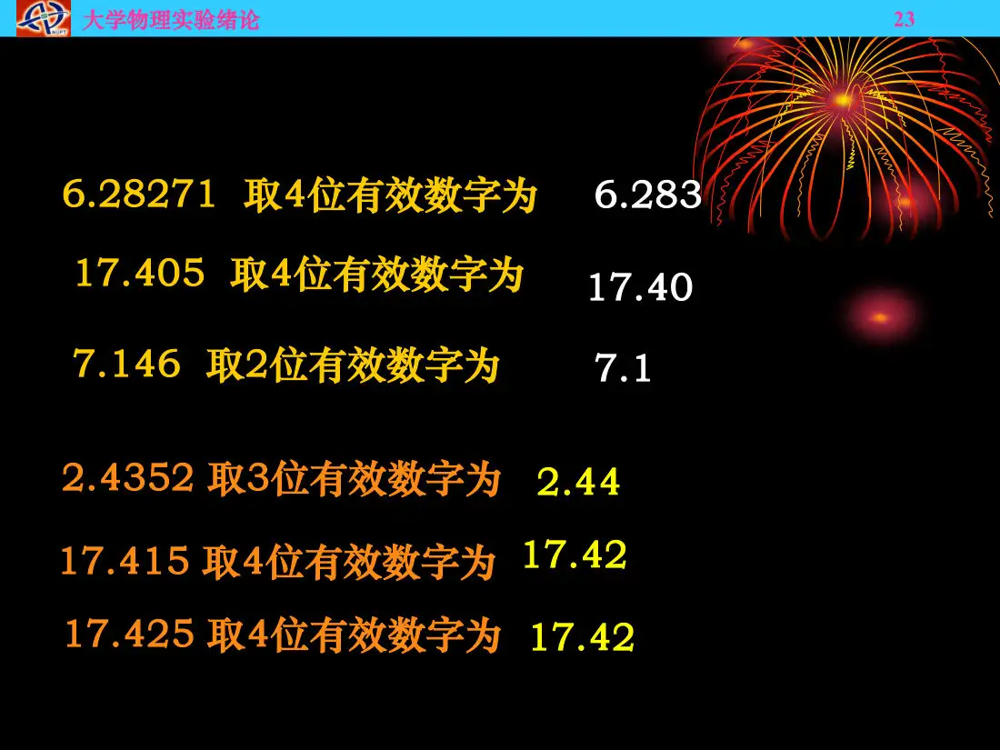

原文：

6.28271 取4位有效数字为 6.283
17.405 取4位有效数字为 17.40
7.146 取2位有效数字为 7.1
2.4352 取3位有效数字为 2.44
17.415 取4位有效数字为 17.42
17.425 取4位有效数字为 17.42

23

大学物理实验绪论

### 5).有效数字的运算法则(选讲)

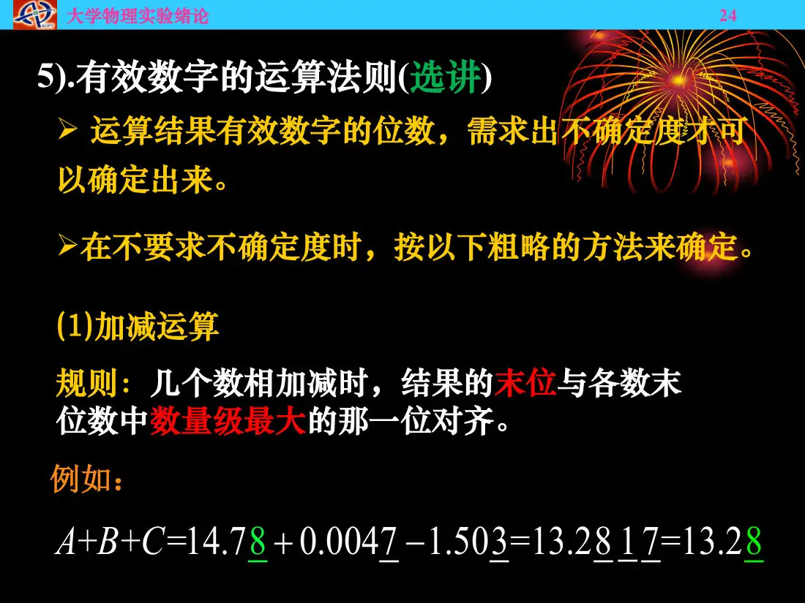

原文：

5).有效数字的运算法则(选讲)

运算结果有效数字的位数，需求出以确定出来。

在不要求不确定度时，按以下粗略的方法来确定。

(1)加减运算

规则：几个数相加减时，结果的末位与各数末位数中数量级最大的那一位对齐。

例如：

A B C + + =14.7 0.0047 1.503=13.28 1 7= . 8 + − 13 28

24

大学物理实验绪论

### (2)乘除运算

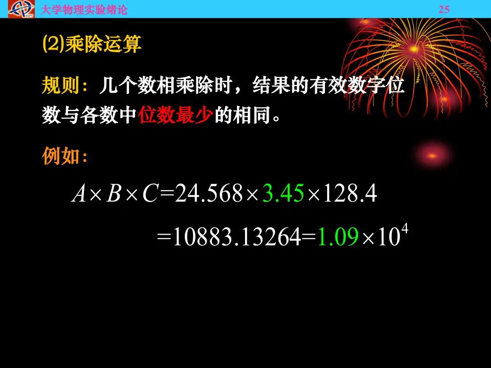

原文：

(2)乘除运算

规则：几个数相乘除时，结果的有效数字位数与各数中位数最少的相同。

例如：

=24.568 128.43.45A B C× × × × 4=10883.13264=1.09 10×

大学物理实验绪论

25

### 有效数字及其运算

原文：

有效数字及其运算

总的原则：抓两头，简化中间。

开始测量时：测量的有效数字位数不能少。

结尾结果表达时：有效数字位数要根据

不确定度规则修约。

中间计算过程：由于计算器的普及，可以不考虑

有效数字的位数。

大学物理实验绪论

26

### 6)、直接测量量的有效数字读数原则

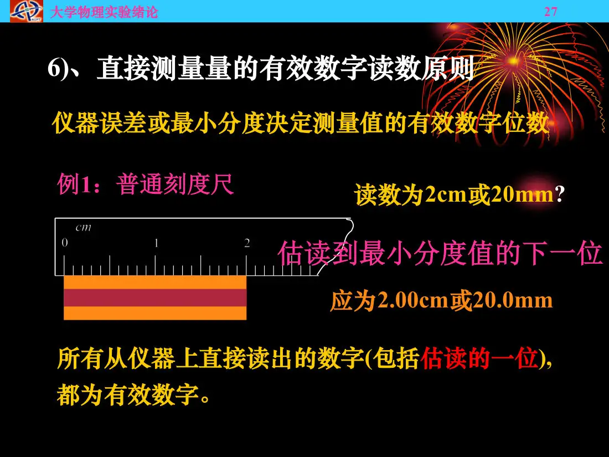

原文：

6)、直接测量量的有效数字读数原则

仪器误差或最小分度决定测量值的有效数字位数

例1：普通刻度尺

读数为2cm或20mm?

估读到最小分度值的下一位

应为2.00cm或20.0mm

所有从仪器上直接读出的数字(包括估读的一位),都为有效数字。

大学物理实验绪论

27

### 例2：角游标尺

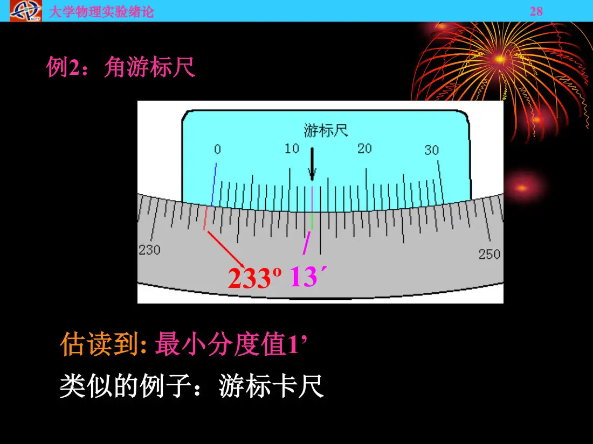

原文：

例2：角游标尺

估读到: 最小分度值1’类似的例子：游标卡尺

28

大学物理实验绪论

### 大学物理实验绪论

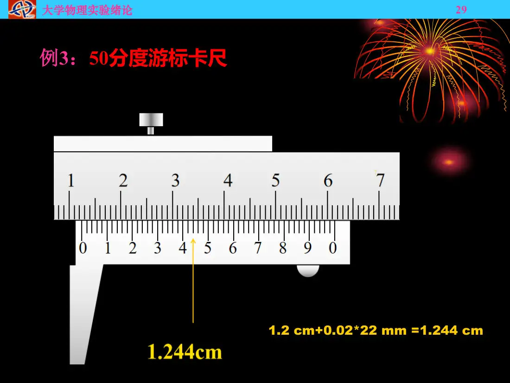

原文：

大学物理实验绪论

### 例4：数字表头的读数

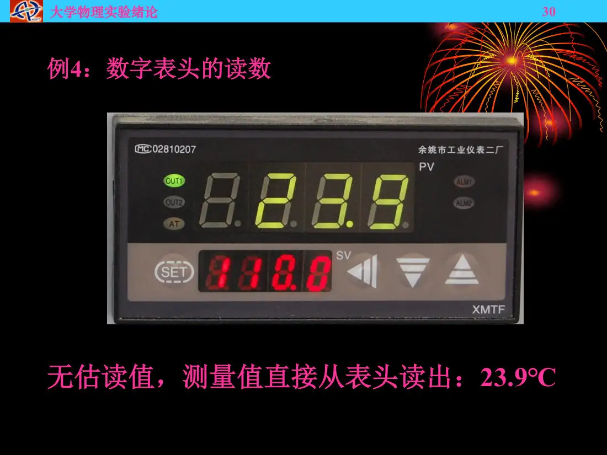

原文：

例4：数字表头的读数

MC02810207

OUT2 8.8.8.8 188.01

无估读值，测量值直接从表头读出：23.9℃

大学物理实验绪论

### 四、误差与不确定度

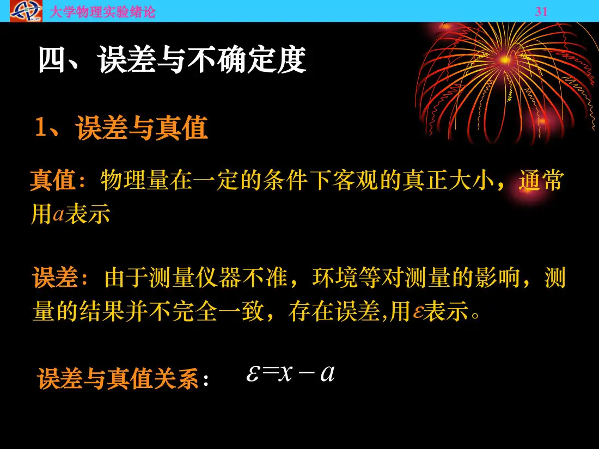

原文：

四、误差与不确定度

1、误差与真值

真值：物理量在一定的条件下客观的真正大小，通常用a表示

误差：由于测量仪器不准，环境等对测量的影响，测量的结果并不完全一致，存在误差,用ε表示。

误差与真值关系： $\circledast$

大学物理实验绪论

### 2、误差的分类

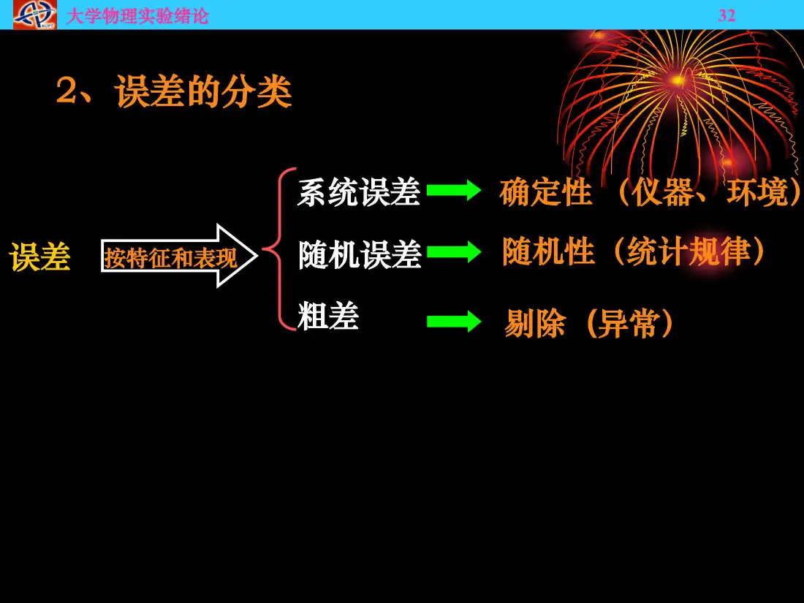

原文：

2、误差的分类

误差 按特征和表现

系统误差

随机误差

粗差

确定性 （仪器、环境）

随机性 （统计规律）

剔除 (异常）

大学物理实验绪论

### 3、不确定度

原文：

3、不确定度

1981年10月第十七届国际计量委员会大会通过决议，建议采用“不确定度”作为测量结果正确程度的评价。

★不确定度表示测量值可能变动（不能确定）的范围，

不确定度的分类 ：

1）直接测量量不确定度：分为A类和B类

2）间接测量量不确定度：由换算公式计算而得

大学物理实验绪论

### 3-1 直接测量结果不确定度

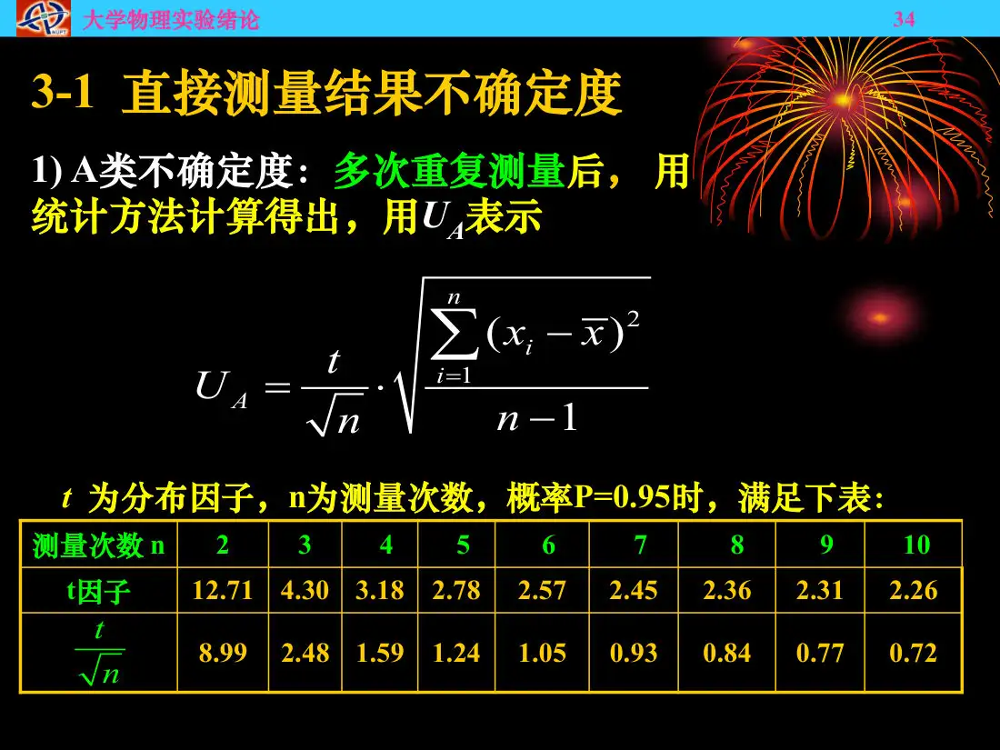

原文：

3-1 直接测量结果不确定度

1) A类不确定度：多次重复测量后， 用统计方法计算得出，用 $\textcircled { 1 } \textcircled { \cdot }$ 表示

$$
U _ {A} = \frac {t}{\sqrt {n}} \cdot \sqrt {\frac {\sum_ {i = 1} ^ {n} (x _ {i} - \overline {{x}}) ^ {2}}{n - 1}}
$$

t 为分布因子，n为测量次数，概率P=0.95时，满足下表：

<table><tr><td>测量次数 n</td><td>2</td><td>3</td><td>4</td><td>5</td><td>6</td><td>7</td><td>8</td><td>9</td><td>10</td></tr><tr><td>t因子</td><td>12.71</td><td>4.30</td><td>3.18</td><td>2.78</td><td>2.57</td><td>2.45</td><td>2.36</td><td>2.31</td><td>2.26</td></tr><tr><td> $\frac{t}{\sqrt{n}}$ </td><td>8.99</td><td>2.48</td><td>1.59</td><td>1.24</td><td>1.05</td><td>0.93</td><td>0.84</td><td>0.77</td><td>0.72</td></tr></table>

34

大学物理实验绪论

### $$

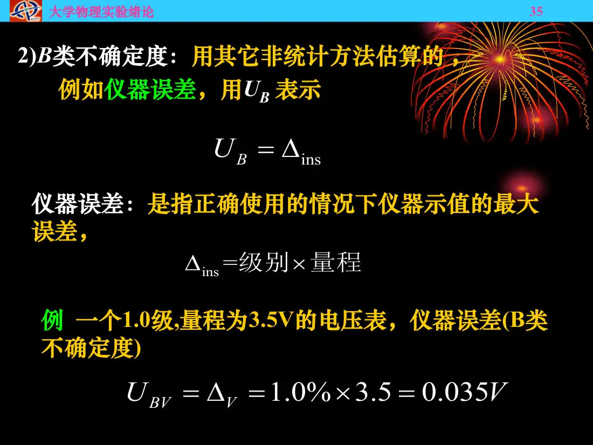

原文：

2)B类不确定度：用其它非统计方法估算的例如仪器误差，用 $\textcircled { 1 } \textcircled { 2 }$ 表示

$$
U _ {B} = \Delta_ {\mathrm{ins}}
$$

仪器误差：是指正确使用的情况下仪器示值的最大误差，

∆ × ins=级别 量程

例 一个1.0级,量程为3.5V的电压表，仪器误差(B类不确定度)

$$
U _ {B V} = \Delta_ {V} = 1.0\% \times 3.5 = 0.035V
$$

35

大学物理实验绪论

### 3)合成不确定度的估计

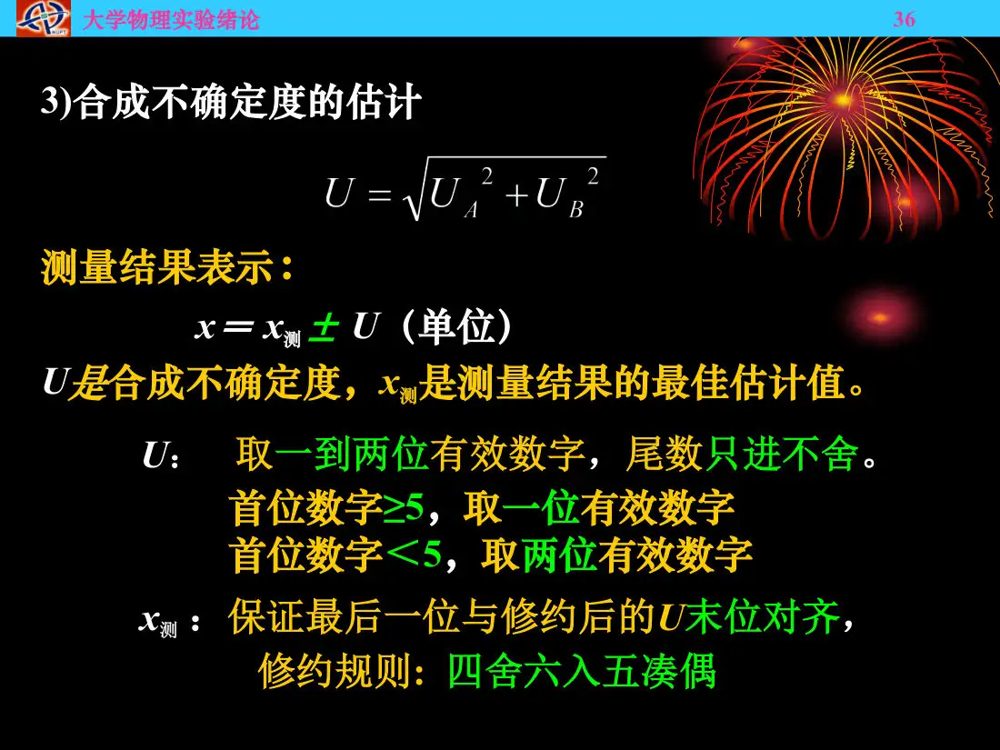

原文：

3)合成不确定度的估计

$$
U = \sqrt {U _ {A} ^ {2} + U _ {B} ^ {2}}
$$

测量结果表示：

$x = - \frac { 3 } { 2 }$ ±U（单位）

U是合成不确定度， $a = \frac { 3 } { 2 }$ 是测量结果的最佳估计值。

U： 取一到两位有效数字，尾数只进不舍。首位数字≥5，取一位有效数字首位数字＜5，取两位有效数字

$\mathbb { S } _ { \Delta } \mathbb { M }$ ：保证最后一位与修约后的U末位对齐，

修约规则: 四舍六入五凑偶

大学物理实验绪论

### 例题: 5.0000001

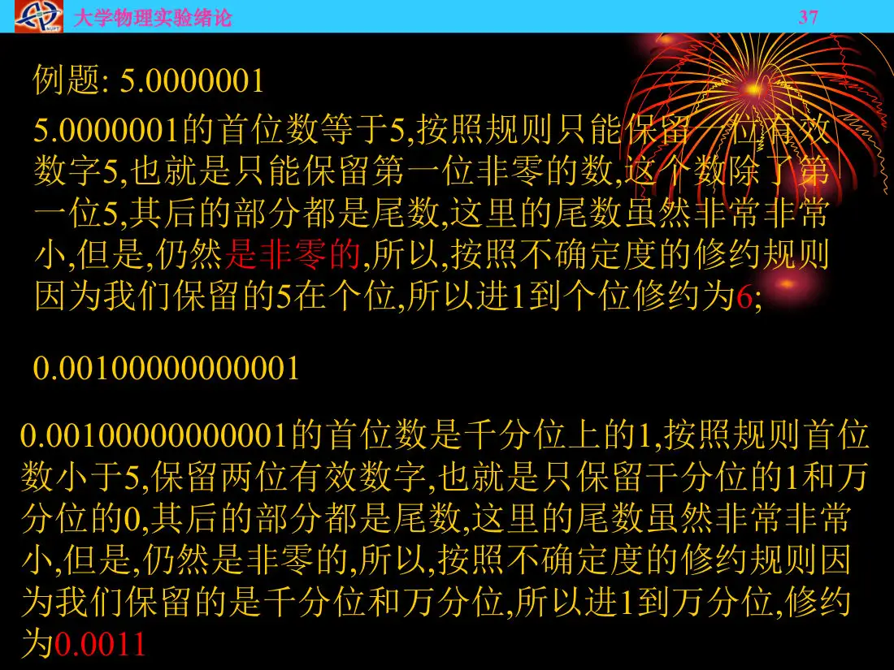

原文：

例题: 5.0000001

5.0000001的首位数等于5,按照规则只能保留一位有数字5,也就是只能保留第一位非零的数,这个数除了第一位5,其后的部分都是尾数,这里的尾数虽然非常非常小,但是,仍然是非零的,所以,按照不确定度的修约规则因为我们保留的5在个位,所以进1到个位修约为6;

0.00100000000001

0.00100000000001的首位数是千分位上的1,按照规则首位数小于5,保留两位有效数字,也就是只保留干分位的1和万分位的0,其后的部分都是尾数,这里的尾数虽然非常非常小,但是,仍然是非零的,所以,按照不确定度的修约规则因为我们保留的是千分位和万分位,所以进1到万分位,修约为0.0011

大学物理实验绪论

### 物理量的测量可分为单次测量和多次测量。

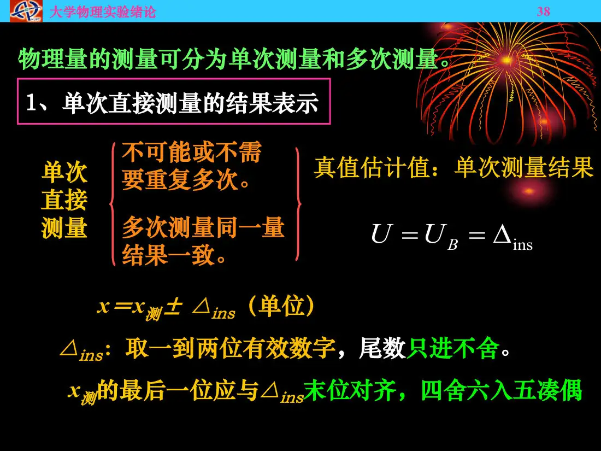

原文：

物理量的测量可分为单次测量和多次测量。

1、单次直接测量的结果表示

单直 单次
直接
测量测

不可能或不需要重复多次。

多次测量同一量结果一致。

真值估计值：单次测量结果

$$
U = U _ {B} = \Delta_ {\mathrm{ins}}
$$

x ＝x测± $1 4 \times 1 0 \% = 1 8 0 \%$ （单位）

$1 9 9 \times 3 = 1 0 0 0 ( c m )$ 取一到两位有效数字，尾数只进不舍。

$a = \frac { 3 } { 2 }$ 的最后一位应与 $1 0 0 k g$ 末位对齐，四舍六入五凑偶例1 用1.0级,量程为3.5V的电压表测量电压,单次测量测得电压为2.62V,写出结果表达式.

大学物理实验绪论

### $$

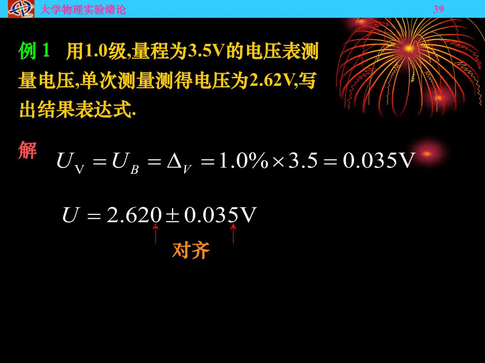

原文：

解

$$
U _ {\mathrm{V}} = U _ {B} = \Delta_ {V} = 1.0 \% \times 3.5 = 0.035 \mathrm{V}
$$

$$
U = 2. 6 2 0 \pm 0. 0 3 5 \mathrm{V}
$$

对齐

大学物理实验绪论

### 2、多次重复测量结果表示

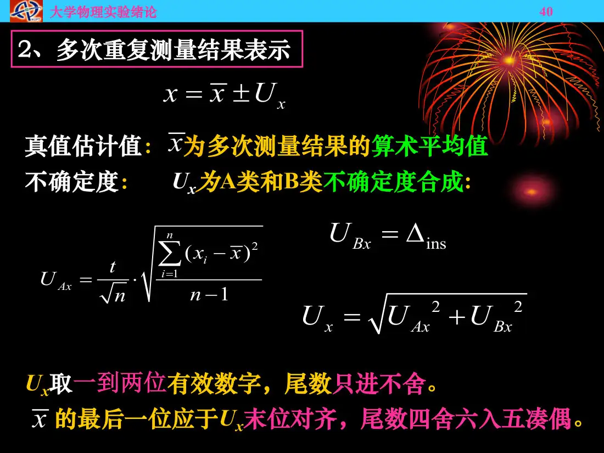

原文：

2、多次重复测量结果表示

x x U= ± x

真值估计值： 为多次测量结果的算术平均值x不确定度： $\textcircled { 1 } \textcircled { \bullet }$ 为A类和B类不确定度合成:

$$
U _ {A x} = \frac {t}{\sqrt {n}} \cdot \sqrt {\frac {\sum_ {i = 1} ^ {n} (x _ {i} - \overline {{x}}) ^ {2}}{n - 1}}
$$

$$
U _ {B x} = \Delta_ {\mathrm{ins}}
$$

$$
U _ {x} = \sqrt {U _ {A x} ^ {2} + U _ {B x} ^ {2}}
$$

U取一到两位有效数字，尾数只进不舍。的最后一位应于Ux末位对齐，尾数四舍六入五凑偶。x例2用50分度的游标卡尺测量圆柱体直径10次，数据如下表。写出结果表达式。

大学物理实验绪论

### $$

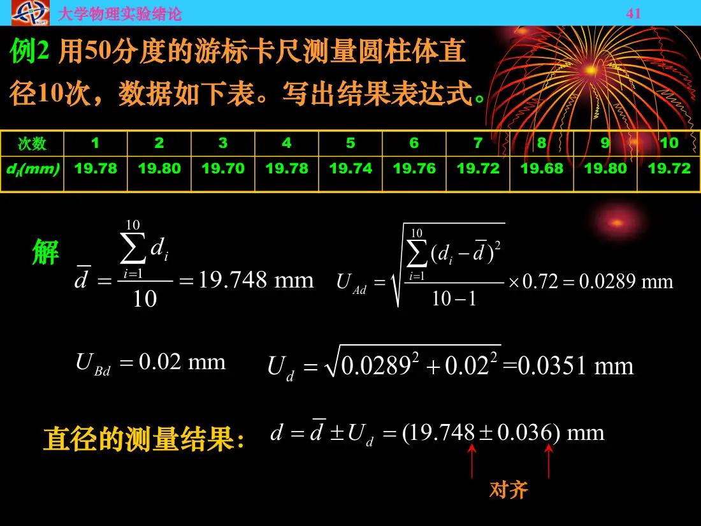

原文：

次数 1 2 3 4 5 6 7 8 9 10$c [ c ( m ) ]$ 19.78 19.80 19.70 19.78 19.74 19.76 19.72 19.68 19.80 19.72

解 $\frac { 1 } { 1 0 } = \frac { 1 } { 1 0 } = \frac { 1 } { 1 0 } \times \frac { 1 } { 1 0 } = \frac { 1 } { 1 0 } ( m ^ { 2 } )$ $\frac { 1 1 } { 1 0 } \times \frac { 1 } { 2 } \times \frac { 1 } { 3 } \times \frac { 1 } { 2 } \times \frac { 1 } { 3 } \times \frac { 1 } { 2 } \times \frac { 1 } { 3 } \times \frac { 1 } { 2 } \times \frac { 1 } { 3 } \times \frac { 1 } { 2 } \times \frac { 1 } { 3 } \times \frac { 1 } { 2 } \times \frac { 1 } { 3 } \times \frac { 1 } { 2 }$

$$
U _ {B d} = 0. 0 2 \mathrm{mm}
$$

$$
U _ {d} = \sqrt {0 . 0 2 8 9 ^ {2} + 0 . 0 2 ^ {2}} = 0. 0 3 5 1 \mathrm{mm}
$$

直径的测量结果： $( 1 ) \because ( 1 0 0 - 1 1 ) \div ( 1 1 0 ) \times ( 1 0 0 - 1 1 ) = ( 1 1 0 0 ) ( 1 1 0 - 1 )$ 1

对齐

大学物理实验绪论

### 3-2 测量结果的相对不确定度表示法

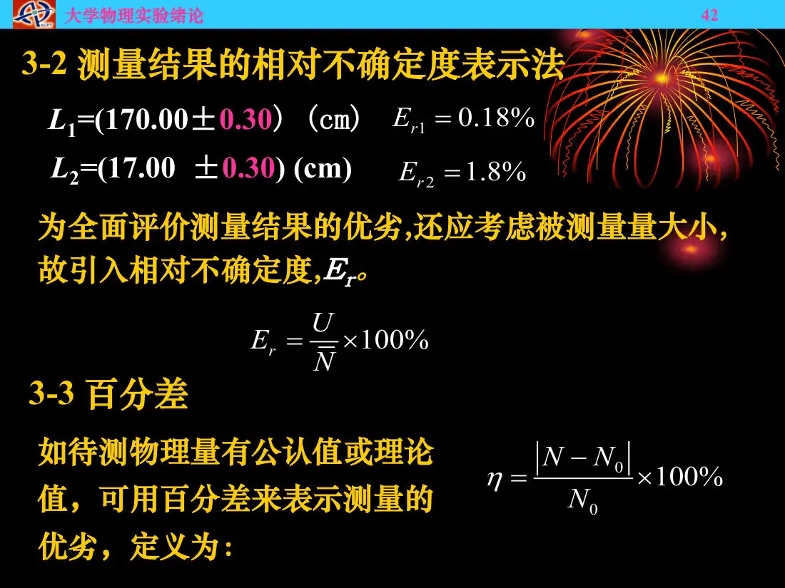

原文：

3-2 测量结果的相对不确定度表示法

$$
L _ {1} = (1 7 0. 0 0 \pm 0. 3 0)
$$

$$
E _ {r 1} = 0.18 \%
$$

$$
L _ {2} = (1 7. 0 0 \pm 0. 3 0) (\mathrm{cm})
$$

$$
E _ {r 2} = 1.8\%
$$

为全面评价测量结果的优劣,还应考虑被测量量大小,故引入相对不确定度, $\textcircled { 1 } \frac { 1 } { 6 }$

$$
E _ {r} = \frac {U}{\overline {{N}}} \times 100 \%
$$

3-3 百分差

如待测物理量有公认值或理论值，可用百分差来表示测量的优劣，定义为：

$$
\eta = \frac{\left|N - N_{0}\right|}{N_{0}}\times 100\%
$$

大学物理实验绪论

### 相对不确定度 $1 3$ 或百分差修约规则与不确定度的相同

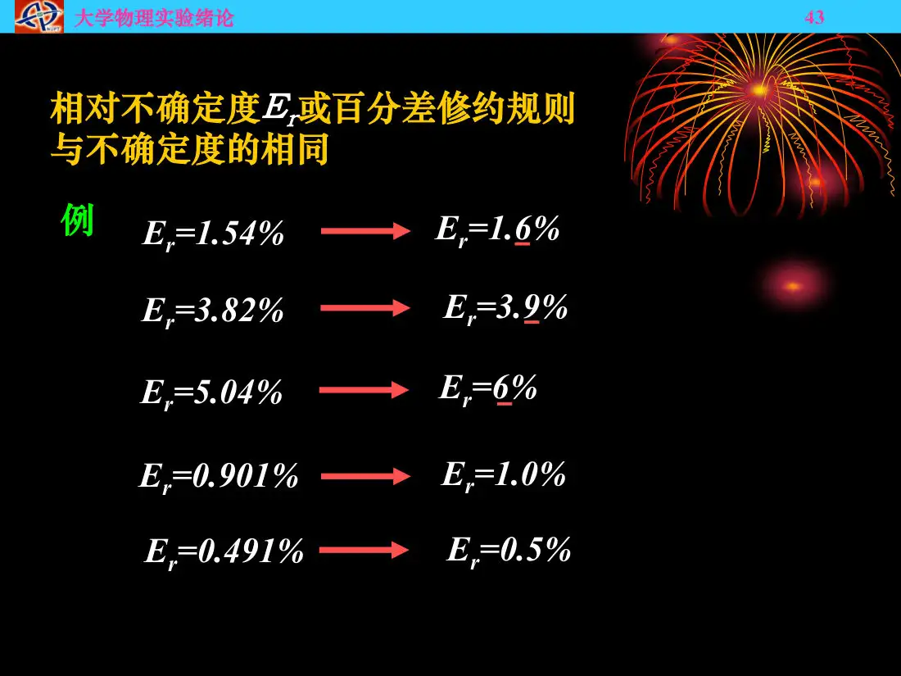

原文：

相对不确定度 $1 3$ 或百分差修约规则与不确定度的相同

例

$$
E _ {r} = 1.54 \% \quad \longrightarrow \quad E _ {r} = 1.6 \%
$$

$$
E _ {r} = 3.82 \% \quad \longrightarrow \quad E _ {r} = 3.9 \%
$$

$$
E _ {r} = 5.04 \% \quad \longrightarrow \quad E _ {r} = 6 \%
$$

$$
E _ {r} = 0.901 \% \longrightarrow E _ {r} = 1.0 \%
$$

$$
E _ {r} = 0.491 \% \longrightarrow E _ {r} = 0.5\%
$$

大学物理实验绪论

### 3-4 间接测量量的测量结果表示

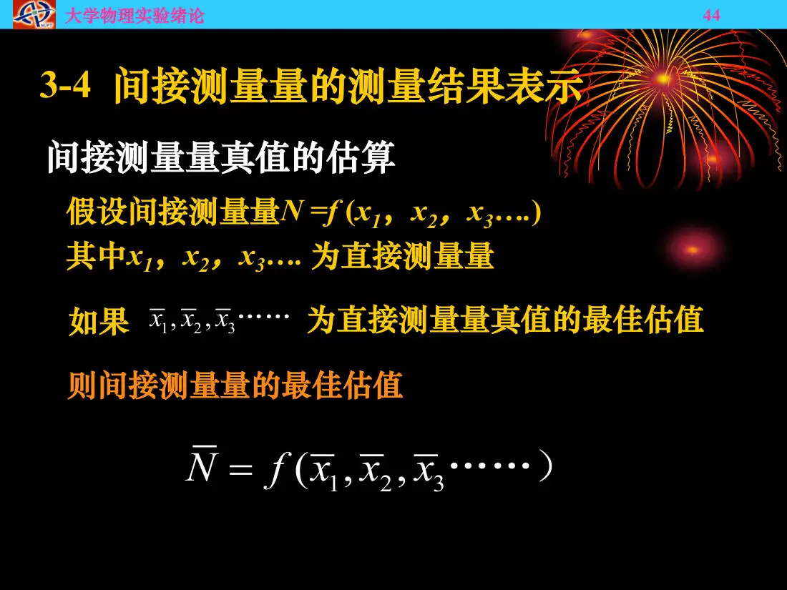

原文：

3-4 间接测量量的测量结果表示

间接测量量真值的估算

假设间接测量量 $\Delta B E F / / C G E , \Delta B C F / / C G ( A A S )$

其中 $( 2 7 6 ) \div 2 = 1 7 7$ 为直接测量量

如果 $3 0 0 0 0 0 0 0 0 0 0 0 0 0 0 0 0 0 0 0 0 0 0 0 0 0 0 0 0 0 0 0 0 0 0 0 0 0 0 0 0 0 0 0 0 0 0 0 0 0 0 0 0 0 0 0 0 0 0 0 0 0 0 0 0 0 0 0 0 0 0 0 0 0 0 0 0 0 0 0 0 0 0 0 0 0 0 0 0 0 0 0 0 0 0 0 0 0 0 0 0 0 0 0 0 0 0 0 0 0 0 0 0 0 0 0 0 0 0 0 0 0 0 0 0 0 0 0 0 0 0 0 0 0 0 0 0 0 0 0 0 0 0 0 0 0 0 0 0 0 0 0 0 0 0 0 0 0 0 0 0 0 0 0 0 0 0 0 0 0 0 0 0 0 0 0 0 0 0 0 0 0 0 0 0 0 0 0 0 0 0 0 0 0 0 0 0 0 0 0 0 0 0 0 0 0 0 0 0 0 0 0 0 0 0 0 0 0 0 0 0 0 0 0 0 0 0 0 0 0 0 0 0 0 0 0 0 0 0 0 0 0 0 0 0 0 0 0 0 0 0 0 0 0 0 0 0 0 0 0 0 0 0 0 0 0 0 0 0 0 0 0 0 0 0 0 0 0 0 0 0 0 0 0 0 0 0 0 0 0 0 0 0 0 0 0 0 0 0 0 0 0 0 0 0 0 0 0 0 0 0 0 0 0 0 0 0 0 0 0 0 0 0 0 0 0 0 0 0 0 0 0 0 0 0 0 0 0 0 0 0 0 0 0 0 0 0 0 0 0 0 0 0 0 0 0 0 0 0 0 0 0 0 0 0 0 0 0 0 0 0 0 0 0 0 0 0 0 0 0 0 0 0 0 0 0 0 0 0 0 0 0 0 0 0 0 0 0 0 0 0 0 0 0 0 0 0 0 0 0 0 0 0 0 0 0 0 0 0 0 0 0 0 0 0 0 0 0 0 0 0 0 0 0 0 0 0 0 0 0 0 0 0 0 0 0 0 0 0 0 0 0 0 0 0 0 0 0 0 0 0 0 0 0 0 0 0 0 0 0 0 0 0 0 0 0 0 0 0 0 0 0 0 0 0 0 0 0 0 0 0 0 0 0 0 0 0 0 0 0 0 0 0 0 0 0 0 0 0 0 0 0 0 0 0 0 0 0 0 0 0 0 0 0 0 0 0 0 0 0 0 0 0 0 0 0 0 0 0 0 0 0 0 0 0 0 0 0 0 0 0 0 0 0 0 0 0 0 0 0 0 0 0 0 0 0 0 0 0 0 0 0 0 0 0 0$ 为直接测量量真值的最佳估值

则间接测量量的最佳估值

$$
\overline {{N}} = f (\overline {{x _ {1}}}, \overline {{x _ {2}}}, \overline {{x _ {3}}} \dots \dots)
$$

大学物理实验绪论

### 间接测量量不确定度的估算

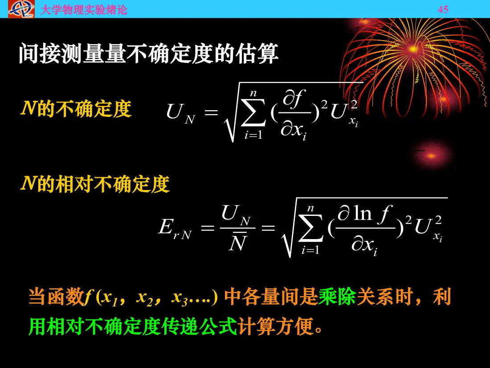

原文：

间接测量量不确定度的估算

的不确定度

$$
U _ {N} = \sqrt {\sum_ {i = 1} ^ {n} (\frac {\partial f}{\partial x _ {i}}) ^ {2}} U _ {x _ {i}} ^ {2}
$$

的相对不确定度

$$
E _ {r N} = \frac {U _ {N}}{\overline {{N}}} = \sqrt {\sum_ {i = 1} ^ {n} (\frac {\partial \ln f}{\partial x _ {i}}) ^ {2} U _ {x _ {i}} ^ {2}}
$$

当函数f $( 0 . 7 5 - 0 . 5 2 ) \times 5 0 = 0 . 7 5 ( c m )$ 中各量间是乘除关系时，利用相对不确定度传递公式计算方便。

大学物理实验绪论

### 间接测量结果表示：

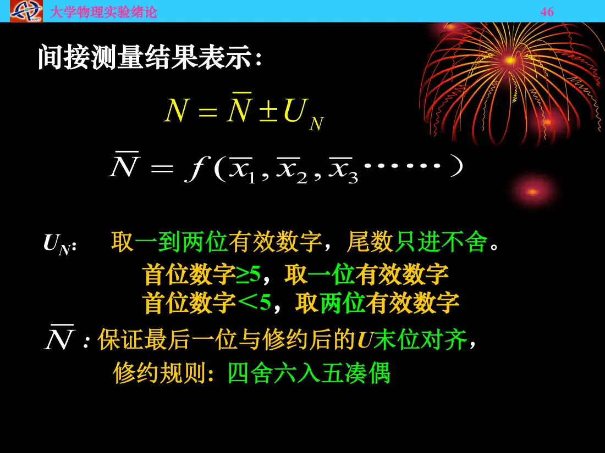

原文：

间接测量结果表示：

$$
N = \bar {N} \pm U _ {N}
$$

$$
\overline {{N}} = f (\overline {{x _ {1}}}, \overline {{x _ {2}}}, \overline {{x _ {3}}} \dots \dots)
$$

$\textcircled { 1 0 } \textcircled { > } \textcircled { > }$ 取一到两位有效数字，尾数只进不舍。首位数字≥5，取一位有效数字首位数字＜5，取两位有效数字

: 保证最后一位与修约后的U末位对齐，N

修约规则: 四舍六入五凑偶例4 用单摆测重力加速度的公式为：$3 = 1 5 0 0 ( c m ^ { 2 } )$ ，测得：$1 5 \times 1 1 1 1 1 1 1 1 1 1 1 1 1 1 1 1 1 1 1 1 1 1 1 1 1 1 1 1 1 1 1 1 1 1 1 1 1 1 1 1 1 1 1 1 1 1 1 1 1 1 1 1 1 1 1 1 1 1 1 1 1 1 1 1 1 1 1 1 1 1 1 1 1 1 1 1 1 1 1 1 1 1 1 1 1 1 1 1 1 1 1 1 1 1 1 1 1 1 1 1 1 1 1 1 1 1 1 1 1 1 1 1 1 1 1 1 1 1 1 1 1 1 1 1 1 1 1 1 1 1 1 1 1 1 1 1 1 1 1 1 1 1 1 1 1 1 1 1 1 1 1 1 1 1 1 1 1 1 1 1 1 1 1 1 1 1 1 1 1 1 1 1 1 1 1 1 1 1 1 1 1 1 1 1 1 1 1 1 1 1 1 1 1 1 1 1 1 1 1 1 1 1 1 1 1 1 1 1 1 1 1 1 1 1 1 1 1 1 1 1 1 1 1 1 1 1 1 1 1 1 1 1 1 1 1 1 1 1 1 1 1 1 1 1 1 1 1 1 1 1 1 1 1 1 1 1 1 1 1 1 1 1 1 1 1 1 1 1 1 1 1 1 1 1 1 1 1 1 1 1 1 1 1 1 1 1 1 1 1 1 1 1 1 1 1 1 1 1 1 1 1 1 1 1 1 1 1 1 1 1 1 1 1 1 1 1 1 1 1 1 1 1 1 1 1 1 1 1 1 1 1 1 1 1 1 1 1 1 1 1 1 1 1 1 1 1 1 1 1 1 1 1 1 1 1 1 1 1 1 1 1 1 1 1 1 1 1 1 1 1 1 1 1 1 1 1 1 1 1 1 1 1 1 1 1 1 1 1 1 1 1 1 1 1 1 1 1 1 1 1 1 1 1 1 1 1 1 1 1 1 1 1 1 1 1 1 1 1 1 1 1 1 1 1 1 1 1 1 1 1 1 1 1 1 1 1 1 1 1 1 1 1 1 1 1 1 1 1 1 1 1 1 1 1 1 1 1 1 1 1 1 1 1 1 1 1 1 1 1 1 1 1 1 1 1 1 1 1 1 1 1 1 1 1 1 1 1 1 1 1 1 1 1 1 1 1 1 1 1 1 1 1 1 1 1 1 1 1 1 1 1 1 1 1 1 1 1 1 1 1 1 1 1 1 1 1 1 1 1 1 1 1 1 1 1 1 1 1 1 1 1 1 1 1 1 1 1 1 1 1 1 1 1 1 1 1 1 1 1 1 1 1 1 1 1 1 1 1 1 1 1 1 $ 试写出重力加速度g的结果表示式.

大学物理实验绪论

### $$

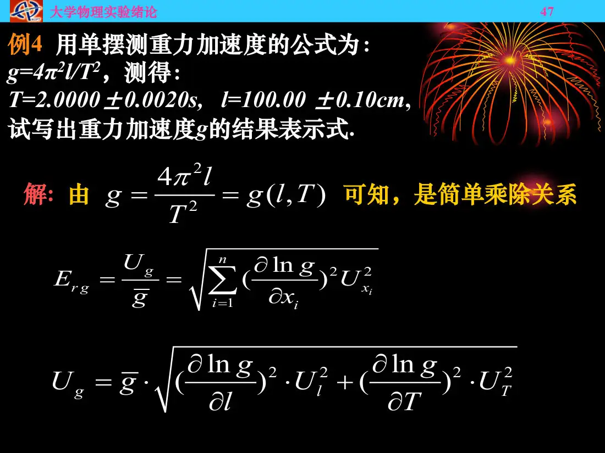

原文：

解: 由 $\frac { 1 } { 2 } \times \frac { 1 } { 3 } \times \frac { 1 } { 3 } = \frac { 1 } { 3 } \times \frac { 1 } { 3 } = \frac { 1 } { 3 } ( c m ^ { 2 } )$ 可知，是简单乘除关系

$$
E _ {r g} = \frac {U _ {g}}{\overline {{g}}} = \sqrt {\sum_ {i = 1} ^ {n} (\frac {\partial \ln g}{\partial x _ {i}}) ^ {2} U _ {x _ {i}} ^ {2}}
$$

$$
U _ {g} = \overline {{g}} \cdot \sqrt {(\frac {\partial \ln g}{\partial l}) ^ {2} \cdot U _ {l} ^ {2} + (\frac {\partial \ln g}{\partial T}) ^ {2} \cdot U _ {T} ^ {2}}
$$

### $$

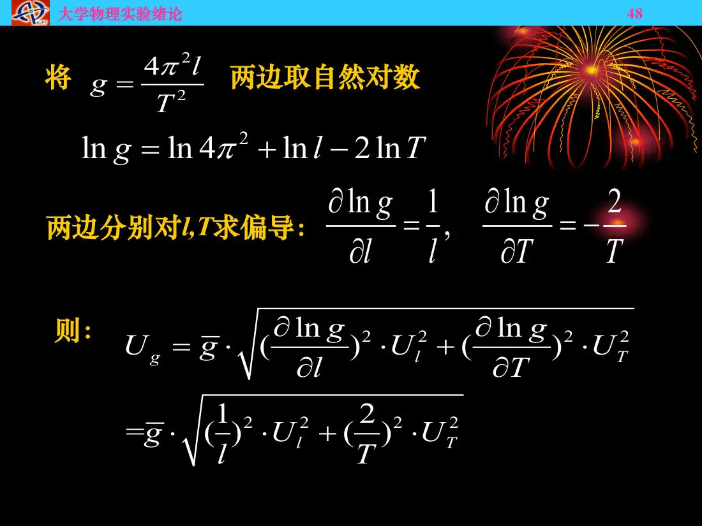

原文：

将 $\frac { 2 } { 3 } x = \frac { 1 } { 3 }$ 两边取自然对数

$$
\ln g = \ln 4 \pi^ {2} + \ln l - 2 \ln T
$$

两边分别对l,T求偏导： $\frac { \langle a \vert \vert \vert \nabla \vert } { \langle a \vert } = \frac { \vert c \vert \vert } { \vert c \vert } = \frac { \langle a \vert \vert \vert \vert \nabla \vert } { \vert c \vert }$

则：

$$
\begin{array}{r l} & U _ {g} = \overline {{g}} \cdot \sqrt {(\frac {\partial \ln g}{\partial l}) ^ {2} \cdot U _ {l} ^ {2} + (\frac {\partial \ln g}{\partial T}) ^ {2} \cdot U _ {T} ^ {2}} \\ & = \overline {{g}} \cdot \sqrt {(\frac {1}{l}) ^ {2} \cdot U _ {l} ^ {2} + (\frac {2}{T}) ^ {2} \cdot U _ {T} ^ {2}} \end{array}
$$

大学物理实验绪论

### $$

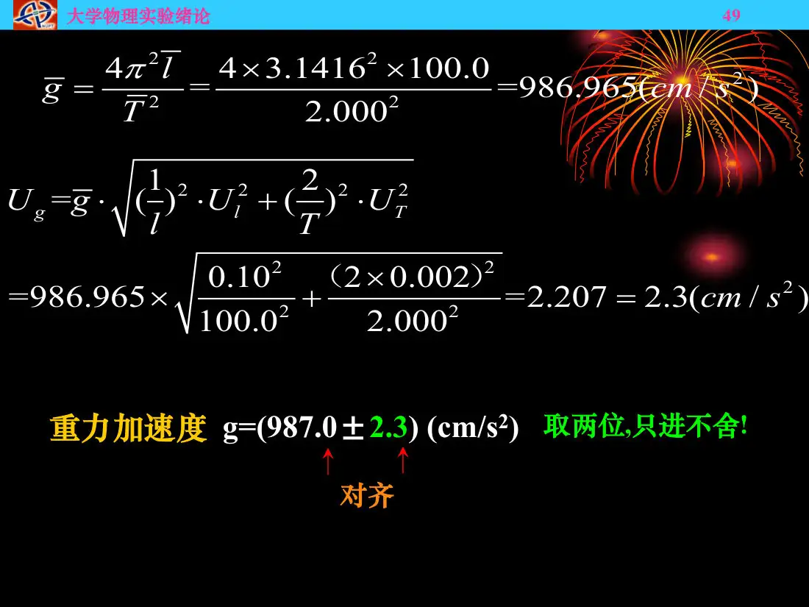

原文：

$$
U _ {g} = \overline {{g}} \cdot \sqrt {\left(\frac {1}{l}\right) ^ {2} \cdot U _ {l} ^ {2} + \left(\frac {2}{T}\right) ^ {2} \cdot U _ {T} ^ {2}}
$$

$$
= 9 8 6. 9 6 5 \times \sqrt {\frac {0 . 1 0 ^ {2}}{1 0 0 . 0 ^ {2}} + \frac {(2 \times 0 . 0 0 2) ^ {2}}{2 . 0 0 0 ^ {2}}} = 2. 2 0 7 = 2. 3 (c m / s ^ {2})
$$

重力加速度 g=(987.0±2.3) (cm/s2) 取两位,只进不舍!对齐

大学物理实验绪论NUPT

### 第三部分数据处理的基本方法

原文：

第三部分数据处理的基本方法

列表法作图法逐差法

大学物理实验绪论

### 一、列表法

原文：

一、列表法

列表记录和处理数据时，应注意

1、表格设计要合理，要简单明了，能完整地记录实验数据。物理量的排列应与测量顺序一致。

2、各标题栏中应注明所列物理量的名称、符号和单位（数据不要重复书写单位）。

3、表中数据要正确反映测量的有效数字。

4、提供与表格有关的说明和参数（表格名称、测量仪器规格、环境条件等），以利于对结果的复查。

5、表格中所列的主要是原始数据，重要的中间计算结果也可列入。

大学物理实验绪论

### 举例----测钢丝直径

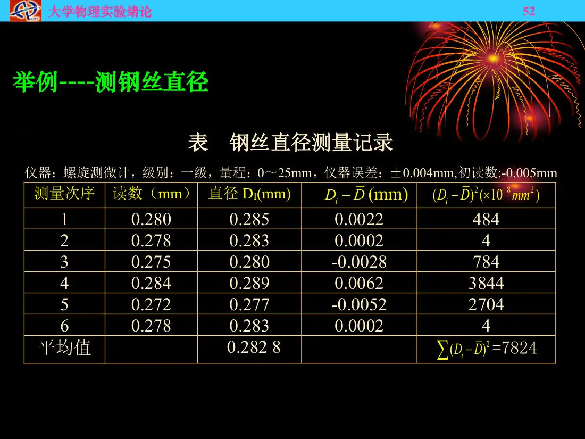

原文：

举例----测钢丝直径

表 钢丝直径测量记录
<table><tr><td colspan="5">仪器:螺旋测微计,级别:一级,量程:0~25mm,仪器误差:±0.004mm,初读数:-0.005mm</td></tr><tr><td>测量次序</td><td>读数(mm)</td><td>直径 $D_I$ (mm)</td><td> $D_i - \bar{D}$ (mm)</td><td> $(D_i - \bar{D})^2 (\times 10^{-8} mm^2)$ </td></tr><tr><td>1</td><td>0.280</td><td>0.285</td><td>0.0022</td><td>484</td></tr><tr><td>2</td><td>0.278</td><td>0.283</td><td>0.0002</td><td>4</td></tr><tr><td>3</td><td>0.275</td><td>0.280</td><td>-0.0028</td><td>784</td></tr><tr><td>4</td><td>0.284</td><td>0.289</td><td>0.0062</td><td>3844</td></tr><tr><td>5</td><td>0.272</td><td>0.277</td><td>-0.0052</td><td>2704</td></tr><tr><td>6</td><td>0.278</td><td>0.283</td><td>0.0002</td><td>4</td></tr><tr><td>平均值</td><td></td><td>0.2828</td><td></td><td> $\sum (D_i - \bar{D})^2 = 7824$ </td></tr></table>

大学物理实验绪论

52

### 二.作图法

原文：

二.作图法

作图法就是通过图线将物理量之间的关系直观地表示出来的方法。

作好一张正确、实用、美观的图是实验技能训练中的一项基本功。

实验作图不是示意图，而是用图来表达实验中得到的物理量之间的定量关系，要反映测量的准确程度，必须满足一定的作图规则。

大学物理实验绪论

### 作图的基本规则

原文：

作图的基本规则

1、有完整列有数据的表格。

2、选用合适的坐标纸

作图必须用坐标纸。

根据需要选用合适种类和大小的坐标纸。

物理实验中常用的是直角坐标纸（毫米方格纸）

大学物理实验绪论

### F mg ( )

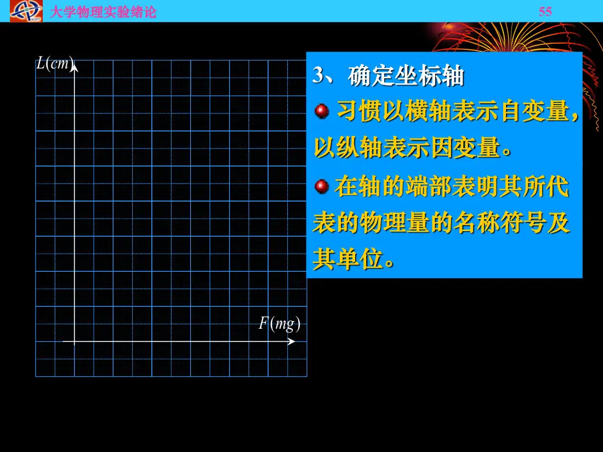

原文：

F mg ( )

3、确定坐标轴

习惯以横轴表示自变量，以纵轴表示因变量。

在轴的端部表明其所代表的物理量的名称符号及其单位。

大学物理实验绪论

55

### 4、合理确定坐标分度

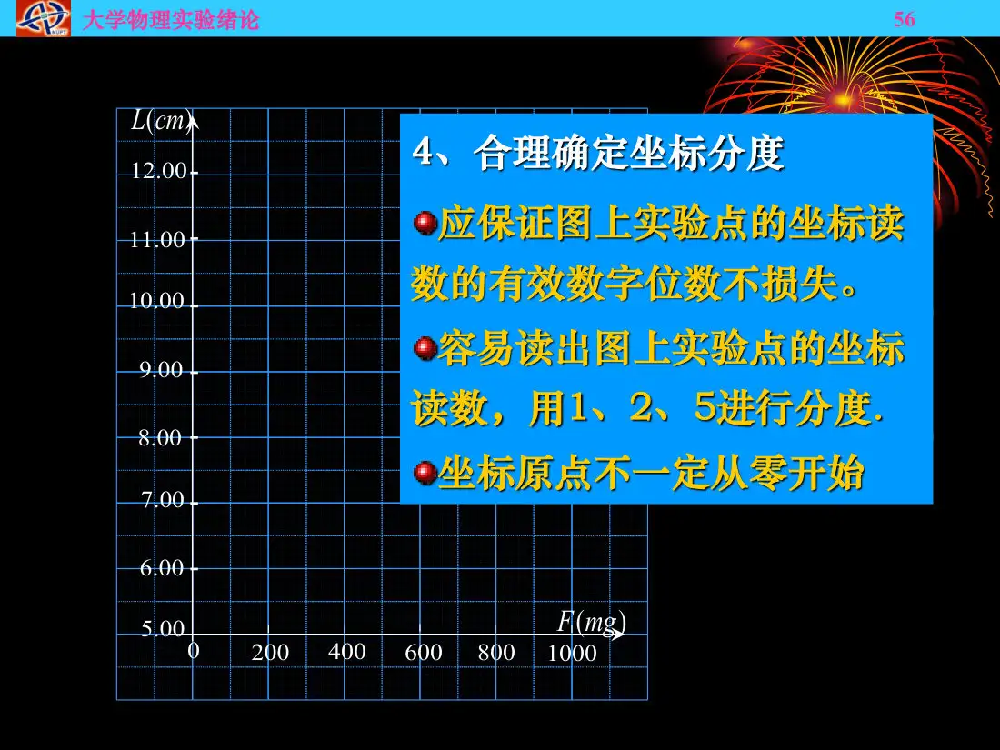

原文：

4、合理确定坐标分度

应保证图上实验点的坐标读数的有效数字位数不损失。

容易读出图上实验点的坐标读数，用1、2、5进行分度.

坐标原点不一定从零开始

200 400 600 800 1000

大学物理实验绪论

56

### 5、标出实验点

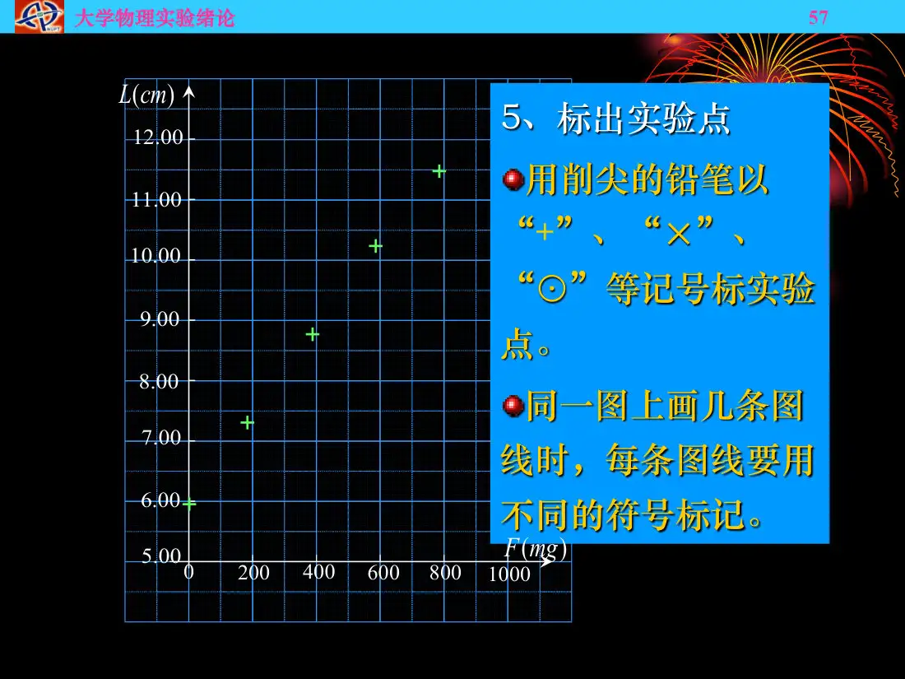

原文：

5、标出实验点

用削尖的铅笔以 “+” “ 99

等记号标实验点。

同一图上画几条图线时，每条图线要用不同的符号标记。

200 400 600 800 1000

大学物理实验绪论

57

### 6、连接实验曲线

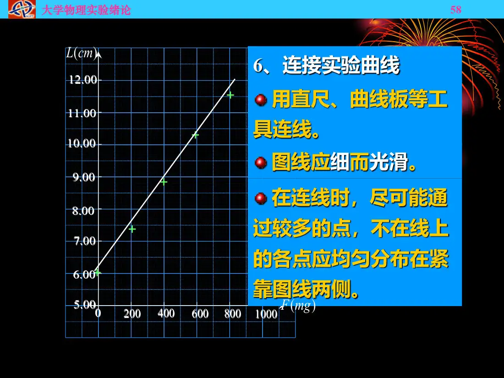

原文：

6、连接实验曲线

用直尺、曲线板等工具连线。

图线应细而光滑。

在连线时，尽可能通过较多的点，不在线上的各点应均匀分布在紧靠图线两侧。

大学物理实验绪论

58

### 12.00

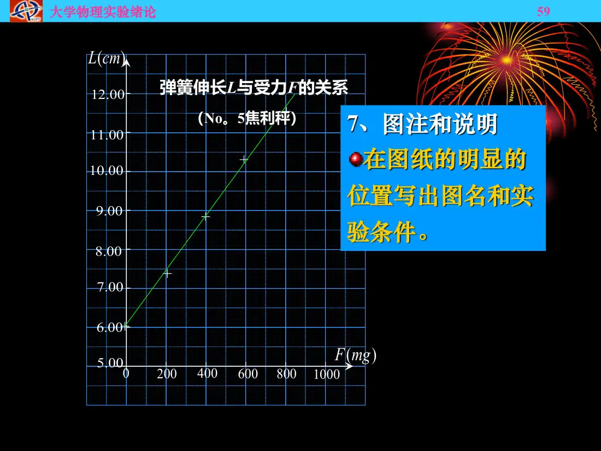

原文：

12.00

11.00

10.00

9.00

8.00

7.00

弹簧伸长L与受力F的关系

（No。5焦利秤）

6.00

5.00

7、图注和说明在图纸的明显的位置写出图名和实验条件。

F mg ( )

200 400 600 800 1000

大学物理实验绪论

59

### 图解法

原文：

图解法

利用已作好的图线，定量地求得待测量或得出相关量的经验公式的方法。

当图线是直线时，尤为方便。

直线图线的图解步骤：

大学物理实验绪论

### 设直线方程为： $1 2 - 2 0 0 = 1 0 0 0$

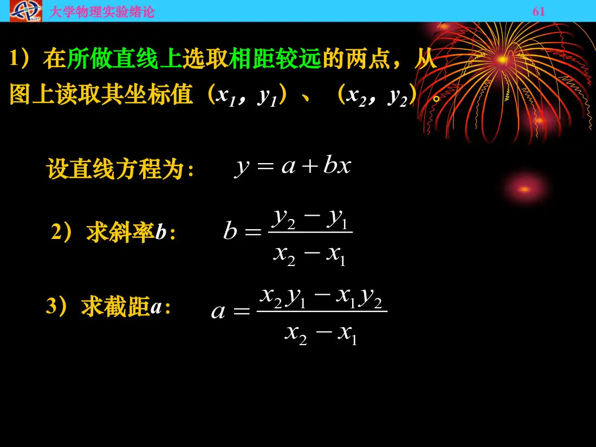

原文：

1）在所做直线上选取相距较远的两点， 图上读取其坐标值 $( \cos \alpha \sin \alpha \cos \alpha \sin \alpha \cos \alpha \cos \alpha \sin \alpha \cos \alpha \cos \alpha \sin \alpha \cos \alpha \cos \alpha \sin \alpha \cos \alpha \cos \alpha \sin \alpha \cos \alpha \cos \alpha \cos \alpha \sin \alpha \cos \alpha \cos \alpha \cos \alpha \sin \alpha \cos \alpha \cos \alpha \sin \alpha \cos \alpha \cos \alpha \sin \alpha$

设直线方程为： $1 2 - 2 0 0 = 1 0 0 0$

2）求斜率b：

$$
b = \frac {y _ {2} - y _ {1}}{x _ {2} - x _ {1}}
$$

3）求截距a：

$$
a = \frac {x _ {2} y _ {1} - x _ {1} y _ {2}}{x _ {2} - x _ {1}}
$$

大学物理实验绪论

### 700，10.96）

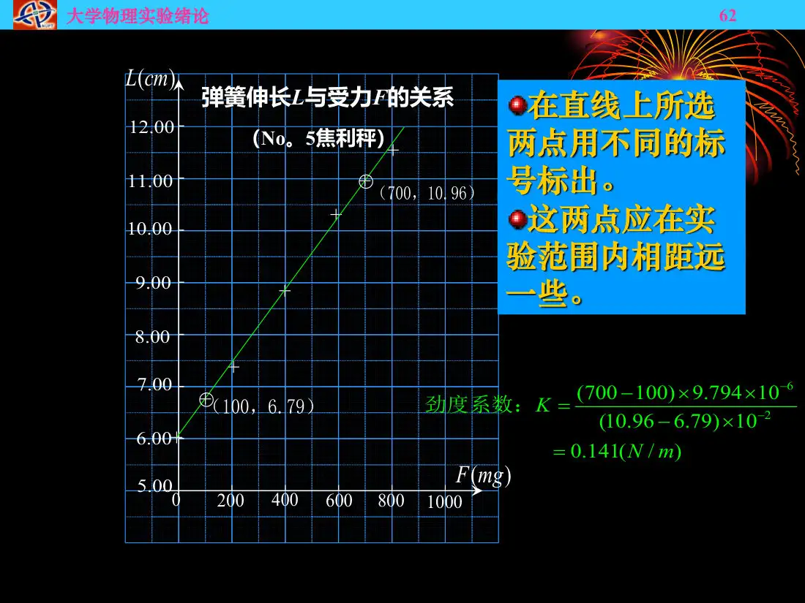

原文：

700，10.96）

（100，6.79）

200 400 600 800 1000

在直线上所选两点用不同的标号标出。这两点应在实验范围内相距远一些。

$$
\begin{array}{r l} K & = \frac {(7 0 0 - 1 0 0) \times 9 . 7 9 4 \times 1 0 ^ {- 6}}{(1 0 . 9 6 - 6 . 7 9) \times 1 0 ^ {- 2}} \\ & = 0. 1 4 1 (N / m) \end{array}
$$

大学物理实验绪论

62

### 三、逐差法

原文：

三、逐差法

逐差法是物理实验中常用的数据处理方法之一，常用于处理自变量等间距变化的数据。

逐差法：

把实验数据列成表格进行逐次项减可验证数据变化的规律。

分成高、低两组对应项相减。

可充分利用数据，减少测量误差。

大学物理实验绪论

### $$

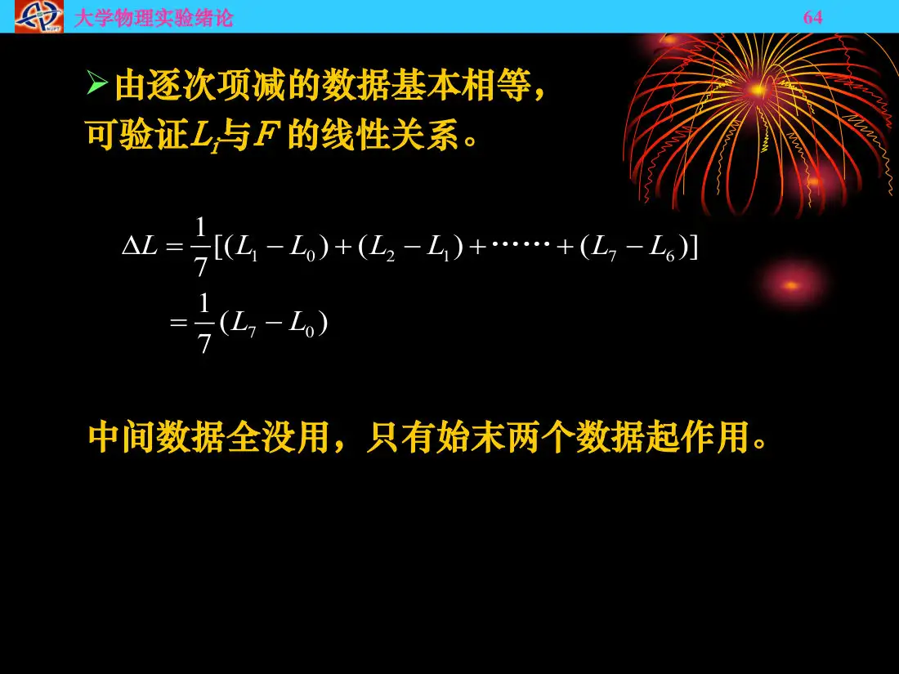

原文：

由逐次项减的数据基本相等，可验证 $1 6 \pi$ 与 $\boxed { \pmb { / { 2 } } }$ 的线性关系。

$$
\begin{array}{r l} & {\Delta L = \frac {1}{7} [ (L _ {1} - L _ {0}) + (L _ {2} - L _ {1}) + \dots \dots + (L _ {7} - L _ {6}) ]} \\ & {\qquad = \frac {1}{7} (L _ {7} - L _ {0})} \end{array}
$$

中间数据全没用，只有始末两个数据起作用。

大学物理实验绪论

### $$

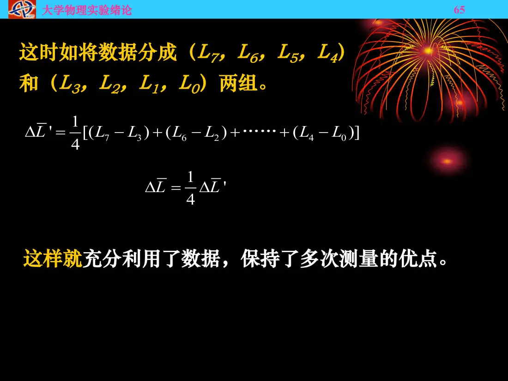

原文：

这时如将数据分成 $( 1 4 0 - 1 ) \times ( 2 5 - 1 ) = 1 0 0 ( c m )$ 和 $( 1 1 0 0 0 0 0 0 0 0 0 0 0 0 0 0 0 0 0 0 0 0 0 0 0 0 0 0 0 0 0 0 0 0 0 0 0 0 0 0 0 0 0 0 0 0 0 0 0 0 0 0 0 0 0 0 0 0 0 0 0 0 0 0 0 0 0 0 0 0 0 0 0 0 0 0 0 0 0 0 0 0 0 0 0 0 0 0 0 0 0 0 0 0 0 0 0 0 0 0 0 0 0 0 0 0 0 0 0 0 0 0 0 0 0 0 0 0 0 0 0 0 0 0 0 0 0 0 0 0 0 0 0 0 0 0 0 0 0$ 两组。

$$
\Delta \overline {{L}} ^ {\prime} = \frac {1}{4} [ (L _ {7} - L _ {3}) + (L _ {6} - L _ {2}) + \dots + (L _ {4} - L _ {0}) ]
$$

$$
\Delta \overline {{L}} = \frac {1}{4} \Delta \overline {{L}} ^ {\prime}
$$

这样就充分利用了数据，保持了多次测量的优点。

大学物理实验绪论

### 本章重点

原文：

本章重点

1、实验课规则

2、有效数字表示，修约规则，运算法则，读数

3、不确定度— 计算，修约规则

A类不确定度， B类不确定度，合成

间接测量量不确定度计算过程

大学物理实验绪论

### 4、测量结果表示：

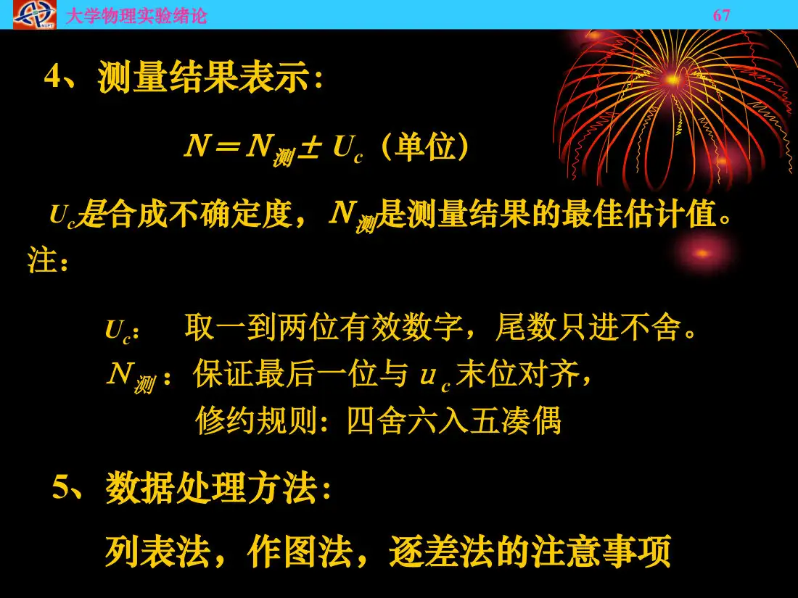

原文：

4、测量结果表示：

$\angle B = \angle A ^ { \prime }$ Uc（单位）

Uc是合成不确定度， $1 \times 1 = 1 0$ 是测量结果的最佳估计值。

$\textcircled { \bullet } \textcircled { > }$ 取一到两位有效数字，尾数只进不舍。

$1 \times ( - \frac { 1 } { 2 } ) \times ( - \frac { 1 } { 2 } ) \times ( - \frac { 1 } { 2 } )$ 保证最后一位与 $1 0 \%$ 末位对齐，修约规则: 四舍六入五凑偶

5、数据处理方法：

列表法，作图法，逐差法的注意事项

大学物理实验绪论

### 大学物理实验绪论

原文：

大学物理实验绪论

68
