# 《物理实验》（下）实验操作考试说明及复习大纲

原件经识别和整理；“参考解答”是我们补的。

## 《物理实验》（下）实验操作考试说明

1. 本学期期末将进行实验操作考试，考试操作考试成绩占 40%，平时实验成绩占 60%，最后合并计入本课程总成绩。
2. 本学期（1—16 周）共安排七个实验内容，完成本学期所有实验内容后将在（17—18 周）安排实验操作考试。
3. 实验操作考试范围为本学期的 6 个必做实验和上学期（扭摆法测量物体转动惯量及迈克尔逊干涉仪的调整和使用）共 8 个实验内容。
4. 每位同学参加实验操作考试前 10 分钟由随机摇号的方式决定具体操作考试内容（八选一），进入相应的实验室，根据考卷上具体要求完成相关的操作及必要的数据处理。
5. 本次操作考试采用闭卷方式。考生参加考试必须带本人学生证或身份证，方可进入考场。带齐必要的文具（包括计算器及作图工具等）。考试过程中，考生在规定的时间独立完成，不得相互讨论、喧哗，影响考场秩序。通讯器材一律处于关闭状态。
6. 实验操作考试的总体要求：

对考试范围内涉及到的实验仪器能正确调整、规范操作、完成特定物理量的测量；正确记录实验原始数据；

掌握常用的实验数据处理方法：逐差法、作图法；

物理量测量结果的正确表示（含不确定度的计算）。

## 考试时间

请至少提前 10 分钟到教 2 西四楼确认自己的考场。

| 时间 | 班级 |
| --- | --- |
| 12月21日 9:50—10:50 | B140101、B140102、B140103、B140104、B140105、B140106、B140107 |
| 12月21日 13:50—14:50 | B140201、B140202、B140203、B140204、B140205、B140206、B140207 |
| 12月22日 9:50—10:50 | B140108、B140109、B140401、B140402、B140403、B140404、B140405 |
| 12月22日 13:50—14:50 | B140601、B140602、B140603、B140604 |
| 12月23日 9:50—10:50 | B140701、B140702、B140703、B140704、B140705、B140706 |
| 12月24日 9:50—10:50 | B140901、B140902、B140903、B140904、B140905、B140906、B140907 |
| 12月24日 13:50—14:50 | B140501、B140502、B140503、B140504、B140505、B140506 |
| 12月26日 8:00—9:00 | B140110、B140111、B140112、B140113、B140208、B140209、B140210 |
| 12月26日 9:20—10:20 | B140301、B140302、B140303、B140304、B140305、B140306、B140307 |
| 12月26日 10:40—11:40 | B140406、B140407、B140408、B140409、B140410、Q140102、Q140103 |
| 12月26日 13:30—14:30 | B140308、B140309、B141503、B141504、B140507、B140508、B140509 |
| 12月26日 14:50—15:50 | B140801、B140802、B140803、B140804、B140510、B140511、Q140101 |
| 12月26日 16:10—17:10 | B140114、B140115、B140116、B140117、B140118、B140119、B140908 |

## 考试大纲

### 8 个实验操作考试的具体要求

### 一、声速测量考试复习大纲

1. 掌握共振干涉法、相位比较法测声速的原理和方法；
2. 掌握示波器主要功能键的调节和使用；
3. 掌握信号发生器信号参数调节和寻找共振频率的方法；
4. 会用逐差法进行数据处理计算声速、结果的正确表达。

### 二、用电位差计测电动势考试复习大纲

1. 掌握检流计的调零方法；
2. 按给定的定标系数进行定标（工作电流标准化）并测量待测电源电动势；
3. 掌握测量和计算各物理量过程中有效位数的修约规则。

### 三、电表改装考试复习大纲

1. 掌握测量电表表头内阻的方法；
2. 掌握两档不同量程电流表的改装原理和方法；
3. 掌握改装电流表的校正方法；
4. 能正确作出改装电表的校正曲线，并定义改装表的级别。

### 四、扭摆实验考试复习大纲

1. 熟悉扭摆法测量几种特定形状物体转动惯量的实验步骤；
2. 能正确使用转动惯量测试仪；
3. 能正确使用扭摆（调节水平位置，测量时扭摆的摆动幅度合理等）；
4. 正确使用游标卡尺、直尺测量长度；
5. 各物体的转动惯量公式不需要记。

### 五、分光计的调整和使用考试复习大纲

1. 了解分光计的结构和原理；
2. 熟练掌握分光计的调节要求及方法；
3. 掌握反射法测三棱镜顶角及其计算公式；
4. 掌握三棱镜顶角及衍射光栅测单色光波长的计算方法。

### 六、迈克尔逊干涉仪的调整和使用考试复习大纲

1. 熟悉和掌握迈克尔逊干涉仪的结构，了解形成等倾干涉的光路；
2. 掌握迈克尔逊干涉仪的调整方法；
3. 会正确测量单色光源的波长；
4. 掌握逐差法计算实验结果，会计算不确定度并能正确表达实验结果。

### 七、光的等厚干涉实验考试复习大纲

1. 熟悉干涉法测量物体几何尺寸的原理；
2. 熟练掌握读数显微镜的调节方法；
3. 正确记录数据（注意有效数字的位数）；
4. 会用逐差法和作图法处理数据（注意作图的规范）；
5. 能够写出不确定度的计算公式并能正确计算不确定度（不确定度的有效数字的位数）；
6. 会正确书写结果表达式（会修约）。

### 八、电介质介电常数测量

1. 熟悉和掌握固体电介质测量原理和实验方法；
2. 掌握交流电桥测量电容的方法；
3. 能运用作图法进行数据处理，正确表达实验结果。

## 声速测量

2014-10-31

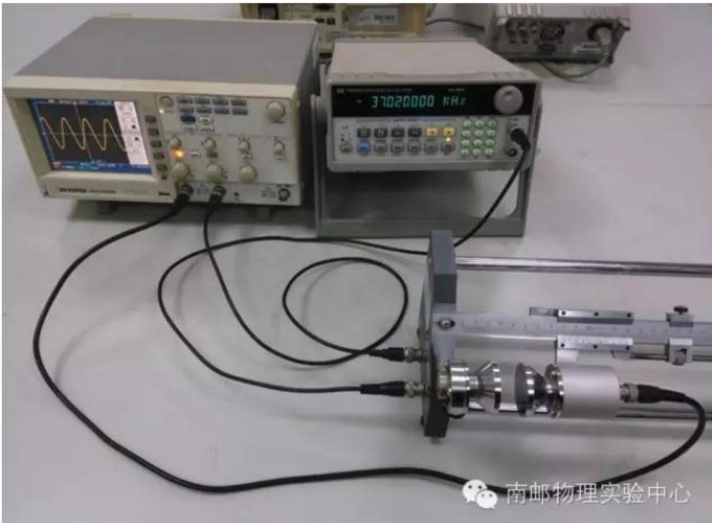

实验地点：教 2 西 518（南侧）

### 实验目的

用共振干涉法和相位比较法测定超声波在空气中的速度。

### 实验原理

压电陶瓷换能器，可实现声压和电压之间的转换。

声速 $v$ 与频率 $f$ 和波长 $\lambda$ 的关系：$v=f\lambda$

其中，$f$ 为信号发生器的输出频率（须调节使其与压电陶瓷换能器的谐振频率相同）；

$\lambda$ 为声波的波长，用共振干涉法测波长。

当 $S_1$、$S_2$ 之间的距离为半波长的整数倍时，媒质中出现稳定的驻波共振现象，接收面所处的声压也达到极大值，则示波器上显示的电信号幅值将达到最大。保持 $f$（频率）不变，通过测量连续相邻极大值时 $S_2$ 的位置，就可求出波长 $\lambda$。

### 实验步骤

1. 移动 $S_2$ 使其与 $S_1$ 接近，并保证二者端面平行；
2. 设置信号发生器的初始频率为 37kHz，调节 $S_2$ 位置，使得波形幅度最大；
3. 调节信号发生器的旋钮，改变 0.1kHz 位，使得波形幅度最大；
4. 调节 $S_2$ 的位置微调旋钮，使波形幅度最大；
5. 调节信号发生器的旋钮，改变 0.01kHz 位，使波形幅度最大，记录此刻的频率值 $f$；
6. 缓慢移动 $S_2$ 使其远离 $S_1$，依次寻找（仔细调节微调旋钮）振幅最大值所对应的 $S_2$ 的位置点 $L_0$、$L_1$、$L_2$、$L_3$、$L_4$、$L_5$、$L_6$、$L_7$、$L_8$、$L_9$。

### 数据处理

1. 通过逐差法计算 $\Delta L$；
2. 根据 $\lambda=2/5\Delta L$（为什么系数为 $2/5$？）计算波长，并求出声速的实验值；
3. 记录当时实验室室温 $t$，计算声速理论值；
4. 计算声速实验值和理论值的百分差。

确定谐振频率的视频，大小约为 2M。

也可在腾讯视频搜索“声速 nupt”。

其实，共振干涉法测量时只需要连接两根线，如下图增加的第三根线请勿拆除。

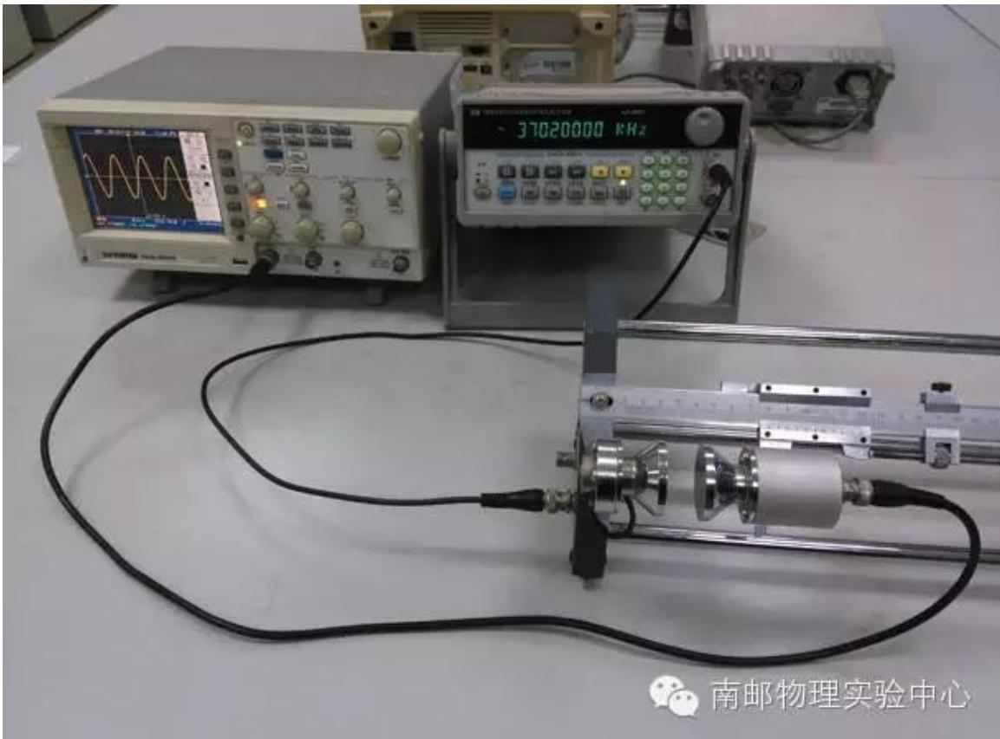

## 用电位差计测电动势

2014-11-14

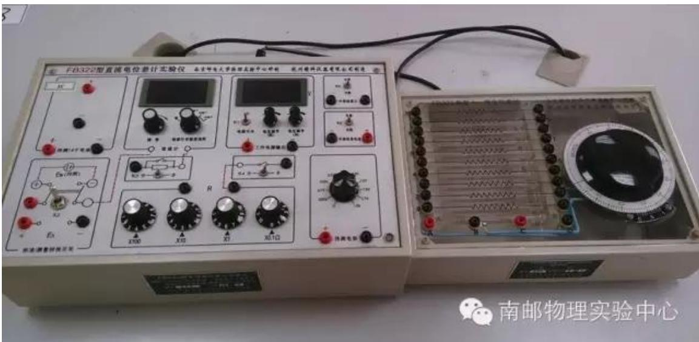

### 实验目的

1. 理解电位差计的补偿原理；
2. 掌握电位差计定标和测量方法。

### 知识要点

#### 1. 补偿法原理

补偿法是一种准确测量电动势（电压）的有效方法。

一连续可调的标准电源电动势（电压），与待测电动势并联，调节可调电源，使检流计示数为零，即电路达到平衡补偿状态。

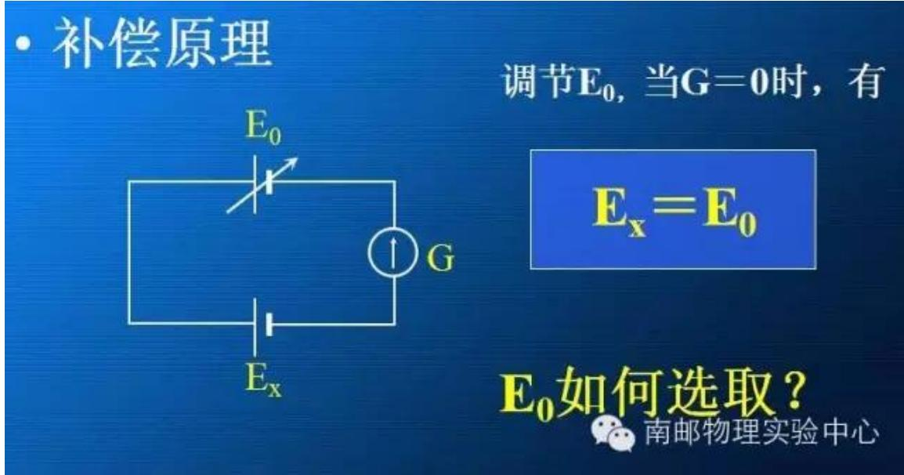

#### 2. 电位差计原理

十一线电位差计由 11 根长度为 1 米的电阻与电源串联而成，其中一根最小可选取长度为 0.001 米，特定长度对应于相应的电动势。

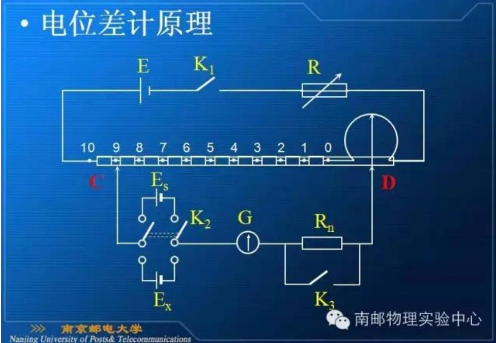

### 请思考

1. 如何找到一连续可调的电源？请从中学常用仪器中寻找，电位差计即为其改进版。
2. 如何让电阻长度与电动势对应？

### 操作要点

1. 定标：

根据定标系数，确定电源电压；

再根据标准电源为 1.01860V，确定定标长度；

微调电源，使得检流计为零。

2. 测量：

根据待测电动势 1.5V，估算测量长度；

调节电阻长度，使得检流计为零。

请注意以上两处黄色区域的不同。

请思考：在定标和测量中，分别体现了补偿法原理，你发现了吗？

友情提醒：

1）K2 开关有三档：

上：与标准电压相连

中：断开

下：与待测电动势相连

2）仪器上红色虚线为已连导线

3）有疑问，请直接回复！

### 实物接线图

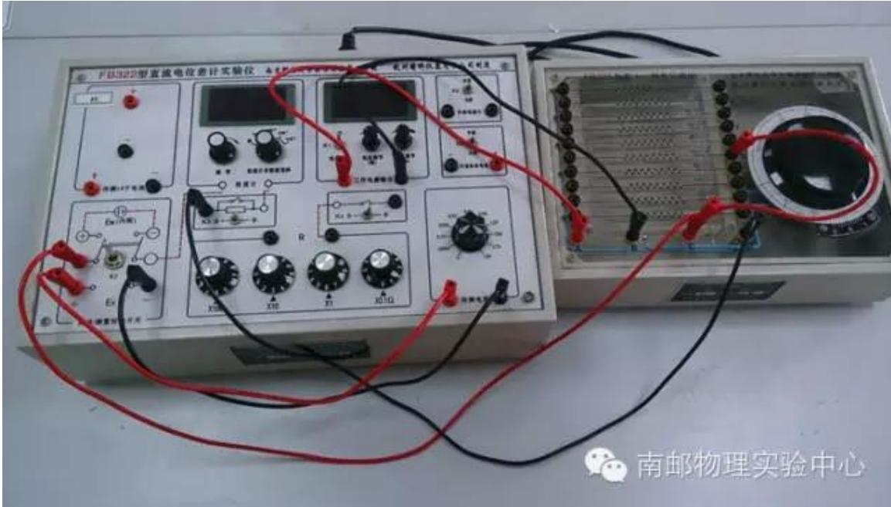

## 电表改装

2015-11-08

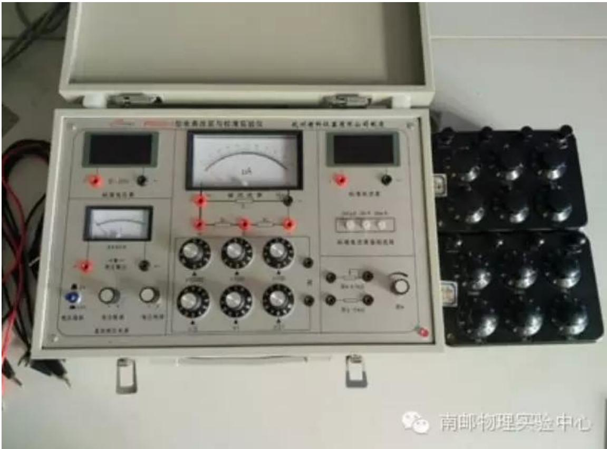

实验地点：教 2 西 416（南侧）

### 实验器材

FB308-1 型电表改装与校准实验仪（含 100 微安表头，标准电流表），电阻箱两个，电路连接导线若干。

### 实验目标

用一个 100 微安的表头（100 格）和两个电阻箱做一个双量程电流表，量程分别为 1mA 和 10mA。

### 实验内容

a. 画出用于电表校准的电路图，用替代法测出微安表的内阻 $R_g$，并计算出双量程电表中 $R_1$ 和 $R_2$ 的理论值；

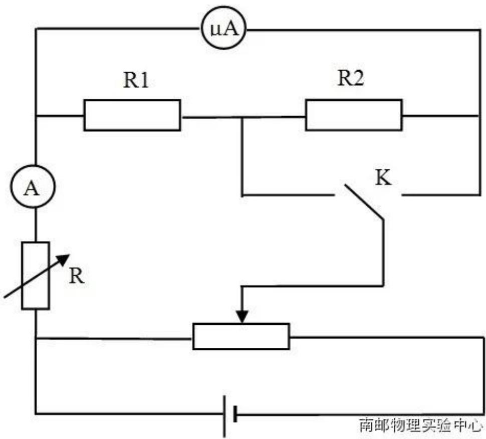

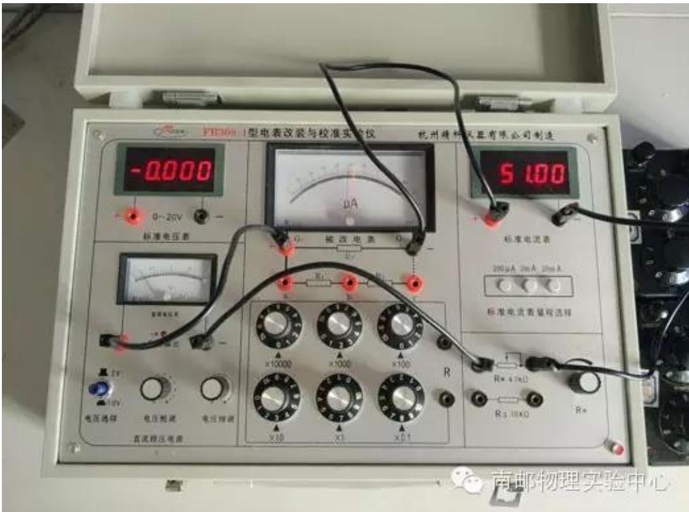

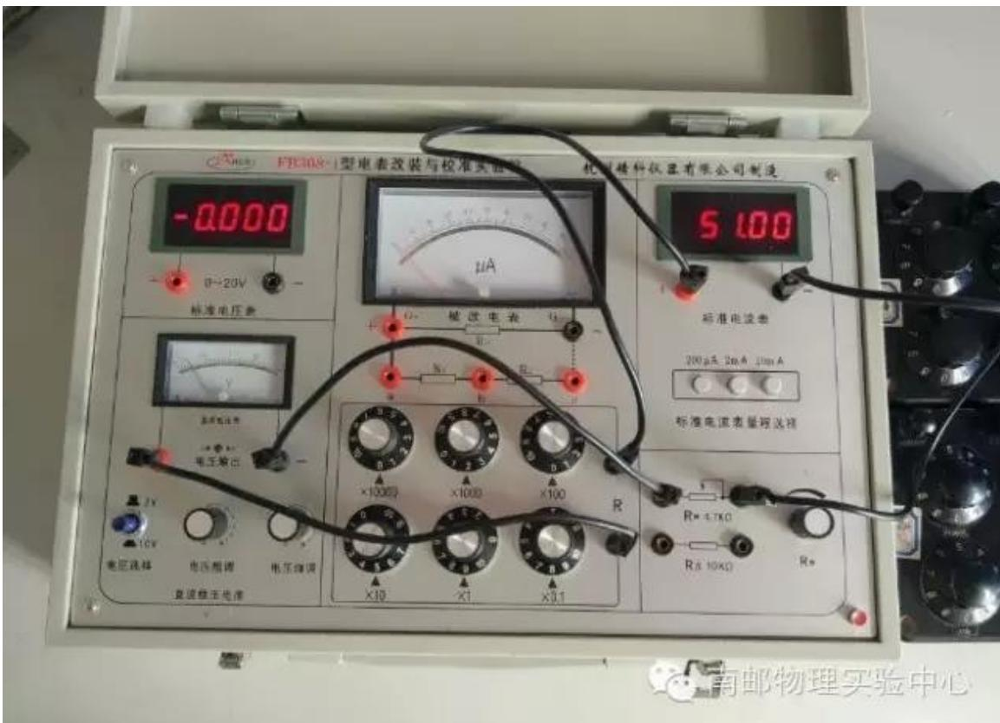

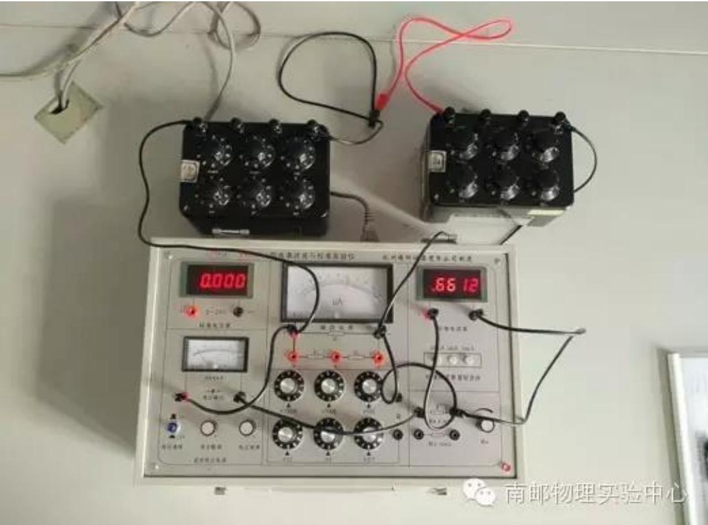

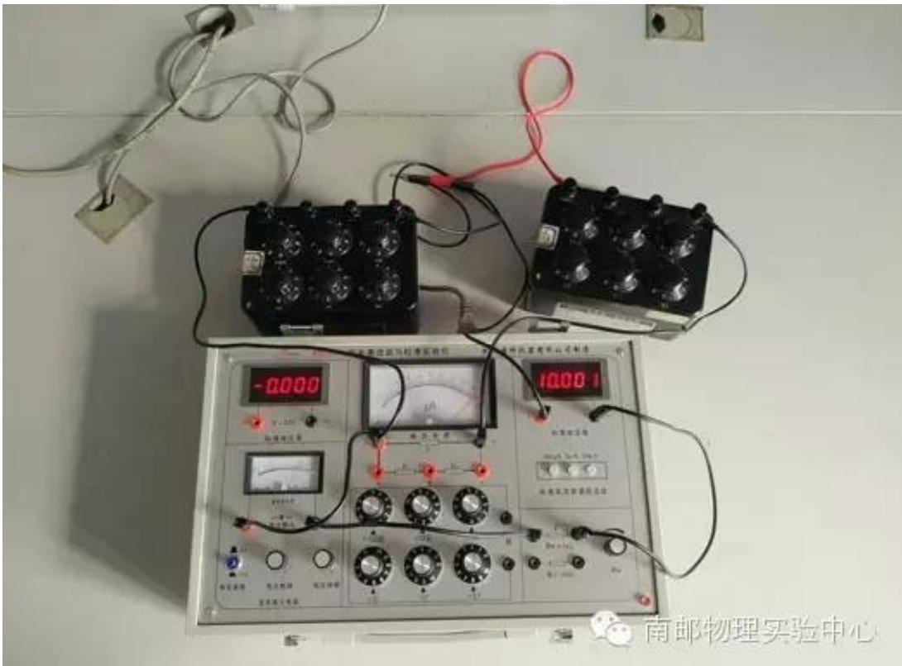

### 数据记录

a. 记录 $R_1$ 和 $R_2$ 的理论值和实验值；b. 校准表格。

## 扭摆法测定物体转动惯量

2015-03-14

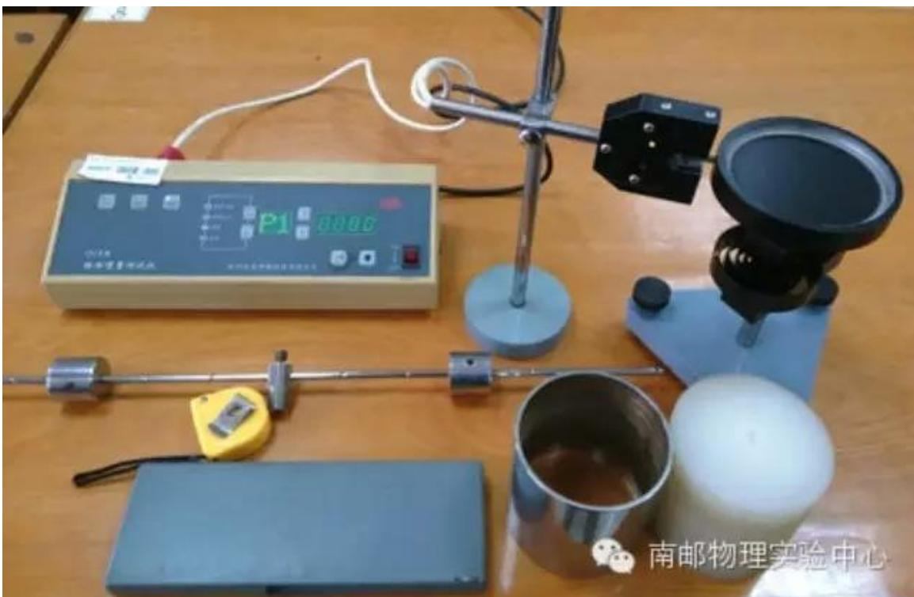

实验地点：教 2 西 427（北侧）

### 实验目的

用扭摆测定几种不同形状物体的转动惯量，验证平行轴定理。

### 实验仪器

转动惯量测试仪等。

### 实验原理

# 物理实验（下）实验操作考试说明及复习大纲

本资料由识别工具读取整理，包含扭摆、分光计及迈克耳逊干涉仪三个实验的说明、步骤与数据记录要求。

## 扭摆法测定转动惯量

### 实验原理与问题

根据胡克定律和转动定律，证明扭摆运动是简谐振动。
其中 $I$ 为物体的转动惯量，$K$ 为弹簧的扭转常数。

$$
T = \frac {2 \pi}{\omega} = 2 \pi \sqrt {\frac {I}{K}}
$$

验证平行轴定理：
$I _ { 0 }$ 为物体对新轴的转动惯量，$I_C$ 为物体绕通过质心轴的转动惯量，$m$ 为物体质量，$x$ 为转轴平行移动的距离。

$$
I _ {0} = I _ {C} + m x ^ {2}
$$

**问题：**
1. 扭转常数 $K$ 的推导过程？
2. 摆角为何要控制在 $40^{\circ} - 90^{\circ}$ 之间？

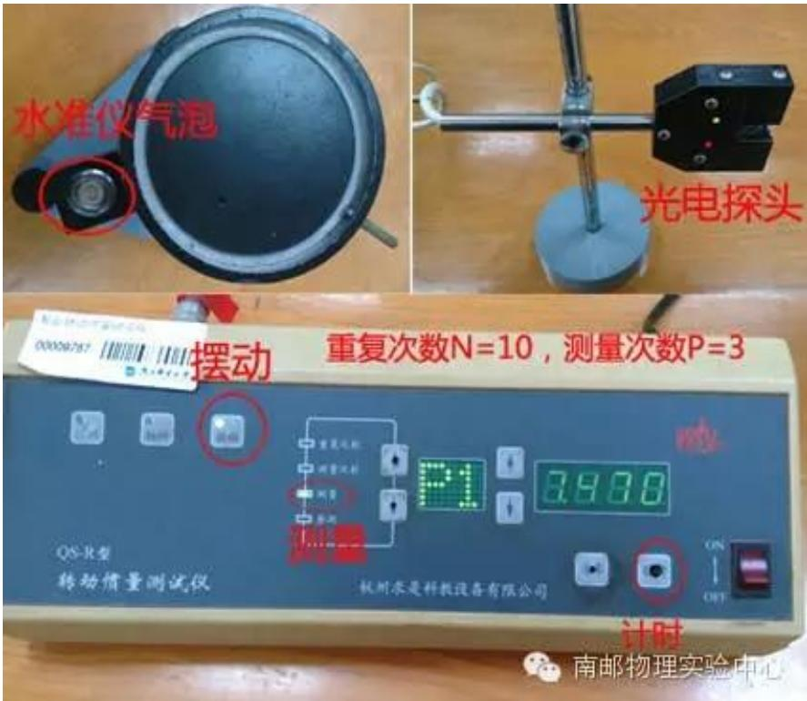

### 实验步骤

1. 调整扭摆处于水平状态，设置转动惯量测试仪的参数；
2. 装上金属载物盘，调整光电探头至合适位置，记录周期 $T_0$；
3. 在载物盘上垂直装上塑料圆柱体，测定其周期 $T_1$，计算扭转常数 $K$；
4. 将塑料圆柱体换成空心金属圆柱体，测量周期 $T_2$；
5. 用游标卡尺测量待测物体几何尺寸，用数字式电子台秤分别测出待测物体的质量；
6. 装上金属细杆，测出周期 $T_3$，将滑块对称地放置在金属细杆两边的凹槽内，测量并记录各自周期 $T_4$。

### 数据记录

#### 表 1 几种待测物体的转动惯量数据记录表格

| 物体名称 | 质量 (g) | 几何尺寸 (mm) | 周期 (s) |
| :--- | :--- | :--- | :--- |
| **金属载物盘** | / | / | $10T_0$ |
| **塑料圆柱** | | $D_I$ | $10T_1$ |
| **金属圆筒** | | $D_{外}$ $D_{内}$ | $10T_2$ |
| **金属细杆** | | L | $10T_3$ |
| **滑块** | | $D_{外}$ $D_{内}$ $L_I$ | - |

> 注：该部分画在最后一页。南邮物理实验中心。

#### 表 2 验证转动惯量的平行轴定理

| 位置 $x(10^{-2}m)$ | 5.00 | 10.00 | 15.00 |
| :--- | :--- | :--- | :--- |
| 10 次摆动周期 $10T(s)$ | | | |

### 数据处理

**扭转常数公式：**
$k = 4 \pi ^ { 2 } \frac { \bar { I } _ { 1 } ^ { ~ 3 } } { \bar { T } _ { 1 } ^ { 2 } - \bar { I } _ { 0 } ^ { 2 } } =$

#### 表 1 几种待测物体的转动惯量数据处理表格

| 物体名称 | 质量 (g) | 几何尺寸 (mm) | 周期 (s) | 转动惯量理论值 ($kgm^2$) | 实验值 ($kgm^2$) | 百分差 |
| :--- | :--- | :--- | :--- | :--- | :--- | :--- |
| **金属载物盘** | / | / | $\overline{T_0}$ | / | $I_0=\frac{I_1^{\prime}\overline{T}_0^2}{T_1^2-T_0^2}$ | / |
| **塑料圆柱** | | $\overline{D_1}$ | $\overline{T_1}$ | $I_1'=\frac{1}{8}m\overline{D_1^2}$ | $I_1=\frac{K\overline{T_1^2}}{4\pi^2}-I_0$ | |
| **金属圆筒** | | $\overline{D_p}$ $\overline{D_n}$ | $\overline{T_2}$ | $I_2'=\frac{1}{8}m(\overline{D_p^2}+\overline{D_n^2})$ | $I_2=\frac{K\overline{T_2^2}}{4\pi^2}-I_0$ | |
| **金属细杆** | | L | $\overline{T_3}$ | $I_3'=\frac{1}{12}mL^2$ | $I_3=\frac{K}{4\pi^2}\overline{T_3^2}$ | |

#### 表 2 验证转动惯量的平行轴定理

| 位置 $x(10^{-2}m)$ | 5.00 | 10.00 | 15.00 |
| :--- | :--- | :--- | :--- |
| 摆动周期 $\overline{T}(s)$ | | | |
| 实验值 $(10^{-2}kgm^{2})$ $I=\frac{K}{4\pi^{2}}\overline{T}^{2}$ | | | |
| 理论值 $(10^{-2}kgm^{2})$ $I' = I_{3}' + 2mx^{2} + I_{4}'$ | | | |
| 百分差 | | 南邮物理实验中心 | |

### 视频资源

视频很小，可直接观看！
视频地址：http://v.qq.com/boke/page/s/0/k/s0148x6s2wk.html
也可在腾讯视频，搜索“扭摆 nupt"

---

## 分光计的调节及三棱镜折射率的测定

### 基本信息

*   **日期**: 2015-03-30
*   **地点**: 教 2 西 532 教室（北侧）

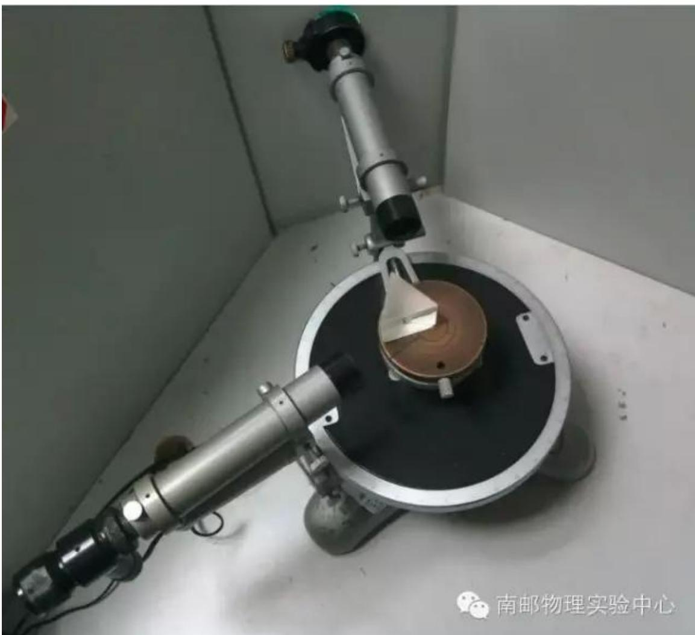

### 实验目的

掌握分光计的调节以及用最小偏向角法测定玻璃三棱镜的折射率。

### 实验仪器

JJY1' 型分光计、Hg 灯光源、双面反射镜、三棱镜等。

### 实验原理

$$
n = \frac {\sin \frac {\delta_ {\min} + A}{2}}{\sin \frac {A}{2}} \quad (A = 60 ^ {\circ})
$$

其中，$\delta _ { \mathtt { m i n } } = \frac { 1 } { 4 } ( \left| \theta _ { \mathtt { m } } ^ { , } - \theta _ { \mathtt { m } } \right| + \left| \theta _ { \mathtt { t } } ^ { , } - \theta _ { \mathtt { m } } \right| )$

光路图：
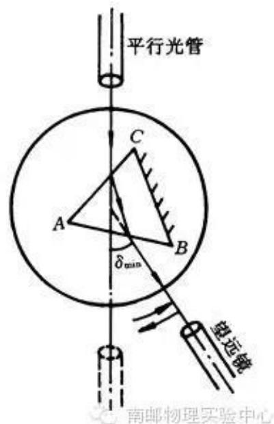

### 分光计的调节

> **[!IMPORTANT]**
> 此段最重要，请认真看书消化理解。

1. 旋转目镜调焦手轮，使分划板上黑色十字准线清晰；
2. 把双面反射镜紧贴在物镜上，松开目镜套筒锁紧螺钉，前后移动镜筒，使得反射回来的绿色十字像清晰；
3. 把双面反射镜放置在载物台其中一条线上，多次调节三个螺钉，使得两个面均能将绿十字像反射进入镜筒；
4. 用“各半调节”法，多次调节望远镜俯仰螺钉和载物台调平螺钉 a、b，使得两面反射回来的十字像都与上刻度线重合；
5. 将双面反射镜旋转 90 度，找到反射十字像，只调节螺钉 c，使十字像与上刻度线重合；
6. 松开狭缝锁紧螺钉，前后移动狭缝装置，使望远镜中狭缝的像清晰，适当调节平行光管俯仰螺钉。

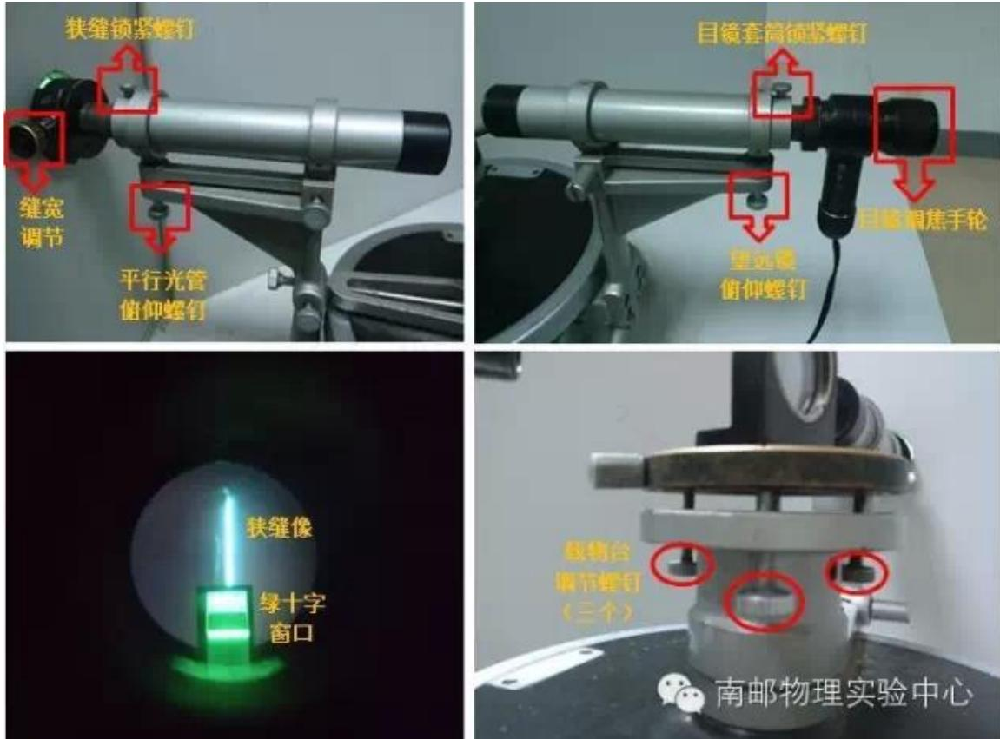

### 实验步骤

1. 调节分光计到正常工作状态；
2. 正确放置三棱镜，转动望远镜，找到一系列彩色谱线；
3. 往同一方向转动平台，从望远镜中跟踪绿谱线，找到绿谱线最小偏向角的位置，读出左、右两窗口的读数 $\theta$ 和 $\theta'$；
4. 转动平台，使三棱镜到另一侧，重复以上步骤，记下此时两窗口读数 $\theta''$ 和 $\theta'''$。

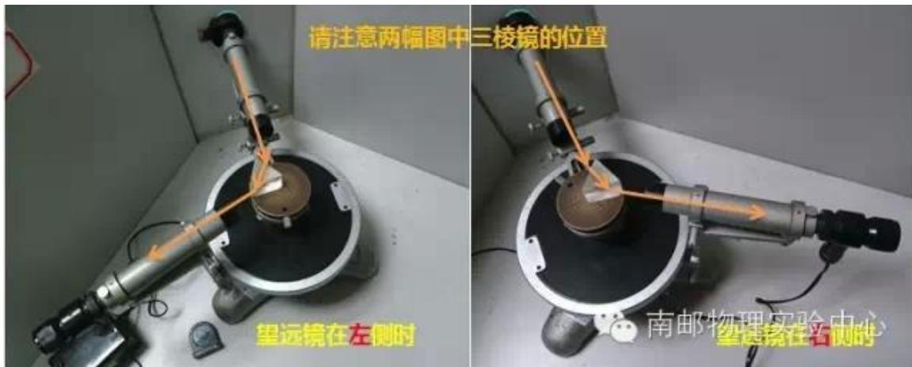

> **注意**: 三棱镜置于载物台上后，请不要再移动三棱镜，转动载物台使得三棱镜到另外一侧。
> 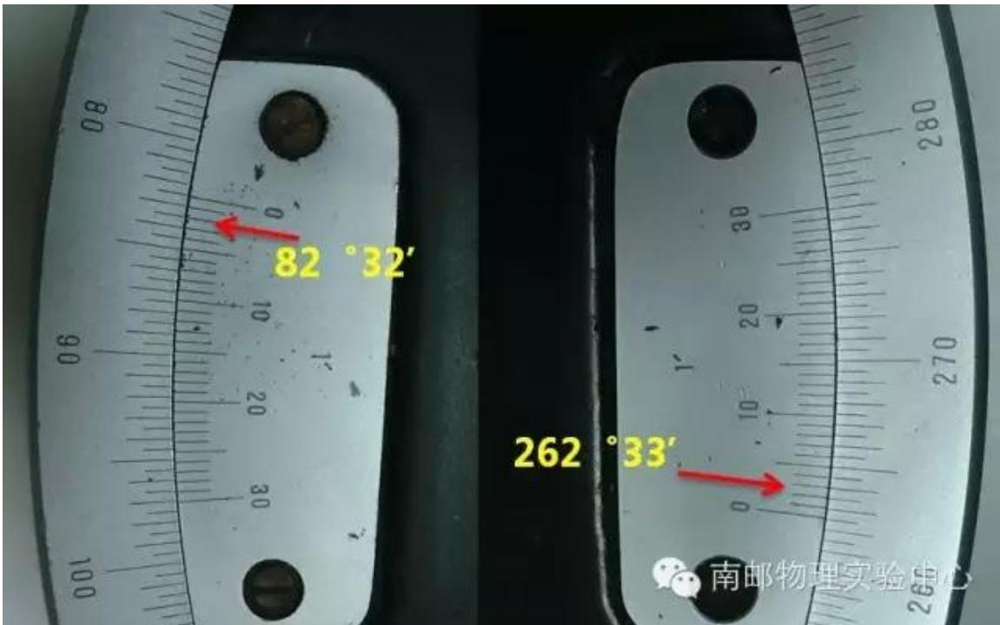

### 读数方法

角游标的读数方法和游标卡尺相同，先看游标零点位置，读周围一圈大盘（主尺，最小间隔为 30 分），再找对齐（不要读出超过 60 分的数据来）。

### 数据记录

<table>
<tr><td>测量次数\角度</td><td> $\theta_{\text{左}}$ </td><td> $\theta_{\text{右}}$ </td><td> $\theta_{\text{左}'}$ </td><td> $\theta_{\text{右}'}$ </td></tr>
<tr><td>1</td><td></td><td></td><td></td><td></td></tr>
<tr><td>2</td><td></td><td></td><td></td><td></td></tr>
<tr><td>3</td><td></td><td></td><td></td><td>南邮物理实验中心</td></tr>
</table>

**谱线运动视频**（视频很小，可直接点击观看）
注：往同一方向转动平台，从望远镜中看到情况：向中间运动有一极限位置（右侧情况是对称的）。

---

## 迈克耳逊干涉仪的调整和使用

### 基本信息

*   **日期**: 2014-09-12
*   **地点**: 教 2 西 534（北侧）

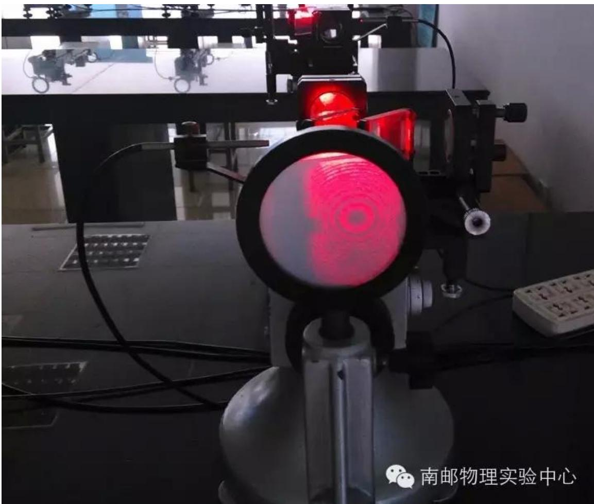

### 实验目的

用迈克耳逊干涉仪测量单色光（He-Ne 激光）的波长。

### 实验原理

$$
\lambda = \frac {1}{N} \cdot 2 \cdot \Delta d
$$

*   $N$: “冒出”或“消失”的圆环条纹个数
*   $\Delta d$: 与 $N$ 相对应的动镜 M 移动的距离

**请问：**
1. 公式中常数 2 是怎么产生的？
2. He-Ne 激光波长的理论值是多少？

### 实验步骤

*(原文内容在此处截断)*

# 《物理实验》（下）实验操作考试说明及复习大纲

## 迈克尔逊干涉仪实验

### 实验操作步骤

1. 转动粗调转轮，使动镜 $M_1$ 位于主尺刻度 50mm 左右；
2. 调节激光束大致垂直射到定镜 $M_2$ 上；
3. 移开观察屏，分别调节 $M_1$ 和 $M_2$ 背后的 2 个调节螺钉，使两排光点尽量重合（注意要一一对应）；
4. 移回观察屏，接收到明暗相间的同心圆环（若无干涉环，重复第 3 步）；
5. 消除回程差：使微调转轮沿同一方向转动几周；
6. 记录下 $M$ 的初始位置 $d$，继续沿原方向转动微调转轮，数出“冒出”(或“消失”)的圆环的数目，每隔 20 个条纹数记录下 $M_1$ 的位置 $d_1, d_2, d_3, d_4, d_5$。

### 原始数据记录表格

| 冒出或消失条纹数 | 动镜M位置(mm) |
| :--- | :--- |
| 第0个 | $d=$ |
| 第20个 | $d=$ |
| 第40个 | $d=$ |
| 第60个 | $d=$ |
| 第80个 | $d=$ |
| 第100个 | $d=$ |

由逐差法，得到 $\Delta d = d - d_i (i=0,1,2)$，则 $N=60$。取平均值，代入公式，求出波长。

### 读数方法

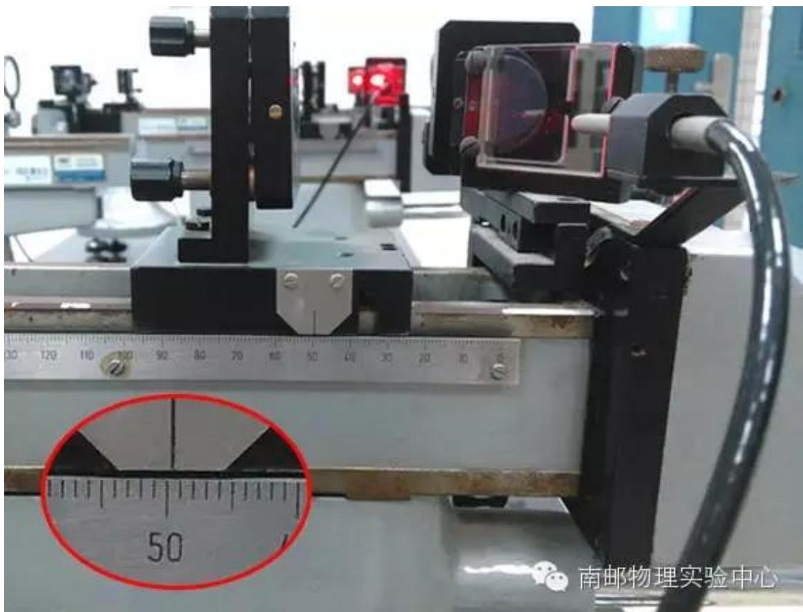

#### 一、先读主尺 50.

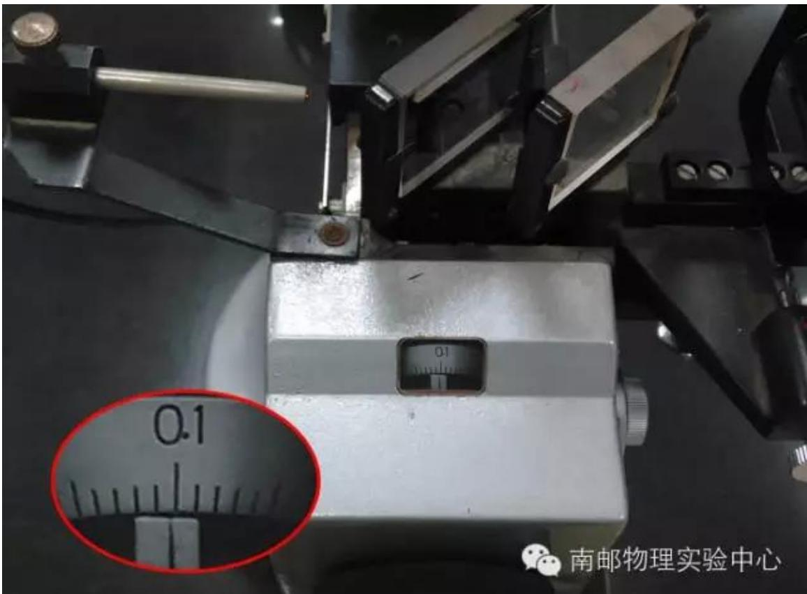

#### 二、再读中间窗口 50.09

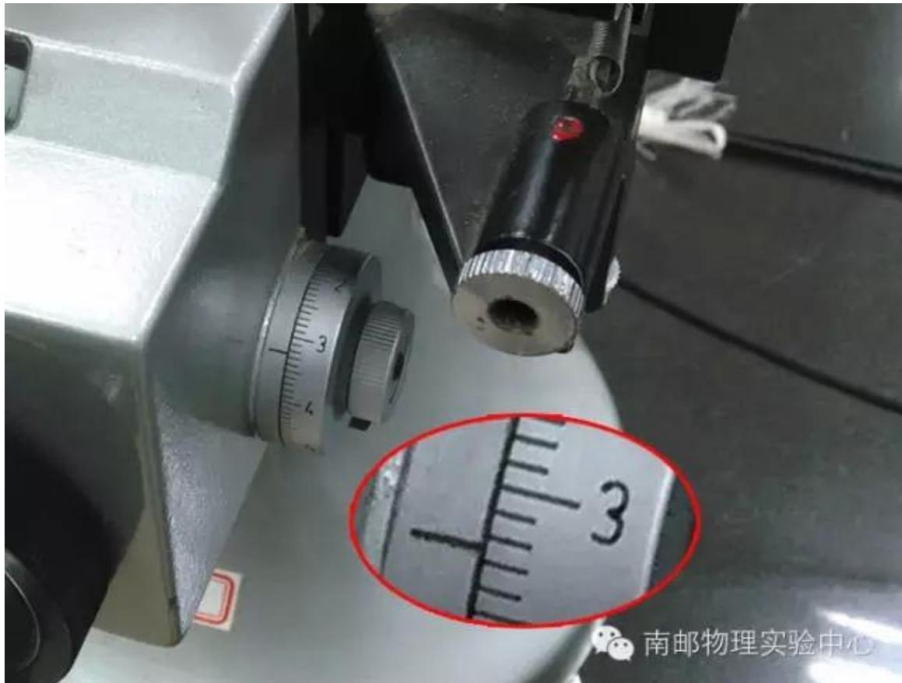

#### 三、最后读微调转轮 50.09324mm

## 光的等厚干涉（牛顿环）

### 实验地点

教 2 西 521（南侧）

### 实验目的

1. 利用牛顿环测量透镜的曲率半径；
2. 分别用图解法和逐差法处理数据。

### 实验原理

**牛顿环装置：** 平凸玻璃透镜 + 平面玻璃

*   **平凸玻璃透镜：** 从曲率半径很大（接近 1 米）的玻璃球上切下一小块玻璃片，肉眼几乎看不出与平面玻璃有任何区别。
*   **空气薄膜：** 透镜凸面与平面玻璃接触，两者之间形成空气薄膜（请在脑海中构建出空气薄膜的立体形状）。

亲爱的小伙伴们，请观察下图中的两个插图，完成“找不同”游戏，这下你应该想到辨别两种玻璃的方法了吧？

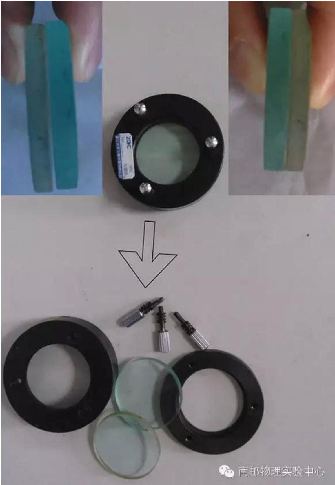

### 请思考

1. 牛顿环干涉图样的中心是暗斑还是亮斑？由什么决定？
2. 图解法中，横坐标和纵坐标代表的变量分别是什么？
3. 逐差法中，交叉相减的量是什么？为什么可以用逐差法？
4. 如何消除回程差？实际操作中，与迈克尔逊实验有什么不同？

### 注意事项

1. 正确摆放牛顿环，使得叉丝竖线与暗环相切，切点为叉丝交点，并且左右两边同时满足该条件；
2. 物镜下方的 45 度半反射镜的角度如图，使得前方过来的光线向下反射进入牛顿环。

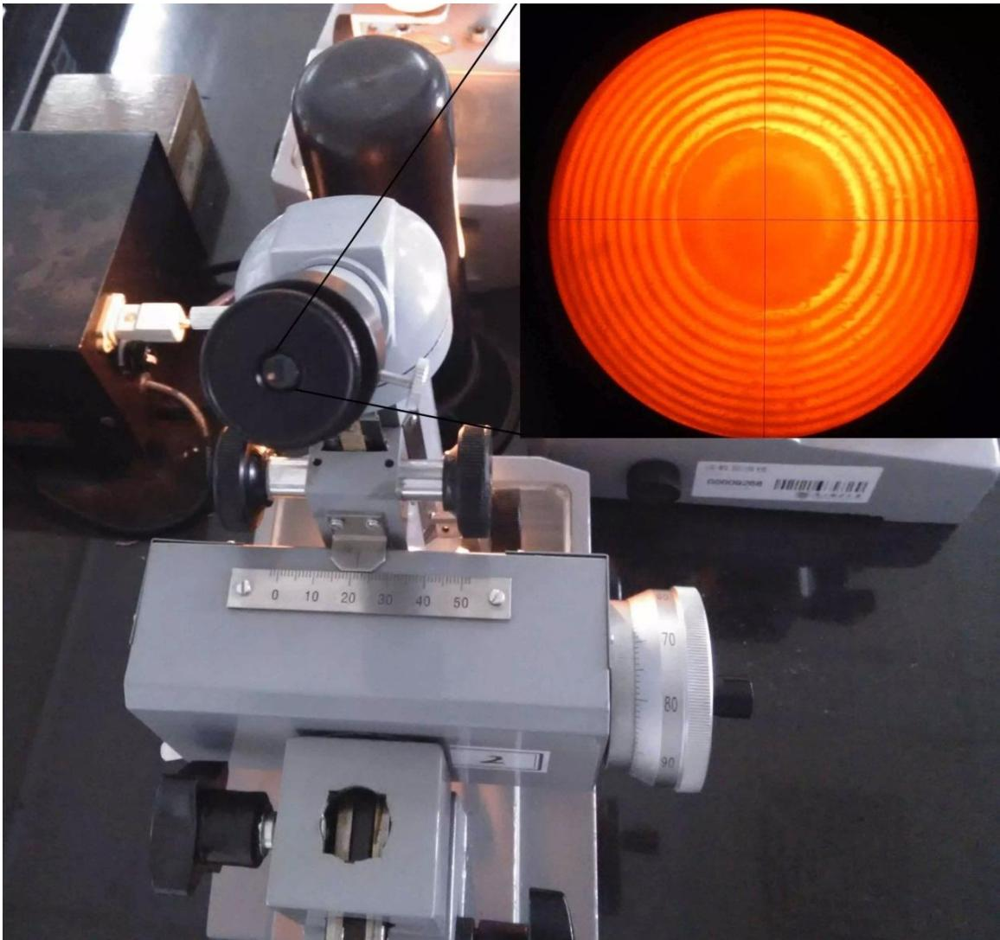

## 电介质介电常数的测量

### 实验地点

教 2 西 429（北侧）

### 实验目的

掌握固体电介质相对介电常数的测量原理及方法。

### 实验仪器

DF2826 LCR数字电桥、螺旋测微器、游标卡尺等。

### 实验原理

**1. 用电桥法测量固体电介质相对介电常数 $\varepsilon_r$**

$$
\varepsilon_{\mathrm{r}} = \frac {C _ {\mathrm{串}} \cdot d}{\varepsilon_ {0} S - C _ {\mathrm{串}} (D - d)}
$$

其中
$$
C _ {\mathrm{串}} = C _ {2} - C _ {1} + C _ {0}, \quad C _ {0} = \frac {\varepsilon_ {0} S}{D},
$$

*   $D$: 电极的间距；
*   $d$: 固体介质样品的厚度；
*   $S$: 固体介质样品的面积（通过测量介质的直径计算）；
*   $C _ {1}$: 平行板电极间以空气为介质时的电容量；
*   $C _ {2}$: 平行板电极间充满固体介质时的电容量。

**2. 测定空气的介电常数 $\varepsilon_0$ 和系统的分布电容 $C_{\mathcal{H}}$**

$$
C = \frac {\varepsilon_ {0} S _ {0}}{D} + C _ {\mathrm{分}}, \quad S _ {0} = 21.61 \mathrm{cm} ^ {2}
$$

$C _ {\mathcal{A}}$ 为测量引线及测量系统等引起的分布电容之和。

### 实验步骤

1. 用游标卡尺和螺旋测微器测出样品的直径 $l$ 和厚度 $d$，并计算出面积 $S$；
2. 固定电极的间距 $D$ 为 5.500mm，测出以空气为介质时的电容量 $C_1$ 和有介质时的电容量 $C_2$；
3. 重复 1、2 步骤，各两次；
4. 调节测量电极两极板的间距从 1.000mm 开始，每次增加 0.100mm，测出每个间距对应的电容量 $C_n$。

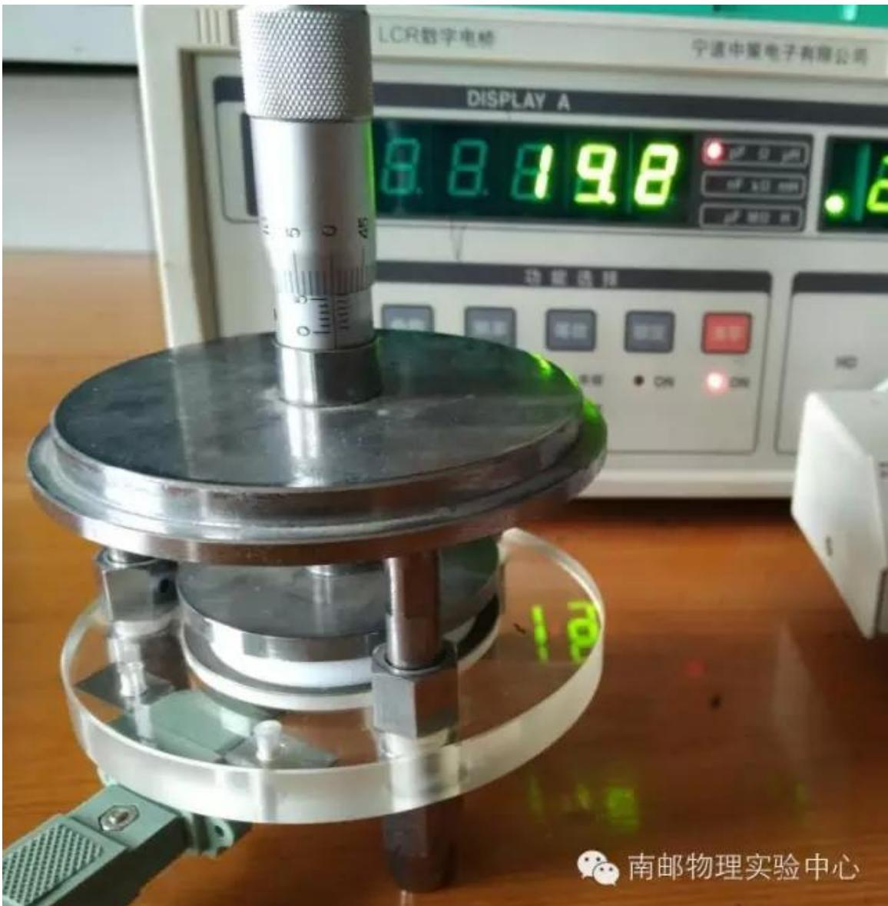

### 原始数据记录表

**1. 固体电介质相对介电常数 $\varepsilon_r$ 数据记录表**

| 次数 | D(mm) | d(mm) | l(mm) | C1(pF) | C2(pF) |
| :--- | :--- | :--- | :--- | :--- | :--- |
| 1 | rowspan="3">5.500 | | | | |
| 2 | | | | | |
| 3 | | | | | |
| 平均值 | | | | | |

**2. 空气介电常数 $\varepsilon_0$ 和分布电容 $C$ 数据记录表**

| D(mm) | 1.000 | 1.100 | 1.200 | 1.300 | 1.400 | 1.500 | 1.600 | 1.700 | 1.800 | 1.900 |
| :--- | :--- | :--- | :--- | :--- | :--- | :--- | :--- | :--- | :--- | :--- |
| C(pF) | | | | | | | | | | |
