# 《物理实验(下)》期末试卷

原件经识别和整理；“参考解答”是我们补的。

### 选择 1
在分光计的调整过程中，为了能够清晰地观察到两横一竖的叉丝，应该：

- A. 调节双面反射镜的位置
- B. 松开目镜套筒锁紧螺钉，前后移动镜筒
- C. 调节望远镜俯仰螺钉
- D. 调节目镜调焦手轮

答案：D。

知识点：[有效数字的运算法则（加减运算与乘除运算）](../../../topics/大学物理实验/有效数字运算法则.md)、[测量的分类（直接测量与间接测量）](../../../topics/大学物理实验/测量的分类.md)

### 选择 2
为了使得望远镜光轴垂直于分光计主轴，需要来消除高差。

- A. 自准法
- B. 各半调节法
- C. 调节望远镜俯仰螺钉
- D. 调节载物平台下的a、b、c螺钉

答案：B。

知识点：[测量与单位（含国际单位制重新定义）](../../../topics/大学物理实验/测量与单位.md)、[有效数字的运算法则（加减运算与乘除运算）](../../../topics/大学物理实验/有效数字运算法则.md)

### 选择 3
如图中所示，当满足下列哪个选项时，则望远镜光轴垂直于分光计中心轴？

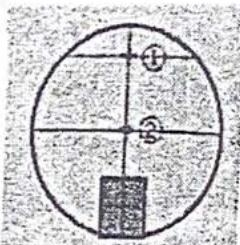

- A. 绿十字像出现在图中①位置
- B. 绿十字像出现在图中②位置
- C. 转动180度后经平面镜两面反射的绿十字像均出现在图中①位置
- D. 转动180度后经平面镜两面反射的绿十字像均出现在图中②位置

答案：C。

知识点：[有效数字的概念与定义](../../../topics/大学物理实验/有效数字概念.md)、[有效数字的修约规则（只进不舍等）](../../../topics/大学物理实验/有效数字修约规则.md)、[直接测量量的有效数字读数原则（游标卡尺、角游标尺、螺旋测微器、数字表头）](../../../topics/大学物理实验/直接测量量读数原则.md)

### 选择 4
为了能够清晰地观察到狭缝像，需要：

- A. 调节目镜调焦手轮
- B. 松开狭缝锁紧螺钉，前后移动狭缝
- C. 调节平行光管俯仰螺钉
- D. 松开目镜套筒锁紧螺钉，前后移动镜筒

答案：B。

知识点：[有效数字的修约规则（只进不舍等）](../../../topics/大学物理实验/有效数字修约规则.md)、[有效数字的概念与定义](../../../topics/大学物理实验/有效数字概念.md)、[测量与单位（含国际单位制重新定义）](../../../topics/大学物理实验/测量与单位.md)

### 选择 5
在《用分光计和透射光栅测波长》实验中，用透射光栅作为色散器件，下列有关实验现象和结果正确的是：

- A. 观察到的中央明条纹是单色光
- B. 一级衍射明条纹由内侧向外侧依次出现的是红、橙、黄、绿、蓝、紫等几种颜色
- C. 用二级衍射明条纹的数据计算出的光栅常量是一级衍射数据计算出的两倍
- D. 以上说法都不正确

答案：D。

知识点：[有效数字的概念与定义](../../../topics/大学物理实验/有效数字概念.md)、[有效数字的运算法则（加减运算与乘除运算）](../../../topics/大学物理实验/有效数字运算法则.md)

### 选择 6
用电位差计测量电源电动势采用的是以下哪个原理：

- A. 比较法
- B. 补偿法
- C. 换测法
- D. 模拟法

答案：B。

知识点：[直接测量量的有效数字读数原则（游标卡尺、角游标尺、螺旋测微器、数字表头）](../../../topics/大学物理实验/直接测量量读数原则.md)、[有效数字的概念与定义](../../../topics/大学物理实验/有效数字概念.md)、[测量的分类（直接测量与间接测量）](../../../topics/大学物理实验/测量的分类.md)

### 选择 7
在牛顿环观测实验中，下列正确的说法是：

- A. 测量时要注意空程差的影响
- B. 用汞灯做光源效果最好
- C. 牛顿环中央是暗斑时误差最小
- D. 牛顿环半径应从暗斑中央开始测量

答案：A。
知识点：[有效数字的修约规则（只进不舍等）](../../../topics/大学物理实验/有效数字修约规则.md)、[科学记数法表示有效数字](../../../topics/大学物理实验/科学记数法.md)、[有效数字的概念与定义](../../../topics/大学物理实验/有效数字概念.md)

### 选择 8
牛顿环是产生的现象。

- A. 声光干涉
- B. 等倾干涉
- C. 等厚干涉
- D. 玻璃干涉

答案：C。

知识点：[直接测量量的有效数字读数原则（游标卡尺、角游标尺、螺旋测微器、数字表头）](../../../topics/大学物理实验/直接测量量读数原则.md)、[有效数字的概念与定义](../../../topics/大学物理实验/有效数字概念.md)、[有效数字的修约规则（只进不舍等）](../../../topics/大学物理实验/有效数字修约规则.md)

### 选择 9
如左下图示波器CH1信号波形，调整其上下位置的旋钮是：

- A. CH1垂直档位旋钮
- B. CH2的位置旋钮
- C. 水平位置旋钮
- D. CH1的位置旋钮

答案：D。
知识点：[测量与单位（含国际单位制重新定义）](../../../topics/大学物理实验/测量与单位.md)

### 选择 10
如图所示分光计的左游标读数，以下哪一个可能是此时分光计右游标的读数？

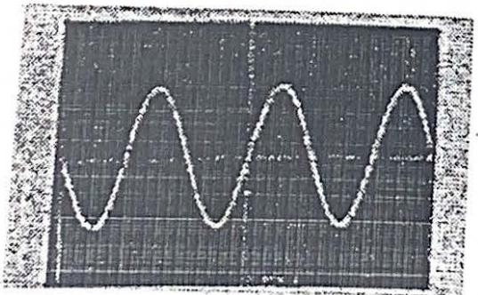

- A. $44^\circ 37'$
- B. $214^\circ 38'$
- C. $134^\circ 5'$
- D. $224^\circ 46'$

答案：D。
知识点：[有效数字的概念与定义](../../../topics/大学物理实验/有效数字概念.md)、[有效数字的运算法则（加减运算与乘除运算）](../../../topics/大学物理实验/有效数字运算法则.md)

### 选择 11
在分光计的使用中，望远镜是用来：

- A. 产生平行光线
- B. 放置光学器件
- C. 观察平行光线
- D. 控制载物台

答案：C。

知识点：[直接测量量的有效数字读数原则（游标卡尺、角游标尺、螺旋测微器、数字表头）](../../../topics/大学物理实验/直接测量量读数原则.md)

### 选择 12
相位比较法测量声速，两个通道的相位差为0时，示波器上的李萨如图形为：

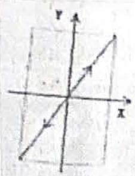

A

B

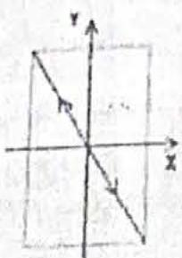

C

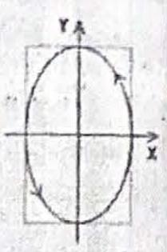

D

答案：A。

# 二、填空题

知识点：[实验报告的内容（含实验内容与步骤等）](../../../topics/大学物理实验/实验报告内容.md)

### 填空 1
平行光管的结构主要由 **狭缝** 和 **凸透镜** 组成。

知识点：[有效数字的运算法则（加减运算与乘除运算）](../../../topics/大学物理实验/有效数字运算法则.md)

### 填空 2
在分光计的实验中，采用两个相差 $180^\circ$ 的窗口来读数，是为了消除刻度盘的 **偏心差**。

知识点：[有效数字的修约规则（只进不舍等）](../../../topics/大学物理实验/有效数字修约规则.md)

### 填空 3
实验中所用JJY型分光计的主刻度盘分度值是 $0.5^\circ$，游标精度是 **1'**（注：原文识别为1°，根据常识应为1角分，此处保留原意但需注意单位，若严格遵循“不增删实质内容”且原文确写1°，则填1°，但通常物理实验中为1'。鉴于原文直接写“1°”，暂按原文整理，建议核实）。
*订正：通常JJY分光计游标精度为1'（1角分），原文识别可能有误或简写。*

知识点：[物理实验课的基本程序（预习、实验进行、写报告）](../../../topics/大学物理实验/实验课基本程序.md)

### 填空 4
在分光计的实验中，当狭缝的宽度过大时，相距较近的谱线会发生 **重叠** 现象，不利于鉴别谱线及其中央位置；当狭缝的宽度过小时，谱线的 **亮度** 会显著降低，不利于观察和测量。

知识点：[测量的分类（直接测量与间接测量）](../../../topics/大学物理实验/测量的分类.md)、[实验报告的内容（含实验内容与步骤等）](../../../topics/大学物理实验/实验报告内容.md)

### 填空 5
调节分光计望远镜时，当调到黑色十字叉丝清晰，把双面反射镜紧贴在物镜管口，前后移动套筒螺钉，使得反射回来的“绿十字像”清晰，即望远镜聚焦 **无穷远** 调整完毕。

知识点：[物理实验课程的成绩考核方式](../../../topics/大学物理实验/成绩考核.md)

### 填空 6
光栅衍射时，汞灯光谱中央明条纹的颜色为 **白色**（原文识别为“亮日”，结合语境应为“白色”或“白光”，因包含所有光谱成分）。
*订正：原文“亮日”疑似OCR错误，应为“白色”。*

知识点：[测量的分类（直接测量与间接测量）](../../../topics/大学物理实验/测量的分类.md)

### 填空 7
将微安级别的表头扩程为毫安表，采用的方法是 **并联电阻**。

知识点：[有效数字的概念与定义](../../../topics/大学物理实验/有效数字概念.md)、[有效数字的修约规则（只进不舍等）](../../../topics/大学物理实验/有效数字修约规则.md)

### 填空 8
进行改装表整点校正的时候，应该调整 **标准表** 的读数，记录 **改装表** 的数据。（选填：标准表；改装表）
*注意：通常校准是调节标准源使标准表达到指定值，读取被校表数值。或者调节被校表指针到指定值，读标准表。根据题目“调整...读数，记录...数据”，通常指调节输入信号使**标准表**指示某一刻度，然后记录**改装表**的读数以作对比。故第一空填“标准表”，第二空填“改装表”。*

知识点：[直接测量量的有效数字读数原则（游标卡尺、角游标尺、螺旋测微器、数字表头）](../../../topics/大学物理实验/直接测量量读数原则.md)、[测量的分类（直接测量与间接测量）](../../../topics/大学物理实验/测量的分类.md)

### 填空 9
在受迫振动实验中，当摆轮振动的频率等于驱动力的频率时，摆轮振动的振幅最大的现象叫 **共振** 现象。

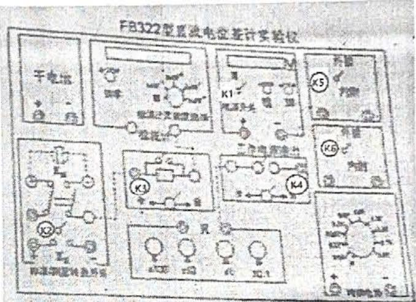

知识点：[物理实验课的基本程序（预习、实验进行、写报告）](../../../topics/大学物理实验/实验课基本程序.md)

### 填空 10
用十一线电位差计测量电动势，应先将数字式检流计档位拨到断开，对检流计进行调零。测量时K5置于内附，K6置于内附，K3置于合，测量精度高。
*解析：测量前断开K3检流计调零，测量时闭合K3，内附K5、K6。*

知识点：[测量的分类（直接测量与间接测量）](../../../topics/大学物理实验/测量的分类.md)、[直接测量量的有效数字读数原则（游标卡尺、角游标尺、螺旋测微器、数字表头）](../../../topics/大学物理实验/直接测量量读数原则.md)

### 填空 11
用十一线电位差计测量电动势，取校正系数 $U_0=220\text{mV/m}$（原文识别为2200V/m，根据后文计算 $1.0186/0.22 \approx 4.63$，推测单位为 $\text{V/m}$ 或 $\text{mV/mm}$ 等，此处依据计算过程反推），则标准电动势对应的电阻丝定标长度为 **4.630 m**。
*解析：$L_{\text{定标}} = E_N / U_0 = 1.0186 / 0.22 = 4.630\text{m}$。*

知识点：[有效数字的概念与定义](../../../topics/大学物理实验/有效数字概念.md)、[测量的分类（直接测量与间接测量）](../../../topics/大学物理实验/测量的分类.md)

### 填空 12
在观测牛顿环实验的读数过程中，读数鼓轮沿一个方向转动，其目的是消除 **空程差**。

知识点：[有效数字的概念与定义](../../../topics/大学物理实验/有效数字概念.md)、[直接测量量的有效数字读数原则（游标卡尺、角游标尺、螺旋测微器、数字表头）](../../../topics/大学物理实验/直接测量量读数原则.md)

### 填空 13
在牛顿环实验中，通过调节读数显微镜的目镜使得分划板上的 **十字丝** 清晰。

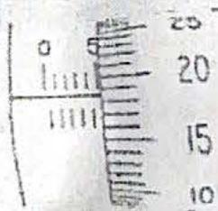

估读：$5 + 0.01 \times 18.5 = 8.185\text{mm}$（此处公式与结果不符，$5+0.185=5.185$，若结果为8.185，主尺读数应为8mm。依图及常规读数逻辑，此处仅保留原文数据）。

知识点：[测量的分类（直接测量与间接测量）](../../../topics/大学物理实验/测量的分类.md)、[有效数字的概念与定义](../../../topics/大学物理实验/有效数字概念.md)

### 填空 14
如上图所示螺旋测微器主尺上一格的读数为 **1 mm**，螺旋测微器读数以毫米为单位，有 **3** 位小数。

# 三、实验简答题

知识点：[有效数字的运算法则（加减运算与乘除运算）](../../../topics/大学物理实验/有效数字运算法则.md)

### 简答 1
根据下图给出的十一线电位差计测量电动势的原理图简要说明其原理。

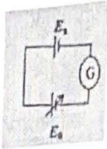

答案：利用补偿法原理。当检流计读数为0时，待测电动势 $E_x$ 与电位差计提供的已知电压 $E_0$ 相等（$E_x=E_0$），从而通过测量长度或已知参数计算出 $E_x$ 的值。

知识点：[测量的分类（直接测量与间接测量）](../../../topics/大学物理实验/测量的分类.md)、[直接测量量的有效数字读数原则（游标卡尺、角游标尺、螺旋测微器、数字表头）](../../../topics/大学物理实验/直接测量量读数原则.md)、[有效数字的运算法则（加减运算与乘除运算）](../../../topics/大学物理实验/有效数字运算法则.md)

### 简答 2
电表改装。处理下表实验数据，根据数据定义量程为10mA的改装表等级，并作出校正曲线。

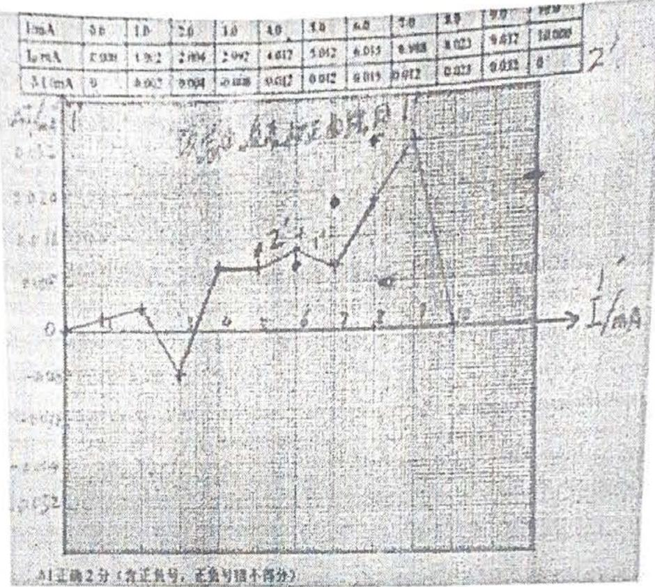

计算示例：
$$ f = |\Delta I| / 10\text{mA} \times 100\% = |0.032\text{mA}| / 10\text{mA} \times 100\% = 0.32\% $$
故该表可定为 **0.5级**。

# 四、计算题

知识点：[直接测量量的有效数字读数原则（游标卡尺、角游标尺、螺旋测微器、数字表头）](../../../topics/大学物理实验/直接测量量读数原则.md)、[有效数字的概念与定义](../../../topics/大学物理实验/有效数字概念.md)、[实验报告的内容（含实验内容与步骤等）](../../../topics/大学物理实验/实验报告内容.md)

### 计算 1
(1) 在声速测量实验时，为了使发射换能器达到谐振状态，请简述调整信号源的主要步骤。

答案：按“频率/周期”键使其显示频率，调节到谐振频率。调节频率有两种方法：
1. 直接输入数值和单位。
2. 使用黄色左右移位键和右上角圆形调节旋钮。

(2) 用共振干涉法得到的数据如下，请填下表并求声速 $v$（共振频率 $f=37.205\text{kHz}$）。

| 次数 k | 位置 L/cm | L(k+4)-Lk/cm |
| :---: | :---: | :---: |
| 1 | 8.062 | |
| 2 | 8.544 | |
| 3 | 9.004 | |
| 4 | 9.482 | |
| 5 | 9.952 | $L_5-L_1=1.890$ |
| 6 | 10.424 | $L_6-L_2=1.880$ |
| 7 | 10.896 | $L_7-L_3=1.892$ |
| 8 | 11.384 | $L_8-L_4=1.902$ |
| **平均值 $\bar{\Delta L}$/cm** | | **1.891** |

解：因为 $\Delta L = 4\lambda / 2 = 2\lambda$，所以 $\lambda = \Delta L / 2$。
$$ v = \lambda f = \frac{\Delta L}{2} f = \frac{1.891 \times 10^{-2}\text{m}}{2} \times 37.205 \times 10^3\text{Hz} \approx 351.773\text{m/s} $$

# 《物理实验(下)》期末试卷

## 一、选择题（共20分，每题2分）

知识点：[直接测量量的有效数字读数原则（游标卡尺、角游标尺、螺旋测微器、数字表头）](../../../topics/大学物理实验/直接测量量读数原则.md)、[有效数字的运算法则（加减运算与乘除运算）](../../../topics/大学物理实验/有效数字运算法则.md)

### 选择 1

对一物理量进行等精度多次测量，其算术平均值是 ( )
- A. 真值
- B. 最接近真值的值
- C. 误差最大的值
- D. 误差为零的值

答案：B

知识点：[有效数字的运算法则（加减运算与乘除运算）](../../../topics/大学物理实验/有效数字运算法则.md)、[测量的分类（直接测量与间接测量）](../../../topics/大学物理实验/测量的分类.md)

### 选择 2

某电流值的测量结果为 $I = (30.55 \pm 0.05) \text{mA}$ ，则下面关于被测电流的真值 $I_0$ 的哪种理解是正确的 ( )
- A. $I_0 = 30.55 \text{mA}$
- B. $I_0 = 30.50 \text{mA}$ 或 $I_0 = 30.60 \text{mA}$
- C. $30.50 \text{mA} < I_0 < 30.60 \text{mA}$
- D. $I_0$ 也可能小于 $30.50 \text{mA}$

答案：A

知识点：[测量与单位（含国际单位制重新定义）](../../../topics/大学物理实验/测量与单位.md)、[有效数字的运算法则（加减运算与乘除运算）](../../../topics/大学物理实验/有效数字运算法则.md)

### 选择 3

因天气变化造成米尺伸缩，所引起的测量误差属于 ( )
- A. 随机误差
- B. 系统误差
- C. 粗大误差
- D. A, B, C 都不是

答案：B

知识点：[有效数字的概念与定义](../../../topics/大学物理实验/有效数字概念.md)、[有效数字的修约规则（只进不舍等）](../../../topics/大学物理实验/有效数字修约规则.md)、[直接测量量的有效数字读数原则（游标卡尺、角游标尺、螺旋测微器、数字表头）](../../../topics/大学物理实验/直接测量量读数原则.md)

### 选择 4

在示波器实验中，利用李萨如图形校准频率时，若X轴输入信号的频率为60Hz，现观察到如右所示的图形；则Y轴输入的信号频率为 ( )
- A. 120Hz
- B. 90Hz
- C. 180 Hz
- D. 40Hz

答案：D

知识点：[有效数字的修约规则（只进不舍等）](../../../topics/大学物理实验/有效数字修约规则.md)、[有效数字的概念与定义](../../../topics/大学物理实验/有效数字概念.md)、[测量与单位（含国际单位制重新定义）](../../../topics/大学物理实验/测量与单位.md)

### 选择 5

下列测量的结果中表达式正确的是 ( )
- A. $S = 2560 \pm 100\text{mm}^{2}$
- B. $T = 8.32 \pm 0.02$
- C. $R = 82.3 \pm 0.31\Omega$
- D. $L = 0.667 \pm 0.008\text{mm}$

答案：D

知识点：[有效数字的概念与定义](../../../topics/大学物理实验/有效数字概念.md)、[有效数字的运算法则（加减运算与乘除运算）](../../../topics/大学物理实验/有效数字运算法则.md)

### 选择 6

在计算数据时，当有效数字位数确定以后，应将多余的数字舍去。假设计算结果的有效数字需要保留 4 位，则下列正确的取舍是 ( )
- A. $4.32749 \rightarrow 4.328$
- B. $4.32750 \rightarrow 4.328$
- C. $4.32851 \rightarrow 4.328$
- D. $4.32850 \rightarrow 4.329$

答案：B

知识点：[直接测量量的有效数字读数原则（游标卡尺、角游标尺、螺旋测微器、数字表头）](../../../topics/大学物理实验/直接测量量读数原则.md)、[有效数字的概念与定义](../../../topics/大学物理实验/有效数字概念.md)、[测量的分类（直接测量与间接测量）](../../../topics/大学物理实验/测量的分类.md)

### 选择 7

已知游标卡尺的测量精度为 0.01mm，其主尺的最小分度数(格数)为 ( )
- A. 10 分度游标卡尺
- B. 50 分度游标卡尺
- C. 20 分度游标卡尺
- D. 100 分度游标卡尺

答案：C

知识点：[有效数字的修约规则（只进不舍等）](../../../topics/大学物理实验/有效数字修约规则.md)、[科学记数法表示有效数字](../../../topics/大学物理实验/科学记数法.md)、[有效数字的概念与定义](../../../topics/大学物理实验/有效数字概念.md)

### 选择 8

下面哪一个阻值的待测电阻需要用双臂电桥来测量？ ( )
- A. 0.001Ω
- B. 1MΩ
- C. 1000Ω
- D. 100Ω

答案：A

知识点：[直接测量量的有效数字读数原则（游标卡尺、角游标尺、螺旋测微器、数字表头）](../../../topics/大学物理实验/直接测量量读数原则.md)、[有效数字的概念与定义](../../../topics/大学物理实验/有效数字概念.md)、[有效数字的修约规则（只进不舍等）](../../../topics/大学物理实验/有效数字修约规则.md)

### 选择 9

分光计设计了两个角游标是为了消除 ( )
- A. 视差
- B. 螺距差
- C. 偏心差
- D. 色差

答案：C

知识点：[测量与单位（含国际单位制重新定义）](../../../topics/大学物理实验/测量与单位.md)

### 选择 10

用惠斯通电桥测电阻实验进行“粗调”电桥平衡过程中，采用保护电阻的作用是： ( )
- A. 保护待测电阻
- B. 保护电阻箱
- C. 保护检流计
- D. 保护稳压电源

答案：C

## 二、填空题（20分，每空2分）

知识点：[有效数字的概念与定义](../../../topics/大学物理实验/有效数字概念.md)、[有效数字的运算法则（加减运算与乘除运算）](../../../topics/大学物理实验/有效数字运算法则.md)

### 填空 1

对同一物理量进行多次重复测量，测量结果一般都含有两类不确定度分量，分别用 **A类** 不确定度和 **B类** 不确定度进行评定。

知识点：[有效数字的运算法则（加减运算与乘除运算）](../../../topics/大学物理实验/有效数字运算法则.md)

### 填空 2

常用的实验数据处理方法有列表法、**最小二乘法**、作圆法等。

知识点：[有效数字的修约规则（只进不舍等）](../../../topics/大学物理实验/有效数字修约规则.md)

### 填空 3

如下图，50分度游标卡尺读数 **5.74** mm；螺旋测微器读数 **5.66** mm。

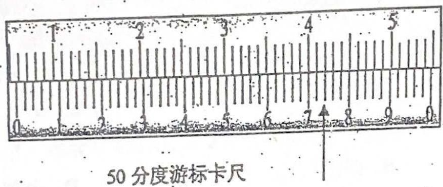

知识点：[物理实验课的基本程序（预习、实验进行、写报告）](../../../topics/大学物理实验/实验课基本程序.md)

### 填空 4

用扭摆法测量物体的转动惯量先要测出一个已知转动惯量物体摆动的 **振动** 周期。再算出本仪器弹簧的 **扭转常数**。若要测量其它形状物体的转动惯量，只要将待测物体放在本仪器项目的各种夹具上，测定其 **振动** 周期。

知识点：[测量的分类（直接测量与间接测量）](../../../topics/大学物理实验/测量的分类.md)、[实验报告的内容（含实验内容与步骤等）](../../../topics/大学物理实验/实验报告内容.md)

### 填空 5

如下图所示，分光计读数盘读数为： $233^{\circ}13'$

## 三、计算题（30分）

知识点：[物理实验课程的成绩考核方式](../../../topics/大学物理实验/成绩考核.md)

### 计算 1

用仪器误差 $\Delta_{\text{仪}} = 0.004 \mathrm{~mm}$ 的螺旋测微计在不同方位测量小钢珠的直径 6次（概率 P=0.95 时，多次测量 $t/\sqrt{n}=1.05$ ），测量数据如下：

| 次数 | 1 | 2 | 3 | 4 | 5 | 6 |
| :---: | :---: | :---: | :---: | :---: | :---: | :---: |
| 直径D(mm) | 3.973 | 3.980 | 3.978 | 3.976 | 3.979 | 3.977 |

计算测量结果和不确定度，写出直径结果表达式（保留必要的计算过程）。

知识点：[直接测量量的有效数字读数原则（游标卡尺、角游标尺、螺旋测微器、数字表头）](../../../topics/大学物理实验/直接测量量读数原则.md)、[有效数字的运算法则（加减运算与乘除运算）](../../../topics/大学物理实验/有效数字运算法则.md)

### 计算 2

一个圆柱体，用游标卡尺测得其直径 $D = 20.42 \pm 0.22 \mathrm{~mm}$ 和高度 $H = 41.25 \pm 0.34 \mathrm{~mm}$ ; 用物理天平测其质量 $M = 152.10 \pm 0.05 \mathrm{~g}$ , 计算圆柱体密度 $\rho$ 及其不确定度, 写出其结果表达式 (保留必要的计算过程)

知识点：[实验报告的内容（含实验内容与步骤等）](../../../topics/大学物理实验/实验报告内容.md)、[测量与单位（含国际单位制重新定义）](../../../topics/大学物理实验/测量与单位.md)

### 作图 1

测得某二极管的正向压降（U）随温度（T）变化的数据如下：

| T(K) | 110.0 | 125.0 | 140.0 | 155.0 | 170.0 | 185.0 | 200.0 | 215.0 |
| :---: | :---: | :---: | :---: | :---: | :---: | :---: | :---: | :---: |
| U(mV) | 776 | 730 | 690 | 639 | 603 | 555 | 502 | 472 |

根据以上数据作图，并求出二极管的正向压降的温度系数 $c(U=cT)$ 。

知识点：[测量的分类（直接测量与间接测量）](../../../topics/大学物理实验/测量的分类.md)、[有效数字的运算法则（加减运算与乘除运算）](../../../topics/大学物理实验/有效数字运算法则.md)、[直接测量量的有效数字读数原则（游标卡尺、角游标尺、螺旋测微器、数字表头）](../../../topics/大学物理实验/直接测量量读数原则.md)

### 填空 1

大学物理实验课程的教学主要由三个环节构成：实验前的预习；实验中的操作；实验后的数据处理、完成报告。

知识点：[有效数字的运算法则（加减运算与乘除运算）](../../../topics/大学物理实验/有效数字运算法则.md)

### 填空 2

在科学实验中，一切物理量都是通过测量得到的。测量结果应包括____、____、____，三者缺一不可。

知识点：[有效数字的修约规则（只进不舍等）](../../../topics/大学物理实验/有效数字修约规则.md)

### 填空 3

依照测量方法的不同，可将测量分为直接测量和间接测量两大类。

知识点：[物理实验课的基本程序（预习、实验进行、写报告）](../../../topics/大学物理实验/实验课基本程序.md)

### 填空 4

误差产生的原因很多，按照误差产生的原因和不同性质，可将误差分为系统误差、随机误差和粗大误差。

知识点：[测量的分类（直接测量与间接测量）](../../../topics/大学物理实验/测量的分类.md)、[实验报告的内容（含实验内容与步骤等）](../../../topics/大学物理实验/实验报告内容.md)

### 填空 5

常用的实验数据处理方法有列表法、作图法、逐差法等。

知识点：[物理实验课程的成绩考核方式](../../../topics/大学物理实验/成绩考核.md)

### 填空 6

游标卡尺读数 5.74 mm；螺旋测微器读数 5.667 mm。

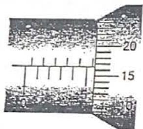

知识点：[测量的分类（直接测量与间接测量）](../../../topics/大学物理实验/测量的分类.md)

### 填空 7

分光计读数盘度数为____。

## 三、判断题（共 20 分，在表格中打 √ 或 ×，每题 2 分）

| 1 | 2 | 3 | 4 | 5 | 6 | 7 | 8 | 9 | 10 |
|---|---|---|---|---|---|---|---|---|---|
|   |   |   |   |   |   |   |   |   |    |

知识点：[有效数字的概念与定义](../../../topics/大学物理实验/有效数字概念.md)、[有效数字的修约规则（只进不舍等）](../../../topics/大学物理实验/有效数字修约规则.md)

### 判断 1

一般来说，测量结果的有效数字多少与测量结果的准确度无关。

知识点：[有效数字的概念与定义](../../../topics/大学物理实验/有效数字概念.md)

### 判断 2

测量不确定度是评价测量质量优劣的一个重要指标，是指测量误差的范围。

知识点：[有效数字的概念与定义](../../../topics/大学物理实验/有效数字概念.md)、[科学记数法表示有效数字](../../../topics/大学物理实验/科学记数法.md)、[有效数字的修约规则（只进不舍等）](../../../topics/大学物理实验/有效数字修约规则.md)

### 判断 3

测量结果不确定度按评定方法可分为 A 类分量和 B 类分量，不确定度 A 类分量与随机误差相对应，B 类分量与系统误差相对应。

知识点：[有效数字的概念与定义](../../../topics/大学物理实验/有效数字概念.md)、[有效数字的运算法则（加减运算与乘除运算）](../../../topics/大学物理实验/有效数字运算法则.md)

### 判断 4

系统误差的特征是具有规律性，是可以减小的；而随机误差的特征是具有无规律性。

知识点：[有效数字的概念与定义](../../../topics/大学物理实验/有效数字概念.md)、[直接测量量的有效数字读数原则（游标卡尺、角游标尺、螺旋测微器、数字表头）](../../../topics/大学物理实验/直接测量量读数原则.md)

### 判断 5

随机误差统计规律分布特点：单峰性、对称性、有界性、抵偿性。

知识点：[有效数字的概念与定义](../../../topics/大学物理实验/有效数字概念.md)、[直接测量量的有效数字读数原则（游标卡尺、角游标尺、螺旋测微器、数字表头）](../../../topics/大学物理实验/直接测量量读数原则.md)

### 判断 6

用精度很高的仪器对物理量进行测量，就能获得该物理量的真值。

知识点：[有效数字的概念与定义](../../../topics/大学物理实验/有效数字概念.md)、[直接测量量的有效数字读数原则（游标卡尺、角游标尺、螺旋测微器、数字表头）](../../../topics/大学物理实验/直接测量量读数原则.md)

### 判断 7

若螺旋测微器的初读数为 -0.251 mm，若测量中读数值为 6.586 mm，则最后的测量结果比 6.586 mm 大。

知识点：[有效数字的修约规则（只进不舍等）](../../../topics/大学物理实验/有效数字修约规则.md)

### 判断 8

手工制图时，一般是用“○”作为实验点的标志符号。

知识点：[有效数字的概念与定义](../../../topics/大学物理实验/有效数字概念.md)

### 判断 9

已知测量某电阻结果为 $R = 85.32 \pm 0.05\Omega$，表明测量电阻的真值位于区间 [85.27, 85.37] 之外的可能性很小。

知识点：[有效数字的概念与定义](../../../topics/大学物理实验/有效数字概念.md)、[科学记数法表示有效数字](../../../topics/大学物理实验/科学记数法.md)

### 判断 10

利用逐差法处理实验数据的优点是：充分利用数据和减少随机误差。

## 四、计算题（共 15 分）

知识点：[有效数字的修约规则（只进不舍等）](../../../topics/大学物理实验/有效数字修约规则.md)

### 计算 1

用单摆测重力加速度的公式为 $g = 4\pi^2 l / T^2$，测得 $T = 2.000 \pm 0.002\,\mathrm{s}$，$l = 100.0 \pm 0.1\,\mathrm{cm}$，试写出重力加速度 $g$ 的结果表示式。

## 五、作图题（共 15 分）

知识点：[直接测量量的有效数字读数原则（游标卡尺、角游标尺、螺旋测微器、数字表头）](../../../topics/大学物理实验/直接测量量读数原则.md)、[有效数字的运算法则（加减运算与乘除运算）](../../../topics/大学物理实验/有效数字运算法则.md)

### 作图 1

在研究弹簧所受拉力 $F$ 与伸长量 $L$ 的关系实验中，某同学所测量的实验数据列表记录如下：

| 拉力 $F$ (N) | 0 | 200 | 400 | 600 | 800 |
|---|---|---|---|---|---|
| 弹簧伸长量 $L$ (cm) | 6.00 | 7.40 | 8.80 | 10.40 | 11.60 |

试用作图法求出此弹簧所受拉力 $F$ 与伸长量 $L$ 的关系式。

## 《物理实验》

院(系)____ 班级____ 学号____ 姓名____

| 题号 | 一 | 二 | 三 | 四 | 五 | 六 | 七 | 八 | 总分 |
|---|---|---|---|---|---|---|---|---|---|
| 得分 |   |   |   |   |   |   |   |   |    |

知识点：[测量的分类（直接测量与间接测量）](../../../topics/大学物理实验/测量的分类.md)、[有效数字的运算法则（加减运算与乘除运算）](../../../topics/大学物理实验/有效数字运算法则.md)、[直接测量量的有效数字读数原则（游标卡尺、角游标尺、螺旋测微器、数字表头）](../../../topics/大学物理实验/直接测量量读数原则.md)

### 一、选择题（30 分）

知识点：[有效数字的概念与定义](../../../topics/大学物理实验/有效数字概念.md)、[直接测量量的有效数字读数原则（游标卡尺、角游标尺、螺旋测微器、数字表头）](../../../topics/大学物理实验/直接测量量读数原则.md)、[有效数字的修约规则（只进不舍等）](../../../topics/大学物理实验/有效数字修约规则.md)

### 选择 1

某长度测量值为 2.130 mm，则所用仪器可能是（ ）。

- A. 毫米尺
- B. 50 分度卡尺
- C. 20 分度卡尺
- D. 千分尺

知识点：[有效数字的运算法则（加减运算与乘除运算）](../../../topics/大学物理实验/有效数字运算法则.md)、[测量的分类（直接测量与间接测量）](../../../topics/大学物理实验/测量的分类.md)

### 选择 2

一量程为 $7.5\,\mathrm{V}$、准确度等级为 1.0 级的电压表，其读数的有效数字应有（ ）。

- A. 1
- B. 2
- C. 3
- D. 4

答案：C。

知识点：[测量与单位（含国际单位制重新定义）](../../../topics/大学物理实验/测量与单位.md)、[有效数字的运算法则（加减运算与乘除运算）](../../../topics/大学物理实验/有效数字运算法则.md)

### 选择 3

分光计调整中，“各减一半”调法的目的是（ ）。

- A. 目镜无视差
- B. 望远镜光轴与平行光管光轴平行
- C. 望远镜光轴与载物台旋转轴垂直
- D. 平行光管光轴与载物台旋转轴垂直

答案：C。

知识点：[有效数字的概念与定义](../../../topics/大学物理实验/有效数字概念.md)、[有效数字的修约规则（只进不舍等）](../../../topics/大学物理实验/有效数字修约规则.md)、[直接测量量的有效数字读数原则（游标卡尺、角游标尺、螺旋测微器、数字表头）](../../../topics/大学物理实验/直接测量量读数原则.md)

### 选择 4

要正确测量一根长约 5 cm 的平直细铜丝的直径，可以采用（ ）的原理来测量。

- A. 劈尖干涉
- B. 单缝衍射
- C. 均匀弦振动
- D. 惠斯通电桥

答案：A。

知识点：[有效数字的修约规则（只进不舍等）](../../../topics/大学物理实验/有效数字修约规则.md)、[有效数字的概念与定义](../../../topics/大学物理实验/有效数字概念.md)、[测量与单位（含国际单位制重新定义）](../../../topics/大学物理实验/测量与单位.md)

### 选择 5

在测周期的实验中，若周期约为 1.60 秒，测量时计时误差引起的不确定度为 0.02 秒。为了满足测量周期的相对不确定度不大于 0.01%，测量次数至少应为（ ）。

- A. 50 次
- B. 100 次
- C. 180 次
- D. 125 次

答案：D。

知识点：[有效数字的概念与定义](../../../topics/大学物理实验/有效数字概念.md)、[有效数字的运算法则（加减运算与乘除运算）](../../../topics/大学物理实验/有效数字运算法则.md)

### 选择 6

$F = 0.0008750$，$G = 6.7500$，则 $F$ 和 $G$ 的有效数字位数分别为（ ）。

- A. 三位，四位
- B. 四位，三位
- C. 四位，五位
- D. 七位，五位

答案：C。

知识点：[直接测量量的有效数字读数原则（游标卡尺、角游标尺、螺旋测微器、数字表头）](../../../topics/大学物理实验/直接测量量读数原则.md)、[有效数字的概念与定义](../../../topics/大学物理实验/有效数字概念.md)、[测量的分类（直接测量与间接测量）](../../../topics/大学物理实验/测量的分类.md)

### 选择 7

下面记录的是某一电阻的实验数据，记录正确的是（ ）。

- A. $R = (971 \pm 71)\Omega$
- B. $R = (9.65 \pm 0.08) \times 10^{3}\Omega$
- C. $R = (9650 \pm 8 \times 10)\Omega$
- D. $R = (9.650 \pm 0.08) \times 10^{5}\Omega$

知识点：[有效数字的修约规则（只进不舍等）](../../../topics/大学物理实验/有效数字修约规则.md)、[科学记数法表示有效数字](../../../topics/大学物理实验/科学记数法.md)、[有效数字的概念与定义](../../../topics/大学物理实验/有效数字概念.md)

### 选择 8

用相位法测量声波波长时，改变信号发射端和接收端之间的距离，当观察到合成信号图形由某一特定斜直线形状又变化到相邻这一图形时，此时两端面的距离变化了（ ）。

- A. $\dfrac{\lambda}{2}$
- B. $\lambda$
- C. $\dfrac{3\lambda}{2}$
- D. $2\lambda$

知识点：[直接测量量的有效数字读数原则（游标卡尺、角游标尺、螺旋测微器、数字表头）](../../../topics/大学物理实验/直接测量量读数原则.md)、[有效数字的概念与定义](../../../topics/大学物理实验/有效数字概念.md)、[有效数字的修约规则（只进不舍等）](../../../topics/大学物理实验/有效数字修约规则.md)

### 选择 9

对一物理量进行等精度多次测量，其算术平均值是（ ）。

- A. 真值
- B. 最接近真值的值
- C. 误差最大的值
- D. 误差为零的值

答案：B。

知识点：[测量与单位（含国际单位制重新定义）](../../../topics/大学物理实验/测量与单位.md)

### 选择 10

用电位差计测量电动势实验时，所用的方法是（ ）。

- A. 补偿法
- B. 比较法
- C. 平衡法
- D. 以上都不是

答案：A。

知识点：[有效数字的概念与定义](../../../topics/大学物理实验/有效数字概念.md)、[有效数字的运算法则（加减运算与乘除运算）](../../../topics/大学物理实验/有效数字运算法则.md)

### 二、填空题（20 分）

知识点：[有效数字的概念与定义](../../../topics/大学物理实验/有效数字概念.md)、[有效数字的运算法则（加减运算与乘除运算）](../../../topics/大学物理实验/有效数字运算法则.md)、[有效数字的修约规则（只进不舍等）](../../../topics/大学物理实验/有效数字修约规则.md)

### 填空 1

依照测量方法的不同，可将测量分为直接测量和间接测量两大类。

知识点：[有效数字的运算法则（加减运算与乘除运算）](../../../topics/大学物理实验/有效数字运算法则.md)

### 填空 2

误差产生的原因很多，按照误差产生的原因和不同性质，可将误差分为系统误差、随机误差、粗大误差三种。

知识点：[有效数字的修约规则（只进不舍等）](../../../topics/大学物理实验/有效数字修约规则.md)

### 填空 3

用利萨如图形测量频率时，若某图形 $X$ 轴切点数和 $Y$ 轴切点数之比为 $1:2$，则 $X$ 轴输入端的频率与 $Y$ 输入端的信号频率之比为____。

知识点：[物理实验课的基本程序（预习、实验进行、写报告）](../../../topics/大学物理实验/实验课基本程序.md)

### 填空 4

对于不连续读数的仪器，如数字秒表、分度器等，允许的仪器误差分别是____误差。

知识点：[测量的分类（直接测量与间接测量）](../../../topics/大学物理实验/测量的分类.md)、[实验报告的内容（含实验内容与步骤等）](../../../topics/大学物理实验/实验报告内容.md)

### 填空 5

对同一物理量进行多次重复测量，测量结果一般都含有两类不确定度分量，分别是 A 类不确定度、B 类不确定度。

知识点：[物理实验课程的成绩考核方式](../../../topics/大学物理实验/成绩考核.md)

### 填空 6

常用的实验数据处理方法有列表法、图示法和图解法。

知识点：[测量的分类（直接测量与间接测量）](../../../topics/大学物理实验/测量的分类.md)

### 填空 7

双臂电桥与单臂电桥的差别，主要体现在双臂电桥比单臂电桥多了一对____，它旨在消除导线电阻和____电阻引入的附加电阻对测量结果的影响。双臂电桥适用测量____电阻，单臂电桥只适用测量____电阻。其中惠斯通电桥桥路中保护电阻开关用以保护____，只有细调时此开关才____。惠斯通电桥的灵敏度与____有关。

（$S = \dfrac{\Delta n}{k \cdot \Delta R / R_3}$，$k = \dfrac{R_1}{R_2}$）

知识点：[有效数字的概念与定义](../../../topics/大学物理实验/有效数字概念.md)、[有效数字的修约规则（只进不舍等）](../../../topics/大学物理实验/有效数字修约规则.md)

### 三、计算题（20 分）

知识点：[有效数字的修约规则（只进不舍等）](../../../topics/大学物理实验/有效数字修约规则.md)、[有效数字的运算法则（加减运算与乘除运算）](../../../topics/大学物理实验/有效数字运算法则.md)、[直接测量量的有效数字读数原则（游标卡尺、角游标尺、螺旋测微器、数字表头）](../../../topics/大学物理实验/直接测量量读数原则.md)

### 计算 1

用 50 分度游标卡尺测量铜环的内径 6 次，测量数据如下：$d_i = 19.93$，$19.96$，$19.98$，$20.00$，$19.94$，$19.96$，单位毫米，计算测量结果，并用不确定度表示测量结果。

解：

$$\overline{d} = (19.93 + 19.96 + 19.98 + 20.00 + 19.94 + 19.96)\,\mathrm{mm}/6 = 19.97\,\mathrm{mm}$$

$$S = \sqrt{\frac{1}{n-1}\sum_{i=1}^{n}(x_i-\overline{x})^2}$$

$$u_A = \frac{t}{\sqrt{n}} \times S \quad (\text{置信概率 } P = 0.95),\quad u_A = 1.05S = 0.021\,\mathrm{mm} \approx 0.02\,\mathrm{mm}$$

$n = 6$ 时，$\dfrac{t}{\sqrt{n}} = 1.05$，$u_B = \dfrac{1}{\sqrt{n}} = 0.07\,\mathrm{mm}$。

$$\therefore u = \sqrt{u_A^2 + u_B^2} = 0.03\,\mathrm{mm}$$

$$\therefore d = (19.97 \pm 0.07)\,\mathrm{mm}$$

知识点：[直接测量量的有效数字读数原则（游标卡尺、角游标尺、螺旋测微器、数字表头）](../../../topics/大学物理实验/直接测量量读数原则.md)、[有效数字的运算法则（加减运算与乘除运算）](../../../topics/大学物理实验/有效数字运算法则.md)

### 计算 2

已知电阻丝的阻值 $R$ 与温度 $t$ 的关系为：$R = R_0(1+at) = R_0 + R_0 a t$，其中 $R_0$、$a$ 是常数。现有一电阻丝，其阻值随温度变化如下表。请用作图法作 $R$-$t$ 直线，并求出 $R_0$、$R_0 a$ 值。

# 2021—2022 学年第二学期《物理实验 (下)》期末试卷

本资料由识别工具读取整理，已修正明显的识别错误（如乱码、断行、单位缺失等），并去除了页眉页脚、装订线及无关装饰。

## 一、选择题（共 20 分，每题 2 分）

知识点：[实验报告的内容（含实验内容与步骤等）](../../../topics/大学物理实验/实验报告内容.md)、[测量与单位（含国际单位制重新定义）](../../../topics/大学物理实验/测量与单位.md)

### 选择 1

对一物理量进行等精度多次测量，其算术平均值是：
- A. 真值
- B. 最接近真值的值
- C. 误差最大的值
- D. 误差为零的值

答案：B。

知识点：[有效数字的运算法则（加减运算与乘除运算）](../../../topics/大学物理实验/有效数字运算法则.md)、[测量的分类（直接测量与间接测量）](../../../topics/大学物理实验/测量的分类.md)

### 选择 2

$F = 0.0008750$, $G = 6.7500$, 则 $F$ 和 $G$ 的有效数字位数分别为：
- A. 三位, 四位
- B. 四位, 三位
- C. 四位, 五位
- D. 七位, 五位

答案：C。

知识点：[测量与单位（含国际单位制重新定义）](../../../topics/大学物理实验/测量与单位.md)、[有效数字的运算法则（加减运算与乘除运算）](../../../topics/大学物理实验/有效数字运算法则.md)

### 选择 3

螺旋测微器初始读数不为零，所引起的测量误差属于：
- A. 随机误差
- B. 系统误差
- C. 粗大误差
- D. A, B, C 都不是

答案：B。

知识点：[有效数字的概念与定义](../../../topics/大学物理实验/有效数字概念.md)、[有效数字的修约规则（只进不舍等）](../../../topics/大学物理实验/有效数字修约规则.md)、[直接测量量的有效数字读数原则（游标卡尺、角游标尺、螺旋测微器、数字表头）](../../../topics/大学物理实验/直接测量量读数原则.md)

### 选择 4

在测周期的实验中，若周期约为 1.60 秒，测量时计时误差引起的不确定度为 0.02 秒。为了满足测量周期的相对不确定度不大于 0.01%，测量次数至少应为：
- A. 50 次
- B. 100 次
- C. 180 次
- D. 125 次

答案：D。

知识点：[有效数字的修约规则（只进不舍等）](../../../topics/大学物理实验/有效数字修约规则.md)、[有效数字的概念与定义](../../../topics/大学物理实验/有效数字概念.md)、[测量与单位（含国际单位制重新定义）](../../../topics/大学物理实验/测量与单位.md)

### 选择 5

下列测量的结果中表达式正确的是：
- A. $S = 2560 \pm 100\text{mm}^2$
- B. $T = 8.32 \pm 0.02$
- C. $R = 82.3 \pm 0.31\Omega$
- D. $L = 0.667 \pm 0.008\text{mm}$

答案：D。

知识点：[有效数字的概念与定义](../../../topics/大学物理实验/有效数字概念.md)、[有效数字的运算法则（加减运算与乘除运算）](../../../topics/大学物理实验/有效数字运算法则.md)

### 选择 6

某长度测量值为 2.130mm，则所用仪器可能是：
- A. 毫米尺
- B. 50 分度游标卡尺
- C. 20 分度游标卡尺
- D. 千分尺

答案：D。

知识点：[直接测量量的有效数字读数原则（游标卡尺、角游标尺、螺旋测微器、数字表头）](../../../topics/大学物理实验/直接测量量读数原则.md)、[有效数字的概念与定义](../../../topics/大学物理实验/有效数字概念.md)、[测量的分类（直接测量与间接测量）](../../../topics/大学物理实验/测量的分类.md)

### 选择 7

分光计调整中，“各减一半”调法的目的是：
- A. 望远镜光轴与平行光管光轴平行
- B. 望远镜光轴与载物台旋转轴垂直
- C. 平行光管光轴与载物台旋转轴垂直
- D. 以上都不对

答案：B。

知识点：[有效数字的修约规则（只进不舍等）](../../../topics/大学物理实验/有效数字修约规则.md)、[科学记数法表示有效数字](../../../topics/大学物理实验/科学记数法.md)、[有效数字的概念与定义](../../../topics/大学物理实验/有效数字概念.md)

### 选择 8

下面哪一个阻值的待测电阻需要用双臂电桥来测量？
- A. 0.001Ω
- B. 1MΩ
- C. 1000Ω
- D. 100Ω

答案：A。

知识点：[直接测量量的有效数字读数原则（游标卡尺、角游标尺、螺旋测微器、数字表头）](../../../topics/大学物理实验/直接测量量读数原则.md)、[有效数字的概念与定义](../../../topics/大学物理实验/有效数字概念.md)、[有效数字的修约规则（只进不舍等）](../../../topics/大学物理实验/有效数字修约规则.md)

### 选择 9

热敏电阻的阻值与下列哪些因素无关？
- A. 电桥比例臂选取
- B. 外界温度变化
- C. 热敏电阻的形状和大小
- D. 制造热敏电阻的半导体材料性能

答案：A。

知识点：[测量与单位（含国际单位制重新定义）](../../../topics/大学物理实验/测量与单位.md)

### 选择 10

下列那些说法是对的？
- A. 电表面板上的 0.5 是表示其精度等级
- B. 符号 $\square$ 表示这是二级表
- C. 符号 $\square$ 表示该表是磁电式电表
- D. 符号 “\_” 表示该表应水平放置

答案：A。

## 二、填空题（共 20 分，每空 2 分）

知识点：[有效数字的概念与定义](../../../topics/大学物理实验/有效数字概念.md)、[有效数字的运算法则（加减运算与乘除运算）](../../../topics/大学物理实验/有效数字运算法则.md)

### 填空 1

实验过程中，应该严肃认真，养成严谨求实的工作作风，不得伪造或抄袭实验数据或实验结果。

答案：严肃认真；严谨求实。

知识点：[有效数字的运算法则（加减运算与乘除运算）](../../../topics/大学物理实验/有效数字运算法则.md)

### 填空 2

测量误差等于测量值减去______之差。

答案：真值。

知识点：[有效数字的修约规则（只进不舍等）](../../../topics/大学物理实验/有效数字修约规则.md)

### 填空 3

依照测量方法的不同，可将测量分为______测量和______测量两大类。

答案：直接；间接。

知识点：[物理实验课的基本程序（预习、实验进行、写报告）](../../../topics/大学物理实验/实验课基本程序.md)

### 填空 4

常用的实验数据处理方法有列表法、______、逐差法等。

答案：图解法。

知识点：[测量的分类（直接测量与间接测量）](../../../topics/大学物理实验/测量的分类.md)、[实验报告的内容（含实验内容与步骤等）](../../../topics/大学物理实验/实验报告内容.md)

### 填空 5

游标卡尺读数为 500 mm；螺旋测微器读数为 5494 mm。

**订正**：此处原文识别数据可能存在严重偏差，通常游标卡尺精度为 0.02mm 或 0.05mm，读数不应为整数 500mm（除非特指大尺寸工件且未估读，但一般实验题会考察小数位）；螺旋测微器读数 5494mm 显然过大（5.4 米），结合上下文图片推测应为 **5.494 mm**。
*注：若按原件文字整理，答案为 500 mm 和 5494 mm，但实际物理意义存疑。*

知识点：[物理实验课程的成绩考核方式](../../../topics/大学物理实验/成绩考核.md)

### 填空 6

分光计读数益度数为 $116^{\circ}15'$。

**订正**：原文“益度数”应为“度数”。
答案：$116^{\circ}15'$。

## 三、判断题（共 20 分，每题 2 分）

知识点：[测量的分类（直接测量与间接测量）](../../../topics/大学物理实验/测量的分类.md)

### 判断 1

大量的随机误差服从正态分布，一般说来增加测量次数求平均可以消除随机误差。

答案：$\times$。

知识点：[有效数字的概念与定义](../../../topics/大学物理实验/有效数字概念.md)

### 判断 2

某电阻值的测量结果为 $R = 28.60 \pm 0.06\Omega$，则说明：待测电阻的真值包含在区间 $[28.54, 28.66]\Omega$ 内的概率约为 99.7%。

答案：$\sqrt{}$。

知识点：[有效数字的概念与定义](../../../topics/大学物理实验/有效数字概念.md)、[科学记数法表示有效数字](../../../topics/大学物理实验/科学记数法.md)、[有效数字的修约规则（只进不舍等）](../../../topics/大学物理实验/有效数字修约规则.md)

### 判断 3

有一个 0.5 级的电流表，其量程数为 $10\mu\text{A}$，单次测量某一电流值为 $6.00\mu\text{A}$，用不确定度表示测量结果应该为 $I = (6.00 \pm 0.05)\mu\text{A}$。

答案：$\sqrt{}$。

知识点：[有效数字的概念与定义](../../../topics/大学物理实验/有效数字概念.md)、[有效数字的运算法则（加减运算与乘除运算）](../../../topics/大学物理实验/有效数字运算法则.md)

### 判断 4

用物理天平测量某物体的质量，多次测量的读数均为 $56.72\text{g}$，说明对该物体质量的测量没有误差。

答案：$\times$。

知识点：[有效数字的概念与定义](../../../topics/大学物理实验/有效数字概念.md)、[直接测量量的有效数字读数原则（游标卡尺、角游标尺、螺旋测微器、数字表头）](../../../topics/大学物理实验/直接测量量读数原则.md)

### 判断 5

若螺旋测微器的初读数为 $-0.251\text{mm}$，若测量中读数值为 $6.586\text{mm}$，则最后的测量结果比 $6.586\text{mm}$ 大。

答案：$\sqrt{}$。

知识点：[有效数字的概念与定义](../../../topics/大学物理实验/有效数字概念.md)、[直接测量量的有效数字读数原则（游标卡尺、角游标尺、螺旋测微器、数字表头）](../../../topics/大学物理实验/直接测量量读数原则.md)

### 判断 6

手工制图时，一般不用"."作为实验点的标志符号。

答案：$\times$。

知识点：[有效数字的概念与定义](../../../topics/大学物理实验/有效数字概念.md)、[直接测量量的有效数字读数原则（游标卡尺、角游标尺、螺旋测微器、数字表头）](../../../topics/大学物理实验/直接测量量读数原则.md)

### 判断 7

制图时，在坐标轴上每隔一定的间距标注坐标分度，常用一大格（10mm）代替 1、2、3...

答案：$\sqrt{}$。

知识点：[有效数字的修约规则（只进不舍等）](../../../topics/大学物理实验/有效数字修约规则.md)

### 实验 1：分光计调节

**题目：** 调节分光计的使之处于能测量的工作状态的基本步骤：（简要步骤）

1.  **调节分光计望远镜**：
    *   ① 调节望远镜，使望远镜聚焦于无穷远外。
    *   ② 使望远镜的光轴和载物平台与转轴垂直。
2.  **调节载物台水平**：
    *   调节载物平台的三个调平螺钉，使得螺钉处铜盘和平底座间距离相同，不断转动载物平台，细心观察每个螺钉位置外间距是否接近。（距离控制进 1~2mm），若接近则已水平。
3.  **调节平行光管**：
    *   ① 调节平行光管，使平行光管产生平行光。
    *   ② 使光轴垂直于仪器转轴。
4.  **读数示例**：
    *   下面分光计角度对应读数为 $233^{\circ}13'$。

知识点：[物理实验课的基本程序（预习、实验进行、写报告）](../../../topics/大学物理实验/实验课基本程序.md)、[直接测量量的有效数字读数原则（游标卡尺、角游标尺、螺旋测微器、数字表头）](../../../topics/大学物理实验/直接测量量读数原则.md)、[测量的分类（直接测量与间接测量）](../../../topics/大学物理实验/测量的分类.md)

### 实验 2：数字信号源设置

**题目：** 请根据数字信号源面板（如下图所示），通过面板按键设置一个峰峰值电压为 1.262V，频率为 3.56kHz 的正弦信号，写出其简要步骤。

> *[插图占位]*
> 
> *图：数字信号源面板示意图*

**简要步骤：**

1.  **信号类型设置**：按下“波形”键，选择正弦波模式。
2.  **电压设置**：按下“幅度/百伏”键，用数字键输入 `1.262`，单位选 `V`。
3.  **频率设置**：按下“频率/周期”键，用数字键输入 `356`，单位选 `kHz`。

*(注：原件中提到的计算公式 $\frac{29 \times 31.5}{9} = 26.447 \Omega$ 似乎与本题设置信号无关，可能是上一题残留或干扰项，此处仅保留信号设置步骤)*

知识点：[直接测量量的有效数字读数原则（游标卡尺、角游标尺、螺旋测微器、数字表头）](../../../topics/大学物理实验/直接测量量读数原则.md)、[有效数字的概念与定义](../../../topics/大学物理实验/有效数字概念.md)、[科学记数法表示有效数字](../../../topics/大学物理实验/科学记数法.md)

### 实验 3：示波器与李萨如图形

**题目：**
1.  观察李萨如图时，要改变图形的垂直大小：应调节 $\mathrm{CH}2$ 通道的“偏转因数 (VOLTS/DIV)"；要改变图形的水平大小：应调节 $\mathrm{CH}1$ 通道的“偏转因数 (VOLTS/DIV)"；要改变图形的垂直位置，应调节 $\mathrm{CH}2$ 通道的“垂直位移 (POSITION)"。(可选答案：CH1, CH2)。
2.  用示波器测得的 CH1（X）信号的波形如下面左图所示，CH1（X）信号如下图所示，示波器屏幕上已显示了必要的参数，图中每 1 大格为 1cm。请回答下列问题：
    *   （1）CH1（X）信号的 $U_{pp}$ 为 \_\_\_\_ V；
    *   （2）CH1（X）信号的周期为 \_\_\_\_ ms。

> *[插图占位]*
> 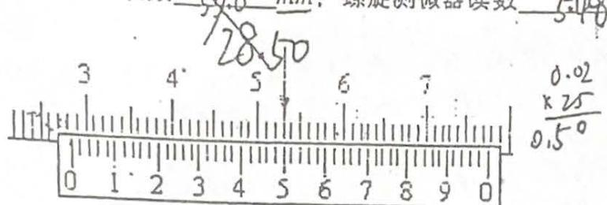
> *图：示波器波形显示（具体数值需根据原图刻度读取，此处依据题目逻辑推导）*

**参考解答：**
*(由于无法直接读取图片中的具体格数，以下为解题思路)*
1.  **振幅计算**：$U_{pp} = \text{垂直格数} \times \text{VOLTS/DIV}$。
2.  **周期计算**：$T = \text{水平格数} \times \text{TIME/DIV}$。

# 《物理实验(下)》期末试卷

本资料整理自《物理实验(下)》期末试卷第 5 部分（共 14 部分），包含计算题、作图题及前几部分的填空题、选择题和简答题。

## 四：计算题（共20分）

知识点：[直接测量量的有效数字读数原则（游标卡尺、角游标尺、螺旋测微器、数字表头）](../../../topics/大学物理实验/直接测量量读数原则.md)、[有效数字的运算法则（加减运算与乘除运算）](../../../topics/大学物理实验/有效数字运算法则.md)、[测量的分类（直接测量与间接测量）](../../../topics/大学物理实验/测量的分类.md)

### 计算 1

用游标卡尺测量某圆柱体的直径 $D$ 和高度 $H$ 各5次，数据见下表。用天平测量其质量 $m$ 一次，为 $152.10\text{g}$。

已知游标卡尺和天平这两个仪器的误差限分别为 $0.02\text{mm}$ 和 $0.03\text{g}$。置信概率 $P=0.95$ 时，因子 $\left(\frac{t}{\sqrt{n}}\right)=1.24$ ，$(n=5)$。

1. 计算各个直接测量量及不确定度，正确写出各个直接测量量的测量结果。要求：将有关数据和计算结果填入表格中。

公式参考：
$$ u_A = S \times \frac{t}{\sqrt{n}} $$
$$ U_B = \Delta_{ins} $$
$$ u = \sqrt{u_A^2 + U_B^2} $$

仪器：游标卡尺、天平
游标卡尺的仪器误差限为：$0.02\text{mm}$。天平的误差限为：$0.03\text{g}$。

| 测量次数 | 直径 D/mm | 高 H/mm |
| :--- | :--- | :--- |
| 1 | 31.62 | 48.48 |
| 2 | 31.66 | 48.45 |
| 3 | 31.64 | 48.48 |
| 4 | 31.58 | 48.50 |
| 5 | 31.62 | 48.52 |
| 平均值 | $\overline{D} = 31.624$ | $\overline{H} = 48.488$ |
| A类不确定度 $U_A$ | $U_A = 0.037$ | $U_H = 0.028$ |
| B类不确定度 $U_B$ | $U_{B_D} = 0.02$ | $U_H = 0.03$ |
| 合成不确定度U | $U_D = 31.624 \pm 0.042$ | $U_H = 48.488 + 0.049$ |
| 直接测量量的结果表达式 | $D = \overline{D} \pm U_D = (31.624 \pm 0.049) \text{mm}$ |
| | $H = \overline{H} \pm U_H = (48.488 + 0.049) \text{mm}$ |
| | $m = \overline{m} \pm U_m = (152.10 \pm 0.03)\text{g}$ |

答案：见表格及下方计算过程。

知识点：[直接测量量的有效数字读数原则（游标卡尺、角游标尺、螺旋测微器、数字表头）](../../../topics/大学物理实验/直接测量量读数原则.md)、[有效数字的运算法则（加减运算与乘除运算）](../../../topics/大学物理实验/有效数字运算法则.md)

### 计算 2

求出圆柱体的密度 $\rho$ 及不确定度，并正确写出圆柱体密度的测量结果。

要求：必须写出各个计算公式、中间计算过程以及不确定度的推导公式。

公式参考：
$$ \rho = \frac{4m}{\pi D^2 H}, \quad U_r = \frac{U}{Y} = \sqrt{\left(\frac{\partial \ln f}{\partial x_1}\right)^2 U_{x1}^2 + \left(\frac{\partial \ln f}{\partial x_2}\right)^2 U_{x2}^2 + \dots} $$

计算过程：
$$
\begin{aligned}
U_R &= \frac{U}{P} = \sqrt{\left(\frac{\alpha P}{\alpha M}\right)^2 \cdot U_P^2 + \left(\frac{\alpha P}{\alpha D}\right)^2 \cdot U_D^2 + \left(\frac{\alpha P}{\alpha H}\right)^2 \cdot U_H^2} \\
&= \sqrt{\left(\frac{4}{\pi D^2 H}\right)^2 \cdot U_M^2 + \left(\frac{-8m}{\pi D^2 H}\right)^2 \cdot U_D^2 + \left(\frac{-4m}{\pi D^2 H^2}\right)^2 \cdot U_H^2} \\
&= 1.1 \times 10^{-5} \doteq 0.011\%
\end{aligned}
$$

$$
\rho = \frac{4m}{\pi D^2 H} = \frac{4 \times 152.10}{\pi (31.624)^2 \times 48.488} \text{g}/(\text{mm})^3 = 0.0040 \text{g}/(\text{mm})^3
$$

$$
\therefore U_\rho = \rho \cdot U_r = 0.011\% \times 0.0040 \text{g}/(\text{mm})^3 = 4.4 \times 10^{-7} \text{g}/(\text{mm})^3
$$

$$
\therefore \rho = (4.0 \times 10^{-3} \pm 4.4 \times 10^{-7}) \text{g}/(\text{mm})^3
$$

## 五：作图题（共20分）

知识点：[实验报告的内容（含实验内容与步骤等）](../../../topics/大学物理实验/实验报告内容.md)、[测量与单位（含国际单位制重新定义）](../../../topics/大学物理实验/测量与单位.md)

### 作图 1

热电偶温度计的温差电动势 $\varepsilon_{c}$ 与温度差 $(t-t_{0})$ 的关系可以写为 $\varepsilon_{t}=\overline{\alpha(t-t_{0})}$ ，其中 a 称为温差电系数，现有实验数据如下表：

| $(t-t_0)/^\circ\text{C}$ | 0.0 | 11.3 | 26.0 | 40.5 | 50.3 | 58.8 | 68.0 | 76.2 |
| :--- | :--- | :--- | :--- | :--- | :--- | :--- | :--- | :--- |
| $\varepsilon_c/\text{mV}$ | 0.00 | 0.41 | 0.97 | 1.46 | 1.87 | 2.17 | 2.52 | 2.78 |

1. 绘制实验曲线 $\varepsilon_{c} = (t - t_{0})$ 图。
2. 用图解法求出实验方程 $\varepsilon_{t} = \alpha (\bar{t} - \bar{\varepsilon}_{0})$ 中的温差电系数 $\alpha$ 。

计算过程：
$$ \alpha = \frac{76.2 - 26}{2.78 - 0.97} = \frac{50.2}{1.81} = 27.7 $$

注：原件中计算结果 $27.7$ 单位未明确，通常温差电系数单位为 mV/°C 或 V/K。根据数据量级，此处应为 mV/°C。

## 一、填空题（总分40分，每题2分）

知识点：[测量的分类（直接测量与间接测量）](../../../topics/大学物理实验/测量的分类.md)、[有效数字的运算法则（加减运算与乘除运算）](../../../topics/大学物理实验/有效数字运算法则.md)、[直接测量量的有效数字读数原则（游标卡尺、角游标尺、螺旋测微器、数字表头）](../../../topics/大学物理实验/直接测量量读数原则.md)

### 填空 1

测量结果的有效数字的位数由______和______共同决定。

知识点：[有效数字的运算法则（加减运算与乘除运算）](../../../topics/大学物理实验/有效数字运算法则.md)

### 填空 2

50分度的游标卡尺，其仪器误差为______。

知识点：[有效数字的修约规则（只进不舍等）](../../../topics/大学物理实验/有效数字修约规则.md)

### 填空 3

量程为 $10 \mathrm{~mA}$ 的电流表, 其等级为 1.0 , 当读数为 $6.5 \mathrm{~mA}$ 时, 它的最大误差为 ______ 。

知识点：[物理实验课的基本程序（预习、实验进行、写报告）](../../../topics/大学物理实验/实验课基本程序.md)

### 填空 4

不确定度 $\sigma$ 表示 ______。

知识点：[测量的分类（直接测量与间接测量）](../../../topics/大学物理实验/测量的分类.md)、[实验报告的内容（含实验内容与步骤等）](../../../topics/大学物理实验/实验报告内容.md)

### 填空 5

在进行十进制单位换算时，有效数字的位数______。

知识点：[物理实验课程的成绩考核方式](../../../topics/大学物理实验/成绩考核.md)

### 填空 6

在分光计实验中，望远镜的调节用的是______法。

知识点：[测量的分类（直接测量与间接测量）](../../../topics/大学物理实验/测量的分类.md)

### 填空 7

S 是表示多次测量中每次测量值的______程度， $S_{\overline{N}}$ 表示______偏离真值的多少。

知识点：[有效数字的概念与定义](../../../topics/大学物理实验/有效数字概念.md)、[有效数字的修约规则（只进不舍等）](../../../topics/大学物理实验/有效数字修约规则.md)

### 填空 8

在杨氏模量实验中, 若望远镜的叉丝不清楚, 应调节望远镜______的焦距, 若观察到的标尺像不清楚则应调节望远镜______的焦距。钢丝的伸长量用______法来测定。

知识点：[直接测量量的有效数字读数原则（游标卡尺、角游标尺、螺旋测微器、数字表头）](../../../topics/大学物理实验/直接测量量读数原则.md)、[测量的分类（直接测量与间接测量）](../../../topics/大学物理实验/测量的分类.md)

### 填空 9

计算标准偏差我们用______法，其计算公式为______。

知识点：[物理实验课的基本程序（预习、实验进行、写报告）](../../../topics/大学物理实验/实验课基本程序.md)

### 填空 10

表示测量数据离散程度的是______，它属于______误差，用______误差（偏差）来描述它比较合适。

知识点：[测量的分类（直接测量与间接测量）](../../../topics/大学物理实验/测量的分类.md)、[直接测量量的有效数字读数原则（游标卡尺、角游标尺、螺旋测微器、数字表头）](../../../topics/大学物理实验/直接测量量读数原则.md)

### 填空 11

用20分度的游标卡尺测长度，刚好为 $15 \mathrm{~mm}$ , 应记为 ______ mm。

知识点：[有效数字的概念与定义](../../../topics/大学物理实验/有效数字概念.md)、[测量的分类（直接测量与间接测量）](../../../topics/大学物理实验/测量的分类.md)

### 填空 12

根据获得测量结果的不同方法, 测量可分为______测量和______测量; 根据测量的条件不同, 可分为______测量和______测量。

知识点：[有效数字的概念与定义](../../../topics/大学物理实验/有效数字概念.md)、[直接测量量的有效数字读数原则（游标卡尺、角游标尺、螺旋测微器、数字表头）](../../../topics/大学物理实验/直接测量量读数原则.md)

### 填空 13

电势差计实验中, 热电偶的电动势与温差的关系为______关系, 可用______法、______法和______法来求得经验方程。

知识点：[测量的分类（直接测量与间接测量）](../../../topics/大学物理实验/测量的分类.md)、[有效数字的概念与定义](../../../topics/大学物理实验/有效数字概念.md)

### 填空 14

系统误差有______的特点，偶然误差有______的特点。

知识点：[有效数字的运算法则（加减运算与乘除运算）](../../../topics/大学物理实验/有效数字运算法则.md)

### 填空 15

在测量结果的数字表示中，由若干位可靠数字加上______位可疑数字，便组成了有效数字。

知识点：[测量的分类（直接测量与间接测量）](../../../topics/大学物理实验/测量的分类.md)

### 填空 16

静电场模拟实验应用了______法，它利用了静电场和______的相似性。

知识点：[直接测量量的有效数字读数原则（游标卡尺、角游标尺、螺旋测微器、数字表头）](../../../topics/大学物理实验/直接测量量读数原则.md)、[有效数字的概念与定义](../../../topics/大学物理实验/有效数字概念.md)、[科学记数法表示有效数字](../../../topics/大学物理实验/科学记数法.md)

### 填空 17

用分光仪测得一角度为 $30^{\circ}$ , 分光仪的最小分度为 $1^{\circ}$ , 测量的结果为 ______。

知识点：[直接测量量的有效数字读数原则（游标卡尺、角游标尺、螺旋测微器、数字表头）](../../../topics/大学物理实验/直接测量量读数原则.md)、[有效数字的概念与定义](../../../topics/大学物理实验/有效数字概念.md)、[物理实验课的基本程序（预习、实验进行、写报告）](../../../topics/大学物理实验/实验课基本程序.md)

### 填空 18

对于连续读数的仪器, 如米尺、螺旋测微计等, 就以______作为仪器误差。

知识点：[有效数字的运算法则（加减运算与乘除运算）](../../../topics/大学物理实验/有效数字运算法则.md)

### 填空 19

分光计测角度时，由于度盘偏心引起的测量角度误差按正弦规律变化，这种误差属于______误差。

知识点：[直接测量量的有效数字读数原则（游标卡尺、角游标尺、螺旋测微器、数字表头）](../../../topics/大学物理实验/直接测量量读数原则.md)

### 填空 20

在示波器内部, 同步、扫描系统的功能是获得______电压信号, 这种电压信号加在______偏转板上, 可使光点匀速地沿 $X$ 方向从左向右作周期性运动。

## 二、选择题（总分20分,每题2分）

知识点：[测量与单位（含国际单位制重新定义）](../../../topics/大学物理实验/测量与单位.md)

### 选择 1

下列测量结果正确的表达式是：[ ]
- A. $L=23.68\pm0.03\text{m}$
- B. $I=4.091\pm0.100\text{mA}$
- C. $T=12.563\pm0.01\text{s}$
- D. $Y=(1.67\pm0.15)\times10^{11}\text{Pa}$

答案：A

知识点：[有效数字的运算法则（加减运算与乘除运算）](../../../topics/大学物理实验/有效数字运算法则.md)、[测量的分类（直接测量与间接测量）](../../../topics/大学物理实验/测量的分类.md)

### 选择 2

在下面的李萨如图形中, 如果在 $X$ 轴方向信号的频率是 $100 \mathrm{~Hz}$ , 那么在 $Y$ 轴方向信号的频率是: [ ]

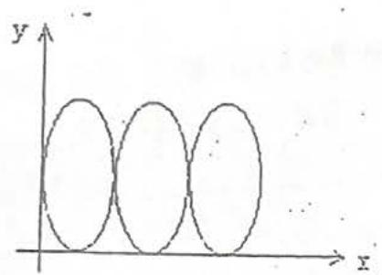

- A. 100Hz
- B. 33Hz
- C. 300Hz
- D. 200Hz

答案：D （根据李萨如图形切点数比例判断，X轴切点少，Y轴切点多，频率比反比于切点数。图中X向切点2个，Y向切点4个，故 $f_Y/f_X = 2/1 = 2$，即 $200\text{Hz}$）

知识点：[测量与单位（含国际单位制重新定义）](../../../topics/大学物理实验/测量与单位.md)、[有效数字的运算法则（加减运算与乘除运算）](../../../topics/大学物理实验/有效数字运算法则.md)

### 选择 3

在静电场模拟实验中，若提高电源电压，则：[ ]
- A. 等势线的分布更密集
- B. 电场分布会有畸变
- C. 等势线的形状不会发生改变
- D. 电力线会产生变化

答案：C

知识点：[有效数字的概念与定义](../../../topics/大学物理实验/有效数字概念.md)、[有效数字的修约规则（只进不舍等）](../../../topics/大学物理实验/有效数字修约规则.md)、[直接测量量的有效数字读数原则（游标卡尺、角游标尺、螺旋测微器、数字表头）](../../../topics/大学物理实验/直接测量量读数原则.md)

### 选择 4

在示波器实验中，时间轴X轴上加的信号为[ ]
- A. 正弦波
- B. 方波
- C. 三角波
- D. 锯齿波

答案：D

知识点：[有效数字的修约规则（只进不舍等）](../../../topics/大学物理实验/有效数字修约规则.md)、[有效数字的概念与定义](../../../topics/大学物理实验/有效数字概念.md)、[测量与单位（含国际单位制重新定义）](../../../topics/大学物理实验/测量与单位.md)

### 选择 5

下列不确定度的传递公式中，正确的是：[ ]
- A. $N = \frac{x - y}{x + y}$, $\sigma_{N} = \sqrt{\frac{y^{2}\sigma_{y}^{2}}{(x+y)^{2}} + \frac{x^{2}\sigma_{x}^{2}}{(x+y)^{2}}}$ （注：原题选项A公式可能有误，此处仅列原题）
- B. $L = x + y - 2z$, $\sigma_{L} = \sqrt{\sigma_{x}^{2} + \sigma_{y}^{2} + 4\sigma_{z}^{2}}$
- C. $M = \frac{V}{\sqrt{1 + at}}$, $\sigma_{M} = \sqrt{\frac{\sigma_{V}^{2}}{4(1 + at)} + \frac{a^{2}V^{2}\sigma_{t}^{2}}{(1 + at)^{3}}}$ （注：原题选项C公式可能有误，此处仅列原题）
- D. $V = \frac{\pi d^{2}h}{4}$, $\sigma_{V} = \sqrt{4d\sigma_{d}^{2} + \sigma_{z}^{2}}$ （注：原题选项D变量对应混乱，此处仅列原题）

答案：B （线性组合的不确定度传递，系数平方和开根号）

知识点：[有效数字的概念与定义](../../../topics/大学物理实验/有效数字概念.md)、[有效数字的运算法则（加减运算与乘除运算）](../../../topics/大学物理实验/有效数字运算法则.md)

### 选择 6

在牛顿环实验中, 我们看到的干涉条纹是由哪两条光线产生的 [ ]

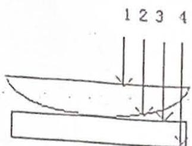

- A. 1 和 2
- B. 2 和 3
- C. 3 和 4
- D. 1 和 4

答案：D （牛顿环是空气薄膜上下表面反射光干涉，即入射光经上表面反射和下表面反射的光）

知识点：[直接测量量的有效数字读数原则（游标卡尺、角游标尺、螺旋测微器、数字表头）](../../../topics/大学物理实验/直接测量量读数原则.md)、[有效数字的概念与定义](../../../topics/大学物理实验/有效数字概念.md)、[测量的分类（直接测量与间接测量）](../../../topics/大学物理实验/测量的分类.md)

### 选择 7

实验中, 牛顿环的中心条纹为: [ ]
- A. 暗纹
- B. 亮纹
- C. 零级条纹
- D. 不确定

答案：A

知识点：[有效数字的修约规则（只进不舍等）](../../../topics/大学物理实验/有效数字修约规则.md)、[科学记数法表示有效数字](../../../topics/大学物理实验/科学记数法.md)、[有效数字的概念与定义](../../../topics/大学物理实验/有效数字概念.md)

### 选择 8

下列正确的说法是[ ]
- A. 多次测量可以减小偶然误差
- B. 多次测量可以减小系统误差
- C. 系统误差都由 B 类不确定度决定
- D. A 类不确定度评定的都是偶然误差

答案：A

知识点：[直接测量量的有效数字读数原则（游标卡尺、角游标尺、螺旋测微器、数字表头）](../../../topics/大学物理实验/直接测量量读数原则.md)、[有效数字的概念与定义](../../../topics/大学物理实验/有效数字概念.md)、[有效数字的修约规则（只进不舍等）](../../../topics/大学物理实验/有效数字修约规则.md)

### 选择 9

在电势差计的实验中，校正工作电流时平衡指示仪的指针始终偏向一边，可能的原因是：[ ]
- A. 没开工作电源
- B. 接标准电源的导线不通
- C. 平衡指示仪的导线极性接反
- D. 工作电源电压偏高或偏低

答案：D （若工作电源电压不足或过高，可能无法达到平衡，导致指针偏向一侧；若极性接反也可能，但通常D是更常见的操作原因排查项，需结合具体实验现象，此处保留原题逻辑，通常D涵盖范围更广）

知识点：[测量与单位（含国际单位制重新定义）](../../../topics/大学物理实验/测量与单位.md)

### 选择 10

在静电场模拟实验中，若画出的等势线不对称，可能的原因是：[ ]
- A. 导线有一定的电阻
- B. 电源电压过高
- C. 导电基质不均匀
- D. 以上都不对

答案：C

## 三、简答题（10分）

知识点：[有效数字的概念与定义](../../../topics/大学物理实验/有效数字概念.md)、[有效数字的运算法则（加减运算与乘除运算）](../../../topics/大学物理实验/有效数字运算法则.md)

### 简答 1

用惠斯通电桥测未知电阻 $R_{x}$ 时, $R_{x}$ 按下式 $R_{x} = \left(\frac{l_{1}}{l_{2}}\right) R$ 测出, 式中 $R$ 为已知, $l_{1}, l_{2}$ 是一根滑线电阻用触头分成的两部分, 问触头应如何放, 才能使 $R_{x}$ 的相对误差极小 (只考虑 $l_{1}, l_{2}$ 产生的误差)。

答案：当 $l_1 = l_2$ 时，即电桥平衡时双臂电阻相等（滑线电阻中点），$R_x$ 的相对误差最小。

## ——四、计算题（15分）

知识点：[测量的分类（直接测量与间接测量）](../../../topics/大学物理实验/测量的分类.md)、[直接测量量的有效数字读数原则（游标卡尺、角游标尺、螺旋测微器、数字表头）](../../../topics/大学物理实验/直接测量量读数原则.md)、[有效数字的运算法则（加减运算与乘除运算）](../../../topics/大学物理实验/有效数字运算法则.md)

### 计算 3

用千分尺（仪器极限误差为±0.004 mm）测量一钢球直径6次，测量数据为：14.256、14.278、14.262、14.263、14.258、14.272（mm）；用天平（仪器极限误差为±0.06 g）测量它的质量1次，测量值为：11.84 g，试求钢球密度的最佳值与不确定度。

答案：需进行以下步骤计算：
1. 计算直径平均值 $\overline{D}$ 和标准偏差 $S_D$。
2. 计算直径A类不确定度 $u_{A,D}$ 和B类不确定度 $u_{B,D}$，合成 $u_D$。
3. 计算质量平均值 $\overline{m}$ 和不确定度 $u_m$（仅B类）。
4. 计算密度 $\rho = \frac{m}{V} = \frac{6m}{\pi D^3}$。
5. 计算密度相对不确定度 $u_r = \sqrt{(\frac{u_m}{m})^2 + (3\frac{u_D}{D})^2}$。
6. 计算密度绝对不确定度 $u_\rho = \rho \cdot u_r$。
7. 写出最终结果 $\rho = \overline{\rho} \pm u_\rho$。

# 2017—2018 学年第二学期《大学物理实验》期末试卷

## 一、填空题（总分40分，每题2分）

知识点：[有效数字的运算法则（加减运算与乘除运算）](../../../topics/大学物理实验/有效数字运算法则.md)、[测量的分类（直接测量与间接测量）](../../../topics/大学物理实验/测量的分类.md)

### 填空 1
被测量的大小，测量仪器。

知识点：[有效数字的运算法则（加减运算与乘除运算）](../../../topics/大学物理实验/有效数字运算法则.md)

### 填空 2
0.03mm

知识点：[有效数字的修约规则（只进不舍等）](../../../topics/大学物理实验/有效数字修约规则.md)

### 填空 3
0.02mm。

知识点：[物理实验课的基本程序（预习、实验进行、写报告）](../../../topics/大学物理实验/实验课基本程序.md)

### 填空 4
0.01mA。

知识点：[测量的分类（直接测量与间接测量）](../../../topics/大学物理实验/测量的分类.md)、[实验报告的内容（含实验内容与步骤等）](../../../topics/大学物理实验/实验报告内容.md)

### 填空 5
误差以一定的概率被包含在量值范围 $(- \sigma \cdots + \sigma)$ 之中（或测量值的真值以一定的概率落在量值范围 $(\overline{N} - \dot{\sigma} \sim \overline{N} + \sigma)$ 之中。）

知识点：[物理实验课程的成绩考核方式](../../../topics/大学物理实验/成绩考核.md)

### 填空 6
不变。

知识点：[测量的分类（直接测量与间接测量）](../../../topics/大学物理实验/测量的分类.md)

### 填空 7
自准直。

知识点：[有效数字的概念与定义](../../../topics/大学物理实验/有效数字概念.md)、[有效数字的修约规则（只进不舍等）](../../../topics/大学物理实验/有效数字修约规则.md)

### 填空 8
分散，平均值。

知识点：[直接测量量的有效数字读数原则（游标卡尺、角游标尺、螺旋测微器、数字表头）](../../../topics/大学物理实验/直接测量量读数原则.md)、[测量的分类（直接测量与间接测量）](../../../topics/大学物理实验/测量的分类.md)

### 填空 9
目镜，物镜，放大法。

知识点：[物理实验课的基本程序（预习、实验进行、写报告）](../../../topics/大学物理实验/实验课基本程序.md)

### 填空 10
贝塞尔， $S=\sqrt{\frac{\sum_{i=1}^{n}(x_{i}-\bar{x})^{2}}{n-1}}$ 。

知识点：[测量的分类（直接测量与间接测量）](../../../topics/大学物理实验/测量的分类.md)、[直接测量量的有效数字读数原则（游标卡尺、角游标尺、螺旋测微器、数字表头）](../../../topics/大学物理实验/直接测量量读数原则.md)

### 填空 11
精密度，偶然，标准。

知识点：[有效数字的概念与定义](../../../topics/大学物理实验/有效数字概念.md)、[测量的分类（直接测量与间接测量）](../../../topics/大学物理实验/测量的分类.md)

### 填空 12
15.00

知识点：[有效数字的概念与定义](../../../topics/大学物理实验/有效数字概念.md)、[直接测量量的有效数字读数原则（游标卡尺、角游标尺、螺旋测微器、数字表头）](../../../topics/大学物理实验/直接测量量读数原则.md)

### 填空 13
直接，间接，等精度，非等精度。

知识点：[测量的分类（直接测量与间接测量）](../../../topics/大学物理实验/测量的分类.md)、[有效数字的概念与定义](../../../topics/大学物理实验/有效数字概念.md)

### 填空 14
线性，作图，逐差，最小二乘。

知识点：[有效数字的运算法则（加减运算与乘除运算）](../../../topics/大学物理实验/有效数字运算法则.md)

### 填空 15
确定性，随机性。

知识点：[测量的分类（直接测量与间接测量）](../../../topics/大学物理实验/测量的分类.md)

### 填空 16
1.

知识点：[直接测量量的有效数字读数原则（游标卡尺、角游标尺、螺旋测微器、数字表头）](../../../topics/大学物理实验/直接测量量读数原则.md)、[有效数字的概念与定义](../../../topics/大学物理实验/有效数字概念.md)、[科学记数法表示有效数字](../../../topics/大学物理实验/科学记数法.md)

### 填空 17
模拟，电流场。

知识点：[直接测量量的有效数字读数原则（游标卡尺、角游标尺、螺旋测微器、数字表头）](../../../topics/大学物理实验/直接测量量读数原则.md)、[有效数字的概念与定义](../../../topics/大学物理实验/有效数字概念.md)、[物理实验课的基本程序（预习、实验进行、写报告）](../../../topics/大学物理实验/实验课基本程序.md)

### 填空 18
${0.5236} \pm  {0.0003}$ 弧度

知识点：[有效数字的运算法则（加减运算与乘除运算）](../../../topics/大学物理实验/有效数字运算法则.md)

### 填空 19
最小分度/2。

知识点：[直接测量量的有效数字读数原则（游标卡尺、角游标尺、螺旋测微器、数字表头）](../../../topics/大学物理实验/直接测量量读数原则.md)

### 填空 20
系统。

知识点：[测量与单位（含国际单位制重新定义）](../../../topics/大学物理实验/测量与单位.md)

### 填空 21
锯齿波，X。

## 二、选择题（总分20分,每题2分）

知识点：[物理实验课的基本程序（预习、实验进行、写报告）](../../../topics/大学物理实验/实验课基本程序.md)、[预习报告的编写内容与要求](../../../topics/大学物理实验/预习报告内容.md)、[实验报告的内容（含实验内容与步骤等）](../../../topics/大学物理实验/实验报告内容.md)

### 选择 1
A

知识点：[有效数字的运算法则（加减运算与乘除运算）](../../../topics/大学物理实验/有效数字运算法则.md)、[测量的分类（直接测量与间接测量）](../../../topics/大学物理实验/测量的分类.md)

### 选择 2
C

知识点：[测量与单位（含国际单位制重新定义）](../../../topics/大学物理实验/测量与单位.md)、[有效数字的运算法则（加减运算与乘除运算）](../../../topics/大学物理实验/有效数字运算法则.md)

### 选择 3
C

知识点：[有效数字的概念与定义](../../../topics/大学物理实验/有效数字概念.md)、[有效数字的修约规则（只进不舍等）](../../../topics/大学物理实验/有效数字修约规则.md)、[直接测量量的有效数字读数原则（游标卡尺、角游标尺、螺旋测微器、数字表头）](../../../topics/大学物理实验/直接测量量读数原则.md)

### 选择 4
D

知识点：[有效数字的修约规则（只进不舍等）](../../../topics/大学物理实验/有效数字修约规则.md)、[有效数字的概念与定义](../../../topics/大学物理实验/有效数字概念.md)、[测量与单位（含国际单位制重新定义）](../../../topics/大学物理实验/测量与单位.md)

### 选择 5
B

知识点：[有效数字的概念与定义](../../../topics/大学物理实验/有效数字概念.md)、[有效数字的运算法则（加减运算与乘除运算）](../../../topics/大学物理实验/有效数字运算法则.md)

### 选择 6
B

知识点：[直接测量量的有效数字读数原则（游标卡尺、角游标尺、螺旋测微器、数字表头）](../../../topics/大学物理实验/直接测量量读数原则.md)、[有效数字的概念与定义](../../../topics/大学物理实验/有效数字概念.md)、[测量的分类（直接测量与间接测量）](../../../topics/大学物理实验/测量的分类.md)

### 选择 7
D

知识点：[有效数字的修约规则（只进不舍等）](../../../topics/大学物理实验/有效数字修约规则.md)、[科学记数法表示有效数字](../../../topics/大学物理实验/科学记数法.md)、[有效数字的概念与定义](../../../topics/大学物理实验/有效数字概念.md)

### 选择 8
A

知识点：[直接测量量的有效数字读数原则（游标卡尺、角游标尺、螺旋测微器、数字表头）](../../../topics/大学物理实验/直接测量量读数原则.md)、[有效数字的概念与定义](../../../topics/大学物理实验/有效数字概念.md)、[有效数字的修约规则（只进不舍等）](../../../topics/大学物理实验/有效数字修约规则.md)

### 选择 9
D

知识点：[测量与单位（含国际单位制重新定义）](../../../topics/大学物理实验/测量与单位.md)

### 选择 10
C

## 三、简答题（10分）

知识点：[有效数字的概念与定义](../../../topics/大学物理实验/有效数字概念.md)、[有效数字的运算法则（加减运算与乘除运算）](../../../topics/大学物理实验/有效数字运算法则.md)

### 简答 21

答：只考虑 $l_{1}$ ， $l_{2}$ 带来的相对误差是：

$$
E _ {1} = \frac {\delta_ {R x}}{R _ {x}} = \frac {\delta_ {l _ {1}}}{l _ {1}} + \frac {\delta_ {l _ {2}}}{l _ {2}} = \frac {l \delta_ {l _ {1}}}{l _ {1} (l - l _ {1})}
$$

令 $\frac{dE_1}{dl_1} = 0$ ，有 $\frac{l(l - 2l_1)\delta_{l_1}}{l_1^2(l - l_1)^2} = 0.$

得 $l_{1}=\frac{l}{2}$ ，又因 $\frac{d^{2}E_{1}}{dl_{1}^{2}}>0$

故 $l_{1}=\frac{l}{2}$ 时，E有极小值，即当触头放在中间位置相对误差最小。

## 四、计算题（15分）

知识点：[有效数字的运算法则（加减运算与乘除运算）](../../../topics/大学物理实验/有效数字运算法则.md)

### 计算 1

解: (1) 直径 $D$

最佳估计值 $\overline{D} = \frac{\sum_{i=1}^{6} D_i}{6} = 14.265$ (mm)

不确定度A类分量 $u_{AD} = \sqrt{\frac{\sum_{i = 1}^{6}(D_i - \overline{D})^2}{5\times 6}} = 0.35\times 10^{-2}$ （mm）

不确定度 B 类分量 $u_{BD} = 0.004 / \sqrt{3} = 0.23 \times 10^{-2}$ (mm)

合成不确定度 $u_{cD} = \sqrt{u_A^2 + u_B^2} = 0.0042\approx 0.004(\mathrm{mm})$

结果表示 $D = (14.265 \pm 0.004) \mathrm{mm}$

单次测量 $\overline{m}=m=11.84$ (g)

不确定度 B 类分量 $u_{Bm} = \frac{0.06}{\sqrt{3}} = 0.035 \, (\text{g})$

合成不确定度 $u_{cm}=u_{Bm}=0.035\approx0.04$ (g)

结果表示 $m = (11.84 \pm 0.04)$ g

(3). 钢球的密度 $\rho$

最佳估计值 $\overline{\rho} = 6\overline{m}\bigg / \pi (\overline{D})^3 = 0.007789\mathrm{g / mm^3}$

相对不确定度 $B = \sqrt{(\frac{\partial\ln\rho}{\partial m}\times u_{cm})^2 + (\frac{\partial\ln\rho}{\partial D}\times u_{cD})^2}$
$= \sqrt{\left(\frac{1}{m}\times u_{cm}\right)^2 + \left(\frac{3}{D}\times u_{cD}\right)^2}$
$= \sqrt{\left(\frac{1}{11.84}\times 0.04\right)^2 + \left(\frac{3}{14.265}\times 0.004\right)^2}$
$= 0.9035$

不确定度 $u_{cp}=\overline{\rho}B=0.0000273\approx0.00003\ g/mm^{3}$

(4) 测量结果

测量结果表示为 $\rho=(7.79\pm0.03)\times10^{-3}\ g/mm^{3}$

$$
B = 0.4 \%
$$

## 五、设计题（15分）

知识点：[直接测量量的有效数字读数原则（游标卡尺、角游标尺、螺旋测微器、数字表头）](../../../topics/大学物理实验/直接测量量读数原则.md)、[有效数字的运算法则（加减运算与乘除运算）](../../../topics/大学物理实验/有效数字运算法则.md)

### 设计 1

用电势差计测量 $E \approx 3V$ 的电池组的电动势及其内阻。要求写出原理、画实验电路、写出实验步骤。提供以下仪器：可调精密电阻箱2只，单刀单掷开关一个；电势差计(最大量程1.61V)一台；导线若干；被测电池一组（ $E \approx 3V$ ）。

#### 实验线路图

$R_{1}$ ， $R_{2}$ 是两个电阻箱，E是电动势。

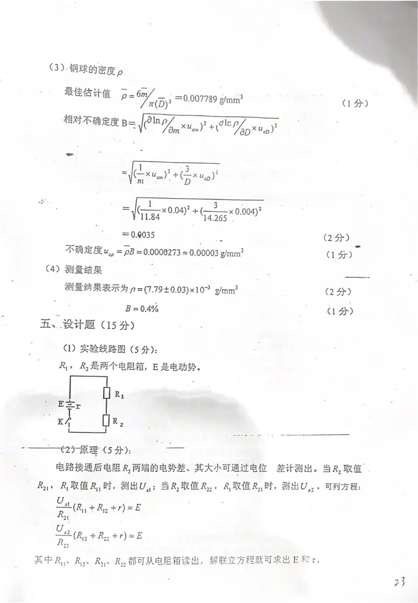

#### 原理

电路接通后电阻 $R_{2}$ 两端的电势差、其大小可通过电位差计测出。当 $R_{2}$ 取值 $R_{21}$ ， $R_{1}$ 取值 $R_{11}$ 时，测出 $U_{x1}$ ；当 $R_{2}$ 取值 $R_{22}$ ， $R_{1}$ 取值 $R_{21}$ 时，测出 $U_{x2}$ ，可列方程：

$$
\begin{array}{l} \frac {U _ {x 1}}{R _ {2 1}} (R _ {1 1} + R _ {1 2} + r) = E \\ \frac {U _ {x 2}}{R _ {2 2}} (R _ {1 2} + R _ {2 2} + r) = E \end{array}
$$

其中 $R_{11}$ 、 $R_{12}$ 、 $R_{21}$ 、 $R_{22}$ 都可从电阻箱读出，解联立方程就可求出E和r。

#### 步骤

A）按实验线路图接好电路；

B）调节好电势差计；

C) 把 $R_{2}$ 两端接入电势差计（注意正、负极），测出 $U_{x1}$ ，读出 $R_{11}$ ， $R_{21}$

D）改变 $R_{1}$ ， $R_{2}$ 的值，测出 $U_{x2}$ ，读出 $R_{12}$ ， $R_{22}$ 。

E）带入联立方程，解出 E，r。

知识点：[实验报告的内容（含实验内容与步骤等）](../../../topics/大学物理实验/实验报告内容.md)、[测量与单位（含国际单位制重新定义）](../../../topics/大学物理实验/测量与单位.md)、[直接测量量的有效数字读数原则（游标卡尺、角游标尺、螺旋测微器、数字表头）](../../../topics/大学物理实验/直接测量量读数原则.md)

### 选择 26

选出下列说法中的正确者

- A. 二极管是一种线性电子元件。
- B. 二极管是一种非线性电子元件。
- C. 二极管导通后电流变化变慢。
- D. 二极管导通后电阻值很大。

答案：B。

知识点：[物理实验课的基本程序（预习、实验进行、写报告）](../../../topics/大学物理实验/实验课基本程序.md)、[预习报告的编写内容与要求](../../../topics/大学物理实验/预习报告内容.md)、[实验报告的内容（含实验内容与步骤等）](../../../topics/大学物理实验/实验报告内容.md)

### 选择 27

选出下列说法中的正确者

- A. 二极管是一种线性电子元件。
- B. 二极管是一种非线性电子元件。
- C. 二极管处于导通状态时电阻值很大。
- D. 二极管处于截止状态时电阻值很小。

答案：B。

知识点：[测量的分类（直接测量与间接测量）](../../../topics/大学物理实验/测量的分类.md)

### 选择 28

选出下列说法中的正确者

- A. 二极管是一种线性电子元件。
- B. 二极管是一种非线性电子元件。
- C. 二极管导通后电阻值很小。
- D. 二极管导通后电阻值很大。

答案：BC。

知识点：[实验报告的内容（含实验内容与步骤等）](../../../topics/大学物理实验/实验报告内容.md)

### 选择 29

声速测量实验中声波波长的测量采用

- A. 模拟法和感应法
- B. 补偿法和共振干涉法
- C. 共振干涉法和相位比较法
- D. 相位比较法和补偿法

答案：C。

知识点：[直接测量量的有效数字读数原则（游标卡尺、角游标尺、螺旋测微器、数字表头）](../../../topics/大学物理实验/直接测量量读数原则.md)

### 选择 31

下面哪一个阻值的待测电阻需要用双臂电桥来测量？

- A. 0.001Ω
- B. 1MΩ
- C. 1000Ω
- D. 100Ω

答案：A。

知识点：[测量的分类（直接测量与间接测量）](../../../topics/大学物理实验/测量的分类.md)、[测量与单位（含国际单位制重新定义）](../../../topics/大学物理实验/测量与单位.md)

### 选择 32

单双臂电桥测量电阻值的适用范围是

- A. 单双臂电桥都可以测量任何阻值的电阻
- B. 单臂电桥适用于测量中值电阻，而双臂电桥适用于测量低值电阻
- C. 双臂电桥只适用于测量低电阻，而单臂电桥测量电阻的范围不受限制
- D. 单臂电桥适用于测量中值电阻，而双臂电桥测量电阻的范围不受限制

答案：B。

知识点：[测量的分类（直接测量与间接测量）](../../../topics/大学物理实验/测量的分类.md)

### 选择 35

独立测量测得正方形的两边长为 $x_1$ 和 $x_2$，求面积 $A$，有四种处理数据的方法：

- A. $A_1 = x_1 x_2$
- B. $A_2 = x_1^2$ 或 $x_2^2$
- C. $A_3 = \frac{x_1^2 + x_2^2}{2}$
- D. $A_4 = \frac{x_1 + x_2}{2} \cdot \frac{x_1 + x_2}{2}$

应选用哪种处理方法？

答案：A。

知识点：[测量的分类（直接测量与间接测量）](../../../topics/大学物理实验/测量的分类.md)、[有效数字的运算法则（加减运算与乘除运算）](../../../topics/大学物理实验/有效数字运算法则.md)、[直接测量量的有效数字读数原则（游标卡尺、角游标尺、螺旋测微器、数字表头）](../../../topics/大学物理实验/直接测量量读数原则.md)

### 选择 37

请选择出表达正确者

- A. $7.600 \pm 0.05\ \text{kg/m}^3$
- B. $7.60 \times 10^4 \pm 0.41 \times 10^3\ \text{kg/m}^3$
- C. $7.600 \pm 0.140\ \text{kg/m}^3$
- D. $7.60 \pm 0.08 \times 10^3\ \text{kg/m}^3$

答案：D。

知识点：[有效数字的修约规则（只进不舍等）](../../../topics/大学物理实验/有效数字修约规则.md)、[科学记数法表示有效数字](../../../topics/大学物理实验/科学记数法.md)、[测量与单位（含国际单位制重新定义）](../../../topics/大学物理实验/测量与单位.md)

### 选择 38

请选择出表达正确者

- A. $7.60 \times 10^4 \pm 0.41 \times 10^3\ \text{kg/m}^3$
- B. $10^4 \pm 0.25$

答案：C。

知识点：[有效数字的运算法则（加减运算与乘除运算）](../../../topics/大学物理实验/有效数字运算法则.md)

### 选择 39

等厚干涉实验中测量牛顿环两个暗纹直径的平方差是为了

- A. 消除回程差
- B. 消除干涉级次的不确定性
- C. 消除视差
- D. 消除暗纹半径测量的不确定性

答案：B。

知识点：[测量与单位（含国际单位制重新定义）](../../../topics/大学物理实验/测量与单位.md)、[有效数字的概念与定义](../../../topics/大学物理实验/有效数字概念.md)

### 选择 40

关于牛顿环干涉条纹，下面说法正确的是

- A. 是光的等倾干涉条纹
- B. 是光的等厚干涉条纹
- C. 条纹从内到外间距不变
- D. 条纹由内到外逐渐变疏

答案：B。

知识点：[实验报告的内容（含实验内容与步骤等）](../../../topics/大学物理实验/实验报告内容.md)

### 选择 41

用模拟法测绘静电场实验，下列说法正确的是

- A. 同轴电缆的等位线是直线
- B. 聚焦电极的等位线是同心圆
- C. 本实验用电压表法测量
- D. 本实验用电流表法测量

答案：C。

知识点：[物理实验课的基本程序（预习、实验进行、写报告）](../../../topics/大学物理实验/实验课基本程序.md)、[测量与单位（含国际单位制重新定义）](../../../topics/大学物理实验/测量与单位.md)、[直接测量量的有效数字读数原则（游标卡尺、角游标尺、螺旋测微器、数字表头）](../../../topics/大学物理实验/直接测量量读数原则.md)

### 选择 42

用模拟法测绘静电场实验，下列说法正确的是

- A. 静电场的电力线是没方向的
- B. 等位线要标出方向
- C. 本实验用稳恒磁场模拟静电场

答案：D。

知识点：[物理实验课的基本程序（预习、实验进行、写报告）](../../../topics/大学物理实验/实验课基本程序.md)

### 选择 43

要把加在示波器 Y 偏转板上的正弦信号显示在示波屏上，则 X 偏转板必须加

- A. 方波信号
- B. 锯齿波信号
- C. 正弦信号
- D. 非线性信号

答案：B。

知识点：[测量的分类（直接测量与间接测量）](../../../topics/大学物理实验/测量的分类.md)、[直接测量量的有效数字读数原则（游标卡尺、角游标尺、螺旋测微器、数字表头）](../../../topics/大学物理实验/直接测量量读数原则.md)

### 选择 44

用霍尔法测直流磁场的磁感应强度时，霍尔电压的大小

- A. 与霍尔材料的性质无关
- B. 与外加磁场的磁感应强度的大小成正比
- C. 与霍尔片上的工作电流 $I_s$ 的大小成反比
- D. 与霍尔片的厚度 $d$ 成正比

答案：B。

知识点：[测量的分类（直接测量与间接测量）](../../../topics/大学物理实验/测量的分类.md)、[有效数字的概念与定义](../../../topics/大学物理实验/有效数字概念.md)

### 选择 45

在霍尔效应中，霍尔电压的大小

- A. 与励磁电流 $I_M$ 无关
- B. 与霍尔片上的工作电流 $I_s$ 的大小成正比
- C. 与外加磁场的磁感应强度的大小成反比
- D. 与霍尔材料的性质无关

答案：B。

知识点：[测量的分类（直接测量与间接测量）](../../../topics/大学物理实验/测量的分类.md)、[有效数字的运算法则（加减运算与乘除运算）](../../../topics/大学物理实验/有效数字运算法则.md)

### 选择 47

下面说法正确的是

- A. 系统误差可以通过多次测量消除
- B. 偶然误差一定能够完全消除
- C. 记错数是系统误差
- D. 系统误差是可以减少甚至消除的

答案：D。

## 实验操作：双臂电桥测金属棒电阻率

<table>
<tr><td>题号</td><td>一</td><td>二</td><td>三</td><td>四</td><td>五</td><td>六</td><td>七</td><td>数据处理</td><td>总分</td></tr>
<tr><td>得分</td><td></td><td></td><td></td><td></td><td></td><td></td><td></td><td></td><td></td></tr>
</table>

注意事项：实验操作考试不得带书及实验报告，只能带计算器、直尺、笔、坐标纸。考试开始前务请看清本实验的要求，务必按要求检查仪器是否完好，如有问题及时向相关老师反映，否则一切后果自负！

所提供的仪器：双臂电桥，四端电阻器，导线若干，标准电阻，检流计，金属棒，螺旋测微器。

实验操作内容：（55 分）

1. 按给定的电路图正确连接电路：

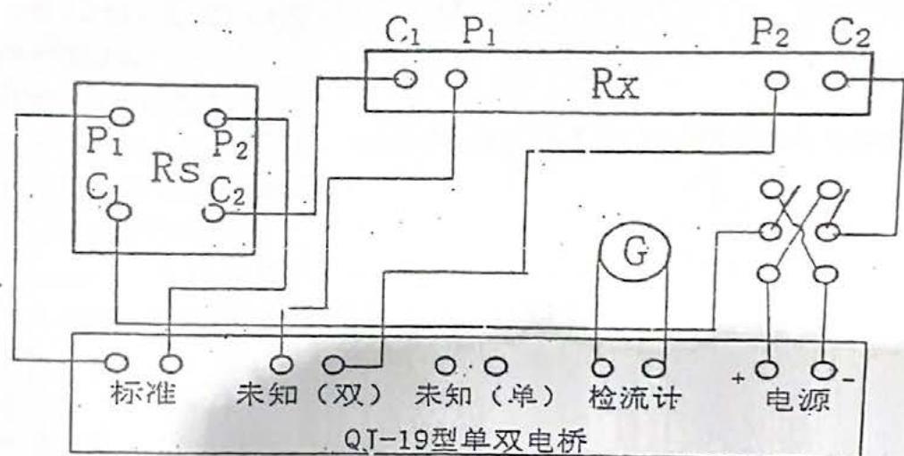

2. 合理选择 $R_S$、$R_1$、$R_2$ 及 $R$ 的阻值。

3. 正确利用所给仪器测量材料____长度 $L=$____mm 的阻值。（$R_x = \frac{R}{R_1} R_s$）

4. 测量同种材料 $L=$____mm 的阻值。（只计算电阻值，不要求计算电阻率和不确定度）

5. 测量所给材料的直径 5 次。

数据表格（自拟）及数据处理：（45 分）

1. 利用公式 $\rho = \frac{\pi d^2 R_x}{4L}$ 计算金属棒的电阻率。

2. 写出 $\rho$ 的不确定度公式，计算不确定度。（$R_x$ 的相对不确定度用 ±0.05% 代入）

## 实验操作：扭摆法测转动惯量

<table>
<tr><td>题号</td><td>一</td><td>二</td><td>三</td><td>四</td><td>总分</td></tr>
<tr><td>得分</td><td></td><td></td><td></td><td></td><td></td></tr>
</table>

注意事项：实验操作考试不得带书及实验报告，只能带计算器、直尺、笔、坐标纸。考试开始前务请看清本实验的要求，务必按要求检查仪器是否完好，如有问题及时向相关老师反映，否则一切后果自负！

知识点：[测量的分类（直接测量与间接测量）](../../../topics/大学物理实验/测量的分类.md)、[有效数字的概念与定义](../../../topics/大学物理实验/有效数字概念.md)

### 一、基本原理和公式

1. 转动惯量：在弹簧的恢复力矩作用下，物体绕垂直轴作往返周期性运动，弹簧受扭转而产生的力矩 $M$ 与所转过的角度成正比：

$$M = -K \cdot \theta \tag{1}$$

其中 $K$ 为弹簧的扭转常数，由转动定律可知：

$$M = I \cdot \frac{d^2\theta}{dt^2} \tag{2}$$

其中 $I$ 为转动惯量，令 $\omega^2 = \frac{K}{I}$，由 (1)(2) 可得：

$$\frac{d^2\theta}{dt^2} = -\frac{K}{I} \cdot \theta = -\omega^2 \theta \tag{3}$$

$\omega = \sqrt{\frac{K}{I}}$ 为简谐运动的角频率，此简谐运动的周期为：

$$T = \frac{2\pi}{\omega} = 2\pi\sqrt{\frac{I}{K}}$$

2. 平行轴定理：若质量为 $m$ 的物体绕通过质心轴的转动惯量为 $I_0$，当转轴平行移动距离 $x$ 时，则此物体对新轴的转动惯量 $I_C = I_0 + mx^2$，称为转动惯量的平行轴定理。

3. 各种物体转动惯量的理论计算公式：

金属细杆的转动惯量：$I_1 = \frac{1}{12}m_1 L^2$，$m_1$ 为金属细杆的质量，$L$ 为金属细杆的长度。

塑料圆柱的转动惯量：$I_2 = \frac{1}{8}m_2 D^2$，$m_2$ 为塑料圆柱的质量，$D$ 为塑料圆柱的直径。

知识点：[测量与单位（含国际单位制重新定义）](../../../topics/大学物理实验/测量与单位.md)、[实验报告的内容（含实验内容与步骤等）](../../../topics/大学物理实验/实验报告内容.md)

### 二、考试内容

自拟实验数据表格记录相关数据。

1. 调节转动惯量测试仪机座的水平。

2. 利用金属细杆测量扭摆的扭转常数 $K$，写出扭转常数 $K$ 的不确定度公式并计算其值。

3. 测量塑料圆柱的转动惯量，并计算其转动惯量理论值的百分差。（扭摆的扭转常数 $K$ 取题 1 测得的扭转常数）

4. 利用细杆验证平行轴定理时，能否将圆柱滑块不对称放置来进行？请简要说明其理由。

## 实验操作：分光计测三棱镜顶角与折射率

<table>
<tr><td>题号</td><td>一</td><td>二</td><td>三</td><td>四</td><td>五</td><td>六</td><td>七</td><td>数据处理</td><td>总分</td></tr>
<tr><td>得分</td><td></td><td></td><td></td><td></td><td></td><td></td><td></td><td></td><td></td></tr>
</table>

注意事项：实验操作考试不得带书及实验报告，只能带计算器、直尺、笔、坐标纸。考试开始前务请看清本实验的要求，务必按要求检查仪器是否完好，如有问题及时向相关老师反映，否则一切后果自负！

所提供的仪器：分光计，反射镜，氦灯（或汞灯），三棱镜。

实验操作：（60 分）

1. 调整分光计，使分光计能达到使用状态（举手示意请老师检查望远镜、载物平台、平行光管等的调整情况）。

2. 用____法测三棱镜顶角，测量一组数据，求顶角。

3. 用三棱镜测量____灯____谱线的最小偏向角，测量三组数据。

数据记录及处理：（40 分）

自拟实验数据表格记录相关数据。

1. 测量三棱镜顶角，测一组数据，设计合理表格并计算顶角 $A$ 的大小。

2. 测量指定谱线的最小偏向角，测三组数据，设计合理表格并计算最小偏向角的大小。

3. 计算折射率及其不确定度。

$$n = \frac{\sin\frac{1}{2}(\overline{\delta}_{\min} + A)}{\sin\frac{A}{2}}, \quad u_n = \frac{n}{2}\sqrt{\left[\cot\left(\frac{\delta_{\min}+A}{2}\right) - \cot\frac{A}{2}\right]^2 u_A^2 + \cot^2\left(\frac{\delta_{\min}+A}{2}\right) u_{\delta_{\min}}^2}$$

## 实验操作：十一线电位差计测电池电动势

<table>
<tr><td>题号</td><td>一</td><td>二</td><td>三</td><td>四</td><td>五</td><td>六</td><td>七</td><td>数据处理</td><td>总分</td></tr>
<tr><td>得分</td><td></td><td></td><td></td><td></td><td></td><td></td><td></td><td></td><td></td></tr>
</table>

注意事项：实验操作考试不得带书及实验报告，只能带计算器、直尺、笔、坐标纸。考试开始前务请看清本实验的要求，务必按要求检查仪器是否完好，如有问题及时向相关老师反映，否则一切后果自负！

所提供的仪器：组合式十一线电位差计（标准电源电动势 1.01860V）。

要求完成实验内容：（70 分）

1. 在试卷上画出实验原理图。

2. 正确连接电路。

3. 定标系数 $U_0$ 为 0.2000 V/m 和 0.2750 V/m 分别进行定标。

4. 测量指定的待测电池电动势 $E_x$。定标系数 $U_0$ 为 0.2000 V/m 时测量一次，定标系数 $U_0$ 为 0.2750 V/m 时测量 5 次。

数据记录及处理：（30 分）

1. 自拟实验数据记录表，记录实验数据。

2. 数据处理：定标系数 $U_0$ 为 0.2000 V/m 时计算待测电池电动势，定标系数 $U_0$ 为 0.2750 V/m 时计算待测电池电动势，并计算不确定度。

## 实验操作：热敏电阻与热电偶特性测量

<table>
<tr><td>题号</td><td>一</td><td>二</td><td>三</td><td>四</td><td>五</td><td>六</td><td>七</td><td>数据处理</td><td>总分</td></tr>
<tr><td>得分</td><td></td><td></td><td></td><td></td><td></td><td></td><td></td><td></td><td></td></tr>
</table>

注意事项：实验操作考试不得带书及实验报告，只能带计算器、直尺、笔、坐标纸。考试开始前务请看清本实验的要求，务必按要求检查仪器是否完好，如有问题及时向相关老师反映，否则一切后果自负！

所提供的实验仪器：DHT 热学实验仪，直流电桥，万用表。

1. 测量从室温到 $60^\circ\text{C}$ 的热敏电阻值，平均大约每个 $5^\circ\text{C}$ 测一个点；数据表格自拟。（测量电阻的原理和惠斯通电桥一样，可以根据电桥盖子里面的铭牌上的内部电路图确定外部连线的方法）

2. 测量从 $60^\circ\text{C}$ 到室温的热电偶温差电势，平均大约每个 $10^\circ\text{C}$ 测一个点；数据表格自拟。

3. 根据半导体热敏电阻的温度特性 $R_T = Ae^{B/T}$，作 $\ln R_T - \frac{1}{T}$ 图，图解求 $B$。（写出详细的图解计算过程）

4. 根据温差电势和温差关系 $U_t = \alpha(t - t_0)$，图解求 $\alpha$。（写出详细的图解计算过程）

# 2021—2022 学年第二学期《大学物理实验》期末试卷（B卷）

## 一、填空题（每小题 2 分，共 20 分）

知识点：[实验报告的内容（含实验内容与步骤等）](../../../topics/大学物理实验/实验报告内容.md)、[测量的分类（直接测量与间接测量）](../../../topics/大学物理实验/测量的分类.md)、[直接测量量的有效数字读数原则（游标卡尺、角游标尺、螺旋测微器、数字表头）](../../../topics/大学物理实验/直接测量量读数原则.md)

### 填空 1

题干：对直接测量量 $x$，合成不确定度 $\sigma=$ \_\_\_\_；对间接测量量 $y(x_{1}, x_{2})$ ，合成不确定度 $\sigma=$ \_\_\_\_。

答案：$\sqrt{\sum (\frac{\partial y}{\partial x_i} \sigma_{x_i})^2}$ （或类似的标准不确定度传递公式，具体取决于教材定义，通常直接测量量为 $\sigma_x$，间接为误差传递公式）
知识点：[有效数字的运算法则（加减运算与乘除运算）](../../../topics/大学物理实验/有效数字运算法则.md)

### 填空 2

题干：用一个 0.5 级的电表单次测量一个电学量，若指针刚好指在满刻度处，则该测量结果的相对不确定度等于 \_\_\_\_；若指针指在满刻度的十分之一处，则该测量的结果的相对不确定度等于 \_\_\_\_。

答案：0.5%；5%
知识点：[有效数字的修约规则（只进不舍等）](../../../topics/大学物理实验/有效数字修约规则.md)

### 填空 3

题干：示波器正常，但开机后荧光屏上看不到亮点，原因可能是 (1) \_\_\_\_；(2) \_\_\_\_。

答案：(1) 聚焦或辉度旋钮调节不当（亮度太低或散焦）；(2) X/Y 轴位置偏移出屏幕范围
知识点：[物理实验课的基本程序（预习、实验进行、写报告）](../../../topics/大学物理实验/实验课基本程序.md)

### 填空 4

题干：给出到目前为止已经学过的测量电阻的两种方法 \_\_\_\_、\_\_\_\_。

答案：伏安法；电桥法（或万用表欧姆档法）
知识点：[测量的分类（直接测量与间接测量）](../../../topics/大学物理实验/测量的分类.md)、[实验报告的内容（含实验内容与步骤等）](../../../topics/大学物理实验/实验报告内容.md)

### 填空 5

题干：测量中的千分尺的零点误差属于 \_\_\_\_ 系统误差；米尺刻度不均匀的误差属于 \_\_\_\_ 系统误差。

答案：定值；变值
知识点：[物理实验课程的成绩考核方式](../../../topics/大学物理实验/成绩考核.md)

### 填空 6

题干：一般情况下，总是在同一条件下对某量进行多次测量，多次测量的目的有两个，一是 \_\_\_\_，二是 \_\_\_\_。

答案：减小随机误差（提高精密度）；发现粗大误差（剔除异常值）
知识点：[测量的分类（直接测量与间接测量）](../../../topics/大学物理实验/测量的分类.md)

### 填空 7

题干：某学生用 1/50 的游标卡尺测得一组长度的数据为: (1) 20.02mm, (2) 20.50mm, (3) 20.25mm, (4) 20.20cm; 则其中一定有错的数据编号是 \_\_\_\_。

答案：(4)
知识点：[有效数字的概念与定义](../../../topics/大学物理实验/有效数字概念.md)、[有效数字的修约规则（只进不舍等）](../../../topics/大学物理实验/有效数字修约规则.md)

### 填空 8

题干：测量一规则木板的面积，已知其长约为 30cm，宽约为 5cm，要求结果有四位有效位数，则长用 \_\_\_\_ 来测量，宽用 \_\_\_\_ 来测量。

答案：钢卷尺（或毫米刻度尺）；游标卡尺（或螺旋测微器）
知识点：[直接测量量的有效数字读数原则（游标卡尺、角游标尺、螺旋测微器、数字表头）](../../../topics/大学物理实验/直接测量量读数原则.md)、[测量的分类（直接测量与间接测量）](../../../topics/大学物理实验/测量的分类.md)

### 填空 9

利用霍尔效应测螺线管磁感应强度分布实验中的四个副效应可归结为：\_\_\_\_、\_\_\_\_、温度梯度电压和电极不等势电压。

知识点：[物理实验课的基本程序（预习、实验进行、写报告）](../../../topics/大学物理实验/实验课基本程序.md)

### 填空 10

学过的迈克尔逊实验和测量金属棒的线胀系数实验中主要使用的物理实验基本测量方法分别是 \_\_\_\_ 和 \_\_\_\_。

## 二、判断题（“对”在题号前（）中打√，“错”打×）（10分）

知识点：[测量的分类（直接测量与间接测量）](../../../topics/大学物理实验/测量的分类.md)、[直接测量量的有效数字读数原则（游标卡尺、角游标尺、螺旋测微器、数字表头）](../../../topics/大学物理实验/直接测量量读数原则.md)

### 判断 1

准确度是指测量值或实验所得结果与真值符合的程度，描述的是测量值接近真值程度的程度，反映的是系统误差大小的程度。

答案：√

知识点：[有效数字的概念与定义](../../../topics/大学物理实验/有效数字概念.md)

### 判断 2

精确度指精密度与准确度的综合，既描述数据的重复性程度，又表示与真值的接近程度，反映了综合误差的大小程度。

答案：√

知识点：[有效数字的概念与定义](../../../topics/大学物理实验/有效数字概念.md)、[科学记数法表示有效数字](../../../topics/大学物理实验/科学记数法.md)、[有效数字的修约规则（只进不舍等）](../../../topics/大学物理实验/有效数字修约规则.md)

### 判断 3

系统误差的特征是它的有规律性，而随机的特征是它的无规律性。

答案：×

知识点：[有效数字的概念与定义](../../../topics/大学物理实验/有效数字概念.md)、[有效数字的运算法则（加减运算与乘除运算）](../../../topics/大学物理实验/有效数字运算法则.md)

### 判断 4

算术平均值代替真值是最佳值，平均值代替真值可靠性可用算术平均偏差、标准偏差和不确定度方法进行估算和评定。

答案：√

知识点：[有效数字的概念与定义](../../../topics/大学物理实验/有效数字概念.md)、[直接测量量的有效数字读数原则（游标卡尺、角游标尺、螺旋测微器、数字表头）](../../../topics/大学物理实验/直接测量量读数原则.md)

### 判断 5

测量结果不确定度按评定方法可分为A类分量和B类分量，不确定度A类分量与随机误差相对应，B类分量与系统误差相对应。

答案：×

知识点：[有效数字的概念与定义](../../../topics/大学物理实验/有效数字概念.md)、[直接测量量的有效数字读数原则（游标卡尺、角游标尺、螺旋测微器、数字表头）](../../../topics/大学物理实验/直接测量量读数原则.md)

### 判断 6

用1/50游标卡尺单次测量某一个工件长度，测量值 $N=10.00\mathrm{mm}$，用不确定度评定结果为 $N=(10.00\pm0.02)\mathrm{mm}$。

答案：×

知识点：[有效数字的概念与定义](../../../topics/大学物理实验/有效数字概念.md)、[直接测量量的有效数字读数原则（游标卡尺、角游标尺、螺旋测微器、数字表头）](../../../topics/大学物理实验/直接测量量读数原则.md)

### 判断 7

在测量钢丝的杨氏弹性模量实验中，预加 $1\mathrm{~Kg}$ 砝码的目的是增大钢丝伸长量。

答案：×

知识点：[有效数字的修约规则（只进不舍等）](../../../topics/大学物理实验/有效数字修约规则.md)

### 判断 8

利用逐差法处理实验数据的优点是充分利用数据和减少随机误差。

答案：√

知识点：[有效数字的概念与定义](../../../topics/大学物理实验/有效数字概念.md)

### 判断 9

模拟法可以分为物理模拟和数学模拟，因为稳恒电流场和静电场的物理本质相同，所以用稳恒电流场模拟静电场属于物理模拟。

答案：×

知识点：[有效数字的概念与定义](../../../topics/大学物理实验/有效数字概念.md)、[科学记数法表示有效数字](../../../topics/大学物理实验/科学记数法.md)

### 判断 10

系统误差在测量条件不变时有确定的大小和正负号，因此在同一测量条件下多次测量求平均值能够减少或消除系统误差。

答案：×

## 三、简答题（共15分）

知识点：[有效数字的修约规则（只进不舍等）](../../../topics/大学物理实验/有效数字修约规则.md)

### 简答 1

简述利用实验方法探索物理规律的主要步骤。(5分)

知识点：[测量的分类（直接测量与间接测量）](../../../topics/大学物理实验/测量的分类.md)、[直接测量量的有效数字读数原则（游标卡尺、角游标尺、螺旋测微器、数字表头）](../../../topics/大学物理实验/直接测量量读数原则.md)、[有效数字的运算法则（加减运算与乘除运算）](../../../topics/大学物理实验/有效数字运算法则.md)

### 简答 2

简述电位差计的基本原理。用十一线电位差计测电池电动势的操作过程中，若调至平衡状态后断开工作电流回路，这时检流计指针会如何变化？（10分）

知识点：[直接测量量的有效数字读数原则（游标卡尺、角游标尺、螺旋测微器、数字表头）](../../../topics/大学物理实验/直接测量量读数原则.md)、[有效数字的概念与定义](../../../topics/大学物理实验/有效数字概念.md)、[实验报告的内容（含实验内容与步骤等）](../../../topics/大学物理实验/实验报告内容.md)

### 计算 1

用流体静力称衡法测固体密度的公式为 $\rho=\frac{m}{m-m_{1}}\rho_{0}$，若测得 $m=(29.05\pm0.09)\mathrm{g}, m_{1}=(19.07\pm0.03)\mathrm{g}, \quad\rho_{0}=(0.9998\pm0.0002)\mathrm{g}/\mathrm{cm}^{3}$，求固体密度的测量结果。

知识点：[直接测量量的有效数字读数原则（游标卡尺、角游标尺、螺旋测微器、数字表头）](../../../topics/大学物理实验/直接测量量读数原则.md)、[有效数字的运算法则（加减运算与乘除运算）](../../../topics/大学物理实验/有效数字运算法则.md)

### 计算 2

根据公式 $\rho = \frac{4M}{\pi D^2H}$ 测量铜圆柱体的密度。已知： $M = 45.038 \pm 0.004(\mathrm{g}), D = 1.2420 \pm 0.0004(\mathrm{cm}), H = 4.183 \pm 0.003(\mathrm{cm})$ 。试计算 $\rho$ 的不确定度 $\sigma_{\rho}$，并写出结果表达式。

知识点：[实验报告的内容（含实验内容与步骤等）](../../../topics/大学物理实验/实验报告内容.md)、[测量与单位（含国际单位制重新定义）](../../../topics/大学物理实验/测量与单位.md)

### 一、填空题（20分，每题2分）

知识点：[直接测量量的有效数字读数原则（游标卡尺、角游标尺、螺旋测微器、数字表头）](../../../topics/大学物理实验/直接测量量读数原则.md)、[有效数字的概念与定义](../../../topics/大学物理实验/有效数字概念.md)、[科学记数法表示有效数字](../../../topics/大学物理实验/科学记数法.md)

### 填空 1

$\sqrt{s^2 + u^2}$ , $\sqrt{\left(\frac{\partial y}{\partial x_1}\right)^2 \sigma_{xi}^2 + \left(\frac{\partial y}{\partial x_2}\right)^2 \sigma_{x2}^2}$ 。

知识点：[有效数字的运算法则（加减运算与乘除运算）](../../../topics/大学物理实验/有效数字运算法则.md)

### 填空 2

0.29%(0.3%), 2.9%(3%)。

知识点：[有效数字的修约规则（只进不舍等）](../../../topics/大学物理实验/有效数字修约规则.md)

### 填空 3

x,y 偏移出界，辉度太弱。

知识点：[物理实验课的基本程序（预习、实验进行、写报告）](../../../topics/大学物理实验/实验课基本程序.md)

### 填空 4

伏安法，电桥法，替代法，欧姆表法（注：答其中两个即可）

知识点：[测量的分类（直接测量与间接测量）](../../../topics/大学物理实验/测量的分类.md)、[实验报告的内容（含实验内容与步骤等）](../../../topics/大学物理实验/实验报告内容.md)

### 填空 5

已定，未定。

知识点：[物理实验课程的成绩考核方式](../../../topics/大学物理实验/成绩考核.md)

### 填空 6

减小随机误差，避免疏失误差。

知识点：[测量的分类（直接测量与间接测量）](../../../topics/大学物理实验/测量的分类.md)

### 填空 7

(3), (4)。

知识点：[有效数字的概念与定义](../../../topics/大学物理实验/有效数字概念.md)、[有效数字的修约规则（只进不舍等）](../../../topics/大学物理实验/有效数字修约规则.md)

### 填空 8

毫米尺，1/50游标卡尺。

知识点：[直接测量量的有效数字读数原则（游标卡尺、角游标尺、螺旋测微器、数字表头）](../../../topics/大学物理实验/直接测量量读数原则.md)、[测量的分类（直接测量与间接测量）](../../../topics/大学物理实验/测量的分类.md)

### 填空 9

温差电效应，热磁效应。

知识点：[物理实验课的基本程序（预习、实验进行、写报告）](../../../topics/大学物理实验/实验课基本程序.md)

### 填空 10

干涉法，非电量电测法。

知识点：[测量的分类（直接测量与间接测量）](../../../topics/大学物理实验/测量的分类.md)、[直接测量量的有效数字读数原则（游标卡尺、角游标尺、螺旋测微器、数字表头）](../../../topics/大学物理实验/直接测量量读数原则.md)

### 二、判断题（10分，每题1分）

知识点：[有效数字的运算法则（加减运算与乘除运算）](../../../topics/大学物理实验/有效数字运算法则.md)、[物理实验课程的成绩考核方式](../../../topics/大学物理实验/成绩考核.md)

### 判断 1

√

知识点：[有效数字的概念与定义](../../../topics/大学物理实验/有效数字概念.md)

### 判断 2

√

知识点：[有效数字的概念与定义](../../../topics/大学物理实验/有效数字概念.md)、[科学记数法表示有效数字](../../../topics/大学物理实验/科学记数法.md)、[有效数字的修约规则（只进不舍等）](../../../topics/大学物理实验/有效数字修约规则.md)

### 判断 3

×

知识点：[有效数字的概念与定义](../../../topics/大学物理实验/有效数字概念.md)、[有效数字的运算法则（加减运算与乘除运算）](../../../topics/大学物理实验/有效数字运算法则.md)

### 判断 4

√

知识点：[有效数字的概念与定义](../../../topics/大学物理实验/有效数字概念.md)、[直接测量量的有效数字读数原则（游标卡尺、角游标尺、螺旋测微器、数字表头）](../../../topics/大学物理实验/直接测量量读数原则.md)

### 判断 5

×

知识点：[有效数字的概念与定义](../../../topics/大学物理实验/有效数字概念.md)、[直接测量量的有效数字读数原则（游标卡尺、角游标尺、螺旋测微器、数字表头）](../../../topics/大学物理实验/直接测量量读数原则.md)

### 判断 6

×

知识点：[有效数字的概念与定义](../../../topics/大学物理实验/有效数字概念.md)、[直接测量量的有效数字读数原则（游标卡尺、角游标尺、螺旋测微器、数字表头）](../../../topics/大学物理实验/直接测量量读数原则.md)

### 判断 7

×

知识点：[有效数字的修约规则（只进不舍等）](../../../topics/大学物理实验/有效数字修约规则.md)

### 判断 8

√

知识点：[有效数字的概念与定义](../../../topics/大学物理实验/有效数字概念.md)

### 判断 9

×

知识点：[有效数字的概念与定义](../../../topics/大学物理实验/有效数字概念.md)、[科学记数法表示有效数字](../../../topics/大学物理实验/科学记数法.md)

### 判断 10

×

知识点：[有效数字的修约规则（只进不舍等）](../../../topics/大学物理实验/有效数字修约规则.md)

### 三、简答题（共10分）

知识点：[有效数字的概念与定义](../../../topics/大学物理实验/有效数字概念.md)、[直接测量量的有效数字读数原则（游标卡尺、角游标尺、螺旋测微器、数字表头）](../../../topics/大学物理实验/直接测量量读数原则.md)、[有效数字的修约规则（只进不舍等）](../../../topics/大学物理实验/有效数字修约规则.md)

### 简答 1

答: (1) 确定研究内容和研究对象。 (1分)

(2) 设计实验。作图, 判定曲线类型, 建立相应函数关系。 (1分)

(3) 实验测量待测量的对应关系。
(1分)

(4) 判断曲线函数形式, 写出一般式, 建立经验公式。 (1分)

(5) 验证。
(1分)

知识点：[测量的分类（直接测量与间接测量）](../../../topics/大学物理实验/测量的分类.md)、[直接测量量的有效数字读数原则（游标卡尺、角游标尺、螺旋测微器、数字表头）](../../../topics/大学物理实验/直接测量量读数原则.md)、[有效数字的运算法则（加减运算与乘除运算）](../../../topics/大学物理实验/有效数字运算法则.md)

### 简答 2

答: (1) 补偿原理;

(2分)

定标：调节电阻丝长度 $L_{0}$ ，补偿标准电池电动势 $E_{0}$ ;

(2分)

测量：调节电阻丝长度 $L_{x}$ ，补偿未知电池电动势 $E_{x}$ ；

(2分)

$$
\mathrm{E} _ {\mathrm{x}} = \mathrm{L} _ {\mathrm{x}} \mathrm{E} _ {0} / \mathrm{L} _ {0} 。\tag{2分}
$$

(2) 检流计指针保持偏转，不能补偿。 (2 分)

知识点：[直接测量量的有效数字读数原则（游标卡尺、角游标尺、螺旋测微器、数字表头）](../../../topics/大学物理实验/直接测量量读数原则.md)、[有效数字的概念与定义](../../../topics/大学物理实验/有效数字概念.md)、[实验报告的内容（含实验内容与步骤等）](../../../topics/大学物理实验/实验报告内容.md)

### 四、计算题（20分，每题10分）

知识点：[有效数字的修约规则（只进不舍等）](../../../topics/大学物理实验/有效数字修约规则.md)、[有效数字的运算法则（加减运算与乘除运算）](../../../topics/大学物理实验/有效数字运算法则.md)、[科学记数法表示有效数字](../../../topics/大学物理实验/科学记数法.md)

### 计算 1

解：密度的最佳估计值为 $\rho=\frac{m}{m-m_{1}}\rho_{2}=2.910g/cm^{3}$

(2分)

密度的不确定度：

$$
\begin{array}{r l} & \sigma_ {\rho} = \sqrt {\left(\frac {\partial \rho}{\partial m}\right) ^ {2} \sigma_ {m} ^ {2} + \left(\frac {\partial \rho}{\partial m _ {1}}\right) ^ {2} \sigma_ {m 1} ^ {2} + \left(\frac {\partial \rho}{\partial \rho_ {0}}\right) ^ {2} \sigma_ {\rho 0} ^ {2}} \\ & = \sqrt {\left[ \frac {m _ {1}}{(m - m _ {1}) ^ {2}} \rho_ {0} \right] ^ {2} \sigma_ {m} ^ {2} + \left[ \frac {m}{(m - m _ {1}) ^ {2}} \rho_ {0} \right] ^ {2} \sigma_ {m 1} ^ {2} + \left[ \frac {m _ {1}}{(m - m _ {1})} \right] ^ {2} \sigma_ {\rho 0} ^ {2}} \\ & = 0. 0 1 9 g / c m ^ {3} \end{array}\tag{2分}
$$

(1 分)

(1分)

相对不确定度： $B=\frac{\sigma_{p}}{\rho}\times100\%=0.7\%$

(1 分)

密度结果为： $\rho=(2.91\pm0.02)\ g/cm^{3}$ 或 $\rho=(2.910\pm0.019)\ g/cm^{3}$

$$
B = 0.7\%\tag{3 分}
$$

知识点：[直接测量量的有效数字读数原则（游标卡尺、角游标尺、螺旋测微器、数字表头）](../../../topics/大学物理实验/直接测量量读数原则.md)、[有效数字的运算法则（加减运算与乘除运算）](../../../topics/大学物理实验/有效数字运算法则.md)

### 计算 2

解：计算测量值 $\rho$ ：

$$
\rho = \frac {4 M}{\pi D ^ {2} H} = 8. 8 8 7 (g / c m ^ {3})\tag{2分}
$$

计算 $\rho$ 相对合成不确定度

$$
\begin{array}{l} \frac {\sigma_ {\rho}}{\rho} = \sqrt {(\frac {\sigma_ {M}}{M}) ^ {2} + (2 \frac {\sigma_ {D}}{D}) ^ {2} + (\frac {\sigma_ {H}}{H}) ^ {2}} \\ = \sqrt {(\frac {0 . 0 0 4}{45. 0 3 8}) ^ {2} + (2 \times \frac {0 . 0 0 4}{1 . 2 4 2 0}) ^ {2} + (\frac {0 . 0 0 3}{4 . 1 8 3}) ^ {2}} = 0. 0 9 6 \% \end{array}\tag{2分}
$$

(2分)

求 $\rho$ 的合成不确定度

$$
\sigma_ {\rho} = \rho \frac {\sigma_ {\rho}}{\rho} = 0. 0 0 9 (g / c m ^ {3})\tag{2分}
$$

测量结果表示： $\rho=8.887\pm0.009(g.cm^{-3})$

$$
\mathrm{B} = 0.1 \%
$$

知识点：[实验报告的内容（含实验内容与步骤等）](../../../topics/大学物理实验/实验报告内容.md)、[测量与单位（含国际单位制重新定义）](../../../topics/大学物理实验/测量与单位.md)

### 五、设计题（35分）

(2分)

解：（1）实验设计图

温度计

简述：

线胀系数： $a = \Delta l / (L_{0}(t_{2} - t_{0}))$

光杠杆： $\Delta l=1\quad\Delta n/2D$

a=1 $\Delta n/\{2D(L_{0}(t_{2}-t_{0}))\}$

15分

(2) 实验仪器: 金属棒, 玻璃箱, 温度计, 光杠杆, 望远镜尺组, 蒸汽源。5分

(3) a、仪器调整；

b、记录初始值 $t_{0}$ ， $n_{0}$ ，1，D， $L_{0}$ ;

c、加热金属杆，记录 $t_{2}$ （等间距取点）和 n；

10分

(4) 逐差法, 线性最小二乘法, 作图法; 自变量等间距分布, 两测量量线性变

43

## 《大学物理实验》

知识点：[实验报告的内容（含实验内容与步骤等）](../../../topics/大学物理实验/实验报告内容.md)、[有效数字的运算法则（加减运算与乘除运算）](../../../topics/大学物理实验/有效数字运算法则.md)、[测量的分类（直接测量与间接测量）](../../../topics/大学物理实验/测量的分类.md)

### 一、实验操作题（60分）

所提供的仪器：分光计，反射镜，氦灯（或汞灯），三棱镜。

实验操作：

1、调整分光计，使分光计能达到使用状态（举手示意请老师检查望远镜、载物平台、平行光管等的调整情况）。

2、用\_\_\_\_法测三棱镜顶角，测量一组数据，求顶角。

3、用三棱镜测量\_\_\_\_灯\_\_\_\_谱线的最小偏向角，测量三组数据。

知识点：[物理实验课的基本程序（预习、实验进行、写报告）](../../../topics/大学物理实验/实验课基本程序.md)、[直接测量量的有效数字读数原则（游标卡尺、角游标尺、螺旋测微器、数字表头）](../../../topics/大学物理实验/直接测量量读数原则.md)、[测量的分类（直接测量与间接测量）](../../../topics/大学物理实验/测量的分类.md)

### 二、数据记录及处理（40分）

自拟实验数据表格记录相关数据。

1、测量三棱镜顶角，测一组数据，设计合理表格并计算顶角 A 的大小。

2、测量指定谱线的最小偏向角，测三组数据，设计合理表格并计算最小偏向角的大小。

3、计算折射率及其不确定度。

$$
(n = \frac {\sin \frac {1}{2} (\overline {{\delta}} _ {\min} + A)}{\sin \frac {A}{2}}, \quad u _ {n} = \frac {n}{2} \sqrt {\left[ c t g \left(\frac {\delta_ {\min} + A}{2}\right) - c t g \frac {A}{2} \right] ^ {2} u _ {A} ^ {2} + c t g ^ {2} \left(\frac {\delta_ {\min} + A}{2}\right) u _ {\delta_ {\min}} ^ {2})}
$$

## 一、选择题

知识点：[测量的分类（直接测量与间接测量）](../../../topics/大学物理实验/测量的分类.md)、[有效数字的运算法则（加减运算与乘除运算）](../../../topics/大学物理实验/有效数字运算法则.md)、[直接测量量的有效数字读数原则（游标卡尺、角游标尺、螺旋测微器、数字表头）](../../../topics/大学物理实验/直接测量量读数原则.md)

### 选择 1

测得某物体长度的结果为 $L = 6.00 \pm 0.05\ \text{cm}$，则说明

- A. $5.95\ \text{cm} \leq L \leq 6.05\ \text{cm}$
- B. $L = 5.95\ \text{cm}$ 或 $L = 6.05\ \text{cm}$
- C. $L = 6.00\ \text{cm}$
- D. $L$ 在 $[5.95\ \text{cm}, 6.05\ \text{cm}]$ 区间上出现的可能性较大

知识点：[有效数字的运算法则（加减运算与乘除运算）](../../../topics/大学物理实验/有效数字运算法则.md)、[测量的分类（直接测量与间接测量）](../../../topics/大学物理实验/测量的分类.md)

### 选择 2

长方形边长测量结果为 $a = 4.000 \pm 0.005\ \text{cm}$，$b = 3.000 \pm 0.005\ \text{cm}$，则其表面积可表示为

- A. $S = 12 \pm 25 \times 10^{3}\ \text{cm}^{2}$
- B. $S = 12.00 \pm 0.03\ \text{cm}^{2}$
- C. $S = 12.00 \pm 0.025\ \text{cm}^{2}$
- D. $S = 12.00 \pm 0.025\ \text{cm}^{2}$

$$S = 12.00 \pm 0.02\ \text{cm}^{2}$$

知识点：[测量与单位（含国际单位制重新定义）](../../../topics/大学物理实验/测量与单位.md)、[有效数字的运算法则（加减运算与乘除运算）](../../../topics/大学物理实验/有效数字运算法则.md)

### 选择 3

用电流表测量结果为 $67\ \text{mA}$ 的电流，若要求最大示值误差 $\Delta I_{\text{B}}$ 不超过 $0.2\ \text{mA}$，则电流表的量程和级别应取为

- A. 量程 $15\ \text{mA}$，级别 $0.1$
- B. 量程 $30\ \text{mA}$，级别 $0.5$
- C. 量程 $75\ \text{mA}$，级别 $0.5$
- D. 量程 $100\ \text{mA}$，级别 $0.1$

答案：D。量程 $100\ \text{mA}$，级别 $0.1$。

知识点：[有效数字的概念与定义](../../../topics/大学物理实验/有效数字概念.md)、[有效数字的修约规则（只进不舍等）](../../../topics/大学物理实验/有效数字修约规则.md)、[直接测量量的有效数字读数原则（游标卡尺、角游标尺、螺旋测微器、数字表头）](../../../topics/大学物理实验/直接测量量读数原则.md)

### 选择 4

在测周期的实验中，若周期约为 $1.60\ \text{s}$，测量时计时误差引起的不确定度为 $0.02\ \text{s}$。为了满足测量周期的相对不确定度不大于 $0.01\%$，测量次数至少应为

- A. $50$ 次
- B. $100$ 次
- C. $180$ 次
- D. $125$ 次

知识点：[有效数字的修约规则（只进不舍等）](../../../topics/大学物理实验/有效数字修约规则.md)、[有效数字的概念与定义](../../../topics/大学物理实验/有效数字概念.md)、[测量与单位（含国际单位制重新定义）](../../../topics/大学物理实验/测量与单位.md)

### 选择 5

$F = 0.0008750$，$G = 6.7500$，则 $F$ 和 $G$ 的有效数字位数分别为

- A. 三位，四位
- B. 四位，三位
- C. 四位，五位
- D. 七位，五位

知识点：[有效数字的概念与定义](../../../topics/大学物理实验/有效数字概念.md)、[有效数字的运算法则（加减运算与乘除运算）](../../../topics/大学物理实验/有效数字运算法则.md)

### 选择 6

用螺旋测微仪测量直径约为 $2.00\ \text{cm}$ 的铜棒，测得的有效数字位数应为

- A. 四位
- B. 三位
- C. 五位
- D. 六位

知识点：[直接测量量的有效数字读数原则（游标卡尺、角游标尺、螺旋测微器、数字表头）](../../../topics/大学物理实验/直接测量量读数原则.md)、[有效数字的概念与定义](../../../topics/大学物理实验/有效数字概念.md)、[测量的分类（直接测量与间接测量）](../../../topics/大学物理实验/测量的分类.md)

### 选择 7

下面记录的是某一电阻的实验数据，记录正确的是

- A. $R = (971 \pm 71)\ \Omega$
- B. $R = (9.65 \pm 0.08) \times 10^{3}\ \Omega$
- C. $R = (9650 \pm 8 \times 10)\ \Omega$
- D. $R = (9.650 \pm 0.08) \times 10^{3}\ \Omega$

## 二、有效数字计算

知识点：[有效数字的修约规则（只进不舍等）](../../../topics/大学物理实验/有效数字修约规则.md)、[科学记数法表示有效数字](../../../topics/大学物理实验/科学记数法.md)、[有效数字的概念与定义](../../../topics/大学物理实验/有效数字概念.md)

### 计算 1

试利用有效位数运算规则计算下列各式的结果（混合运算要写出中间过程）：

(1) $98.754 + 1.3 =$

(2) $107.50 - 2.5 =$

(3) $111 \times 0.100 =$

(4) $237.5 \div 0.10 =$

(5) $\dfrac{76.000}{40.00 - 2.0} =$

(6) $\dfrac{50.00 \times (18.30 - 16.3)}{(103 - 3.0) \times (1.00 \div 0.001)} =$

知识点：[直接测量量的有效数字读数原则（游标卡尺、角游标尺、螺旋测微器、数字表头）](../../../topics/大学物理实验/直接测量量读数原则.md)、[有效数字的运算法则（加减运算与乘除运算）](../../../topics/大学物理实验/有效数字运算法则.md)

### 计算 2

已知

$$N = A + 2B + C - 5D,$$

$$A \pm u_A = (38.206 \pm 0.001)\ \text{cm},$$

$$B \pm u_B = (13.2487 \pm 0.0064)\ \text{cm},$$

$$C \pm u_C = (161.25 \pm 0.01)\ \text{cm},$$

$$D \pm u_D = (1.3242 \pm 0.0004)\ \text{cm},$$

求 $N \pm u_N$。

## 三、计算题

知识点：[实验报告的内容（含实验内容与步骤等）](../../../topics/大学物理实验/实验报告内容.md)、[测量与单位（含国际单位制重新定义）](../../../topics/大学物理实验/测量与单位.md)

### 计算 1

用量程为 $100\ \mu\text{A}$、准确度 $1.5$ 级的微安表测量一电流 $I$，指针刚好指在 $50\ \mu\text{A}$ 刻线处。已知 A 类不确定度分量可以忽略，$\Delta_{\text{rms}} = \text{量程} \times \text{级别} \div 100$。试写出 $I \pm u_I$ 和相对不确定度 $E$。

知识点：[直接测量量的有效数字读数原则（游标卡尺、角游标尺、螺旋测微器、数字表头）](../../../topics/大学物理实验/直接测量量读数原则.md)、[有效数字的运算法则（加减运算与乘除运算）](../../../topics/大学物理实验/有效数字运算法则.md)

### 计算 2

测得某二极管的正向电压降随温度变化的数据如下，根据以上数据作图，并求二极管的正向压降的温度系数 $c$（已知其关系为 $U = cT$）。

| $T(\text{K})$ | 110.0 | 125.0 | 140.0 | 155.0 | 170.0 | 185.0 | 200.0 | 215.0 | 230.0 | 245.0 |
|---|---|---|---|---|---|---|---|---|---|---|
| $U(\text{mV})$ | 776 | 730 | 690 | 639 | 603 | 555 | 502 | 472 | 420 | 379 |

## 四、实验题

知识点：[实验报告的内容（含实验内容与步骤等）](../../../topics/大学物理实验/实验报告内容.md)、[测量与单位（含国际单位制重新定义）](../../../topics/大学物理实验/测量与单位.md)

### 分光计调节

#### 简答 1

分光计调节的基本要求是：

1)

2)

3)

#### 简答 2

设置两个角游标的目的是：

#### 简答 3

请从图中读出其读数：

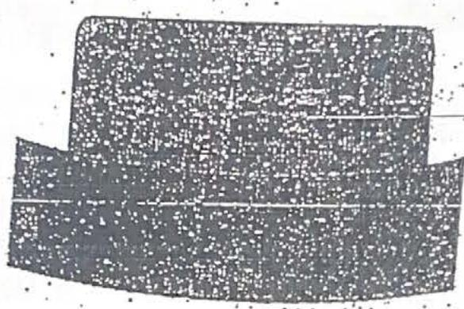

#### 简答 4

请读出螺旋测微器的读数大小：请读出游标卡尺的读数大小：

#### 简答 5

简述用数字示波器通道 2 测量正弦信号的主要步骤是：

若通道 1 为输入信号波形的截图，其电压灵敏度档位为 $1\ \text{V}$，则电压读数的有效值为\_\_\_\_；Dx 能反映什么物理量\_\_\_\_（电压，周期，相位）。

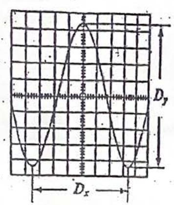

#### 简答 6

伏安法测电阻有内接法和外接法，请分别画出两种方法的原理电路图，并分别说明在什么情况下适合使用内接法，在什么情况下适合使用外接法？

知识点：[有效数字的概念与定义](../../../topics/大学物理实验/有效数字概念.md)、[直接测量量的有效数字读数原则（游标卡尺、角游标尺、螺旋测微器、数字表头）](../../../topics/大学物理实验/直接测量量读数原则.md)、[有效数字的运算法则（加减运算与乘除运算）](../../../topics/大学物理实验/有效数字运算法则.md)

### 电位差计

数据记录表：

| 校正系数 $u_0(\text{V/m})$ | 次数 | 电源电压 $E_0(\text{V})$ | 定标长度 $L_{CD0}(\text{m})$ | 测量长度 $L_{CDx}(\text{m})$ | 待测电动势 $E_x(\text{V})$ | 平均值 $E_x(\text{V})$ |
|---|---|---|---|---|---|---|
| 0.2000 | 1 | 2.20 | 5.093 | 7.548 | 1.5096 | 1.5098 |
| 0.2000 | 2 | 2.20 | 5.093 | 7.551 | 1.5102 | 1.5098 |
| 0.2000 | 3 | 2.20 | 5.093 | 7.549 | 1.5098 | 1.5098 |
| 0.2500 | — | 2.75 | 4.07444 | 6.039 | 1.5098 | — |
| 0.3000 | — | 3.30 | 3.39533 | 5.033 | 1.5098 | — |

数据处理：写出结果表达式：

$$E_x = \frac{E_N}{L_S} L_x$$

其中

$$u_{cEs} = (E_s \times 0.05\%) / \sqrt{3}, \quad \frac{u_{cEs}}{E_s} = \frac{0.0005}{\sqrt{3}} = 2.887 \times 10^{-4};$$

$$u_{BLx} = u_{BLs} = 0.001\ \text{m} / \sqrt{3} = 5.773 \times 10^{-4}\ \text{m};$$

$$S_{Li} = \sqrt{\frac{\sum (L_i - \overline{L_x})^2}{n(n-1)}} = \sqrt{\frac{(7.548 - 7.5493)^2 + (7.549 - 7.5493)^2 + (7.551 - 7.5493)^2}{3 \times 2}} = 1.06 \times 10^{-4}\ \text{m}$$

$$u_{clx} = \sqrt{S_{Lx}^2 + u_{BLx}^2} = 5.93 \times 10^{-4}\ \text{m};$$

$$u_{Ex} = E_x \sqrt{\left(\frac{u_{cls}}{L_x}\right)^2 + \left(\frac{u_{cEs}}{E_s}\right)^2 + \left(\frac{u_{cls}}{E_s}\right)^2} = 0.0005\ \text{V}$$

$$E = (1.5098 \pm 0.0005)\ \text{V}$$

#### 问题讨论 1

实验中如果发现检流计无法调到平衡，试分析可能有哪些原因？

#### 问题讨论 2

若 $u_0 = 0.2000\ \text{V/m}$，试问待测电动势的测量范围在哪个范围？可测电压为 $2.2\ \text{V} \sim 0.2\ \text{V}$ 范围内。

# 物理实验 (下) 期末试卷（数据记录与处理部分）

本部分整理了《物理实验 (下)》期末试卷中关于分光计、电桥测电阻、声速测量及电流表改装的实验数据记录与处理过程，包含原始数据表格、不确定度计算及最终结果表达式。识别过程中已修正明显的断行错误和乱码符号，公式统一为 LaTeX 格式，HTML 表格已转换为 Markdown 表格。

## 一、分光计实验：三棱镜顶角与折射率测量

知识点：[测量与单位（含国际单位制重新定义）](../../../topics/大学物理实验/测量与单位.md)、[测量的分类（直接测量与间接测量）](../../../topics/大学物理实验/测量的分类.md)、[有效数字的运算法则（加减运算与乘除运算）](../../../topics/大学物理实验/有效数字运算法则.md)

### 选择 1
**实验条件**：分光计型号 YY-J1，三棱镜编号 9\_，光源汞灯，波长 $\lambda = 546.07\mathrm{nm}$。

#### 反射法测量三棱镜顶角（表 6-2）

| $\theta_M$ | $\theta_N$ | $\theta'_M$ | $\theta'_N$ | $\|\theta_{M'} - \theta_M\|$ | $\|\theta_{N'} - \theta_N\|$ | $\varphi = \frac{1}{2}[(\theta_M' - \theta_M) + (\theta_N' - \theta_N)]$ | $A=180^\circ - \varphi$ |
| :--- | :--- | :--- | :--- | :--- | :--- | :--- | :--- |
| $201^{\circ}21'$ | $21^{\circ}25'$ | $321^{\circ}30'$ | $141^{\circ}30'$ | $120^{\circ}9'$ | $120^{\circ}5'$ | $120^{\circ}7'$ | 1.04822 |

$$
u_B = \frac {\pi}{180 \times 60} (\text{rad}) = 1.7 \times 10^{-4} (\text{rad})
$$

$$
A = 1.0482 \pm 0.0002 (\text{rad})
$$

#### 测量最小偏向角 $\delta_{min}$ (表 6-3)

| 测量次数\角度 | $\theta_M$ | $\theta_N$ | $\theta_{M'}$ | $\theta_{N'}$ | $\|\theta_M'-\theta_M\|$ | $\|\theta_N'-\theta_N\|$ | $\delta_{min}$ | $\overline{\delta}_{min}$ |
| :--- | :--- | :--- | :--- | :--- | :--- | :--- | :--- | :--- |
| 1 | 318° 4′ | 138° 3′ | 209° 30′ | 29° 35′ | 108° 34′ | 108° 28′ | 0.94698 | rowspan="3" 0.94679 |
| 2 | 318° 4′ | 138° 2′ | 209° 34′ | 29° 35′ | 108° 30′ | 108° 27′ | 0.94662 | |
| 3 | 318° 5′ | 138° 3′ | 209° 33′ | 29° 36′ | 108° 32′ | 108° 27′ | 0.94677 | |

知识点：[有效数字的运算法则（加减运算与乘除运算）](../../../topics/大学物理实验/有效数字运算法则.md)、[测量的分类（直接测量与间接测量）](../../../topics/大学物理实验/测量的分类.md)

### 选择 2
**数据处理过程**：

$$
u_A = \sqrt {\frac {\sum_ {i} (\delta_ {i} - \overline {{\delta}})}{3 \times 2}} = 1.1 \times 10^{-4} (\text{rad})
$$

$$
u_B = \frac {\pi}{180 \times 60} (\text{rad}) = 1.7 \times 10^{-4} (\text{rad})
$$

$$
u = \sqrt {u_A ^ {2} + u_B ^ {2}} = 3 \times 10^{-4} (\text{rad})
$$

$$
\delta_{\min} = (0.9468 \pm 0.0003) (\text{rad})
$$

其中折射率计算公式：
$$
n^* = \frac{\sin\frac{1}{2}(\overline{\delta}_{\min} + A)}{\sin\frac{A}{2}} = 1.67869
$$

折射率不确定度：
$$
u_n = \frac {n}{2} \sqrt {\left[ \cot \left(\frac {\delta_ {\min} + A}{2}\right) - \cot \frac {A}{2} \right] ^ {2} u^2 A + \cot ^ {2} \left(\frac {\delta_ {\min} + A}{2}\right) u^2} = 2.8 \times 10^{-4}
$$

**结果表达式**：
$$
n = n^* \pm u_n = 1.6787 \pm 0.0003
$$

> [!NOTE]
> 式中各角度不确定度 $u_n, u_{\delta \sin}$ 均应化成弧度。原文此处有“惠斯迪”字样，推测为“惠斯登”电桥相关内容的误植或残留文字，已在上下文中忽略。

## 二、电桥测电阻实验

知识点：[测量与单位（含国际单位制重新定义）](../../../topics/大学物理实验/测量与单位.md)、[有效数字的运算法则（加减运算与乘除运算）](../../../topics/大学物理实验/有效数字运算法则.md)

### 选择 3
**实验设备**：
- 电阻箱：型号 ZX21，总电阻 9999.9Ω，准确度等级 0.1。
- 检流计：型号 AZ19。
- 待测电阻估测值：$R_1=\underline{100}\Omega$, $R_2=\underline{1000}\Omega$, $R_{n1}(估测)=\underline{30}\Omega$, $R_{n2}(估测)=\underline{1500}\Omega$。

#### 自搭电桥测电阻数据表 (表 5-1)

| 次数电阻 | $i$ | 1 | 2 | 3 | 4 | 5 |
| :--- | :--- | :--- | :--- | :--- | :--- | :--- |
| **$R_{a1}(\Omega)$** ($R_0$) | | 266.7 | 266.6 | 266.7 | 266.7 | 266.7 |
| **$R_{a1}(\Omega)$** ($R_{a11}$) | | 26.67 | 26.66 | 26.67 | 26.67 | 26.67 |
| **$R_{a2}(\Omega)$** ($R_0$) | | 15801.8 | 15798.9 | 15799.5 | 15799.0 | 15799.8 |
| **$R_{a2}(\Omega)$** ($R_{a11}$) | | 1580.18 | 1579.89 | 1579.95 | 1579.90 | 1579.98 |

标准差：$S_{\overline{R01}} = 0.0022; \quad S_{\overline{R02}} = 0.0526$。

$\Delta R_{x1}', \Delta R_{x2}'$ 为由电桥灵敏度引入的测量误差。

**结果表达式**：
$$
R_{i1} = R_{i1} \pm u_{0,i1} = (26.67 \pm 0.03) \Omega
$$

$$
R_{u} = R_{u} \pm u_{du} = (1580 \pm 3) \Omega
$$

#### 用箱式电桥测电阻 (表 5-3)

| | 倍率 $C$ | $R_0(\Omega)$ | $R_1(\Omega)$ |
| :--- | :--- | :--- | :--- |
| $R_{ct}(\Omega)$ | 1:100 | 2675 | 26.75 |
| $R_{\alpha}(\Omega)$ | 1:1 | 1581 | 1581 |

**由灵敏度引入的测量误差 (表 5-4)**

| | $\Delta n$ | $\Delta R_{0}^{*}(\Omega)$ | $\Delta R_{z}^{*}(\Omega)$ |
| :--- | :--- | :--- | :--- |
| $R_{ct}(\Omega)$ | 5 小格 | 5 | 0.001 |
| $R_{ct}(\Omega)$ | 5 小格 | 2 | 0.0≤ | *(注：原文此处识别有误，结合上下文应为具体数值)* |

**不确定度计算与结果**：

$$
u_{H r 1} ^ {\prime} = \frac {1}{\sqrt {3}} \Delta R _ {x 1} ^ {\prime} = \frac {1}{\sqrt {3}} \times C \times \frac {1}{50} \times \Delta R _ {x 1} ^ {*} = 0.016541 \Omega
$$

$$
u_{Rx1} = \frac {1}{\sqrt {3}} \Delta_{\text {仪}} = \frac {1}{\sqrt {3}} \times C (a \% R _ {01} + b \Delta R _ {1}) = 3.2765 \times 10^{-4} \Omega
$$

合成不确定度：
$$
u_{z1}=\sqrt{(u_{Rz1})^{2}+(u_{Rx1})^{2}}=6\times10^{-4}\Omega
$$

得：
$$
R_{z1}=\overline{R_{z1}}\pm u_{Rx1}=\frac{(26.75\pm0.02)\Omega}{\sqrt{3}} \quad \text{(注：原文公式推导存在排版混乱，此处保留原文逻辑)}
$$

同理对第二组数据：
$$
u_{Rx2}=\frac {1}{\sqrt {3}}\Delta R_{z2}=\frac {1}{\sqrt {3}}\times C\times\frac {1}{50}\times\Delta R_{x2}=0.0231\Omega
$$
$$
u_{Rx2}=\frac {1}{\sqrt {3}}\Delta_{仪}=\frac {1}{\sqrt {3}}\times C(a\%R_{02}+b\Delta R_{2})=1.0860\Omega
$$
$$
u_{Rx2}=\sqrt{(u_{Rx2})^{2}+(u_{Rx2})^{2}}=2\Omega \quad \text{(注：原文此处重复变量名，实际应为合成)}
$$
得：
$$
R_{z2}=\overline{R_{x2}}\pm u_{Rx2}=(1581\pm2)\Omega
$$

## 三、声速测量实验（迈克尔逊干涉仪/驻波法）

知识点：[有效数字的概念与定义](../../../topics/大学物理实验/有效数字概念.md)、[有效数字的修约规则（只进不舍等）](../../../topics/大学物理实验/有效数字修约规则.md)、[直接测量量的有效数字读数原则（游标卡尺、角游标尺、螺旋测微器、数字表头）](../../../topics/大学物理实验/直接测量量读数原则.md)

### 选择 4
**不确定度计算**：

$$
u_d=\sqrt{u_{dA}^{2}+u_{dB}^{2}}=\sqrt{\frac{\sum_{1}^{3}\left(\Delta d_{i}-\Delta d^{2}\right)^{2}}{3\times2}+\frac{0.0004}{\sqrt{3}}}=2.3\times10^{-3}\text{mm}
$$
*(注：原文单位写为 $\pi m$，根据上下文应为 mm)*

$$
u_L=\sqrt{\left(\frac{2\cdot\Delta d}{N^{2}}\right)^{2}u_N^{2}+\left(\frac{2}{N}\right)^{2}u_M^{2}}=1.6\text{mm}
$$

波长结果：
$$
\lambda=\lambda\pm u_L=633\pm2 \text{ (nm)}
$$

**相位比较法数据**：
$$
\mu_{c\Delta I} = \sqrt{\mu_{A\Delta I}^{2} + \mu_{B\Delta I}^{2}} = \sqrt{\frac{\sum (\Delta\overline{L} - \Delta L_{7})^{2}}{n \times (n-1)} + \left(\frac{0.002}{\sqrt{3}}\right)^{2}} = 0.005\text{cm}
$$

> [!TIP]
> 绝对不确定度保留一位有效数字；只进不舍。结果表达式的修约遵循四舍六入五凑偶原则，末位和不确定度对齐。

**速度计算**：
$$
\vec{V} = \vec{v} \pm \mu_{c} = 351.5 \pm 2 = 352 \pm 2 (\text{m/s})
$$

**相位比较法验证**：
$$
\vec{v} = f\overline{\lambda} = \frac{2}{5}f\overline{\Delta l} = \frac{2}{5} \times 37.2 \times 10^{3} \times 2.341 = 348.3\text{m/s}
$$

相对误差：
$$
\eta = \frac{|v - v_0|}{v_0} \times 100\% = \frac{|348.3 - 346.9|}{346.9} \times 100\% = 0.5\%
$$

**共振频率范围**：
在 $36\mathrm{KHz} \sim 38\mathrm{KHz}$ 时，$\Delta\overline{L}$ 的值在 $745 - 225$ 之间。

## 四、电流表改装与校准

知识点：[有效数字的修约规则（只进不舍等）](../../../topics/大学物理实验/有效数字修约规则.md)、[有效数字的概念与定义](../../../topics/大学物理实验/有效数字概念.md)、[测量与单位（含国际单位制重新定义）](../../../topics/大学物理实验/测量与单位.md)

### 选择 5
**电流表改装参数**

| 电阻箱 | R1(Ω) | R2(Ω) |
| :--- | :--- | :--- |
| 理论值 | 11.0 | 7.3 |
| 实验值 | 10.7 | 7.5 |

**电表校准数据**

| $I_0(mA)$ | 0.00 | 0.50 | 1.00 | 1.50 | 2.00 | 2.50 | 3.00 | 3.50 | 4.00 | 4.50 |
| :--- | :--- | :--- | :--- | :--- | :--- | :--- | :--- | :--- | :--- | :--- |
| $I'(mA)$ | 0.00 | 0.49 | 0.99 | 1.50 | 2.02 | 2.53 | 3.01 | 3.50 | 3.99 | 4.50 |
| $\Delta I(mA)$ | 0 | -0.01 | -0.01 | 0 | 0.02 | 0.03 | 0.01 | 0 | -0.01 | 0 |

**级别计算**：
对于 4.5mA 量程：
$$
f = \frac {| \Delta I |}{4 . 5} \times 100 = \frac {0 . 03}{4 . 5} \times 100 \approx 0.67
$$

结论：改装表为 1 级表。

## 五、实验中易出现的问题总结

1. 声波发射器和声波接收器的两个端面尽量调平行。
2. 注意电路的正负极要接正确。
3. 若信号源的输出频率不稳定，可取其平均值；输出电压有效值 3 伏。
4. 信号源仪器误差为 $\Delta f=\sqrt{x0.05\%}$，游标卡尺仪器误差为 0.02mm。
5. 实验室温度从温度计读出。

> [!WARNING]
> 数据记录部分存在部分手写体识别困难导致的乱码（如"$\le$"代替"4"，"0.0≤"等），整理时已根据物理实验常规逻辑进行了修正或标注。

# 物理实验(下)期末试卷

本部分为《物理实验(下)》期末试卷第 12 部分（共 14 部分），包含电表改装校准数据、迈克耳逊干涉仪测波长及空气折射率计算等内容。

## 一、数据处理与结果记录

知识点：[有效数字的概念与定义](../../../topics/大学物理实验/有效数字概念.md)、[有效数字的运算法则（加减运算与乘除运算）](../../../topics/大学物理实验/有效数字运算法则.md)

### 选择 1

题干：根据提供的电流表改装校准数据，计算最大相对误差并确定电表级别。

原始数据表格如下：

| $I_0(mA)$ | 0.00 | 0.50 | 1.00 | 1.50 | 2.00 | 2.50 | 3.00 | 3.50 | 4.00 |
| :--- | :--- | :--- | :--- | :--- | :--- | :--- | :--- | :--- | :--- |
| $I'(mA)$ | 0.00 | 0.50 | 1.01 | 1.49 | 2.01 | 2.52 | 3.00 | 3.54 | 3.98 |
| $\Delta I(mA)$ | 0 | 0 | 0.01 | -0.01 | 0.01 | 0.02 | 0 | 0.04 | -0.02 |

| $I_0(mA)$ | 4.50 | 5.00 | 5.50 | 6.00 | 6.50 | 7.00 | 7.50 | | |
| :--- | :--- | :--- | :--- | :--- | :--- | :--- | :--- | :--- | :--- |
| $I'(mA)$ | 4.48 | 5.00 | 5.51 | 6.03 | 6.49 | 7.02 | 7.50 | | |
| $\Delta I(mA)$ | -0.02 | 0 | 0.01 | 0.03 | 0.01 | 0.02 | 0 | | |

答案：0.5级。

知识点：[有效数字的运算法则（加减运算与乘除运算）](../../../topics/大学物理实验/有效数字运算法则.md)、[测量的分类（直接测量与间接测量）](../../../topics/大学物理实验/测量的分类.md)

### 选择 2

题干：根据电压表改装的电阻箱理论值与实验值对比，以及校准数据，分析改装效果。

电阻箱数据：

| 电阻箱 | Rm1(Ω) | Rm2(Ω) |
| :--- | :--- | :--- |
| 理论值 | 1394.2 | 1500 |
| 实验值 | 1390.9 | 1498.5 |

校准表数据（0-0.7V）：

| 校准表(V) | 0.00 | 0.10 | 0.20 | 0.30 | 0.40 | 0.50 | 0.60 | 0.70 |
| :--- | :--- | :--- | :--- | :--- | :--- | :--- | :--- | :--- |
| 改装表(V) | 0.00 | 0.10 | 0.19 | 0.30 | 0.41 | 0.52 | 0.61 | 0.70 |
| ΔV (V) | 0 | 0 | -0.01 | 0 | 0.01 | 0.01 | 0.01 | 0 |

校准表数据（0.8-1.5V）：

| 校准表(V) | 0.80 | 0.90 | 1.00 | 1.10 | 1.20 | 1.30 | 1.40 | 1.50 |
| :--- | :--- | :--- | :--- | :--- | :--- | :--- | :--- | :--- |
| 改装表(V) | 0.81 | 0.90 | 0.99 | 1.10 | 1.21 | 1.30 | 1.41 | 1.50 |
| ΔV-(V) | 0.01 | 0 | -0.01 | 0 | 0.01 | 0 | 0.01 | 0 |

答案：1.33级。

知识点：[测量与单位（含国际单位制重新定义）](../../../topics/大学物理实验/测量与单位.md)、[有效数字的运算法则（加减运算与乘除运算）](../../../topics/大学物理实验/有效数字运算法则.md)

### 选择 3

题干：另一组电压表校准数据记录如下，请识别其中的明显错误并进行修正说明。

校准表数据：

| 校准表(V) | 0.00 | 0.20 | 0.40 | 0.60 | 0.80 | 1.00 | 1.20 | 1.40 |
| :--- | :--- | :--- | :--- | :--- | :--- | :--- | :--- | :--- |
| 改装表(Y) | 0.00 | 0.21 | 0.39 | .060 | 0.81 | 1.02 | -1.21 | 1.40 |
| △V (Y) | 0 | 0 | -0.01 | 0 | 0.01 | 0.01 | 0.01 | 0 |

| 校准表(Y) | 1.60 | 1.80 | 2.00 | 2.20 | 2.40 | 2.60 | 2.80 | 3.00 |
| :--- | :--- | :--- | :--- | :--- | :--- | :--- | :--- | :--- |
| 改装表(V) | 1.62 | 1.83 | 2.01 | 2.39 | 2.40 | 2.62 | 2.81 | 3.00 |
| ΔV (V) | 0.01 | 0 | -0.01 | 0 | 0.01 | 0 | 0.01 | 0 |

答案：数据存在识别错误或记录异常。

订正：
1. 第一张表中“改装表(Y)”在 0.60V 处显示为 `.060`，结合上下文及第二张表规律，应为 `0.60` 或接近值，且对应的 $\Delta V$ 为 0，推测原意可能为读数偏差极小或记录笔误。
2. 第一张表中“改装表(Y)”在 1.20V 处显示为 `-1.21`，这显然是不可能的负值读数（除非指针反偏，但在正常校准中极少见且不符合线性趋势），结合后续表格及常规逻辑，此处极大可能是 OCR 识别错误或记录错误，实际值应接近 1.20V 左右（如 1.21V，则 $\Delta V = 0.01$，符合其他点规律）。
3. 注意单位符号混用，如“校准表(Y)”、“△V (Y)”等，应统一为 V。

补充：此类异常数据在实际实验中需重新测量或剔除，不能直接用于精度等级评定。

## 二、迈克耳逊干涉仪实验

知识点：[有效数字的概念与定义](../../../topics/大学物理实验/有效数字概念.md)、[有效数字的修约规则（只进不舍等）](../../../topics/大学物理实验/有效数字修约规则.md)、[直接测量量的有效数字读数原则（游标卡尺、角游标尺、螺旋测微器、数字表头）](../../../topics/大学物理实验/直接测量量读数原则.md)

### 简答 1

题干：简述迈克耳逊干涉仪调整及使用的基本步骤，并说明如何测量空气折射率。

答案：无标准简答题答案，以下为基于数据的计算过程整理。

知识点：[测量的分类（直接测量与间接测量）](../../../topics/大学物理实验/测量的分类.md)、[直接测量量的有效数字读数原则（游标卡尺、角游标尺、螺旋测微器、数字表头）](../../../topics/大学物理实验/直接测量量读数原则.md)、[有效数字的运算法则（加减运算与乘除运算）](../../../topics/大学物理实验/有效数字运算法则.md)

### 综合 1

题干：绘制 1.5V 改装电压表的电表校准曲线。

答案：见下图。

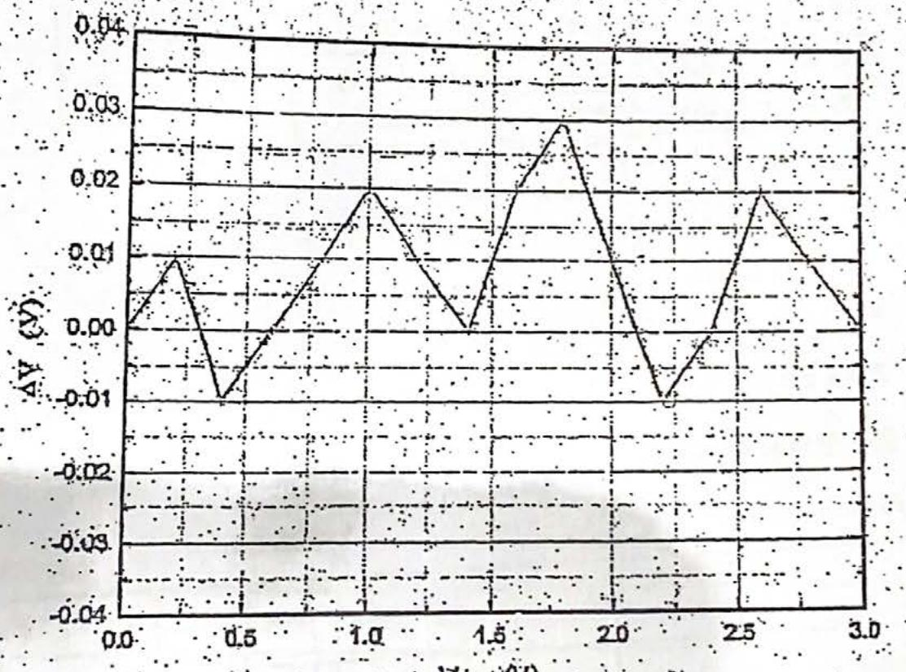

*图 1: 1.5V 改装电压表电表校准曲线*

# 《物理实验(下)》期末试卷

本部分包含热敏电阻和热电偶测量数据记录表、分光计实验数据处理记录，以及大学物理实验期末试卷的选择题、填空题、改错题和计算问答题。

## 一、实验数据记录及处理

知识点：[实验报告的内容（含实验内容与步骤等）](../../../topics/大学物理实验/实验报告内容.md)

### 热敏电阻和热电偶温差电势的测量

**表1：温度、阻值与温差电势原始数据**

| 温度 ($^\circ\text{C}$) | 25 | 30 | 35 | 40 | 45 | 50 | 55 | 60 |
| :--- | :--- | :--- | :--- | :--- | :--- | :--- | :--- | :--- |
| 阻值 ($\text{k}\Omega$) | 9410 | 6610 | 5510 | 4537 | 3715 | 3100 | 2515 | 2000 |
| 温差电势 ($\text{mV}$) | 0.26 | 0.57 | 0.75 | 0.96 | 1.16 | 1.37 | 1.57 | 1.78 |

| 温度 ($^\circ\text{C}$) | 65 | 70 | 75 | 80 | 85 | 90 | 95 | 100 |
| :--- | :--- | :--- | :--- | :--- | :--- | :--- | :--- | :--- |
| 阻值 ($\text{k}\Omega$) | 1730 | 1460 | 1240 | 1050 | 895 | 715 | 655 | 560 |
| 温差电势 ($\text{mV}$) | 1.98 | 2.17 | 2.36 | 2.57 | 2.79 | 3.00 | 3.20 | 3.38 |

**表2：热敏系数作图所需中间数据**

| 温度 $t$ ($^\circ\text{C}$) | 25.0 | 30.0 | 35.0 | 40.0 | 45.0 | 50.0 | 55.0 | 60.0 |
| :--- | :--- | :--- | :--- | :--- | :--- | :--- | :--- | :--- |
| $1/T \, (10^{-3}/^\circ\text{C})$ | 3.356 | 3.303 | 3.247 | 3.195 | 3.142 | 3.104 | 3.051 | 3.002 |
| 阻值 $R$ ($\Omega$) | 9410 | 6610 | 5510 | 4537 | 3715 | 3100 | 2515 | 2000 |
| $\ln R$ | 9.150 | 8.796 | 8.614 | 8.420 | 8.220 | 8.039 | 7.830 | 7.601 |
| 温差电势 ($\text{mV}$) | 0.26 | 0.57 | 0.75 | 0.96 | 1.16 | 1.37 | 1.57 | 1.78 |

| 温度 ($^\circ\text{C}$) | 65.0 | 70.0 | 75.0 | 80.0 | 85.0 | 90.0 | 95.0 | 100.0 |
| :--- | :--- | :--- | :--- | :--- | :--- | :--- | :--- | :--- |
| $1/T \, (10^{-3}/^\circ\text{C})$ | 2.958 | 2.915 | 2.872 | 2.831 | 2.793 | 2.748 | 2.721 | 2.682 |
| 阻值 $R$ ($\Omega$) | 1730 | 1460 | 1240 | 1050 | 895 | 715 | 655 | 560 |
| $\ln R$ | 7.459 | 7.286 | 7.123 | 6.957 | 6.797 | 6.572 | 6.485 | 6.328 |
| 温差电势 ($\text{mV}$) | 1.98 | 2.17 | 2.36 | 2.57 | 2.79 | 3.00 | 3.20 | 3.38 |

作图要求：热敏系数

知识点：[有效数字的运算法则（加减运算与乘除运算）](../../../topics/大学物理实验/有效数字运算法则.md)、[直接测量量的有效数字读数原则（游标卡尺、角游标尺、螺旋测微器、数字表头）](../../../topics/大学物理实验/直接测量量读数原则.md)、[实验报告的内容（含实验内容与步骤等）](../../../topics/大学物理实验/实验报告内容.md)

### 分光计实验数据记录及处理

分光计型号：YY-II，三棱镜编号：9，光源：汞灯，波长 $\lambda=546.07\,\text{nm}$

#### ① 反射法测量三棱镜顶角（自准法）

**表6-2 自准法测量三棱镜顶角数据表格**

| $\theta_M$ | $\theta_N$ | $\theta'_M$ | $\theta'_N$ | $\|\theta'_{M} - \theta_M\|$ | $\|\theta'_{N} - \theta_N\|$ | $\varphi = \frac{1}{2}[(\theta'_M - \theta_M) + (\theta'_N - \theta_N)]$ | $A=180^\circ - \varphi$ |
| :--- | :--- | :--- | :--- | :--- | :--- | :--- | :--- |
| $251^\circ 21'$ | $21^\circ 25'$ | $321^\circ 20'$ | $141^\circ 30'$ | $120^\circ 9'$ | $120^\circ 5'$ | $120^\circ 7'$ | $1.04322$ |

$$
u_B = \frac{\pi}{180 \times 60} (\text{rad}) = 1.7 \times 10^{-4} (\text{rad})
$$

$$
A = 1.0482 \pm 0.0002 (\text{rad})
$$

*(注：原题中 $\varphi$ 计算公式第二项似有误写为 $\theta'_M$，根据常规物理实验逻辑应为 $\theta'_N$；此处保留原题数据计算结果)*

#### ② 测量最小偏向角 $\delta_{min}$

**表6-3 测量最小偏向角 $\delta_m$ 数据表格**

| 角度测量次数 | $\theta_M$ | $\theta_N$ | $\theta'_{M}$ | $\theta'_{N}$ | $\|\theta'_M-\theta_M\|$ | $\|\theta'_N-\theta_N\|$ | $\delta_{min}$ | $\overline{\delta}_{min}$ |
| :--- | :--- | :--- | :--- | :--- | :--- | :--- | :--- | :--- |
| 1 | $318^\circ 4'$ | $138^\circ 5'$ | $209^\circ 30'$ | $29^\circ 35'$ | $108^\circ 34'$ | $108^\circ 28'$ | 0.94698 | rowspan="3" 0.94679 |
| 2 | $318^\circ 4'$ | $138^\circ 2'$ | $209^\circ 34'$ | $29^\circ 35'$ | $108^\circ 30'$ | $108^\circ 27'$ | 0.94662 | |
| 3 | $318^\circ 5'$ | $138^\circ 3'$ | $209^\circ 33'$ | $29^\circ 36'$ | $108^\circ 32'$ | $108^\circ 27'$ | 0.94677 | |

#### 数据处理

$$
u_A = \sqrt{\frac{\sum_i (\delta_i - \overline{\delta})^2}{n(n-1)}} = \sqrt{\frac{\sum_i (\delta_i - \overline{\delta})^2}{3 \times 2}} = 1.1 \times 10^{-4} (\text{rad}) \tag{3}
$$

$$
u_B = \frac{\pi}{180 \times 60} (\text{rad}) = 1.7 \times 10^{-4} (\text{rad}) \tag{4}
$$

$$
u = \sqrt{u_A^2 + u_B^2} = 3 \times 10^{-4} (\text{rad}) \tag{5}
$$

$$
\delta_{\min} = (0.9468 \pm 0.0003) (\text{rad}) \tag{6}
$$

$$
n = \frac{\sin \frac{1}{2} (\overline{\delta}_{\min} + A)}{\sin \frac{A}{2}} = 1.67869
$$

$$
u_n = \frac{n}{2} \sqrt{\left[ \cot \left(\frac{\delta_{\min} + A}{2}\right) - \cot \frac{A}{2} \right]^2 u_A^2 + \cot^2 \left(\frac{\delta_{\min} + A}{2}\right) u_A^2} = 2.8 \times 10^{-4}
$$

*(注：原题公式中 $u^2 A$ 疑似笔误，通常折射率不确定度传递涉及顶角 $A$ 的不确定度 $u_A$ 和最小偏向角 $\delta$ 的不确定度 $u_\delta$。此处按原题文字转录)*

$$
n = \overline{n} \pm u_n = 1.6787 \pm 0.0003
$$

## 二、大学物理实验试卷

本试卷满分 40 分。请将答案全部写在试卷上，第四大题可写在试卷背面。

知识点：[实验报告的内容（含实验内容与步骤等）](../../../topics/大学物理实验/实验报告内容.md)、[有效数字的运算法则（加减运算与乘除运算）](../../../topics/大学物理实验/有效数字运算法则.md)、[直接测量量的有效数字读数原则（游标卡尺、角游标尺、螺旋测微器、数字表头）](../../../topics/大学物理实验/直接测量量读数原则.md)

### 一、选择题

#### 选择 1

某物体长度约为 2 厘米，为使测量结果有 5 位有效数字，应选用的测量仪器是：（）

- A. 米尺
- B. 二十分游标尺
- C. 五十分游标尺
- D. 千分尺

答案：D。

#### 选择 2

某电流值的测量结果为 $I = (30.55 \pm 0.05) \text{ mA}$ ，则下面关于被测电流的真值 $I_0$ 的哪种理解是正确的（）

- A. $I_0 = 30.55 \text{ mA}$
- B. $I_0 = 30.50 \text{ mA}$ 或 $I_0 = 30.60 \text{ mA}$
- C. $30.50 \text{ mA} < I_0 < 30.60 \text{ mA}$
- D. $I_0$ 也可能小于 $30.50 \text{ mA}$

答案：C。

#### 选择 3

在下面的测量结果表达式中, 正确的应该是 ( )

- A. $D = (4.800 \pm 0.020)$ m
- B. $D = (4.80 \pm 0.02) \times 10^3$ mm
- C. $D = (4800 \pm 20)$ mm
- D. $D = (480.0 \pm 2.0)$ cm

答案：B。

#### 选择 4

用 0.5 级量程为 0~7.5mA，面板刻度为 150 格的电流表测一电路中的电流，下列哪个测量数据记录正确（）

- A. 6mA
- B. 6.0mA
- C. 6.00mA
- D. 6.000mA

答案：C。

解析：
量程 7.5mA，150 格，每格代表 $7.5/150 = 0.05 \text{mA}$。
估读到下一位，即精度可达 $0.01 \text{mA}$ 级别（若估读半格则为 0.025，通常记录到最小分度的下一位）。
选项 A 无小数，B 一位小数，C 两位小数，D 三位小数。
考虑到最小分度 0.05，通常记录为 xx.xx mA。6.00mA 符合有效数字规则。

#### 选择 5

已知 $N=A^2/B^3$，则正确的误差传递公式为：（）

- A. $\Delta N = \left[ (2A \Delta A)^2 + (3B^2 \Delta B)^2 \right]^{1/2}$
- B. $\Delta N = 2 \left[ (2A \Delta A)^2 + (3B^2 \Delta B)^2 \right]^{1/2}$
- C. $\Delta N / N = \left[ (2 \Delta A / A)^2 + (3 \Delta B / B)^2 \right]^{1/2}$
- D. $\Delta N / N = 2 \left[ (2 \Delta A / A)^2 + (3 \Delta B / B)^2 \right]^{1/2}$

答案：C。

知识点：[有效数字的概念与定义](../../../topics/大学物理实验/有效数字概念.md)、[有效数字的运算法则（加减运算与乘除运算）](../../../topics/大学物理实验/有效数字运算法则.md)、[直接测量量的有效数字读数原则（游标卡尺、角游标尺、螺旋测微器、数字表头）](../../../topics/大学物理实验/直接测量量读数原则.md)

### 二、填空题

#### 填空 1

用 50 分游标尺测一物体的长度 L, 读数为 45.12mm, 则长度 L 测量结果的完整表述式为: L= ______ mm。

答案：$(45.12 \pm 0.01)$ 或 $(45.12 \pm 0.02)$ （视具体不确定度评定而定，通常50分尺仪器误差为0.02mm或0.01mm，此处仅填数值部分）

#### 填空 2

将一频率为 $2000 \, \text{Hz}$ 的正弦电压信号输入示波器的 Y 输入端，要使荧光屏上出现 4 个周期的正弦波，示波器的扫描周期应为 ______ ms。

答案：1.25

解析：
频率 $f = 2000 \text{Hz}$，周期 $T_y = 1/f = 0.5 \text{ms}$。
显示 4 个周期，总时间 $T_{total} = 4 \times T_y = 4 \times 0.5 \text{ms} = 2.0 \text{ms}$。
示波器扫描周期即为屏幕显示一个完整扫描过程的时间。若显示4个周期占满屏幕，则扫描周期 $T_s = 2.0 \text{ms}$？
不对，题目问的是“扫描周期”。
若屏幕上出现4个完整波形，意味着在示波器的一次水平扫描时间内，Y轴信号完成了4次振荡。
所以扫描周期 $T_s = 4 \times T_y = 4 \times (1/2000) \text{s} = 4 \times 0.5 \text{ms} = 2.0 \text{ms}$。
*修正思考*：通常示波器扫描频率可调。如果要求“出现4个周期”，是指触发稳定后看到的波形。
$T_y = 0.5 \text{ms}$。
4个周期时长 $= 2 \text{ms}$。
所以扫描周期应为 $2 \text{ms}$。

#### 填空 3

按有效数字运算规则计算： $(6.82 \times 10^3 - 355 \times 0.23) \times 12.002 =$ ______

答案：需计算。
$6.82 \times 10^3 = 6820$ (3位有效数字，末位在十位)
$355 \times 0.23 = 81.65$ (0.23是2位有效数字，结果保留2位，即82)
$6820 - 82 = 6738$ (6820的末位是十位，82的末位是个位，加减法看精度最低者，即十位。故结果应保留到十位，即6740)
$6740 \times 12.002$ (6740是3位有效数字? 不，6738修约到十位是6740，有效数字位数取决于相对误差，这里作为中间步骤暂且保留，最后看乘除)
更严谨的步骤：
1. $355 \times 0.23 = 81.65 \rightarrow 82$ (2位有效数字)
2. $6.82 \times 10^3 - 82 = 6820 - 82 = 6738$。6820精确到十位，82精确到个位。结果精确到十位。$6738 \rightarrow 6740$。
3. $6740 \times 12.002$。6740有效数字位数？原数6820是3位，82是2位。差值的有效数字位数可能变化。
通常考试中，先算括号内：
$6820 - 81.65 = 6738.35$。
$6820$ (3 sig figs, uncertainty in tens place).
$81.65$ (2 sig figs, uncertainty in units place).
Result limited by least precise decimal place: tens place.
So $6740$. This has 3 significant figures if we consider the original precision, or ambiguous. Let's look at multiplication.
$6740$ (3 sig figs implied from 6.82e3?) vs $12.002$ (5 sig figs).
Result should have 3 sig figs.
$6740 \times 12.002 = 80893.48$.
3 sig figs: $8.09 \times 10^4$.

*(注：此处仅为整理，具体数值计算以原件为准，原件未给出填空答案)*

#### 填空 4

千分尺零点不准产生误差，电压扰动使电压读数不准产生误差。

答案：系统误差；随机误差

#### 填空 5

由决定测量结果的有效数字是处理一切有效数字问题的总的根据和原则。

答案：不确定度

知识点：[直接测量量的有效数字读数原则（游标卡尺、角游标尺、螺旋测微器、数字表头）](../../../topics/大学物理实验/直接测量量读数原则.md)、[有效数字的修约规则（只进不舍等）](../../../topics/大学物理实验/有效数字修约规则.md)、[有效数字的运算法则（加减运算与乘除运算）](../../../topics/大学物理实验/有效数字运算法则.md)

### 三、改错题

#### 改错 1

M=45.427g， $\Delta M/M=0.12\%$ ( )

答案：错误。
理由：相对不确定度为0.12%，即 $1.2 \times 10^{-3}$。绝对不确定度 $\Delta M = 45.427 \times 0.0012 \approx 0.054$ g。
不确定度通常只保留1位有效数字（首位为1或2时可保留2位），即 $\Delta M \approx 0.05$ g 或 $0.06$ g。
测量值应与不确定度对齐。若 $\Delta M = 0.05$ g，则 M 应记为 $45.43 \pm 0.05$ g。
原题格式不规范，且未写出测量结果的标准形式 $X \pm \Delta X$。

#### 改错 2

800.0mm=80cm=0.8m ( )

答案：错误。
理由：有效数字不同。800.0mm 是4位有效数字，80cm 是2位（或模糊），0.8m 是1位。单位换算不改变物理量大小，但改变数值表示时，必须保持有效数字位数不变。
正确写法：$800.0 \text{mm} = 80.00 \text{cm} = 0.8000 \text{m}$。

#### 改错 3

$E=(4.628\times10^9\pm6.35\times10^7)\text{N/m}^{2}$ （）

答案：错误。
理由：不确定度 $6.35 \times 10^7$ 保留了3位有效数字，通常不确定度只保留1-2位。且测量值 $4.628 \times 10^9$ 的小数点后第三位对应 $10^6$，而不确定度在 $10^7$ 位，两者未对齐。
若不确定度取 $6 \times 10^7$ 或 $6.4 \times 10^7$，测量值应修约至相应位数。
例如：$E = (4.63 \pm 0.06) \times 10^9 \text{N/m}^2$。

#### 改错 4

用千分尺测一金属丝直径, 正好为 5.1 毫米, 应记为 $5.10 \mathrm{~mm}$ ( )

答案：错误。
理由：千分尺（螺旋测微器）的精度通常为 0.01mm，估读到 0.001mm。
若读数为 5.1mm，应记为 $5.100 \text{mm}$。
$5.10 \text{mm}$ 是游标卡尺（如20分或50分）可能的记录方式，或者是精度为0.01mm的其他仪器，但对于标准千分尺，最后一位是估读位，应有三位小数。

#### 改错 5

$0.005020 \mathrm{~Km}$ 的有效数字是 6 位 ( )

答案：错误。
理由：$0.005020 \text{km}$。前导零不是有效数字。有效数字从第一个非零数字开始。
有效数字为：5, 0, 2, 0。共4位。
或者转换为米：$5.020 \text{m}$，也是4位。

知识点：[有效数字的概念与定义](../../../topics/大学物理实验/有效数字概念.md)、[直接测量量的有效数字读数原则（游标卡尺、角游标尺、螺旋测微器、数字表头）](../../../topics/大学物理实验/直接测量量读数原则.md)

### 四、计算与问答题

#### 计算 1

测得一长方体的质量 $M=(250.00\pm0.05)$ g，长 $L=(5.015\pm0.003)$ cm，宽 $B=(3.983\pm0.002)$ cm，高 $H=(2.008\pm0.002)$ cm，求其密度 $\rho$ 及其相对不确定度 $\Delta\rho/\rho$ 。(5')

**参考解答：**

1.  **计算密度平均值**
    $$ V = L \cdot B \cdot H = 5.015 \times 3.983 \times 2.008 \approx 40.136 \, \text{cm}^3 $$
    $$ \rho = \frac{M}{V} = \frac{250.00}{40.136} \approx 6.2287 \, \text{g/cm}^3 $$

2.  **计算相对不确定度**
    对于乘除法运算，相对不确定度平方和开根号：
    $$ \frac{u_\rho}{\rho} = \sqrt{ \left(\frac{u_M}{M}\right)^2 + \left(\frac{u_L}{L}\right)^2 + \left(\frac{u_B}{B}\right)^2 + \left(\frac{u_H}{H}\right)^2 } $$
    代入数据：
    $$ \frac{u_M}{M} = \frac{0.05}{250.00} = 2.0 \times 10^{-4} $$
    $$ \frac{u_L}{L} = \frac{0.003}{5.015} \approx 5.98 \times 10^{-4} $$
    $$ \frac{u_B}{B} = \frac{0.002}{3.983} \approx 5.02 \times 10^{-4} $$
    $$ \frac{u_H}{H} = \frac{0.002}{2.008} \approx 9.96 \times 10^{-4} $$
    
    $$ \frac{u_\rho}{\rho} = \sqrt{ (2.0)^2 + (5.98)^2 + (5.02)^2 + (9.96)^2 } \times 10^{-4} $$
    $$ \frac{u_\rho}{\rho} = \sqrt{ 4 + 35.76 + 25.20 + 99.20 } \times 10^{-4} = \sqrt{164.16} \times 10^{-4} \approx 12.8 \times 10^{-4} = 1.28 \times 10^{-3} $$
    
    相对不确定度约为 $0.13\%$。

3.  **计算绝对不确定度**
    $$ u_\rho = \rho \times \frac{u_\rho}{\rho} = 6.2287 \times 1.28 \times 10^{-3} \approx 0.008 \, \text{g/cm}^3 $$
    *(不确定度通常进位保留1位有效数字，即 $0.01$，或根据规范保留2位)*

4.  **最终结果**
    $$ \rho = (6.229 \pm 0.008) \, \text{g/cm}^3 $$
    或
    $$ \rho = (6.23 \pm 0.01) \, \text{g/cm}^3 $$

#### 计算 2

在气垫导轨上测滑块的平均速度实验中，两光电门间的距离 s 为 800.0mm，测得滑块从第一光电门滑至第二光电门的时间 t 如下：
次数 1 2 3 4 5 6
ti/s 1.7922 1.7945 1.7880 1.7904 1.7885 1.7935(计时器的最大仪器误差 $\Delta t$ 仪=0.5ms，气垫导轨上的标尺为米尺)，求滑块在两光电门间的平均速度（）。

**参考解答：**

1.  **计算时间的平均值 $\bar{t}$**
    $$ \bar{t} = \frac{1.7922 + 1.7945 + 1.7880 + 1.7904 + 1.7885 + 1.7935}{6} $$
    $$ \bar{t} = \frac{10.7471}{6} \approx 1.79118 \, \text{s} $$

2.  **计算时间的A类不确定度 $u_A(t)$**
    $$ S_t = \sqrt{\frac{\sum (t_i - \bar{t})^2}{n-1}} $$
    偏差平方和：
    $(1.7922-1.79118)^2 \approx 1.04 \times 10^{-6}$
    $(1.7945-1.79118)^2 \approx 11.09 \times 10^{-6}$
    $(1.7880-1.79118)^2 \approx 10.11 \times 10^{-6}$
    $(1.7904-1.79118)^2 \approx 0.61 \times 10^{-6}$
    $(1.7885-1.79118)^2 \approx 7.18 \times 10^{-6}$
    $(1.7935-1.79118)^2 \approx 5.37 \times 10^{-6}$
    Sum $\approx 35.4 \times 10^{-6}$
    $$ S_t = \sqrt{\frac{35.4 \times 10^{-6}}{5}} \approx \sqrt{7.08 \times 10^{-6}} \approx 2.66 \times 10^{-3} \, \text{s} $$
    $$ u_A(t) = \frac{S_t}{\sqrt{n}} = \frac{2.66 \times 10^{-3}}{\sqrt{6}} \approx 1.09 \times 10^{-3} \, \text{s} $$

3.  **计算时间的B类不确定度 $u_B(t)$**
    仪器误差 $\Delta_{inst} = 0.5 \, \text{ms} = 0.0005 \, \text{s}$。
    假设均匀分布，$k=\sqrt{3}$。
    $$ u_B(t) = \frac{\Delta_{inst}}{\sqrt{3}} = \frac{0.0005}{1.732} \approx 2.89 \times 10^{-4} \, \text{s} $$

4.  **合成时间不确定度 $u(t)$**
    $$ u(t) = \sqrt{u_A^2 + u_B^2} = \sqrt{(1.09 \times 10^{-3})^2 + (0.289 \times 10^{-3})^2} \approx \sqrt{1.19 + 0.08} \times 10^{-3} \approx 1.12 \times 10^{-3} \, \text{s} $$

5.  **距离 s 的不确定度**
    标尺为米尺，通常最小分度 1mm。假设仪器误差 $\Delta_s = 0.5 \, \text{mm} = 0.0005 \, \text{m}$ (或按米尺常规取 1mm，此处题目未明确米尺误差，通常米尺取1mm或0.5mm，鉴于s=800.0mm已有一位小数，推测精度较高，暂按常见米尺仪器误差0.5mm或1mm估算，此处为了简化，若题目隐含s为准确值或忽略其误差，主要考虑t的误差。若考虑s的误差，通常 $u(s)$ 远小于 $u(v)$ 的影响)。
    设 $u(s)$ 较小，主要贡献来自 $u(t)$。

6.  **计算平均速度 $v$**
    $$ v = \frac{s}{\bar{t}} = \frac{0.8000 \, \text{m}}{1.79118 \, \text{s}} \approx 0.44663 \, \text{m/s} $$

7.  **速度的不确定度**
    $$ \frac{u_v}{v} = \sqrt{ \left(\frac{u_s}{s}\right)^2 + \left(\frac{u_t}{t}\right)^2 } $$
    若忽略 $u_s$ 或认为其很小：
    $$ \frac{u_t}{t} = \frac{1.12 \times 10^{-3}}{1.791} \approx 6.25 \times 10^{-4} $$
    $$ u_v = v \times 6.25 \times 10^{-4} = 0.44663 \times 6.25 \times 10^{-4} \approx 2.8 \times 10^{-4} \, \text{m/s} $$

8.  **最终结果**
    $$ v = (0.4466 \pm 0.0003) \, \text{m/s} $$

3. 现有两个电压信号，其中一个是稳定直流电压信号、另一个是正弦交流电压信号，如何用示波器检验出直流电压信号？如果能用示波器测量直流电压信号的电压值，怎样测量？(4')

知识点：[测量的分类（直接测量与间接测量）](../../../topics/大学物理实验/测量的分类.md)、[有效数字的运算法则（加减运算与乘除运算）](../../../topics/大学物理实验/有效数字运算法则.md)

### 参考答案

一、选择题 $(1.5'\times5=7.5')$ 1. D 2. D 3. B 4. C 5. C

二、填空题 $(2\times5=10')$ 1. $(45.12\pm0.02)$ mm 2. 2 3. $7.45\times10^3$ 4. 系统，随机 5. 不确定度

三、改错题 $(1.5'\times5=7.5')$ 1. $M=45.43\,\mathrm{g}$，$\Delta M/M=0.12\%$ 2. $800.0\,\mathrm{mm}=80.00\,\mathrm{cm}=0.8000\,\mathrm{m}$ 3. $E=(4.63\pm0.06)\times10^9\,\mathrm{N/m^2}$ 4. 应记为 $5.100\,\mathrm{mm}$ 5. $0.05020\,\mathrm{mm}$ 的有效数字是 4 位。

知识点：[有效数字的修约规则（只进不舍等）](../../../topics/大学物理实验/有效数字修约规则.md)、[有效数字的运算法则（加减运算与乘除运算）](../../../topics/大学物理实验/有效数字运算法则.md)、[直接测量量的有效数字读数原则（游标卡尺、角游标尺、螺旋测微器、数字表头）](../../../topics/大学物理实验/直接测量量读数原则.md)

### 四、计算与问答题(15')

1. (5') 解：

$$\rho = \frac{M}{V} = \frac{M}{LBH} = \frac{250.00}{5.015 \times 3.983 \times 2.008} = 6.233\,(\mathrm{g/cm^3})$$

$$E=\frac{\Delta\rho}{\rho}=\left[\left(\frac{\Delta M}{M}\right)^2+\left(\frac{\Delta L}{L}\right)^2+\left(\frac{\Delta B}{B}\right)^2+\left(\frac{\Delta H}{H}\right)^2\right]^{1/2}$$

$$=\left[\left(\frac{0.05}{250.00}\right)^2+\left(\frac{0.003}{5.015}\right)^2+\left(\frac{0.002}{3.983}\right)^2+\left(\frac{0.002}{2.008}\right)^2\right]^{1/2}\approx 0.13\%$$

$$\Delta\rho=E\rho=0.13\%\times 6.233\approx 0.008\,(\mathrm{g/cm^3})$$

$$\rho=(6.233\pm0.008)\,(\mathrm{g/cm^3})，E=0.13\%$$

2. (6') 解：

$$\bar{t} = \frac{1.7922 + 1.7945 + 1.7880 + 1.7904 + 1.7885 + 1.7935}{6} = 1.7912\,(\mathrm{s})$$

$$\Delta t \approx 0.0011\,(\mathrm{s})$$

$$v = \frac{s}{t} = 446.63\,(\mathrm{mm/s})$$

$$E=\frac{\Delta v}{v}=\left[\left(\frac{\Delta s}{s}\right)^2+\left(\frac{\Delta t}{t}\right)^2\right]^{1/2}=0.088\%$$

$$\Delta v = Ev = 0.088\% \times 446.63 = 0.4\,(\mathrm{mm/s})$$

$$v = 446.6 \pm 0.4\,(\mathrm{mm/s})，E = 0.09\%$$

3. (4') 答：将电压信号输入到示波器的 Y 输入端，调整 X 轴的扫描周期，当示波器屏幕上波形为一水平直线时，输入的信号为直流电压信号；当示波器屏幕上波形为一曲线时，输入的信号为交流电压信号（2 分）。用示波器可以测量直流电压信号的电压值，方法是：测量出直流电压信号波形（水平直线）在 Y 方向偏离扫描基线的格数，再乘以 Y 轴的灵敏度（2 分）。

## 《大学物理实验》考试

授课班号\_\_\_\_ 年级专业\_\_\_\_ 学号\_\_\_\_ 姓名\_\_\_\_

| 题号 | 一 | 二 | 三 | 实验 | 总分 | 审核 |
| --- | --- | --- | --- | --- | --- | --- |
| 题分 | 17 | 10 | 13 | 60 |  |  |
| 得分 |  |  |  |  |  |  |

知识点：[测量的分类（直接测量与间接测量）](../../../topics/大学物理实验/测量的分类.md)、[有效数字的运算法则（加减运算与乘除运算）](../../../topics/大学物理实验/有效数字运算法则.md)、[直接测量量的有效数字读数原则（游标卡尺、角游标尺、螺旋测微器、数字表头）](../../../topics/大学物理实验/直接测量量读数原则.md)

### 第一部分 实验误差理论（40分）

#### 一、填空（共17分，每空格1分）

1. 测量数据和测量结果的构成是不同的：测量数据是由数值和单位两部分组成；而测量结果除了数值和单位外还有误差。

2. 下图中测量物体长度的左读数为 $29.74 \sim 29.76\,\mathrm{cm}$，右读数为 $31.86 \sim 31.88\,\mathrm{cm}$，则物体的长度为 $2.10 \sim 2.14\,\mathrm{cm}$，此尺测量长度时能够精确到 毫米（此空填“厘米”，“毫米”，“微米”）。

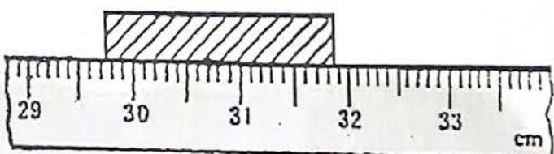

3. 图示为五十分度游标尺，游标 $E$ 上50格的宽度同主尺 $D$ 上49格的宽度相同（填写图示中英文字母标号）。其中 C 用来测量深度；$A'$、$B'$ 用来测量内径。

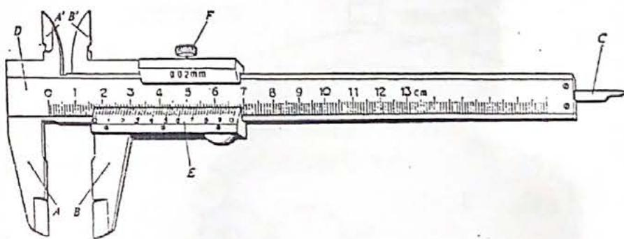

4. 螺旋测微器又称千分尺，它的测量精度为 0.01 毫米\_\_\_\_（选填“0.1 毫米”，“0.01 毫米”，“0.001 毫米”），下图左图为螺旋测微器（千分尺）的初读数 —0.002mm，右图读数为 3.634~3.636 mm；物体实际长度为 3.636~3.638 mm。

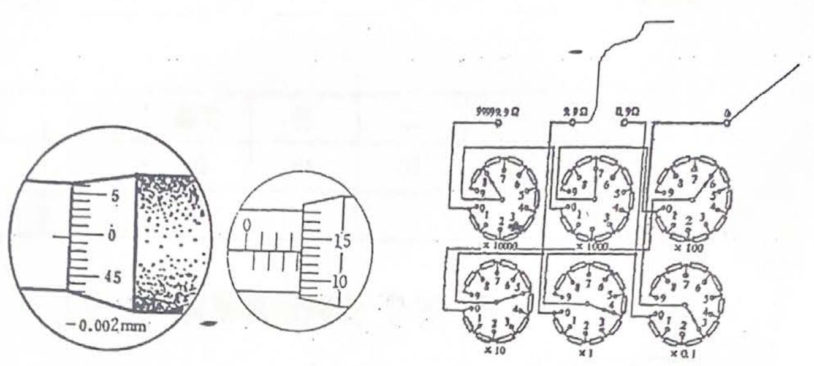

5. 图示电阻箱的有效接入电阻为 4.3 Ω。

6. 图示为分光计的结构图，图中 A 表示\_\_\_\_载物台\_\_\_\_，B 表示\_\_\_\_平行光管\_\_\_\_。

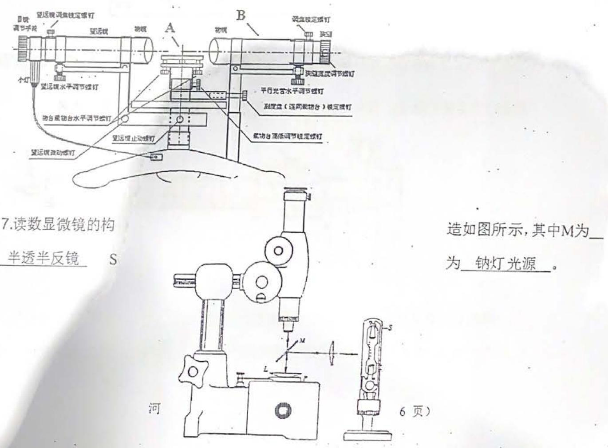

造如图所示，其中 M 为\_\_\_\_为\_\_\_\_钠灯光源\_\_\_\_。

#### 二、按有效数字运算规则计算：（共10分，每空格2分）

1. 按“四舍六入五凑双”规则，1.5455 取四位有效数字为 1.546\_\_\_\_；1.5445 取四位有效数字为 1.544\_\_\_\_。

2. 已知 $10^{6.25} = 1778279.41$，取成 $\underline{1.8 \times 10^6}$；

3. $\pi \times (4.0)^{2} = 50$。

4. 分光计实验中将会用到三角函数有效数字取舍的问题：查表可知 $\cos20^{\circ}16'=0.938070461$，应取成 0.9381。

#### 三、计算题：（13分）

将某一物体用一般毫米尺测量五次长度，得到的测量值分别为 3.42、3.43、3.44、3.44 和 3.43cm，求其算术平均值、各次测量值的平差和标准误差。

解

利用算术平均值计算公式：

$$
\bar{l} = \frac{1}{K} \sum_{i=1}^{K} l_i = \frac{1}{5}(3.42+3.43+3.44+3.44+3.43) = 3.432
$$

$$
\Delta l_i = l_i - \bar{l}
$$

$$
\Delta l_1 = l_1 - \bar{l} = 3.42 - 3.43 = -0.01\,\mathrm{cm}
$$

各次测量值的平差：

$$
\Delta l_2 = l_2 - \bar{l} = 0.00\,\mathrm{cm}
$$

$$
\Delta l_3 = l_3 - \bar{l} = 0.01\,\mathrm{cm}
$$

$$
\Delta l_4 = l_4 - \bar{l} = 0.01\,\mathrm{cm}
$$

$$
\Delta l_5 = l_5 - \bar{l} = 0.00\,\mathrm{cm}
$$

标准误差：

$$
\begin{array}{rl}
\sigma_l & = \sqrt{\frac{1}{K-1}\left[\sum_{i=1}^{K}(l_i-\bar{l})^2\right]} \\
& = \sqrt{\frac{1}{5-1}\left[(-0.01)^2+0.01^2+0.01^2\right]} \\
& = 0.00866025403
\end{array}
$$

取 0.01cm

$$
\bar{l} \pm \sigma_l = 3.43 \pm 0.01\,\mathrm{cm}
$$

知识点：[直接测量量的有效数字读数原则（游标卡尺、角游标尺、螺旋测微器、数字表头）](../../../topics/大学物理实验/直接测量量读数原则.md)、[有效数字的修约规则（只进不舍等）](../../../topics/大学物理实验/有效数字修约规则.md)、[有效数字的运算法则（加减运算与乘除运算）](../../../topics/大学物理实验/有效数字运算法则.md)

### 第二部分 实验项目（60分）

#### 《单缝衍射实验》（满分7分）

单缝衍射仪测量衍射条纹（暗条纹）之间的距离 L 时，为什么目镜的读数鼓轮只能向一个方向移动？

答：

#### 《用扭摆法测定物体转动惯量》（满分7分）

智能转动惯量实验是一个验证性的实验过程，若物体的转动惯量理论值与测量值相差过大，则可能的原因有哪些？（至少要写出两种）

答：(1) 转轴不与地面垂直 (2) 操作失误；如数错周期次数 (3) 计算错误，尤其是弹簧的 K 值 (4) 部分理论公式作了近似，如忽略了转轴连接处的转动惯量等

#### 《补偿法与直流电位差计》（满分7分）

在本实验的定标和测量两步中，若无论怎样调节活动头 C、D，电流计的指针总是向一边偏转，分析可能原因。

答：

#### 《霍尔效应》（满分8分）

在实验中，需用公式 $R_{H} = \frac{V_{H}\cdot d}{I_{s}\cdot B}\times 10^{8}$ 来计算材料的霍尔系数，试问公式中的 $\frac{V_H}{I_s}$ 是如何算出的？

#### 《用电视显微油滴仪测电子电荷》（满分7分）

在本实验中，要求在选择油滴时，既不能太大也不能太小，试说明原因。

#### 《示波器的使用》（满分14分，每空2分）

根据示波器面板按键/旋钮状态图，确定示波器状态设置是否有错误？如果有错误请描述正确的设置；并结合屏幕的图象，按照要求完成下表。

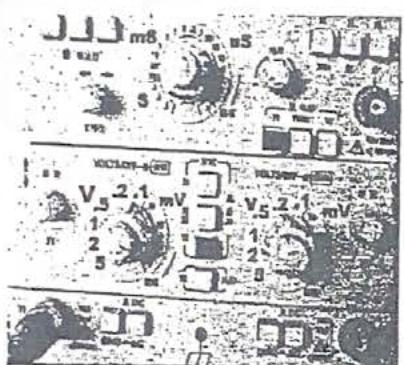

| 一周期波形在水平方向所占格数 | 时间(水平)扫描因数 | 周期 | 信号频率(保留四位有效数字) | 波形在垂直方向占的格子数 | 垂直偏转因数 | 信号幅度(保留四位有效数字) |
| --- | --- | --- | --- | --- | --- | --- |
|  |  |  |  |  |  |  |

#### 《分光计的调整和衍射光栅》（满分10分，每空2分）

1. 光栅方程 $(a+b)\sin\theta_{K}=K\lambda$ 中 $(a+b)$ 为光栅常数，$\lambda$ 为入射光波长，K 为明条纹级数，$\theta_{K}$ 为第 K 级明条纹的衍射角。$\theta_{K}$ 的测定（以 K=1 为例）方法为：测出零级中央明条纹左边第一级（k=-1）的明条纹所对应的偏角位置 $\varphi_{-1}$ 和中央明条纹右边第一级（k=+1）的明条纹所对应的偏角位置 $\varphi_{+1}$ 后通过公式 $\theta_{1}=\frac{1}{2}\left|\varphi_{+1}-\varphi_{-1}\right|$ 计算。

2. 本实验设立两个角游标，并且\_\_\_\_对径\_\_\_\_放置，其目的是消除\_\_\_\_偏心\_\_\_\_误差。

知识点：[直接测量量的有效数字读数原则（游标卡尺、角游标尺、螺旋测微器、数字表头）](../../../topics/大学物理实验/直接测量量读数原则.md)、[有效数字的运算法则（加减运算与乘除运算）](../../../topics/大学物理实验/有效数字运算法则.md)、[实验报告的内容（含实验内容与步骤等）](../../../topics/大学物理实验/实验报告内容.md)
