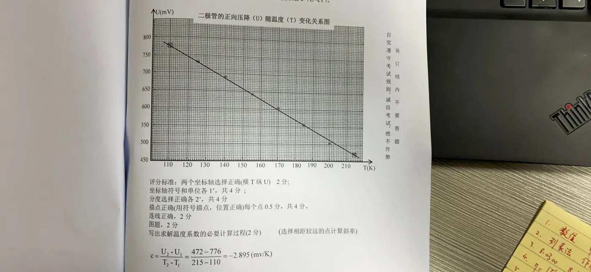

# 《物理实验》作图题评分标准及解答（含温度系数计算）

原件经识别和整理；“参考解答”是我们补的。

# 《物理实验》作图题评分标准及解答（含温度系数计算）

本资料为《物理实验》课程中关于作图题的评分标准及温度系数计算的参考解答，由识别工具读取整理。

## 一、作图题评分标准

### 作图规范与分值分配

- **坐标轴选择**：两个坐标轴选择正确（横轴 T，纵轴 U），2 分；
- **坐标轴符号和单位**：各 1 分，共 4 分；
- **分度选择**：选择正确各 2 分，共 4 分；
- **描点**：正确（用符号描点，位置正确），每个点 0.5 分，共 4 分；
- **连线**：正确，2 分；
- **图题**：2 分；
- **计算过程**：写出求解温度系数的必要计算过程（2 分）（要求选择相距较远的点计算斜率）。

知识点：[实验报告的内容（含实验内容与步骤等）](../../../topics/大学物理实验/实验报告内容.md)、[有效数字的概念与定义](../../../topics/大学物理实验/有效数字概念.md)、[直接测量量的有效数字读数原则（游标卡尺、角游标尺、螺旋测微器、数字表头）](../../../topics/大学物理实验/直接测量量读数原则.md)

### 温度系数计算示例

根据评分标准中的计算要求，选取相距较远的两点进行斜率计算：

$$
\mathrm{c} = \frac {\mathrm{U} _ {2} - \mathrm{U} _ {1}}{\mathrm{T} _ {2} - \mathrm{T} _ {1}} = \frac {472 - 776}{215 - 110} = -2.895 (\mathrm{mv/K})
$$

知识点：[有效数字的运算法则（加减运算与乘除运算）](../../../topics/大学物理实验/有效数字运算法则.md)、[有效数字的修约规则（只进不舍等）](../../../topics/大学物理实验/有效数字修约规则.md)、[测量与单位（含国际单位制重新定义）](../../../topics/大学物理实验/测量与单位.md)
