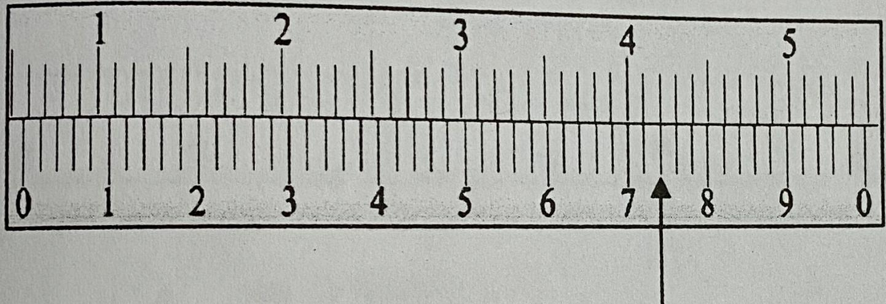
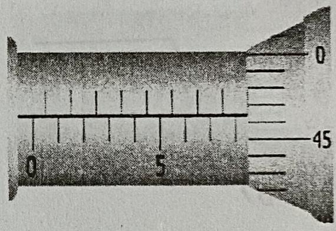

# 《物理实验》期末试卷（真题）

原件经识别和整理；“参考解答”是我们补的。

## 二、填空题（共 24 分，每空 2 分）

### 填空 1

通常情况下，一个物理量的测量结果应包含两个要素：____ 和 ____。

知识点：[测量与单位（含国际单位制重新定义）](../../../topics/大学物理实验/测量与单位.md)、[有效数字的概念与定义](../../../topics/大学物理实验/有效数字概念.md)

### 填空 2

常用的实验数据处理方法有：____、____ 和 ____ 等。

知识点：[物理实验课的基本程序（预习、实验进行、写报告）](../../../topics/大学物理实验/实验课基本程序.md)、[实验报告的内容（含实验内容与步骤等）](../../../topics/大学物理实验/实验报告内容.md)

### 填空 3

有效数字在换算过程中有效数字的位数应保持不变。将一物体质量 $M = 8030.0\ \text{g}$ 可表示为 ____ kg 或 ____ g（用科学计数法表示）。

知识点：[科学记数法表示有效数字](../../../topics/大学物理实验/科学记数法.md)、[有效数字的概念与定义](../../../topics/大学物理实验/有效数字概念.md)

### 填空 4

圆筒转动惯量理论值 $I_{0}=1.7481\times10^{-3}\ \text{kg}\cdot\text{m}^{2}$；实验值 $I=1.7411\times10^{-3}\ \text{kg}\cdot\text{m}^{2}$，计算其百分差的公式为 ____，其百分差数据结果是 ____。

知识点：[有效数字的运算法则（加减运算与乘除运算）](../../../topics/大学物理实验/有效数字运算法则.md)、[科学记数法表示有效数字](../../../topics/大学物理实验/科学记数法.md)

### 填空 5

如下图，50 分度游标卡尺对准位置如图所示，其读数为 ____ mm；螺旋测微器读数 ____ mm。

知识点：[直接测量量的有效数字读数原则（游标卡尺、角游标尺、螺旋测微器、数字表头）](../../../topics/大学物理实验/直接测量量读数原则.md)

### 填空 6

如右图所示，分光计读数盘读数为 ____。

知识点：[直接测量量的有效数字读数原则（游标卡尺、角游标尺、螺旋测微器、数字表头）](../../../topics/大学物理实验/直接测量量读数原则.md)、[有效数字的概念与定义](../../../topics/大学物理实验/有效数字概念.md)
