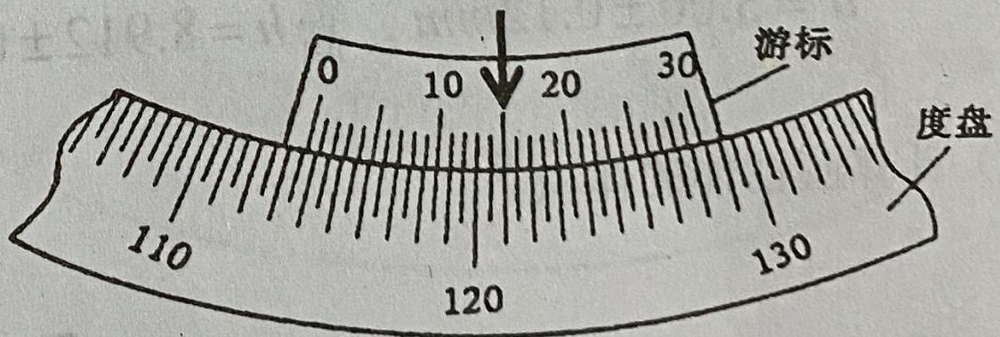

# 《物理实验》期末试卷（真题）

原件经识别和整理；“参考解答”是我们补的。

## 二、填空题（共 24 分，每空 2 分）

### 填空 1

通常情况下，一个物理量的测量结果应包含两个要素：____ 和 ____。

参考解答：**数值** 和 **单位**。

测量结果只有同时给出数值和单位，才能完整表示物理量的大小。

知识点：[测量与单位（含国际单位制重新定义）](../../../topics/大学物理实验/测量与单位.md)、[有效数字的概念与定义](../../../topics/大学物理实验/有效数字概念.md)

### 填空 2

常用的实验数据处理方法有：____、____ 和 ____ 等。

参考解答：列表法、图示法、逐差法

这三种方法是物理实验中最基础且通用的数据处理手段：**列表法**用于有序记录原始数据并初步检查异常值；**图示法**通过绘制变量关系曲线直观揭示物理规律并辅助求解参数；**逐差法**则专门针对等间距测量数据，能充分利用所有测量值以减小随机误差。其他如最小二乘法虽也常用，但上述三种在基础实验教学中最为典型和优先。

知识点：[物理实验课的基本程序（预习、实验进行、写报告）](../../../topics/大学物理实验/实验课基本程序.md)、[实验报告的内容（含实验内容与步骤等）](../../../topics/大学物理实验/实验报告内容.md)

### 填空 3

有效数字在换算过程中有效数字的位数应保持不变。将一物体质量 $M = 8030.0\ \text{g}$ 可表示为 ____ kg 或 ____ g（用科学计数法表示）。

参考解答：质量保持不变，有效数字位数不变：

- $8030.0\ \text{g} = 8.0300 \times 10^0\ \text{kg}$  
  因为 $1\ \text{kg}=10^3\ \text{g}$，所以  
  
$$
8030.0\ \text{g}=\frac{8030.0}{1000}\ \text{kg}=8.0300\ \text{kg}=8.0300\times 10^0\ \text{kg}
$$

- 用科学计数法表示原质量：  
  
$$
8030.0\ \text{g}=8.0300\times 10^3\ \text{g}
$$

所以答案为：  
**$8.0300 \times 10^0\ \text{kg}$** 或 **$8.0300 \times 10^3\ \text{g}$**。

知识点：[科学记数法表示有效数字](../../../topics/大学物理实验/科学记数法.md)、[有效数字的概念与定义](../../../topics/大学物理实验/有效数字概念.md)

### 填空 4

圆筒转动惯量理论值 $I_{0}=1.7481\times10^{-3}\ \text{kg}\cdot\text{m}^{2}$；实验值 $I=1.7411\times10^{-3}\ \text{kg}\cdot\text{m}^{2}$，计算其百分差的公式为 ____，其百分差数据结果是 ____。

参考解答：百分差公式为 $\displaystyle \frac{|I - I_0|}{I_0} \times 100\%$，计算结果为 $0.40\%$。

推理与计算过程：  
百分差用于衡量实验值与理论值的相对偏差，以理论值为基准。代入数据：
$$
\frac{|1.7411\times10^{-3} - 1.7481\times10^{-3}|}{1.7481\times10^{-3}} \times 100\% = \frac{0.0070\times10^{-3}}{1.7481\times10^{-3}} \times 100\% \approx 0.4004\%,
$$
根据有效数字规则（原始数据均为5位有效数字，差值保留2位有效数字），结果修约为 $0.40\%$。

知识点：[有效数字的运算法则（加减运算与乘除运算）](../../../topics/大学物理实验/有效数字运算法则.md)、[科学记数法表示有效数字](../../../topics/大学物理实验/科学记数法.md)

### 填空 5

如下图，50 分度游标卡尺对准位置如图所示，其读数为 ____ mm；螺旋测微器读数 ____ mm。

参考解答：**结论：**游标卡尺读数为 **10.64 mm**；螺旋测微器读数为 **6.680 mm**。

**计算过程：**

1. **50 分度游标卡尺**

   游标卡尺的分度值为

   
$$
\frac{1\ \mathrm{mm}}{50}=0.02\ \mathrm{mm}
$$

   主尺读数为 $10\ \mathrm{mm}$，游标第 $32$ 格与主尺刻线对齐，因此

   
$$
10+32\times 0.02=10.64\ \mathrm{mm}
$$

2. **螺旋测微器**

   固定刻度读数为 $6.5\ \mathrm{mm}$，可动刻度第 $18$ 格与基准线对齐，螺旋测微器的分度值为 $0.01\ \mathrm{mm}$，故

   
$$
6.5+18\times 0.01=6.680\ \mathrm{mm}
$$

知识点：[直接测量量的有效数字读数原则（游标卡尺、角游标尺、螺旋测微器、数字表头）](../../../topics/大学物理实验/直接测量量读数原则.md)

### 填空 6

如右图所示，分光计读数盘读数为 ____。

参考解答：先看主刻度盘：读数为 $87^\circ$ 多一点。  
游标上对齐的刻度为 $15'$，因此读数为

$$
87^\circ 15'
$$

结论：$\boxed{87^\circ 15'}$

知识点：[直接测量量的有效数字读数原则（游标卡尺、角游标尺、螺旋测微器、数字表头）](../../../topics/大学物理实验/直接测量量读数原则.md)、[有效数字的概念与定义](../../../topics/大学物理实验/有效数字概念.md)
