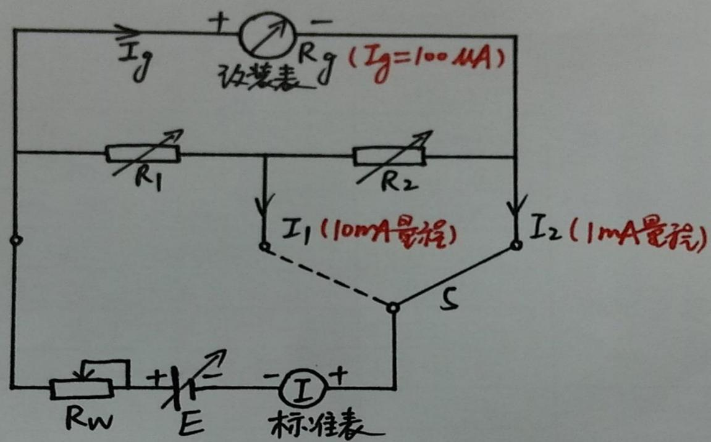
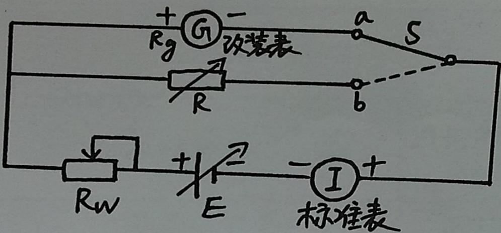

# 《物理实验》电表改装（课件）

原件经识别和整理；“参考解答”是我们补的。

---
title: 《物理实验》电表改装（课件）
kind: 课件
course: 物理实验
term: 
source: 南京邮电大学理学院 何学敏，2016年11月
---

# 《物理实验》电表改装

本资料整理自南京邮电大学理学院何学敏老师于2016年11月制作的《物理实验》电表改装课件。

## 一、实验原理

$I_{2}(1mA量程)$

并联电压相等：
$$
\left\{ \begin{array}{l} {I_g R_g} = {(I_2 - I_g)(R_1 + R_2)} \\ {I_g(R_g + R_2)} = {(I_1 - I_g)R_1} \end{array}\right.
$$

$\Rightarrow$ 分流电阻：
$$
\left\{ \begin{array}{l} {R_1 = \frac{I_2 / I_g}{(I_2 / I_g - 1) I / I_g} R_g = R_g / 90} \\ {R_2 = \frac{I_1 / I_g - I_2 / I_g}{(I_2 / I_g - 1) I / I_g} R_g = R_g / 10} \end{array} \right.
$$

## 二、实验步骤

### ① 替代法测表头内阻 $R_g$

第一步：S拨向a，调节E或$R_w$，使表头满偏，记录下此时标准表的读数$I$；

第二步：S拨向b，调节$R$，使标准表读数与上一步相等，则电阻$R$值即表头内阻$R_g$。

### ② 满偏校准

第一步：计算分流电阻 $R_1$ 、 $R_2$ 的理论值

$$
R_1 = R_g / 90, \quad R_2 = R_g / 10
$$

第二步：按照实验原理图，S选择 $I_2$ ，即先校准1mA量程。调节E或$R_w$，使标准表读数$I=1mA$，再调节$R_1$或$R_2$使改装表满偏；反复以上步骤，直到标准表为1mA时同样满足改装表满偏，记录下此时 $R_1+R_2$ 的电阻值。

第三步：S选择$I_1$，即再校准10mA量程。调节E或$R_w$使标准表读数为10mA，再调节$R_1$使改装表满偏，同时调$R_2$使$R_1+R_2$的差值与上一步保持一致；反复以上过程，直到标准表为10mA时同样满足改装表满偏，记录下此时$R_1$和$R_2$的电阻值。

### ③ 测量校正

第一步：S拨向 $I_2$ ，校正1mA量程的改装表。

调节E或$R_w$，使改装表依次偏转10小格，记录下相应的标准表读数，填于表1中。

第二步：S拨向 $I_1$ ，校正10mA量程的改装表。

同样是调节E或$R_w$，使改装表依次偏转10小格，记录下相应的标准表读数，填于表2中。

## 三、数据处理

### ① 计算改装表的精度，并确定级别

精度 $f = \frac{| \Delta I |_{\text{max}}}{1 \text{ mA 或 } 10 \text{ mA}} \times 100\%$

例如：
- 1mA量程改装表 $f = 0.86\%$ ，则级别为1级；
- 10mA量程改装表 $f = 1.25\%$ ，则级别为1.5级。

### ② 绘制校正曲线

根据表1和表2分别画出两种改装表的校正曲线，即 $\Delta I \sim I$ 图（如下页所示）。

## 四、原始实验数据记录

### 表1 将表头G改装成1mA量程电流表的实验数据

| 改装表格数n | 1 | 10 | 20 | 30 | 40 | 50 | 60 | 70 | 80 | 90 | 100 |
| :--- | :--- | :--- | :--- | :--- | :--- | :--- | :--- | :--- | :--- | :--- | :--- |
| 改装表 $I_0(mA)$ | 0.0 | 0.1 | 0.2 | 0.3 | 0.4 | 0.5 | 0.6 | 0.7 | 0.8 | 0.9 | 1.0 |
| 标准表I(mA) | | | | | | | | | | | |
| 误差 $\Delta I= I-I_0(mA)$ | | | | | | | | | | | |

### 表2 将表头G改装成10mA量程电流表后的实验数据

| 改装表格数n | 0 | 10 | 20 | 30 | 40 | 50 | 60 | 70 | 80 | 90 | 100 |
| :--- | :--- | :--- | :--- | :--- | :--- | :--- | :--- | :--- | :--- | :--- | :--- |
| 改装表 $I_0(mA)$ | 0 | 1 | 2 | 3 | 4 | 5 | 6 | 7 | 8 | 9 | 10 |
| 标准表I(mA) | | | | | | | | | | | |
| 误差 $\Delta I= I-I_0(mA)$ | | | | | | | | | | | |

### 表3 其他数据

| 项目 | 数值 | 项目 | 数值 |
| :--- | :--- | :--- | :--- |
| 表头内阻 $R_g(\Omega)$ | | 实验值 $R_1+R_2(\Omega)$ | |
| 理论值 $R_1(\Omega)$ | | 实验值 $R_1(\Omega)$ | |
| 理论值 $R_2(\Omega)$ | | 实验值 $R_2(\Omega)$ | |
