# 《物理实验》等厚干涉实验课件——利用等厚干涉测相关物体的几何尺寸

原件经识别和整理；“参考解答”是我们补的。

# 利用等厚干涉测相关物体的几何尺寸

本课件由《大学物理实验》等厚干涉实验的课件（作者：杨茂田）识别整理，按原课件顺序组织为实验目的、实验原理、实验仪器与测量步骤等章节。

## 实验目的

1. 通过对等厚干涉图象观察和测量，加深对光的波动性的认识。
2. 掌握读数显微镜的基本调节和测量操作。
3. 掌握用牛顿环法测量透镜的曲率半径的实验方法。
4. 学习用图解法和逐差法处理数据。

## 实验原理

O 点处密接触，即 O 点处厚度 $e = 0$。

空气层上下表面反射光的光程差：

$$
\delta = 2e + \frac{\lambda}{2}
$$

由几何关系（$r$ 为环半径，$R$ 为透镜曲率半径，$e$ 为对应空气层厚度）：

$$
r^2 = R^2 - (R - e)^2 \approx 2Re
$$

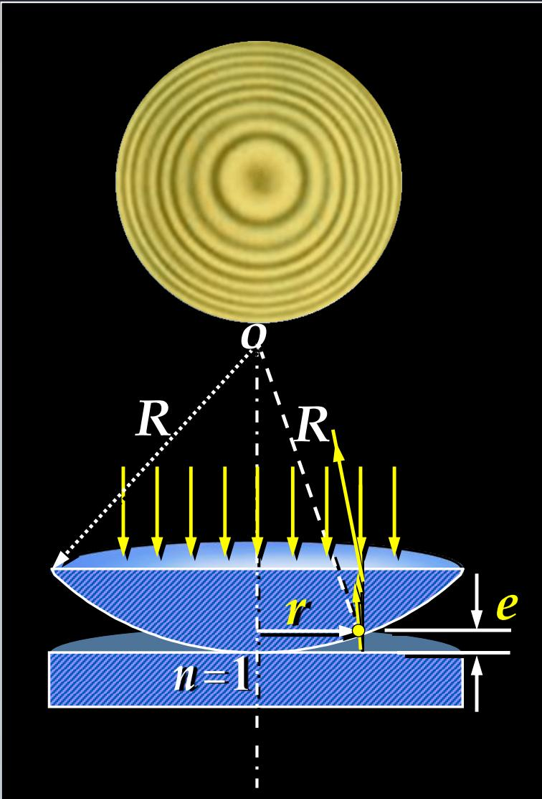

明、暗环半径：

$$
r_k = \begin{cases}
\sqrt{(2k-1)R\lambda/2} & \text{明环} \\
\sqrt{(k-1)R\lambda} & \text{暗环}
\end{cases}
\qquad (k = 1, 2, 3, \dots)
$$

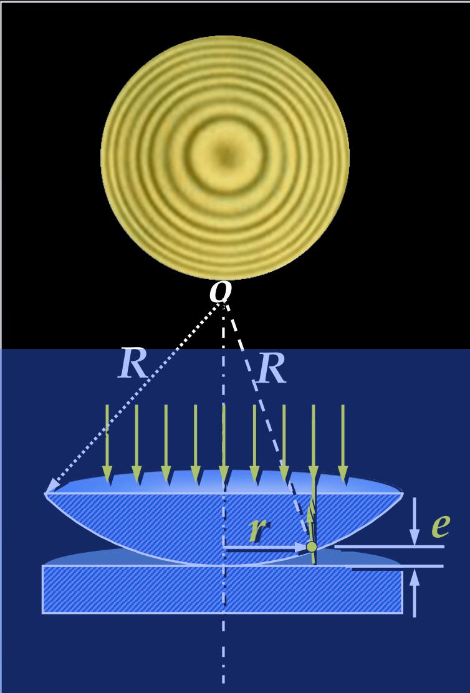

相邻两暗环半径差：

$$
r_{k+1} - r_k = \sqrt{R\lambda}\left(\sqrt{k} - \sqrt{k-1}\right)
$$

$k$ 较大时：

$$
\sqrt{k+1} - \sqrt{k} = \frac{1}{\sqrt{k}}\sqrt{\frac{1+\frac{1}{k}}{}}
$$

条纹特点：愈往外，条纹愈密集，且级次 $k$ 增加！

利用牛顿环测量透镜曲率半径：

暗环：$D_k^2 = 4kR\lambda$（$D_k$ 为第 $k$ 级暗环直径）

$$
R = \frac{D_m^2 - D_n^2}{4(m-n)\lambda}
$$

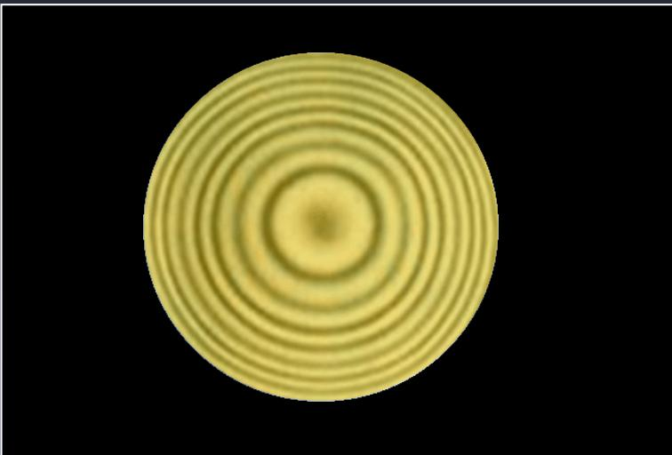

## 实验仪器

读数显微镜，牛顿环，钠光灯。

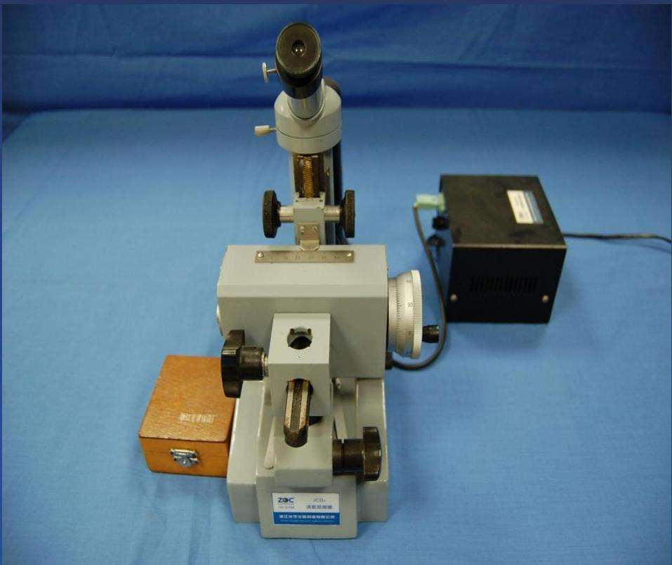

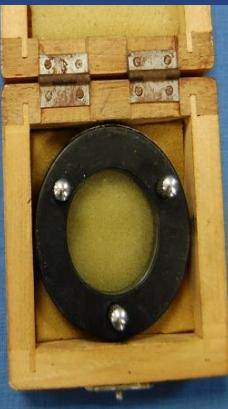

## 读数显微镜使用及注意事项

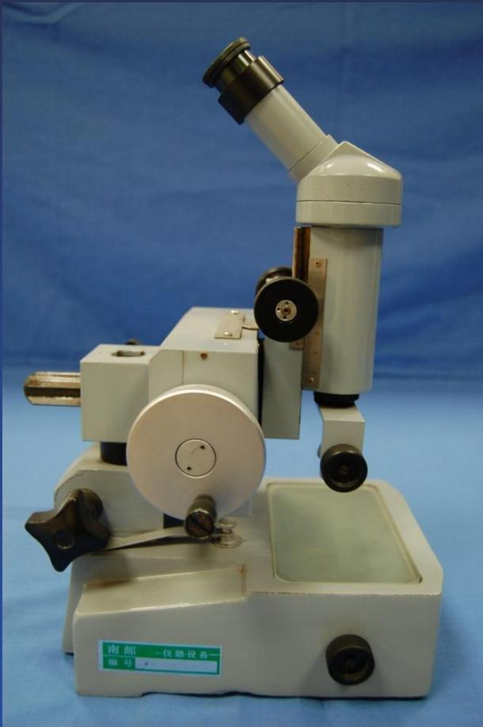

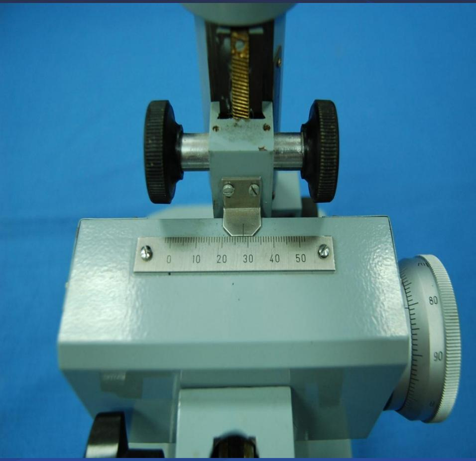

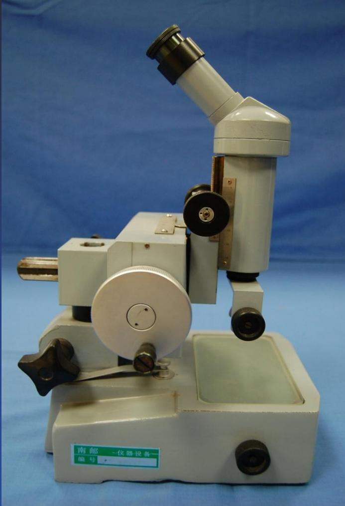

① 先用眼睛粗调：将牛顿环装置放在读数显微镜的工作台上，先不从显微镜里观察而用眼睛沿镜筒方向观察牛顿环装置，移动牛顿环装置，使牛顿环在显微镜筒的正下方。

再用显微镜观察：

a. 调节目镜，使看到的分划板上十字叉丝清晰。

b. 转动套在物镜头上的 45° 透光反射镜，使透光反射镜正对光源，显微镜视场达到最亮。

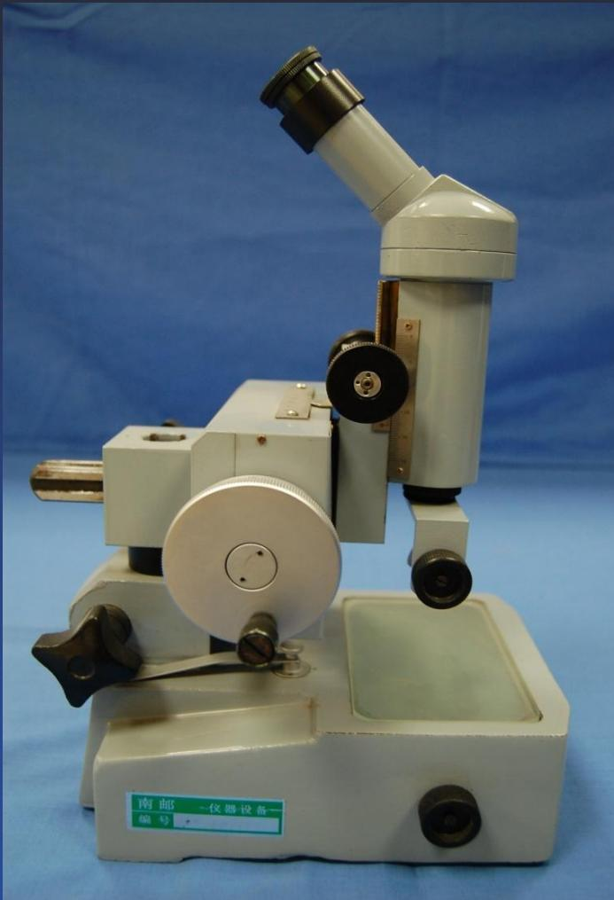

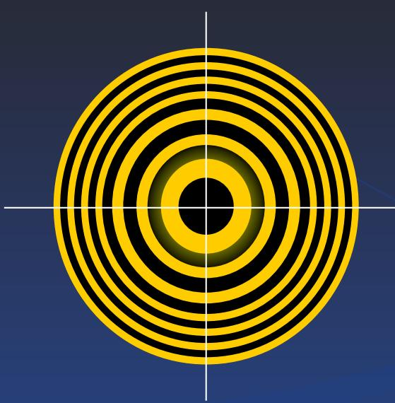

c. 旋转物镜调节手轮，使镜筒由最低位置（注意不要碰到牛顿环装置）缓缓上升，边升边观察，直至目镜中看到聚焦清晰的牛顿环。并适当移动牛顿环装置，使牛顿环圆心处在视场正中央。

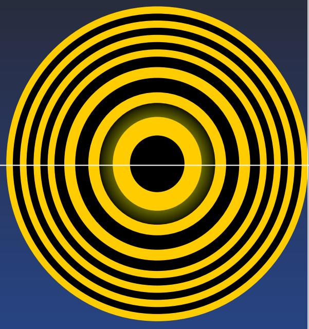

转动读数显微镜读数鼓轮，使显微镜自环心向一个方向移动，为了避免螺丝空转引起的误差，应使镜中叉丝先超过第 30 个暗环（中央暗环不算），即从牛顿环第一条暗环开始数到 35 个暗环，然后再缓缓退回到第 30 个暗环中央（因环纹有一定宽度），记下显微镜读数即该暗环读数 $X_{30}$；再缓慢转动读数显微镜读数鼓轮，使叉丝交点依次对准第 25、20、15、10 和 5 个暗环的中央，记下每次读数 $X_{25}$、$X_{20}$、$X_{15}$、$X_{10}$、$X_{5}$。

并继续缓慢转动读数鼓轮，使目镜镜筒叉丝的交点经过牛顿环中心向另一方向，记下第 5、10、15、20、25、30 暗环的读数 $X_{5}'$、$X_{10}'$、$X_{15}'$、$X_{20}'$、$X_{25}'$、$X_{30}'$。

## 逐差法处理数据

| 暗环序数 | 5 | 10 | 15 | 20 | 25 | 30 |
| --- | --- | --- | --- | --- | --- | --- |
| 暗环读数（cm）左 $X_K$ |  |  |  |  |  |  |
| 暗环读数（cm）右 $X_K'$ |  |  |  |  |  |  |
| 暗环直径 $D_K=\lvert X_K-X_K'\rvert$（cm） |  |  |  |  |  |  |
| $D_K^2$（cm²） |  |  |  |  |  |  |
| $D_m^2-D_n^2$（cm²）（$m-n=15$） |  |  |  |  |  |  |
| $\overline{D_m^2-D_n^2}$（cm²） |  |  |  |  |  |  |
| $\overline{R}$（cm） |  |  |  |  |  |  |

## 不确定度计算

$$
u_{cR} = \overline{R}\sqrt{\left(\frac{u_{c\lambda}}{\lambda}\right)^2 + \left(\frac{u_{cmn}}{m-n}\right)^2 + \left(\frac{S_{\overline{D_m^2-D_n^2}}}{\overline{D_m^2-D_n^2}}\right)^2}
$$

取 $u_{c\lambda} = 6\%$、$\lambda = 3\,\text{nm}$，只计算 A 类不确定度。

## 图解法求透镜的曲率半径 $R$

$$
D_k^2 = (4R\lambda)k
$$

以 $k$ 为横坐标、$D_k^2$ 为纵坐标，作出 $D_k^2\text{-}k$ 图线，由图求出直线的斜率，根据上式再进一步求出透镜的曲率半径 $R$。
