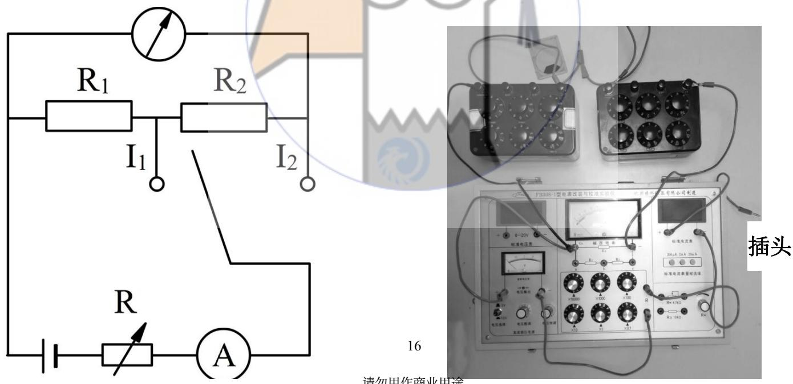
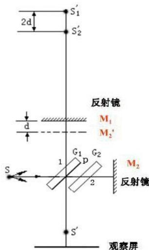
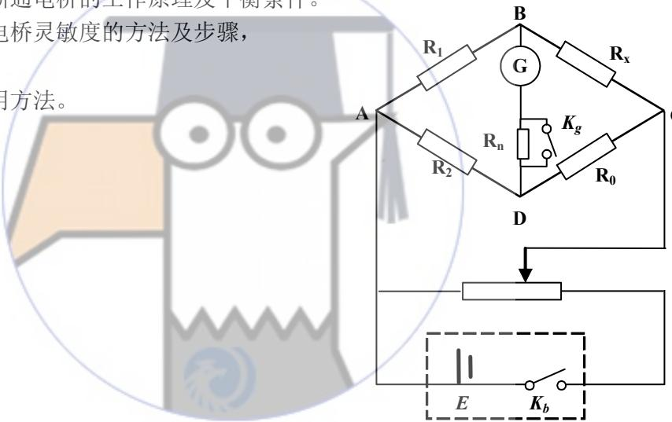
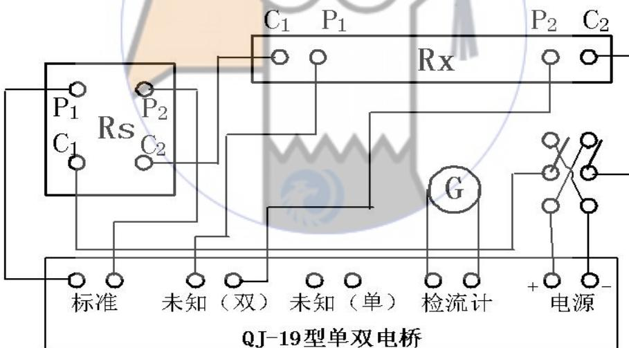

# 《物理实验》练习册答案（练习一）

原件经识别和整理；“参考解答”是我们补的。

### 选择 1

实验测得某物体长度的结果表达为：$L = 6.00 \pm 0.05\,\mathrm{cm}$，则说明（ D ）

- A. $5.95\,\mathrm{cm} \le L \le 6.05\,\mathrm{cm}$
- B. $L = 5.95\,\mathrm{cm}$ 或 $L = 6.05\,\mathrm{cm}$
- C. $L = 6.00\,\mathrm{cm}$
- D. $L$ 在 $[5.95\,\mathrm{cm},\,6.05\,\mathrm{cm}]$ 区间上出现的可能性较大

答案：D。

知识点：[有效数字的修约规则（只进不舍等）](../../../topics/大学物理实验/有效数字修约规则.md)

### 选择 2

对一物理量进行等精度多次测量，其算术平均值是（ B ）

- A. 真值
- B. 最接近真值的值
- C. 误差最大的值
- D. 误差为零的值

答案：B。

知识点：[有效数字的修约规则（只进不舍等）](../../../topics/大学物理实验/有效数字修约规则.md)

### 选择 3

下列正确的说法是（ A ）

- A. 多次测量可以减小随机误差
- B. 多次测量可以消除系统误差
- C. 多次测量可以减小系统误差
- D. 多次测量可以消除随机误差

答案：A。

知识点：[直接测量量的有效数字读数原则（游标卡尺、角游标尺、螺旋测微器、数字表头）](../../../topics/大学物理实验/直接测量量读数原则.md)、[有效数字的概念与定义](../../../topics/大学物理实验/有效数字概念.md)、[科学记数法表示有效数字](../../../topics/大学物理实验/科学记数法.md)

### 选择 4

依据“四舍六入五凑偶”的有效数字修约规则，2.5051 取三位有效数字，2.505 取三位有效数字，表示正确的应该是（ C ）

- A. 2.50；2.51
- B. 2.51；2.51
- C. 2.51；2.50
- D. 以上均不对

答案：C。

知识点：[直接测量量的有效数字读数原则（游标卡尺、角游标尺、螺旋测微器、数字表头）](../../../topics/大学物理实验/直接测量量读数原则.md)、[有效数字的概念与定义](../../../topics/大学物理实验/有效数字概念.md)、[科学记数法表示有效数字](../../../topics/大学物理实验/科学记数法.md)

### 选择 5

下列测量的结果中表达式正确的是（ B ）

- A. $S = 2560 \pm 100\,\mathrm{mm^2}$
- B. $L = 0.667 \pm 0.008\,\mathrm{mm}$
- C. $T = 8.32 \pm 0.02\,\mathrm{S}$
- D. $R = 82.3 \pm 0.31\,\Omega$

答案：B。

知识点：[测量的分类（直接测量与间接测量）](../../../topics/大学物理实验/测量的分类.md)、[有效数字的概念与定义](../../../topics/大学物理实验/有效数字概念.md)、[直接测量量的有效数字读数原则（游标卡尺、角游标尺、螺旋测微器、数字表头）](../../../topics/大学物理实验/直接测量量读数原则.md)

### 选择 6

某长度测量值为 2.130mm，则所用仪器可能是（ D ）

- A. 毫米尺
- B. 50 分度游标卡尺
- C. 20 分度游标卡尺
- D. 千分尺

答案：D。

知识点：[直接测量量的有效数字读数原则（游标卡尺、角游标尺、螺旋测微器、数字表头）](../../../topics/大学物理实验/直接测量量读数原则.md)、[有效数字的概念与定义](../../../topics/大学物理实验/有效数字概念.md)、[测量的分类（直接测量与间接测量）](../../../topics/大学物理实验/测量的分类.md)

### 选择 7

长方形边长测量结果为：$a = 4.00 \pm 0.05\,\mathrm{cm}$，$b = 3.00 \pm 0.05\,\mathrm{cm}$，则其表面积可表示为（ C ）

- A. $S = 12 \pm 0.03\,\mathrm{cm^2}$
- B. $S = 12.0000 \pm 0.0025\,\mathrm{cm^2}$
- C. $S = 12.00 \pm 0.25\,\mathrm{cm^2}$
- D. $S = 12.00 \pm 0.02\,\mathrm{cm^2}$

答案：C。

## 二、填空题

知识点：[有效数字的运算法则（加减运算与乘除运算）](../../../topics/大学物理实验/有效数字运算法则.md)、[直接测量量的有效数字读数原则（游标卡尺、角游标尺、螺旋测微器、数字表头）](../../../topics/大学物理实验/直接测量量读数原则.md)、[有效数字的概念与定义](../../../topics/大学物理实验/有效数字概念.md)

### 填空 1

误差产生的原因很多，按照误差产生的原因和不同性质，可将误差分为粗大误差、系统误差和随机误差。为了对实验测量结果进行合理的评定，用不确定度来表示测量结果的精确程度，按照不确定度的数值评定方法可将不确定度分为 A 类和 B 类。

答案：系统误差；随机误差；A 类；B 类。

知识点：[测量与单位（含国际单位制重新定义）](../../../topics/大学物理实验/测量与单位.md)、[测量的分类（直接测量与间接测量）](../../../topics/大学物理实验/测量的分类.md)

### 填空 2

圆筒转动惯量理论值 $I_0 = 1.6481 \times 10^{-3}\,\mathrm{kg\cdot m^2}$；实验值 $I' = 1.6431 \times 10^{-3}\,\mathrm{kg\cdot m^2}$，计算其百分差的公式为 $\dfrac{|I_0 - I|}{|I_0|} \times 100\%$，其百分差数据结果是 0.31%。

答案：$\dfrac{|I_0 - I|}{|I_0|} \times 100\%$；0.31%。

知识点：[测量与单位（含国际单位制重新定义）](../../../topics/大学物理实验/测量与单位.md)

### 填空 3

根据获得测量结果的方法不同，测量可分为直接测量和间接测量两大类。

答案：直接；间接。

知识点：[测量与单位（含国际单位制重新定义）](../../../topics/大学物理实验/测量与单位.md)

### 填空 4

常用的实验数据处理方法有列表法、逐差法、作图法等。

答案：逐差法；作图法。

知识点：[测量与单位（含国际单位制重新定义）](../../../topics/大学物理实验/测量与单位.md)

### 填空 5

有效数字在换算过程中有效数字的位数应保持不变。将一物体质量 $M = 84030.0\,\mathrm{g}$，可用科学计数法表示为 $8.40300 \times 10^{1}\,\mathrm{kg}$ 或 $8.40300 \times 10^{4}\,\mathrm{g}$。

答案：$8.40300 \times 10^{1}\,\mathrm{kg}$；$8.40300 \times 10^{4}\,\mathrm{g}$。

## 三、计算题

知识点：[测量与单位（含国际单位制重新定义）](../../../topics/大学物理实验/测量与单位.md)、[实验报告的内容（含实验内容与步骤等）](../../../topics/大学物理实验/实验报告内容.md)

### 计算 1

用千分尺（仪器误差为 0.004mm）测量一圆柱体直径 D，所得数据如下表：

| 测量次数 | 1 | 2 | 3 | 4 | 5 | 6 |
|---|---|---|---|---|---|---|
| 直径 D/mm | 9.835 | 9.837 | 9.838 | 9.834 | 9.837 | 9.836 |

置信概率 $P = 0.95$ 时，因子 $\dfrac{t}{\sqrt{n}} = 1.05$，$n = 6$。求圆柱体直径 D 及其不确定度，并写出结果表达式。（要求写出计算过程）

答案：$\overline{D} = 9.836167\,\mathrm{mm}$

$$S_D = \sqrt{\frac{\sum (D_i - \overline{D})^2}{n-1}} = 1.472 \times 10^{-3}\,\mathrm{mm}$$

$$U_A = \frac{t}{\sqrt{n}} S_D = 1.5456 \times 10^{-3}\,\mathrm{mm}$$

$$U_B = 0.004\,\mathrm{mm},\quad U_D = \sqrt{U_A^2 + U_B^2} = 4.29 \times 10^{-3} \approx 4.3 \times 10^{-3}\,\mathrm{mm}$$

$$D = 9.8362 \pm 0.0043\,\mathrm{mm}$$

## 四、计算题

知识点：[直接测量量的有效数字读数原则（游标卡尺、角游标尺、螺旋测微器、数字表头）](../../../topics/大学物理实验/直接测量量读数原则.md)、[测量的分类（直接测量与间接测量）](../../../topics/大学物理实验/测量的分类.md)、[有效数字的修约规则（只进不舍等）](../../../topics/大学物理实验/有效数字修约规则.md)

### 计算 2

一正三棱柱体测得质量 $m = (144.14 \pm 0.05)\,\mathrm{g}$，高 $H = (9.200 \pm 0.012)\,\mathrm{cm}$，底边长 $a = (2.534 \pm 0.005)\,\mathrm{cm}$，求出该三棱柱的密度，$\rho = \dfrac{4\sqrt{3}\,m}{3a^2 H}$。试推导密度的不确定度传递公式：

$$U_\rho = \overline{\rho} \cdot \sqrt{\left(\frac{U_m}{m}\right)^2 + \left(\frac{2U_a}{a}\right)^2 + \left(\frac{U_H}{H}\right)^2}$$

计算不确定度 $U_\rho$ 并写出测量结果表达式。

答案：$\rho = 5.628262\,\mathrm{kg/cm^3}$

$$\frac{U_m}{\overline{m}} = 3.468849 \times 10^{-5},\quad \frac{2U_a}{a} = 3.94633 \times 10^{-3},\quad \frac{U_H}{H} = 1.3043 \times 10^{-3}$$

$$U_\rho = \rho\sqrt{\left(\frac{U_m}{m}\right)^2 + \left(\frac{2U_a}{a}\right)^2 + \left(\frac{U_H}{H}\right)^2} = 0.02339 \approx 0.024\,(\mathrm{g/cm^3})$$

$$\rho = 5.628 \pm 0.024\,(\mathrm{g/cm^3})$$

## 五、作图题（略）

知识点：[测量的分类（直接测量与间接测量）](../../../topics/大学物理实验/测量的分类.md)、[有效数字的运算法则（加减运算与乘除运算）](../../../topics/大学物理实验/有效数字运算法则.md)、[直接测量量的有效数字读数原则（游标卡尺、角游标尺、螺旋测微器、数字表头）](../../../topics/大学物理实验/直接测量量读数原则.md)

### 作图 1

用热电偶测量温度，需要知道温度 t 与热电偶温差电动势 U 之间的关系。现通过实验测得某热电偶的温差电动势 U 与温度 t 的关系如下表所示：

热电偶温差电动势 U 与温度 t 数据表

| $t/^{\circ}\mathrm{C}$ | 10.00 | 20.00 | 30.00 | 40.00 | 50.00 | 60.00 | 70.00 | 80.00 |
|---|---|---|---|---|---|---|---|---|
| $U/\mathrm{mV}$ | 1.18 | 1.96 | 2.78 | 3.63 | 4.48 | 5.34 | 6.20 | 7.12 |

试用作图法进行数据处理，求出热电偶温差电动势 U 与温度 t 之间的经验公式。

# 物理实验练习册答案（练习一）

本资料由识别工具读取《物理实验》练习册答案第 2 部分（共 6 部分，第 4–6 页）整理而成。

## 四、计算题

长方体的体积公式为 $V = abc$，其中测量结果如下：

$$
a = 3.00 \pm 0.10 \text{ mm}, \quad b = 4.00 \pm 0.06 \text{ mm}
$$

$$
c = 5.00 \pm 0.06 \text{ mm}
$$

圆柱体质量测了六次分别为：

$$
0.121 \text{ kg}, \quad 0.122 \text{ kg}, \quad 0.122 \text{ kg}, \quad 0.121 \text{ kg}, \quad 0.120 \text{ kg}, \quad 0.124 \text{ kg}
$$

仪器误差为 $0.001 \text{ kg}$。求出该圆柱体密度的结果表达式 $\bar{\rho} \pm U_L$。

**答案：**

$$
V = abc = 3.00 \times 4.00 \times 5.00 = 60.00 \text{ mm}^3, \quad \bar{m} = 0.121667 \text{ kg}
$$

$$
\bar{\rho} = \frac{\bar{m}}{V} = 2.02778 \times 10^6 \text{ kg/m}^3
$$

$$
S_m = \sqrt{\frac{\sum (m_i - \bar{m})^2}{6 - 1}} = 1.71426 \times 10^{-4} \text{ kg}
$$

$$
U_{Am} = \frac{t}{\sqrt{n}} S_m = 1.7999 \times 10^{-4} \text{ kg}, \quad U_{Bm} = 0.001 \text{ kg}
$$

$$
U_m = \sqrt{U_{Am}^2 + U_{Bm}^2} = 0.0011 \text{ kg}
$$

$$
U_\rho = \bar{\rho} \cdot \sqrt{\left(\frac{U_m}{m}\right)^2 + \left(\frac{U_a}{a}\right)^2 + \left(\frac{U_b}{b}\right)^2 + \left(\frac{U_c}{c}\right)^2} = 0.08244 \times 10^6 \text{ kg/m}^3 \approx 0.09 \times 10^6 \text{ kg/m}^3
$$

$$
\rho = (2.03 \pm 0.09) \times 10^6 \text{ kg/m}^3
$$

## 五、作图题（略）

知识点：[测量的分类（直接测量与间接测量）](../../../topics/大学物理实验/测量的分类.md)、[有效数字的运算法则（加减运算与乘除运算）](../../../topics/大学物理实验/有效数字运算法则.md)、[直接测量量的有效数字读数原则（游标卡尺、角游标尺、螺旋测微器、数字表头）](../../../topics/大学物理实验/直接测量量读数原则.md)

### 选择 1

某热敏电阻阻值 $R$ 与温度 $t$ 的函数关系为 $R_t = R_0 e^{\beta / t}$，现测得如下数据：

| $t/^\circ\text{C}$ | 27.0 | 29.5 | 32.0 | 36.0 | 38.0 | 42.0 | 48.0 | 53.5 | 57.5 | 66.5 |
| :--- | :--- | :--- | :--- | :--- | :--- | :--- | :--- | :--- | :--- | :--- |
| $R_t/\Omega$ | 3427 | 3124 | 2890 | 2645 | 2490 | 2345 | 2122 | 2000 | 1920 | 1791 |

试用图解法求 $\beta$ 的值。

## 练习三

知识点：[有效数字的修约规则（只进不舍等）](../../../topics/大学物理实验/有效数字修约规则.md)

### 一、选择（判断）题

知识点：[测量的分类（直接测量与间接测量）](../../../topics/大学物理实验/测量的分类.md)、[有效数字的概念与定义](../../../topics/大学物理实验/有效数字概念.md)、[直接测量量的有效数字读数原则（游标卡尺、角游标尺、螺旋测微器、数字表头）](../../../topics/大学物理实验/直接测量量读数原则.md)

### 选择 1

按照百分差计算结果表示规则，5.01% 应该修约为（ ）
- A. 5.1%
- B. 5.0%
- C. 6%
- D. 以上都不对

答案：C。

知识点：[有效数字的修约规则（只进不舍等）](../../../topics/大学物理实验/有效数字修约规则.md)

### 选择 2

按照有效数字修约规则，6.255 取三位有效数字应为（ ）
- A. 6.24
- B. 6.25
- C. 6.26
- D. 以上都不对

答案：C。

知识点：[有效数字的修约规则（只进不舍等）](../../../topics/大学物理实验/有效数字修约规则.md)

### 选择 3

用千分尺测量一个钢丝的直径，可能得到的数值为下列数值的哪个？
- A. 4.24mm
- B. 4.240mm
- C. 4.2400 mm
- D. 以上都不对

答案：B。

知识点：[直接测量量的有效数字读数原则（游标卡尺、角游标尺、螺旋测微器、数字表头）](../../../topics/大学物理实验/直接测量量读数原则.md)、[有效数字的概念与定义](../../../topics/大学物理实验/有效数字概念.md)、[科学记数法表示有效数字](../../../topics/大学物理实验/科学记数法.md)

### 选择 4

用精度为 0.02 mm 的游标卡尺去测量一圆筒的直径，下列数值正确的是（ ）
- A. 100.21 mm
- B. 100.2 mm
- C. 100.20 mm
- D. 100.200 mm

答案：C。

知识点：[直接测量量的有效数字读数原则（游标卡尺、角游标尺、螺旋测微器、数字表头）](../../../topics/大学物理实验/直接测量量读数原则.md)、[有效数字的概念与定义](../../../topics/大学物理实验/有效数字概念.md)、[科学记数法表示有效数字](../../../topics/大学物理实验/科学记数法.md)

### 选择 5

下列说法正确的是：（ ）
- A. 多次测量可以减少偶然误差
- B. 多次测量可以减少系统误差
- C. 系统误差都由 B 类不确定度决定
- D. A 类不确定度评定的都是偶然误差

答案：A。

知识点：[测量的分类（直接测量与间接测量）](../../../topics/大学物理实验/测量的分类.md)、[有效数字的概念与定义](../../../topics/大学物理实验/有效数字概念.md)、[直接测量量的有效数字读数原则（游标卡尺、角游标尺、螺旋测微器、数字表头）](../../../topics/大学物理实验/直接测量量读数原则.md)

### 判断 6

由于系统误差在测量条件不变时有确定的大小和正负号，因此在同一测量条件下多次测量求平均值能够减少误差或消除它。

答案：×。

知识点：[测量的分类（直接测量与间接测量）](../../../topics/大学物理实验/测量的分类.md)

### 判断 7

大量的随机误差服从正态分布，一般说来增加测量次数求平均可以减小随机误差。

答案：√。

知识点：[测量的分类（直接测量与间接测量）](../../../topics/大学物理实验/测量的分类.md)

### 判断 8

利用逐差法处理实验数据的最基本条件和优点是可变换成等差级数的数据序列，充分利用数据。

答案：×。

知识点：[有效数字的运算法则（加减运算与乘除运算）](../../../topics/大学物理实验/有效数字运算法则.md)

### 判断 9

测量不确定度是评价测量质量的一个重要指标，是指由于测量误差的存在而使得被测量值不能确定的程度。

答案：×。

知识点：[测量与单位（含国际单位制重新定义）](../../../topics/大学物理实验/测量与单位.md)、[测量的分类（直接测量与间接测量）](../../../topics/大学物理实验/测量的分类.md)、[有效数字的概念与定义](../../../topics/大学物理实验/有效数字概念.md)

### 判断 10

不确定度 A 类分量与随机误差相对应，不确定度 B 类分量与系统误差相对应。

答案：×。

## 二、填空题

知识点：[测量的分类（直接测量与间接测量）](../../../topics/大学物理实验/测量的分类.md)

### 填空 1

仪器没有达到应有的准确程度引起的误差属于 **系统** 误差，由于实验者的粗心导致的误差为 **粗差**。

知识点：[测量与单位（含国际单位制重新定义）](../../../topics/大学物理实验/测量与单位.md)、[测量的分类（直接测量与间接测量）](../../../topics/大学物理实验/测量的分类.md)

### 填空 2

系统误差包括 **已定** 系统误差和 **未定** 系统误差。

知识点：[测量与单位（含国际单位制重新定义）](../../../topics/大学物理实验/测量与单位.md)

### 填空 3

不确定度是表征被测量的 **真值** 所处的量值范围的评定，包括 **随机误差** 和未定系统误差的联合分布范围。

知识点：[测量与单位（含国际单位制重新定义）](../../../topics/大学物理实验/测量与单位.md)

### 填空 4

不确定度按其数值评定的方法可分为两类：**A 类** 不确定度分量与 **B 类** 不确定度分量。

知识点：[测量与单位（含国际单位制重新定义）](../../../topics/大学物理实验/测量与单位.md)

### 填空 5

完整的测量结果应包括被测量的量值、 **单位** 和 **不确定度**。

知识点：[测量与单位（含国际单位制重新定义）](../../../topics/大学物理实验/测量与单位.md)、[实验报告的内容（含实验内容与步骤等）](../../../topics/大学物理实验/实验报告内容.md)

### 填空 6

单次直接测量把单次测得值作为最佳值，而多次直接测量把多次测得值的 **平均值** 作被测量的最佳估值。

知识点：[测量的分类（直接测量与间接测量）](../../../topics/大学物理实验/测量的分类.md)、[直接测量量的有效数字读数原则（游标卡尺、角游标尺、螺旋测微器、数字表头）](../../../topics/大学物理实验/直接测量量读数原则.md)

### 填空 7

在直接测量的多次测量中，对某一物理量要进行 **等精度测量**，本课程中仪器本身的误差限值 $\Delta_{\text{ins}}$ 即为 B 类不确定度。

## 三、计算题

用 1 级螺旋测微器测量某圆柱体直径 $D$，测量前螺旋测微器初始读数为 $-0.003 \text{ mm}$，仪器误差 $\Theta_{\text{INS}} = 0.004 \text{ mm}$。6 次测量值 $D_i$ 分别为 $5.911 \text{ mm}$，$5.912 \text{ mm}$，$5.912 \text{ mm}$，$5.911 \text{ mm}$，$5.910 \text{ mm}$，$5.914 \text{ mm}$。求 $D$ 的结果表达式。

**答案：**

$$
\overline{D} = \frac{1}{n} \sum_{i=1}^{n} D_i \approx 5.91167 \text{ mm}
$$

$$
S = \sqrt{\frac{\sum (D_i - \overline{D})^2}{n-1}} \approx 0.001414 \text{ mm}
$$

$$
U_A = s \cdot \frac{t}{\sqrt{n}} \approx 0.001485 \text{ mm}
$$

$$
U_D = \sqrt{U_A^2 + \Delta_{\text{ins}}^2} \approx 0.00427 \text{ mm}
$$

$$
D = (\overline{D} - (-0.003)) \pm U_D = (5.9147 \pm 0.0043) \text{ mm}
$$

## 四、计算题

一个圆柱体，用 50 分度的游标卡尺测其直径 $D$ 和高度 $H$ 各 6 次，测量数据如下：用仪器误差为 50 毫克的物理天平测其质量一次，为 $152.10 \text{ g}$，计算圆柱体密度 $\rho$ 及合成不确定度，写出结果表达式。

| $D/\text{mm}$ | 20.42 | 20.34 | 20.40 | 20.46 | 20.40 | 20.44 |
| :--- | :--- | :--- | :--- | :--- | :--- | :--- |
| $H/\text{mm}$ | 41.20 | 41.22 | 41.32 | 41.28 | 41.12 | 41.10 |

**答案：**

$$
\overline{H} = \frac{\sum_{i=1}^{6} H_i}{6} \approx 41.21 \text{ mm}, \quad \overline{D} = \frac{\sum_{i=1}^{6} D_i}{6} \approx 20.41 \text{ mm}
$$

$$
U_D = \sqrt{U_A^2 + U_B^2} \approx 0.048 \text{ mm}
$$

$$
U_H = \sqrt{U_A^2 + U_B^2} \approx 0.093 \text{ mm}
$$

$$
\overline{\rho} = \frac{4m}{\pi \overline{D}^2 \overline{H}} \approx 0.011282 \text{ g/mm}^3
$$

$$
U_\rho = \overline{\rho} \sqrt{\left(\frac{U_m}{\overline{m}}\right)^2 + \left(\frac{2 U_D}{\overline{D}}\right)^2 + \left(\frac{U_H}{\overline{H}}\right)^2} \approx 4.6 \times 10^{-5} \text{ g/mm}^3
$$

$$
\rho = \overline{\rho} \pm U_\rho = (1128.2 \pm 4.6) \times 10^{-5} \text{ g/mm}^3
$$

## 五、作图题（略）

空气介电常数为 $\varepsilon_0$，在平行板电容器中：$S_0$ 为极板面积 $(S_0 = 21.61 \text{ cm}^2)$，$D$ 为极板间距，则系统电容量为：

$$
C = \frac{\varepsilon_0 S_0}{D} + C_{\xi\xi}
$$

令 $x = \frac{1}{D}$，$y = C$ 得直线方程：$y = a + bx$，式中 $a = C_{\xi\xi}$，$b = \varepsilon_0 S_0$。试用图解法测空气介电常数 $\varepsilon_0$。

| $D/\text{mm}$ | 1.000 | 1.100 | 1.200 | 1.300 | 1.400 | 1.500 | 1.600 | 1.700 | 1.800 |
| :--- | :--- | :--- | :--- | :--- | :--- | :--- | :--- | :--- | :--- |
| $1/D$ | | | | | | | | | |
| $C/\text{pF}$ | 37.50 | 36.05 | 34.60 | 33.46 | 32.38 | 31.61 | 30.85 | 30.20 | 29.55 |

## 练习四

知识点：[有效数字的运算法则（加减运算与乘除运算）](../../../topics/大学物理实验/有效数字运算法则.md)、[测量的分类（直接测量与间接测量）](../../../topics/大学物理实验/测量的分类.md)

### 一、选择（判断）题

#### 选择 1

分光计设计了两个角游标是为了消除（ ）。

- A. 视差
- B. 螺距差
- C. 偏心差
- D. 色差

答案：C。

#### 选择 2

在右侧李萨如图形中，如果输入到 X 轴方向上的信号频率为 $100\text{Hz}$，那么在 Y 方向上的信号频率为（ ）。

- A. $50\text{ Hz}$
- B. $75\text{ Hz}$
- C. $125\text{ Hz}$
- D. $250\text{ Hz}$

答案：B。

#### 选择 3

使用双臂电桥测量电阻的实验中，测量的电阻值范围是（ ）。

- A. 大电阻
- B. 中等阻值的电阻
- C. 低值电阻
- D. 以上三项都可以

答案：C。

#### 选择 4

下列百分差的表示方法中，正确的是（ ）。

- A. $2.5\%$
- B. $2.51\%$
- C. $3\%$
- D. 以上都不对

答案：A。

#### 选择 5

螺旋测微器的初始读数不为零所引起的读数误差属于（ ）。

- A. 系统误差
- B. 随机误差
- C. 粗差
- D. 以上都不对

答案：A。

#### 判断 6

系统误差有确定的变化规律，随机误差没有变化规律。（ ）

答案：×。

#### 判断 7

双臂电桥测低电阻实验中，用四端引线法的目的是消除导线电阻对测量的影响。（ ）

答案：×。

补充：四端引线法主要目的是消除**接触电阻**和**引线电阻**的影响，而不仅仅是导线电阻。通常表述为消除接触电阻及连接导线电阻的影响，若题目强调“仅”导线或忽略接触电阻则判错，此处原题判错可能侧重于表述不严谨或混淆了单臂与双臂的区别（单臂也有消除引线电阻说法，但双臂核心在于低阻测量消除接触电阻）。*注：根据原件答案保留为 ×*。

#### 判断 8

分光计调节中“各半调节”法是为了消除视差。（ ）

答案：×。

补充：“各半调节”法是为了消除**偏心差**。

#### 判断 9

随机误差的大小一般用标准偏差估计。（ ）

答案：√。

#### 判断 10

系统误差和随机误差都可能由实验者引起。（ ）

答案：×。

补充：通常认为随机误差主要由不可控因素引起，系统误差可由仪器、环境或实验者（如读数习惯）引起。此题判错可能基于特定教材定义，即强调系统误差的确定性来源与随机误差的统计特性区分，或者认为“实验者引起”特指操作失误导致的粗差而非误差分类本身。*注：根据原件答案保留为 ×*。

知识点：[测量的分类（直接测量与间接测量）](../../../topics/大学物理实验/测量的分类.md)、[有效数字的概念与定义](../../../topics/大学物理实验/有效数字概念.md)、[直接测量量的有效数字读数原则（游标卡尺、角游标尺、螺旋测微器、数字表头）](../../../topics/大学物理实验/直接测量量读数原则.md)

### 二、填空题

#### 填空 1

在直接测量的多次测量中，实验标准偏差 $s = \sqrt { \frac { \sum ( x _ { i } - { \overline { { x } } } ) ^ { 2 } } { n - 1 } }$ （贝塞尔公式），A类不确定度 $\underline { { U _ { \scriptscriptstyle A } } } = s \cdot \frac { t } { \sqrt { n } }$ 。

#### 填空 2

根据真实值与不确定度的 **末位对齐** 的要求，对真实值采用“ **四舍六入五凑偶** ”的原则进行修正。

#### 填空 3

被测量量的不确定度一般只取一到两位，本课程中要求，首位数字较小时，一般取 **2** 位，首位不小于 5 时，通常取 **1** 位。

#### 填空 4

不确定度、相对不确定度和百分差的修约规则是相同的，均为 **只进不舍** 。

#### 填空 5

结果表达式中，量值 $y$ 与不确定度 $U$ 的末位数字一般要 **对齐** ，根据修约规则，先要确定 **不确定度** 的有效数字位数。

#### 填空 6

当函数式为 $y = 2 x _ { 1 } + x _ { 2 }$ 时，不确定度的合成公式为 $u _ { y } = \sqrt { \left( 2 u _ { x _ { 1 } } \right) ^ { 2 } + \left( u _ { x _ { 2 } } \right) ^ { 2 } }$ ；当函数式为 $y = 2 x _ { 1 } / x _ { 2 }$ 时，不确定度的合成公式为 $u _ { y } = \frac { 2 x _ { 1 } } { x _ { 2 } } \cdot \sqrt { ( \frac { u _ { x _ { 1 } } } { x _ { 1 } } ) ^ { 2 } + ( \frac { u _ { x _ { 2 } } } { x _ { 2 } } ) ^ { 2 } }$ 。

#### 填空 7

间接测量中，被测量值 $y$ 可写成直接测量量 $x_k$ 的函数 $y { = } f ( x _ { 1 } , x _ { 2 } , \dots, x _ { \mathrm { k } } )$ ，根据传递公式，相对不确定度 $U _ { y r } = \frac { U_y } { y } = \sqrt { \sum _ { i = 1 } ^ { k } ( \frac { \partial \ln y } { \partial x _ { i } } ) ^ { 2 } \cdot u _ { x _ { i } } ^ { 2 } }$ 。

*(注：原识别文本中公式部分有乱码 $U_{yr} = \overline{y} \cdot ...$，根据物理实验数据处理常规公式及上下文“相对不确定度”，修正为标准形式)*

知识点：[实验报告的内容（含实验内容与步骤等）](../../../topics/大学物理实验/实验报告内容.md)、[直接测量量的有效数字读数原则（游标卡尺、角游标尺、螺旋测微器、数字表头）](../../../topics/大学物理实验/直接测量量读数原则.md)、[有效数字的运算法则（加减运算与乘除运算）](../../../topics/大学物理实验/有效数字运算法则.md)

### 三、计算题

#### 计算 1

用游标卡尺（仪器误差为 $0.02\text{mm}$）测量一钢球直径 6 次，测量数据为： $1 4 . 2 6 , 1 4 . 2 8 , 1 4 . 2 2 , 1 4 . 2 4 , 1 4 . 2 8 , 1 4 . 2 2 (\mathrm { m m } )$，试求钢球直径 $D$ 的最佳值与不确定度。

解：

(1) 平均值：
$$ \overline { { D } } = \frac { \sum _ { i = 1 } ^ { 6 } D _ { i } } { 6 } = 1 4 . 2 5 \mathrm { m m } $$

(2) 不确定度：
A类不确定度：
$$ U _ { A } = s \cdot \frac { t } { \sqrt { n } } = 1 . 0 5 \times \sqrt { \frac { \displaystyle \sum _ { i = 1 } ^ { 6 } ( D _ { i } - \overline { { D } } ) ^ { 2 } } { 5 } } \approx 0 . 0 2 9 \mathrm { m m } $$
*(注：此处 $t$ 因子取值及具体计算过程依教材而定，原图给出近似值)*

总不确定度：
$$ U _ { D } = \sqrt { U _ { A } ^ { 2 } + \Delta _ { i n s } ^ { 2 } } \approx 0 . 0 3 6 \mathrm { m m } $$

最终结果表达（需修约）：
$\overline{D} = 14.25 \pm 0.04 \text{ mm}$ (若按一位有效数字进位) 或 $14.25 \pm 0.036 \text{ mm}$ (视课程具体要求，原题未给出最终格式化步骤，仅给出中间计算)。

知识点：[有效数字的修约规则（只进不舍等）](../../../topics/大学物理实验/有效数字修约规则.md)、[有效数字的运算法则（加减运算与乘除运算）](../../../topics/大学物理实验/有效数字运算法则.md)、[测量的分类（直接测量与间接测量）](../../../topics/大学物理实验/测量的分类.md)

### 四、计算题

#### 计算 2

某物理量的测量公式为： $R = { \frac { U } { I } }$ ，其中测量结果如下：$I = 3 . 0 0 \pm 0 . 1 2 \mathrm { A } , U = 4 . 0 0 \pm 0 . 0 6 \mathrm { V }$ 试求出该物理量的结果表达式 $\overline { { R } } \pm { U _ { R } }$ 。

解：

$$
\begin{array}{l} 
\overline {{\mathrm{R}}} = \frac {U}{\mathrm{I}} \approx 1. 3 3 3 3 \Omega \\ 
\mathrm{U} _ {\mathrm{R}} = \sqrt {\left(\frac {U _ {I}}{I}\right) ^ {2} + \left(\frac {U _ {U}}{U}\right) ^ {2}} \cdot \overline{R} \quad \text{(注：原图公式似有误，应为相对不确定度合成后乘均值，或直接写绝对不确定度)} \\
\text{按原图逻辑推导：} \\
\text{相对不确定度 } E_R = \sqrt{(\frac{0.12}{3.00})^2 + (\frac{0.06}{4.00})^2} = \sqrt{0.04^2 + 0.015^2} \approx 0.0427 \\
\text{绝对不确定度 } U_R = 1.3333 \times 0.0427 \approx 0.057 \Omega \\
\text{原图给出的数值为 } 0.04273 \Omega \text{，这通常是相对不确定度的数值误标为绝对，或者计算方式不同。依据原件输出：} \\
\overline {{\mathrm{R}}} \pm \mathrm{U} _ {R} = (1. 3 3 3 \pm 0. 0 4 3) \Omega 
\end{array}
$$

*(注：严格来说，$U_R$ 的计算应遵循误差传递公式。若 $U_R$ 指绝对不确定度，原图结果 $(1.333 \pm 0.043)$ 暗示其计算出的绝对不确定度约为 $0.043$。这与上述标准相对不确定度计算略有出入，可能是直接使用了 $\sqrt{(U_I/I)^2+(U_U/U)^2}$ 的结果作为相对误差百分比对应的绝对值近似，或者是特定简化算法。此处忠实保留原件给出的算式和结果)*

知识点：[直接测量量的有效数字读数原则（游标卡尺、角游标尺、螺旋测微器、数字表头）](../../../topics/大学物理实验/直接测量量读数原则.md)、[有效数字的运算法则（加减运算与乘除运算）](../../../topics/大学物理实验/有效数字运算法则.md)

### 五、作图题（略）

示波管磁偏转实验中，偏转距离与电流之间关系数据如下表所示。

| I/mA | 6.0 | 10.5 | 15.5 | 21.0 | 26.2 | 31.6 | 36.8 | 42.1 |
| :--- | :--- | :--- | :--- | :--- | :--- | :--- | :--- | :--- |
| L/mm | 5.0 | 10.0 | 15.0 | 20.0 | 25.0 | 30.0 | 35.0 | 40.0 |

用直角坐标纸作图，并求出 $L-I$ 之间的关系式。

## 练习五

知识点：[实验报告的内容（含实验内容与步骤等）](../../../topics/大学物理实验/实验报告内容.md)、[测量与单位（含国际单位制重新定义）](../../../topics/大学物理实验/测量与单位.md)、[有效数字的概念与定义](../../../topics/大学物理实验/有效数字概念.md)

### 一、选择（判断）题

#### 选择 1

实验操作不规范或者实验条件突变导致的误差属于（ ）。

- A. 系统误差
- B. 随机误差
- C. 粗差
- D. 以上都不对

答案：C。

#### 选择 2

双臂电桥实验中，测量金属棒的直径和计算金属棒电阻率的过程分别属于（ ）。

- A. 直接测量和间接测量
- B. 间接测量和直接测量
- C. 都是直接测量
- D. 都是间接测量

答案：B。

*(注：通常直径是直接测量，电阻率通过公式计算是间接测量。原题答案为 B，可能存在题意理解差异，如直径通过长度换算等特殊情况，或原题选项顺序印刷错误。此处忠实保留原件答案 B)*

#### 选择 3

用惠斯通电桥法测电阻值比用伏安法测电阻值的优点是（ ）。

- A. 可以测量低值电阻
- B. 测出的电阻值更精确
- C. 测量方法更简单
- D. 以上三条都不对

答案：BA。

*(注：原件识别为 "BA"，结合语境及常见考点，惠斯通电桥相比伏安法的主要优点确实是精度更高（B），且能避免电表内阻影响。A选项低值电阻通常用开尔文电桥（双臂）。此处保留原件奇怪的 "BA" 标记，推测可能是多选或排版错误，意指选 B)*

#### 选择 4

用扭摆法测物体的转动惯量，要求摆角在（ ）。

- A. 0到90度之间
- B. 40度到90度之间
- C. 90度到120度之间
- D. 任意角度都可以

答案：A。

*(注：实际实验中通常要求小角度摆动以满足简谐振动近似，A选项范围过大，但相比其他选项，可能是指起始释放角度不超过90度以避免非线性效应过强或碰撞。此处保留原件答案 A)*

#### 选择 5

在惠斯通电桥测电阻实验中 $\frac { \sf R _ { 1 } } { \sf R _ { 2 } } = \frac { \sf R _ { 0 } } { \sf R _ { \mathrm { { X } } } }$ ，对于一个几十欧姆的待测电阻要求其有效数字达到四位，（ ）。

- A. $R_1$ 取 $100.0$ 欧姆，$R_2$ 取 $1000.0$ 欧姆
- B. $R_1$ 取 $1000.0$ 欧姆，$R_2$ 取 $100.0$ 欧姆
- C. $R_1$ 取 $100.0$ 欧姆，$R_2$ 取 $100.0$ 欧姆
- D. $R_1$ 取 $10.0$ 欧姆，$R_2$ 取 $10.0$ 欧姆

答案：A。

#### 判断 6

表示测量结果时，数据的位数写得越多越精确。（ ）

答案：×。

#### 判断 7

测量读数的有效位数只与仪器的最小分度值有关。（ ）

答案：×。

#### 判断 8

测量结果的有效数字多少仅由误差决定。（ ）

答案：×。

#### 判断 9

拿取光学器件时，严禁用手触摸其光学表面。（ ）

答案：√。

#### 判断 10

仪器镜头被污染时，可以用专用擦镜纸轻轻擦去。（ ）

答案：√。

知识点：[测量的分类（直接测量与间接测量）](../../../topics/大学物理实验/测量的分类.md)、[有效数字的概念与定义](../../../topics/大学物理实验/有效数字概念.md)、[直接测量量的有效数字读数原则（游标卡尺、角游标尺、螺旋测微器、数字表头）](../../../topics/大学物理实验/直接测量量读数原则.md)

### 二、填空题

#### 填空 1

改错： $I { = } 4 . 5 1 3 1 { \times } 1 0 ^ { - 2 } \mathrm { A } { \pm } 3 . 0 2 { \times } 1 0 ^ { - 4 } \mathrm { A }$ 应写为 $I ^ { = ( 4 . 5 1 3 { \pm } 0 . 0 3 1 ) { \times } 1 0 ^ { - 2 } \mathrm { A } }$ ； $U { = } 2 5 . 3 4 6 \mathrm { mv } { \pm } 5 2 \mu \mathrm { v }$ 应写为 $U ^ { = } ~ ( 2 5 . 3 5 { \pm } 0 . 0 6 ) ~ \mathrm { mv } ^ { \phantom { } }$ 。

#### 填空 2

改错： $L=17.450 \pm 0.23 \mathrm{cm}$ 应写为 $\underline { { L } } \mathrm { = } 1 7 . 4 5 \pm 0 . 2 3 \mathrm { cm }$ ； $m \mathrm { = } 1 4 . 5 0 2 \pm 0 . 6 0 2 \mathrm { g }$ 应写为 $m=14.5 \pm 0.7 \mathrm { g }$ 。

#### 填空 3

判断对错： $4 . 6 5 \mathrm { c m } { = } 4 6 . 5 \mathrm { m m }$ **√** ， $46.5\mathrm{mm} \neq 46.50\mathrm{mm}$ **×** 。（均填 “×” 或 “√”）。

*(注：第一空相等正确；第二空从数值上相等，但从有效数字意义上不等价，故说“不等于”是错误的表述，因为物理意义不同不能直接划等号，但在纯数学数值比较上是相等的。通常这类判断题考察有效数字概念，$46.5$ 三位有效，$46.50$ 四位有效，二者精度不同，不能说完全等同，但也不能说数值不等。原题答案给的是 ×，意味着认为它们“相等”（数值上）或者题目意在考察“是否等价”。根据原件：第一个空打钩，第二个空打叉)*

#### 填空 4

用螺旋测微器测得某物体的长度为 $8.321\mathrm{mm}$，若改为 50 分度游标卡尺测量，则测量结果的有效数字有 **3** 位；若用米尺测量，则应有 **2** 位有效数字。

*(注：50分度游标卡尺精度0.02mm，读数如8.32mm，共3位有效数字？或者8.320? 通常游标卡尺读到小数点后两位(mm)，如8.32，有效数字3位。米尺精度1mm，估读到0.1mm，如83.2mm，有效数字3位？原题答案给2位，可能是指以cm为单位？$8.3$cm，2位有效数字。此处保留原件答案)*

#### 填空 5

测得时间 $T { = } 2 . 0 0 0 0 { \pm } 0 . 0 0 2 0 \mathrm { s }$ ，则 $T$ 的相对不确定度表达式 $U _ { \mathrm { T r } } { = } \frac { u _ { T } } { \mathcal { T } } \cdot 1 0 0 \%$ ， 计算结果为 **0.10%** 。

#### 填空 6

南京地区的重力加速度公称值 $g_0$ 为 $9 7 9 . 4 \mathrm { c m } / \mathrm { s } ^ { 2 }$ ，若测量值 $g$ 为 $9 8 3 . 6 \mathrm { c m } / \mathrm { s } ^ { 2 }$ ，则重力加速度的百分差表达式 $E _ { 0 } { = } \frac { { \left| g - g _ { 0 } \right| } } { g _ { 0 } } { \cdot } 1 0 0 \% $ 计算结果为 **0.43%** 。

#### 填空 7

在我们的教材中，有 **列表法** 、图示法、图解法、最小二乘法和逐 **差** 法等五种数据处理方法。

知识点：[实验报告的内容（含实验内容与步骤等）](../../../topics/大学物理实验/实验报告内容.md)、[直接测量量的有效数字读数原则（游标卡尺、角游标尺、螺旋测微器、数字表头）](../../../topics/大学物理实验/直接测量量读数原则.md)、[有效数字的运算法则（加减运算与乘除运算）](../../../topics/大学物理实验/有效数字运算法则.md)

### 三、计算题

用共振干涉法测声波的波长的数据表如下，仪器误差为 $0.002\text{ cm}$。用逐差法求波长 $\lambda$。

| 测量次数 $n$ | 1 | 2 | 3 | 4 | 5 | 6 |
| :---: | :---: | :---: | :---: | :---: | :---: | :---: |
| 信号极大值位置 $L_{i} /\text{cm}$ | 4.322 | 8.648 | 12.962 | 17.274 | 21.576 | 25.862 |

$$
\begin{aligned}
\lambda &= \frac {2}{3} \times \Delta \overline {L} = \frac {2}{3} \times \frac {1}{3} \left[ \left(L _ {4} - L _ {1}\right) + \left(L _ {5} - L _ {2}\right) + \left(L _ {6} - L _ {3}\right) \right] \\
&= \frac {2}{3} \times \frac {1}{3} (12.952 + 12.928 + 12.900) \\
&= \frac {2}{3} \times 12.9267 \\
&\approx 8.6178 \text{ cm}
\end{aligned}
$$

$$
\mu_ {\Delta L B} = 0.002 \text{ cm}
$$

$$
\begin{aligned}
\mu_ {\Delta L A} &= \frac {t}{\sqrt {n}} \times \sqrt {\frac {\Sigma \left(\Delta L _ {i} - \overline {\Delta L}\right) ^ {2}}{n - 1}} \\
&= 1.05 \times \sqrt {\frac {(12.952 - 12.9267) ^ {2} + (12.928 - 12.9267) ^ {2} + (12.900 - 12.9267) ^ {2}}{2}}
\end{aligned}
$$

$$
\mu_ {\lambda} = \frac {2}{3} \mu_ {\Delta L} = \frac {2}{3} \sqrt {\mu_ {\Delta L A} ^ {2} + \mu_ {\Delta L B} ^ {2}} \approx 0.0182 \text{ cm}
$$

$$
\lambda = \overline {\lambda} \pm \mu_ {\lambda} = (8.618 \pm 0.019) \text{ cm}
$$

知识点：[有效数字的修约规则（只进不舍等）](../../../topics/大学物理实验/有效数字修约规则.md)、[有效数字的运算法则（加减运算与乘除运算）](../../../topics/大学物理实验/有效数字运算法则.md)、[测量的分类（直接测量与间接测量）](../../../topics/大学物理实验/测量的分类.md)

### 四、计算题

在测量电功率实验中，电流和电阻的测量结果分别为：
$R = 5.68 \pm 0.07 \, \Omega$，$I = 6.32 \pm 0.49 \, \text{mA}$；
测量公式为 $P = I ^ { 2 } R$，求电功率 $P$ 的结果表达式。

$$
\begin{array}{l} 
\overline {P} = \overline {I} ^ {2} \overline {R} = 6.32 ^ {2} \times 5.68 = 2.269 \times 10 ^ {- 4} \text{ W} \\ 
u _ {P} = \overline {P} \cdot \sqrt {\left(\frac {2 U _ {I}}{\overline {I}}\right) ^ {2} + \left(\frac {U _ {R}}{\overline {R}}\right) ^ {2}} \approx 0.36 \times 10 ^ {- 4} \text{ W} \\ 
P = \overline {P} \pm u _ {P} = (2.27 \pm 0.36) \times 10 ^ {- 4} \text{ W} 
\end{array}
$$

知识点：[直接测量量的有效数字读数原则（游标卡尺、角游标尺、螺旋测微器、数字表头）](../../../topics/大学物理实验/直接测量量读数原则.md)、[有效数字的运算法则（加减运算与乘除运算）](../../../topics/大学物理实验/有效数字运算法则.md)

### 五、作图题

利用伏安法测量某电阻的阻值，其电压与电流关系如下表所示：

| $U/\text{V}$ | 30.0 | 35.0 | 40.0 | 45.0 | 50.0 | 55.0 | 60.0 | 65.0 |
| :---: | :---: | :---: | :---: | :---: | :---: | :---: | :---: | :---: |
| $I/\text{mA}$ | 8.61 | 10.31 | 11.30 | 12.92 | 14.32 | 15.81 | 17.50 | 18.72 |

根据以上数据作 $U-I$ 图，并求出该电阻的阻值 $R$。

## 练习六

知识点：[有效数字的运算法则（加减运算与乘除运算）](../../../topics/大学物理实验/有效数字运算法则.md)、[实验报告的内容（含实验内容与步骤等）](../../../topics/大学物理实验/实验报告内容.md)

### 一、选择（判断）题

#### 选择 1

双臂电桥测电阻和惠斯通电桥测电阻的区别为（ ）

- A. 双臂电桥测的是低值电阻，惠斯通电桥测的是中值电阻
- B. 惠斯通电桥测的是低值电阻，双臂电桥测的是中值电阻
- C. 两者都可以测低值电阻
- D. 两者都可以测中值电阻

答案：A。

#### 选择 2

由于实验原理的不完善所造成的误差属于（ ）

- A. 系统误差
- B. 随机误差
- C. 粗差
- D. 以上都不对

答案：A。

#### 选择 3

用毫米刻度尺测量一物体的长度，关于测量值的仪器误差，下列说法正确的为（ ）

- A. $0.01\text{ mm}$
- B. $0.02\text{ mm}$
- C. $0.5\text{ mm}$
- D. $2\text{ mm}$

答案：C。

#### 判断 4

在牛顿环实验中看到的干涉图像属于等倾干涉。（ ）

答案：×。

#### 判断 5

在测量长度时，测量值 $6.5\text{ cm}$ 和 $6.50\text{ cm}$ 所表示的长度的精度是相同的。（ ）

答案：×。

#### 判断 6

测量值的不确定度和误差指的是同一个意思。（ ）

答案：×。

#### 判断 7

在转动惯量试验中，塑料圆柱转动惯量的理论值和实验值的百分差为零，说明测量结果没有误差。（ ）

答案：×。

#### 判断 8

在惠斯通电桥测电阻实验中，$R_1$ 和 $R_2$ 作为比较臂的比例选取是任意的。（ ）

答案：×。

知识点：[测量的分类（直接测量与间接测量）](../../../topics/大学物理实验/测量的分类.md)、[有效数字的概念与定义](../../../topics/大学物理实验/有效数字概念.md)、[直接测量量的有效数字读数原则（游标卡尺、角游标尺、螺旋测微器、数字表头）](../../../topics/大学物理实验/直接测量量读数原则.md)

### 二、填空题

#### 填空 1

图解法求解时，当图线类型为直线时，可以求出直线的 **斜率** 和 **截距**。

#### 填空 2

图解法选取解析点时，应在直线上取两个与实验原始数据 **不同**（填“相同”或“不同”）的点，并在实验范围内尽量彼此 **远离**（填“靠近”或“远离”）。

#### 填空 3

使用图解法时，当物理量为非直线关系时，可以通过曲线改直的方法处理，如等厚干涉实验中 $D _ { k } ^ { 2 } = 4 R \lambda k$，处理时取 $y = \underline { { D _ { k } ^ { 2 } } }$，$x = \underline { { k } }$。

#### 填空 4

测量得到一组等间距数据 $x _ { 1 } , x _ { 2 } , x _ { 3 } , x _ { 4 } , x _ { 5 } , x _ { 6 } , x _ { 7 } , x _ { 8 }$，需要把测量数据分成高低 **两** 组，用逐差法计算相邻两数据差值所表示的物理量 $x = \frac { ( x _ { 8 } - x _ { 4 } ) + ( x _ { 7 } - x _ { 3 } ) + ( x _ { 6 } - x _ { 2 } ) + ( x _ { 5 } - x _ { 1 } ) } { 16 }$。

#### 填空 5

实验室常用电阻箱设计四个接头（“0”，“0.9”，“9.9”和“99999.99”），当你需要一个阻值为 $8.5\,\Omega$ 的电阻时，一端接“0”另一端应接 **9.9** 接头，当你需要一个阻值为 $88.5\,\Omega$ 的电阻时，一端接“0”另一端应接 **99999.99** 接头。

#### 填空 6

连接模拟直流电表到电路时，电流表 **分** 正负极，检流计 **不分** 正负极。（均填“分”或“不分”）

知识点：[实验报告的内容（含实验内容与步骤等）](../../../topics/大学物理实验/实验报告内容.md)、[直接测量量的有效数字读数原则（游标卡尺、角游标尺、螺旋测微器、数字表头）](../../../topics/大学物理实验/直接测量量读数原则.md)、[有效数字的运算法则（加减运算与乘除运算）](../../../topics/大学物理实验/有效数字运算法则.md)

### 三、计算题

用相位比较法测声波的波长的数据表如下，仪器误差为 $0.002\text{ cm}$。用逐差法求波长 $\lambda$。

| 测量次数 $n$ | 1 | 2 | 3 | 4 | 5 | 6 |
| :---: | :---: | :---: | :---: | :---: | :---: | :---: |
| 同相或反相位值 $L_{i} /\text{cm}$ | 4.340 | 8.438 | 12.504 | 16.586 | 20.632 | 24.786 |

解：

$$
\begin{aligned}
\lambda &= \frac {2}{3} \times \Delta \overline {L} = \frac {2}{9} \left[ \left(L _ {4} - L _ {1}\right) + \left(L _ {5} - L _ {2}\right) + \left(L _ {6} - L _ {3}\right) \right] \\
&= \frac {2}{9} (12.246 + 12.194 + 12.282) \\
&= 8.1604 \text{ cm}
\end{aligned}
$$

$$
\begin{aligned}
\mu_ {\Delta L A} &= \frac {t}{\sqrt {n}} \times \sqrt {\frac {\Sigma (\Delta L _ {i} - \overline {\Delta L}) ^ {2}}{n - 1}} \\
&= 1.05 \times \sqrt {\frac {(12.246 - 12.241) ^ {2} + (12.194 - 12.241) ^ {2} + (12.282 - 12.241) ^ {2}}{2}} \\
&= 0.0465 \text{ cm}
\end{aligned}
$$

$$
\mu_ {\Delta L B} = 0.002 \text{ cm}
$$

$$
\mu_ {\lambda} = \frac {2}{3} \mu_ {\Delta L} = \frac {2}{3} \sqrt {\mu_ {\Delta L A} ^ {2} + \mu_ {\Delta L B} ^ {2}} \approx 0.03103 \text{ cm}
$$

$$
\lambda = \overline {\lambda} \pm \mu_ {\lambda} = (8.160 \pm 0.032) \text{ cm}
$$

知识点：[有效数字的修约规则（只进不舍等）](../../../topics/大学物理实验/有效数字修约规则.md)、[有效数字的运算法则（加减运算与乘除运算）](../../../topics/大学物理实验/有效数字运算法则.md)、[测量的分类（直接测量与间接测量）](../../../topics/大学物理实验/测量的分类.md)

### 四、计算题

圆柱体的体积公式为：$V = \frac 1 4 \pi d ^ { 2 } h$，其中测量结果如下：直径 $d = 3.00 \pm 0.12 \, \text{mm}$；高 $h$ 用 1 级螺旋测微器测量：$4.911\text{ mm}, 4.912\text{ mm}, 4.912\text{ mm}, 4.911\text{ mm}, 4.910\text{ mm}, 4.914\text{ mm}$。测量前螺旋测微器仪器误差为 $-0.002\text{ mm}$。试求出体积 $V$ 的结果表达式 $\overline { V } \pm U _ { V }$。

解：修正值：$4.913\text{ mm}, 4.914\text{ mm}, 4.914\text{ mm}, 4.913\text{ mm}, 4.912\text{ mm}, 4.916\text{ mm}$。

$$
\begin{aligned}
\overline {h} &= 4.9147 \text{ mm} \\
\overline {V} &= \frac {1}{4} \pi d ^ {2} \overline {h} = 34.72 \text{ mm}^3
\end{aligned}
$$

$$
\begin{aligned}
\mu_ {h A} &= \frac {t}{\sqrt {n}} \times s _ {h} = 1.05 \times \sqrt {\frac {\Sigma (h _ {i} - \bar {h}) ^ {2}}{5}} = 0.0017 \text{ mm} \\
\mu_ {h B} &= 0.004 \text{ mm} \\
\mu_ {h} &= \sqrt {\mu_ {h A} ^ {2} + \mu_ {h B} ^ {2}} = 0.00434 \text{ mm}
\end{aligned}
$$

$$
\mu_ {V} = \bar {V} \times \sqrt {\left(\frac {2 \mu_ {d}}{\bar {d}}\right) ^ {2} + \left(\frac {\mu_ {h}}{\bar {h}}\right) ^ {2}} = 34.72 \times 0.08 = 2.78 \text{ mm}^3
$$

$$
V = \overline {V} \pm \mu_ {V} = (34.7 \pm 2.8) \text{ mm}^3
$$

知识点：[直接测量量的有效数字读数原则（游标卡尺、角游标尺、螺旋测微器、数字表头）](../../../topics/大学物理实验/直接测量量读数原则.md)、[有效数字的运算法则（加减运算与乘除运算）](../../../topics/大学物理实验/有效数字运算法则.md)

### 五、作图题

用牛顿环法测定透镜的曲率半径 $R$，数据表格如下，用图解法求出透镜的曲率半径 $R$。

| 暗环序数 $K$ | 5 | 10 | 15 | 20 | 25 | 30 |
| :---: | :---: | :---: | :---: | :---: | :---: | :---: |
| 暗环直径 $D_K=\|X_K-X_K'\| / \text{cm}$ | 0.3730 | 0.4945 | 0.5891 | 0.6728 | 0.7452 | 0.8128 |
| $D_{K}^{2} (\text{cm}^{2})$ | | | | | | |

根据实验数据，以 $K$ 为横坐标，$D _ { K } ^ { 2 }$ 为纵坐标，做出 $K \sim D _ { K } ^ { 2 }$ 图线，由图求出直线的斜率，根据式 $D _ { k } ^ { 2 } = ( 4 R \lambda ) k$，进一步求出透镜的曲率半径 $R$，已知 $\lambda=589.3 \text{ nm}$。

## 电位差计测量电动势 实验考试复习提要

所提供的实验仪器：十一线电阻、电位差计。

实验考试要点：

1. 理解补偿法测量的原理，并能画出实验原理图。
2. 会正确连接测量电路。
3. 能对检流计进行调零校正：检流计调到断开，调节检流计调零旋钮，使读数为 0，回复到测量状态，$10^{-5}$ 档位。
4. 能根据不同的校正系数预置工作电压值；以 0.22 V/m 为例，计算得 $11 \times 0.2200 = 2.42$ V；通过电压粗调旋钮，使电压为 2.42 V。
5. 能进行工作电流标准化，达到设置要求。例电压 0.2200 V/m，计算得长度的值为 $1.0186/0.2200 = 4.630$ m，调节 CD 的长度为 4.630 m，其中 C 插入数字 4 的端口，注意：奇数在右，偶数在左，D 通过游标盘进行设置为 0.630，游标盘的整体长度为一，分成 100 等份。
6. 将 K2 往上推接通标准工作电压 $E_N$。
7. 会设置检流计的不同档位量程，直到灵敏度最高，检流计的读数为 0。将检流计调到 $10^{-5}$ 档位，调节电压旋钮使检流计为 0；提高检流计的灵敏度，调到 $10^{-6}$，调节电压旋钮使检流计为 0；提高检流计的灵敏度，调到 $10^{-7}$，调节电压旋钮使检流计为 0；提高检流计的灵敏度，调到 $10^{-8}$，调节电压旋钮使检流计为 0。（此时的电压值不一定等于 2.42）至此工作电流标准化完成。
8. 能根据不同的待测电动势预置待测长度，能测量待测电动势。例待测电动势约为 1.7，计算大致的长度 $1.7/0.22 = 7.727$ m，调节 CD 的长度为 7.7 m 左右，其中 C 插入数字 7 的端口，注意：奇数在右，偶数在左，D 通过游标盘进行设置为 0.7 左右。
9. 将 K 往下推接到待测电压。慢慢的转动滑动电阻盘，直到检流计在 $10^{-8}$ 为 0，测量完毕，读取其长度，其电压值为长度乘以 0.22 就为待测电压值。
10. 能重复测量并计算不确定度。

## 等厚干涉 实验考试复习提要

知识点：[有效数字的运算法则（加减运算与乘除运算）](../../../topics/大学物理实验/有效数字运算法则.md)、[实验报告的内容（含实验内容与步骤等）](../../../topics/大学物理实验/实验报告内容.md)

### 一、所提供的实验仪器：牛顿环，读数显微镜

知识点：[直接测量量的有效数字读数原则（游标卡尺、角游标尺、螺旋测微器、数字表头）](../../../topics/大学物理实验/直接测量量读数原则.md)

### 二、实验考试要点：

1. 掌握光程差，理解光的等厚干涉的原理及干涉类型（等厚、等倾）。
2. 牛顿环的调节：通过三个螺钉的调节，牛顿环大小合适，目测在中心，（螺钉不能过紧，透镜变形导致牛顿环半径偏大）。
3. 正确使用读数显微镜：了解目镜的调节（包括十字叉丝）、物镜的调节、读数的读取。
   - （A）转动鼓轮旋钮，使其位于标尺的中间位置。
   - （B）目镜调节：松开目镜螺钉，转动目镜使十字叉丝横平竖直，并使其清晰。
   - （C）物镜调节：转动物镜下方的反光板，使目镜中看到的光强最强，慢慢的转动升降旋钮，就能看清牛顿环。
   - （D）适当调节牛顿环的位置，使目镜中看到牛顿环的中心。
   - （E）转动读数旋钮，消除空程误差。
   - （F）正确读数（有效数字的位数）。
4. 合理设置数据表格，会用逐差法处理数据。
   - （A）能正确求出牛顿环的半径。
   - （B）能合理估算不确定度的数值及修约。
   - （C）能正确写出结果表达式。
5. 能用作图法求出斜率并求出半径 $R$。
   - （A）能合理设置坐标轴的物理量、分度值、单位。
   - （B）能正确标点连接数据。
   - （C）能合理选取点求斜率。
   - （D）能根据斜率求半径 $R$。
   - （E）正确写出图标名称。

## 声速测量 实验考试复习提要

所提供的实验仪器：示波器、信号发生器、导线若干、声速测量仪。

知识点：[直接测量量的有效数字读数原则（游标卡尺、角游标尺、螺旋测微器、数字表头）](../../../topics/大学物理实验/直接测量量读数原则.md)、[有效数字的运算法则（加减运算与乘除运算）](../../../topics/大学物理实验/有效数字运算法则.md)、[测量的分类（直接测量与间接测量）](../../../topics/大学物理实验/测量的分类.md)

### 实验考试要点：

知识点：[测量与单位（含国际单位制重新定义）](../../../topics/大学物理实验/测量与单位.md)、[直接测量量的有效数字读数原则（游标卡尺、角游标尺、螺旋测微器、数字表头）](../../../topics/大学物理实验/直接测量量读数原则.md)、[有效数字的概念与定义](../../../topics/大学物理实验/有效数字概念.md)

### 1、掌握信号发生器的调节和使用

（1）打开信号发生器开关，此时信号发生器即为初始状态，显示“10.00KHz”，此状态下可直接调节频率。

（2）调节频率：调节频率时，一定要在信号发生器显示的数值为频率时才可进行，如显示其他物理量，可按“频率/周期”键使其显示频率。调节频率有两种方法：a. 直接输入数值和单位（数值用右侧数字键输入，单位用最底下一排按键输入），如：调节“5KHz”，依次按键“5”“扫描”；b. 通过黄色左右移位键和右上角圆形调节旋钮，调整频率大小，获得我们所需要的频率。

（3）调节电压：调节电压时，一定要在信号发生器显示的数值为电压时才可进行，如显示其他物理量，可按“幅度/脉宽”键使其显示频率。调节电压和调节频率类似，也有两种方法：a. 直接输入数值和单位，如：调节“50mV”，依次按键“50”“调频”；b. 通过黄色左右移位键和右上角圆形调节旋钮进行调节。

知识点：[物理实验课的基本程序（预习、实验进行、写报告）](../../../topics/大学物理实验/实验课基本程序.md)、[预习报告的编写内容与要求](../../../topics/大学物理实验/预习报告内容.md)、[实验报告的内容（含实验内容与步骤等）](../../../topics/大学物理实验/实验报告内容.md)

### 2、掌握示波器的调节和使用

（1）打开示波器开关后，建议先恢复初始设置，依次按键“存储/调出”“F1”。

（2）可按蓝色“自动设置”按键让系统自动调整波形至最佳状态。

知识点：[实验报告的内容（含实验内容与步骤等）](../../../topics/大学物理实验/实验报告内容.md)

### 3、掌握声速的测量方法

（1）调节谐振频率，将信号发生器频率调至“37KHz”，按示波器“自动设置”按键使得屏幕显示正弦信号，细调频率大小，观察正弦信号幅度，通过调节频率当正弦信号幅度最大时，记录下此刻的频率，要求频率精确到“0.01KHz”，注意在细调频率时，如果信号幅度超出屏幕，则应该通过调节示波器“垂直档位”来匹配此刻的信号幅度。

（2）共振干涉法测声速：移动声速测定仪的接收端，观察示波器正弦信号，当信号幅度最大时，记下游标卡尺读数，依次类推记录连续数个位置点数据。如果信号幅度超出屏幕，也应该通过调节示波器“垂直档位”来匹配此刻的信号幅度。

（3）相位比较法测声速：在示波器上依次按键“水平菜单”“F5”，使得示波器显示利萨如图形，移动声速测定仪的接收端，观察示波器利萨如图形，当出现一三象限或者二四象限直线时，记下游标卡尺读数，依次类推记录连续数个位置点数据。

4、掌握逐差法数据处理：连续测量的位置点，两两间距为半个波长 $\lambda$。在计算时要用逐差法，书本中测量了 10 个数据，所以 $\lambda = \frac{2}{5}\Delta L$，如果测量了 8 组数据，那么请思考一下，计算公式应该是什么？

## 电表改装 实验考试复习提要

所提供的实验仪器：示波器、信号发生器、导线若干、声速测量仪。

实验考试要点：

1. 能够根据表头电路在图中画出完整的实验电路图，电路图如图 1 所示。
2. 能够按电路图连接电路，电路实物连接图如图 2 所示。图中最右侧插头作为量程切换开关用于切换两个量程，插在 $R_1 R_2$ 之间时为“$I_1$”量程，插在微安表右端时为“$I_2$”量程。
3. 对两个量程进行满量程校准，并记录 $R_1$、$R_2$ 的实验值。
   （1）打开电源开关后，先校准量程 $I_2$，调节“R”大小或者电源电压，使得标准电流表示数等于 $I_2$，此时微安表应该正好满偏，如果不满偏，调节 $R_1$ 或者 $R_2$ 使得微安表满偏，记录下 $R_1$、$R_2$ 电阻值的和。
   （2）再校准量程 $I_1$，调节“R”大小或者电源电压，使得标准电流表示数等于 $I_1$，此时微安表应该正好满偏，如果不满偏，先调节 $R_1$ 再 $R_2$ 使得微安表满偏，调节时保持 $R_1 R_2$ 电阻值的和不变。

## 迈克耳逊干涉仪的调整和使用 实验考试复习提要

知识点：[物理实验课的基本程序（预习、实验进行、写报告）](../../../topics/大学物理实验/实验课基本程序.md)、[直接测量量的有效数字读数原则（游标卡尺、角游标尺、螺旋测微器、数字表头）](../../../topics/大学物理实验/直接测量量读数原则.md)

### 一、所提供的实验仪器：迈克尔逊干涉仪、He-Ne 激光器

知识点：[物理实验课的基本程序（预习、实验进行、写报告）](../../../topics/大学物理实验/实验课基本程序.md)、[预习报告的编写内容与要求](../../../topics/大学物理实验/预习报告内容.md)

### 二、实验考试要点：

1. 熟悉迈克尔逊干涉仪的结构，了解形成等倾干涉的光路原理图。
2. 重点掌握迈克尔逊干涉仪的调整方法：
   （1）转动粗调转轮，使主尺（标尺）刻度指标于 50 mm 左右。
   （2）以 He-Ne 激光器作为光源，使激光束大致垂直射到 $M_2$（定镜）上。移开观察屏用肉眼可看到分别由 $M_1$、$M_2$ 反射的两排光点，分别调节 $M_1$ 和 $M_2$ 背后的 3 个调节螺钉，使这两排光点中的最亮点尽量重合，这时 $M_1$ 和 $M_2$ 大致互相垂直。接收屏上可观察到明暗相间的同心圆环。
   （3）消除回程差：上述调节工作后，并不能马上进行测量，还必须消除回程差。方法是：使微调转轮沿同一方向转动，若发现干涉条纹在观察屏中心处一个个地“冒出”或“消失”，则回程差消除。
3. 学会正确测量单色光源的波长：

   记录下 $M_1$ 的初始位置 $d_0$，（注意读数方法：标尺、粗调手轮、微调手轮三部分）继续沿原旋转方向转动微调手轮，数出“冒出”（或“消失”）的圆环的数目，每隔 100 个条纹数记录下 $M_1$ 的位置，共记 6 次，得到 $d_0, d_1, d_2, d_3, d_4, d_5$，将数据填入数据表格中。

4. 掌握逐差法计算实验结果，会计算不确定度并能正确表达实验结果。

$$U_{\Delta d} = \sqrt{U_{dA}^2 + \Delta_{dB}^2} = \sqrt{\frac{\sum_{1}^{3}(\Delta d_i - \Delta \bar{d})^2}{2} \times \frac{(4.30)^2}{3} + (0.00004)^2} = \quad \text{nm}$$

$$U_{\lambda} = \sqrt{\left(\frac{2 \cdot \Delta d}{N^2}\right)^2 U_N^2 + \left(\frac{2}{N}\right)^2 U_{\Delta d}^2} = \quad \text{nm}$$

$$\lambda = \bar{\lambda} \pm U_{\lambda} = \quad \text{nm}$$

## 扭摆法测物体的转动惯量 实验考试复习提要

知识点：[直接测量量的有效数字读数原则（游标卡尺、角游标尺、螺旋测微器、数字表头）](../../../topics/大学物理实验/直接测量量读数原则.md)、[有效数字的运算法则（加减运算与乘除运算）](../../../topics/大学物理实验/有效数字运算法则.md)、[测量的分类（直接测量与间接测量）](../../../topics/大学物理实验/测量的分类.md)

### 一、所提供的实验仪器：电子天平、游标卡尺、转动惯量测试仪，塑料圆柱体，电子计时器。

知识点：[测量与单位（含国际单位制重新定义）](../../../topics/大学物理实验/测量与单位.md)、[直接测量量的有效数字读数原则（游标卡尺、角游标尺、螺旋测微器、数字表头）](../../../topics/大学物理实验/直接测量量读数原则.md)、[测量的分类（直接测量与间接测量）](../../../topics/大学物理实验/测量的分类.md)

### 二、实验考试要点：

知识点：[直接测量量的有效数字读数原则（游标卡尺、角游标尺、螺旋测微器、数字表头）](../../../topics/大学物理实验/直接测量量读数原则.md)、[有效数字的运算法则（加减运算与乘除运算）](../../../topics/大学物理实验/有效数字运算法则.md)、[测量的分类（直接测量与间接测量）](../../../topics/大学物理实验/测量的分类.md)

### 1、了解扭摆的结构，掌握测量扭摆弹簧扭转常数的方法；

熟悉扭摆的构造、使用方法，掌握转动惯量测试仪的正确操作要领。调整扭摆基座底脚螺丝，使水准仪中气泡居中，表明扭摆处于水平状态。数字式定数计时器它由主机和光电探头两部分组成。用光电探头来检测挡光杆是否挡光，根据挡光次数能自动判断是否已达到所设定的周期数并计时。注意：测量时扭摆的摆动幅度要合理。

知识点：[物理实验课的基本程序（预习、实验进行、写报告）](../../../topics/大学物理实验/实验课基本程序.md)、[直接测量量的有效数字读数原则（游标卡尺、角游标尺、螺旋测微器、数字表头）](../../../topics/大学物理实验/直接测量量读数原则.md)、[测量的分类（直接测量与间接测量）](../../../topics/大学物理实验/测量的分类.md)

### 2、掌握用扭摆法测量几种特定形状（圆柱、圆筒、细杆等）物体转动惯量的实验步骤；

知识点：[实验报告的内容（含实验内容与步骤等）](../../../topics/大学物理实验/实验报告内容.md)、[物理实验课的基本程序（预习、实验进行、写报告）](../../../topics/大学物理实验/实验课基本程序.md)

### 3、掌握正确使用游标卡尺、直尺等测量长度工具，并能正确读数和记录实验数据；

根据实验中待测物理量，选用游标卡尺、直尺等测量长度的工具，测出相关待测物体几何尺寸。注意：读数方法及有效数字的记录方法。

知识点：[直接测量量的有效数字读数原则（游标卡尺、角游标尺、螺旋测微器、数字表头）](../../../topics/大学物理实验/直接测量量读数原则.md)、[有效数字的概念与定义](../../../topics/大学物理实验/有效数字概念.md)

### 4、了解验证平行轴定理的方法；

将滑块对称地放置在金属细杆两边的凹槽内，使滑块质心离转轴的距离分别为 5.00 cm、10.00 cm、15.00 cm、20.00 cm、25.00 cm 等不同位置时，测量并记录各自摆动周期。

## 惠斯通电桥测电阻 实验考试复习提要

知识点：[实验报告的内容（含实验内容与步骤等）](../../../topics/大学物理实验/实验报告内容.md)

### 一、所提供的实验仪器：电阻箱、磁电式指针检流计、电源、便携式电桥，待测电阻

知识点：[直接测量量的有效数字读数原则（游标卡尺、角游标尺、螺旋测微器、数字表头）](../../../topics/大学物理实验/直接测量量读数原则.md)、[测量的分类（直接测量与间接测量）](../../../topics/大学物理实验/测量的分类.md)、[有效数字的概念与定义](../../../topics/大学物理实验/有效数字概念.md)

### 二、实验考试要点：

1. 了解惠斯通电桥的结构，掌握惠斯通电桥的工作原理及平衡条件。
2. 掌握用惠斯通电桥测电阻及测量电桥灵敏度的方法及步骤，包括电路的连接和比例臂的选择。
3. 掌握检流计、保护电阻的正确使用方法。

## 双臂电桥测低电阻 实验考试复习提要

知识点：[直接测量量的有效数字读数原则（游标卡尺、角游标尺、螺旋测微器、数字表头）](../../../topics/大学物理实验/直接测量量读数原则.md)、[有效数字的运算法则（加减运算与乘除运算）](../../../topics/大学物理实验/有效数字运算法则.md)、[测量的分类（直接测量与间接测量）](../../../topics/大学物理实验/测量的分类.md)

### 一、所提供的实验仪器：双臂电桥，四端电阻器，导线若干，标准电阻，检流计，金属棒，螺旋测微器

知识点：[物理实验课的基本程序（预习、实验进行、写报告）](../../../topics/大学物理实验/实验课基本程序.md)、[预习报告的编写内容与要求](../../../topics/大学物理实验/预习报告内容.md)、[直接测量量的有效数字读数原则（游标卡尺、角游标尺、螺旋测微器、数字表头）](../../../topics/大学物理实验/直接测量量读数原则.md)

### 二、实验考试要点：

1. 了解四端引线法的基本原理。
2. 能按所给电路图正确连接电路。
3. 能正确使用检流计（检流计的调零及合理选择量程）。
4. 使用双臂电桥测量给定材料，不同长度情况下的电阻值，要求合理选择 $R_1$、$R_2$、$R_S$ 值，保证 $R$ 的有效数字达到 5 位。
5. 能正确使用螺旋测微器来测待测金属棒的直径（注意初始误差和有效数字）。
6. 正确求出给定材料的 $\rho$ 及其不确定度。

# 物理实验练习册答案（练习一）第 6 部分

本资料整理自《物理实验》练习册答案（练习一）第 21–23 页，主要包含“分光计的调节及其应用”与“电介质介电常数的测量”两个实验的操作考试复习提要。原文中的广告水印及页码已去除。

## 分光计的调节及其应用 实验考试复习提要

知识点：[直接测量量的有效数字读数原则（游标卡尺、角游标尺、螺旋测微器、数字表头）](../../../topics/大学物理实验/直接测量量读数原则.md)、[有效数字的运算法则（加减运算与乘除运算）](../../../topics/大学物理实验/有效数字运算法则.md)、[测量的分类（直接测量与间接测量）](../../../topics/大学物理实验/测量的分类.md)

### 一、所提供的实验仪器：分光计、He 灯光源、 $\mathrm{Hg}$ 灯光源、双面反射镜、三棱镜、透射光栅

知识点：[实验报告的内容（含实验内容与步骤等）](../../../topics/大学物理实验/实验报告内容.md)、[测量与单位（含国际单位制重新定义）](../../../topics/大学物理实验/测量与单位.md)

### 二、实验操作考试要点：

#### 1. 分光计的调节

(1) **望远镜**：
① 先旋转目镜调焦手轮，使视野中的“两横一竖”状黑十字叉丝清晰；
② 再将双面反射镜贴于物镜前端，松开目镜套筒锁紧螺钉，移动镜筒使视野中的绿十字像清晰；

(2) **粗、细调**：
① 先将双面反射镜正确放置于载物台上，即镜面与载物台下 a、b 螺钉的连接线垂直，采用“各半调节”法，即调节完一下望远镜的俯仰螺钉，就要调节一下载物台下的 a、b 螺钉，让载物台不断旋转 $180^\circ$，反复调节几轮，最终要使反射镜两面反射回来的绿十字像均与黑十字叉丝的上面一条刻度线严格重合；此时望远镜调好，后面的步骤无需再动；
② 再将双面反射镜旋转 $90^\circ$，即镜面与载物台下 a、b 螺钉的连接线平行，此时只需调节载物台下的 c 螺钉，使其中一个面反射回来的绿十字像与叉丝上刻度线严格重合；此时载物台调好，后面的步骤无需再动；

(3) **平行光管**：
① 先适当调节狭缝的宽度，使得从狭缝入射进来的光线宽窄合适；
② 再松开狭缝的锁紧螺钉，前后移动狭缝装置，使视野中的狭缝像清晰；
③ 然后将狭缝旋转至水平，调节平行光管的俯仰螺钉，使视野中的狭缝像与黑十字叉丝的中心水平线严格重合；
④ 最后将狭缝旋转至竖直方向，要让视野中的狭缝像与黑十字叉丝的中心竖直线严格重合；此时可以锁紧狭缝的锁紧螺钉，平行光管调好。注意：望远镜、载物台和平行光管均调节好后，分光计才达到了可以正常使用的状态，就能用于后续的各种测量。

#### 2. 用反射法测量三棱镜的顶角 A

(1) **放置三棱镜**：将三棱镜正确放置于载物台上，要求顶角 A 正对平行光管，使三棱镜的 AB、AC 两个光学面能够有效反射照过来的平行光；

(2) **找到狭缝像**：由中央向左和向右转动望远镜，找准经 AB、AC 两个光学面反射出的狭缝像，使其与黑十字叉丝的中心竖直线严格重合；

(3) **数据记录与处理**：
① 在 AB、AC 两个反射面的狭缝像与视野中的中心竖直黑线重合的时候，记录下角游标刻度盘上的角度值 $\theta_1, \theta_2, \theta_1', \theta_2'$。然后利用公式 $\angle A = \varphi / 2 = (|\theta_1 - \theta_2| + |\theta_1' - \theta_2'|) / 4$ 来计算出三棱镜的顶角 A；
② 测完一组数据后，轻微转动一下载物台，重复上述测量三次，将三组数据记录于相应的表格中，算出三棱镜顶角 A 的平均值，并与理论值 $60^\circ$ 进行比较，算出相对误差 $E_A$。

#### 3. 用最小偏向角法测定三棱镜的折射率 n

(1) **放置三棱镜**：将三棱镜正确放置于载物台上，要求平行光入射到其中一个光学面（如 AC 面），发生一次折射后进入玻璃三棱镜内部，再发生第二次折射由另外一个光学面（如 AB 面）出射到空气中；

(2) **找到彩色谱线**：在出射光学面（如 AB 面）靠近玻璃三棱镜底边 BC 的某个方向观测出射的谱线，先从望远镜外边用眼睛大致观察能够看到从出射面射出的一序列彩色谱线后，再转动望远镜从望远镜的视野中仔细观察各彩色谱线；

(3) **定位最小偏向角 $\delta_{\min}$**：往同一个方向转动载物台，使得出射的某一种颜色的谱线（如绿谱线）向入射光线的方向移动，眼睛从望远镜中跟踪该谱线并找到该谱线反方向移动的位置，那么该位置就是此种颜色谱线（如绿谱线）最小偏向角 $\delta_{\min}$ 的位置；

(4) **数据记录与处理**：
① 在找准某种颜色谱线（如绿谱线）最小偏向角 $\delta_{\min}$ 的位置之后，先转动望远镜使该谱线与黑十字叉丝的中心竖直线严格重合，记录下此时角游标刻度盘上的角度值 $\theta_E, \theta_W$；
② 再转动载物台，以三棱镜的另一个光学面（如 AB 面）作为入射面，而 AC 面作为出射面，重复以上步骤，最终也是绿谱线与中心竖直黑线重合，记录下此时角游标刻度盘上的角度值 $\theta_E', \theta_W'$；
③ 根据最小偏向角的公式 $\delta_{\min} = \varphi / 2 = (|\theta_E - \theta_W| + |\theta_E' - \theta_W'|) / 4$ 来计算某种颜色谱线的 $\delta_{\min}$，根据折射率的公式 $n = [\sin(\delta_{\min} + A) / 2] / \sin(A / 2)$ 来计算玻璃三棱镜的折射率 n，在这里理论上的顶角 $A = 60^\circ$；
④ 测完一组数据后，轻微移动一下三棱镜，重复上述测量三次，将三组数据记录于相应表格中，算出最小偏向角 $\delta_{\min}$ 和折射率 n 的平均值。

#### 4. 用透射光栅来定性研究原子的光谱

(1) **放置光栅**：将透射光栅正确放置于载物台上，要求平行光垂直入射到光栅平面上，从而有效地发生色散现象；

(2) **观察谱线**：由中央分别向左、右转动望远镜，从视野中观察不同颜色的一级衍射谱线。在 He 灯作光源时看到的谱线有浅红、红、黄、淡绿、绿、蓝绿、蓝、紫和淡紫色，相应的谱线波长 $\lambda$ 均会告知；而在 Hg 灯为光源时能看到的谱线颜色是黄 1、黄 2、绿、蓝、紫和淡紫，相应的谱线波长需要求出；

(3) **数据记录与处理**：
① 无论是 He 灯还是 Hg 灯作光源，先右转望远镜，找准各种颜色的一级衍射谱线，分别使其与黑十字叉丝的中心竖直线严格重合，记录下它们的两个角度值 $\theta_E, \theta_W$；
② 再左转望远镜，同样找准各种颜色的（负）一级衍射谱线，分别使其与黑十字叉丝的中心竖直线严格重合，记录下相应的角度值 $\theta_E', \theta_W'$；
③ 根据公式 $\theta = (|\theta_E' - \theta_W'| + |\theta_E'' - \theta_W''|) / 4$ 来计算各一级衍射谱线对应的衍射角 $\theta$，并用计算器算出各 $\sin\theta$ 值，填于表格中；
④ 基于光栅方程 $d \sin\theta = k\lambda$ （衍射级数 $k=0, \pm1, \pm2,\dots$，在本实验中 $k$ 取 1）；先用 He 灯一级衍射谱线的实验数据作出 $\sin\theta \sim \lambda$ 图，根据两点法求出的直线斜率算出透射光栅的光栅常量 $d$；再根据得到的一级衍射光栅方程 $d \sin\theta = \lambda$，代进去 Hg 灯各衍射谱线的 $\sin\theta$ 值，即可求出各谱线相应的波长 $\lambda$。注意：实验中无论使用的是哪一种光源，光栅都要求用同一个透射光栅。

## 电介质介电常数的测量 实验考试复习提要

知识点：[直接测量量的有效数字读数原则（游标卡尺、角游标尺、螺旋测微器、数字表头）](../../../topics/大学物理实验/直接测量量读数原则.md)、[有效数字的运算法则（加减运算与乘除运算）](../../../topics/大学物理实验/有效数字运算法则.md)、[测量的分类（直接测量与间接测量）](../../../topics/大学物理实验/测量的分类.md)

### 一、所提供的实验仪器：数字交流电桥、测微装置（含螺旋测微器、平行板电容器和连接导线）、白色圆片状固体电介质、游标卡尺

知识点：[直接测量量的有效数字读数原则（游标卡尺、角游标尺、螺旋测微器、数字表头）](../../../topics/大学物理实验/直接测量量读数原则.md)、[测量的分类（直接测量与间接测量）](../../../topics/大学物理实验/测量的分类.md)

### 二、实验操作考试要点：

#### 1. 空气介电常数 $\varepsilon_0$ 的测量

(1) **准备工作**：
① 理解螺旋测微器的初始误差，会用螺旋测微器调节平行板电容器上、下极板间的距离并正确读数；
② 合理选择数字交流电桥上的各个面板参数，在开路状态下清零后连接好导线；

(2) **数据记录与处理**：
① 在平行板电容器上、下极板之间什么都不放的时候，即充满空气的情况下，通过旋转螺旋测微器来改变平行板电容器的板间距 $D$（比如从 $1.000\text{mm}$ 每隔 $0.100\text{mm}$ 逐渐增大到 $2.000\text{mm}$），记录下对应的电容值 C 并填于表格中；
② 基于关系式 $C = \varepsilon_0 S_0 / D + C_{j5}$，这里的 $S_0$ 为平行板电容器的有效极板面积（$S_0 = 21.61\text{cm}^2$）；先用表格中的实验数据作出 $C \sim 1/D$ 图，根据两点法求出的直线斜率算出空气的介电常数 $\varepsilon_0$；再根据直线的截距得到系统的分布电容 $C_{j5}$。

#### 2. 固体电介质相对介电常数 $\varepsilon_r$ 的测量

(1) **准备工作**：
① 用游标卡尺正确测量白色圆片状固体电介质的直径 d 和厚度 t，反复测量三次将读数记在表格中，取平均值算出固体电介质的横截面积 $S (= \pi d^2 / 4)$；
② 利用螺旋测微器将平行板电容器的板间距 D 调节为 $5.000\text{mm}$；

(2) **数据记录与处理**：
① 轻轻地将白色固体电介质放置于平行板电容器的上、下极板之间，要确保电介质被上、下极板完全覆盖，稳定后记下此时的电容值 $C_2$；
② 再轻轻地将白色固体电介质从上、下极板间取出，待系统稳定后记录下此时的电容值 $C_1$；
③ 测完一组数据后，反复取、放固体电介质三次，即重复上述测量三次，将三组数据记录于相应的表格中，算出 $C_1, C_2$ 的平均值；
④ 根据公式 $C_0 = \varepsilon_0 S / D$ 和 $C_{\text{介}} = C_2 - C_1 + C_0$ 计算出 $C_0$ 和 $C_{\text{介}}$ 的值；最后由关系式 $\varepsilon_r = C_{\text{介}} t / [\varepsilon_0 S - C_{\text{介}} (D - t)]$ 即可算出白色圆片状固体电介质的相对介电常数 $\varepsilon_r$。

知识点：[直接测量量的有效数字读数原则（游标卡尺、角游标尺、螺旋测微器、数字表头）](../../../topics/大学物理实验/直接测量量读数原则.md)、[有效数字的运算法则（加减运算与乘除运算）](../../../topics/大学物理实验/有效数字运算法则.md)、[测量的分类（直接测量与间接测量）](../../../topics/大学物理实验/测量的分类.md)
