# 《物理实验绪论》（课件）

原件的每一页，下面附识别出的文字。

### 物理实验绪论

原文：

物理实验绪论

何学敏

zspohexuemin@163.com

2016-2-25

大学物理实验绪论

### 1. 迈克尔逊干涉仪的调整和使用 (534)

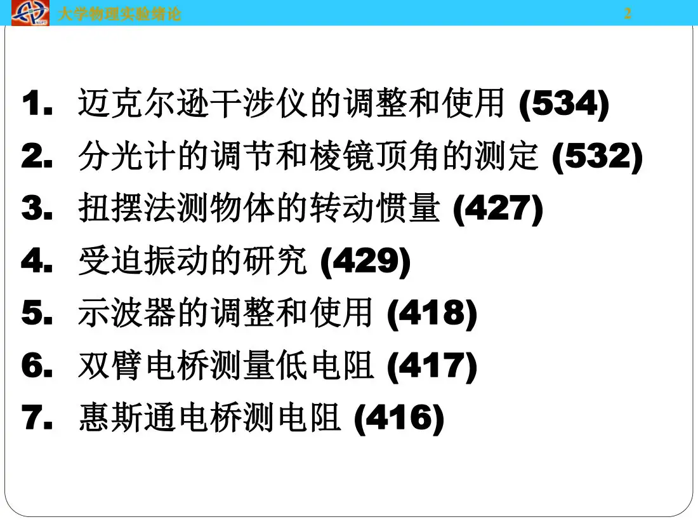

原文：

1. 迈克尔逊干涉仪的调整和使用 (534)
2. 分光计的调节和棱镜顶角的测定 (532)
3. 扭摆法测物体的转动惯量 (427)
4. 受迫振动的研究 (429)
5. 示波器的调整和使用 (418)
6. 双臂电桥测量低电阻 (417)
7. 惠斯通电桥测电阻 (416)

大学物理实验绪论

2

### 第一部分物理实验课的基本程序

原文：

第一部分物理实验课的基本程序

1 .实验前的预习

2 .实验的进行—中心环节

3 .实验后写实验报告

大学物理实验绪论

3

### 1 .实验前的预习

原文：

1 .实验前的预习

预习应做到以下几点：

认真阅读教材和有关参考书

弄清实验原理、方法和实验目的

充分了解实验理论依据和条件

提前进入实验室熟悉实验仪器

写出实验的预习报告

大学物理实验绪论

### 预习报告内容包括如下几方面：

原文：

预习报告内容包括如下几方面：

①实验名称；

②实验目的；

③实验仪器 (型号、规格等) ；

④实验原理：在理解的基础上，用简短的文字扼要阐述实验原理，切忌照抄。包含主要原理公式及简要说明，画出必要的原理图、电路图或光路图；

⑤列出记录实验数据的“原始数据的记录表格”。（画在报告册最后一页，注：用铅笔画以便修改）

未预习或未写好预习报告者，老师有权停止其实验或实验成绩降一档！

大学物理实验绪论

5

### 2 .实验的进行—中心环节

原文：

2 .实验的进行—中心环节

动手实验前

老师检查预习报告

交上次实验报告(学委收齐，按学号排好)

听老师讲解实验原理及注意事项等

动手实验

必须按操作规程使用仪器，不明确操作规程，千万不要动用仪器。

仔细观察和认真分析实验现象；准备就绪后再开始测量，要求实验者精力集中，仔细观察，精心操作

大学物理实验绪论

### 如实记录实验数据和现象；

原文：

如实记录实验数据和现象；

原始数据是指从仪器上直接读出而未经整理的数据，它是以后计算和分析问题的依据，在实际工作中则是宝贵的资料。应当一开始就记录在正式的记录纸上。

记录的内容包括： 日期、时间、地点、室温、气压、仪器编号、名称及规格、原始数据及有关现象

原始数据必须给教师审阅后签字！离开实验室前，要整理好所用的实验仪器，做好清洁工作。

大学物理实验绪论

7

### 3、实验后写实验报告

原文：

3、实验后写实验报告

实验报告是实验工作的总结，是学生实验成果的书面反映，要求文字通顺、字迹端正、图表规范、数据完备和结果正确。

要养成按时处理实验数据和交报告的习惯，对原始数据进行处理和分析，得出实验结果并进行不确定度评估和讨论。

大学物理实验绪论

### 实验报告的内容包括：

原文：

实验报告的内容包括：

1、 实验名称

2、实验目的：

3、实验仪器：

4、实验原理：

5、实验内容与步骤：

6、实验数据记录及处理：

7、讨论与分析。

此部分在实验前进行

此部分在实验后进行，紧接着“实验原理”写

大学物理实验绪论

### 实验内容与步骤：

原文：

实验内容与步骤：

重点写出“做什么，怎么做”实验数据记录及处理：

（1）重新规范合理地画出正式数据的表格（应与“原始数据的记录表格”不同）

（2）作图、计算结果和不确定度估算

（3）结果：按标准形式写出实验结果(测量值、不确定度和单位)，在必要时注明实验条件。

大学物理实验绪论

10

### 第二部分

原文：

第二部分

测量误差与不确定度评定

大学物理实验绪论

11

### 一、测量与单位

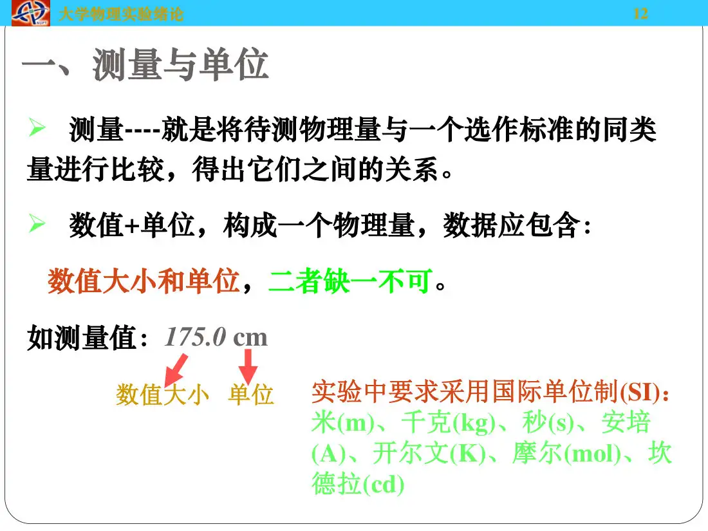

原文：

一、测量与单位

测量----就是将待测物理量与一个选作标准的同类量进行比较，得出它们之间的关系。

 数值+单位，构成一个物理量，数据应包含：

数值大小和单位，二者缺一不可。

如测量值：175.0 cm

数值大小 单位

实验中要求采用国际单位制(SI)：米(m)、千克(kg)、秒(s)、安培(A)、开尔文(K)、摩尔(mol)、坎德拉(cd)

大学物理实验绪论

12

### 二、测量的分类

原文：

二、测量的分类

按测量过程分：

直接测量

间接测量

直接测量----将待测量与定标的测量仪器或量具比较，直接读出待测物理量的量值。

间接测量----有些无法用仪表或量具直接测量的物理量只能通过对一些相关物理量的直接测量，再通过这些物理量间的一定的函数关系求出待测量的大小。

大学物理实验绪论

13

### 例：测量圆柱体的密度

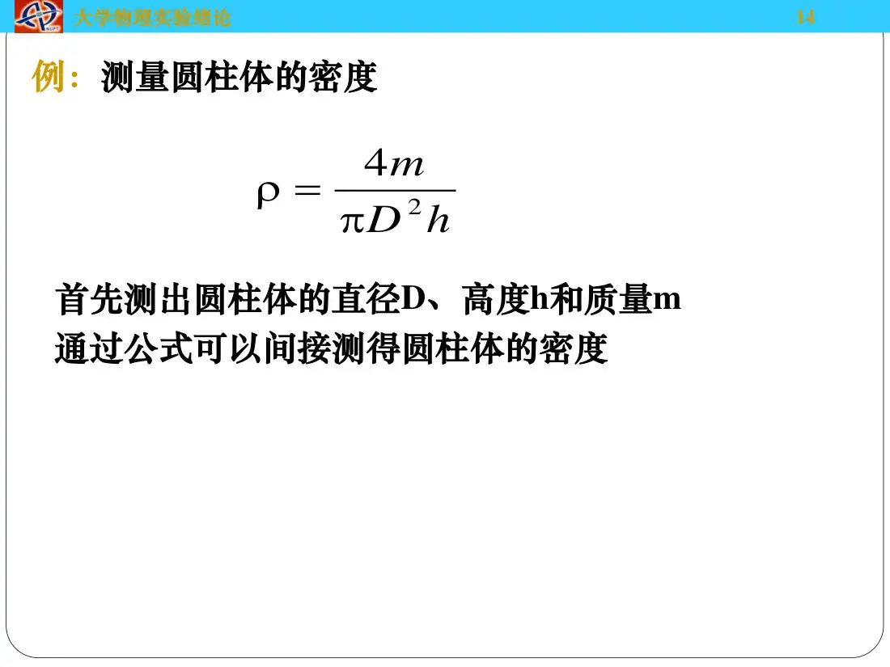

原文：

例：测量圆柱体的密度

$$
\rho = \frac {4 m}{\pi D ^ {2} h}
$$

首先测出圆柱体的直径D、高度h和质量m通过公式可以间接测得圆柱体的密度

大学物理实验绪论

14

### 三、有效数字的概念

原文：

三、有效数字的概念

测量值存在误差是不可避免的，因而测量值包含了准确数字和欠准数字。 我们将准确数字和欠准数字总称为有效数字。

在大学物理实验中，通常只取一位欠准数字。因此有效数字由若干位准确数字和一位欠准数字组成。

有效数字不仅反映了待测量的大小，正确书写的有效数字还可以反映测量的精确程度。

大学物理实验绪论

15

### 1).有效数字定义：

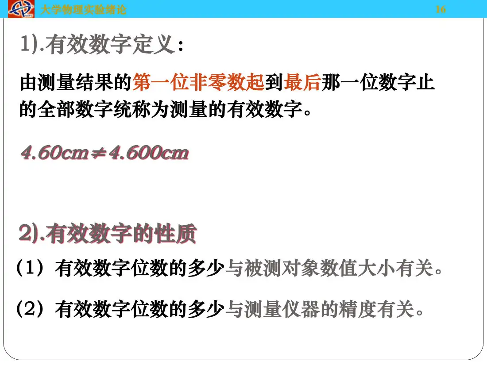

原文：

1).有效数字定义：

由测量结果的第一位非零数起到最后那一位数字止的全部数字统称为测量的有效数字。

$$
4. 6 0 \mathrm{cm} \neq 4. 6 0 0 \mathrm{cm}
$$

2).有效数字的性质

（1）有效数字位数的多少与被测对象数值大小有关。

（2）有效数字位数的多少与测量仪器的精度有关。

大学物理实验绪论

16

### 例如：用不同精度的量具测同一物体的长度。

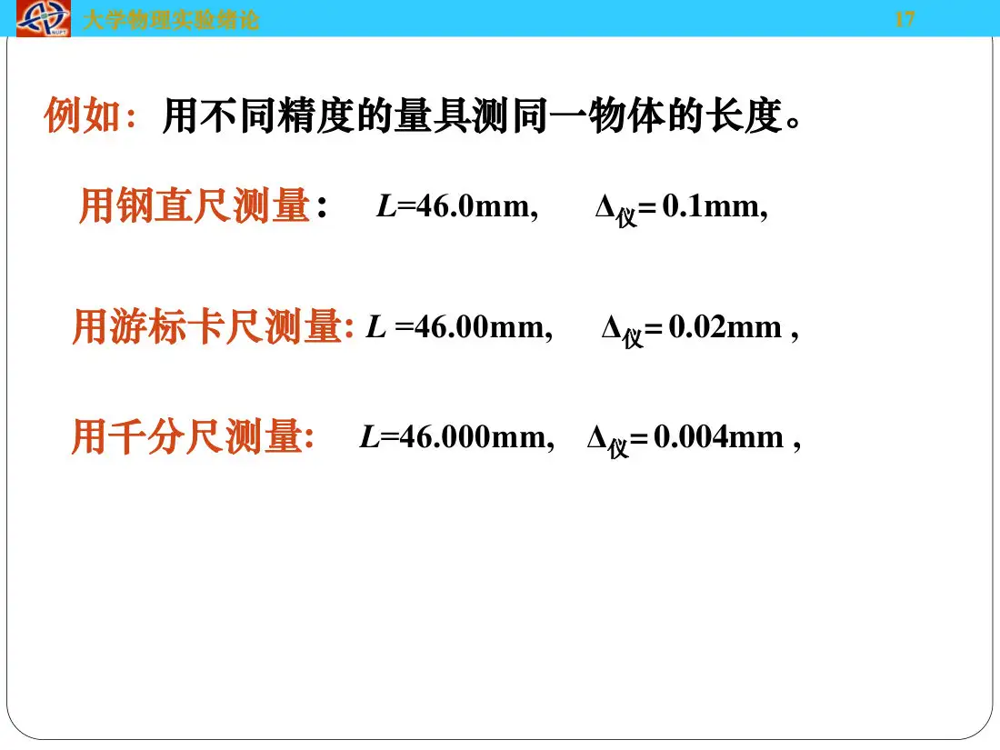

原文：

例如：用不同精度的量具测同一物体的长度。

用钢直尺测量： $\scriptstyle L = 4 6 . 0 \mathbf { m } \mathbf { m }$ $\Delta _ { \{ \chi } = 0 . 1 \mathrm { m m }$ の

用游标卡尺测量: $\pmb { L } = \pmb { 4 6 . 0 0 } \mathbf { m m }$ 9 $\Delta _ { i \backslash i } = 0 . 0 2 \mathrm { m m }$ ,

用千分尺测量: $\scriptstyle L = 4 6 . 0 0 0 { \mathrm { m m } }$ 19 $\Delta _ { i i } = 0 . 0 0 4 \mathrm { { m m } }$

大学物理实验绪论

17

### （3）有效数字位数与小数点的位置、单位无关。

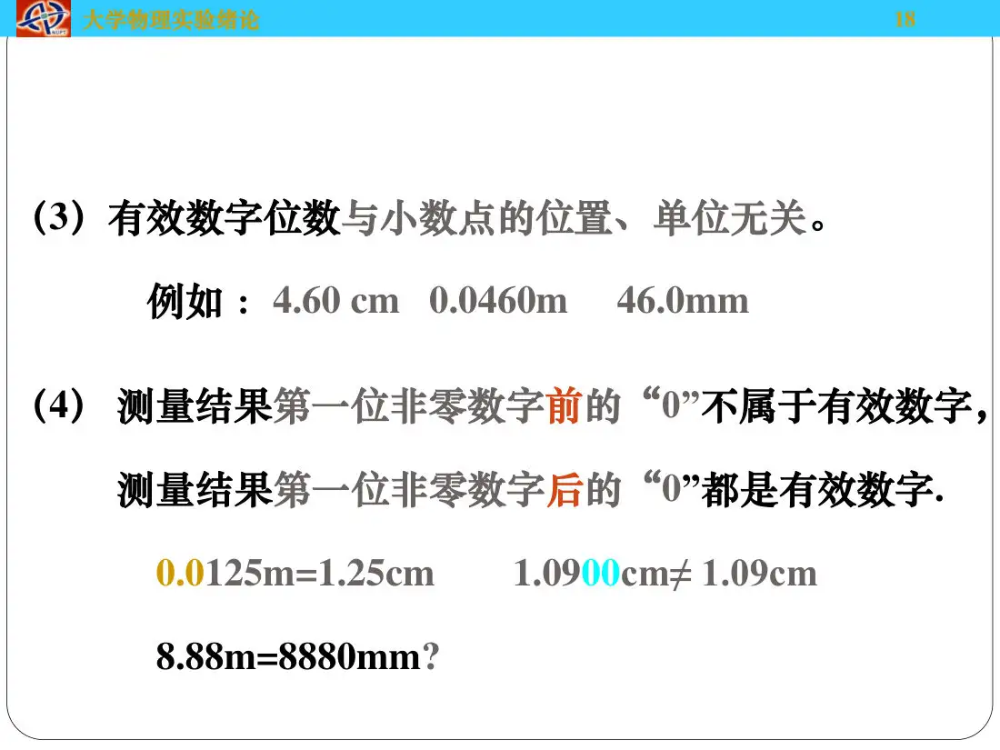

原文：

（3）有效数字位数与小数点的位置、单位无关。

例如 ：4.60 cm 0.0460m 46.0mm

（4） 测量结果第一位非零数字前的“0”不属于有效数字，测量结果第一位非零数字后的“0”都是有效数字.0.0125m=1.25cm 1.0900cm≠ 1.09cm8.88m=8880mm?

大学物理实验绪论

18

### 3). 科学记数法

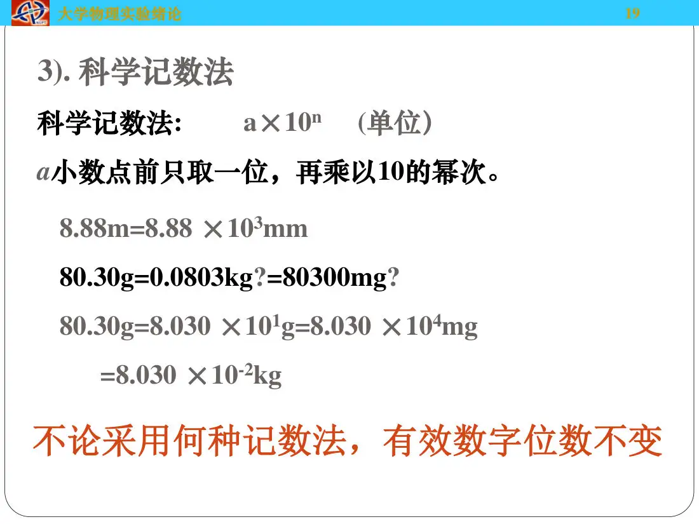

原文：

3). 科学记数法

科学记数法: $\mathbf { a } \times \mathbf { 1 0 ^ { n } }$ (单位）

a小数点前只取一位，再乘以10的幂次。

$$
\begin{array}{r l} 8 0. 3 0 \mathrm{g} & = 8. 0 3 0 \times 1 0 ^ {1} \mathrm{g} = 8. 0 3 0 \times 1 0 ^ {4} \mathrm{mg} \\ & = 8. 0 3 0 \times 1 0 ^ {- 2} \mathrm{kg} \end{array}
$$

不论采用何种记数法，有效数字位数不变

大学物理实验绪论

19

### 4). 有效数字的修约规则

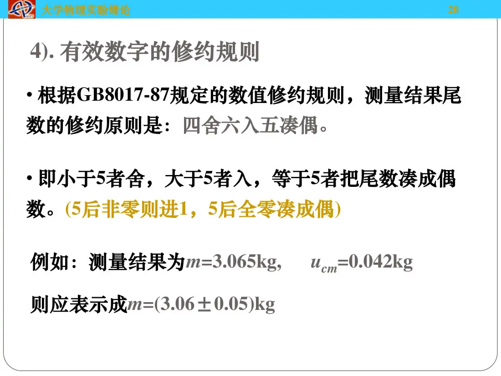

原文：

4). 有效数字的修约规则

• 根据GB8017-87规定的数值修约规则，测量结果尾数的修约原则是：四舍六入五凑偶。

• 即小于5者舍，大于5者入，等于5者把尾数凑成偶数。(5后非零则进1，5后全零凑成偶)

例如：测量结果为 $m { = } 3 . 0 6 5 \mathrm { k g } , ~ u _ { c m } { = } 0 . 0 4 2 \mathrm { k g }$ 则应表示成 $m { = } ( 3 . 0 6 \pm 0 . 0 5 ) \mathrm { k g }$

大学物理实验绪论

20

### 例如:

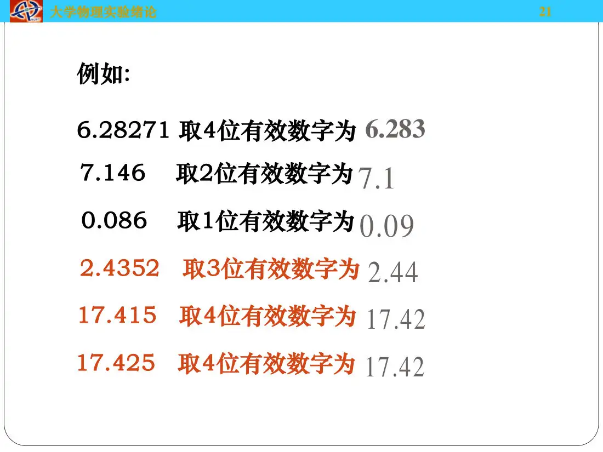

原文：

例如:

6.28271 取4位有效数字为 6.283
7.146 取2位有效数字为 7.1
0.086 取1位有效数字为 0.09
2.4352 取3位有效数字为 2.44
17.415 取4位有效数字为 17.42
17.425 取4位有效数字为 17.42

大学物理实验绪论

21

### 5).有效数字的运算法则

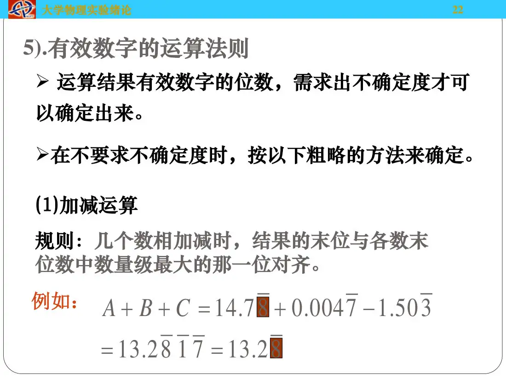

原文：

5).有效数字的运算法则

 运算结果有效数字的位数，需求出不确定度才可以确定出来。

在不要求不确定度时，按以下粗略的方法来确定。

(1)加减运算

规则：几个数相加减时，结果的末位与各数末位数中数量级最大的那一位对齐。

例如： $\begin{array} { l } { A + B + C = 1 4 . 7 ^ { \overline { { - } } } + 0 . 0 0 4 \overline { { 7 } } - 1 . 5 0 \overline { { 3 } } } \\ { = 1 3 . 2 \overline { { 8 } } \overline { { 1 } } \overline { { 7 } } = 1 3 . 2 \overline { { \perp } } } \end{array}$

大学物理实验绪论

22

### (2)乘除运算

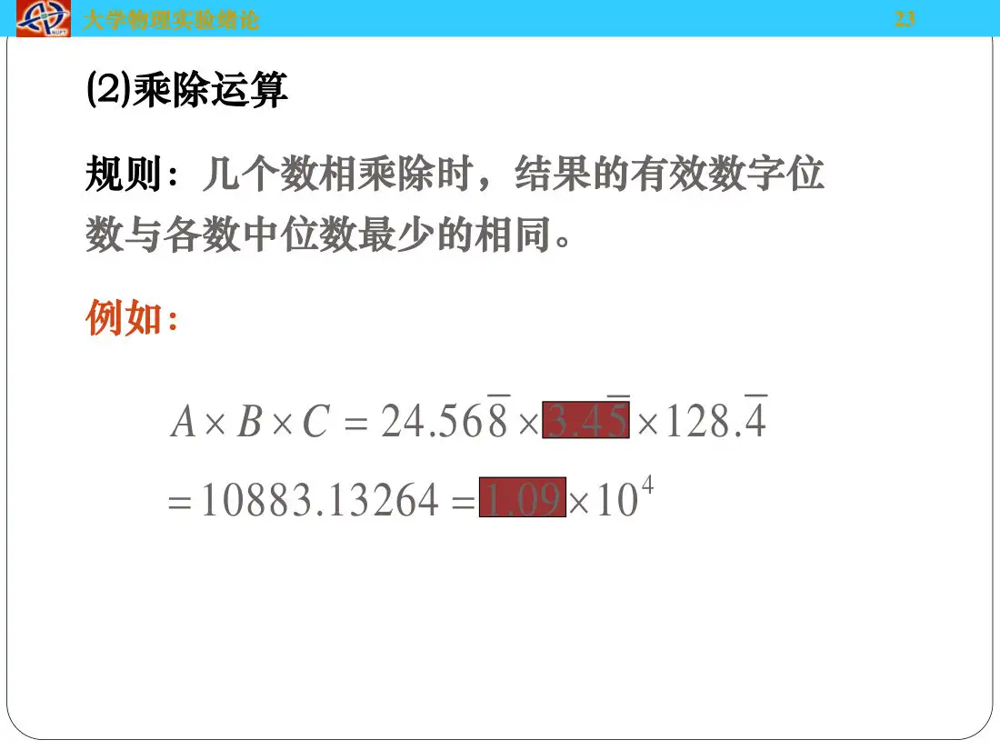

原文：

(2)乘除运算

规则：几个数相乘除时，结果的有效数字位数与各数中位数最少的相同。

例如：

$$
A \times B \times C = 2 4. 5 6 \overline {{8}} \times \boxed {3. 4 \overline {{5}}} \times 1 2 8. \overline {{4}}
$$

$$
= 1 0 8 8 3. 1 3 2 6 4 = \boxed {1. 0 9} \times 1 0 ^ {4}
$$

大学物理实验绪论

23

### 6)、直接测量量的有效数字读数原则

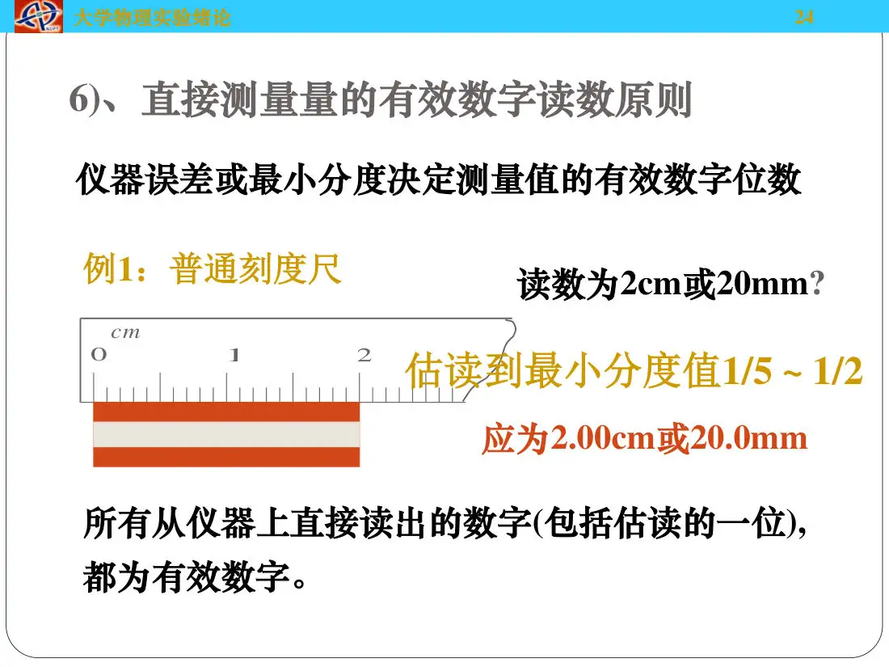

原文：

6)、直接测量量的有效数字读数原则

仪器误差或最小分度决定测量值的有效数字位数

读数为2cm或20mm?

估读到最小分度值1/5 \~ 1/2应为2.00cm或20.0mm

所有从仪器上直接读出的数字(包括估读的一位),都为有效数字。

大学物理实验绪论

24

### 例2：角游标尺

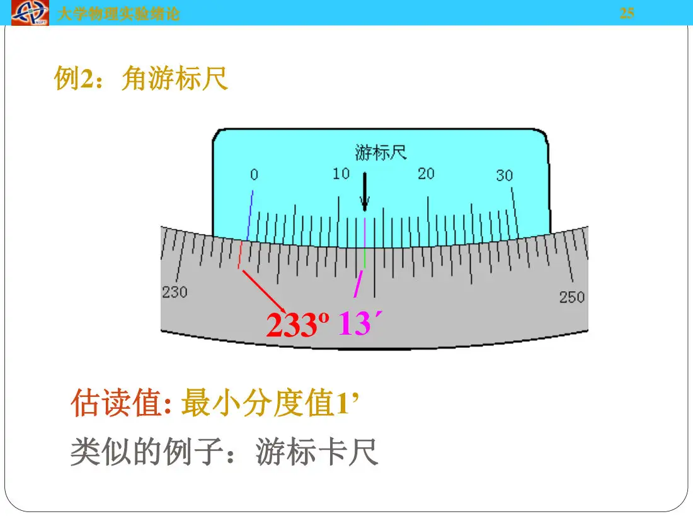

原文：

例2：角游标尺

估读值: 最小分度值1’类似的例子：游标卡尺

大学物理实验绪论

25

### 例3：数字表头的读数

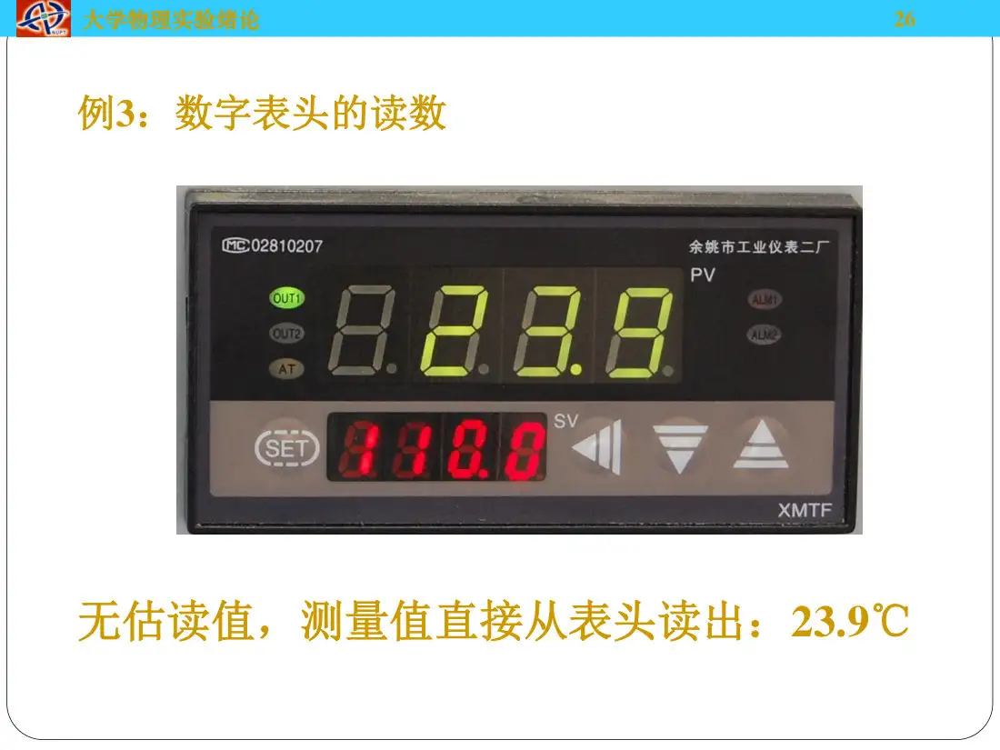

原文：

例3：数字表头的读数

无估读值，测量值直接从表头读出：23.9℃

大学物理实验绪论

26

### 四、误差与不确定度

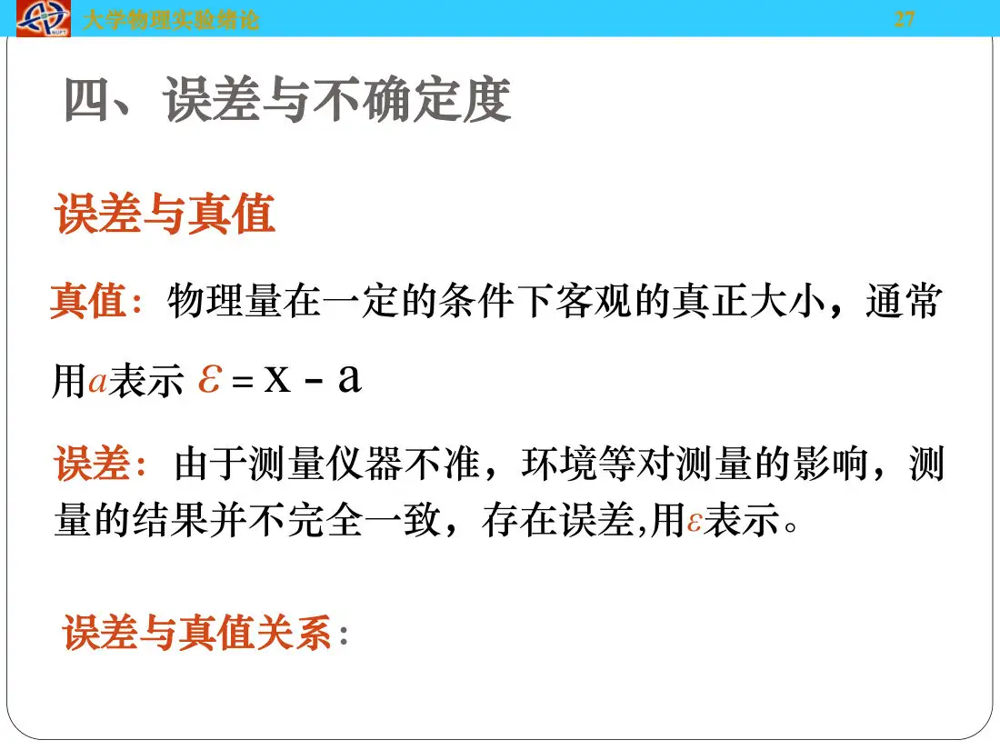

原文：

四、误差与不确定度

误差与真值

真值：物理量在一定的条件下客观的真正大小，通常用a表示 $\boldsymbol { \mathcal { E } } = \mathbf { X } - \mathbf { a }$

误差：由于测量仪器不准，环境等对测量的影响，测量的结果并不完全一致，存在误差,用ε表示。

误差与真值关系：

大学物理实验绪论

27

### 误差的分类

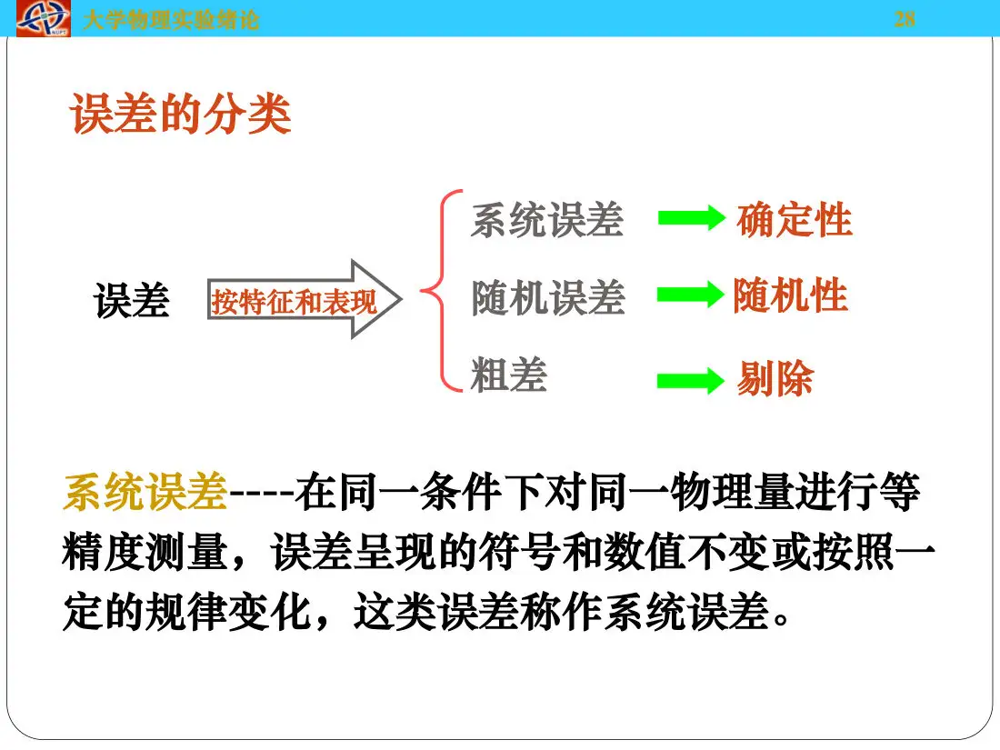

原文：

误差的分类

误差

按特征和表现

系统误差

随机误差

粗差

确定性

随机性

剔除

系统误差----在同一条件下对同一物理量进行等精度测量，误差呈现的符号和数值不变或按照一定的规律变化，这类误差称作系统误差。

大学物理实验绪论

28

### 不确定度

原文：

不确定度

1981年10月第十七届国际计量委员会大会通过决议，建议采用“不确定度”作为测量结果正确程度的评价。

★不确定度表示测量值可能变动（不能确定）的范围，也是与测量结果相关的一个参数，用于合理表示由于测量误差的存在而对被测量值的不能肯定的程度。

大学物理实验绪论

29

### 不确定度u包含两个方面

原文：

不确定度u包含两个方面

1. A类不确定度：多次重复测量后，用统计方法计算，用 $u _ { A }$ 表示

2.B类不确定度：用其它非统计方法估算的例如仪器误差、未定系统误差估值等，用 $u _ { B }$ 表示

3. 合成不确定度：A、 B两类不确定度合成，用合成不确定度作为测量值正确程度的评价

大学物理实验绪论

30

### A类不确定度的估算

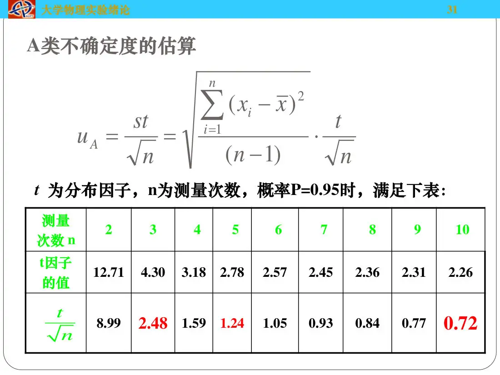

原文：

A类不确定度的估算

$$
u _ {A} = \frac {s t}{\sqrt {n}} = \sqrt {\frac {\sum_ {i = 1} ^ {n} (x _ {i} - \overline {{x}}) ^ {2}}{(n - 1)}} \cdot \frac {t}{\sqrt {n}}
$$

t 为分布因子，n为测量次数，概率P=0.95时，满足下表：

<table><tr><td>测量次数 n</td><td>2</td><td>3</td><td>4</td><td>5</td><td>6</td><td>7</td><td>8</td><td>9</td><td>10</td></tr><tr><td>t因子的值</td><td>12.71</td><td>4.30</td><td>3.18</td><td>2.78</td><td>2.57</td><td>2.45</td><td>2.36</td><td>2.31</td><td>2.26</td></tr><tr><td> $\frac{t}{\sqrt{n}}$ </td><td>8.99</td><td>2.48</td><td>1.59</td><td>1.24</td><td>1.05</td><td>0.93</td><td>0.84</td><td>0.77</td><td>0.72</td></tr></table>

大学物理实验绪论

31

### B类不确定度的估算

原文：

B类不确定度的估算

类不确定度是指用非统计方法计算的误差分量，它通常是指仪器误差和一些特殊估测的极限误差。

仪器误差：是指正确使用的情况下仪器示值的最大误差，通常用Δ表示。

仪器误差Δ通常用级别表示

$$
\mathrm{仪器误差} = \mathrm{级别} \times \mathrm{量程}
$$

仪器误差的具体计算可查阅所用仪器量具的使用说明。

大学物理实验绪论

32

### 将误差折算成B类不确定度

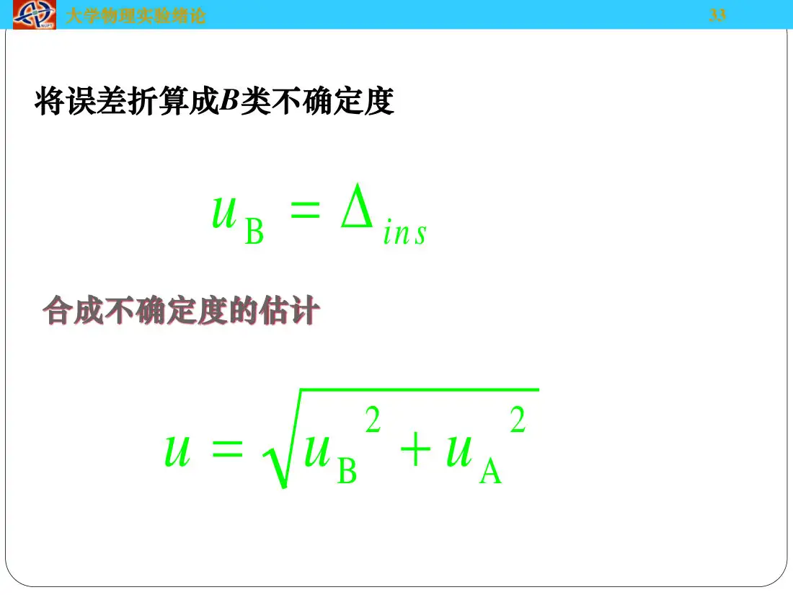

原文：

将误差折算成B类不确定度

$$
u _ {\mathrm{B}} = \Delta_ {i n s}
$$

合成不确定度的估计

$$
u = \sqrt {u _ {\mathrm{B}} ^ {2} + u _ {\mathrm{A}} ^ {2}}
$$

大学物理实验绪论

33

### 测量结果表示：

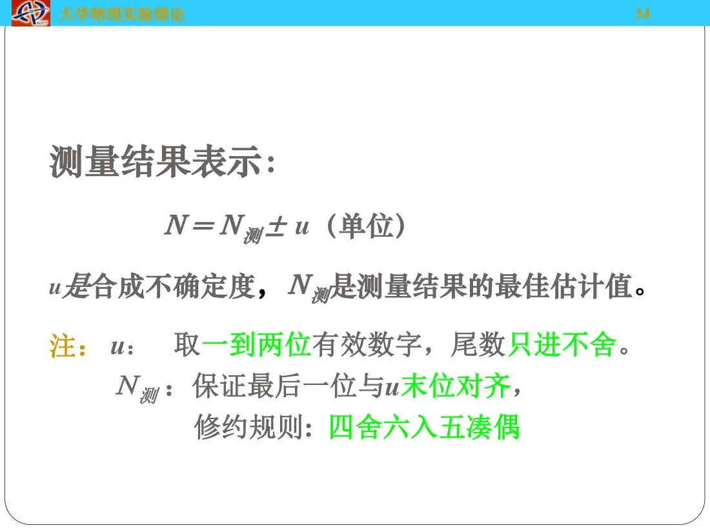

原文：

测量结果表示：

$$
N = N _ {\text {测}} \pm u (\text {单位})
$$

$u _ { . }$ 是合成不确定度， $N _ { i \backslash j }$ 是测量结果的最佳估计值。

u： 取一到两位有效数字，尾数只进不舍。注：

$N _ { \dot { \psi } \dot { \eta } \dot { y } }$ ：保证最后一位与u末位对齐，

修约规则: 四舍六入五凑偶

大学物理实验绪论

34

### 物理量的测量可分为单次测量和多次测量。

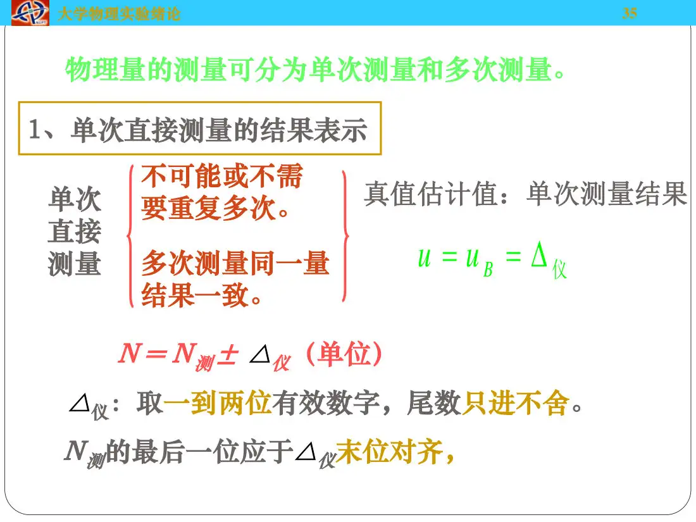

原文：

物理量的测量可分为单次测量和多次测量。

1、单次直接测量的结果表示

单次直接测量

不可能或不需要重复多次。

真值估计值：单次测量结果

多次测量同一量结果一致。

$$
u = u _ {B} = \Delta_ {\mathrm{仪}}
$$

$N { = } N _ { i i j } { \pm } \ A _ { i i }$ （单位）

$\Delta _ { \mathbb { X } }$ ：取一到两位有效数字，尾数只进不舍。

$N _ { i \backslash j }$ 的最后一位应于 $\varDelta _ { \mathcal { M } }$ 末位对齐，例1 用1.0级,量程为3.0V的电压表测量电压,单次测量测得电压为2.62V,写出结果表达式.

大学物理实验绪论

35

### $$

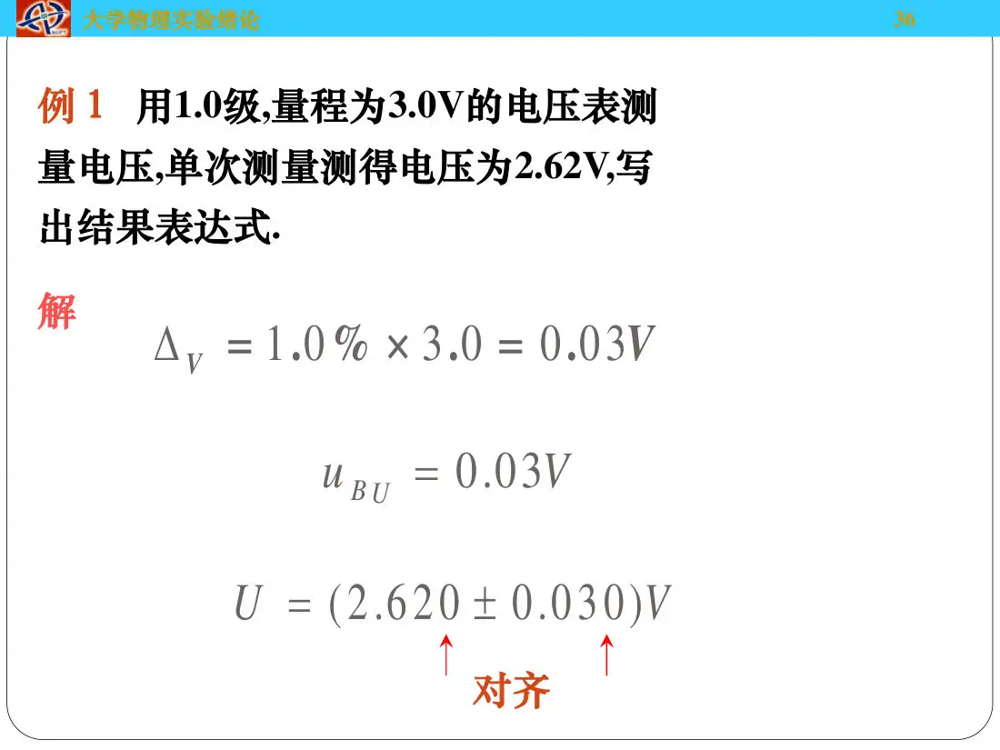

原文：

解

$$
\Delta_ {V} = 1.0 \% \times 3.0 = 0.03 V
$$

$$
u _ {B U} = 0. 0 3 V
$$

$$
U = (2. 6 2 0 \pm 0. 0 3 0) V _ {\text {对齐}}
$$

大学物理实验绪论

36

### 2、多次重复测量结果表示

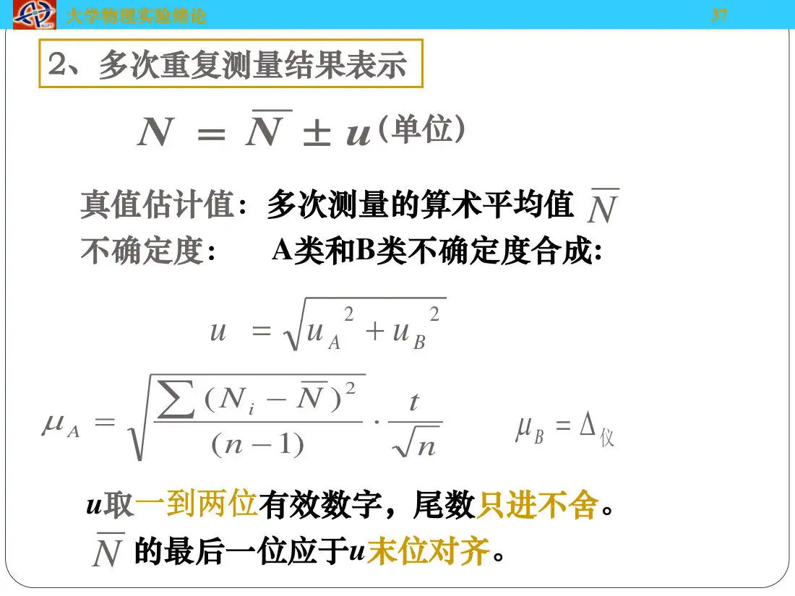

原文：

2、多次重复测量结果表示

$$
N = \overline {{N}} \pm u (\text {单位})
$$

真值估计值：多次测量的算术平均值 $\overline { { N } }$ 不确定度： A类和B类不确定度合成:

$$
u = \sqrt {u _ {A} ^ {2} + u _ {B} ^ {2}}
$$

$$
\mu_ {A} = \sqrt {\frac {\sum (N _ {i} - \overline {{{{N}}}}) ^ {2}}{(n - 1)}} \cdot \frac {t}{\sqrt {n}} \quad \mu_ {B} = \Delta_ {\text {仪}}
$$

u取一到两位有效数字，尾数只进不舍。$\overline { { N } }$ 的最后一位应于u末位对齐。

大学物理实验绪论

37

### 例2 用50分度的游标卡尺测量圆柱体直径10次，数据如下表。写出结果表达式。

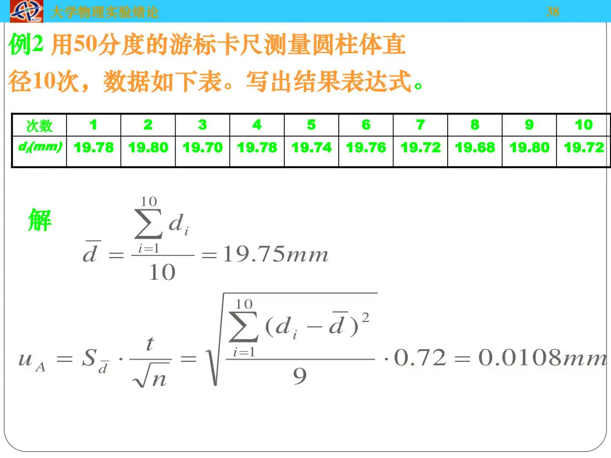

原文：

例2 用50分度的游标卡尺测量圆柱体直径10次，数据如下表。写出结果表达式。

<table><tr><td>次数</td><td>1</td><td>2</td><td>3</td><td>4</td><td>5</td><td>6</td><td>7</td><td>8</td><td>9</td><td>10</td></tr><tr><td> $d_{f}(mm)$ </td><td>19.78</td><td>19.80</td><td>19.70</td><td>19.78</td><td>19.74</td><td>19.76</td><td>19.72</td><td>19.68</td><td>19.80</td><td>19.72</td></tr></table>

解

$$
\overline {{d}} = \frac {\sum_ {i = 1} ^ {1 0} d _ {i}}{1 0} = 1 9. 7 5 m m
$$

$$
u _ {A} = S _ {\overline {{d}}} \cdot \frac {t}{\sqrt {n}} = \sqrt {\frac {\sum_ {i = 1} ^ {1 0} (d _ {i} - \overline {{d}}) ^ {2}}{9}} \cdot 0. 7 2 = 0. 0 1 0 8 m m
$$

大学物理实验绪论

38

### $$

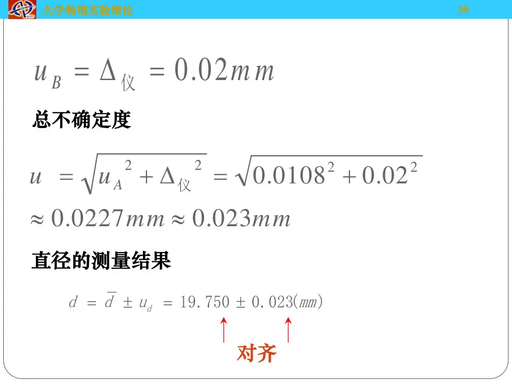

原文：

$$
u _ {B} = \Delta_ {\text {仪}} = 0. 0 2 m m
$$

总不确定度

$$
\begin{array}{r l} {u} & {= \sqrt {u _ {_ A} ^ {2} + \Delta_ {_ \text {仪}} ^ {2}} = \sqrt {0 . 0 1 0 8 ^ {2} + 0 . 0 2 ^ {2}}} \\ & {\approx 0. 0 2 2 7 m m \approx 0. 0 2 3 m m} \end{array}
$$

直径的测量结果

$$
d = \overline {{d}} \pm u _ {d} = 1 9. 7 5 0 \pm 0. 0 2 3 (m m) \uparrow_ {\text {对齐}}
$$

大学物理实验绪论

39

### 测量结果的相对不确定度表示法

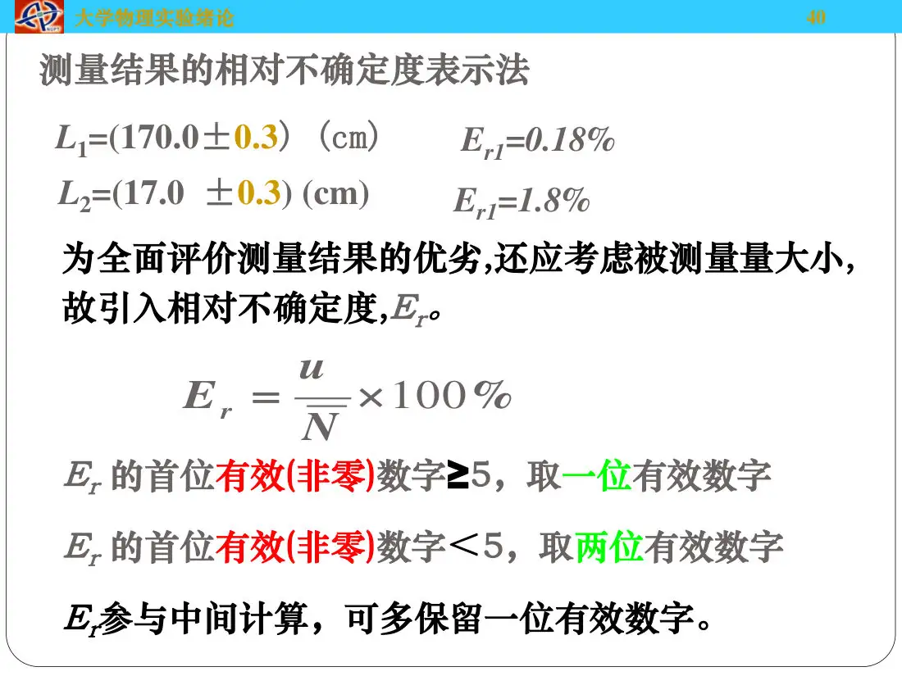

原文：

测量结果的相对不确定度表示法

$$
\begin{array}{l l} L _ {1} = (1 7 0. 0 \pm 0. 3) (\mathrm{cm}) & E _ {r 1} = 0. 18 \% \\ L _ {2} = (1 7. 0 \pm 0. 3) (\mathrm{cm}) & E _ {r 1} = 1. 8 \% \end{array}
$$

为全面评价测量结果的优劣,还应考虑被测量量大小,故引入相对不确定度, $E _ { r }$ 。

$$
E _ {r} = \frac {u}{\overline {{N}}} \times 100 \%
$$

$E _ { r }$ 的首位有效(非零)数字≥5，取一位有效数字$E _ { r }$ 的首位有效(非零)数字＜5，取两位有效数字$E _ { r }$ 参与中间计算，可多保留一位有效数字。

大学物理实验绪论

40

### (3) 百分差

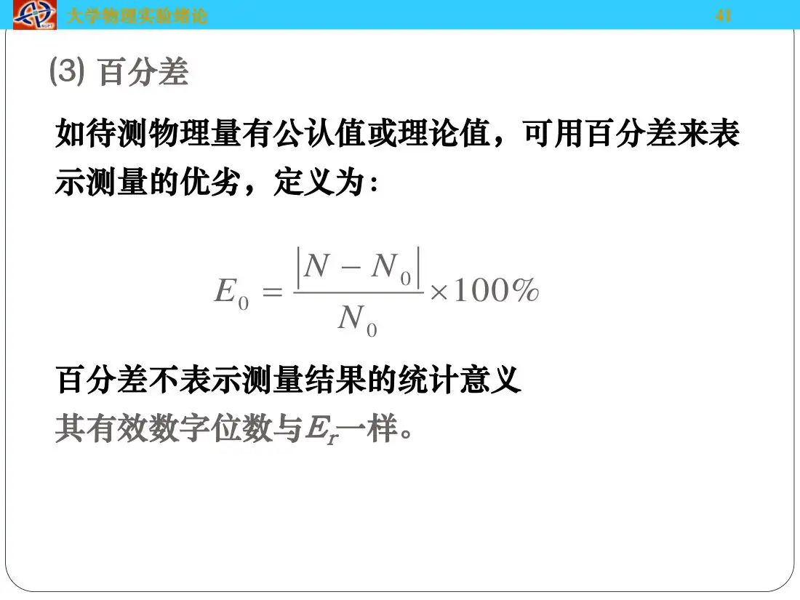

原文：

(3) 百分差

如待测物理量有公认值或理论值，可用百分差来表示测量的优劣，定义为：

$$
E _ {0} = \frac {\left| N - N _ {0} \right|}{N _ {0}} \times 100 \%
$$

百分差不表示测量结果的统计意义其有效数字位数与 $E _ { i }$ 一样。

大学物理实验绪论

41

### 相对不确定度或百分差修约时末位数也只进不舍

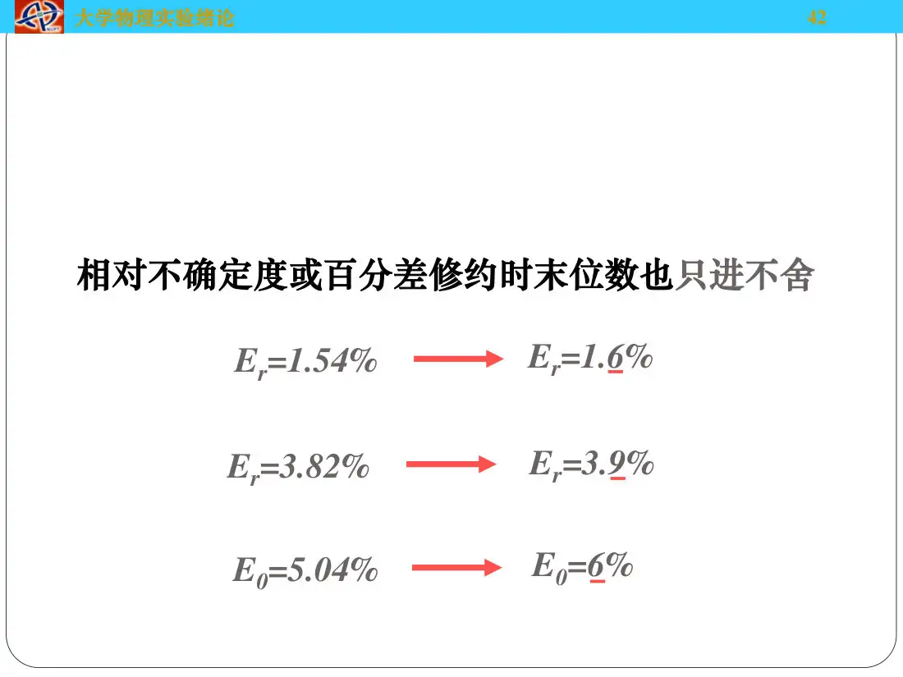

原文：

相对不确定度或百分差修约时末位数也只进不舍

$$
E _ {r} = 1.54 \% \quad \longrightarrow \quad E _ {r} = 1.6 \%
$$

$$
E _ {r} = 3.82 \% \longrightarrow E _ {r} = 3.9 \%
$$

$$
E _ {0} = 5.04 \% \longrightarrow E _ {0} = 6 \%
$$

大学物理实验绪论

42

### 间接测量量的测量结果表示

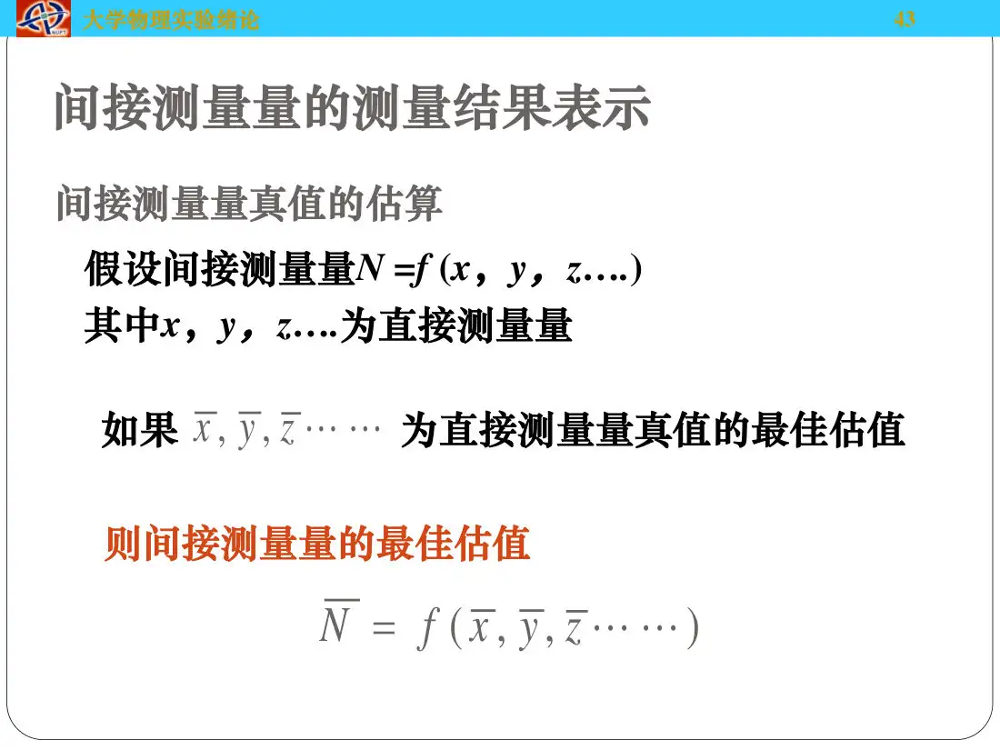

原文：

间接测量量的测量结果表示

间接测量量真值的估算

假设间接测量量 $N = f ( x , \ y , \ z . . . . )$

其中 $x , \ y , \ z \ldots$ 为直接测量量

如果 ${ \overline { { x } } } , { \overline { { y } } } , { \overline { { z } } } \cdots \cdots$ 为直接测量量真值的最佳估值

则间接测量量的最佳估值

$$
\overline {{N}} = f (\overline {{x}}, \overline {{y}}, \overline {{z}} \dots \dots)
$$

大学物理实验绪论

43

### 间接测量量不确定度的估算

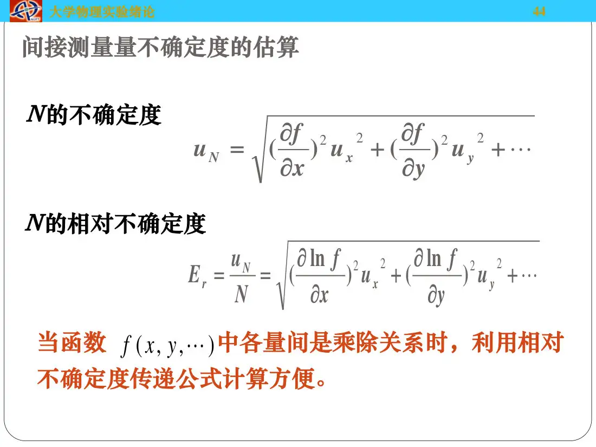

原文：

间接测量量不确定度的估算

的不确定度

$$
\boldsymbol {u} _ {N} = \sqrt {\left(\frac {\partial f}{\partial x}\right) ^ {2} \boldsymbol {u} _ {x} ^ {2} + \left(\frac {\partial f}{\partial y}\right) ^ {2} \boldsymbol {u} _ {y} ^ {2} + \cdots}
$$

的相对不确定度

$$
E _ {r} = \frac {\boldsymbol {u} _ {N}}{N} = \sqrt {(\frac {\partial \ln f}{\partial x}) ^ {2} \boldsymbol {u} _ {x} ^ {2} + (\frac {\partial \ln f}{\partial y}) ^ {2} \boldsymbol {u} _ {y} ^ {2} + \cdots}
$$

当函数 $f ( x , y , \cdots )$ 中各量间是乘除关系时，利用相对不确定度传递公式计算方便。

大学物理实验绪论

44

### 间接测量的结果表示

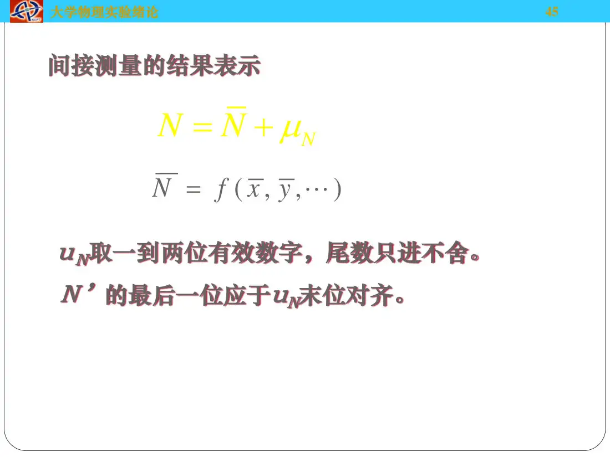

原文：

间接测量的结果表示

$$
N = \overline {{N}} + \mu_ {N}
$$

$$
\overline {{N}} = f (\overline {{x}}, \overline {{y}}, \dots)
$$

$u _ { N }$ 取一到两位有效数字，尾数只进不舍。

$N ^ { \flat }$ 的最后一位应于 $u _ { N }$ 末位对齐。

大学物理实验绪论

45

### ★间接测量结果不确定度的计算过程

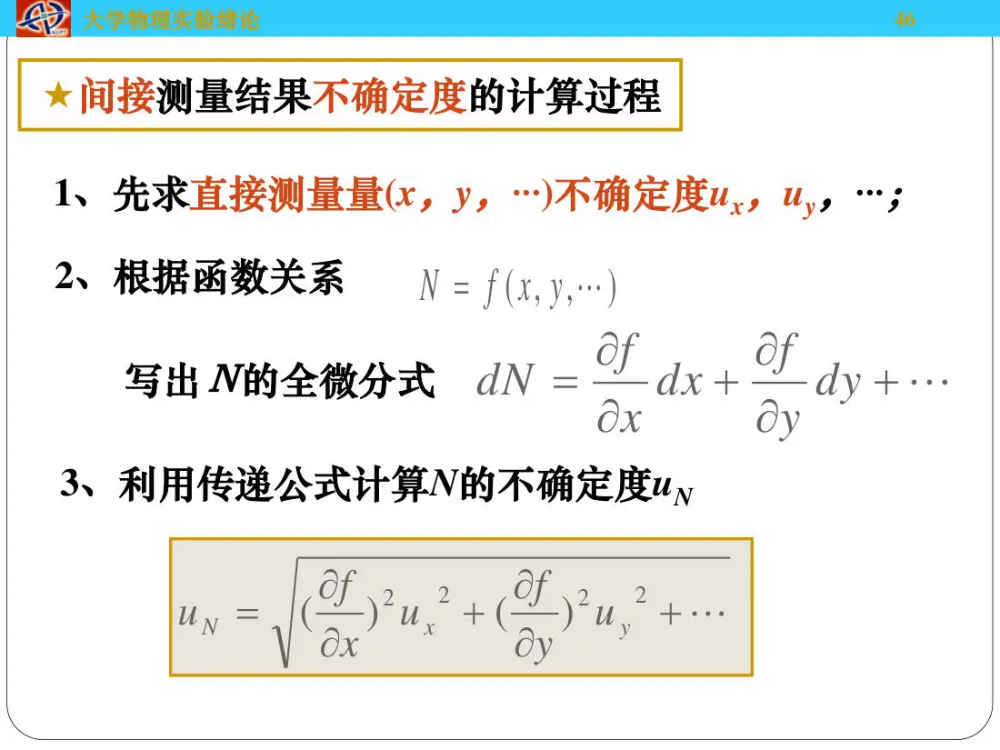

原文：

★间接测量结果不确定度的计算过程

1、先求直接测量量 $( x , \ y , \cdot \circ )$ 不确定度 $u _ { x } , \ u _ { y } , \quad \cdots { }$

2、根据函数关系 $N = f ( x , y , \cdots )$

写出N的全微分式 $d N = \frac { \partial f } { \partial x } d x + \frac { \partial f } { \partial y } d y + \cdots$

3、利用传递公式计算N的不确定度 $\mathbf { \dot { \mu } } _ { M _ { N } }$

$$
u _ {N} = \sqrt {\left(\frac {\partial f}{\partial x}\right) ^ {2} u _ {x} ^ {2} + \left(\frac {\partial f}{\partial y}\right) ^ {2} u _ {y} ^ {2} + \cdots}
$$

大学物理实验绪论

46

### ★间接测量结果相对不确定度的计算过程

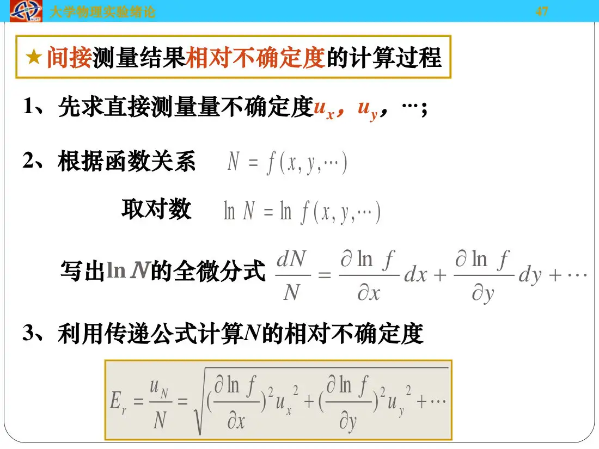

原文：

★间接测量结果相对不确定度的计算过程

1、先求直接测量量不确定度 $u _ { x } , \ u _ { y } , \quad \cdot \cdot ;$

2、根据函数关系 $N = f ( x , y , \cdots )$

取对数 ln ${ \mathfrak { N } } = \ln f ( x , y , \cdots )$

写出lnN的全微分式 $\frac { d N } { N } = \frac { \partial \ln f } { \partial x } d x + \frac { \partial \ln f } { \partial y } d y + \cdots$

3、利用传递公式计算N的相对不确定度

$$
E _ {r} = \frac {u _ {N}}{N} = \sqrt {\left(\frac {\partial \ln f}{\partial x}\right) ^ {2} u _ {x} ^ {2} + \left(\frac {\partial \ln f}{\partial y}\right) ^ {2} u _ {y} ^ {2} + \cdots}
$$

大学物理实验绪论

47

### 解: 由

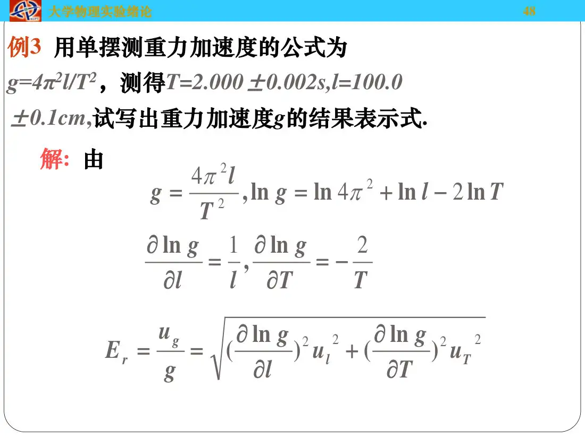

原文：

例3 用单摆测重力加速度的公式为$g { = } 4 \pi ^ { 2 } l / T ^ { 2 }$ ，测得 $T = 2 . 0 0 0 \pm 0 . 0 0 2 s , l = I 0 0 . 0$ $\pm 0 . l c m$ ,试写出重力加速度 $\mathbf { \hat { g } }$ 的结果表示式.

解: 由

$$
g = \frac {4 \pi^ {2} l}{T ^ {2}}, \ln g = \ln 4 \pi^ {2} + \ln l - 2 \ln T
$$

$$
\frac {\partial \ln g}{\partial l} = \frac {1}{l}, \frac {\partial \ln g}{\partial T} = - \frac {2}{T}
$$

$$
E _ {r} = \frac {\boldsymbol {u} _ {g}}{\boldsymbol {g}} = \sqrt {(\frac {\partial \ln \boldsymbol {g}}{\partial l}) ^ {2} \boldsymbol {u} _ {l} ^ {2} + (\frac {\partial \ln \boldsymbol {g}}{\partial T}) ^ {2} \boldsymbol {u} _ {T} ^ {2}}
$$

大学物理实验绪论

48

### $$

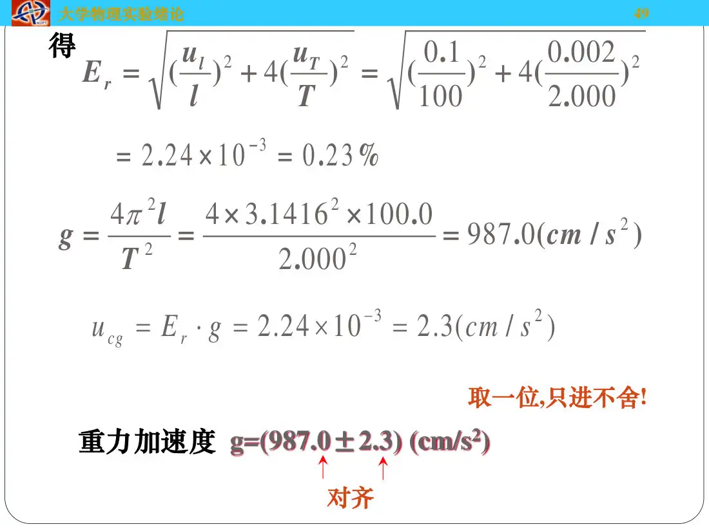

原文：

得

$$
\begin{array}{l}E_{r} = \sqrt{\left(\frac{u_{l}}{l}\right)^{2} + 4\left(\frac{u_{T}}{T}\right)^{2}} = \sqrt{\left(\frac{0.1}{100}\right)^{2} + 4\left(\frac{0.002}{2.000}\right)^{2}}\\ = 2.24\times 10^{-3} = 0.23\% \end{array}
$$

$$
g = \frac {4 \pi^ {2} l}{T ^ {2}} = \frac {4 \times 3 . 1 4 1 6 ^ {2} \times 1 0 0 . 0}{2 . 0 0 0 ^ {2}} = 9 8 7. 0 (c m / s ^ {2})
$$

$$
u _ {c g} = E _ {r} \cdot g = 2. 2 4 \times 1 0 ^ {- 3} = 2. 3 (c m / s ^ {2})
$$

取一位,只进不舍!

重力加速度 $\begin{array} { c } { { \underline { { { \bf g } } } { = } ( 9 8 7 . 0 { \pm } 2 . 3 ) ( { \bf c m / s ^ { 2 } } ) } } \\ { { \uparrow \qquad \uparrow \qquad } } \\ { { \vec { x } \yen \nmid \vec { x } \nmid } } \end{array}$

49

大学物理实验绪论

### 第三部分

原文：

第三部分

数据处理的基本方法

大学物理实验绪论

50

### 一、列表法

原文：

一、列表法

列表记录和处理数据时，应注意

1、表格设计要合理，要简单明了，能完整地记录实验数据。物理量的排列应与测量顺序一致。

2、各标题栏中应注明所列物理量的名称、符号和单位（数据不要重复书写单位）。

3、表中数据要正确反映测量的有效数字。

大学物理实验绪论

51

### 5、表格中所列的主要是原始数据，重要的中间计算结果也可列入。

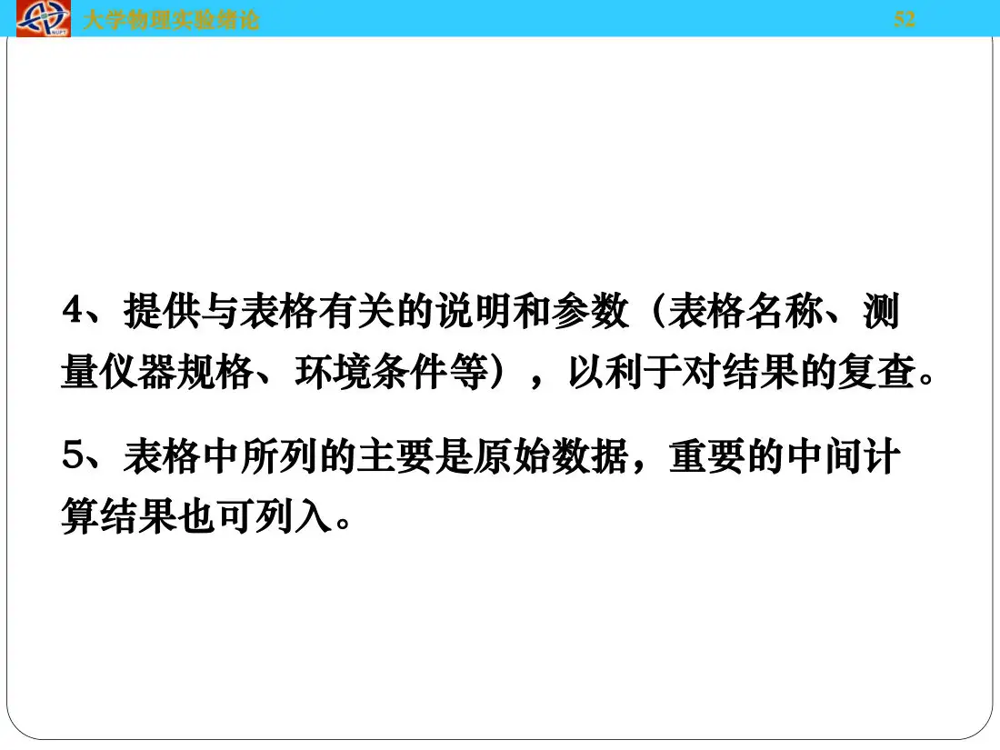

原文：

4、提供与表格有关的说明和参数（表格名称、测量仪器规格、环境条件等），以利于对结果的复查。

5、表格中所列的主要是原始数据，重要的中间计算结果也可列入。

大学物理实验绪论

52

### 举例----测钢丝直径

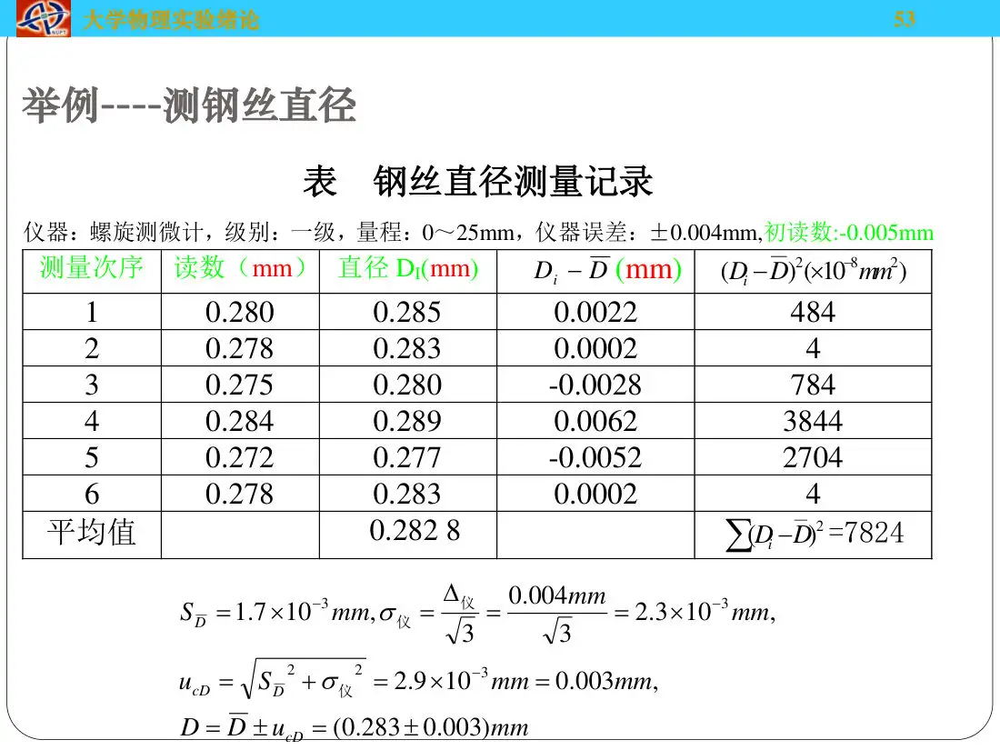

原文：

举例----测钢丝直径

表 钢丝直径测量记录

仪器：螺旋测微计，级别：一级，量程：0～25mm，仪器误差： $\pm 0 . 0 0 4 \mathrm { m m } ,$ ,初读数:-0.005mm

<table><tr><td>测量次序</td><td>读数(mm)</td><td>直径 $D_I$ (mm)</td><td> $D_i - \overline{D}$ (mm)</td><td> $(D_i - \overline{D})^2 (\times 10^{-8} mm^2)$ </td></tr><tr><td>1</td><td>0.280</td><td>0.285</td><td>0.0022</td><td>484</td></tr><tr><td>2</td><td>0.278</td><td>0.283</td><td>0.0002</td><td>4</td></tr><tr><td>3</td><td>0.275</td><td>0.280</td><td>-0.0028</td><td>784</td></tr><tr><td>4</td><td>0.284</td><td>0.289</td><td>0.0062</td><td>3844</td></tr><tr><td>5</td><td>0.272</td><td>0.277</td><td>-0.0052</td><td>2704</td></tr><tr><td>6</td><td>0.278</td><td>0.283</td><td>0.0002</td><td>4</td></tr><tr><td>平均值</td><td></td><td>0.2828</td><td></td><td> $\sum (D_i - \overline{D})^2 = 7824$ </td></tr></table>

$$
S _ {\overline {{D}}} = 1. 7 \times 1 0 ^ {- 3} m m, \sigma_ {\text {仪}} = \frac {\Delta_ {\text {仪}}}{\sqrt {3}} = \frac {0 . 0 0 4 m m}{\sqrt {3}} = 2. 3 \times 1 0 ^ {- 3} m m,
$$

$$
u _ {c D} = \sqrt {S _ {\overline {{{D}}}} ^ {2} + \sigma_ {\text {仪}} ^ {2}} = 2. 9 \times 1 0 ^ {- 3} m m = 0. 0 0 3 m m,
$$

$$
D = \overline {{D}} \pm u _ {c D} = (0. 2 8 3 \pm 0. 0 0 3) m m
$$

大学物理实验绪论

53

### 二.作图法

原文：

二.作图法

作图法就是通过图线将物理量之间的关系直观地表示出来的方法。

作好一张正确、实用、美观的图是实验技能训练中的一项基本功。

实验作图不是示意图，而是用图来表达实验中得到的物理量之间的定量关系，要反映测量的准确程度，必须满足一定的作图规则。

大学物理实验绪论

54

### 作图的基本规则

原文：

作图的基本规则

1、有完整列有数据的表格。

2、选用合适的坐标纸

作图必须用坐标纸。

根据需要选用合适种类和大小的坐标纸。

物理实验中常用的是直角坐标纸（毫米方格纸）

大学物理实验绪论

55

### L (cm )

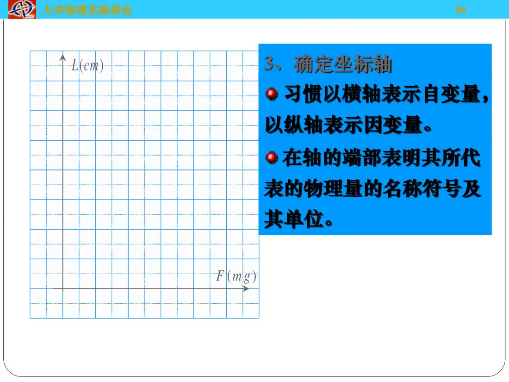

原文：

L (cm )

F ( m g )

3、确定坐标轴

习惯以横轴表示自变量，以纵轴表示因变量。

在轴的端部表明其所代表的物理量的名称符号及其单位。

大学物理实验绪论

56

### L (cm )

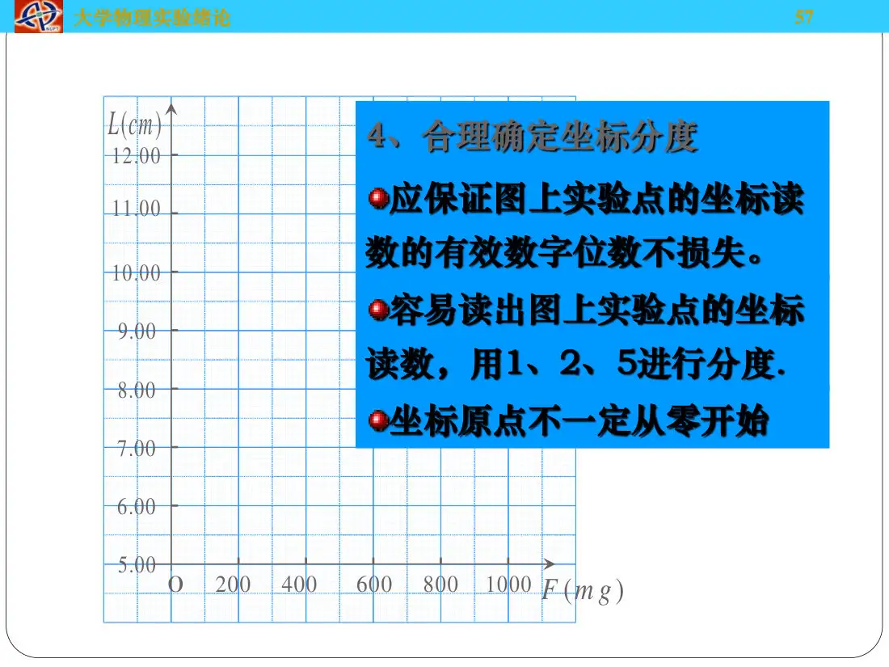

原文：

L (cm )

12.00

11.00

10.00

9.00

8.00

7.00

6.00

5.00

4、合理确定坐标分度

应保证图上实验点的坐标读数的有效数字位数不损失。

容易读出图上实验点的坐标读数，用1、2、5进行分度.

坐标原点不一定从零开始

0 F (m g )200 400 600 800 1000

大学物理实验绪论

57

### 12.00

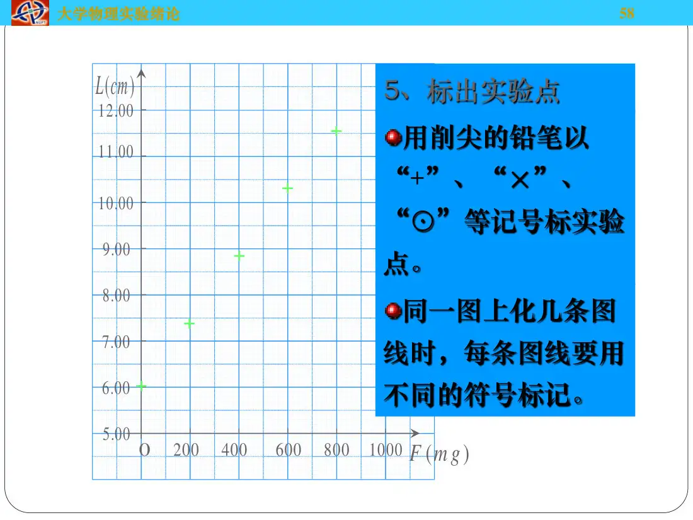

原文：

12.00

11.00

10.00

9.00

8.00

7.00

6.00

5.00

5、标出实验点

用削尖的铅笔以

“

等记号标实验点。

同一图上化几条图线时，每条图线要用不同的符号标记。

F (m g )0 200 400 600 800 1000

大学物理实验绪论

58

### 6、连接实验曲线

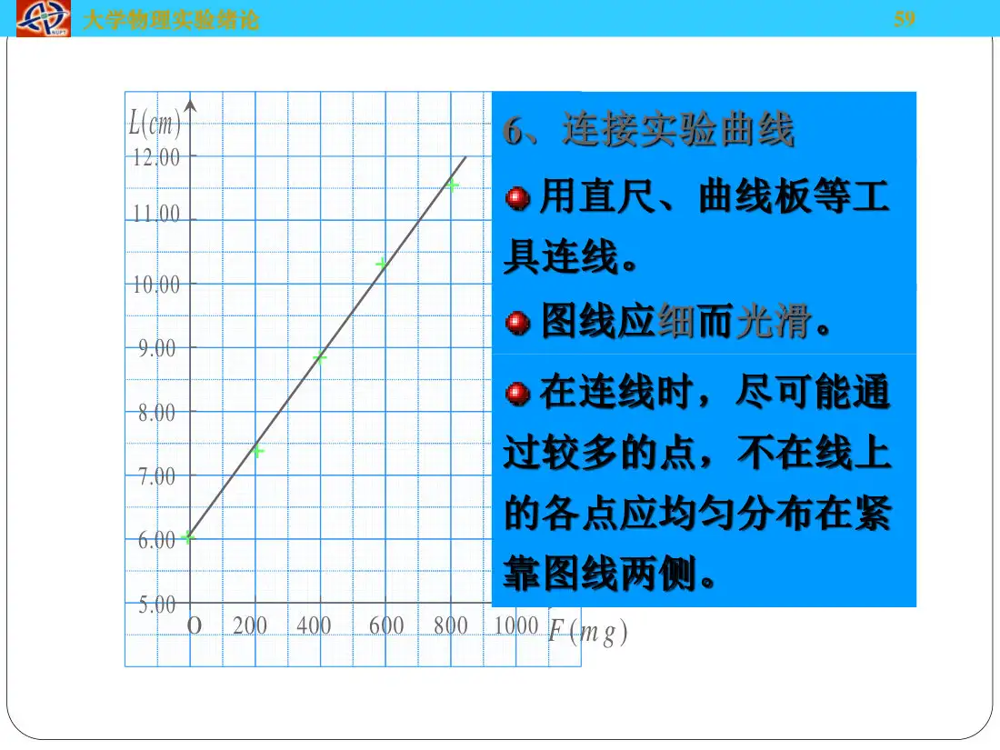

原文：

6、连接实验曲线

用直尺、曲线板等工具连线。

图线应细而光滑。

在连线时，尽可能通过较多的点，不在线上的各点应均匀分布在紧靠图线两侧。

F (m g )0 200 400 600 800 1000

大学物理实验绪论

59

### 12.00

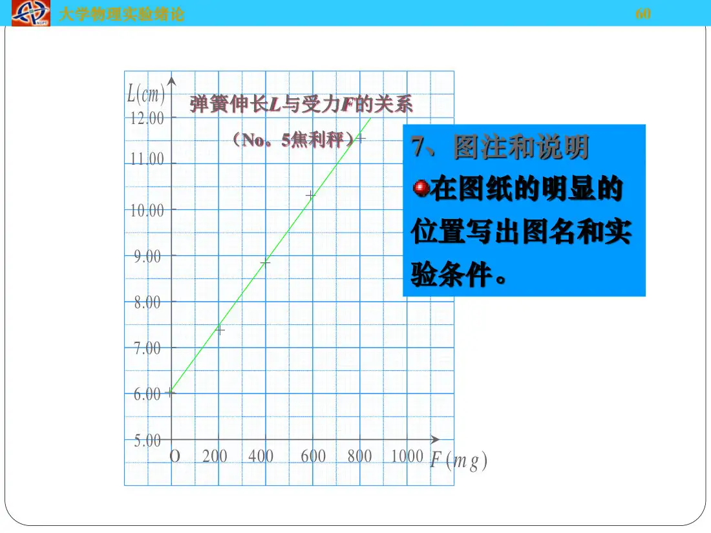

原文：

12.00

11.00

10.00

9.00

8.00

7.00

6.00

5.00

弹簧伸长L与受力F的关系

（No。5焦利秤）

7、图注和说明在图纸的明显的位置写出图名和实验条件。

F (m g )0 200 400 600 800 1000

大学物理实验绪论

60

### 图解法

原文：

图解法

利用已作好的图线，定量地求得待测量或得出相关量的经验公式的方法。

当图线是直线时，尤为方便。

直线图线的图解步骤：

大学物理实验绪论

61

### 设直线方程为： $y = a + b x$

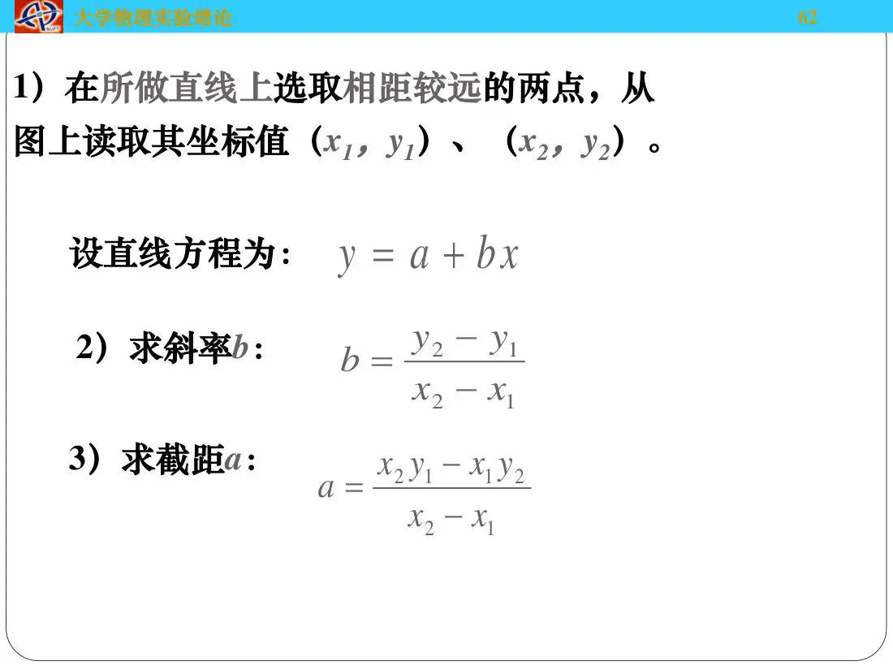

原文：

1）在所做直线上选取相距较远的两点，从 图上读取其坐标值 $( x _ { I } , \ y _ { I } ) \ , ( x _ { 2 } , \ y _ { 2 } )$ 。

设直线方程为： $y = a + b x$

2）求斜率b：

$$
b = \frac {y _ {2} - y _ {1}}{x _ {2} - x _ {1}}
$$

3）求截距a：

$$
a = \frac {x _ {2} y _ {1} - x _ {1} y _ {2}}{x _ {2} - x _ {1}}
$$

大学物理实验绪论

62

### 11.00

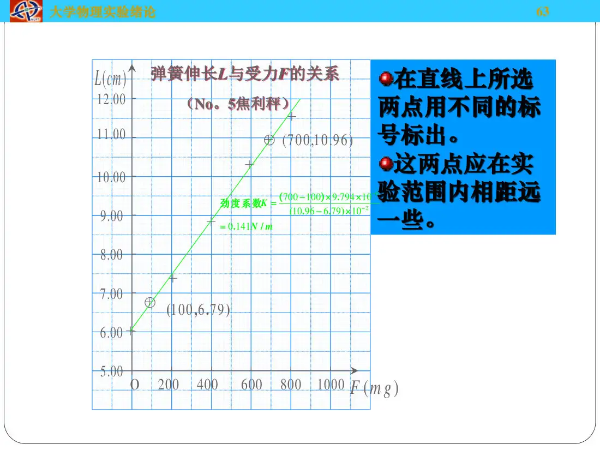

原文：

11.00

10.00

9.00

8.00

7.00

弹簧伸长L与受力F的关系

(700,10.96)

（No。5焦利秤）

(700-100)×9.794×10 K劲度系数 ( . . )10 96 6 79 10 2  

6.00

N m. /0 141

5.00

(100 ,6.79 )

F (m g )0 200 400 600 800 1000

在直线上所选两点用不同的标号标出。

这两点应在实验范围内相距远6一些。

大学物理实验绪论

63

### 大学物理实验绪论

原文：

由于绘制图线有一定主观随意性，用此法求值比较粗糙，只用有效数字粗略地表示其准确度，不需要计算结果的不确定度。

大学物理实验绪论

64

### 三、逐差法

原文：

三、逐差法

逐差法是物理实验中常用的数据处理方法之一，常用于处理自变量等间距变化的数据。

逐差法：

把实验数据列成表格进行逐次项减可验证数据变化的规律。

分成高、低两组对应项相减。

可充分利用数据，减少测量误差。

大学物理实验绪论

65

### $$

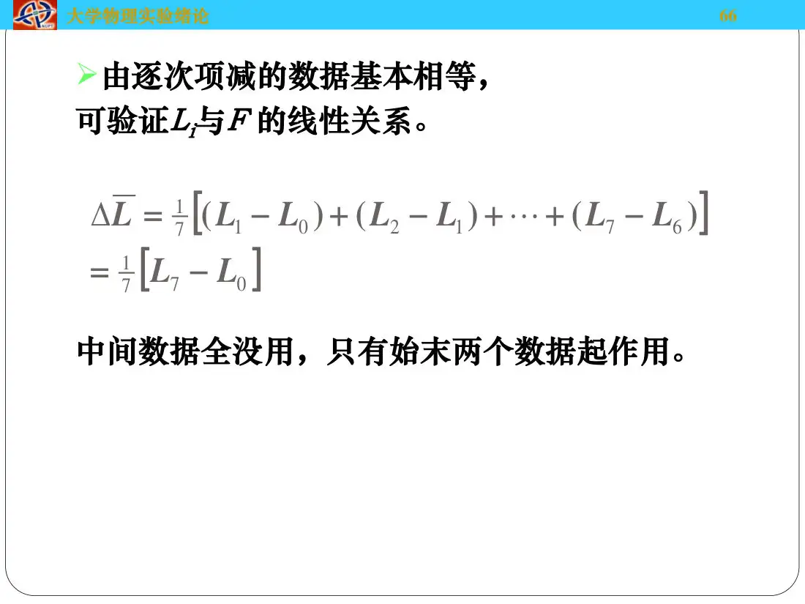

原文：

由逐次项减的数据基本相等，可验证 $L _ { i }$ 与 $\pmb { F }$ 的线性关系。

$$
\begin{array}{l} \Delta \overline {{L}} = \frac {1}{7} \left[ (L _ {1} - L _ {0}) + (L _ {2} - L _ {1}) + \dots + (L _ {7} - L _ {6}) \right] \\ = \frac {1}{7} \left[ L _ {7} - L _ {0} \right] \end{array}
$$

中间数据全没用，只有始末两个数据起作用。

大学物理实验绪论

66

### $$

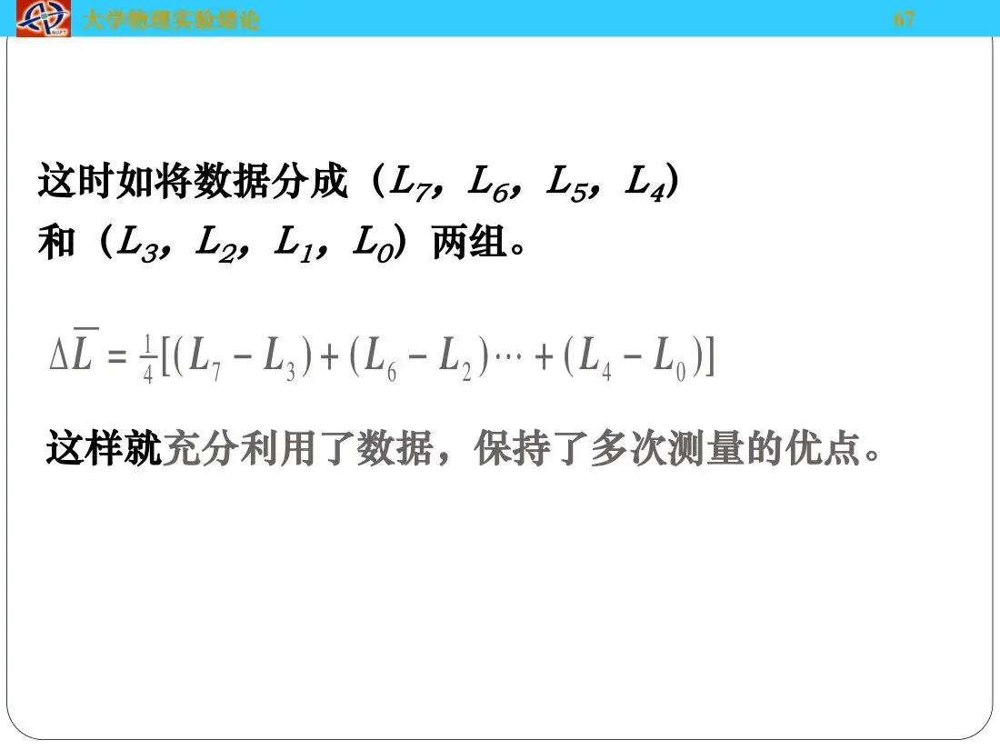

原文：

这时如将数据分成 $( L _ { 7 } , \ L _ { 6 } , \ L _ { 5 } , \ L _ { 4 } )$ 和 $( L _ { 3 } , \ L _ { 2 } , \ L _ { 1 } , \ L _ { O } )$ 两组。

$$
\Delta \overline {{L}} = \frac {1}{4} [ (L _ {7} - L _ {3}) + (L _ {6} - L _ {2}) \dots + (L _ {4} - L _ {0}) ]
$$

这样就充分利用了数据，保持了多次测量的优点。

大学物理实验绪论

67

### 本章重点

原文：

本章重点

1、实验课规则

2、有效数字表示，修约规则，运算法则，读数

3、不确定度——计算，修约规则A类不确定度， B类不确定度，合成间接测量量不确定度计算过程

大学物理实验绪论

68

### 4、测量结果表示：

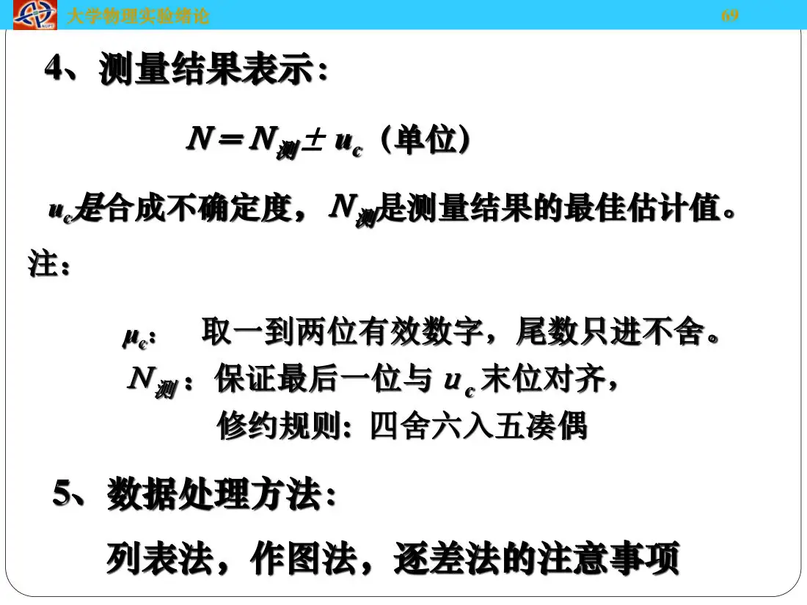

原文：

4、测量结果表示：

$N = N _ { y y } \pm u _ { c }$ （单位）

$u_c$ 是合成不确定度，$N_{\text{测}}$ 是测量结果的最佳估计值。

$\pmb { \mu } _ { c } \pmb { : \mu }$ 取一到两位有效数字，尾数只进不舍。

$N _ { \astrosun }$ ：保证最后一位与 $\pmb { u } _ { e }$ 末位对齐，

修约规则: 四舍六入五凑偶

5、数据处理方法：

列表法，作图法，逐差法的注意事项

大学物理实验绪论

69
