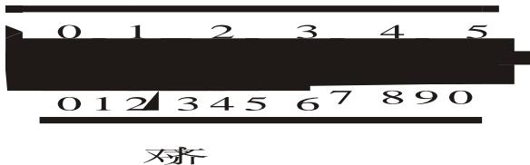
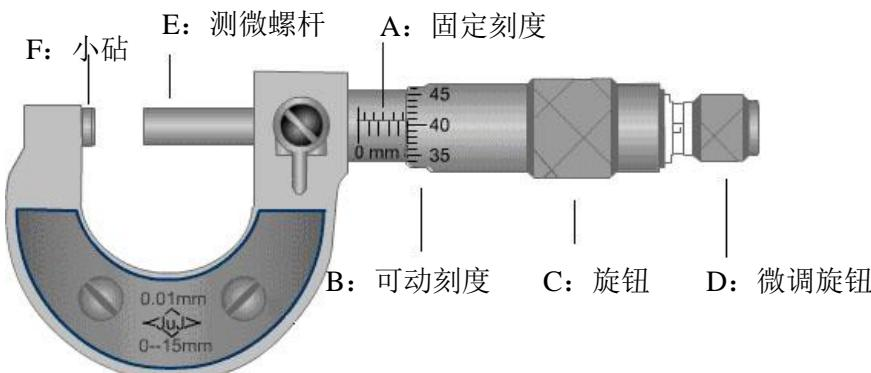
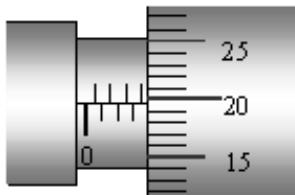
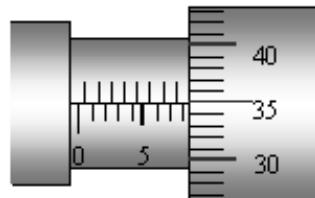

# 《物理实验》绪论部分期末复习参考

原件经识别和整理；“参考解答”是我们补的。

# 《物理实验》绪论部分期末复习参考

## 一、考试概况与要求

### 1. 考试内容
误差理论，以第一次课为主要内容。

知识点：[物理实验课程的成绩考核方式](../../../topics/大学物理实验/成绩考核.md)

### 2. 题型
选择题、填空题、作图题、计算题。

知识点：[物理实验课程的成绩考核方式](../../../topics/大学物理实验/成绩考核.md)

### 3. 复习材料
- **双面打印的那张纸**：全部熟记熟练使用！！！
- **课本第一章**：全部熟读两到三遍。其中的易考内容在文档中会标出（加阴影的文字多为填空选择题，有些字加了红色）。
- **本学期做的七个实验**：只需掌握实验数据处理的技巧、方法与结果的正确表示即可。

知识点：[测量与单位（含国际单位制重新定义）](../../../topics/大学物理实验/测量与单位.md)、[有效数字的概念与定义](../../../topics/大学物理实验/有效数字概念.md)、[直接测量量的有效数字读数原则（游标卡尺、角游标尺、螺旋测微器、数字表头）](../../../topics/大学物理实验/直接测量量读数原则.md)

### 4. 答题规范
一定要按照要求，认真细致规范答题，否则很容易丢分。

知识点：[实验报告的内容（含实验内容与步骤等）](../../../topics/大学物理实验/实验报告内容.md)、[物理实验课的基本程序（预习、实验进行、写报告）](../../../topics/大学物理实验/实验课基本程序.md)、[物理实验课程的成绩考核方式](../../../topics/大学物理实验/成绩考核.md)

### 5. 考前准备
准备好计算器、刻度尺、铅笔、橡皮擦。**无需坐标纸**，卷子上会给出坐标纸。

---

## 二、绪论

知识点：[物理实验课的基本程序（预习、实验进行、写报告）](../../../topics/大学物理实验/实验课基本程序.md)、[预习报告的编写内容与要求](../../../topics/大学物理实验/预习报告内容.md)

### 1. 物理实验课程的任务
物理学是自然科学中最重要、最活跃的学科之一。从本质上说，物理学是一门实验科学，物理规律的研究都以严密的实验事实为基础，并且不断受到实验的检验。物理学理论和实验的发展哺育着许多新兴学科及高新技术的成长和发展。物理实验的思想、方法、技术和装置则是自然科学研究和工程技术发展的基础。

物理实验课程是独立设置的进入高校的大学生的第一门科学实验课程，是学生受到系统的实验思想和实验技能锻炼的开端，在培养学生基本科学实验能力和素养方面有着特殊的地位和作用。因此，学好物理实验对于高等学校中理工科的学生是十分重要的。

知识点：[物理实验课的基本程序（预习、实验进行、写报告）](../../../topics/大学物理实验/实验课基本程序.md)

### 2. 物理实验课程的目的
- **巩固、扩展、加深学生的物理学知识**：通过对实验的观测和分析，学习运用理论指导实验、分析和解决实验中问题的方法，从理论和实际的结合上加深对理论的理解。
- **培养和提高学生从事科学实验的初步能力**：包括通过阅读教材和查阅参考资料，正确理解实验内容，能概括出实验原理和方法的要点，借助教材和仪器说明书，正确使用仪器；掌握基本物理量的测量方法和实验技能；正确记录、分析和处理实验数据，分析实验结果和撰写实验报告；自行设计和完成某些不太复杂的实验任务等。
- **培养优良品德和工作作风**：培养学生实事求是的科学态度、严谨踏实的工作作风；严肃认真、一丝不苟的工作态度；勇于探索、坚韧不拔的钻研精神以及遵守纪律、团结协作、爱护公物的优良品德。

知识点：[物理实验课程的成绩考核方式](../../../topics/大学物理实验/成绩考核.md)

### 3. 物理实验课的主要教学环节
为达到物理实验课的目的，学生应重视物理实验教学的三个环节。

#### （1）实验预习
课前要仔细阅读实验教材或有关资料，基本弄懂实验所用的原理和方法，并学会从中得出主要实验条件、实验关键及实验注意事项，根据实验任务画好记录数据的表格。有些实验还要求学生课前自拟实验方案，自己设计线路图或光路图，自拟数据表格等。因此，课前预习的好坏是实验能否取得主动的关键。如果是设计性实验内容，需要制定初步实验方案，提出对仪器设备的要求，并报请老师批准方可进行实验。

#### （2）实验操作
学生进入实验室后应遵守实验室规则，按照一个科学工作者那样要求自己。井井有条地布置仪器，安全操作，注意细心观察实验现象，认真钻研和探索实验中的问题。不要期望实验工作始终一帆风顺。在遇到问题时，应看作是学习的良机，冷静地分析和处理它。仪器发生故障时，也要在教师的指导下学习排除故障的方法。对实验数据要严肃对待，要正确记录实验数据（注意单位和有效数字位数）。实验结束时，原始实验数据应该交给指导教师审阅签字，并整理还原仪器后方可离开实验室。

#### （3）实验总结
实验报告是实验工作的全面总结，要用简明扼要的形式，将实验结果完整而又真实地表达出来，这也是进行科学实验素质培养的必要内容之一。

书写实验报告要求文字通顺，字迹端正，数据齐全，图表规范，结果正确（包括误差），分析讨论认真。

实验报告的内容包括下列几部分：
1. 实验名称
2. 实验目的
3. 仪器设备（要求标注型号、规格等）
4. 实验原理（包含重要的物理定律、计算公式、光路图或电路图）
5. 实验简要步骤和实验数据记录
6. 数据处理（包括计算、图表、误差分析等）
7. 实验结果（结论）
8. 分析讨论

知识点：[物理实验课的基本程序（预习、实验进行、写报告）](../../../topics/大学物理实验/实验课基本程序.md)、[预习报告的编写内容与要求](../../../topics/大学物理实验/预习报告内容.md)、[实验报告的内容（含实验内容与步骤等）](../../../topics/大学物理实验/实验报告内容.md)

### 4. 学生上物理实验课的须知
1. 物理实验课前应充分做好预习工作，真正了解本次实验“做什么，怎样做，为什么这样做”，并设计好数据表格。
2. 教师上课时将检查学生的预习情况，凡未预习或预习不充分的学生，教师可责令其充分预习后再进行实验。
3. 实验过程中，应严肃认真，养成严谨求实的工作作风，不得伪造实验数据或相互抄袭实验结果。
4. 实验过程中，应注意安全，爱护仪器，如有遗失或损坏仪器等情况发生，请及时向指导教师报告，教师将酌情按有关规章处理。
5. 严肃课堂纪律。实验课不得无故缺席、迟到、早退。
6. 实验结束应将仪器、桌凳等整理后再离开实验室。
7. 实验后一周内完成实验报告并及时上交。
8. 物理实验课程的总成绩由平时成绩与考核成绩综合评定。

---

## 三、第一节 基本测量法

物理测量是泛指以物理理论为依据，以实验仪器和装置及实验技术为手段进行测量的过程。测量涉及内容非常广泛，包括力、热、电、磁、光等物理量的测量。测量方法也很多，按测量方法分类，可分为直接测量、间接测量、组合测量等；按测量内容分，可分为电学测量和非电学测量两类；根据测量过程中被测物理量随时间的变化，又可分为静态测量和动态测量等等。下面简单介绍几种基本测量方法：

知识点：[物理实验课的基本程序（预习、实验进行、写报告）](../../../topics/大学物理实验/实验课基本程序.md)、[预习报告的编写内容与要求](../../../topics/大学物理实验/预习报告内容.md)、[物理实验课程的成绩考核方式](../../../topics/大学物理实验/成绩考核.md)

### 1. 比较法
比较法是实验中最普遍、最基本的测量方法，它是将待测物理量与选作标准单位的物理量进行比较而得到测量值的。即是将待测物理量与标准量进行比较的过程。既然是比较就必须有标准量具，相关的仪器，如游标卡尺、温度计、电表等。有时，只有标准量具还不够，还必须配置“比较系统”，使被测量和标准量具能够实现比较。如，只有标准电池还不能测量电压，还需要用比较电阻等附属装置组成电位差计来测量电压，这个装置便称为比较系统。

知识点：[测量的分类（直接测量与间接测量）](../../../topics/大学物理实验/测量的分类.md)、[直接测量量的有效数字读数原则（游标卡尺、角游标尺、螺旋测微器、数字表头）](../../../topics/大学物理实验/直接测量量读数原则.md)、[物理实验课的基本程序（预习、实验进行、写报告）](../../../topics/大学物理实验/实验课基本程序.md)

### 2. 放大法
在物理实验的测量中，有时由于被测量过分小，以至无法被实验者或仪器直接感觉和反应，这时可以先通过某种途径将被测量放大，然后再进行测量。放大法有机械放大、电放大、光放大、积累放大几种。

#### （1）机械放大法
它是最直观的一种放大法。
利用游标可以提高测量的细分程度，原来的分度值为 $X$ 的主尺，加上一个 $n$ 等分的游标后，组成的游标尺的分度值，即细分了 $n$ 倍。
螺旋测微原理也是一种机械放大，将螺距 $d$（螺旋进一圈的推进距离），通过螺母上圆周来进行放大。放大率：$\frac{\pi D}{d}$，其中 $d$ 是螺距，$D$ 是螺母连接在一起的微分套筒的直径。

#### （2）光放大法
光放大法可分为角放大和微小变化量（微小长度）放大。
视角放大的仪器有放大镜、显微镜和望远镜。这类仪器只是在观察中放大视角，并无实际尺寸的变化，故并不增加误差。
微小变化量的放大原理常用于检流计、光杠杆等仪器装置中。光杠杆就是通过微小长度变化的放大来测量物理量的。

#### （3）电放大法
对微弱的电信号（电压、电流、功率）进行有效的测量，可以是交流的，也可以是直流的，借助于电路或电子仪器对微弱的信号进行测量，把电量信号放在提高物理量本身的量值时，还必须注意减小本底噪声信号，提高所测物理量的信噪比和灵敏度，降低电信号的噪声。

#### （4）积累放大法
当我们要测量牛顿环、劈尖、迈克尔逊干涉仪干涉条纹间距 $d$ 的数量级一般很小，为了减少测量误差，一般不是逐一去测量，而是测量若干（$n$）个条纹总间距，这就是积累放大法。

知识点：[测量与单位（含国际单位制重新定义）](../../../topics/大学物理实验/测量与单位.md)、[直接测量量的有效数字读数原则（游标卡尺、角游标尺、螺旋测微器、数字表头）](../../../topics/大学物理实验/直接测量量读数原则.md)、[有效数字的概念与定义](../../../topics/大学物理实验/有效数字概念.md)

### 3. 换测法
在物理量中，许多物理量之间存在着多种效应和关系，故可有各种不同的换测方法。换测法大致可分为参量换测法和能量换测法两大类。

#### （1）参量换测法
参量换测法利用各种参量的变换及其变化的相互关系，以达到测量某一物理量的目的。具体有两种情况。
① 把不可测量的物理量转换成可测量的物理量，“曹冲称象”。
② 把测量不准的量转换成可测准的量，例不规则物体的体积，转换成易测准的液体体积。

#### （2）能量换测法
能量换测法是指某种形式的物理量，通过能量变换器，变成另一种形式物理量的测量方法。系统主要由能量变换器和测量装置组成。传感器的种类很多，如热敏、光敏、磁敏、压敏、声敏、气敏、温敏材料等；考虑到电量参量具有测量方便、快速的特点，所以许多能量转换法都是使待测物理量通过各种传感器转换成电量参量来测量。
① **光电转换**：利用光敏元件，将光信号转换成电信号进行测量。
② **磁电转换**：利用磁敏元件（霍尔元件、巨磁阻元等）或电磁感应组件，将磁量转换成电压、电流或电阻的测量。
③ **热电转换法**：利用热敏元件（半导体热敏元件、热电偶等），将温度的测量转换成电压或电阻测量。热电偶构造简单，测量温度的准确度高，测量范围宽、灵敏度高，在高、低温区应用均很广泛。
④ **压电转换**：利用压敏元件或压敏材料（压电换能器、压电陶瓷、石英晶体）的压电效应，将压力转换成电信号进行测量。
压电传感器具有使用频率宽、灵敏度高、信噪比高、结构简单、工作可靠、重量轻等优点。

知识点：[测量的分类（直接测量与间接测量）](../../../topics/大学物理实验/测量的分类.md)

### 4. 补偿法
某系统受某种作用产生 A 效应，受另一种同类作用产生 B 效应，如果由于 B 效应的存在而使 A 效应显示不出来，就叫做 B 对 A 进行了补偿。
例：电位差计是典型的补偿应用电路。

知识点：[实验报告的内容（含实验内容与步骤等）](../../../topics/大学物理实验/实验报告内容.md)

### 5. 模拟法
模拟法是指不直接研究某物理现象或过程的本身，而是用与该物理现象或过程相似的模型来进行研究的一种方法。模拟法可分为物理模拟和数学模拟两类。物理模拟又可分为几何模拟、动力相似模拟、替代或类比模拟。

#### （1）几何模拟
将实物按比例放大或缩小，对其物理性能及功能进行试验。

#### （2）动力相似模拟
利用模型试验条件，便可用模型动力学参量的测量代替原形动力学参量的测量。

#### （3）替代或类比模拟
利用物质材料的相似性和类比性进行实验模拟，它可以利用别的物质、材料或者别的物理过程，来模拟另一种材料或另一种物理过程。例用电流场模拟静电场。

#### （4）数学模拟
原型和模型遵循相同的数学规律，而在物理实质上并无共同之处，通过计算机求解各种数学方程，直接模拟实验过程，预测一些可能的实验结果，此为计算物理的范畴，目前已成为物理学三大支柱之一。

以上五种基本测量方法，在物理实验中得到了广泛的应用，而有时各种方法在物理实验中往往是相互联系，综合使用的。

---

## 四、第二节 实验仪器调整的基本要求

知识点：[物理实验课的基本程序（预习、实验进行、写报告）](../../../topics/大学物理实验/实验课基本程序.md)、[预习报告的编写内容与要求](../../../topics/大学物理实验/预习报告内容.md)、[实验报告的内容（含实验内容与步骤等）](../../../topics/大学物理实验/实验报告内容.md)

### 1. 仪器调整的基本要求

#### （1）零位（零点）调整
绝大多数测量工具都具有零位（零点），在测量前应首先检查测量仪器的零位是否正确，对于能调整的有偏差的零位要进行调整或校准，对不能调整的则记下其对零的偏差值，以便在以后测量值中予以修正，消除由此带来的系统误差。

#### （2）水平、垂直调整
在实验中，有些仪器需要进行水平或垂直的调整，对配置有水准仪或悬锤的，调整时只需要调整底座上的三个底脚螺丝使水准仪中的气泡居中，或使悬锤的锤尖对准底座上的座尖即可。对没有配置水平仪或悬锤的仪器，需要调水平或垂直，可利用自身的装置进行调整。如焦利秤可以通过调整底脚螺丝使悬锤处在玻璃管的中间，对于既没有配置水平仪又不能利用自身装置调整的仪器，可取一水准仪，来辅助调水平和垂直。

#### （3）调焦调整
在使用望远镜、显微镜和测微目镜等光学仪器时，为了清晰地看清目的物，需调节物镜或目镜的距离。调焦的要求，能清晰地看清物体上的局部细小特征为准（如清晰轮廓分明的十字线）。

#### （4）视差消除调整
在测量读数时，经常会遇到读数标线（指针、叉线）和标度尺（盘）不重合的情况，当眼睛在不同位置观察时，读得指示值就会有一定的差异，这就是视差。为了测量正确，实验时必须消除视差。为了消除视差，应做到正面垂面观察。（例对有反射镜的电表读数时，人的视线应铅直正视，使指针与刻度槽下面平面镜中的像重叠，读出标尺上无视差的读数才是正确的。焦利秤的读数装置也是如此。）二是使标尺平面与被测物重合于同一平面内。游标卡尺的游标尺被做成斜面，便是为了使游标卡尺的刻线端与主尺的刻线端接近处于同一平面，减少视差。使用光学测量仪器读数均须消除视差的影响，使被观察物的实像成在作为标尺的叉焦分划板上，即与它们的虚像处于同一平面，此时人眼稍微移动时，叉焦和物像无相对运动。

#### （5）光路的共轴调整
在由两个或两个以上光学元器件组成的实验系统中，为了获得好的成像质量，满足近轴光线的条件，必须进行共轴调整。

*   **采用普通光源做实验时**：应以光具座的导轨为准。先用目测法进行粗调，使光源、物体、透镜和光屏的中心大致等高共线，各元件均不倾斜。再利用光学系统本身，依据透视或成像规律进行细调。例共轭法成像时，两次成像中心重合，即表示已达到等高共轴的要求。
*   **应用激光做实验时**：先以导轨为准，调节激光束的方向平行于导轨。用一光屏导轨平稳地移动较长一段距离，若屏上激光的中心位置不变，则表明光束的方向平行于导轨。再以激光束为准，依次放置并调节各元件的高低和左右，使光束经过各元件后光斑的中心仍在原来的位置。
*   **在安排二维光路时**：应以平台面为准，调配光束的俯仰，使光束平行于台面。当光屏在平台上滑动较长一段距离时，屏上光斑的中心应保持同一高度，放置其他元件时，应使经反射或折射后的光束保持原高度，经扩束镜扩束后形成的光轴线也保持原高度。

#### （6）电路连接
电路连接是电磁学实验中的一项基本功。一张电路图可分解为若干个闭合回路，连接时，循回路由始点（某高电位）依次首尾相连，最后仍回到始点，此接线方法称回路接线法。按照此法接线和查线，可确保电路连接正确，注意安全用电。

**接线规则：**
① **合理安排仪器**。接线时必须有正确的线路图。参考线路图，通常把需要经常操作的仪器放在近处，需要读数的仪表放在眼前，根据走线合理、操作方便、实验安全的原则放置仪器。
② **按回路接线法接线和查线**。按线路图，从电源正极开始，经过一个回路，回到电源负极。再从已接好的回路中某段分压的高电位点出发接下一个回路，然后回到该段分压的低电位点。这样一个回路、一个回路地接线。查线时也这样按回路查线。接线时还要注意走线美观整齐。
③ **预置安全位置**。在接通电源前，应检查变阻器滑动端（或电位器旋钮）是否已放在安全位置，例如使电路中电流最小或电压最低的位置。有些实验还需要检查电阻是否已经放到预估的阻值等。自己检查线路和预置安全位置后，应请教师复查，才能接通电源。
④ **接通时要做瞬态试验**。先试通电源，及时根据仪表示值和现象判断线路有无异常。若有异常，应立即断电进行检查。若情况正常，就可以开始做实验，调节线路至实验的最佳状态。
⑤ **做完实验，应该用理论知识分析一下这些数据是否合理**，有无可疑之处，有无漏测，确认无误后，方可拆线，拆线时应先切断电源再拆线，严防电源短路。最后将仪器还原，导线整理整齐。

知识点：[物理实验课的基本程序（预习、实验进行、写报告）](../../../topics/大学物理实验/实验课基本程序.md)

### 2. 常用基本实验仪器介绍

#### （1）力学部分
##### ① 游标卡尺

知识点：[物理实验课的基本程序（预习、实验进行、写报告）](../../../topics/大学物理实验/实验课基本程序.md)、[直接测量量的有效数字读数原则（游标卡尺、角游标尺、螺旋测微器、数字表头）](../../../topics/大学物理实验/直接测量量读数原则.md)、[有效数字的概念与定义](../../../topics/大学物理实验/有效数字概念.md)

### 1. 游标卡尺

游标卡尺是一种能准确到 $0.1\text{mm}$ 以上的较精密量具，用它可以测量物体的长、宽、高、深及工件的内、外直径等。它主要由按米尺刻度的主尺和一个可沿主尺移动的游标（又称副尺）组成。常用的一种游标卡尺的结构如图 1 所示。D 为主尺，E 为副尺，主尺和副尺上有测量钳口 AB 和 $A'B'$，钳口 $A'B'$ 用来测量物体内径，尾尺 C 在背面与副尺相连，移动副尺时尾尺也随之移动，可用来测量孔径深度，F 为锁紧螺钉，旋紧它，副尺就与主尺固定了。

读数时，待测物的长度 $L$ 可分为两部分读出后再相加。先在主尺上与游标 "$0$" 线对齐的位置读出毫米以上的整数部分 $L_1$，再在游标上读出不足 $1\text{mm}$ 的小数部分 $L_2$，则 $L = L_1 + L_2$。$L_2 = K \frac{1}{N} \text{mm}$，$k$ 为游标上与主尺某刻线对得最齐的那条刻线的序数。如图 2 所示的游标卡尺读数为：

$$
\begin{aligned}
L_1 &= 0 \\
L_2 &= k \frac{1}{N} = \frac{12}{50} = 0.24 \text{mm} \\
L &= L_1 + L_2 = 0.24 \text{mm}
\end{aligned}
$$

许多游标卡尺的游标上常标有数值，$L_2$ 可以直接由游标上读出。如图 2 所示，可以从游标上直接读出 $L_2$ 为 $0.24\text{mm}$。

知识点：[直接测量量的有效数字读数原则（游标卡尺、角游标尺、螺旋测微器、数字表头）](../../../topics/大学物理实验/直接测量量读数原则.md)、[有效数字的概念与定义](../../../topics/大学物理实验/有效数字概念.md)、[测量的分类（直接测量与间接测量）](../../../topics/大学物理实验/测量的分类.md)

### 2. 螺旋测微器

螺旋测微器也称千分尺，其各部分名称及主要用途，如图 3 所示：

*   **A：固定刻度（主尺）**：用于读取固定刻度所显示的最大毫米刻度数(包括 $0.5$ 毫米)；
*   **B：可动刻度（微分套筒）**：用于读取主尺上固定刻度的水平线对应的螺旋尺上可动刻度的刻度(包括估读)；
*   **C：旋钮**：用于紧固被测物；
*   **D：微调旋钮**：用于可动尺的微调；
*   **E：测微螺杆**；
*   **F：小砧**。

**使用方法：**

使用螺旋测微器时，为使每次测量均在被测物上施以相同的压力，以减少形变误差；也为了避免损坏精确的螺旋刻度起见，当顶针已将被测物轻轻夹住时，勿再旋转旋钮，此时应旋转位于套筒后的微调旋钮，直到听到三响“滴答”声为止，读取数值即可。

**读数的要点：**

① 测量前应首先检查砧台和测量螺杆的端面（卡口）在接触时的读数值是正值、负值或是零，即初读数。

② 读取两个零刻度线之间的整数倍（即主尺读数），再读出微分套筒上的刻度（要估读一位），乘以 $0.01\text{mm}$ 即为套筒上的读数，两者相加即为末读数。在读主尺读数时，类似的也要注意有时某刻度线即使露出，但只能读取它前面的刻度加上套筒上的读数。

## 二、电学部分

知识点：[直接测量量的有效数字读数原则（游标卡尺、角游标尺、螺旋测微器、数字表头）](../../../topics/大学物理实验/直接测量量读数原则.md)、[有效数字的概念与定义](../../../topics/大学物理实验/有效数字概念.md)、[物理实验课的基本程序（预习、实验进行、写报告）](../../../topics/大学物理实验/实验课基本程序.md)

### 1. 直流电源

实验室常用的直流电源有晶体管直流稳压电源、干电池和直流稳流电源。晶体管稳压电源电压稳定，电阻小，使用方便，其输出电压有固定的，也有连续可调的。干电池电压稳定，内阻也小，但其容量有限，要注意经常更换。直流稳流电源在一定的负载阻值范围内，能给出一定的恒定电流，电流大小连续可调。选用电源时除了应注意它的输出电压是否符合需要外，也需注意取用的电流或负载电阻是否在电源的额定值之内，如果电流超额，即电源过载，电源将急剧发热而损坏，使用电压电源时特别要防止它短路。

知识点：[实验报告的内容（含实验内容与步骤等）](../../../topics/大学物理实验/实验报告内容.md)

### 2. 直流电表

实验室用的直流电表有磁电式仪表和数字式电表两种。直流电表的主要规格指量程、准确度等级和内阻。量程指电表可测的最大电流值或最大电压值。电表内阻一般在仪表说明书上已给出，或由实验室测出。设计线路和使用电表时必须了解电表的规格。电表的误差是主要技术性能，可分为基本误差和附加误差两部分。电表的基本误差是由其内部特性决定的。电表的基本误差 $\gamma$ 是用绝对误差 $\Delta A$ 与量程 $A_m$ 之比来表示，即

$$
\text{基本误差 } \gamma = \frac{\text{绝对误差 } \Delta A}{\text{量程 } A_m} \times 100\%
$$

标准规定，如果电表的准确度等级示数为 $K$，在一定条件下，基本误差极限不大于 $\pm K\%$。电表的附加误差在大学物理实验中考虑比较困难，不作要求。在实验教学中，一般只考虑基本误差的影响，按下式简化误差的计算 $|\Delta A| \le A_m \cdot K\% = \Delta A_{0}$。

国家标准规定：电表一般分为 11 个准确度等级，即 0.05 级、0.1 级、0.2 级、0.3 级、0.5 级、1.0 级、1.5 级、2.0 级、2.5 级、3.0 级、5.0 级。电表出厂时一般已经将级别标在表盘上。

读取电表示值时，可能产生一定的读数误差。要尽量减小读数产生的附加误差，方法为眼睛正对指针。1.5 级以上的电表都配有镜面，读数时要眼睛、指针及指针的像三者成一直线，以尽量减小由于读数而引起的附加误差。要使估计位的读数误差不大于 $(1/3 \sim 1/5)\Delta A$，一般读到仪表最小分度的 $1/4 \sim 1/10$ 就可以使读数的有效数字符合电表准确度的要求。

被测量 $A$ 一定时，为了减小 $\Delta A/A$ 的值，使用电表时应让指针偏转尽量接近满量程。此外，使用直流电表时还要注意电表的极性，通电前要检查并调节指针指向零点，在线路中的连接方式，电流表应串联，电压表应并联。避免损坏电表。

知识点：[直接测量量的有效数字读数原则（游标卡尺、角游标尺、螺旋测微器、数字表头）](../../../topics/大学物理实验/直接测量量读数原则.md)、[有效数字的概念与定义](../../../topics/大学物理实验/有效数字概念.md)

### 3. 数字电压表

数字电压表具有输入阻抗高、准确度高、测量速度快、易于小型智能化等优点，数字电压表配上各种变换器后可进行电压、电阻、电容、频率、温度等物理量的测量。

数字电压表的工作特性：数字电压表的显示位数一般为 3 位半、4 位半、6 位半、8 位半等，例如最大显示值为 1999，满度值为 2000 的数字电压表，其最高位不能显示出 0～9 这十个数字的全体，故称为 3 位半数字表。数字电压表的输入阻抗高，可达 $10^7 \sim 10^{10} \Omega$，远大于指针式电压表的内阻。数字电压表的仪器误差限可表示为：

$$
\Delta_{ins} = \pm (a \% \cdot x + n)
$$

式中 $a$ 为误差的相对项系数，$x$ 为测量值，实际上数字电表的误差很小，一般为最后显示位的 1～2 个字。

知识点：[直接测量量的有效数字读数原则（游标卡尺、角游标尺、螺旋测微器、数字表头）](../../../topics/大学物理实验/直接测量量读数原则.md)

### 4. 滑线变阻器

滑线变阻器是将电阻丝均匀绕在绝缘瓷管上制成的。它有两个固定的接线端，并有一滑动端可在电阻线圈上滑动。在线路中常用它作为可变阻值的串联电阻器或组成分压电路，分别起控制电流或调节电压的作用。

变阻器的主要规格是电阻值和额定电流。电阻值指整个变阻器的总电阻。额定电流即变阻器允许通过的最大电流。使用时通常应根据外接负载来选用规格适当（即电阻和额定电流均合适）的变阻器。

知识点：[实验报告的内容（含实验内容与步骤等）](../../../topics/大学物理实验/实验报告内容.md)

### 5. 电阻箱

电阻箱一般是由电阻温度系数较小的锰铜线绕制的精密电阻串联而成，通过十进位旋钮可使电阻改变。电阻箱的主要规格是总电阻、额定电流（或额定功率）和准确度等级。如实验室常用的 5 位十进式电阻箱，它的 5 个旋钮下的电阻全部使用上则总电阻为 $99999.9\Omega$。如果只要 $0.1\Omega \sim 0.9\Omega$ (或 $0.9\Omega$) 的阻值变化，则应该接“0”和 “$0.9\Omega$” （或 9.9$\Omega$）两接线柱，这样可避免电阻箱其余部分的接触电阻和导线电阻对低电阻带来的不可忽略的误差。本实验室所用的 ZX21 型电阻箱各档阻值的额定电流如下：

| 步进电阻/$\Omega$(旋钮倍率) | 1 | 0.1 | 10 | 100 | 1000 | 10000 |
| :---: | :---: | :---: | :---: | :---: | :---: | :---: |
| 额定电流/A | 1 | 0.5 | 0.15 | 0.05 | 0.015 | 0.005 |

有些电阻箱或变阻器只标明了额定功率 $P$，其额定电流可由下式得到。

$$
I = (P / R)^{1/2}
$$

实验室约定：在通常的教学条件下，0.1 级电阻箱的阻值不确定度 $\Delta_R$ 用下式简化地表示：

$$
\Delta_R = 0.1 \% R + 0.005 (N + 1)
$$

上式中 $\Delta_R$ 的单位是 $\Omega$，$N$ 是实际所用的十进制电阻盘的个数。例如，用“0”和“9.9$\Omega$”两接线柱时 $N$ 值取 2。

## 三、光学元件和仪器的维护

透镜、棱镜等光学元件大多数用光学玻璃制成的，它们的光学表面都经过仔细的研磨和抛光，有些还镀有一层或多层薄膜。对这些元件或其材料的光学性能（折射率、反射率、透射率等）都有一定的要求，而它们的机械性能和化学性能可能很差，若使用和维护不当，则会降低光学性能甚至损坏报废。为安全使用光学元件和仪器，必须遵守以下规则：

① 必须在了解仪器的操作和使用方法后再使用。

② 轻拿轻放，勿使仪器或光学元件受到冲击或震动，特别要防止跌落。不使用的光学元件应随时装入专用盒内并放在桌面的里侧。

③ 切忌用手接触元件的光学表面，如必须用手拿光学元件时，只能接触磨砂面，如透镜的边缘、棱镜的上下底面等。

④ 光学表面上如有灰尘，可用实验室专备的干燥脱脂棉轻轻拭去或用橡皮球吹掉。

⑤ 光学表面上若有轻微的污痕或指印，可用清洁的镜头纸轻轻反复擦拭、拂去，但不要加压擦拭，更不准用手帕、普通纸片、衣角袖口等擦拭。若表面有严重的污痕或指印，应由实验室人员用丙酮或酒精清洗。所有镀膜均不能触碰或擦拭。

⑥ 不要对着光学元件说话、打喷嚏等，以防止唾液或其他溶液溅落在光学表面上。

⑦ 调整光学仪器时，要耐心细致，一边观察一边调整，动作要轻、慢、严禁盲目及粗鲁操作。

⑧ 仪器用毕应放回箱（盒）内或加罩，防止灰尘玷污。

## 四、误差的基础知识

知识点：[测量与单位（含国际单位制重新定义）](../../../topics/大学物理实验/测量与单位.md)、[有效数字的概念与定义](../../../topics/大学物理实验/有效数字概念.md)、[直接测量量的有效数字读数原则（游标卡尺、角游标尺、螺旋测微器、数字表头）](../../../topics/大学物理实验/直接测量量读数原则.md)

### 1. 测量

物理实验是以测量为基础的，研究物理现象、了解物质特征、验证物理原理都要进行测量。所谓测量，就是对确定量值作一组操作。量值是指：用数和适当的单位表示的物理量大小的值。测量所得的值应包括数值大小和单位，二者缺一不可。单位依据国际单位。依据获取数据的方法不同，测量可分为直接测量和间接测量两类。

（1）直接测量：是指被测量直接与标准量（量具或仪表）进行比较，直接读数获取数据。相应测得量称为直接测量量。如刻度尺、游标卡尺、螺旋测微仪测出的长度，用秒表测时间等。

（2）间接测量：在物理实验中，大多数物理量没有直接测量的量具，不能直接获取数据，但能够找到它与某些直接测量量的函数关系，这样的测量就称为间接测量，相应的测量量就是间接测量量。值得指出的是同一物理量，由于选用的测量方法不同，它可以是直接测量量，也可以是间接测量量。

知识点：[测量与单位（含国际单位制重新定义）](../../../topics/大学物理实验/测量与单位.md)、[测量的分类（直接测量与间接测量）](../../../topics/大学物理实验/测量的分类.md)

### 2. 误差概念及分类

误差主要分为两类：随机误差和系统误差。它们的性质不同，应分别处理。

（1）随机误差：是指重复测量中以不可预知方式变化的测量误差分量。电表轴承摩擦力矩的变动、螺旋测微器测量头的压紧力在一定范围内的变化、数字表末位取整时的随机舍入过程等，都会产生一定的随机误差分量。

随机误差分量是测量误差的一部分，其大小和符号虽然不知，但在相同的条件下对同一稳定被测量的多次重复测量中，它们的分布常常满足一定的统计规律。随机误差分布绝大多数是“有界性”的，大多数有抵偿性，相当多的有单峰性，即绝对值小的误差出现的概率大。

（2）系统误差：是指在多次测量同一被测量的过程中，保持恒定或以可预知方式变化的测量误差的分量。例如实验装置和实验方法没有（或不可能）完全满足理论上的要求，有的仪器没有达到应有的准确程度，环境因素（温度、湿度等）没有控制到预计的情况等。只要这些因素与正确要求有所偏离，那么在测量结果中就会出现其绝对值均为恒定的或以可预知方式变化的误差分量，因素不变，系统误差也就不变，系统误差包括已定系统误差和未定系统误差。

已定系统误差的特征是它的确定性、规律性。它主要来自以下几个方面：
*   **仪器误差**：测量时由于所用的测量仪器、仪表不准确所引起的基本误差。
*   **环境误差**：测量仪器偏离了规定条件使用时，如受环境温度、电源频率、波形、外界电磁场等等变化的影响。
*   **方法误差**：测量方法不完善及所依据的理论不严密所产生的。凡是在测量结果的表达式中没有得到反映，而在实际测量中又起作用的一些因素所引起的误差。例仪器在测量过程中吸收被测电路的功率。
*   **个人误差**：由实验者的分辨能力、感光器官的不完善和生理变化，反应速度和固有习惯等引起的误差。如：估计读数始终偏大或偏小。

已定系统误差可以消除、修正或减小，它属于技能问题，可以在实验前、实验中、实验后进行。通过标准仪器，改进实验装置和实验方法或对测量结果进行理论上的修正加以消除或尽可能减小。发现和减小实验中的系统误差通常是一个困难任务，需要对整个实验所依据的原理、方法、测量步骤及所用仪器等可能引起误差的各种因素一一进行分析。一个实验结果是否正确，往往就在于系统误差已被发现和尽可能消除，因此系统误差不能轻易放过。

未定系统误差是指绝对值未被确定而未知的系统误差分量，一般只能估计其限值或分布特征值，未定系统误差大多与 B 类不确定度分量来源有大致对应关系。

（3）粗差：是指测量值明显地歪曲了、远离了正常测量值的异常误差。这种误差是由于实验者的粗心、不正确的操作和实验条件的突变等引起的。如读错、记错、故障仪器的使用等，粗差应剔除。

## 第四节 测量结果的正确表达—不确定度

不确定度是指由于测量误差的存在而对被测量值不能确定的程度，是表征被测量的真值所处的量值范围的评定，即随机误差分量和未定系统误差分量的联合分布范围。按其数值评定的方法可分为两类：A 类不确定度分量 $U_{\mathrm{A}}$ 与 B 类不确定度分量 $U_{\mathrm{B}}$。总不确定度由 A 类不确定度分量 $U_{\mathrm{A}}$ 和 B 类不确定度分量 $U_{\mathrm{B}}$ 合成而来。

$$
U = \sqrt{U_{A}^{2} + U_{B}^{2}}
$$

用总不确定度 $U$ 表示时，$U$ 为误差分布基本宽度之半。误差一般在 $\pm U$ 之间，在 $\pm U$ 之外的概率不大于 5%。

完整的测量结果应给出被测量的量值，同时还要标出测量的总不确定度，写成 $x = \bar{x} \pm U_{x}$ 的形式，这表示被测量的真值在 $\pm U$ 的范围之外的可能性（置信概率）很小。不确定度原则上总可以具体评定的，而误差一般由于真值未知而不能计算。

知识点：[测量的分类（直接测量与间接测量）](../../../topics/大学物理实验/测量的分类.md)、[有效数字的概念与定义](../../../topics/大学物理实验/有效数字概念.md)、[实验报告的内容（含实验内容与步骤等）](../../../topics/大学物理实验/实验报告内容.md)

### 单次直接测量结果的表达

在实验中有时只能测一次，称为单次直接测量。估计单次直接测量的测量不确定度，也是科学实验中的一个基本问题。

单次直接测量的测得值就作为最佳值，用仪器本身的误差限值 $\Delta_{\mathrm{INS}}$ 作为 B 类不确定度，$U_{\mathrm{B}} \approx \Delta_{\mathrm{INS}}$，合成不确定度 $U = U_{\mathrm{B}} = \Delta_{\mathrm{INS}}$。

多数的一般测量从效率考虑，只进行单次测量。单次测量不评定 A 类不确定度。

对单次直接测量物理量 $x$ 的测量结果写为

$$
x = x \pm U_{B}
$$

知识点：[直接测量量的有效数字读数原则（游标卡尺、角游标尺、螺旋测微器、数字表头）](../../../topics/大学物理实验/直接测量量读数原则.md)、[测量的分类（直接测量与间接测量）](../../../topics/大学物理实验/测量的分类.md)

### 多次直接测量结果的表达

在直接对某一物理量 $x$ 进行等精度测量之后，测量值采用测量列的算术平均值 $\bar{x}$（不含应修正的系统误差）表示，而总不确定度则表达为

$$
U = \sqrt{U_{A}^{2} + U_{B}^{2}}
$$

多次直接测量总不确定度的具体求解步骤：

（1）A 类不确定度分量 $U_{\mathrm{A}}$ 的估计（统计方法计算的分量）

① 求算术平均值

大多数随机误差有抵偿性，即测量次数足够多时，正、负误差之和的绝对值近似相等。因此，用多次测得值的算术平均值作被测量的估值，能减小随机误差的影响。

$$
\bar{x} = \frac{\sum_{1}^{n} x_{i}}{n}
$$

② 求实验标准差 $s$

随机误差引起测得值 $x_{i}$ 分散性用实验标准偏差 $s$ 表征，$s$ 由贝塞尔公式

$$
s = \sqrt{\frac{1}{n - 1} \sum_{i = 1}^{n} (x_{i} - \bar{x})^{2}}
$$

③ 求 $U_{\mathrm{A}}$

$$
U_{A} = s \times \frac{t}{\sqrt{n}} = \sqrt{\frac{1}{n - 1} \sum_{i = 1}^{n} \left(x_{i} - \bar{x}\right)^{2}} \times \frac{t}{\sqrt{n}}
$$

其中：$t$ 对应于 $t$ 分布因子；$n$ 为测量次数。当 $n$ 确定后，概率 $P = 0.95$ 时，$\frac{t}{\sqrt{n}}$ 的值由下表给出。

表 1 概率 $P=0.95$ 时，多次测量的 $t$ 因子和 $\frac{t}{\sqrt{n}}$ 的值（这个数值一般会给出）

| 测量次数 $n$ | 2 | 3 | 4 | 5 | 6 | 7 | 8 | 9 | 10 |
| --- | --- | --- | --- | --- | --- | --- | --- | --- | --- |
| $t$ 因子的值 | 12.71 | 4.30 | 3.18 | 2.78 | 2.57 | 2.45 | 2.36 | 2.31 | 2.26 |
| $\frac{t}{\sqrt{n}}$ 的值 | 8.99 | 2.48 | 1.59 | 1.24 | 1.05 | 0.93 | 0.84 | 0.77 | 0.72 |

（2）B 类不确定度分量 $U_{\mathrm{B}}$ 的估计

$U_{\mathrm{B}}$ 是用非统计方法评定的不确定度的分量，一般情况下应根据其经验或其它非统计信息估计。在测量中，往往采用一些必要的措施，使得系统误差减到最低程度，或对系统误差进行修正，这样可以只考虑测量仪器误差或测试条件不符合要求而引起的附加误差所带来的 B 类分量。本课程为简化用仪器本身的误差限值 $\Delta_{\mathrm{INS}}$，$U_{\mathrm{B}} \approx \Delta_{\mathrm{INS}}$。

综上所述：物理实验中，一般用简化的方法近似计算等精度多次直接测量量的总不确定度。

$$
U_{x} = \sqrt{\left(\frac{t}{\sqrt{n}} s\right)^{2} + \Delta_{ins}^{2}}
$$

对多次测量的物理量 $x$ 的测量结果写为 $x = \bar{x} \pm U$。

例 1：用 1 级螺旋测微器测量某圆柱体直径 $D$，测量前螺旋测微器零点（零位）读数值（即已定系差）为 $-0.003\,\mathrm{mm}$。6 次测量值 $y_{i}$ 分别为 $8.345\,\mathrm{mm}$，$8.348\,\mathrm{mm}$，$8.344\,\mathrm{mm}$，$8.343\,\mathrm{mm}$，$8.347\,\mathrm{mm}$，$8.343\,\mathrm{mm}$。一级螺旋测微器的示值误差限 $\Delta_{\mathrm{INS}} = 0.004\,\mathrm{mm}$。

解：

① 先求平均值

$$
\bar{y} = (8.345 + 8.348 + 8.344 + 8.347 + 8.343)\,\mathrm{mm} / 6 = 8.3450\,\mathrm{mm}
$$

② 对已定系差进行修正

$$
y = \bar{y} - (-0.003) = 8.348\,\mathrm{mm}
$$

③ 由贝塞尔公式求出标准差 $s = 0.0021\,\mathrm{mm}$

④ A 类不确定度为

$$
U_{\mathrm{A}} = 1.05 s = 0.0022\,\mathrm{mm}
$$

⑤ 求合成不确定度 $U$，因为 $U_{\mathrm{B}} = 0.004\,\mathrm{mm}$

$$
U = \sqrt{U_{A}^{2} + U_{B}^{2}} = 0.0045\,\mathrm{mm}
$$

⑥ 直径的测量结果最后表示成

$$
D = (8.3480 \pm 0.0045)\,\mathrm{mm} \text{ 或 } D = (8.348 \pm 0.005)\,\mathrm{mm}
$$

知识点：[测量的分类（直接测量与间接测量）](../../../topics/大学物理实验/测量的分类.md)、[有效数字的运算法则（加减运算与乘除运算）](../../../topics/大学物理实验/有效数字运算法则.md)、[直接测量量的有效数字读数原则（游标卡尺、角游标尺、螺旋测微器、数字表头）](../../../topics/大学物理实验/直接测量量读数原则.md)

### 间接测量量的不确定度合成

间接测量的测量值是由直接测量的测量值通过公式计算得到的，由于直接测量有误差，它们必然通过函数关系传递给间接测量量，这就是误差的传递。

设被测量量 $y$ 可写成直接测量量 $x_{k}$ 的函数

$$
y = f(x_{k})
$$

首先写出误差 $\mathrm{d}y$ 的全微分表达式，即误差传递的代数和形式

$$
\mathrm{d}y = \sum_{k} \frac{\partial f(x_{k})}{\partial x_{k}} \mathrm{d}x_{k}
$$

式中 $\mathrm{d}x_{k}$ 是直接测量量 $x_{k}$ 的误差，其中偏导数的绝对值用 $c_{k}$ 表示，叫灵敏度系数，为 $x_{k}$ 的误差或不确定度对结果误差或不确定度的影响系数

$$
c_{k} = \left| \frac{\partial f(x_{k})}{\partial x} \right|
$$

考虑到基础课的特殊性，采用合成不确定度传递的近似公式

$$
U = \sqrt{\sum_{k} (c_{k} \cdot U_{x_{k}})^{2}}
$$

即：

$$
U_{y} = \sqrt{\left(\frac{\partial f}{\partial x_{1}}\right)^{2} \cdot U_{x_{1}}^{2} + \left(\frac{\partial f}{\partial x_{2}}\right)^{2} \cdot U_{x_{2}}^{2} + \cdots}
$$

（公式 1）

式中 $U_{x_{k}}$ 是直接测量量 $x_{k}$ 的不确定度，该式适用于各量之间是和差形式的函数时计算比较方便。

当间接测量中，当函数 $f(x_{k})$ 中各量之间是乘除形式的函数时，用

$$
U_{r} = \frac{U}{y} = \sqrt{\left(\frac{\partial \ln f}{\partial x_{1}}\right)^{2} \cdot U_{x_{1}}^{2} + \left(\frac{\partial \ln f}{\partial x_{2}}\right)^{2} \cdot U_{x_{2}}^{2} + \cdots}
$$

（公式 2）

计算比较方便，$U_{r}$ 为相对不确定度，$U$ 为间接测量量的合成不确定度。

间接测量不确定度的计算步骤：

（1）求间接测量量的最佳估计值；

（2）求各直接测量量的不确定度 $U_{x_{k}}$；

（3）本教材中采用（公式 1）和（公式 2）计算间接测量量的不确定度；不确定度只取一到两位；

（4）根据真值与不确定度的末位对齐的要求，对真值采用“四舍六入五凑偶”的原则进行修约；

（5）写出结果表达式。

表 2 常用函数的不确定度合成公式

| 函数式 | 不确定度合成公式 |
| --- | --- |
| $y = x_{1} + x_{2}$ | $U_{y} = \sqrt{U_{x_{1}}^{2} + U_{x_{2}}^{2}}$ |
| $y = x_{1} \cdot x_{2}$，$y = x_{1} / x_{2}$ | $U_{r_{y}} = \frac{U_{y}}{y} = \sqrt{\left(\frac{U_{x_{1}}}{x_{1}}\right)^{2} + \left(\frac{U_{x_{2}}}{x_{2}}\right)^{2}} = \sqrt{U_{r_{x_{1}}}^{2} + U_{r_{x_{2}}}^{2}}$ |
| $y = \frac{x_{1}^{k} x_{2}^{m}}{x_{3}^{n}}$ | $U_{r_{y}} = \frac{U_{y}}{y} = \sqrt{k^{2} \left(\frac{U_{x_{1}}}{x_{1}}\right)^{2} + m^{2} \left(\frac{U_{x_{2}}}{x_{2}}\right)^{2} + n^{2} \left(\frac{U_{x_{3}}}{x_{3}}\right)^{2}}$ $= \sqrt{k^{2} U_{r_{x_{1}}}^{2} + m^{2} U_{r_{x_{2}}}^{2} + n^{2} U_{r_{x_{3}}}^{2}}$ |
| $y = kx$ | $U_{y} = k U_{x}$ |
| $y = \sin x$ | $U_{y} = \left|\cos x\right| U_{x}$ |

例 2：用单摆测重力加速度的公式为 $g = 4 \pi^{2} l / T^{2}$，测得 $T = 2.0000 \pm 0.0020\,\mathrm{s}$，$l = 100.00 \pm 0.10\,\mathrm{cm}$，试写出重力加速度 $g$ 的结果表示式。

解：

①

$$
g = \frac{4 \pi^{2} l}{T^{2}} = \frac{4 \times \pi^{2} \times 100.0}{2.000^{2}} = 989.96\,(\mathrm{cm}/\mathrm{s}^{2})
$$

② 对公式 $g = \frac{4 \pi^{2} l}{T^{2}}$，两边取对数得 $\ln g = \ln 4 \pi^{2} + \ln l - 2 \ln T$

则，$\frac{\partial \ln g}{\partial l} = \frac{1}{l}$，$\frac{\partial \ln g}{\partial T} = -\frac{2}{T}$

③

$$
U_{r_{g}} = \frac{U_{g}}{g} = \sqrt{\left(\frac{\partial \ln g}{\partial l}\right)^{2} U_{l}^{2} + \left(\frac{\partial \ln g}{\partial T}\right)^{2} U_{T}^{2}}
$$

$$
U_{r_{g}} = \sqrt{\left(\frac{U_{l}}{l}\right)^{2} + 4 \left(\frac{U_{T}}{T}\right)^{2}} = \sqrt{\left(\frac{0.1}{100}\right)^{2} + 4 \left(\frac{0.002}{2.000}\right)^{2}} = 2.24 \times 10^{-3} = 0.23\%
$$

$$
U_{g} = g \cdot U_{r_{g}} = 2.2\,\mathrm{cm}/\mathrm{s}^{2}
$$

④ 重力加速度 $g = 987.0 \pm 2.2\,(\mathrm{cm}/\mathrm{s}^{2})$

知识点：[测量的分类（直接测量与间接测量）](../../../topics/大学物理实验/测量的分类.md)、[有效数字的修约规则（只进不舍等）](../../../topics/大学物理实验/有效数字修约规则.md)、[有效数字的运算法则（加减运算与乘除运算）](../../../topics/大学物理实验/有效数字运算法则.md)

### 相对不确定度

为了更直观地评价测量结果的准确度，较常采用相对不确定度的概念，它是扩展不确定度 $U$ 与量值 $y$ 之比，即

$$
U_{r} = \frac{U}{y}
$$

扩展不确定度 $U$ 与 $U_{r}$ 相对不确定度只取 1 至 2 位有效数字。

# 物理实验绪论部分期末复习参考（第 4 部分）

本资料整理自《物理实验》绪论部分期末复习参考，包含有效数字及其计算、实验数据处理等核心内容。

## 第五节 有效数字及其计算

知识点：[有效数字的概念与定义](../../../topics/大学物理实验/有效数字概念.md)、[有效数字的修约规则（只进不舍等）](../../../topics/大学物理实验/有效数字修约规则.md)、[有效数字的运算法则（加减运算与乘除运算）](../../../topics/大学物理实验/有效数字运算法则.md)

### 有效数字的概念及正确书写

国家标准中有效数字的定义为：对没有小数位且以若干个零结尾的数值，从非零数字最左一位向右数，所得位数减去无效零（即仅为定位用的零）的个数，就是有效数字位数；对其它十进位数，从非零数字最左一位向右数，所得位数就是有效位数。

#### 1. 有效数字是通过测量得到的

当通过仪表、量具等读取原始数据时，一般要充分反映计量器具的准确度，通常要把计量器具所能读出或估出的位数全读出来。

- **游标类量具**：如游标卡尺、分光计方位角的游标度盘、水银大气压计的读数游标、焦利秤的读数游标尺等，一般应读到游标分度值的整数倍。
- **对数显仪表及有十进步进式标度盘的仪表**：如数字电压表、电阻箱、电桥等，一般应直接读取仪表的示值。
- **指针式仪表**：读数时一般要估读到最小分度值的 $1/4 \sim 1/10$，或要求估读间隔不大于基本误差限的 $1/5 \sim 1/3$，同时要符合修约间隔的规定。由于人眼分辨能力的限制，一般不可能估读到最小分度的 $1/10$ 以下。
- **可估读到最小分度值以下的计量器具**：当最小分度不小于 $1\text{mm}$ 时，通常要估读到 $0.1$ 分度，如螺旋测微仪和测量显微镜鼓轮的读数，都要估计到 $1/10$ 分度，少数情况下也可只估读到 $0.2$ 或 $0.5$ 分度，例如光具座上的标尺的坐标读数可以只估计到毫米分度的 $1/2$ 或 $1/5$。

> [!TIP]
> 提示
> 读数时要“全读出来”，包括准确值和一位估读值。

#### 2. 有效数字在换算过程中有效数字的位数应保持不变

例：$4.63\text{cm} = 46.3\text{mm} = 0.0463\text{m}$，而 $46.3\text{mm} \neq 46.30\text{mm}$，原因在于有效数字位数不同。在进行单位换算时，常采用科学记数法，采用科学记数法时，一般小数点前只保留 1 位数字。

例：$4.586\text{秒} = 4.586 \times 10^3\text{毫秒}$

$$
1.38\text{m} = 1.38 \times 10^3\text{mm}
$$

#### 3. 有效数字的修约规则

修约规则为：“四舍六入五凑偶”，即小于 5 的数字舍，大于 5 的数字进，等于 5 的则将尾数凑成偶数。其中 5 后全 0 将尾数凑成偶数，5 后非 0 则进 1。

- 例：$2.645$ 取 2 位有效数字为 $2.6$。
- 例：$3.64502$ 取 3 位有效数字为 $3.65$。

> [!CAUTION]
> 注意
> 修约过程应该一次完成，不能多次连续修约。例如要使 $0.55$ 保留一位有效数字，不能先修约成 $0.55$，接着再修约成 $0.6$，而应当一次修成 $0.5$。负数的修约先取绝对值，按上述规定修约，然后在修约值前加负号。

#### 4. 有效数字的运算规则

对参与运算的数和中间运算结果都不修约，只在算出不确定度后，最后结果表示前再修约，这样做既是需要，也更有利于实验效率的提高。

#### 5. 测量结果最终表达式中的有效数字

- **不确定度的有效数字**：独立被测量的不确定度一般只取一到两位。教学中要求：修约前首位数字较小时，一般取两位，首位不小于 5 时通常取一位。
- **结果表达式**：量值 $Y$ 与不确定度 $U$ 的末位数字一般要对齐。
- **百分误差与相对不确定度**：与上述规则相同。

有效数字的确定，既要充分反映测量和数学方法的精密度，又要避免位数过多而做无用功。基本要求是抓两头，放中间。
- **抓两头**：就是做好原始实验数据的读取和最后结果的表示这两个环节。
- **放中间**：就是中间运算放手多取几位，不无端地减少位数。

## 第六节 实验数据处理

用简明而又科学的方法，表达和分析实验数据并从中找出内在的规律，这就是数据处理。数据处理的方法有多种，实际工作中往往同时采用几种方法，从不同的方面表达和分析实验数据。在此仅就列表法、图示法、图解法、最小二乘法和逐差法作简单介绍。

知识点：[有效数字的概念与定义](../../../topics/大学物理实验/有效数字概念.md)、[直接测量量的有效数字读数原则（游标卡尺、角游标尺、螺旋测微器、数字表头）](../../../topics/大学物理实验/直接测量量读数原则.md)、[有效数字的修约规则（只进不舍等）](../../../topics/大学物理实验/有效数字修约规则.md)

### 1. 列表法表达实验数据和结果

列表法是数据处理的一种基本方法，将数据按一定的规律列成表格使得数据表达清晰、有条理，易于核查和发现问题，有助于分析物理量之间的相互关系和规律。

数据表格没有统一的格式，但在设计表格时应注意以下几点：

1. 首先要写明数据表格的名称，必要时还应提供有关参数。例如：实验时的环境参数（温度、湿度、大气压强等），测量仪器的误差限等。
2. 数据表格的标题栏设计要合理、简单明了，便于记录原始数据，便于揭示物理量之间的相互关系。在标题栏中应表明各物理量的名称、符号、单位及量值的数量级，不要将物理量的单位及数量级重复记在各个数据后。
3. 数据表格可分为原始数据记录表格和实验数据表格两种。
   - **原始数据记录表格**：用于实验进行过程中，其表格的设计一般以待测量和设定的测量条件为主。表格中的数据要正确的反映测量结果的有效数字，测量次数应多设定几次，以便在需要时使用。原始数据的记录不要随意修改，如果数据记录有错或有疑问，应在数据上画一条斜杠以供备查，把修正的数据写在旁边。
   - **实验数据表格**：除了原始测量数据外还应包括有关计算结果（包括一些中间计算结果），如平均值、不确定度等。

**实验数据表格设计举例：**

**表 3 钢丝直径测量数据**
仪器：螺旋测微计，级别：一级，量程：$0 \sim 25\text{mm}$，仪器误差：$\pm 0.004\text{mm}$，初读数：$-0.005\text{mm}$

| 测量次序 | 读数 (mm) | 直径 $D_i$ (mm) | $D_i - \overline{D}$ (mm) | $(D_i - \overline{D})^2 (\times 10^{-8} \text{mm}^2)$ |
| :---: | :---: | :---: | :---: | :---: |
| 1 | 0.280 | 0.285 | 0.0022 | 484 |
| 2 | 0.278 | 0.283 | 0.0002 | 4 |
| 3 | 0.275 | 0.280 | -0.0028 | 784 |
| 4 | 0.284 | 0.289 | 0.0062 | 3844 |
| 5 | 0.272 | 0.277 | -0.0052 | 2704 |
| 6 | 0.278 | 0.283 | 0.0002 | 4 |
| 平均值 | | 0.2828 | | $\sum (D_i - \overline{D})^2 = 7824$ |

知识点：[实验报告的内容（含实验内容与步骤等）](../../../topics/大学物理实验/实验报告内容.md)、[直接测量量的有效数字读数原则（游标卡尺、角游标尺、螺旋测微器、数字表头）](../../../topics/大学物理实验/直接测量量读数原则.md)、[有效数字的概念与定义](../../../topics/大学物理实验/有效数字概念.md)

### 2. 图示和图解法处理实验数据

图示和图解法是一种广泛用于处理实验数据的方法，尤其是在没有完全掌握实验的规律，或很难用一个简单的解析函数表示物理量之间的关系时，用图示和图解法处理实验数据更显得简洁明了。

#### （1）图示法的作用和优点

图示法简明直观，它不仅显示出物理量之间的相互关系、变化趋势，而且能从图线上看出变量的极大值、极小值、转折点、周期性和某些奇异性。如果通过内插法或外推法，可以从图线上直接读出没有进行观测的点的数值。如果图线是依据测量数据点绘出的平滑曲线，则作图法有多次测量取平均的效果。在图上能方便地发现实验中的个别测量错误，并根据图线对实验的误差进行分析。在图示基础上，用图解法可以方便的求出实验需要的某些结果。例如对直线，可以从图线上求出斜率和截距等（斜率和截距往往代表某些重要的物理参数）。

在物理实验中遇到的图线大致有物理量的关系曲线、元器件的特性曲线、仪器仪表的定标曲线等，除仪表的校正曲线为无规则的折线；其余一般为光滑的曲线或直线。

#### （2）作图的步骤和规则

##### ① 选用坐标纸

作图要用坐标纸，常用的坐标纸有直角坐标纸、单对数坐标纸、双对数坐标纸、极坐标纸等，应根据实验图线的性质研究作图参量，选用不同的坐标纸。本课程主要用直角坐标纸。直角坐标纸的大小要根据实验数据的有效数字和对测量结果的需要来确定。原则上应能包含所有的实验点，并且尽量不损失实验数据的有效数字位数，即图上的最小格与实验数据的有效数字的最小正确数字位对应。

##### ② 确定坐标轴和注明分度值

以横坐标表示自变量，纵坐标表示因变量在坐标纸上画出坐标轴，并用箭头表示出方向（千万不要认为方格纸上有线条就不需要画出坐标轴了），注明坐标轴所代表的物理量的名称或符号及单位。在坐标轴上每隔一定间距，用整齐的数字标明物理量的数值，即标注坐标分度值。合理选轴、正确分度是作图效果的关键。

> [!NOTE]
> 注意事项
> 坐标轴的分度应使每个实验点的坐标值都能正确、迅速、方便地找到，凡是难以直接读数的分度值多是不合理的。常用一大格（$10\text{mm}$）代表 1、2、5、10 个单位，而不代表 3、6、7、9 个单位。作出的图线最好充满整个图纸而不偏于一边或一角。纵、横坐标轴的比例按 $4:5$ 或 $5:4$ 匹配较好；直线与横轴的夹角控制在 $45^\circ \pm 10^\circ$ 范围内为宜；坐标轴的起点不一定从零开始，一般用低于实验数据最小值的某一个整数作为起点，用高于某一个实验数据最大值的某一个整数作为终点进行坐标分度。

##### ③ 正确标出测量标志点

用标志符号"$+$"标出各测量数据点的坐标位置。“$+$”号要用直尺和削尖的 2H 铅笔清楚地画出，并将其交点落在实验测量数据对应的坐标位置上。在一张图上同时要画几条曲线时，各条曲线应采用不同的标志符号表示，如"$\times$" "$\odot$" "$\oplus$"等，一般不用"$\bullet$"作为标志符号，因为它容易与图纸的缺陷点等混淆而发生差错。

连接实验图线，用直尺、曲线板、尖的 2H 铅笔，根据实验点的分布趋势作光滑连续的曲线或直线。因为测量值有误差，所以图线不一定要通过所有的实验点，但要求线两旁的实验点分布均匀，且离图线较近。如有个别数据点偏离曲线较远，则应认真分析后将其舍弃或重新测量并核对。

##### ④ 图注与说明

在图纸的明显位置上标明图线的名称、作者、作图日期和必要的简短说明（如条件、数据来源等）。图线的名称要正确完整，不要随意简化，以避免意义不清。将坐标纸与实验报告订在一起。

#### （3）图解法求实验的直线方程

根据已作好的实验图线，运用解析几何的知识求解图线上的各种参数，得到曲线方程即经验公式的方法，称为图解法。当图线类型为直线时，图解法求解参数极为方便。直线图解的步骤：

1. **选取解析点**：在直线上取两点 $A(x_1, y_1), B(x_2, y_2)$，用于实验数据不同的记号将它们表示出来，并在旁边注明其坐标值（注意书写的有效数字的位数），为了减小相对误差，所取两点应在实验范围内尽量彼此远离，但不能取原始实验数据。
2. **计算直线的斜率和截距**：将所取解析点 A 与 B 的坐标值代入方程 $y = a + bx$，解得直线的斜率 $b$ 和截距 $a$。

$$
\text{斜率 } b = \frac{y_2 - y_1}{x_2 - x_1}
$$

$$
\text{截距 } a = \frac{x_1 y_2 - x_2 y_1}{x_1 - x_2}
$$

如果横坐标的起点为零，直线的截距也可以从图中直接读出。

> [!WARNING]
> 重要
> 注意：图解所得斜率和截距都是有单位的物理量。不能用纵坐标和横坐标的几何长度比值来求斜率。

#### （4）曲线的改直

在实际工作中，许多物理量之间的关系不一定是直线关系，但可以通过适当的数学变换使其图线用直线表示，这称为曲线改直，给实验数据的处理带来很大的方便。

- **等温方程**：$pV = c$，$c$ 为常数。作 $p - \frac{1}{V}$ 图得直线，斜率为 $C$。
- **热敏电阻随温度的变化**：$R = R_0 e^{-\frac{T}{B}}$，两边取自然对数，$\ln R = \ln R_0 - \frac{T}{B}$，作 $\ln R - T$ 图得直线，斜率为 $-\frac{1}{B}$，截距为 $\ln R_0$。

知识点：[实验报告的内容（含实验内容与步骤等）](../../../topics/大学物理实验/实验报告内容.md)、[有效数字的概念与定义](../../../topics/大学物理实验/有效数字概念.md)

### 3. 用最小二乘法求实验的直线方程

用数学解析的方法，从一组实验数据中找出一条最佳拟合曲线（即寻求一个误差最小的实验方法），称为方程的回归。回归法中最常用的数学方法是最小二乘法。在此仅讨论实验中常用的一元线性回归，即直线拟合问题。

最小二乘法原理是：若能找到一条最佳的拟合曲线，那么 $n$ 个测量值与这条拟合曲线上对应点之差的平方和为最小。

设某实验获得的一系列数据测量值为 $(x_i, y_i) ~ (i = 1, 2, 3, \dots, n)$，若 $x$ 与 $y$ 存在线性关系，一元线性回归方程为 $y = a + bx$。

为了方便，假设自变量 $x_i$ 的测量精度比应变量 $y_i$ 的高，主要误差都出现在 $y_i$ 的观测上。对于每一个 $x_i$，在直线上有一点 $Y_i = a + bx_i$，则测量值 $y_i$ 与直线上对应点 $Y_i$ 的差值为：

$$
\Delta y_i = y_i - Y_i = y_i - (a + bx_i)
$$

$\Delta y_i$ 的平方和为 $Q$：

$$
Q = \sum_{i=1}^{n} (\Delta y_i)^2 = \sum_{i=1}^{n} (y_i - a - bx_i)^2
$$

# 《物理实验》绪论部分期末复习参考（第 5 部分）

本部分整理自《物理实验》绪论部分期末复习参考第 28–30 页，主要涵盖最小二乘法线性回归及逐差法处理数据的内容。

## 一、最小二乘法线性回归

知识点：[有效数字的运算法则（加减运算与乘除运算）](../../../topics/大学物理实验/有效数字运算法则.md)

### 线性回归方程参数的确定

可见，$Q$ 是 $a$ 和 $b$ 的函数，根据最小二乘法原理，为使 $Q$ 达到最小值，则应有：

$$
\frac {\partial Q}{\partial a} = - 2 \sum_ {i = 1} ^ {n} \left(y _ {i} - a - b x _ {i}\right) = 0
$$

$$
\frac {\partial Q}{\partial b} = - 2 \sum_ {i = 1} ^ {n} (y _ {i} - a - b x _ {i}) x _ {i} = 0
$$

引入符号：

$$
\overline {{x}} = \frac {1}{n} \sum_ {i = 1} ^ {n} x _ {i}, \quad \overline {{y}} = \frac {1}{n} \sum_ {i = 1} ^ {n} y _ {i}, \quad \overline {{x ^ {2}}} = \frac {1}{n} \sum_ {i = 1} ^ {n} x _ {i} ^ {2}, \quad \overline {{y ^ {2}}} = \frac {1}{n} \sum_ {i = 1} ^ {n} y _ {i} ^ {2},
$$

$$
\overline {{x y}} = \frac {1}{n} \sum_ {i = 1} ^ {n} x _ {i} y _ {i}
$$

可解得：

$$
b = \frac { \overline { { x } } \bullet \overline { { y } } - \overline { { x y } } } { \overline { { x ^ { 2 } } } - \overline { { x } } ^ { 2 } }
$$

$$
a = \overline {{y}} - b \overline {{x}}
$$

由式计算出的 $a$ 和 $b$，就是线性回归方程中的待定参数和的最佳估计值。

对于确定的回归系数 $a$、$b$ 虽然是最佳的，但并不是没有误差，因此常用相关系数 $r$ 来检验。对于一元线性回归，相关系数的定义为：

$$
r = \frac { \overline { { x y } } - \overline { { x } } \bullet \overline { { y } } } { \sqrt { \left(\overline { { x ^ { 2 } } } - \bar { x } ^ { 2 } \right) \left(\overline { { y ^ { 2 } } } - \bar { y } ^ { 2 } \right)} }
$$

可以证明，$r$ 相关系数的值在 -1 到 +1 之间。如果 $| r |$ 接近于 1，说明实验点能聚集在一条直线附近，用最小二乘法作线性回归比较合理；相反，如果 $| r |$ 远小于 1 而接近于 0，用线性回归来推测实验数据的变化规律与实际差异很大，应采用其它函数曲线或方法进行拟合。

最小二乘法作线性回归在科学实验中应用十分广泛，特别是计算机普及后，计算工作量已大大减轻。许多计算器上均有此功能，直接可以进行计算。

知识点：[测量与单位（含国际单位制重新定义）](../../../topics/大学物理实验/测量与单位.md)、[有效数字的运算法则（加减运算与乘除运算）](../../../topics/大学物理实验/有效数字运算法则.md)

### 逐差法处理实验数据

逐差法是物理实验中经常采用的数据处理方法之一，该方法常用于自变量等间距变化的线性函数关系的处理中，可以方便地求其线性关系式 $y = a + b x$ 中的斜率 $b$。逐差法的优点在于可以充分利用实验中单行程测量采集的数据，达到对数据取平均（即保持多次测量的优越性，减少随机误差）的效果，而且还可以最大限度地保证不损失有效数字、减小相对误差。

所谓逐差法就是把实验测量数据分成高低两组，实行对应项相减。

设实验测得一组 $2n$ 个数据，对应为 $(x _ { 1 }, x _ { 2 }, \cdots, x _ { n })$ 和 $(y _ { 1 }, y _ { 2 }, \cdots, y _ { n })$。$y$ 与 $x$ 之间呈线性变化关系 $y = a + b x$，令 $k = n / 2$，将实验数据分成前后两组，将后组各数据与前组各对应数据相减：

$$
\Delta y _ {1} = y _ {k + 1} - y _ {1} = b (x _ {k + 1} - x _ {1}) = b \Delta x _ {1}
$$

$$
\Delta y _ {2} = y _ {k + 2} - y _ {2} = b \left(x _ {k + 2} - x _ {2}\right) = b \Delta x _ {2}
$$

$$
\Delta y _ {k} = y _ {2 k} - y _ {k} = b (x _ {2 k} - x _ {k}) = b \Delta x _ {k}
$$

于是得到：

$$
b = \frac {\overline {{\Delta y}}}{\overline {{\Delta x}}} = \frac {\sum_ {i = 1} ^ {k} \Delta y _ {i}}{\sum_ {i = 1} ^ {k} \Delta x _ {i}} = \frac {\sum_ {i = 1} ^ {k} (y _ {k + i} - y _ {i})}{\sum_ {i = 1} ^ {k} (x _ {k + i} - x _ {i})}
$$

逐差法在本教材中有比较多的应用。

**例：声速测量——共振干涉法**

| 次数 $k$ | 位置 $L_k$ (cm) | $L_{k+5}-L_k$ (cm) |
| :---: | :---: | :---: |
| 1 | 8.062 | 2.362 |
| 2 | 8.544 | |
| 3 | 9.004 | 2.352 |
| 4 | 9.482 | |
| 5 | 9.952 | 2.380 |
| 6 | 10.424 | |
| 7 | 10.896 | 2.368 |
| 8 | 11.384 | |
| 9 | 11.850 | 2.360 |
| 10 | 12.312 | |
| **平均值 $\Delta \overline{L}$ (cm)** | | **2.364** |

知识点：[有效数字的运算法则（加减运算与乘除运算）](../../../topics/大学物理实验/有效数字运算法则.md)、[测量的分类（直接测量与间接测量）](../../../topics/大学物理实验/测量的分类.md)、[有效数字的修约规则（只进不舍等）](../../../topics/大学物理实验/有效数字修约规则.md)
