# 《物理实验》迈克尔逊干涉仪的调整和使用

原件经识别和整理；“参考解答”是我们补的。

# 迈克尔逊干涉仪的调整和使用

本资料由识别工具读取并整理自《物理实验》教材中关于迈克尔逊干涉仪的实验部分。

## 一、实验背景与目的

### 1. 历史背景

1881年，迈克尔逊发明了高精度的迈克尔逊干涉仪。

1887年，他与E.W.莫雷合作，进行了著名的迈克尔逊-莫雷实验。实验的零结果直接否定了“以太”的存在。

迈克尔逊因此荣获1907年诺贝尔物理学奖。

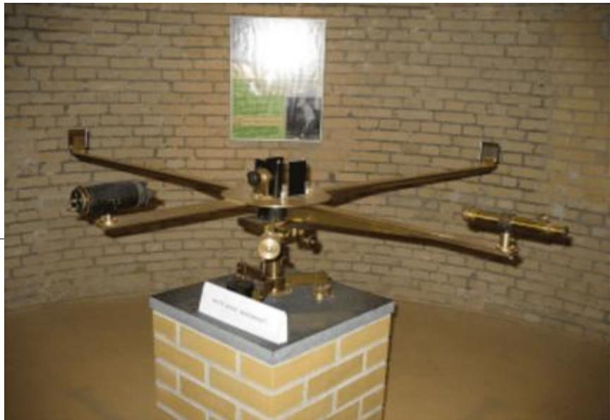

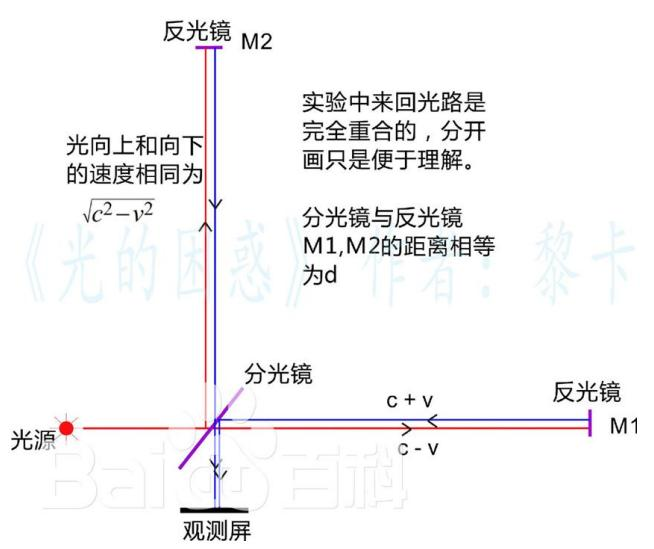

### 2. 应用范围

迈克尔逊干涉仪可用于测量光谱线的波长、介质折射率等；在天文学中，利用特种天体干涉仪还可测定远距离星体的直径等。

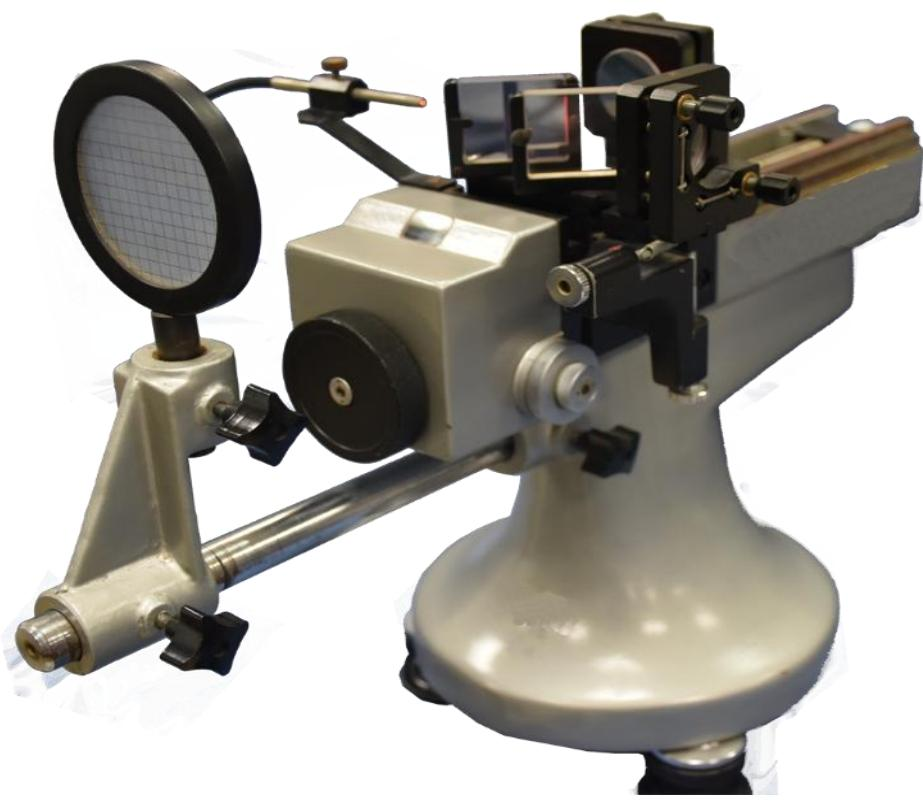

### 3. 实验目的

1. 了解迈克尔逊干涉仪的光学原理以及构造
2. 掌握迈克尔逊干涉仪的调整和使用方法
3. 利用迈克尔逊干涉仪测量单色光（He-Ne）激光的波长
4. 学会迈克尔逊干涉仪的读数方法以及采用逐差法处理数据

### 4. 实验仪器

*   激光器
*   分束板
*   补偿板
*   动反射镜 $M_2$
*   定反射镜 $M_1$

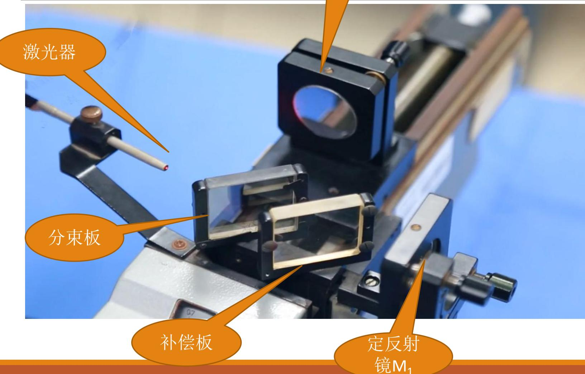

## 二、实验原理

### 1. 干涉条件

以明纹为例，当数出的干涉条纹冒出或消失1圈时，光程差变化 $\lambda$，对应镜面距离 $d$ 变化 $\lambda/2$。

$$
\delta = 2(d + \Delta d) = 2(k + 1) \cdot \frac{\lambda}{2}
$$

一般地，当数出的干涉条纹冒出或消失 $N$ 圈时，$d$ 变化 $N(\lambda/2)$：

$$
\begin{aligned}
\delta &= 2(d + \Delta d) \\
&= 2(k + N) \cdot \frac{\lambda}{2} \\
\Delta d &= N \frac{\lambda}{2}
\end{aligned}
$$

### 2. 不同光程差下的干涉图像

根据 $M_1$ 与 $M_2'$（$M_2$ 的像）的位置关系，可形成不同类型的干涉图样：

*   **$M_1$ 与 $M_2'$ 重合**：此时光程差为0，形成等倾干涉圆环的中心或白光干涉条纹。
*   **$M_1$ 平行于 $M_2'$**：形成等倾干涉圆环。
*   **$M_1$ 不平行于 $M_2'$**：形成等厚干涉直条纹。

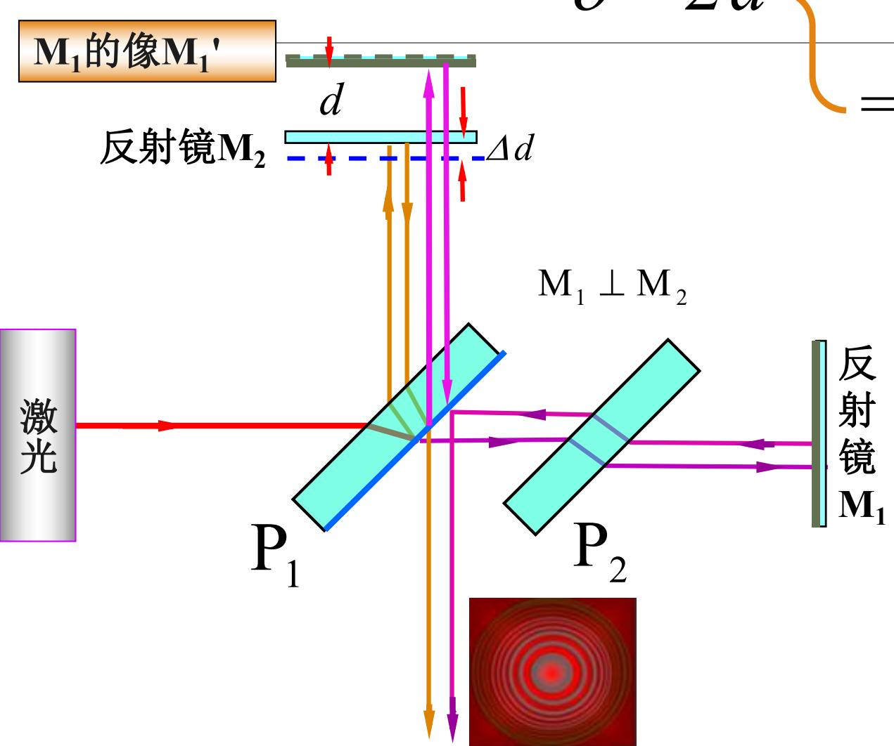

$$
\text{明纹: } \delta = 2d = 2k \cdot \frac{\lambda}{2}
$$
$$
\text{暗纹: } \delta = 2d = (2k + 1) \cdot \frac{\lambda}{2}
$$

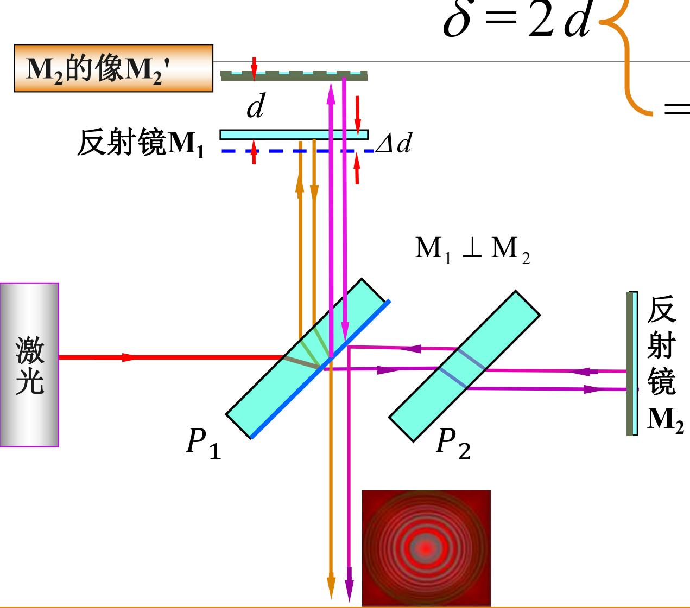

$$
\begin{array}{c c c} 
M_2' & M_2' & M_1 \text{与} M_2' \\ 
M_1 & M_1 & \text{重合} 
\end{array}
$$

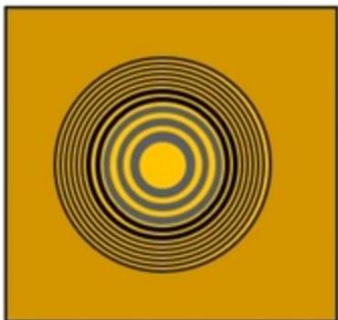

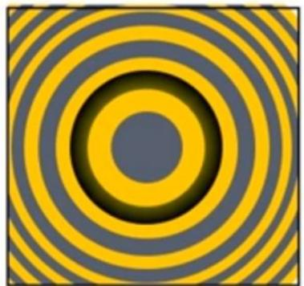

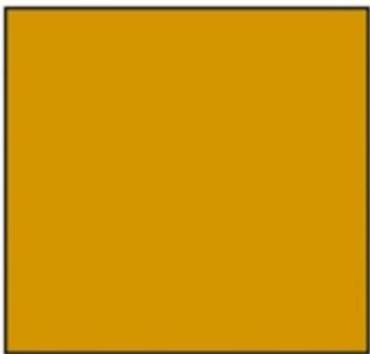

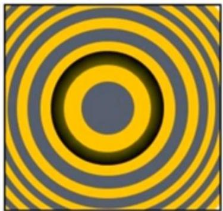

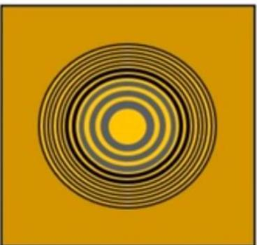

## 三、实验步骤

### 1. 调出干涉条纹

1.  转动粗调转轮，使主尺刻度位于 50mm 左右；
2.  移开观察屏，肉眼观察两排光点；
3.  调节动镜和定镜后面的螺钉，使两排光点重合，即代表两个平面反射镜垂直。

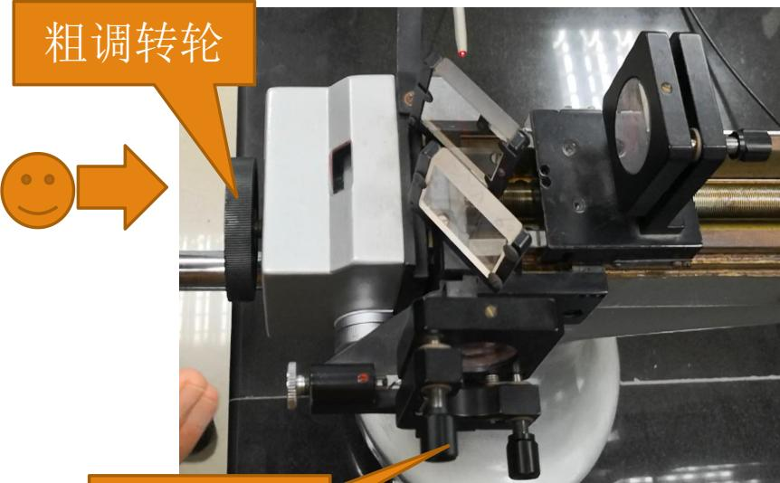

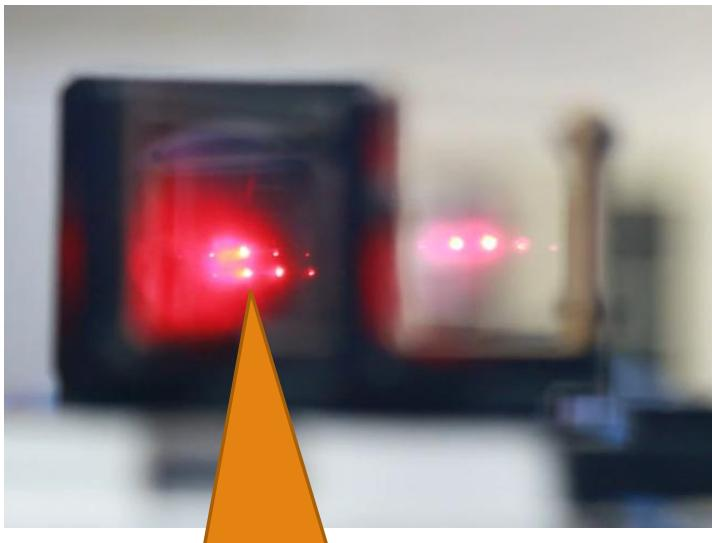

**两排最亮的光点**

只要屏幕出现如左图的细纹，则光点接近重合，直接在屏幕上观察，同时微调反射镜背后螺钉，调出最终的干涉条纹（如右图）。

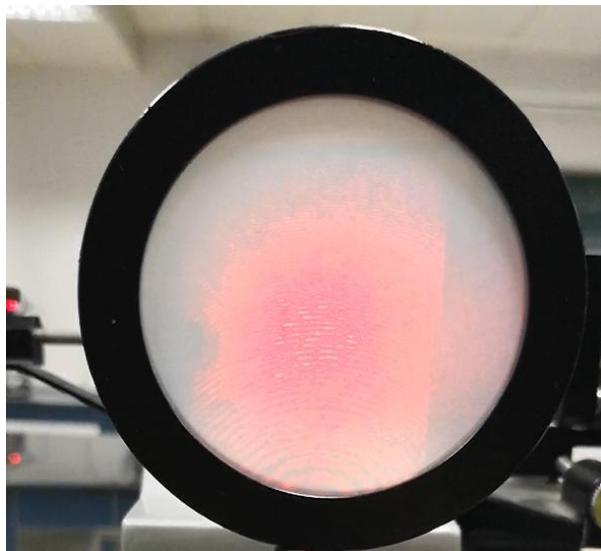

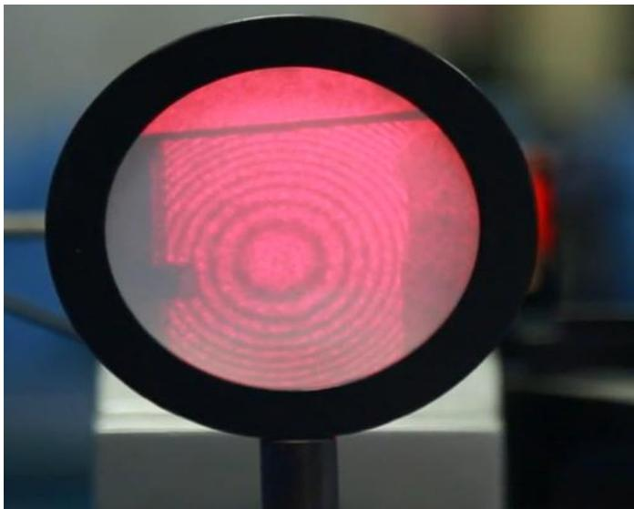

通过旋转微调手轮，就可以看到中心条纹有冒出或者陷入的现象。

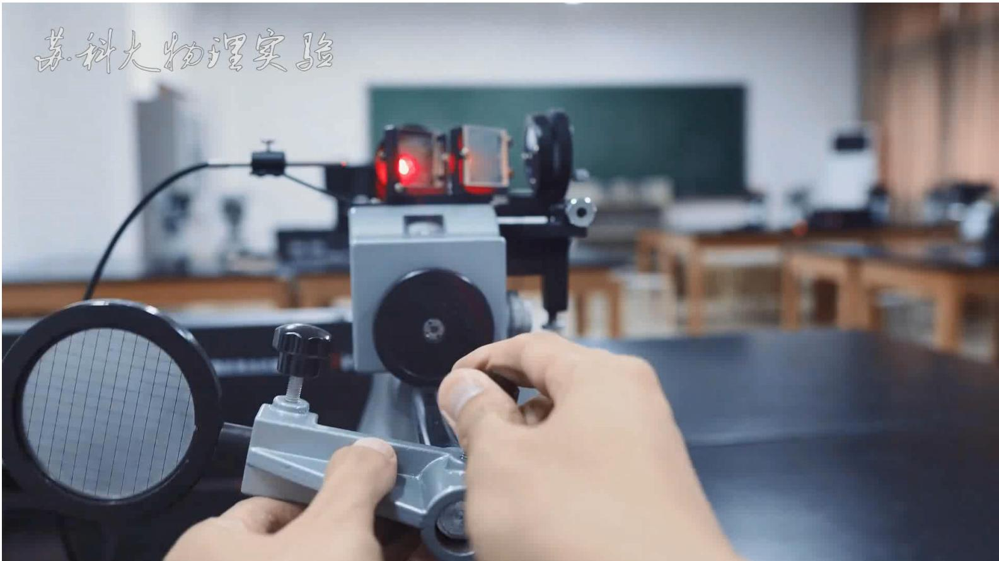

### 2. 消除回程差

1.  微调转轮和粗调转轮需朝一个方向旋转（同时顺时针或逆时针）；
2.  朝一个方向旋转微调转轮使得观察屏中干涉条纹的“冒出”或“消失”（多转几圈），以消除机械空程误差。

### 3. 记录数据

1.  连续冒出或消失条纹后，开始记录动镜 $M_1$ 的初始位置 $d_0$；
2.  沿原先方向转动微调转轮，数出条纹的数目，每隔 50 个条纹数记录动镜位置。

> **注意**：条纹易受环境影响，会抖动。因此出现抖动时，应停下计数，等不抖动了，继续数条纹变化数。

## 四、读数方法与数据处理

### 1. 读数系统

动镜 $M_2$（注：通常读数为动镜 $M_1$ 的位置，此处依原文标注）的位置由迈克尔逊干涉仪的读数系统确定，格式为 AA.BB.CCC mm。

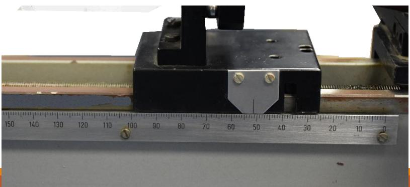

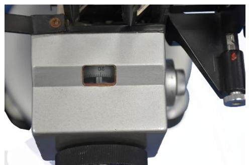

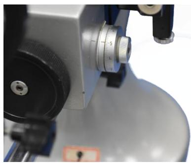

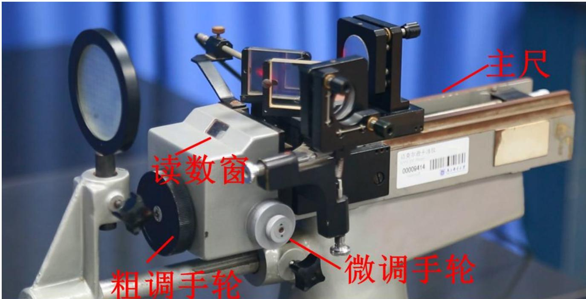

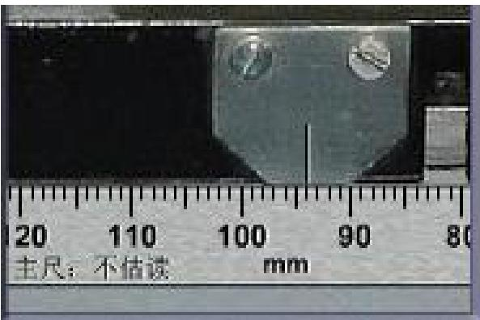

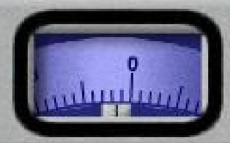

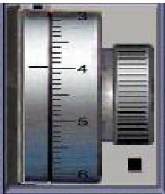

### 2. 数据表格

| 变化条纹数 | 动镜 $M_2$ 位置/mm | $N=150$ 个条纹, $M_2$ 移动距离 $\Delta d$/mm | 平均 $\Delta d$/mm | $\lambda = \frac{1}{N} \times 2 \times \Delta d$ |
| :--- | :--- | :--- | :--- | :--- |
| 第0条 | $d_0=$ | $\Delta d_1 = d_3 - d_0 =$ | | |
| 第50条 | $d_1=$ | | | |
| 第100条 | $d_2=$ | $\Delta d_2 = d_4 - d_1 =$ | | |
| 第150条 | $d_3=$ | | | |
| 第200条 | $d_4=$ | $\Delta d_3 = d_5 - d_2 =$ | | |
| 第250条 | $d_5=$ | | | |

## 数据处理

课后要求：

计算测量值 $(\Delta d, \lambda)$ 的不确定度，并且要求写出 $\Delta d$、$\lambda$ 的正确表达式（即 $\Delta d = \overline{\Delta d} \pm U_{\Delta d}$，$\lambda = \overline{\lambda} \pm U_{\lambda}$；注意末尾对齐）及相对误差。

提示：$U_{\Delta d} = \sqrt{U_{A,\Delta d}^2 + U_{B,\Delta d}^2}$；其中 B 类不确定度为 $0.00004\,\mathrm{mm}$（$U_{B,\Delta d} = 0.00004\,\mathrm{mm}$），A 类不确定度 $U_{A,\Delta d} = \dfrac{t}{\sqrt{n}}\sqrt{\sum_{i=1,\dots,n}\dfrac{(\Delta d_i - \overline{\Delta d})^2}{n-1}}$，$n$ 为测量次数；$U_N = U_{B,N} = 0.5$ 条数。$\lambda = \dfrac{2}{N}\Delta d$ 为间接测量。

### 数据处理

$$
\Delta d = \overline{\Delta d} \pm U_{\Delta d}\ (\mathrm{mm}), \qquad U_{A,\Delta d} = \frac{t}{\sqrt{n}}\sqrt{\sum_{i=1,\dots,n}\frac{(\Delta d_i - \overline{\Delta d})^2}{n-1}}
$$

解：

$$
U_{\Delta d} = \sqrt{U_{A,\Delta d}^2 + U_{B,\Delta d}^2}
$$

$U_{\Delta d}$：取一到两位有效数字，尾数只进不舍。首位非零数字 ≥5，取一位有效数字；首位非零数字＜5，取两位有效数字。

$$
U_{B,\Delta d} = 0.00004\,\mathrm{mm}
$$

$\overline{\Delta d}$：保证最后一位与修约后的 $U_{\Delta d}$ 末位对齐，修约规则：四舍六入五凑偶。

| 测量次数 $n$ | 2 | 3 | 4 | 5 | 6 | 7 | 8 | 9 | 10 |
|---|---|---|---|---|---|---|---|---|---|
| $t$ 因子 | 12.71 | 4.30 | 3.18 | 2.78 | 2.57 | 2.45 | 2.36 | 2.31 | 2.26 |
| $\dfrac{t}{\sqrt{n}}$ | 8.99 | 2.48 | 1.59 | 1.24 | 1.05 | 0.93 | 0.84 | 0.77 | 0.72 |

### 数据处理

$$
E_{rX} = \frac{U_X}{\overline{X}} = \sqrt{\sum_{i=1}^{n}\left(\frac{\partial \ln f}{\partial x_i}\right)^2 U_{x_i}^2}
$$

解：$\lambda = \overline{\lambda} \pm U_{\lambda}\ (\mathrm{nm})$

波长平均值：$\overline{\lambda} = \dfrac{2}{\overline{N}}\overline{\Delta d}$

将 $\lambda = \dfrac{2}{N}\Delta d$ 两边取对数

$$
\ln \lambda = \ln 2 - \ln N + \ln \Delta d
$$

对变量 $N$ 和 $\Delta d$ 求偏导

$$
\frac{\partial \ln \lambda}{\partial N} = -\frac{1}{N}
$$

$$
\frac{\partial \ln \lambda}{\partial \Delta d} = \frac{1}{\Delta d}
$$

### 数据处理

根据相对不确定度公式得到：

$$
\begin{aligned}
U_{\lambda} &= E_{r\lambda} \cdot \overline{\lambda} \\
&= \overline{\lambda}\sqrt{\left(-\frac{1}{N}\right)^2 U_N^2 + \left(\frac{1}{\Delta d}\right)^2 U_{\Delta d}^2} \\
&= \overline{\lambda}\sqrt{\left(-\frac{1}{N}\right)^2 U_N^2 + \left(\frac{1}{\overline{\Delta d}}\right)^2 U_{\Delta d}^2}
\end{aligned}
$$

$N$ 的不确定度

$$
U_N = U_{B,N} = 0.5\ \text{条数}, \qquad N = 150, \qquad U_N/N = \pm 0.5\%
$$

### 数据处理

波长表达式为

$$
\lambda = \overline{\lambda} \pm U_{\lambda}\ (\mathrm{nm})
$$

$U_{\lambda}$：取一到两位有效数字，尾数只进不舍。首位非零数字 ≥5，取一位有效数字；首位非零数字＜5，取两位有效数字。

$\overline{\lambda}$：保证最后一位与修约后的 $U_{\lambda}$ 末位对齐，修约规则：四舍六入五凑偶。

### 谢谢！
