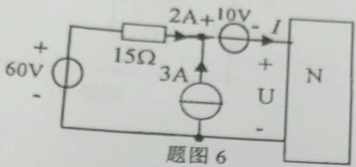

# 2014-2015学年《电路分析基础A》期末试卷

原件经识别和整理；“参考解答”是我们补的。

## 二、填空题(每空2分，共20分)

### 填空 1

题图 6 所示电路中，电流 $I=$ \_\_\_\_ A；电压 $U=$ \_\_\_\_ V；3A 电流源吸收功率 $P_{I_{s}}=$ \_\_\_\_ W；网络 N 吸收功率 $P_{N}=$ \_\_\_\_ W。

知识点：[基尔霍夫电流定律（KCL）及其应用](../../../topics/电路与电子技术/KCL.md)、[元件吸收与产生功率的计算与判断](../../../topics/电路与电子技术/功率计算.md)、[电流、电压的参考方向及关联参考方向](../../../topics/电路与电子技术/参考方向.md)

### 填空 2

对于具有 n 个节点，b 条支路的连通网络 N，有 \_\_\_\_ 个独立节点，可列 \_\_\_\_ 个独立的 KCL 方程，可列 \_\_\_\_ 独立的 KVL 方程。

知识点：[基尔霍夫电流定律（KCL）及其应用](../../../topics/电路与电子技术/KCL.md)、[基尔霍夫电压定律（KVL）及其应用](../../../topics/电路与电子技术/KVL.md)

### 填空 3

题图 7 所示电路相量模型，已知端口电压有效值 $U = 100 \mathrm{~V}$ ，则该网络的平均功率 $P =$ \_\_\_\_ W，无功功率 $Q =$ \_\_\_\_ Var，视在功率 $S =$ \_\_\_\_ VA。

## 三、简单计算题（每题6分，共42分）

(本题请写出简明的解题步骤)

知识点：[元件吸收与产生功率的计算与判断](../../../topics/电路与电子技术/功率计算.md)

### 计算 1

化简题图 8 所示电路为最简形式。

知识点：[理想电压源与理想电流源的特性](../../../topics/电路与电子技术/独立电源.md)、[四种受控电源（VCVS、VCCS、CCVS、CCCS）的特性](../../../topics/电路与电子技术/受控电源.md)、[基尔霍夫电流定律（KCL）及其应用](../../../topics/电路与电子技术/KCL.md)

### 计算 2

试用节点分析法求题图 9 所示电路中的电流 i。

知识点：[基尔霍夫电流定律（KCL）及其应用](../../../topics/电路与电子技术/KCL.md)、[线性时不变电阻的伏安关系（欧姆定律）](../../../topics/电路与电子技术/线性电阻VCR.md)、[理想电压源与理想电流源的特性](../../../topics/电路与电子技术/独立电源.md)

### 计算 3

某二端网络的端电压、端电流分别为 $u(t) = 3 + 2\cos \left(t + \frac{\pi}{4}\right) + 2\cos \left(2t - \frac{\pi}{4}\right)\mathrm{V}$ , $i(t) = 5\sqrt{2}\cos t + 2\cos \left(2t + \frac{\pi}{4}\right)\mathrm{A}$ , 且 $i(t)$ 和 $u(t)$ 取关联参考方向, 试求: (1) 电压、电流的有效值; (2) 网络吸收的平均功率 $\mathbb{P}$ 。

知识点：[电流、电压的参考方向及关联参考方向](../../../topics/电路与电子技术/参考方向.md)、[元件吸收与产生功率的计算与判断](../../../topics/电路与电子技术/功率计算.md)
