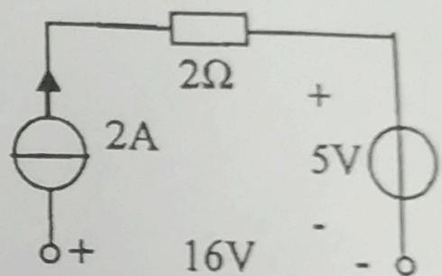

# 2014-2015学年第二学期《电路分析基础A》期末试卷

原件经识别和整理；“参考解答”是我们补的。

## 一、选择题（每题2分，共10分）

### 选择 1

题图 1 所示电路中, 电流源发出的功率为

- A. $14 \mathrm{~W}$
- B. $-14 \mathrm{~W}$
- C. $22 \mathrm{~W}$
- D. $-22 \mathrm{~W}$

知识点：[电流、电压的参考方向及关联参考方向](../../../topics/电路与电子技术/参考方向.md)、[理想电压源与理想电流源的特性](../../../topics/电路与电子技术/独立电源.md)、[元件吸收与产生功率的计算与判断](../../../topics/电路与电子技术/功率计算.md)

### 选择 2

电路如题图2所示, 其ab端的等效电阻为

- A. $8 \Omega$
- B. $9 \Omega$
- C. $12 \Omega$
- D. $6 \Omega$

知识点：[线性时不变电阻的伏安关系（欧姆定律）](../../../topics/电路与电子技术/线性电阻VCR.md)

### 选择 3

题图 3 所示电路的时间常数 $\tau$ 为

- A. 1s
- B. 2s
- C. 4s
- D. 3s

知识点：[理想电压源与理想电流源的特性](../../../topics/电路与电子技术/独立电源.md)、[线性时不变电阻的伏安关系（欧姆定律）](../../../topics/电路与电子技术/线性电阻VCR.md)、[基尔霍夫电流定律（KCL）及其应用](../../../topics/电路与电子技术/KCL.md)

### 选择 4

题图 4 所示正弦稳态电路中, 已知 ${I}_{\mathrm{C}} = 4\mathrm{\;A},{I}_{\mathrm{L}} = 3\mathrm{\;A}$ 则电流 $I$ 为

- A. 1A
- B. 7A
- C. 5A
- D. $\sqrt{5} \mathrm{~A}$

知识点：[基尔霍夫电流定律（KCL）及其应用](../../../topics/电路与电子技术/KCL.md)、[理想电压源与理想电流源的特性](../../../topics/电路与电子技术/独立电源.md)、[线性时不变电阻的伏安关系（欧姆定律）](../../../topics/电路与电子技术/线性电阻VCR.md)

### 选择 5

题图 5 所示含理想变压器电路，其 ab 端的等效阻抗 $Z_{\mathrm{ab}}$ 等于

- A. $4 \Omega$
- B. $2 \Omega$
- C. $1 / 4 \Omega$
- D. $1 / 2 \Omega$

知识点：[理想电压源与理想电流源的特性](../../../topics/电路与电子技术/独立电源.md)、[线性时不变电阻的伏安关系（欧姆定律）](../../../topics/电路与电子技术/线性电阻VCR.md)、[四种受控电源（VCVS、VCCS、CCVS、CCCS）的特性](../../../topics/电路与电子技术/受控电源.md)
