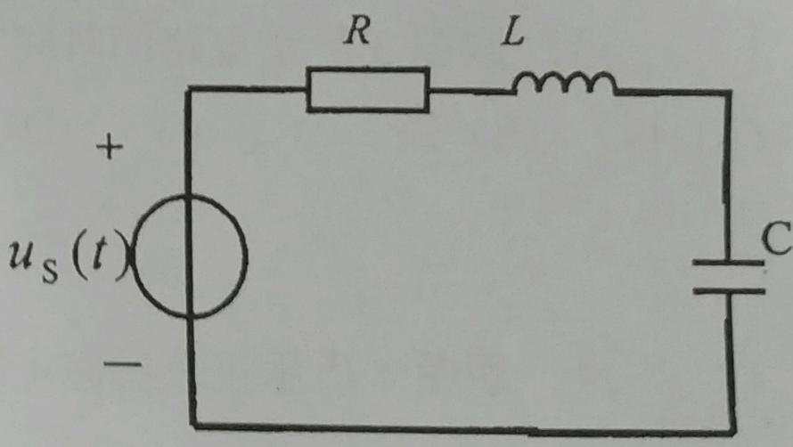
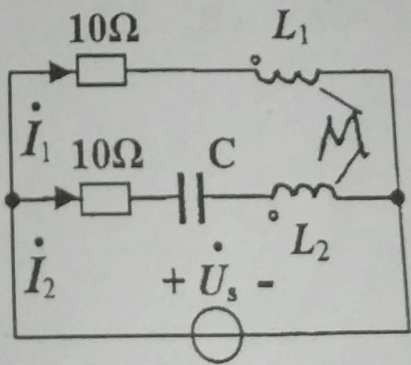

# 2014—2015 学年第二学期《电路分析基础 A》期末试卷

原件经识别和整理；“参考解答”是我们补的。

# 2014—2015 学年第二学期《电路分析基础 A》期末试卷

## 四、综合计算题（第1-2题每题10分，第3题8分，共28分）

### 综合 1

题图 14 所示电路中，已知当 $u_{S}(t)=\varepsilon(t)\mathrm{V}$ ， $i_{S}(t)=0\mathrm{A}$ 时， $u_{C}(t)=2e^{-2t}+\frac{1}{2}\mathrm{V}$ （$t>0$）；当 $i_{S}(t)=\varepsilon(t)\mathrm{A}$ ， $u_{S}(t)=0\mathrm{V}$ 时，$u_{C}(t) = \frac{1}{2} e^{-2t} + 2\mathrm{V}$ （$t > 0$）。试求 $R_{1}$ 、 $R_{2}$ 和 $C$ 。

知识点：[线性时不变电阻的伏安关系（欧姆定律）](../../../topics/电路与电子技术/线性电阻VCR.md)、[基尔霍夫电流定律（KCL）及其应用](../../../topics/电路与电子技术/KCL.md)、[基尔霍夫电压定律（KVL）及其应用](../../../topics/电路与电子技术/KVL.md)

### 综合 2

题图 15 所示 RLC 串联谐振电路中，已知 $u_{s}(t)=100\cos\omega_{0}t\ \mathrm{mV}$，其中 $\omega_{0}$ 为电路谐振角频率，$C=400\mathrm{pF}$，$R$ 上消耗的功率为 $5\mathrm{mW}$，电路通频带 $Bw=4\times10^{4}\mathrm{rad/s}$。试求 $R$、$L$、$\omega_{0}$、$U_{C0}$。

知识点：[线性时不变电阻的伏安关系（欧姆定律）](../../../topics/电路与电子技术/线性电阻VCR.md)、[理想电压源与理想电流源的特性](../../../topics/电路与电子技术/独立电源.md)

### 综合 3

题图 16 所示电路，已知 $L_{1}=2\mathrm{mH}, L_{2}=1\mathrm{mH}, M=1\mathrm{mH}, U_{s}=20\mathrm{V}$，电源角频率 $\omega=10^{4}\mathrm{rad/s}$，且 $I_{1}=I_{2}$，求电容 $C$ 的值。

知识点：[理想电压源与理想电流源的特性](../../../topics/电路与电子技术/独立电源.md)、[基尔霍夫电压定律（KVL）及其应用](../../../topics/电路与电子技术/KVL.md)、[线性时不变电阻的伏安关系（欧姆定律）](../../../topics/电路与电子技术/线性电阻VCR.md)
