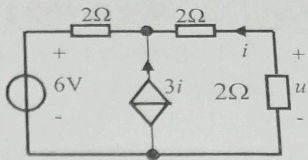
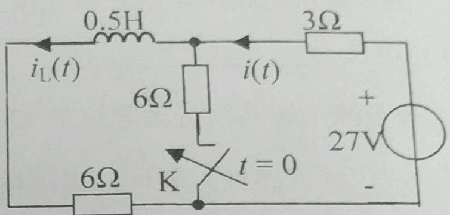
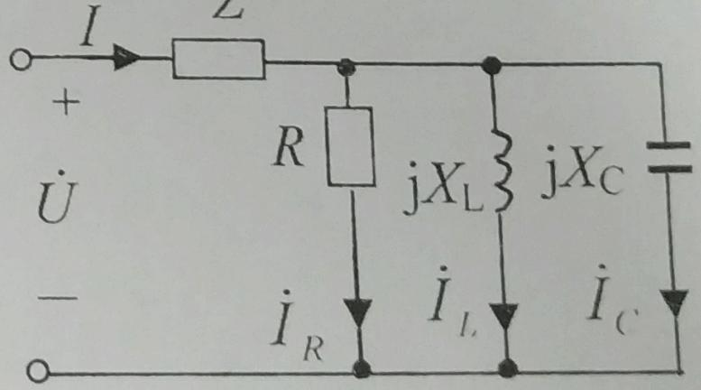

# 2015—2016 学年第二学期《电路分析基础 A》期末试卷

原件经识别和整理；“参考解答”是我们补的。

## 六、计算题

### 计算 3

试用戴维南定理求图 10 所示电路中的电压 $u$。

知识点：[理想电压源与理想电流源的特性](../../../topics/电路与电子技术/独立电源.md)、[线性时不变电阻的伏安关系（欧姆定律）](../../../topics/电路与电子技术/线性电阻VCR.md)、[基尔霍夫电压定律（KVL）及其应用](../../../topics/电路与电子技术/KVL.md)

### 计算 4

图 11 所示电路，原已处于稳态，在 $t = 0$ 时开关 K 闭合，试求 $t > 0$ 时的 $i(t)$。（用三要素法求解）

知识点：[基尔霍夫电压定律（KVL）及其应用](../../../topics/电路与电子技术/KVL.md)、[基尔霍夫电流定律（KCL）及其应用](../../../topics/电路与电子技术/KCL.md)、[线性时不变电阻的伏安关系（欧姆定律）](../../../topics/电路与电子技术/线性电阻VCR.md)

### 计算 5

图 12 中已知：$Z = 2 + \mathrm{j}2\,\Omega$，$I_{\mathrm{R}} = 5\,\mathrm{A}$，$I_{\mathrm{L}} = 3\,\mathrm{A}$，$I_{\mathrm{C}} = 8\,\mathrm{A}$，且总平均功率 $P = 200\,\mathrm{W}$，求 $U = ?$

知识点：[基尔霍夫电流定律（KCL）及其应用](../../../topics/电路与电子技术/KCL.md)、[元件吸收与产生功率的计算与判断](../../../topics/电路与电子技术/功率计算.md)、[基尔霍夫电压定律（KVL）及其应用](../../../topics/电路与电子技术/KVL.md)
