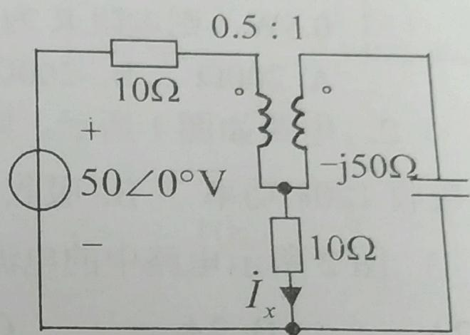
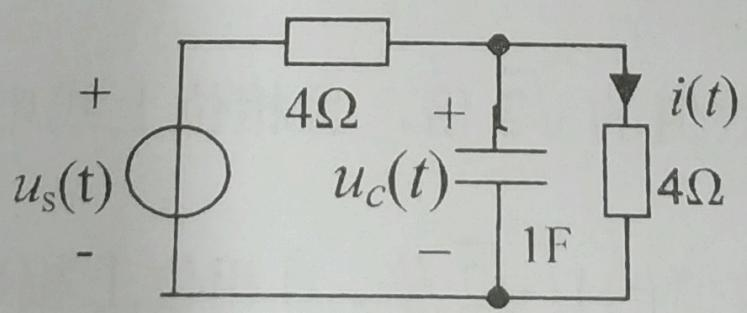
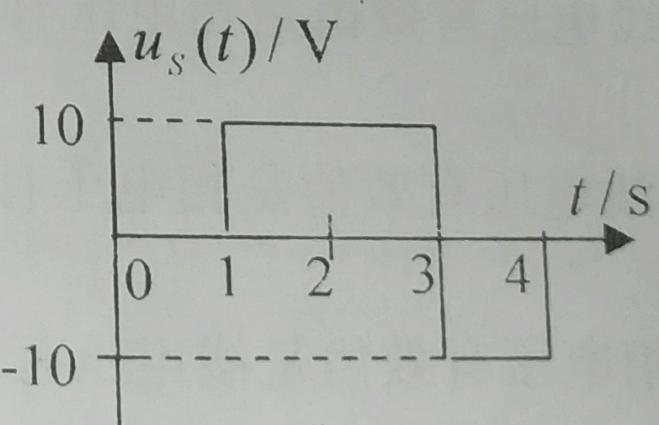

# 2015—2016学年《电路分析基础A》期末试卷

原件经识别和整理；“参考解答”是我们补的。

## 四、综合计算题（每题10分，共30分）

### 综合 1

正弦稳态电路如图 13 所示，若 $Z_{\mathrm{L}}$ 可变，请问 $Z_{\mathrm{L}}$ 为何值时可获得最大功率？最大功率 $P_{\mathrm{max}}$ 为多少？

知识点：[理想电压源与理想电流源的特性](../../../topics/电路与电子技术/独立电源.md)、[线性时不变电阻的伏安关系（欧姆定律）](../../../topics/电路与电子技术/线性电阻VCR.md)、[基尔霍夫电压定律（KVL）及其应用](../../../topics/电路与电子技术/KVL.md)

### 综合 2

试求图 14 所示电路中的电流相量 $\dot{I}_{x}$ 。

知识点：[理想电压源与理想电流源的特性](../../../topics/电路与电子技术/独立电源.md)、[线性时不变电阻的伏安关系（欧姆定律）](../../../topics/电路与电子技术/线性电阻VCR.md)、[基尔霍夫电流定律（KCL）及其应用](../../../topics/电路与电子技术/KCL.md)

### 综合 3

电路如图 15(a) 所示, 已知 $u_{c}(0^{-}) = 2 \mathrm{~V}$ 及 $u_{s}(t)$ 的波形如图 (b) 所示, 试求 $t > 0$ 时的电流 $i(t)$ 。

知识点：[基尔霍夫电压定律（KVL）及其应用](../../../topics/电路与电子技术/KVL.md)、[电流、电压的参考方向及关联参考方向](../../../topics/电路与电子技术/参考方向.md)、[理想电压源与理想电流源的特性](../../../topics/电路与电子技术/独立电源.md)
