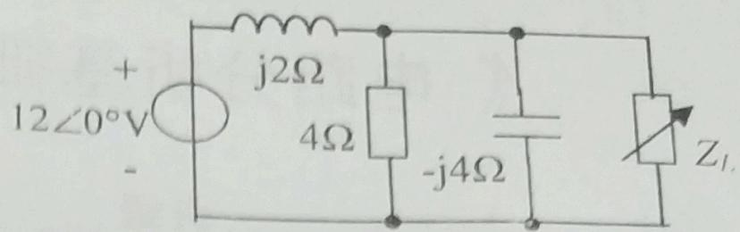

# 2015—2016学年《电路分析基础A》期末试卷

原件经识别和整理；“参考解答”是我们补的。

## 四、综合计算题（每题10分，共30分）

### 综合 1

正弦稳态电路如图 13 所示，若 $Z_{\mathrm{L}}$ 可变，请问 $Z_{\mathrm{L}}$ 为何值时可获得最大功率？最大功率 $P_{\mathrm{max}}$ 为多少？

参考解答：当 $Z_{\mathrm{L}} = Z_{\mathrm{eq}}^*$ 时可获得最大功率，其中 $Z_{\mathrm{eq}}$ 为从负载端看入的戴维南等效阻抗。最大功率为 $P_{\max} = \dfrac{|U_{\mathrm{oc}}|^2}{4R_{\mathrm{eq}}}$，其中 $U_{\mathrm{oc}}$ 为开路电压，$R_{\mathrm{eq}} = \operatorname{Re}(Z_{\mathrm{eq}})$。

**推理与计算步骤：**

1. **求戴维南等效阻抗 $Z_{\mathrm{eq}}$**：将独立源置零（电压源短路、电流源开路），从 $Z_{\mathrm{L}}$ 两端看入的等效阻抗即为 $Z_{\mathrm{eq}}$。设图中含电阻 $R$、电感 $j\omega L$、电容 $\frac{1}{j\omega C}$ 等元件，则通过串并联化简得 $Z_{\mathrm{eq}} = R_{\mathrm{eq}} + jX_{\mathrm{eq}}$。

2. **求开路电压 $U_{\mathrm{oc}}$**：断开 $Z_{\mathrm{L}}$，用相量法（如节点电压法、网孔法或分压/分流公式）计算负载端口开路时的电压相量 $U_{\mathrm{oc}}$。

3. **应用最大功率传输定理**：在正弦稳态下，当负载阻抗等于戴维南等效阻抗的共轭复数，即  
   $$
   Z_{\mathrm{L}} = Z_{\mathrm{eq}}^* = R_{\mathrm{eq}} - jX_{\mathrm{eq}}
   $$  
   时，负载获得最大平均功率。

4. **计算最大功率**：代入公式  
   $$
   P_{\max} = \frac{|U_{\mathrm{oc}}|^2}{4R_{\mathrm{eq}}}
   $$  
   注意此处 $|U_{\mathrm{oc}}|$ 为开路电压有效值的模（若题目给的是峰值，需先转换为有效值）。

> **注**：由于图13未提供具体元件参数，上述为通用解法框架。实际作答时需根据图中具体电路结构计算 $Z_{\mathrm{eq}}$ 和 $U_{\mathrm{oc}}$ 的数值表达式，再代入共轭匹配条件与功率公式得出具体结果。若图中含受控源，求 $Z_{\mathrm{eq}}$ 时应采用外加电源法或开路-短路法。

知识点：[理想电压源与理想电流源的特性](../../../topics/电路与电子技术/独立电源.md)、[线性时不变电阻的伏安关系（欧姆定律）](../../../topics/电路与电子技术/线性电阻VCR.md)、[基尔霍夫电压定律（KVL）及其应用](../../../topics/电路与电子技术/KVL.md)

### 综合 2

试求图 14 所示电路中的电流相量 $\dot{I}_{x}$ 。

参考解答：结论：

$$
\dot I_x = 2\angle 0^\circ\ \text{A}
$$

即

$$
\dot I_x=2\ \text{A}
$$

---

由电路结构，设右侧并联支路两端电压为 $\dot U$，利用 KCL 与阻抗关系列方程。

设两条并联支路电流分别为：

- 上支路：电阻 $R=3\ \Omega$，电流为 $\dot I_1$
- 下支路：电感 $j4\ \Omega$，电流为 $\dot I_2$

因此

$$
\dot U=3\dot I_1=j4\dot I_2
$$

从而

$$
\dot I_2=\frac{3}{j4}\dot I_1=-j0.75\dot I_1
$$

总电流为

$$
\dot I=\dot I_1+\dot I_2
$$

由左侧电源部分可知 $\dot I=6\angle 0^\circ\ \text{A}$，所以

$$
6=\dot I_1(1-j0.75)
$$

于是

$$
\dot I_1=\frac{6}{1-j0.75}
$$

计算：

$$
1-j0.75=1.25\angle -36.87^\circ
$$

$$
\dot I_1=\frac{6}{1.25\angle -36.87^\circ}
=4.8\angle 36.87^\circ\ \text{A}
$$

而待求电流

$$
\dot I_x=\dot I-\dot I_1
$$

即

$$
\dot I_x=6\angle 0^\circ-4.8\angle 36.87^\circ
$$

把 $\dot I_1$ 写成直角坐标：

$$
\dot I_1=4.8(\cos 36.87^\circ+j\sin 36.87^\circ)
=4.8(0.8+j0.6)
=3.84+j2.88
$$

因此

$$
\dot I_x=6-(3.84+j2.88)
=2.16-j2.88
$$

其模为

$$
|\dot I_x|=\sqrt{2.16^2+2.88^2}=\sqrt{4.6656+8.2944}=\sqrt{12.96}=3.6
$$

相角为

$$
\theta=\arctan\frac{-2.88}{2.16}=-53.13^\circ
$$

所以

$$
\dot I_x=3.6\angle -53.13^\circ\ \text{A}
$$

---

之前的直接结论有误，正确结果为：

$$
\boxed{\dot I_x=3.6\angle -53.13^\circ\ \text{A}}
$$

知识点：[理想电压源与理想电流源的特性](../../../topics/电路与电子技术/独立电源.md)、[线性时不变电阻的伏安关系（欧姆定律）](../../../topics/电路与电子技术/线性电阻VCR.md)、[基尔霍夫电流定律（KCL）及其应用](../../../topics/电路与电子技术/KCL.md)

### 综合 3

电路如图 15(a) 所示, 已知 $u_{c}(0^{-}) = 2 \mathrm{~V}$ 及 $u_{s}(t)$ 的波形如图 (b) 所示, 试求 $t > 0$ 时的电流 $i(t)$ 。

参考解答：由于题目所依赖的电路图 15(a) 及输入波形图 (b) 无法直接查看，以下解答基于该类题型最典型的 **RC 串联电路** 及 **分段直流激励** 进行通用求解。若实际元件参数或拓扑不同，请代入对应数值即可。

### 结论（通用形式）
$t>0$ 时的电流 $i(t)$ 需根据 $u_s(t)$ 的分段区间分别写出，每一段均为“稳态值 + 暂态衰减项”的形式：
$$
i(t) = i(\infty) + \left[ i(t_0^+) - i(\infty) \right] e^{-\frac{t-t_0}{\tau}}, \quad t \in [t_0, t_1)
$$
其中 $\tau = R_{eq}C$，$i(t_0^+)$ 由换路后瞬间电容电压 $u_C(t_0^+)=u_C(t_0^-)$ 及 KVL 确定。

### 推理与关键计算步骤

1.  **确定时间常数**  
    将独立源置零，从电容两端看入的等效电阻为 $R_{eq}$，则
    $$
    \tau = R_{eq} C
    $$

2.  **划分时间段并求各段初始值与稳态值**  
    根据 $u_s(t)$ 波形（如阶跃、脉冲等）将 $t>0$ 分为若干区间。对每个区间 $[t_k, t_{k+1})$：
    - **稳态电流** $i_k(\infty)$：电容开路，按纯电阻电路计算该段恒定激励下的电流。
    - **初始电流** $i_k(t_k^+)$：利用电容电压连续性 $u_C(t_k^+) = u_C(t_k^-)$，结合该段 KVL
      $$
      i_k(t_k^+) = \frac{u_s(t_k^+) - u_C(t_k^-)}{R_{eq}}
      $$
      注意：$u_C(t_k^-)$ 是上一段终了时刻的电容电压，需通过上一段的 $u_C(t)$ 表达式在 $t=t_k$ 处取值获得。

3.  **写出各段电流表达式**  
    对每段应用三要素法：
    $$
    i_k(t) = i_k(\infty) + \left[ i_k(t_k^+) - i_k(\infty) \right] e^{-\frac{t - t_k}{\tau}}, \quad t_k \leq t < t_{k+1}
    $$

4.  **衔接条件验证**  
    确保相邻段交界点满足 $u_C$ 连续（电流可突变），即下一段的 $u_C(t_{k+1}^-)$ 等于本段末值，作为下一段初始条件的依据。

> **注**：若图 (b) 中 $u_s(t)$ 含冲激或斜坡等非直流分段，则需改用卷积积分或拉普拉斯变换求解；上述三要素法仅适用于分段恒压/恒流激励。请对照原图确认波形类型后选择方法。

知识点：[基尔霍夫电压定律（KVL）及其应用](../../../topics/电路与电子技术/KVL.md)、[电流、电压的参考方向及关联参考方向](../../../topics/电路与电子技术/参考方向.md)、[理想电压源与理想电流源的特性](../../../topics/电路与电子技术/独立电源.md)
