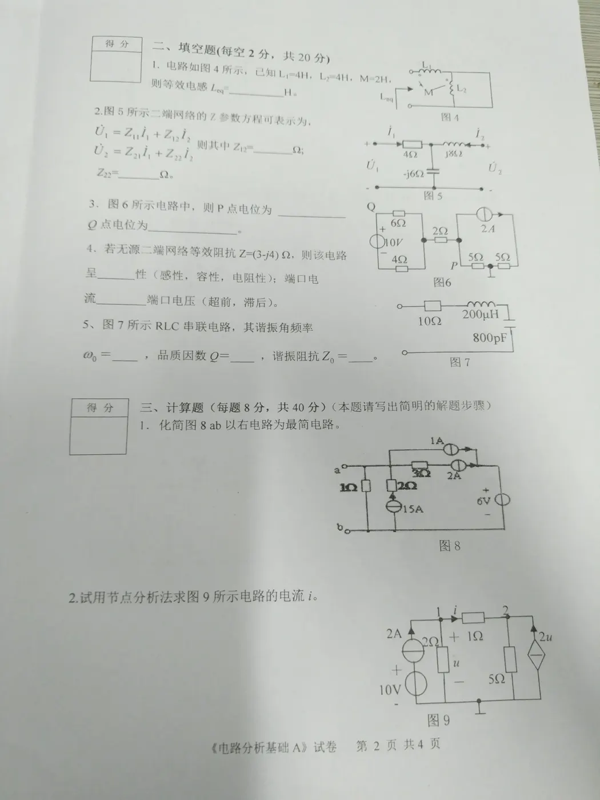
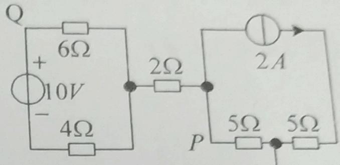
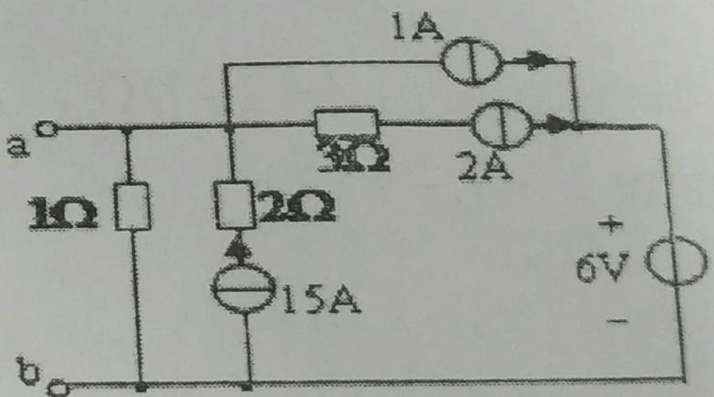
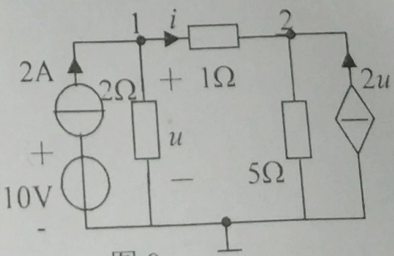

# 2015—2016学年第二学期《电路分析基础A》期末试卷

原件经识别和整理；“参考解答”是我们补的。

# 2015—2016学年第二学期《电路分析基础A》期末试卷

本资料由识别工具读取并整理，修正了部分断行和格式错误。

## 二、填空题（每空 2 分，共 20 分）

### 填空 1

题干：电路如图4所示，已知 $L_{1} = 4H$ ， $L_{2} = 4H$ ， $M = 2H$ 则等效电感 $L_{\mathrm{eq}} =$ \_\_\_\_ H。

### 填空 2

题干：图5所示二端网络的Z参数方程可表示为 $\dot{U}_1 = Z_{11}\dot{I}_1 + Z_{12}\dot{I}_2$ 则其中 $Z_{12} = \_\_\_\_\Omega$；$\dot{U}_2 = Z_{21}\dot{I}_1 + Z_{22}\dot{I}_2$，$Z_{22} = \_\_\_\_\Omega$。

参考解答：$Z_{12}=-j6\,\Omega$，$Z_{22}=0\,\Omega$。

图5是 T 型二端口：左支路 $4\,\Omega$、中间支路 $-j6\,\Omega$、右支路 $j6\,\Omega$。按图示两端口电流均流入网络，公共支路电流为 $\dot I_1+\dot I_2$，因此

$$
\dot U_1=4\dot I_1-j6(\dot I_1+\dot I_2),\qquad
\dot U_2=j6\dot I_2-j6(\dot I_1+\dot I_2)=-j6\dot I_1.
$$

与 Z 参数方程逐项比较，得到上述结果。此图没有受控电源，不能套用其他二端口的参数。

知识点：[理想电压源与理想电流源的特性](../../../topics/电路与电子技术/独立电源.md)、[线性时不变电阻的伏安关系（欧姆定律）](../../../topics/电路与电子技术/线性电阻VCR.md)、[基尔霍夫电压定律（KVL）及其应用](../../../topics/电路与电子技术/KVL.md)

### 填空 3

题干：图6所示电路中, P点电位为\_\_\_\_。Q点电位为\_\_\_\_。

参考解答：$V_P=-10\,\mathrm V$，$V_Q=-4\,\mathrm V$。

右侧 $2\,\mathrm A$ 电流源从 P 节点流向右上节点，回流经两个 $5\,\Omega$ 电阻。左侧电路仅通过一个 $2\,\Omega$ 支路连接到 P，故该连接支路电流为零，左右连接点等电位。

流经 P 与地之间 $5\,\Omega$ 电阻的电流从地流向 P，故

$$V_P=0-2\times5=-10\,\mathrm V.$$

左侧 $10\,\mathrm V$ 电压源与 $6\,\Omega$、$4\,\Omega$ 电阻构成回路，电流为 $10/(6+4)=1\,\mathrm A$。Q 比连接点高 $6\,\mathrm V$，因此

$$V_Q=V_P+1\times6=-4\,\mathrm V.$$

知识点：[基尔霍夫电压定律（KVL）及其应用](../../../topics/电路与电子技术/KVL.md)、[线性时不变电阻的伏安关系（欧姆定律）](../../../topics/电路与电子技术/线性电阻VCR.md)

### 填空 4

题干：若无源二端网络等效阻抗 $Z = (3 - j4)\Omega$ ，则该电路呈\_\_\_\_性（感性，容性，电阻性）；端口电流\_\_\_\_端口电压（超前，滞后）。

知识点：[基尔霍夫电压定律（KVL）及其应用](../../../topics/电路与电子技术/KVL.md)

### 填空 5

题干：图7所示RLC串联电路，其谐振角频率 $\omega_{0}=$ \_\_\_\_ ，品质因数Q=\_\_\_\_ ，谐振阻抗 $Z_{0}=$ \_\_\_\_ 。

知识点：[理想电压源与理想电流源的特性](../../../topics/电路与电子技术/独立电源.md)、[线性时不变电阻的伏安关系（欧姆定律）](../../../topics/电路与电子技术/线性电阻VCR.md)、[基尔霍夫电压定律（KVL）及其应用](../../../topics/电路与电子技术/KVL.md)

代入原图 $R=10\,\Omega$、$L=200\,\mu\mathrm H$、$C=800\,\mathrm{pF}$，得 $\omega_0=2.5\times10^6\,\mathrm{rad/s}$、$Q=50$、$Z_0=10\,\Omega$。

## 三、计算题（每题 8 分，共 40 分）
（本题请写出简明的解题步骤）

### 计算 1

题干：化简图 8 ab 以右电路为最简电路。

参考解答：ab 以右电路等效为 $12\,\mathrm V$ 电压源串联 $1\,\Omega$ 电阻，电压源正极在 a 端；等价的诺顿形式为 $12\,\mathrm A$ 电流源（b 指向 a）并联 $1\,\Omega$ 电阻。

求开路电压时，在 a 节点列 KCL。$15\,\mathrm A$ 电流源向 a 注入电流；上方 $1\,\mathrm A$ 和中间 $2\,\mathrm A$ 电流源均从 a 流向右侧，余下电流通过 $1\,\Omega$ 电阻流向 b：

$$\frac{U_{ab}}{1}+1+2=15\quad\Rightarrow\quad U_{oc}=12\,\mathrm V.$$

求等效电阻时，将全部独立电流源开路、$6\,\mathrm V$ 电压源短路。与理想电流源串联的 $2\,\Omega$、$3\,\Omega$ 支路均断开，端口仅剩 $1\,\Omega$，故 $R_{th}=1\,\Omega$。

知识点：[理想电压源与理想电流源的特性](../../../topics/电路与电子技术/独立电源.md)、[线性时不变电阻的伏安关系（欧姆定律）](../../../topics/电路与电子技术/线性电阻VCR.md)

### 计算 2

题干：试用节点分析法求图9所示电路的电流i。

参考解答：按图示由节点1指向节点2的参考方向，$i=3\,\mathrm A$。

取下方公共节点为参考，节点电压为 $u_1,u_2$，控制电压 $u=u_1$。左支路理想电流源向节点1注入 $2\,\mathrm A$；与之串联的 $10\,\mathrm V$ 电压源不改变这个注入电流。右侧受控电流源向节点2注入 $2u_1$。

$$
\begin{aligned}
\frac{u_1}{2}+(u_1-u_2)&=2,\\
\frac{u_2}{5}+(u_2-u_1)&=2u_1.
\end{aligned}
$$

第二式给出 $u_2=2.5u_1$，代入第一式，得 $u_1=-2\,\mathrm V$、$u_2=-5\,\mathrm V$。于是

$$i=\frac{u_1-u_2}{1}=3\,\mathrm A.$$

校验：节点1经 $2\,\Omega$ 的流出电流为 $-1\,\mathrm A$，连同横支路 $3\,\mathrm A$，净流出正好为 $2\,\mathrm A$。

知识点：[基尔霍夫电流定律（KCL）及其应用](../../../topics/电路与电子技术/KCL.md)、[线性时不变电阻的伏安关系（欧姆定律）](../../../topics/电路与电子技术/线性电阻VCR.md)、[理想电压源与理想电流源的特性](../../../topics/电路与电子技术/独立电源.md)
