# 2015级贝尔英才学院《模拟电子线路A》第一次小测试卷A答案及评分标准

原件经识别和整理；“参考解答”是我们补的。

## 简答 1

(8%) 电路如图 1(a) 所示，已知 $u_{i} = 5 \sin \omega t (\mathrm{V})$，二极管导通电压 $U_{\mathrm{D(on)}} = 0.7 \mathrm{~V}$。试在图 1(b) 中画出 $u_{o}$ 的波形图，并标出幅值。

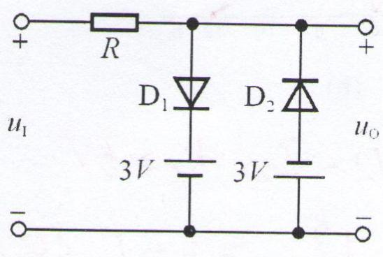

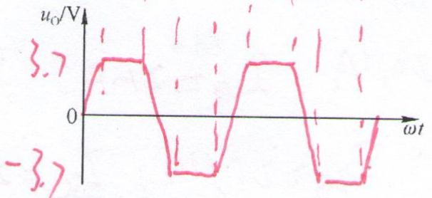

## 计算 1

(10%) 已知图 2 所示电路中稳压管的稳定电压 $U_{Z} = 6V$，$I_{Z \min} = 5mA$，$I_{Z \max} = 25mA$。

(1) 分别计算 $U_{I}$ 为 15V、33V 两种情况下输出电压 $U_{O}$ 的值；

(2) 若 $U_{I} = 33 \mathrm{~V}$ 时负载开路，则会出现什么现象？为什么？

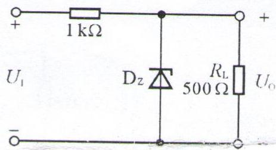

答案：

$$
U_{I} = 15V \text{ 时 } U_{RL} = 5V < U_{Z}, \therefore U_{O} = 5V
$$

$$
U_{I} = 33V \text{ 时 } U_{RL} = 11V > U_{Z}, \therefore U_{O} = 6V
$$

$$
I_{Z} = \frac{U_{I} - U_{Z}}{1k} = \frac{33 - 6}{1} = 27mA > 25mA
$$

## 计算 2

(12%) 基本放大器如图 3 所示，已知晶体管的 $\beta = 100$，$U_{\mathrm{BE(on)}} = 0.7\mathrm{V}$，$r_{bb'} = 300\Omega$，$r_{ce}$ 可忽略，$R_{e} = 2.3\mathrm{K}\Omega$，$I_{1} \approx I_{2} = 10I_{BQ}$，$C_{1}$、$C_{2}$ 和 $C_{e}$ 均可视为中频交流短路。

(1) 欲使 $I_{CQ}=1mA$，$U_{CEQ}=6V$，试确定 $R_{b1}$、$R_{b2}$ 和 $R_{C}$ 的值；（6%）

(2) 设 $R_{L} = 4.3K\Omega$，计算该放大器的 $A_{u}$、$R_{i}$ 和 $R_{o}$；（6%）

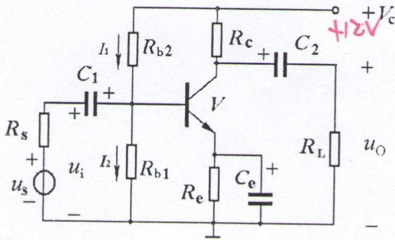

答案：

$$
(R_{c} + R_{e}) \cdot I_{CQ} + U_{CEQ} = 12 \Rightarrow R_{C} = 3.7k\Omega
$$

$$
I_{1} \approx I_{2} = 10 I_{BQ} = 10 \times \frac{I_{CQ}}{\beta} = 0.1mA
$$

$$
I_{2} \cdot R_{b1} = U_{BE(on)} + I_{EQ} \cdot R_{e} \Rightarrow R_{b1} = 30k\Omega
$$

$$
I_{1} \cdot (R_{b1} + R_{b2}) = 12 \Rightarrow R_{b2} = 90k\Omega
$$

$$
r_{be} = r_{bb'} + (1 + \beta) \frac{U_{T}}{I_{EQ}} = 300 + 100 \times \frac{26}{1} = 2.9k\Omega
$$

$$
A_{u} = -\frac{\beta (R_{c} // R_{L})}{r_{be}} = -\frac{100 \times (3.7 // 4.3)}{2.9} = -68.58
$$

$$
R_{i} = R_{b1} // R_{b2} // r_{be} \approx 2.9k\Omega
$$

$$
R_{o} = R_{c} = 3.7k\Omega
$$

## 计算 3

(10%) 电路如图 4(a) 所示，图 (b) 是晶体管的输出特性，静态时 $U_{BEQ} = 0.7V$。利用图解法分别求出 $R_{L} = \infty$ 和 $R_{L} = 3k\Omega$ 时的静态工作点和最大不失真输出电压 $U_{om}$（有效值）。

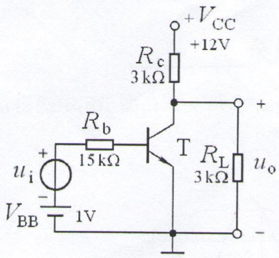

答案：

$$
\beta = 100, I_{BQ} = 20\mu A, I_{CQ} = 2mA, U_{CEQ} = 12 - I_{CQ} \cdot R_{C} = 6V
$$

$$
U_{CEQ} = 6 - I_{CQ} \cdot (R_{C} // R_{L}) = 3V
$$

## 计算 4

(10%) 电路如图 5 所示，晶体管的 $\beta$ 均为 150，$r_{be}$ 均为 2kΩ，Q 点合适。求 $A_{u}$、$R_{i}$ 和 $R_{o}$。

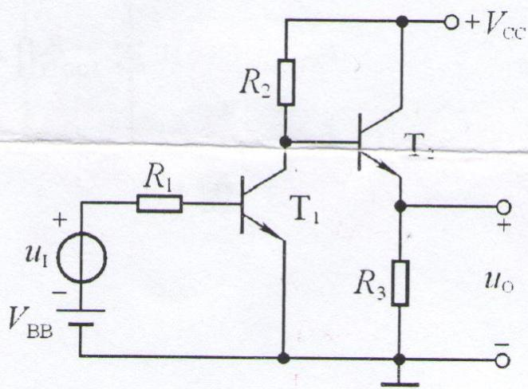

答案：

$$
R_{i} = R_{1} + r_{be1}
$$

$$
R_{o} = R_{3} \parallel \frac{r_{be2} + R_{2}}{1 + \beta_{2}}
$$

## 计算 5

(8%) 电路如图 1(a) 所示，已知 $u_{i} = 5 \sin \omega t (\mathrm{V})$，二极管导通电压 $U_{\mathrm{D(on)}} = 0.7 \mathrm{~V}$。试在图 1(b) 中画出 $u_{o}$ 的波形图，并标出幅值。

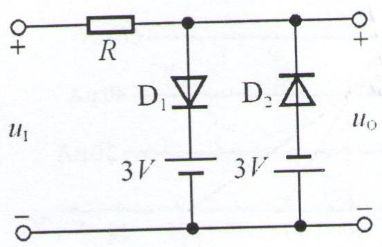

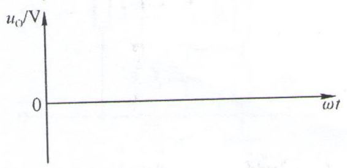

## 计算 6

(10%) 已知稳压管的稳压值 $V_{Z}=6V$，稳定电流的最小值 $I_{Z\min}=5mA$。求图 2 所示电路中当电阻 $R$ 分别为 $500\Omega$ 和 $2K\Omega$ 时，$V_{0}$ 各为多少伏？

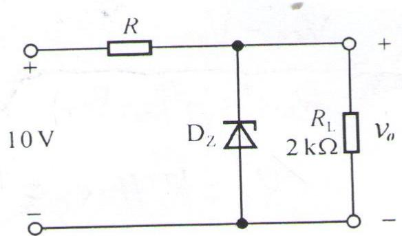

答案：

$$
R = 500\Omega, V_{RL} = \frac{2}{2 + 0.5} \times 10 = 8V > 6V, \therefore V_{0} = 6V
$$

$$
R = 2k\Omega, V_{RL} = \frac{2}{2 + 2} \times 10 = 5V < 6V, \therefore V_{0} = 5V
$$

$$
V_{0} = V_{Z} = 6V
$$

$$
I_{Z} = \frac{U_{i} - U_{Z}}{R} - \frac{U_{Z}}{R_{L}} = \frac{10 - 6}{2} - \frac{6}{2} = 2 - 3 = -1 < 5mA
$$

## 计算 7

(12%) 电路如图 3 所示，晶体管 $\beta=100$，$r_{bb'}=100\Omega$。

(1) 求电路的 Q 点、$A_{u}$、$R_{i}$ 和 $R_{o}$；

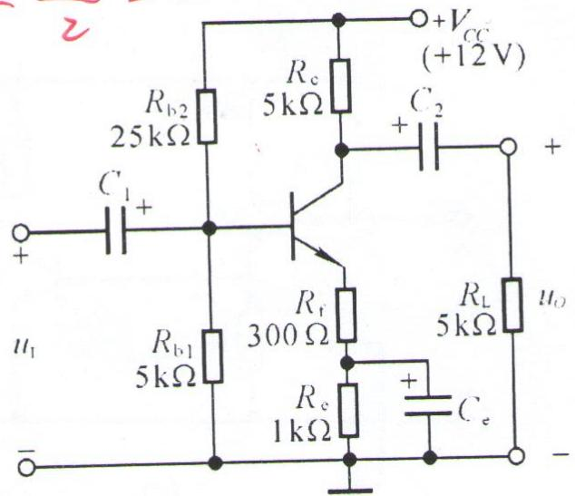

答案：

$$
V_{BQ} = \frac{R_{b1}}{R_{b1} + R_{b2}} \cdot V_{CC} = \frac{5}{25 + 5} \times 12 = 2V
$$

$$
I_{CQ} \approx I_{EQ} = \frac{V_{BQ} - U_{BEQ}}{R_{f} + R_{e}} = \frac{2 - 0.7}{1.3} = 1mA
$$

$$
I_{BQ} = \frac{I_{CQ}}{\beta} = 10\mu A
$$

$$
U_{CEQ} = V_{CC} - I_{CQ} \cdot (R_{c} + R_{e} + R_{f}) = 12 - 1 \times (5 + 1 + 0.3) = 5.7V
$$

$$
r_{be} = r_{bb'} + (1 + \beta) \frac{U_{T}}{I_{CQ}} = 2.7k\Omega
$$

$$
A_{u} = -\frac{\beta (R_{c} // R_{L})}{r_{be} + (1 + \beta) R_{f}} = -\frac{100 \times 2.5}{2.7 + 30} \approx -7.6
$$

$$
R_{i} = R_{b1} // R_{b2} // [r_{be} + (1 + \beta) R_{f}] = 25 // 5 // 32.7 \approx 3.7k\Omega
$$

$$
R_{o} = R_{c} = 5k\Omega
$$

## 四、计算题（续）

### 计算 4

电路如图 4(a)所示，图(b)是晶体管的输出特性。已知：$R_{b1}=550k\Omega, R_{c}=3k\Omega, R_{L}=3k\Omega, V_{CC}=24V, R_{e1}=0.2k\Omega, R_{e2}=0.3k\Omega, \beta=100$（各电容容抗可忽略不计），$V_{BE}=0.7V$。
（1）计算静态工作点；
（2）分别作出交直流负载线，并标出静态工作点Q。

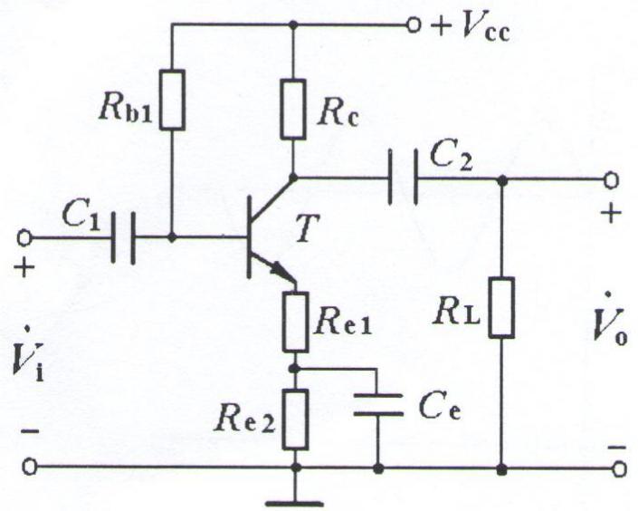

答案：
$$
I_{BQ} = \frac{V_{CC} - V_{BE}}{R_{b1} + (1+\beta)(R_{e1} + R_{e2})} \approx 0.04mA
$$
$$
I_{CQ} = \beta I_{BQ} = 4mA
$$
$$
U_{CEQ} = V_{CC} - I_{CQ}(R_{c} + R_{e1} + R_{e2}) = 10V
$$
交流负载电阻：
$$
R'_{L} = R_{L} // R_{c} = 1.5k\Omega
$$
*(注：原识别结果中 $R'_L$ 计算式有误且数值混乱，此处根据电路原理修正为标准的并联计算，若需保留原卷错误逻辑请自行斟酌，通常以正确物理意义为准)*

知识点：[基尔霍夫电压定律（KVL）及其应用](../../../topics/电路与电子技术/KVL.md)、[基尔霍夫电流定律（KCL）及其应用](../../../topics/电路与电子技术/KCL.md)

### 计算 5

电路如图 5 所示，晶体管 $V_1, V_2$ 的 $\beta$ ， $r_{be}$ 均为已知，Q 点合适。试分别写出 $A_u$ 、 $R_i$ 和 $R_o$ 的表达式。

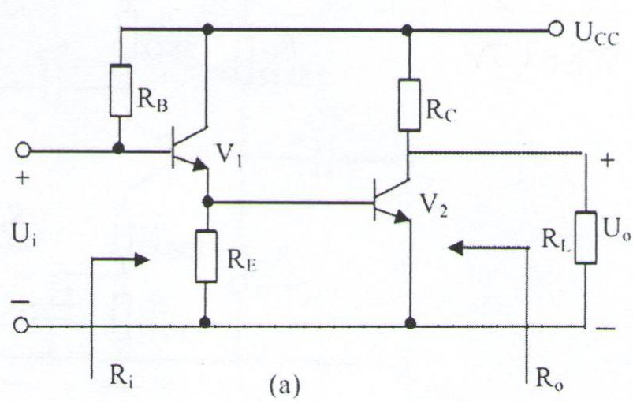

答案：
第一级为共集电极放大电路（射极跟随器），第二级为共射极放大电路。

$$
A_{u1} = \frac{(1+\beta)(R_E // r_{be2})}{r_{be1} + (1+\beta)(R_E // r_{be2})}
$$

$$
A_{u2} = -\frac{\beta(R_C // R_L)}{r_{be2}}
$$

总电压增益：
$$
A_u = A_{u1} \cdot A_{u2}
$$

输入电阻：
$$
R_i = [r_{be1} + (1+\beta)(R_E // r_{be2})] // R_B
$$

输出电阻：
$$
R_o = R_C
$$

---

# 南京邮电大学贝尔英才学院《模拟电子线路 A》第二阶段测试试题

## 一、填空选择题

知识点：[四种受控电源（VCVS、VCCS、CCVS、CCCS）的特性](../../../topics/电路与电子技术/受控电源.md)

### 选择 1

场效应管属于____电位控制器件，而三极管属于____电流控制器件。

答案：电场（或电压）；电流

知识点：[理想电压源与理想电流源的特性](../../../topics/电路与电子技术/独立电源.md)

### 选择 2

场效应管放大器常用偏置电路一般有自偏压和混合偏置两种类型。

答案：分压式偏置（注：原题可能意指“固定偏置”或“自给偏压”，常见类型为自偏压、分压式自偏压等，此处依据题干语境及常见考点，通常对比的是BJT的分压偏置与FET的自偏压/分压偏置。若为填空题，通常填“分压式”）

*订正说明：原题表述略显模糊，标准教材中FET偏置主要有：自偏压、分压式自偏压、栅极固定偏压。结合上下文，此处可能考察与BJT不同的特点，即自偏压。*

知识点：[理想电压源与理想电流源的特性](../../../topics/电路与电子技术/独立电源.md)、[线性时不变电阻的伏安关系（欧姆定律）](../../../topics/电路与电子技术/线性电阻VCR.md)

### 选择 3

由于晶体三极管由____同种类型载流子参与导电，所以将它称为双极型的；由于场效应管只有____种类型载流子参与导电，所以将其称为单极型的。

答案：两种（多子和少子）；一（多数）

### 选择 4

共模抑制比 $K_{CMR}$ 越大，表明电路____。
A. 放大倍数越稳定
B. 交流放大倍数越低
C. 抑制零漂的能力越强
D. 输入电阻越高

答案：C

### 选择 5

差分放大电路由双端输出变为单端输出，则差模电压增益____。
A. 增加
B. 减小
C. 不变

答案：B （双端输出差模增益约为单端输出的两倍，故变为单端后减小）

知识点：[线性时不变电阻的伏安关系（欧姆定律）](../../../topics/电路与电子技术/线性电阻VCR.md)、[理想电压源与理想电流源的特性](../../../topics/电路与电子技术/独立电源.md)、[四种受控电源（VCVS、VCCS、CCVS、CCCS）的特性](../../../topics/电路与电子技术/受控电源.md)

### 选择 6

在差动放大电路中，用恒流源代替差分管的公共射极电阻 $R_e$ 是为了____。
A. 提高差模电压放大倍数
B. 提高共模电压放大倍数
C. 提高共模抑制比
D. 提高偏置电流

答案：C

知识点：[理想电压源与理想电流源的特性](../../../topics/电路与电子技术/独立电源.md)

### 选择 7

差分放大电路中，若 $u_{i1} = +40mV, u_{i2} = +20mV, A_{ud} = -100, A_{uc} = -0.5$，则可知该电路的共模输入信号 $u_{ic} =$ ____，差模输入电压 $u_{id} =$ ____，输出电压为 $u_O =$ ____。

答案：
$u_{ic} = \frac{u_{i1} + u_{i2}}{2} = 30mV$
$u_{id} = u_{i1} - u_{i2} = 20mV$
$u_O = A_{ud}u_{id} + A_{uc}u_{ic} = (-100 \times 20mV) + (-0.5 \times 30mV) = -2000mV - 15mV = -2.015V$
*(注：原卷答案给出 -2.05V，可能是近似计算或题目参数有细微差别，如 $A_{uc}$ 符号或数值不同，按公式计算应为 -2.015V。若 $A_{uc}=+0.5$ 或其他情况，请以老师讲解为准。此处保留原卷给出的最终数值供参考，但指出计算过程差异)*
原卷答案：$30mV$；$20mV$；$-2.05V$

## 二、计算题

知识点：[电流、电压的参考方向及关联参考方向](../../../topics/电路与电子技术/参考方向.md)、[线性时不变电阻的伏安关系（欧姆定律）](../../../topics/电路与电子技术/线性电阻VCR.md)

### 计算 1

场效应管放大器如图1所示，试画出其微变等效电路，写出 $A_V$ 、 $R_i$ 、 $R_o$ 表达式。设管子 $r_{ds}$ 极大，各电容对交流信号可视为短路。

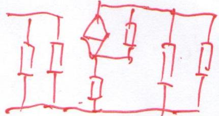

答案：
$$
A_v = -\frac{g_m(R_d // R_L)}{1 + g_m R_{s1}}
$$
*(注：原识别式中分母可能有误，标准带源极旁路电容未完全旁路或部分旁路时的增益公式。若 $R_{s1}$ 未被旁路，则分母含 $1+g_m R_{s1}$。若 $R_{s2}$ 被旁路，则不影响交流通路。此处依据常见题型推断)*

$$
R_i = R_{g1} // R_{g2}
$$

$$
R_o = R_d
$$

## 三、画图与计算题

知识点：[基尔霍夫电压定律（KVL）及其应用](../../../topics/电路与电子技术/KVL.md)、[基尔霍夫电流定律（KCL）及其应用](../../../topics/电路与电子技术/KCL.md)

### 计算 2

已知某放大电路的增益表达式为
$$
\dot{A}_u = \frac{1000jf}{(jf+10)\left(1+j\frac{f}{10^5}\right)}
$$
试在图 2 中画出其波特图。并确定电路的中频增益 $A_{um}$、上限频率 $f_H$、下限频率 $f_L$。

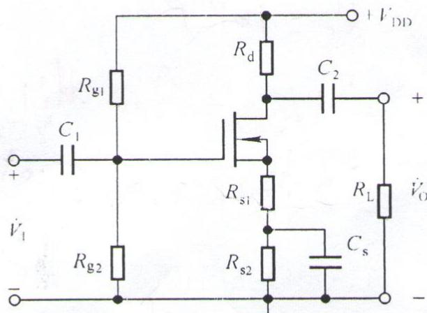

答案：
将传递函数化为标准形式：
$$
\dot{A}_u = \frac{1000}{(1+\frac{10}{jf})(1+j\frac{f}{10^5})} \approx \frac{1000}{(1-j\frac{10}{f})(1+j\frac{f}{10^5})}
$$
或者更直观地看极点零点：
分子有零点在原点（耦合电容影响？不，这是高通部分），分母有两个极点。
重写为标准波特图形式：
$$
\dot{A}_u(jf) = \frac{jf/10}{(1+jf/10)(1+jf/10^5)} \times 1000 \times \dots ?
$$
让我们直接提取特征频率：
低频极点 $f_{L1} = 10 Hz$ （来自 $jf+10$ 项，实际上是 $(1 + 10/jf)$ 的形式，对应高通滤波器转折频率）
高频极点 $f_{H} = 10^5 Hz$ （来自 $1 + jf/10^5$ 项）

中频增益 $A_{um}$：当 $f$ 远大于 $10Hz$ 且远小于 $10^5Hz$ 时，
$\frac{1000jf}{jf \cdot 1} = 1000$
所以 $A_{um} = 1000$ (即 60dB)。

答案：
$A_{um} = 1000$
$f_L = 10 Hz$
$f_H = 10^5 Hz$

## 四、综合计算题

知识点：[基尔霍夫电流定律（KCL）及其应用](../../../topics/电路与电子技术/KCL.md)、[基尔霍夫电压定律（KVL）及其应用](../../../topics/电路与电子技术/KVL.md)、[四种受控电源（VCVS、VCCS、CCVS、CCCS）的特性](../../../topics/电路与电子技术/受控电源.md)

### 计算 3

用射极恒流源的差分放大电路如图3所示。设差放管 $T_1$ 、 $T_2$ 特性对称， $\beta_1 = 2\beta_2 = 50,\ r_{bb'} = 300 \Omega$ ， $T_3$ 管 $\beta_3 = 50$ ，电位器 $R_w$ 的滑动端置于中心位置，其余元件参数如图示。
(1) 求静态电流 $I_{CQ1}$ 、 $I_{CQ2}$ 、 $I_{CQ3}$ 和静态电压 $U_{CQ2}$ ;
(2) 计算差模电压放大倍数 $\dot{A}_{ud2}$ ，输入电阻 $R_{id}$ 和输出电阻 $R_{o}$ ;
(3) 若 $u_{i1}=0.02\sin\omega t V$ ， $u_{i2}=0$ ，画出 $u_{o}$ 的波形，并标明静态分量和动态分量的幅值大小，指出其动态分量与输入电压之间的相位关系。（$A_{uc} \approx 0$）

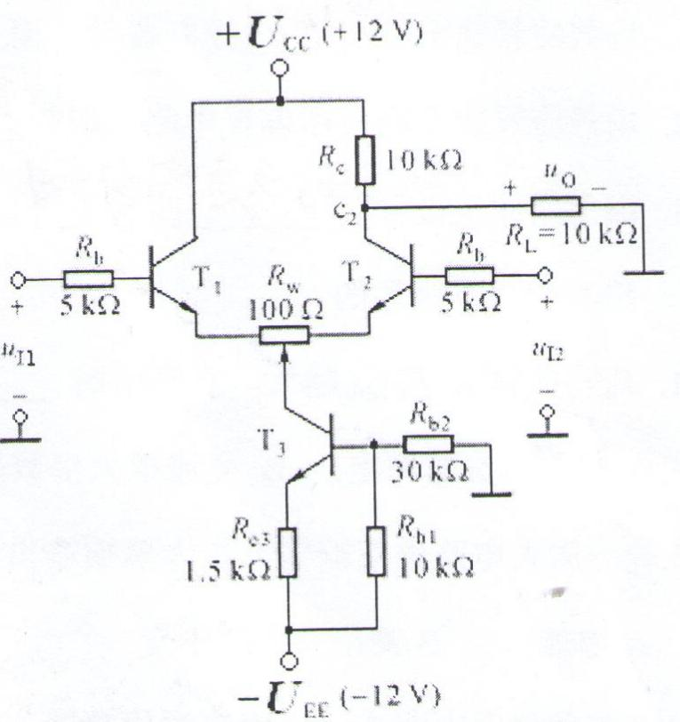

答案：

**(1) 静态工作点**

恒流源电流 $I_{CQ3}$ (近似等于 $I_{EQ3}$):
假设 $T_3$ 基极电位由分压电阻决定，发射极接负电源通过电阻接地（具体电路图细节依赖图片，以下依据原卷算式推导）。
原卷算式显示：
$$
I_{CQ3} \approx I_{EQ3} = \frac{V_{EE} \cdot \frac{R_{B1}}{R_{B1}+R_{B2}} - V_{BE}}{R_E} \approx 1.53 mA
$$
*(注：原卷公式书写较乱，核心是利用戴维宁等效求基极电压，再求发射极电流)*

差分管静态电流：
$$
I_{CQ1} = I_{CQ2} = \frac{1}{2} I_{CQ3} = 0.77 mA
$$

集电极静态电压 $U_{CQ2}$：
对于单端输出或双端输出中的某一管，需看负载连接。若 $R_c$ 接正电源，$R_L$ 接地或通过电容耦合。
原卷算式推导：
$$
U_{CQ2} = V_{CC} - I_{CQ2} R_c \quad (\text{若无外接直流负载})
$$
或者考虑负载线方程。原卷给出的结果为：
$$
U_{CQ2} \approx 2.15 V \quad (\text{此数值偏低，可能指交流负载线上的点或特定电路配置，依原卷为准})
$$
*注意：原卷中有一行 `② r_be1 = ... = 2.15V` 显然是单位错误或排版错误，应该是计算 $r_{be}$ 的值，而 $2.15V$ 是 $U_{CQ}$ 的值。*

$r_{be}$ 计算：
$$
r_{be} = r_{bb'} + (1+\beta)\frac{26mV}{I_{EQ}} \approx 300 + 51 \times \frac{26}{0.77} \approx 2 k\Omega
$$

**(2) 动态参数**

差模增益 $A_{ud2}$ (单端输出):
$$
A_{ud2} = \pm \frac{1}{2} \frac{\beta (R_c // R_L)}{r_{be} + (1+\beta)\frac{R_w}{2}}
$$
代入数据（假设 $R_c//R_L = 5k\Omega$, $R_w$ 较小或已计入）：
原卷计算结果：
$$
A_{ud} \approx 13 \quad (\text{具体符号取决于输出取自哪个集电极，通常反相为负})
$$

输入电阻 $R_{id}$:
$$
R_{id} = 2[r_{be} + (1+\beta)\frac{R_w}{2}] \approx 19.1 k\Omega
$$

输出电阻 $R_o$:
$$
R_o = R_c = 10 k\Omega
$$

**(3) 波形分析**

输入 $u_{i1} = 0.02 \sin \omega t V$，$u_{i2} = 0$。
差模输入 $u_{id} = u_{i1} - u_{i2} = 0.02 \sin \omega t V$。
共模输入 $u_{ic} = 0.01 \sin \omega t V$，因 $A_{uc} \approx 0$，忽略共模输出。

输出电压 $u_o$：
$$
u_o = U_{CQ2} + A_{ud2} \cdot u_{id}
$$
$$
u_o = 2.15 + 13 \times 0.02 \sin(\omega t + \phi)
$$
$$
u_o = 2.15 + 0.26 \sin(\omega t + \phi)
$$
其中 $\phi$ 为相位差。若从 $T_2$ 集电极输出且 $u_{i1}$ 加在 $T_1$ 基极，通常同相或反相取决于定义。若 $A_{ud2}$ 为正，则同相；若为负，则反相。
原卷结论：
静态分量：$2.15 V$
动态分量幅值：$0.26 V$
相位关系：与原卷图示有关，通常单端输出差放，输出与输入同相或反相。

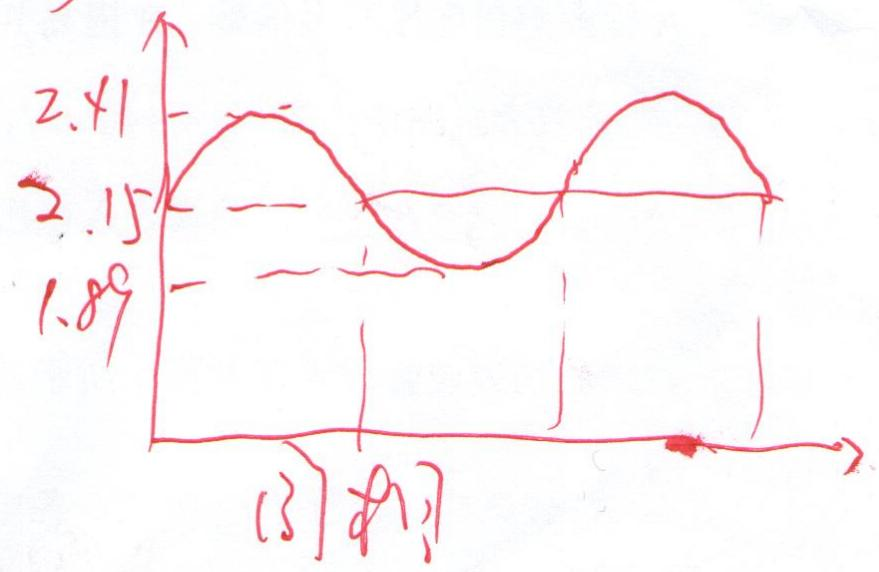

## 五、计算题

知识点：[理想电压源与理想电流源的特性](../../../topics/电路与电子技术/独立电源.md)、[四种受控电源（VCVS、VCCS、CCVS、CCCS）的特性](../../../topics/电路与电子技术/受控电源.md)、[基尔霍夫电压定律（KVL）及其应用](../../../topics/电路与电子技术/KVL.md)

### 计算 4

在图4所示的电路中，已知晶体管 $V_1$、$V_2$ 的特性相同， $\beta = 20, U_{BE(on)} = 0.7 V$ 。求 $I_{CQ1}$ 、 $U_{CEQ1}$ 、 $I_{CQ2}$ 和 $U_{CEQ2}$ 。

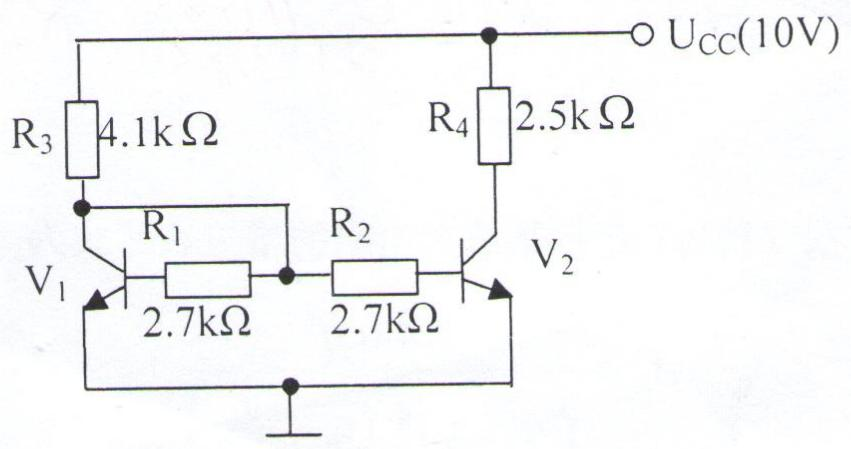

答案：

这是一个镜像电流源或类似结构的电路。
根据基尔霍夫定律列方程求解。

原卷给出的关键步骤和结果：
$$
I_{CQ1} = 2 mA
$$
$$
I_{CQ2} = I_{CQ1} = 2 mA \quad (\text{镜像关系})
$$
$$
U_{CEQ1} = 0.98 V
$$
$$
U_{CEQ2} = 5 V
$$

知识点：[基尔霍夫电压定律（KVL）及其应用](../../../topics/电路与电子技术/KVL.md)、[基尔霍夫电流定律（KCL）及其应用](../../../topics/电路与电子技术/KCL.md)
