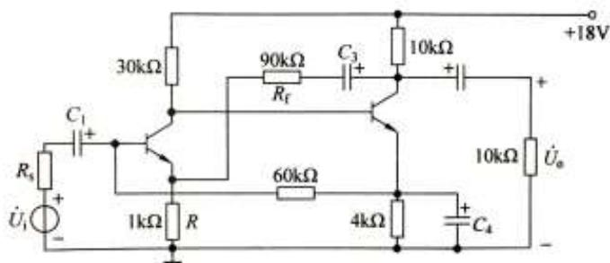
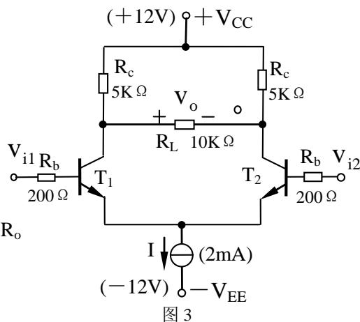
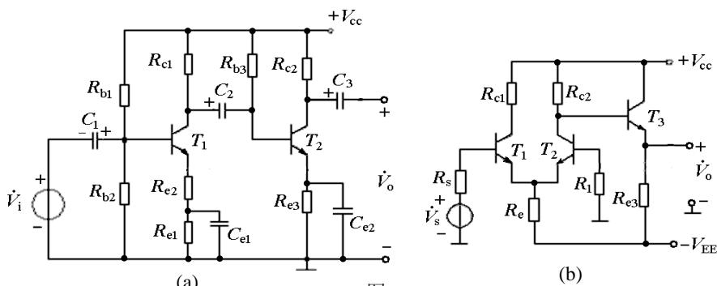
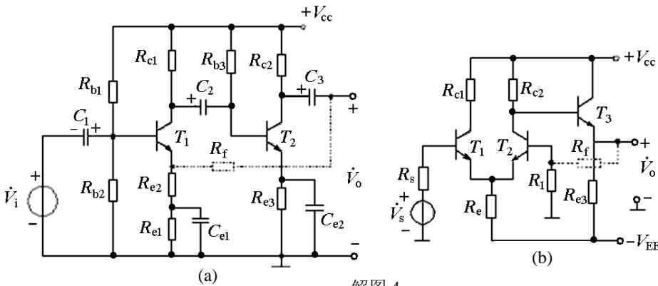
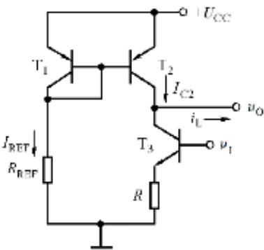

# 2015级贝尔英才学院《模拟电子线路A》第二次小测参考答案

原件经识别和整理；“参考解答”是我们补的。

# 2015级贝尔英才学院《模拟电子线路A》第二次小测参考答案

南京邮电大学贝尔英才学院《模拟电子线路 A》第二阶段测试参考答案整理。

## 一、填空选择题（每小题 2 分，共 26 分）

### 选择 1

为了稳定静态工作点，应在放大电路中引入直流（直流或交流）负反馈。

答案：直流。

### 选择 2

欲增大从信号源索取的电压，增大带负载能力，应在放大电路中引入负反馈的类型是串联负反馈；欲从信号源获得更大的电流，并稳定输出电流，应在放大电路中引入负反馈的类型是并联负反馈。

答案：串联负反馈；并联负反馈。

知识点：[四种受控电源（VCVS、VCCS、CCVS、CCCS）的特性](../../../topics/电路与电子技术/受控电源.md)、[基尔霍夫电流定律（KCL）及其应用](../../../topics/电路与电子技术/KCL.md)、[基尔霍夫电压定律（KVL）及其应用](../../../topics/电路与电子技术/KVL.md)

### 选择 3

串联负反馈 \_\_\_\_ 放大电路的输入电阻，并联负反馈 \_\_\_\_ 放大电路的输入电阻。

答案：增大；减小。

### 选择 4

共模抑制比 $K_{\mathrm{CMR}}$ 越大，表明电路 \_\_\_\_ 。
- A. 放大倍数越稳定
- B. 交流放大倍数越低
- C. 抑制零漂的能力越强
- D. 输入电阻越高

答案：C。

知识点：[四种受控电源（VCVS、VCCS、CCVS、CCCS）的特性](../../../topics/电路与电子技术/受控电源.md)、[线性时不变电阻的伏安关系（欧姆定律）](../../../topics/电路与电子技术/线性电阻VCR.md)

### 选择 5

差分放大电路由双端输出变为单端输出，则差模电压增益 \_\_\_\_ 。
- A. 增加
- B. 减小
- C. 不变

答案：B。

知识点：[理想电压源与理想电流源的特性](../../../topics/电路与电子技术/独立电源.md)

### 选择 6

在差动放大电路中，用恒流源代替差分管的公共射极电阻 $R_{\mathrm{e}}$ 是为了 \_\_\_\_ 。
- A. 提高差模电压放大倍数
- B. 提高共模电压放大倍数
- C. 提高共模抑制比
- D. 提高偏置电流

答案：C。

知识点：[理想电压源与理想电流源的特性](../../../topics/电路与电子技术/独立电源.md)、[线性时不变电阻的伏安关系（欧姆定律）](../../../topics/电路与电子技术/线性电阻VCR.md)

### 选择 7

差分放大电路中，若 $u_{\mathrm{i1}} = +40 \, \mathrm{mV}$ ， $u_{\mathrm{i2}} = +20 \, \mathrm{mV}$ ， $A_{\mathrm{ud}} = -100$ ， $A_{\mathrm{uc}} = -0.5$ ，则可知该电路的共模输入信号 $u_{\mathrm{ic}} =$ \_\_\_\_ ，差模输入电压 $u_{\mathrm{id}} =$ \_\_\_\_ ，输出电压为 $u_{\mathrm{o}} =$ \_\_\_\_ 。

答案：$30 \, \mathrm{mV}$；$20 \, \mathrm{mV}$；$-2.015 \, \mathrm{V}$。

知识点：[基尔霍夫电流定律（KCL）及其应用](../../../topics/电路与电子技术/KCL.md)、[四种受控电源（VCVS、VCCS、CCVS、CCCS）的特性](../../../topics/电路与电子技术/受控电源.md)、[线性时不变电阻的伏安关系（欧姆定律）](../../../topics/电路与电子技术/线性电阻VCR.md)

### 选择 8

当信号频率等于放大电路的 $f_{L}$ 或 $f_{H}$ 时，放大倍数的值约下降到中频时的 \_\_\_\_ 倍，即增益下降 \_\_\_\_ dB。

答案：0.707；3。

## 二、计算题（12 分）

已知某放大器的幅频特性如图 1 所示。

(1) 试说明该放大器的中频增益、上限频率 $f_{\mathrm{H}}$ 和下限频率 $f_{\mathrm{L}}$ 、通频带 BW。（4*2%）

(2) 当 $u_{i}=10\sin(4\pi\cdot10^{6}t)(mV)+20\sin(2\pi\times10^{4}t)(mV)$ 和 $u_{i}=10\sin(2\pi\cdot5t)(mV)+20\sin(2\pi\times10^{4}t)(mV)$ 时，输出信号有无失真？是何种性质的失真？分别说明之。（4%）

参考解答：
(1) 由题图可得：中频增益为 $40\mathrm{dB}$ ，即 100 倍， $f_{H} = 10^{6}\mathrm{Hz}$ ， $f_{L} = 10\mathrm{Hz}$ （在 $f_{H}$ 和 $f_{L}$ 处，增益比中频增益下降 3 dB）， $BW = 10^{6} - 10 \approx 10^{6}Hz$ 。

(2) 当 $u_{i}=10\sin(4\pi\cdot10^{6}t)(mV)+20\sin(2\pi\times10^{4}t)(mV)$ 时，其中 $f=10^{4}Hz$ 的频率在中频段，而 $f=2\times10^{6}Hz$ 的频率在高频段，可见输出信号要产生失真，即高频失真。

当 $u_{i}=10\sin(2\pi\cdot5t)(mV)+20\sin(2\pi\times10^{4}t)(mV)$ 时，$f=5Hz$ 的频率在低频段， $f=10^{4}Hz$ 的频率在中频段，所以输出要产生失真，即低频失真。

## 三、计算题（17 分）

反馈放大器电路如图 2 所示，试回答：

(1) 判断该电路引入了何种级间交流反馈？（5%）

(2) 该电路的输入、输出电阻如何变化？（6%）

(3) 在深反馈条件下，交流电压增益 $A_{uf}=$ ? (6%)

参考解答：
(1) 90 kΩ 电阻和 1 kΩ 电阻构成两级之间的交流串联电压负反馈。4 kΩ、60 kΩ 以及 $V_{1}$ 构成两级之间的直流电流负反馈，以保证直流工作点更加稳定。

(2) 该电路输入阻抗增大，输出阻抗减小。

(3) 在深反馈条件下： $A_{ui} = \frac{1}{F} = \frac{1k + 90k}{1k} = 91$

## 四、计算题（18 分）

电路如图 3 所示。设差放管 $\mathrm{T}_{1}$ 、 $\mathrm{T}_{2}$ 特性对称， $\beta = 50$ ， $r_{\mathrm{bb}^{\prime}} = 200\Omega$ ， $U_{\mathrm{BE(on)}} = 0.7\mathrm{V}$ ，其余元件参数如图 3 示。

(1) 求静态电流 $I_{BQ1}$ 、 $I_{CQ1}$ 、 $U_{CEQ1}$ ; (3*3%)

(2) 计算差模电压放大倍数 $A_{ud}^{X}$ ，输入电阻 $R_{id}$ 和输出电阻 $R_{o}$ ; (4+3+2%)

参考解答：
(1) 因为 $I_{C1} = 1mA$

$$
I _ {B} = \frac {1}{\beta} I _ {C} = \frac {1 0 0 0}{5 0} = 2 0 \mu A
$$

$$
\begin{array}{r l} V _ {C E 1} & = V _ {C 1} - V _ {E 1} = \left(V _ {C C} - I _ {C 1} R _ {C}\right) - \left(0 - I _ {B 1} R _ {b} - V _ {B E}\right) \\ & = (1 2 - 1 \times 5) - (0 - 0. 0 2 \times 0. 2 - 0. 7) = 7. 7 V \end{array}
$$

(2) 差模电压放大倍数 $\mathrm{A}_{\mathrm{Vd}}$ 、差模输入电阻 $\mathbf{R}_{\mathrm{id}}$ 和输出电阻 $\mathbf{R}_{\mathrm{o}}$

$$
r _ {\mathrm{be}} = r _ {\mathrm {bb^ {\prime}}} + (1 + \beta) \frac {2 6 \mathrm{mV}}{I _ {\mathrm{EQ}}} = 2 0 0 + (1 + 5 0) \times \frac {2 6 \mathrm{mV}}{1 m A} \approx 1. 5 \mathrm{k} \Omega
$$

$$
A _ {V D} = - \frac {\beta (R _ {C} / / \frac {1}{2} R _ {L})}{R _ {b} + r _ {b e}} = - \frac {5 0 (5 / / 5)}{0 . 2 + 1 . 5} = - 7 3. 5,
$$

$$
R _ {i d} = 2 (r _ {b e} + R _ {b}) = 2 (1. 5 + 0. 2) \approx 3. 4 k \Omega , R _ {o} = 2 R _ {C} = 1 0 K \Omega 。
$$

## 五、作图题（16 分）

说明在图 4(a)、(b) 电路中各引入什么反馈使输出电压稳定，并在图中将反馈电路补充完整。

参考解答：
图 4 所示电路，在图 (a) 电路中，要使输出电压稳定，必须引入电压负反馈，利用瞬时极性法判别可得，反馈信号引入 $\mathrm{T}_{1}$ 发射极时，反馈电压 $V_{\mathrm{F}}$ 对地极性才能与 $V_{\mathrm{i}}$ 对地极性相同，方可构成电压负反馈。所以，在输出端（ $V_{0}$ ）与 $\mathrm{T}_{1}$ 发射极之间串联电阻 $R_{\mathrm{F}}$ 后，可构成电压串联负反馈。为了提高电路开环放大倍数，应在 $R_{\mathrm{e3}}$ 两端并接旁路电容。

图 (b) 所示的电路中，分析方法与图（a）所示电路类似，在输出端（ $V_{0}$ ）与 $T_{2}$ 基极之间串接电阻 $R_{F}$ 后，可构成电压串联负反馈。完善的电路如解图 4(a)、(b) 所示。

## 六、分析题（11 分）

某集成运放电路如图 5 所示，设 $T_{1}$ 、 $T_{2}$ 管的参数完全相同。问：

(1) $\mathrm{T}_{1}$ 、 $\mathrm{T}_{2}$ 和 $R_{\mathrm{REF}}$ 组成什么电路？其作用是什么？ $(3 + 2\%)$

(2) $I_{C2}$ 与 $I_{REF}$ 有什么关系？写出 $I_{C2}$ 的表达式。(2+4%)

参考解答：
(1) $T_{1}$ 、 $T_{2}$ 和 $R_{REF}$ 组成基本镜像电流源电路。

$$
I _ {\mathrm{C2}} \approx I _ {\mathrm{REF}} = \frac {U _ {\mathrm{CC}} - U _ {\mathrm{BE}}}{R _ {\mathrm{REF}}} \tag {2}
$$

其作用是：作为 $T_{3}$ 管的集电极有源负载，可提高该管所组成的共射放大电路的电压增益。
