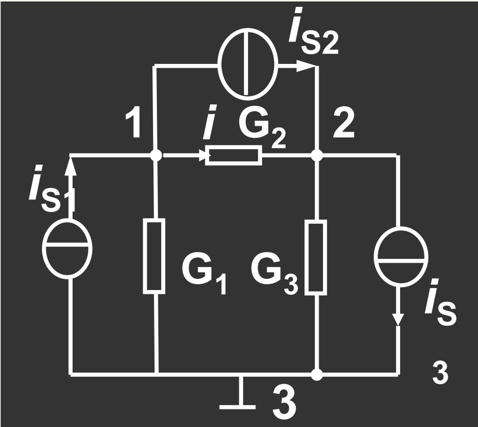
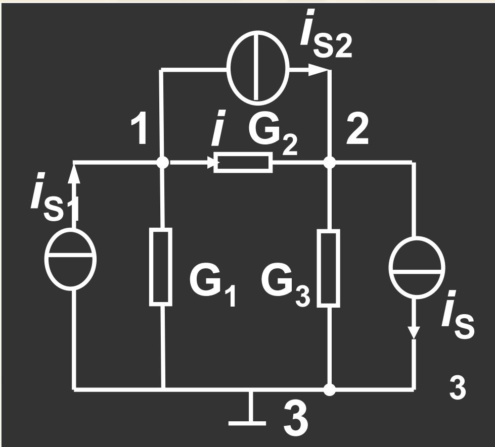
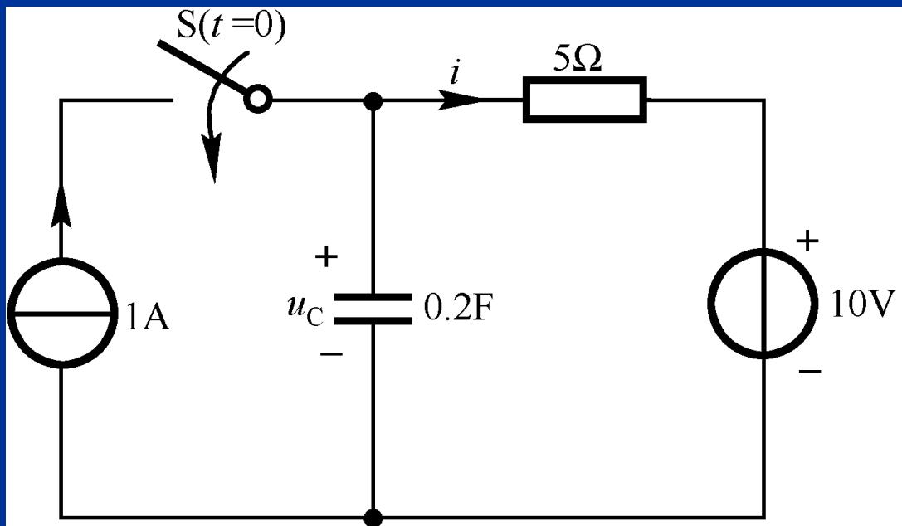
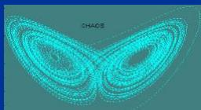
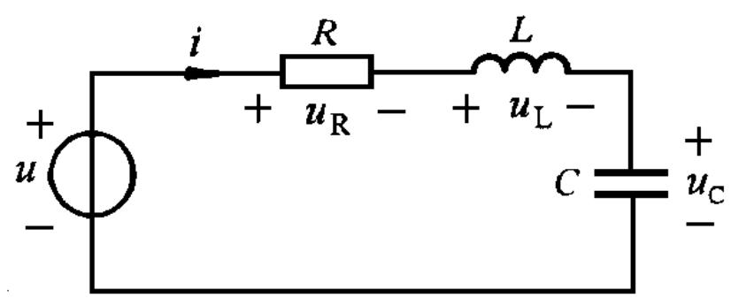
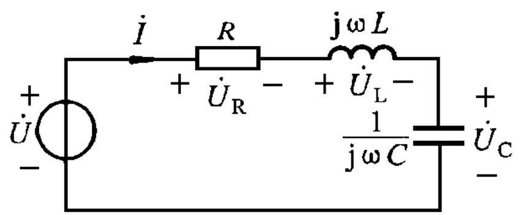
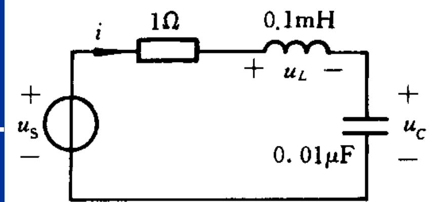
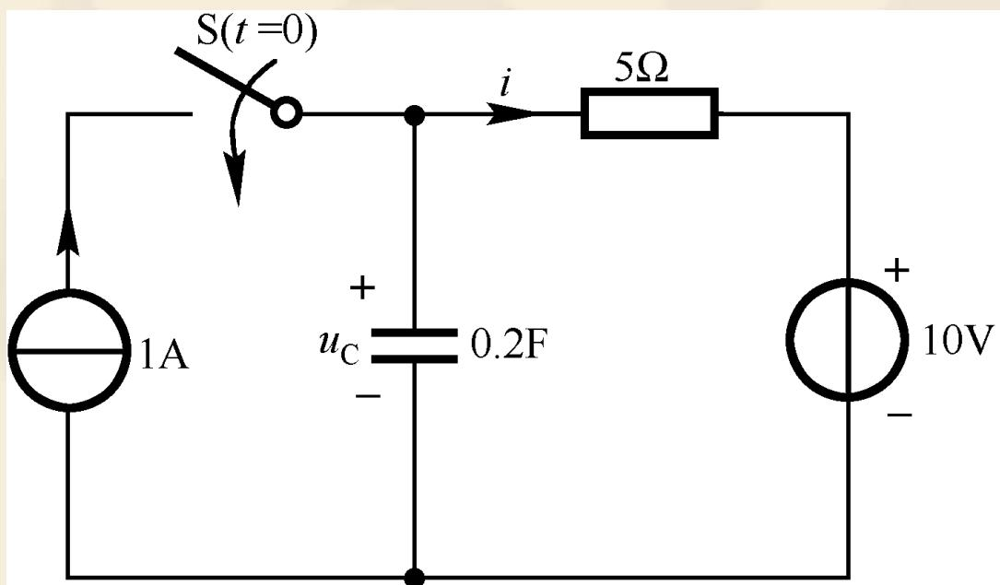
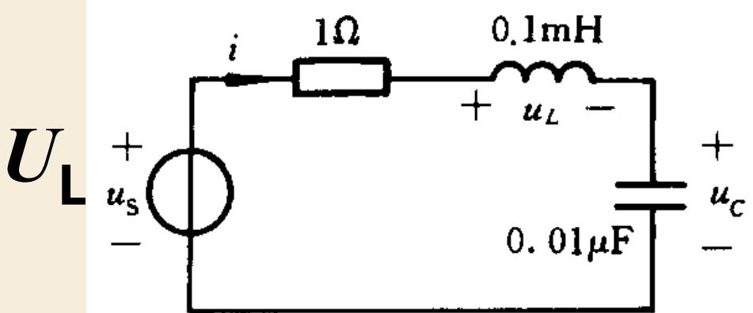
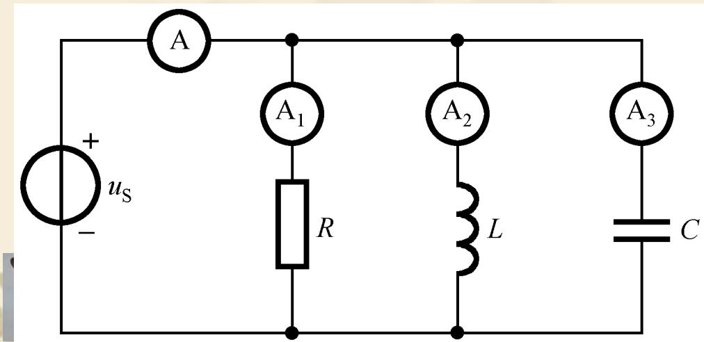

# 2017年《电路分析》期末考试复习（课件）

原件经识别和整理；“参考解答”是我们补的。

## 期末考试复习 (2017)

### 考试内容

知识点：[元件吸收与产生功率的计算与判断](../../../topics/电路与电子技术/功率计算.md)、[电流、电压的参考方向及关联参考方向](../../../topics/电路与电子技术/参考方向.md)、[基尔霍夫电流定律（KCL）及其应用](../../../topics/电路与电子技术/KCL.md)

### 考点详解

#### CH1

1、会计算基本电路的电压、电流、功率。

2、熟悉关联和非关联参考方向，会用 KVL、KCL。

3、掌握书中例题的解法。

#### CH2

1、掌握例 2-3，例 2-4。

2、掌握图 2-21，图 2-22。掌握例 2-7，2-

3、掌握例 2-9，例 2-10。

会利用上面几个例题的方法，求解不含受控源电路的化简方法。

#### CH3

1、掌握节点法，会做例 3-5。会列写此类不含受控源的节点电压方程。

#### CH4

1、掌握叠加定理，会做例 4-1，4-2。

2、掌握戴维南定理，掌握诺顿定理，会做例 4-5，4-6。

会求不含受控源的戴维南等效电路。

#### CH5（约 10 分）

掌握三要素法

1、知道电容和电感的伏安关系。

2、会用三要素法求解不含受控源电路的电压、电流，会做例题 6-8。

#### CH7：相量法

1、会写出一个正弦函数的相量形式，含极坐标形式、直角坐标形式。会做例 7.4，例 7-5。

2、会做例题 7-11，例 7-12，例 7-13。

3、熟记有功功率公式、无功功率公式，当给定电压和电流时，会计算 P、Q，会做例 7-19。

#### CH9：谐振电路

1、知道串联谐振概念，掌握书中 9.3.1 小节，9.4.1 小节，给定 R、L、C 三个元件数值，会计算谐振频率和阻抗。不需要掌握其中的频率特性。

【注】1、以上内容包含了绝大部分考点，很多题目都是其简单变形或具体应用，需要仔细理解，不能背题。

2、书上例题原题及其简单变形题约占 20% - 30%。

### 例 5

$i_{s1}=9A,\quad i_{s2}=5A,\quad i_{s3}=6A,\quad G_{1}=1S,$ $G_{2}=2S,\quad G_{3}=1S,$ 用节点法求电流 $i$。

解：1）选 3 为参考节点

2）列节点方程

$$
\begin{array}{r l} & {(G _ {1} + G _ {2}) u _ {n 1} - \overline {{G _ {2} u _ {n 2}}} = i _ {S 1} - i _ {S 2}} \\ & {- G _ {2} u _ {n 1} + (G _ {2} + G _ {3}) u _ {n 2} = i _ {S 2} - i _ {S 3}} \end{array}
$$

整理，得

$$
\begin{array}{r} 3 u _ {n 1} - 2 u _ {n 2} = 4 \\ - 2 u _ {n 1} + 3 u _ {n 2} = - 1 \end{array}
$$

解得

$$
\begin{array}{c} u _ {n 1} = 2 \mathrm{V} \\ u _ {n 2} = 1 \mathrm{V} \end{array}
$$

3）求电流

$$
i = G _ {2} (u _ {n 1} - u _ {n 2}) = 2 \times (2 - 1) = 2 A
$$

知识点：[理想电压源与理想电流源的特性](../../../topics/电路与电子技术/独立电源.md)、[线性时不变电阻的伏安关系（欧姆定律）](../../../topics/电路与电子技术/线性电阻VCR.md)、[基尔霍夫电流定律（KCL）及其应用](../../../topics/电路与电子技术/KCL.md)

### 三要素

会做左图的响应

$$
f (t) = f (\infty) + [ f (0 ^ {+}) - f (\infty) ] \mathrm{e} ^ {- \frac {t}{\tau}}, t > 0
$$

【例】如图所示电路在 $t = 0$ 时闭合，求 $t > 0$ 时的 $u_C$ 及 $i$。

解 初始值

$$
u _ {\mathrm{C}} (0 _ {+}) = u _ {\mathrm{C}} (0 _ {-}) = 1 0 (\mathrm{V})
$$

稳态值

$$
\begin{array}{r l} u _ {\mathrm{c}} (\infty) & = 5 \times 1 + 1 0 \\ & = 1 5 (\mathrm{V}) \end{array}
$$

时间常数 $\tau = 0.2 \times 5 = 1(\mathrm{s})$

利用三要素法公式得

$$
u_{\mathrm{C}}(t) = u_{\mathrm{C}}(\infty) + [u_{\mathrm{C}}(0_{+}) - u_{\mathrm{C}}(\infty)] \mathrm{e}^{-\frac{t}{\tau}} = 15 - 5 \mathrm{e}^{-t}(\mathrm{V})
$$

$$
i(t) = \frac{u_{\mathrm{C}} - 10}{5} = 1 - \mathrm{e}^{-t}(\mathrm{A})
$$

知识点：[基尔霍夫电压定律（KVL）及其应用](../../../topics/电路与电子技术/KVL.md)、[线性时不变电阻的伏安关系（欧姆定律）](../../../topics/电路与电子技术/线性电阻VCR.md)、[理想电压源与理想电流源的特性](../../../topics/电路与电子技术/独立电源.md)

### 有效值相量和振幅相量

$$
u(t) = U_{\mathrm{m}}\cos (\omega t + \varphi_{\mathrm{u}}) = \sqrt{2} U\cos (\omega t + \varphi_{\mathrm{u}}) \leftrightarrow \dot{U} = U\angle \varphi_{\mathrm{u}}
$$

$$
i(t) = I_{\mathrm{m}}\cos (\omega t + \varphi_{\mathrm{i}}) = \sqrt{2} I\cos (\omega t + \varphi_{\mathrm{i}}) \leftrightarrow \dot{I} = I\angle \varphi_{\mathrm{i}}
$$

显然，有 $\dot{U}_{\mathrm{m}} = \sqrt{2}\dot{U},\quad \dot{I}_{\mathrm{m}} = \sqrt{2}\dot{I}$

知识点：[电流、电压的参考方向及关联参考方向](../../../topics/电路与电子技术/参考方向.md)、[线性时不变电阻的伏安关系（欧姆定律）](../../../topics/电路与电子技术/线性电阻VCR.md)

### 分析 RLC 串联电路

相量模型如图 (b) 所示。等效阻抗

$$
\begin{array}{r l} Z = \frac {\dot {U}}{\dot {I}} & = R + \mathrm{j} \omega L + \frac {1}{\mathrm{j} \omega C} = R + \mathrm{j} (\omega L - \frac {1}{\omega C}) \\ & = R + \mathrm{j} X \\ \text {其中:} & X = (\omega L - \frac {1}{\omega C}) \end{array}
$$

例 电路如图，已知 $u_{\mathrm{S}}(t) = \sqrt{2} \cos \omega t \mathrm{~V}$ 求：(1) 频率 $\omega$ 为何值时，电路发生谐振。

(2) 电路谐振时，$U_{\mathrm{L}}$ 和 $U_{\mathrm{C0}}$ 为何值。

解：(1) 电压源的角频率应为

$$
\omega = \omega_ {0} = \frac {1}{\sqrt {L C}} = \frac {1}{\sqrt {1 0 ^ {- 4} \times 1 0 ^ {- 8}}} = 1 0 ^ {6} \mathrm{rad/s}
$$

(2) 电路的品质因数：$Q = \frac{\omega_0 L}{R} = 100$

则 $U_{\mathrm{L0}} = U_{\mathrm{C0}} = Q U_{\mathrm{S}} = 100 \times 1 = 100 \mathrm{~V}$

## 补考复习资料 (2017)

知识点：[理想电压源与理想电流源的特性](../../../topics/电路与电子技术/独立电源.md)、[元件吸收与产生功率的计算与判断](../../../topics/电路与电子技术/功率计算.md)

### 考试内容

考点详解

#### CH1

1、会计算基本电路的电压、电流、功率。

2、熟悉关联和非关联参考方向，会用 KVL、KCL。

3、掌握书中例题的解法。

#### CH2

1、掌握例 2-3，例 2-4。

2、掌握图 2-21，图 2-22。掌握例 2-7，2-

3、掌握例 2-9，例 2-10。

4、掌握作业 2-6。

#### CH2

1、掌握例 2-3，例 2-4。

2、掌握图 2-21，图 2-22。掌握例 2-7，2-

3、掌握例 2-9，例 2-10。

4、掌握作业 2-6。

#### CH3

1、掌握网孔法，会做例 3-2，例 3-3，作业 3-3，列写此类不含受控源的网孔方程。

#### CH4（约 15 分）

1、掌握戴维南定理，掌握诺顿定理，会做例 4-5，4-6。

会求不含受控源、和含受控源的戴维南等效电路。如例 4-8。

2、掌握最大功率传输理论，会做例 4-10，会求含受控源电路的最大功率传输问题。

#### CH5（约 20 分）

掌握三要素法

1、知道电容和电感的伏安关系。

2、会用三要素法求解不含受控源电路的电压、电流，会做例题 6-8。

3、会求阶跃响应，会做例 6-13，作业 6-33。

#### CH7：相量法（约 30 分）

1、会写出一个正弦函数的相量形式，含极坐标形式、直角坐标形式。会做例 7.4，例 7-5。

2、会做例题 7-11，例 7-12，例 7-13。

3、熟记有功功率公式、无功功率公式，当给定电压和电流时，会计算 P、Q，会做例 7-19。

#### CH9：谐振电路（约 10 分）

1、知道串联谐振概念，掌握书中 9.3.1 小节，9.4.1 小节，给定 R、L、C 三个元件数值，会计算谐振频率和阻抗。不需要掌握其中的频率特性。

【注】1、以上内容包含了绝大部分考点，很多题目都是其简单变形或具体应用，需要仔细理解，不能背题。

2、本 PPT 中涉及到的书上例题原题及作业题原题或其简单变形题约占 50% - 60%。

# 2017年《电路分析》期末考试复习（课件）

本部分内容为识别工具读出的第 27–29 页复习要点，已整理为 Markdown 格式，修正了明显的识别错误与排版问题。

## 一、典型例题解析

知识点：[元件吸收与产生功率的计算与判断](../../../topics/电路与电子技术/功率计算.md)、[电流、电压的参考方向及关联参考方向](../../../topics/电路与电子技术/参考方向.md)、[基尔霍夫电流定律（KCL）及其应用](../../../topics/电路与电子技术/KCL.md)

### 例 1：一阶电路的三要素法求解

**题干：**
如图所示电路在 $t = 0$ 时闭合，求 $t > 0$ 时的 $u_C$ 及 $i$。

**解：**

**初始值**
$$
u_{\mathrm{C}}(0_{+}) = u_{\mathrm{C}}(0_{-}) = 10 (\mathrm{V})
$$

**稳态值**
$$
\begin{array}{r l}
u_{\mathrm{C}}(\infty) & = 5 \times 1 + 10 \\
& = 15 (\mathrm{V})
\end{array}
$$

**时间常数**
$$
\tau = 0.2 \times 5 = 1 (\mathrm{s})
$$

**利用三要素法公式得：**
$$
u_{\mathrm{C}}(t) = u_{\mathrm{C}}(\infty) + [u_{\mathrm{C}}(0_{+}) - u_{\mathrm{C}}(\infty)] \mathrm{e}^{-\frac{t}{\tau}} = 15 - 5 \mathrm{e}^{-t} (\mathrm{V})
$$

$$
i(t) = \frac{u_{\mathrm{C}} - 10}{5} = 1 - \mathrm{e}^{-t} (\mathrm{A})
$$

知识点：[基尔霍夫电压定律（KVL）及其应用](../../../topics/电路与电子技术/KVL.md)、[基尔霍夫电流定律（KCL）及其应用](../../../topics/电路与电子技术/KCL.md)、[电流、电压的参考方向及关联参考方向](../../../topics/电路与电子技术/参考方向.md)

### 例 2：串联谐振条件与电压计算

**题干：**
电路如图，已知 $u_{\mathrm{s}}(t) = \sqrt{2} \cos \omega t \mathrm{~V}$。求：
(1) 频率 $\omega$ 为何值时，电路发生谐振。
(2) 电路谐振时，$U_{\mathrm{L}}$ 和 $U_{\mathrm{C0}}$ 为何值。

**解：**
(1) 电压源的角频率应为谐振角频率：
$$
\omega = \omega_{0} = \frac{1}{\sqrt{LC}} = \frac{1}{\sqrt{10^{-4} \times 10^{-8}}} = 10^{6} \mathrm{rad/s}
$$

(2) 电路的品质因数：
$$
Q = \frac{\omega_0 L}{R} = 100
$$

知识点：[线性时不变电阻的伏安关系（欧姆定律）](../../../topics/电路与电子技术/线性电阻VCR.md)、[理想电压源与理想电流源的特性](../../../topics/电路与电子技术/独立电源.md)

### 例 3：正弦交流电路相量法计算

**题干：**
已知图所示的正弦交流电路中，$u_{s}=20\sqrt{2}\sin2t(\mathrm{V})$，$R=5\Omega,\quad L=1\mathrm{H},\quad C=0.1\mathrm{F}$，求各电流表的读数。

**解：**

**1. 相量与阻抗计算**
电压源相量：
$$
\dot {U} _ {\mathrm{s}} = 2 0 \angle 0 ^ {\circ} (\mathrm{V})
$$
感抗：
$$
Z _ {\mathrm{L}} = \mathrm{j} \omega \mathrm{L} = \mathrm{j} 2 (\Omega)
$$
容抗：
$$
Z _ {\mathrm{C}} = \frac {1}{\mathrm{j} \omega \mathrm{C}} = - \mathrm{j} 5 (\Omega)
$$

**2. 支路电流计算**
电阻支路电流：
$$
\dot {I} _ {\mathrm{R}} = \frac {2 0 \angle 0 ^ {\circ}}{5} = 4 \angle 0 ^ {\circ} (\mathrm{A})
$$
电感支路电流：
$$
\dot {I} _ {\mathrm{L}} = \frac {2 0 \angle 0 ^ {\circ}}{\mathrm{j} 2} = - \mathrm{j} 1 0 (\mathrm{A})
$$
电容支路电流：
$$
\dot {I} _ {\mathrm{C}} = \frac {2 0 \angle 0 ^ {\circ}}{- \mathrm{j} 5} = \mathrm{j} 4 (\mathrm{A})
$$

**3. 总电流计算**
$$
\dot {I} = \dot {I} _ {\mathrm{R}} + \dot {I} _ {\mathrm{L}} + \dot {I} _ {\mathrm{C}} = 4 - \mathrm{j} 1 0 + \mathrm{j} 4 = 4 - \mathrm{j} 6 = 7. 2 \angle - 5 6. 3 ^ {\circ} (\mathrm{A})
$$
*(注：原识别结果中 $4-\mathrm{j}10+\mathrm{j}4$ 计算有误，正确应为 $4-\mathrm{j}6$，模值为 $\sqrt{4^2+6^2}=\sqrt{52}\approx 7.2$)*

**4. 电流表读数汇总**

| 电流表 | 读数 (有效值) |
| :--- | :--- |
| $\mathrm{A_ {1}}$ | $4 \mathrm{A}$ |
| $\mathrm{A_ {2}}$ | $1 0 \mathrm{A}$ |
| $\mathrm{A_ {3}}$ | $4 \mathrm{A}$ |
| $\mathrm{A_ {4}}$ | $7. 2 \mathrm{A}$ |

知识点：[线性时不变电阻的伏安关系（欧姆定律）](../../../topics/电路与电子技术/线性电阻VCR.md)、[理想电压源与理想电流源的特性](../../../topics/电路与电子技术/独立电源.md)、[基尔霍夫电流定律（KCL）及其应用](../../../topics/电路与电子技术/KCL.md)
