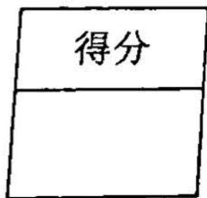

# 2018-2019学年第二学期《电工电子基础实验B》期末试卷（B卷）

原件经识别和整理；“参考解答”是我们补的。

# 2018-2019 学年第二学期《电工电子基础实验 B》期末试卷（B 卷）

## 一、操作题（共 60 分）

### 操作 1

试用 74161 和 MUX 产生 $F=0110100$ 的序列信号，写出设计过程，并画出电路原理图。（20 分）

**得分：** \_\_\_\_\_\_

### 操作 2

硬件实现：用示波器双踪同时稳定显示时钟信号 CP 和序列信号 F 的波形，请老师验收。（20 分）
（本栏由教师填写）

**得分：** \_\_\_\_\_\_

### 操作 3

操作情况。（10 分）
（本栏由教师填写）

**得分：** \_\_\_\_\_\_

参考解答：操作3的具体内容（如电路图、元件参数、操作指令或问题描述）未提供，无法给出针对性解答。

请补充以下信息：
- 电路图（可描述连接方式或上传图片）
- 已知参数（电源、电阻、电容等数值）
- 具体操作要求（如“开关S闭合后求某支路电流”“判断某元件工作状态”等）

补充后即可按“先结论、后关键计算步骤”的格式给出完整解答。

知识点：[基尔霍夫电流定律（KCL）及其应用](../../../topics/电路与电子技术/KCL.md)、[基尔霍夫电压定律（KVL）及其应用](../../../topics/电路与电子技术/KVL.md)

### 操作 4

记录时钟信号 CP 和序列信号 F 的波形，并标出一个周期。（10 分）

## 二、问答题（共 40 分）

### 选择 1

#### 填空 1

1) 用数字示波器双踪同时测量两路信号，若 CH1 所测信号为频率 $1\mathrm{KHz}$，峰峰值 $5\mathrm{V}$ 的方波，CH2 所测信号为频率 $1\mathrm{KHz}$，峰峰值 $5\mathrm{mV}$ 的方波，触发信源应该选择 \_\_\_\_\_\_；若将 CH2 通道信号换为频率 $4\mathrm{KHz}$，峰峰值 $5\mathrm{V}$ 的方波，触发信源应该选择 \_\_\_\_\_\_。

(2) 理想的正弦波只有 \_\_\_\_\_\_，而无 \_\_\_\_\_\_ 分量，如果测出谐波分量，说明该正弦波已有 \_\_\_\_\_\_。

3) 用数字示波器 CHi 通道测量数字试验箱 $2\mathrm{kHz}$ 信号输出，其高电平应为\_\_\_\_\_\_，周期应为\_\_\_\_\_\_。

4) 对一个线性有源二端口网络进行戴维宁等效时，常用的等效电阻测量方法有\_\_\_\_\_\_、\_\_\_\_\_\_、\_\_\_\_\_\_。

**得分：** \_\_\_\_\_\_

参考解答：**选择 1**

触发信源应选择 **CH1**；若 CH2 换为 4 kHz、5 V 方波，触发信源应选择 **CH1 或 CH2 均可**。  
理由：第一次 CH2 信号幅度太小（5 mV），用 CH1 触发更稳定；第二次两路幅度相同，均为稳定方波，任选一路触发都能获得稳定显示。

---

**填空 1**

1) 触发信源应选择 **CH1**；换为 4 kHz、5 V 方波后，触发信源应选择 **CH1 或 CH2 均可**。

2) 理想的正弦波只有 **基波**，而无 **谐波** 分量，如果测出谐波分量，说明该正弦波已有 **失真（非线性失真）**。

3) 其高电平应为 **数字试验箱 TTL 高电平标准值（通常约 3.5 V～5 V，具体看实验箱说明）**，周期应为 **$0.5\ \mathrm{ms}$**。

4) 常用的等效电阻测量方法有 **开路短路法**、**外加电源法**、**半偏法（或两次电压法）**。

知识点：[电流、电压的参考方向及关联参考方向](../../../topics/电路与电子技术/参考方向.md)、[元件吸收与产生功率的计算与判断](../../../topics/电路与电子技术/功率计算.md)、[四种受控电源（VCVS、VCCS、CCVS、CCCS）的特性](../../../topics/电路与电子技术/受控电源.md)

### 计算 1

请画出下面传输函数的连续时间系统模拟框图，其中 $R_{1}=2\mathrm{k}\Omega, R_{2}=500\Omega, L=50\mathrm{mH}, C=1\mu\mathrm{F}$。（10 分）




参考解答：该系统模拟框图应采用**直接II型（规范型）结构**，包含两个积分器、三个加法器和四个系数乘法器，具体连接关系由归一化后的微分方程决定。

### 推理与计算过程

1.  **求传输函数 $H(s)$**  
    电路为 RLC 串联分压网络，输出取自 $R_2$ 与 $C$ 并联支路：
    $$
    H(s) = \frac{U_o(s)}{U_i(s)} = \frac{R_2 \parallel \frac{1}{sC}}{R_1 + sL + \left(R_2 \parallel \frac{1}{sC}\right)}
    $$
    其中 $R_2 \parallel \frac{1}{sC} = \dfrac{R_2}{1+sR_2 C}$，代入整理得：
    $$
    H(s) = \frac{R_2}{s^2 L R_2 C + s(L + R_1 R_2 C) + (R_1 + R_2)}
    $$

2.  **代入元件数值并归一化**  
    $R_1=2000\,\Omega$, $R_2=500\,\Omega$, $L=0.05\,\mathrm{H}$, $C=10^{-6}\,\mathrm{F}$：
    $$
    \begin{aligned}
    a_2 &= L R_2 C = 0.05 \times 500 \times 10^{-6} = 2.5\times10^{-5} \\
    a_1 &= L + R_1 R_2 C = 0.05 + 2000\times500\times10^{-6} = 1.05 \\
    a_0 &= R_1 + R_2 = 2500 \\
    b_0 &= R_2 = 500
    \end{aligned}
    $$
    分子分母同除以 $a_2$，得到首一多项式形式：
    $$
    H(s) = \frac{2\times10^7}{s^2 + 42000\,s + 10^8}
    $$
    即 $b_0'=2\times10^7,\; a_1'=42000,\; a_0'=10^8$。

3.  **构建直接II型模拟框图**  
    对应微分方程 $\ddot{y}+a_1'\dot{y}+a_0' y = b_0' x$，引入中间变量 $w(t)$ 使：
    $$
    \begin{cases}
    \ddot{w} + a_1'\dot{w} + a_0' w = x \\
    y = b_0' w
    \end{cases}
    $$
    框图要素：
    - **两个积分器**级联：$\int\!\to\!\int$，第一个积分器输出为 $\dot{w}$，第二个为 $w$；
    - **反馈回路**：将 $w$ 乘以 $-a_0'=-10^8$、$\dot{w}$ 乘以 $-a_1'=-42000$ 后与输入 $x$ 在加法器求和，送入第一个积分器；
    - **前向通路**：$w$ 乘以 $b_0'=2\times10^7$ 得到输出 $y$。

> **注**：图中所有系数均使用上述归一化后的数值；若采用非归一化形式，系数分别为 $a_2=2.5\times10^{-5},\,a_1=1.05,\,a_0=2500,\,b_0=500$，但需在第一个积分器前额外增加 $1/a_2$ 增益环节，工程上推荐归一化实现以避免极小系数带来的精度问题。

知识点：[线性时不变电阻的伏安关系（欧姆定律）](../../../topics/电路与电子技术/线性电阻VCR.md)、[理想电压源与理想电流源的特性](../../../topics/电路与电子技术/独立电源.md)

### 绘图 1

已知函数信号发生器输出占空比为 $20\%$、周期为 $1\mathrm{s}$、幅值为 $5\mathrm{V}_{\mathrm{PP}}$ 和偏移为 $2\mathrm{V}_{\mathrm{DC}}$ 的脉冲波。请分别画出其在直流和交流两种通道耦合方式下的示波器显示图形，标出高、低电平值和周期。（10 分）

参考解答：## 结论

- **直流耦合**：示波器显示脉冲波本身。高电平为 $7\,\mathrm{V}$，低电平为 $-3\,\mathrm{V}$，周期 $T=1\,\mathrm{s}$，高电平持续时间为 $0.2\,\mathrm{s}$，低电平持续时间为 $0.8\,\mathrm{s}$。
- **交流耦合**：示波器只显示交流分量，脉冲波的平均值被去除，图形在屏幕垂直中心上下对称。高、低电平分别为 $+5\,\mathrm{V}$ 和 $-5\,\mathrm{V}$，周期仍为 $1\,\mathrm{s}$，高、低电平持续时间分别为 $0.2\,\mathrm{s}$ 和 $0.8\,\mathrm{s}$。

## 推理与计算

已知：

$$
T=1\,\mathrm{s},\qquad D=20\%=0.2
$$

因此高电平持续时间为

$$
t_H=DT=0.2\times1=0.2\,\mathrm{s}
$$

低电平持续时间为

$$
t_L=(1-D)T=0.8\times1=0.8\,\mathrm{s}
$$

信号的平均值为

$$
V_{\mathrm{DC}}=2\,\mathrm{V}
$$

### 1. 直流耦合

直流耦合保留信号的直流分量，因此：

$$
V_H=2+5=7\,\mathrm{V}
$$

$$
V_L=2-5=-3\,\mathrm{V}
$$

波形以 $-3\,\mathrm{V}$ 为低电平、$7\,\mathrm{V}$ 为高电平，并在每个周期内保持 $0.2\,\mathrm{s}$ 后下降，保持 $0.8\,\mathrm{s}$ 后再次上升。

示意如下：

```text
  7 V ┤      ┌───┐          ┌───┐
      │      │   │          │   │
 -3 V ┤──────┘   └──────────┘   └────────
      0    0.2  1.0        1.2  2.0      t/s
            tH=0.2 s       tH=0.2 s

          每个周期 T=1 s
```

### 2. 交流耦合

交流耦合滤除信号的直流分量。交流分量为

$$
v_{\mathrm{AC}}(t)=v(t)-V_{\mathrm{DC}}
$$

故高、低电平变为

$$
V_H=7-2=5\,\mathrm{V}
$$

$$
V_L=-3-2=-5\,\mathrm{V}
$$

波形以 $0\,\mathrm{V}$ 为中心，在 $+5\,\mathrm{V}$ 与 $-5\,\mathrm{V}$ 之间跳变；时间参数和占空比均不变。

示意如下：

```text
 +5 V ┤      ┌───┐          ┌───┐
      │      │   │          │   │
  0 V ┼──────┤   ├──────────┤   ├────────  中心线
      │      │   │          │   │
 -5 V ┤──────┘   └──────────┘   └────────
      0    0.2  1.0        1.2  2.0      t/s
            tH=0.2 s       tH=0.2 s

          每个周期 T=1 s
```

其中，交流耦合图形的纵轴 $0\,\mathrm{V}$ 对应原波形的直流平均值 $2\,\mathrm{V}$。

知识点：[理想电压源与理想电流源的特性](../../../topics/电路与电子技术/独立电源.md)

### 计算 2

已知 RLC 电路的 $R = 62\Omega, L = 10\mathrm{mH}$，电容未知。又测得电路的谐振频率为 $5.4\mathrm{KHz}$，请计算此 RLC 电路的品质因数。（10 分）

参考解答：结论：  
品质因数约为 **5.47**。

计算过程：

谐振角频率  

$$
\omega_0 = 2\pi f_0 = 2\pi \times 5.4\times 10^3 \approx 33929.2\ \mathrm{rad/s}
$$

电感  

$$
L = 10\ \mathrm{mH}=0.01\ \mathrm{H}
$$

RLC 串联谐振电路的品质因数公式为  

$$
Q=\frac{\omega_0 L}{R}
$$

代入数据：  

$$
Q=\frac{33929.2 \times 0.01}{62}
=\frac{339.292}{62}
\approx 5.47
$$

因此品质因数约为 **5.47**。

知识点：[基尔霍夫电压定律（KVL）及其应用](../../../topics/电路与电子技术/KVL.md)、[基尔霍夫电流定律（KCL）及其应用](../../../topics/电路与电子技术/KCL.md)、[线性时不变电阻的伏安关系（欧姆定律）](../../../topics/电路与电子技术/线性电阻VCR.md)
