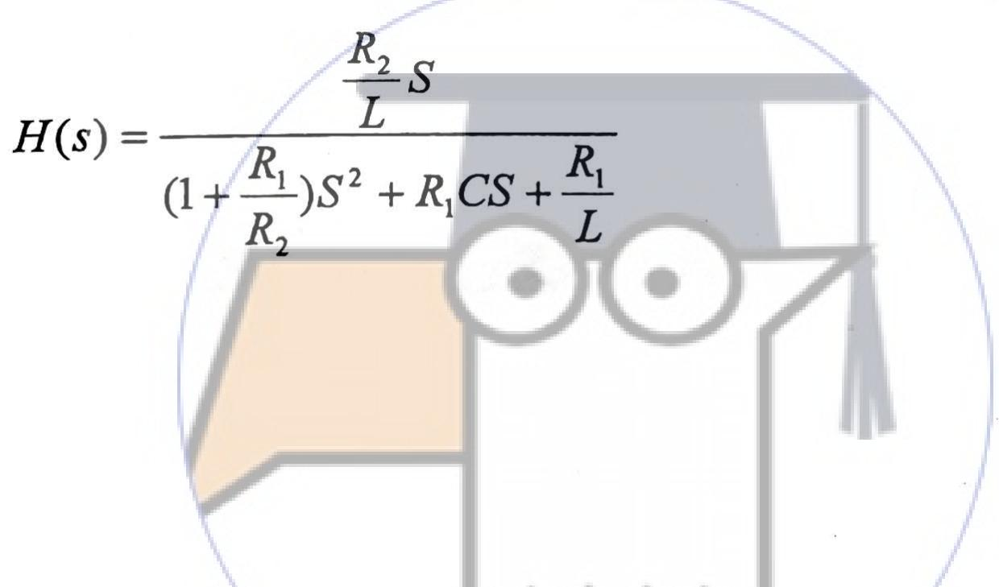

# 2018-2019学年第二学期《电工电子基础实验B》期末试卷（B卷）

原件经识别和整理；“参考解答”是我们补的。

# 2018-2019 学年第二学期《电工电子基础实验 B》期末试卷（B 卷）

## 一、操作题（共 60 分）

### 操作 1

试用 74161 和 MUX 产生 $F=0110100$ 的序列信号，写出设计过程，并画出电路原理图。（20 分）

**得分：** \_\_\_\_\_\_

### 操作 2

硬件实现：用示波器双踪同时稳定显示时钟信号 CP 和序列信号 F 的波形，请老师验收。（20 分）
（本栏由教师填写）

**得分：** \_\_\_\_\_\_

### 操作 3

操作情况。（10 分）
（本栏由教师填写）

**得分：** \_\_\_\_\_\_

知识点：[基尔霍夫电流定律（KCL）及其应用](../../../topics/电路与电子技术/KCL.md)、[基尔霍夫电压定律（KVL）及其应用](../../../topics/电路与电子技术/KVL.md)

### 操作 4

记录时钟信号 CP 和序列信号 F 的波形，并标出一个周期。（10 分）

## 二、问答题（共 40 分）

### 选择 1

#### 填空 1

1) 用数字示波器双踪同时测量两路信号，若 CH1 所测信号为频率 $1\mathrm{KHz}$，峰峰值 $5\mathrm{V}$ 的方波，CH2 所测信号为频率 $1\mathrm{KHz}$，峰峰值 $5\mathrm{mV}$ 的方波，触发信源应该选择 \_\_\_\_\_\_；若将 CH2 通道信号换为频率 $4\mathrm{KHz}$，峰峰值 $5\mathrm{V}$ 的方波，触发信源应该选择 \_\_\_\_\_\_。

(2) 理想的正弦波只有 \_\_\_\_\_\_，而无 \_\_\_\_\_\_ 分量，如果测出谐波分量，说明该正弦波已有 \_\_\_\_\_\_。

3) 用数字示波器 CHi 通道测量数字试验箱 $2\mathrm{kHz}$ 信号输出，其高电平应为\_\_\_\_\_\_，周期应为\_\_\_\_\_\_。

4) 对一个线性有源二端口网络进行戴维宁等效时，常用的等效电阻测量方法有\_\_\_\_\_\_、\_\_\_\_\_\_、\_\_\_\_\_\_。

**得分：** \_\_\_\_\_\_

知识点：[电流、电压的参考方向及关联参考方向](../../../topics/电路与电子技术/参考方向.md)、[元件吸收与产生功率的计算与判断](../../../topics/电路与电子技术/功率计算.md)、[四种受控电源（VCVS、VCCS、CCVS、CCCS）的特性](../../../topics/电路与电子技术/受控电源.md)

### 计算 1

请画出下面传输函数的连续时间系统模拟框图，其中 $R_{1}=2\mathrm{k}\Omega, R_{2}=500\Omega, L=50\mathrm{mH}, C=1\mu\mathrm{F}$。（10 分）

知识点：[线性时不变电阻的伏安关系（欧姆定律）](../../../topics/电路与电子技术/线性电阻VCR.md)、[理想电压源与理想电流源的特性](../../../topics/电路与电子技术/独立电源.md)

### 绘图 1

已知函数信号发生器输出占空比为 $20\%$、周期为 $1\mathrm{s}$、幅值为 $5\mathrm{V}_{\mathrm{PP}}$ 和偏移为 $2\mathrm{V}_{\mathrm{DC}}$ 的脉冲波。请分别画出其在直流和交流两种通道耦合方式下的示波器显示图形，标出高、低电平值和周期。（10 分）

知识点：[理想电压源与理想电流源的特性](../../../topics/电路与电子技术/独立电源.md)

### 计算 2

已知 RLC 电路的 $R = 62\Omega, L = 10\mathrm{mH}$，电容未知。又测得电路的谐振频率为 $5.4\mathrm{KHz}$，请计算此 RLC 电路的品质因数。（10 分）

知识点：[基尔霍夫电压定律（KVL）及其应用](../../../topics/电路与电子技术/KVL.md)、[基尔霍夫电流定律（KCL）及其应用](../../../topics/电路与电子技术/KCL.md)、[线性时不变电阻的伏安关系（欧姆定律）](../../../topics/电路与电子技术/线性电阻VCR.md)
