# 2022 贝尔电分 A 阶段测试一（答案）

原件经识别和整理；“参考解答”是我们补的。

本资料为《电路分析基础》A 阶段测试一的参考答案，由识别工具读取并整理。

## 一、填空题

### 填空 1

题图 1 所示电路中，电流源的电压 $u = [1.2] \text{ V}$，$2\Omega$ 电阻的吸收功率 $P_{2\Omega} = [0.72] \text{ W}$，受控电流源吸收的功率 $P_{2u} = [2.88] \text{ W}$。【9 分】

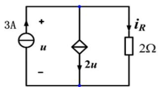

答案：$u=1.2$；$P_{2\Omega}=0.72$；$P_{2u}=2.88$

知识点：[四种受控电源（VCVS、VCCS、CCVS、CCCS）的特性](../../../topics/电路与电子技术/受控电源.md)、[基尔霍夫电流定律（KCL）及其应用](../../../topics/电路与电子技术/KCL.md)、[元件吸收与产生功率的计算与判断](../../../topics/电路与电子技术/功率计算.md)

### 填空 2

题图 2 所示电路中，等效电阻 $R_{ab} = [4] \Omega$，电流 $i_s = [0.5] \text{ A}$。【4 分】

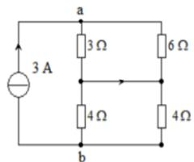

答案：$R_{ab}=4$；$i_s=0.5$

知识点：[线性时不变电阻的伏安关系（欧姆定律）](../../../topics/电路与电子技术/线性电阻VCR.md)、[理想电压源与理想电流源的特性](../../../topics/电路与电子技术/独立电源.md)

### 填空 3

题图 3 所示电路中，电流 $i_1 = [1] \text{ A}$。【4 分】

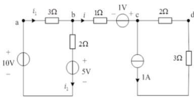

答案：$i_1=1$

知识点：[基尔霍夫电流定律（KCL）及其应用](../../../topics/电路与电子技术/KCL.md)、[线性时不变电阻的伏安关系（欧姆定律）](../../../topics/电路与电子技术/线性电阻VCR.md)、[电流、电压的参考方向及关联参考方向](../../../topics/电路与电子技术/参考方向.md)

### 填空 4

题图 4 所示电路中的电流 $i = [-0.5] \text{ A}$。【4 分】

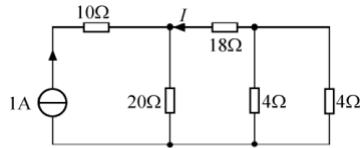

答案：$i=-0.5$

知识点：[基尔霍夫电流定律（KCL）及其应用](../../../topics/电路与电子技术/KCL.md)、[电流、电压的参考方向及关联参考方向](../../../topics/电路与电子技术/参考方向.md)

### 填空 5

图示 5 电路的开路电压 $U_{oc}=[4] \text{ V}$，等效电阻 $R_0=[3] \Omega$。【5 分】

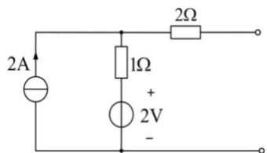

答案：$U_{oc}=4$；$R_0=3$

知识点：[理想电压源与理想电流源的特性](../../../topics/电路与电子技术/独立电源.md)、[线性时不变电阻的伏安关系（欧姆定律）](../../../topics/电路与电子技术/线性电阻VCR.md)、[基尔霍夫电压定律（KVL）及其应用](../../../topics/电路与电子技术/KVL.md)

### 填空 6

题图 6 所示电路中的电流 $i = [2] \text{ A}$。【4 分】

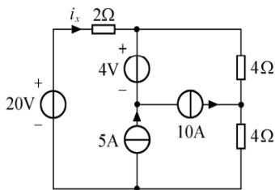

答案：$i=2$

知识点：[理想电压源与理想电流源的特性](../../../topics/电路与电子技术/独立电源.md)、[基尔霍夫电流定律（KCL）及其应用](../../../topics/电路与电子技术/KCL.md)

### 填空 7

题图 7 所示电路中，$R$ 为可变电阻，求当 $R = [2.5] \Omega$ 时，可以获得最大功率。【4 分】

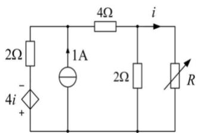

答案：$R=2.5$

## 二、计算题

知识点：[理想电压源与理想电流源的特性](../../../topics/电路与电子技术/独立电源.md)、[基尔霍夫电压定律（KVL）及其应用](../../../topics/电路与电子技术/KVL.md)、[线性时不变电阻的伏安关系（欧姆定律）](../../../topics/电路与电子技术/线性电阻VCR.md)

### 计算 8

求题图所示电路的 $u_s$。

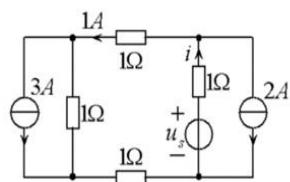

答案：$u_s = 3 \text{ V}$

知识点：[四种受控电源（VCVS、VCCS、CCVS、CCCS）的特性](../../../topics/电路与电子技术/受控电源.md)、[基尔霍夫电压定律（KVL）及其应用](../../../topics/电路与电子技术/KVL.md)、[基尔霍夫电流定律（KCL）及其应用](../../../topics/电路与电子技术/KCL.md)

### 计算 9

求题图所示电路的戴维南等效电路。

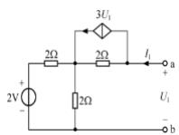

$$
U_{oc} = 1/7 \text{ V}; \quad R_{eq} = 3/7 \Omega
$$

答案：$U_{oc} = 1/7 \text{ V}$，$R_{eq} = 3/7 \Omega$

知识点：[线性时不变电阻的伏安关系（欧姆定律）](../../../topics/电路与电子技术/线性电阻VCR.md)、[理想电压源与理想电流源的特性](../../../topics/电路与电子技术/独立电源.md)、[基尔霍夫电压定律（KVL）及其应用](../../../topics/电路与电子技术/KVL.md)

### 计算 10

列出节点方程，并求出电压 $u$。

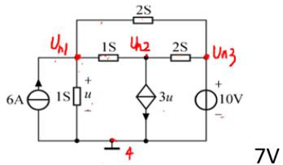

答案：需根据电路图列写节点电压方程求解 $u$。

知识点：[基尔霍夫电流定律（KCL）及其应用](../../../topics/电路与电子技术/KCL.md)、[线性时不变电阻的伏安关系（欧姆定律）](../../../topics/电路与电子技术/线性电阻VCR.md)

### 计算 11

电路如图所示，求输入电阻 $R_{in}$。

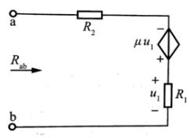

答案：$R_{in} = R_1 + R_2 - \mu R_1$

知识点：[四种受控电源（VCVS、VCCS、CCVS、CCCS）的特性](../../../topics/电路与电子技术/受控电源.md)、[基尔霍夫电压定律（KVL）及其应用](../../../topics/电路与电子技术/KVL.md)、[线性时不变电阻的伏安关系（欧姆定律）](../../../topics/电路与电子技术/线性电阻VCR.md)

### 计算 12

（1）试用诺顿定理求图示电路的诺顿等效电路；（2）若 ab 端接 $9\Omega$ 电阻，求电阻消耗的功率。

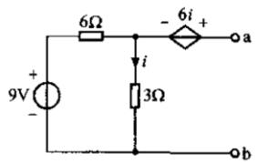

答案：（1）需计算短路电流 $I_{sc}$ 和等效电阻 $R_{eq}$ 得到诺顿等效电路；（2）$P = 3.24 \text{ W}$

知识点：[基尔霍夫电压定律（KVL）及其应用](../../../topics/电路与电子技术/KVL.md)、[电流、电压的参考方向及关联参考方向](../../../topics/电路与电子技术/参考方向.md)、[元件吸收与产生功率的计算与判断](../../../topics/电路与电子技术/功率计算.md)

### 计算 13

用网孔分析法求解题图所示电路中的电流 $i_x$。

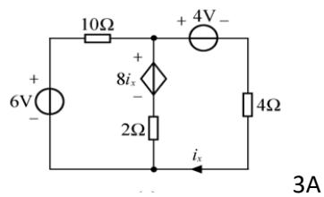

答案：需建立网孔电流方程组求解 $i_x$。

知识点：[基尔霍夫电压定律（KVL）及其应用](../../../topics/电路与电子技术/KVL.md)、[线性时不变电阻的伏安关系（欧姆定律）](../../../topics/电路与电子技术/线性电阻VCR.md)、[电流、电压的参考方向及关联参考方向](../../../topics/电路与电子技术/参考方向.md)

### 计算 14

图示电路，求 $R_L$ 分别等于 $1\Omega$、$2\Omega$、$3\Omega$ 时电流 $I_L$。

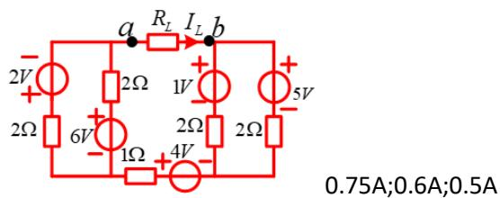

答案：需先求戴维南等效电路，再代入不同 $R_L$ 值计算 $I_L$。

知识点：[理想电压源与理想电流源的特性](../../../topics/电路与电子技术/独立电源.md)、[线性时不变电阻的伏安关系（欧姆定律）](../../../topics/电路与电子技术/线性电阻VCR.md)、[基尔霍夫电压定律（KVL）及其应用](../../../topics/电路与电子技术/KVL.md)

### 计算 15

如图所示电路，当 $U_{s1}=3\text{V}$ 时，$U=4\text{V}$。求当 $U_{s1}=6\text{V}$，其他条件均不变时，$U=?$

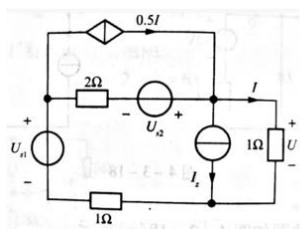

答案：$U = 5 \text{ V}$

知识点：[线性时不变电阻的伏安关系（欧姆定律）](../../../topics/电路与电子技术/线性电阻VCR.md)、[基尔霍夫电压定律（KVL）及其应用](../../../topics/电路与电子技术/KVL.md)、[理想电压源与理想电流源的特性](../../../topics/电路与电子技术/独立电源.md)
