# 2024年《电路分析基础》期末复习

原件经识别和整理；“参考解答”是我们补的。

## 考试题型

一、选择题
二、填空题
三、简单计算题
四、综合计算题

## 说明

- 复习 PPT 是电分 A 期末考试涉及的知识点的归纳，具体细节还得看上课 PPT 和教材，多练习题目来掌握。
- 一些本次期末不考的知识点已经标明（中间划横线）。
- 给出的参考作业请认真练习，相关知识点会考，强调的是分析方法和解题步骤。
- 要求带没有记忆功能的计算器。

## 第一章 电路的基本变量

### 电流、电压的参考方向

电流、电压的参考方向（关联，非关联）。

知识点：[电流、电压的参考方向及关联参考方向](../../../topics/电路与电子技术/参考方向.md)

### 功率的求解

功率的求解：关联 $p=ui$，非关联 $p=-ui$。

注意点：

1. 关联与非关联。
2. 上面公式中的都是吸收功率。

补充：计算电压源的电流列 KCL 方程求解，计算电流源的电压列 KVL 方程求解。

知识点：[元件吸收与产生功率的计算与判断](../../../topics/电路与电子技术/功率计算.md)、[基尔霍夫电流定律（KCL）及其应用](../../../topics/电路与电子技术/KCL.md)、[基尔霍夫电压定律（KVL）及其应用](../../../topics/电路与电子技术/KVL.md)

### KCL、KVL、VCR

KCL、KVL、VCR（电阻，电容，电感，时域和复数域）。

1、3 贯穿整个电路的学习。

参考作业：1-6，1-11，1-12

## 第二章 电路分析中的等效变换

知识点：[基尔霍夫电流定律（KCL）及其应用](../../../topics/电路与电子技术/KCL.md)、[基尔霍夫电压定律（KVL）及其应用](../../../topics/电路与电子技术/KVL.md)、[线性时不变电阻的伏安关系（欧姆定律）](../../../topics/电路与电子技术/线性电阻VCR.md)

### 电阻的等效

电阻的等效（串并联、星三角）；分压分流。

星三角重点掌握三个电阻相同情况：$R_{\Delta}=3R_{\mathrm{Y}}$，$R_{\mathrm{Y}}=R_{\Delta}/3$。

知识点：[线性时不变电阻的伏安关系（欧姆定律）](../../../topics/电路与电子技术/线性电阻VCR.md)、[基尔霍夫电流定律（KCL）及其应用](../../../topics/电路与电子技术/KCL.md)、[基尔霍夫电压定律（KVL）及其应用](../../../topics/电路与电子技术/KVL.md)

### 电源等效变换

#### 独立电源等效变换

a. 电压源串联等效为各个电压源的代数和。

b. 电流源并联等效为各个电流源的代数和。

c. 电压源与任何二端网络并联等效为此电压源。

d. 电流源与任何二端网络串联等效为此电流源。

#### 实际电源等效变换

戴维南模型和诺顿模型相互转换（注意电压源和电流源参考方向对应）。

#### 受控源等效变换

受控源等效变换：当做独立源来处理进行等效变换；最终列写端口 VCR 关系式！重要：只含受控源和电阻（阻抗）的电路最终等效成电阻（阻抗）。

不同电路等效变换方法，例如：

1）求戴维南等效电路及诺顿等效电路

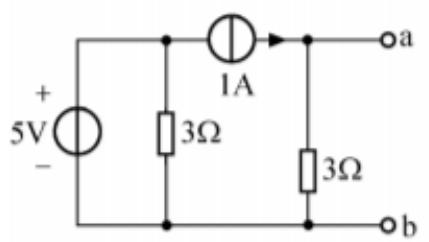

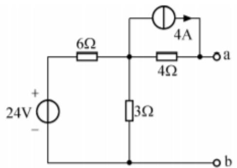

含独立源无受控源的电路——a) 电源等效变换；b) 戴维南/诺顿定理。

2）求如图所示 ab 端等效电阻：

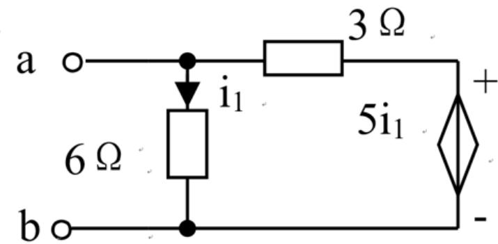

3）求戴维南等效电路

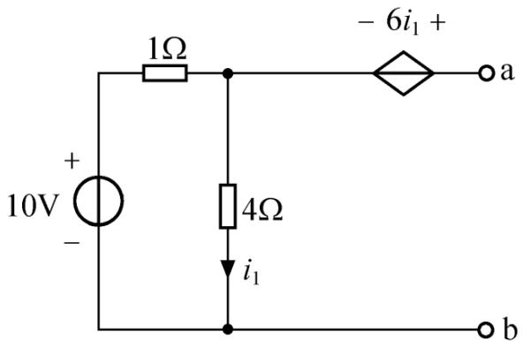

含独立源、有受控源的电路，最好用戴维南定理去做，求 $u_{oc}$ 和 $R_0$；其中 $R_0$ 用加压求流法。

无独立源、仅含电阻受控源电路，等效成一个电阻——加压求流法。

参考作业：2-3，2-5(c)，2-9(c)，2-10(b)，2-15（含源线性网络，用戴维南/诺顿定理去做。求等效电阻的时候有受控源——用加压求流法。），2-19

## 第3章 线性网络的一般分析方法

知识点：[理想电压源与理想电流源的特性](../../../topics/电路与电子技术/独立电源.md)、[四种受控电源（VCVS、VCCS、CCVS、CCCS）的特性](../../../topics/电路与电子技术/受控电源.md)、[基尔霍夫电压定律（KVL）及其应用](../../../topics/电路与电子技术/KVL.md)

### 网孔分析法

网孔分析法——只适用于平面网络。

以 $b-(n-1)$ 个网孔电流为独立的电路变量，按规定规则直接列写网孔方程求解电路的方法。

掌握列写规则和对三种独立电流源的处理；受控源当作独立源看待，网孔方程中必须包含辅助方程！！

知识点：[基尔霍夫电压定律（KVL）及其应用](../../../topics/电路与电子技术/KVL.md)、[理想电压源与理想电流源的特性](../../../topics/电路与电子技术/独立电源.md)、[四种受控电源（VCVS、VCCS、CCVS、CCCS）的特性](../../../topics/电路与电子技术/受控电源.md)

### 节点分析法

节点分析法——适用于所有集中参数电路。

以 $n-1$ 个节点电压为独立的电路变量，按规定规则直接列写节点方程求解电路的方法。

掌握列写规则和对三种独立电压源的处理；受控源当作独立源看待，节点方程中必须包含辅助方程！！

补充：基本回路、基本割集、回路分析法，画对偶电路。

参考作业：3-4，3-5(b)，3-6(a)，3-8，3-9

## 第4章 网络定理

（各种定理适用条件）

知识点：[基尔霍夫电流定律（KCL）及其应用](../../../topics/电路与电子技术/KCL.md)、[基尔霍夫电压定律（KVL）及其应用](../../../topics/电路与电子技术/KVL.md)

### 叠加定理

叠加定理（电源不作用时候的处理，画过程电路图；受控源的处理）。

独立电压源置零——短路；独立电流源置零——开路，受控源不能单独作用及置零，只能保留在电路中。

习题 4-2

知识点：[四种受控电源（VCVS、VCCS、CCVS、CCCS）的特性](../../../topics/电路与电子技术/受控电源.md)、[理想电压源与理想电流源的特性](../../../topics/电路与电子技术/独立电源.md)

### 替代定理

替代定理。

知识点：[基尔霍夫电流定律（KCL）及其应用](../../../topics/电路与电子技术/KCL.md)、[基尔霍夫电压定律（KVL）及其应用](../../../topics/电路与电子技术/KVL.md)

### 戴维南/诺顿定理

戴维南/诺顿定理：习题 4-9(a)，4-10(b)，4-11，第二章的习题 2-10(a)(b)，2-15，2-16

知识点：[理想电压源与理想电流源的特性](../../../topics/电路与电子技术/独立电源.md)、[线性时不变电阻的伏安关系（欧姆定律）](../../../topics/电路与电子技术/线性电阻VCR.md)、[基尔霍夫电压定律（KVL）及其应用](../../../topics/电路与电子技术/KVL.md)

### 最大功率传输定理

a. 电阻电路最大功率传输定理习题 4-14；b. 第八章正弦稳态电路共轭匹配（习题 8-29，8-30）；c. 第九章含有变压器的最大功率（习题 9-11）（习题 9-16）。

注意：最大功率的表达式都是实数，正弦稳态电路 $U_{OC}$ 是有效值！不是相量！

补充：特勒根定理，互易定理。

参考作业：4-2，4-5，4-9(a)，4-10(b)，4-14

## 第6章 一阶电路分析

知识点：[理想电压源与理想电流源的特性](../../../topics/电路与电子技术/独立电源.md)、[线性时不变电阻的伏安关系（欧姆定律）](../../../topics/电路与电子技术/线性电阻VCR.md)、[基尔霍夫电压定律（KVL）及其应用](../../../topics/电路与电子技术/KVL.md)

### 电容和电感——线性时不变

| 元件 | 伏安关系 | 储能 | 吸收功率 |
| --- | --- | --- | --- |
| 电容 | $i_c=\pm C\frac{du_c}{dt}$ | $w_c(t)=\frac{1}{2}Cu_c^2(t)$ | $p(t)=\pm u(t)\cdot i(t)$ |
| 电感 | $u_L=\pm L\frac{di_L}{dt}$ | $w_L(t)=\frac{1}{2}Li_L^2(t)$ | $p(t)=\pm u(t)\cdot i(t)$ |

知识点：[线性时不变电阻的伏安关系（欧姆定律）](../../../topics/电路与电子技术/线性电阻VCR.md)、[元件吸收与产生功率的计算与判断](../../../topics/电路与电子技术/功率计算.md)

### 一阶动态电路的零输入响应

一阶动态电路的零输入响应——仅由初始状态引起的响应。

知识点：[电流、电压的参考方向及关联参考方向](../../../topics/电路与电子技术/参考方向.md)、[线性时不变电阻的伏安关系（欧姆定律）](../../../topics/电路与电子技术/线性电阻VCR.md)、[基尔霍夫电压定律（KVL）及其应用](../../../topics/电路与电子技术/KVL.md)

### 一阶动态电路的零状态响应

一阶动态电路的零状态响应——仅由独立电源引起的响应（$u_c(0^-)=0\,\mathrm{V}$，$i_L(0^-)=0\,\mathrm{A}$）。

会去判断、构建零输入、零状态、全响应。

### 一阶动态电路恒定激励下的全响应

一阶动态电路恒定激励下的全响应——由独立电源和动态元件的初始状态共同产生的。

恒定激励下一阶动态电路的任意全响应可用三要素法计算：

$$r(t)=r(\infty)+[r(0^+)-r(\infty)]\mathrm{e}^{-\frac{t}{\tau}},\quad t>0$$

$r(0^+)$：响应的初始值；

$r(\infty)$：响应的终值；

$\tau$：时间常数的概念，$\tau=RC$ 或 $\tau=L/R$。

三要素的求解，写步骤！！！画图！！！

知识点：[理想电压源与理想电流源的特性](../../../topics/电路与电子技术/独立电源.md)、[基尔霍夫电流定律（KCL）及其应用](../../../topics/电路与电子技术/KCL.md)、[基尔霍夫电压定律（KVL）及其应用](../../../topics/电路与电子技术/KVL.md)

### 一阶动态电路的阶跃响应

何为单位阶跃响应？

补充：6.8 节冲激响应，6.9 节任意激励下的零状态。

参考作业：6-2，6-14(a)(b)，6-26，6-32

## 第八章 正弦激励下的稳态分析

知识点：[理想电压源与理想电流源的特性](../../../topics/电路与电子技术/独立电源.md)、[线性时不变电阻的伏安关系（欧姆定律）](../../../topics/电路与电子技术/线性电阻VCR.md)

### 正弦量和相量对应关系

正弦量和相量对应关系，相互转换。

$$u(t)=U_{\mathrm{m}}\cos(\omega t+\phi_{\mathrm{u}})\longleftrightarrow \dot{U}_{\mathrm{m}}=U_{\mathrm{m}}\angle\phi_{\mathrm{u}},\quad \dot{U}=U\angle\phi_{\mathrm{u}}$$

$$i(t)=I_{\mathrm{m}}\cos(\omega t+\phi_{\mathrm{i}})\longleftrightarrow \dot{I}_{\mathrm{m}}=I_{\mathrm{m}}\angle\phi_{\mathrm{i}},\quad \dot{I}=I\angle\phi_{\mathrm{i}}$$

注意角频率（rad/s）和频率（Hz），$\omega=2\pi f$。

### 元件的 VCR 及阻抗——关联参考方向

| 元件 | 时域表示 | 相量形式 | 阻抗 |
| --- | --- | --- | --- |
| 电阻 | $u=Ri$ | $\dot{U}=R\dot{I}$ | $Z_R=R$ |
| 电容 | $i_c=C\frac{du_c}{dt}$ | $\dot{U}_C=-j\frac{1}{\omega C}\dot{I}_C$ | $Z_C(j\omega)=\frac{1}{j\omega C}$ |
| 电感 | $u_L=L\frac{di_L}{dt}$ | $\dot{U}_L=j\omega L\dot{I}_L$ | $Z_L(j\omega)=j\omega L$ |

在正弦稳态电路中，电阻上的电压和电流同相，电感上的电压超前电流 $90^\circ$，电容上的电压滞后电流 $90^\circ$。

知识点：[电流、电压的参考方向及关联参考方向](../../../topics/电路与电子技术/参考方向.md)、[线性时不变电阻的伏安关系（欧姆定律）](../../../topics/电路与电子技术/线性电阻VCR.md)、[四种受控电源（VCVS、VCCS、CCVS、CCCS）的特性](../../../topics/电路与电子技术/受控电源.md)

### 无源二端网络阻抗和导纳

注意单位！

阻抗串并联等效法。

会求解 $L=?$、$C=?$，会画出时域等效电路。

感性 $X=\omega L$；电阻性 $X=0$；容性 $|B|=1/\omega L$。

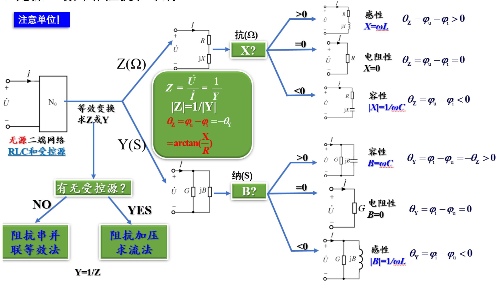

求 $Z$ 或者 $Y$：

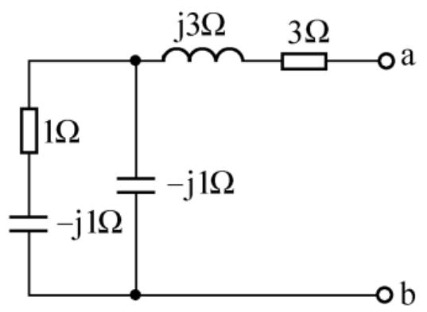

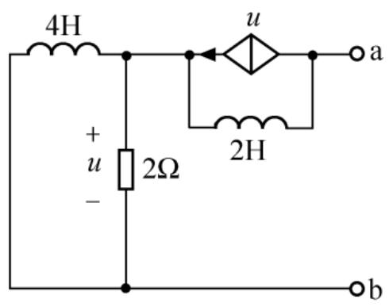

知识点：[线性时不变电阻的伏安关系（欧姆定律）](../../../topics/电路与电子技术/线性电阻VCR.md)、[理想电压源与理想电流源的特性](../../../topics/电路与电子技术/独立电源.md)

### 正弦稳态电路的相量分析法

正弦稳态的无源二端网络推广到相量模型后，所有的元件都用阻抗表示，则可以通过阻抗的串并联计算其等效阻抗或导纳。

- 会根据时域电路图画出相量模型，并利用前四章的知识进行电路分析计算（等效变换、一般线性网络分析方法、网络定理等）；注意有效值相量和振幅相量电路！（电源转换时候决定）
- 会用相量图法分析电路（可以简化计算）8-16

知识点：[基尔霍夫电流定律（KCL）及其应用](../../../topics/电路与电子技术/KCL.md)、[基尔霍夫电压定律（KVL）及其应用](../../../topics/电路与电子技术/KVL.md)、[线性时不变电阻的伏安关系（欧姆定律）](../../../topics/电路与电子技术/线性电阻VCR.md)

### 正弦稳态电路的功率计算

正弦稳态电路的功率计算 $P$、$Q$、$S$、$pf$、$\tilde{S}$，8-25(b)，书上例 8-19。掌握功率计算公式，$U$、$I$ 都是有效值！

电阻、电感、电容的功率情况比较：

|  | $u$ 和 $i$ 相位差 $\theta_z$ | 平均功率 W | 无功功率 Var | 视在功率 VA |
| --- | --- | --- | --- | --- |
| 定义 | $\theta_z=\varphi_u-\varphi_i$ | $P=UI\cos\theta_z$ | $Q=UI\sin\theta_z$ | $S=UI$ |
| 电阻 R | $\theta_z=0^\circ$ | $P_R=UI=I^2R=\frac{U^2}{R}$ | $Q_R=0$ |  |
| 电感 L | $\theta_z=90^\circ$ | $P_L=0$ | $Q_L=UI>0$ |  |
| 电容 C | $\theta_z=-90^\circ$ | $P_C=0$ | $Q_C=-UI<0$ |  |
| 阻抗 $Z=R+jX$ | $\theta_z=\arctan\frac{X}{R}$ | $P=UI\cos\theta_z=I^2R$ | $Q=UI\sin\theta_z=I^2X$ |  |

$pf=\cos\theta_z$，导前或者滞后。

$$P=UI\cos\theta_z=I^2R$$

$$Q=UI\sin\theta_z=I^2X$$

结论：电阻分量消耗的有功功率，就是单口网络吸收的有功功率。

结论：电抗分量消耗的无功功率，就是单口网络的无功功率。

## 5、正弦稳态电路的最大功率传输－共轭匹配

作业8-29、8-30

## 6、三相电路

作业8-32

注意：如果没说通常当成A相的初相为0度；但A相初相可以不是0度

### 电源或者负载作Y形连接

线电流 = 相电流
$$
I _ {l} = I _ {\mathrm{p}}
$$

线电压 $= \sqrt { 3 }$ 相电压 $\angle 3 0 ^ { \circ }$
$$
U _ {l} = \sqrt {3} U _ {\mathrm{p}}
$$

$$
\dot {U} _ {\mathrm{AB}} = \sqrt {3} U _ {\mathrm{p}} \angle 3 0 ^ {\circ} = \sqrt {3} \dot {U} _ {\mathrm{A}} \angle 3 0 ^ {\circ}
$$

$$
\dot {U} _ {\mathrm{BC}} = \sqrt {3} U _ {\mathrm{p}} \angle - 9 0 ^ {\circ} = \sqrt {3} \dot {U} _ {\mathrm{B}} \angle 3 0 ^ {\circ}
$$

$$
\dot {U} _ {\mathrm{CA}} = \sqrt {3} U _ {\mathrm{p}} \angle 1 5 0 ^ {\circ} = \sqrt {3} \dot {U} _ {\mathrm{C}} \angle 3 0 ^ {\circ}
$$

知识点：[基尔霍夫电压定律（KVL）及其应用](../../../topics/电路与电子技术/KVL.md)、[电流、电压的参考方向及关联参考方向](../../../topics/电路与电子技术/参考方向.md)

### 电源或者负载作 $\triangle$ 形连接

线电压 = 相电压
$$
U _ {l} = U _ {\mathrm{p}}
$$

线电流 $= \sqrt { 3 }$ 相电流 $\angle - 3 0 ^ { \circ }$
$$
I _ {l} = \sqrt {3} I _ {\mathrm{p}}
$$

$$
\dot {I} _ {\mathrm{A}} = \sqrt {3} I _ {\mathrm{p}} \angle - 3 0 ^ {\circ} = \sqrt {3} \dot {I} _ {\mathrm {A^ {\prime} B^ {\prime}}} \angle - 3 0 ^ {\circ}
$$

$$
\dot {I} _ {\mathrm{B}} = \sqrt {3} I _ {\mathrm{p}} \angle - 1 5 0 ^ {\circ} = \sqrt {3} \dot {I} _ {\mathrm {B^ {\prime} C^ {\prime}}} \angle - 3 0 ^ {\circ}
$$

$$
\dot {I} _ {\mathrm{C}} = \sqrt {3} I _ {\mathrm{p}} \angle 9 0 ^ {\circ} = \sqrt {3} \dot {I} _ {\mathrm {C^ {\prime} A^ {\prime}}} \angle - 3 0 ^ {\circ}
$$

满足对称三相电路的对称性

$$
P = 3 U _ {\mathrm{p}} I _ {\mathrm{p}} \cos \theta_ {z} = 3 \frac {U _ {l} I _ {l}}{\sqrt {3}} \cos \theta_ {z} = \sqrt {3} U _ {l} I _ {l} \cos \theta_ {z}
$$

## 7、非正弦周期信号

例题 8-28

参考作业：
8-5，8-6，8-10，8-13，8-16，8-25(b)，8-30 ， 8-32，8-42书例8-19、例8-28

# 第9章 耦合电感和变压器电路分析

## 1、耦合电感的伏安关系

## 2、耦合电感的直接去耦等效

串联，并联，三端去耦等效

## 3、空芯变压器电路的分析

当成耦合电感三端去耦等效（重点！）

习题9-3b ，9-8，
9-11（含有变压器的最大功率，共轭匹配）

## 四、理想变压器电路

知识点：[基尔霍夫电流定律（KCL）及其应用](../../../topics/电路与电子技术/KCL.md)、[基尔霍夫电压定律（KVL）及其应用](../../../topics/电路与电子技术/KVL.md)

### 1、理想变压器的伏安关系

知识点：[电流、电压的参考方向及关联参考方向](../../../topics/电路与电子技术/参考方向.md)

### 2、理想变压器电路的分析

➢ 阻抗搬移 例题9-4，习题9-12

➢ 直接用伏安关系 习题9-14

知识点：[理想电压源与理想电流源的特性](../../../topics/电路与电子技术/独立电源.md)、[线性时不变电阻的伏安关系（欧姆定律）](../../../topics/电路与电子技术/线性电阻VCR.md)、[电流、电压的参考方向及关联参考方向](../../../topics/电路与电子技术/参考方向.md)

### 3、全耦合变压器电路的分析

例题9-9，习题9-20等效变换为含理想变压器电路分析（重点！）

## 含空芯变压器电路的计算举例

作业9-11 题图9-11所示电路中，试求当 $Z _ { L }$ 为多大时可获得最大功率，以及它获得的最大功率为多少？

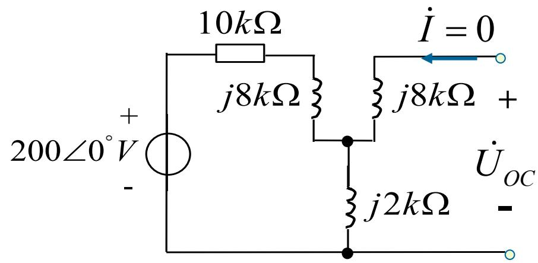

解：去耦等效后的电路如图：

（1）求 $Z _ { L }$ 以左的等效阻抗 $Z _ { 0 }$ ：

$$
Z _ {0} = (1 0 + j 8) / / j 2 + j 8 = (0. 2 + j 9. 8) k \Omega
$$

故， $Z _ { _ { L } } = \stackrel { * } { Z } _ { 0 } = ( 0 . 2 - j 9 . 8 ) k \Omega$ 时，可获得最大功率。

（2）求 $\ L _ { L }$ 以左的开路电压 $\dot { U } _ { o c }$

$$
\dot {U} _ {o c} = 2 0 0 \angle 0 ^ {\circ} \times \frac {j 2}{1 0 + j 8 + j 2} = 2 0 \sqrt {2} \angle 4 5 ^ {\circ} V
$$

故， $Z _ { L }$ 可获得的最大功率为：

$$
P _ {L \max} = \frac {U _ {o c} ^ {2}}{4 R _ {0}} = \frac {(2 0 \sqrt {2}) ^ {2}}{4 \times 0 . 2 \times 1 0 ^ {3}} = 1 W
$$

## 含理想变压器电路的计算举例

【例】含理想变压器电路如图（a）所示，试求 $\dot { I _ { 1 } }$ 和 $\dot { U }$ 。

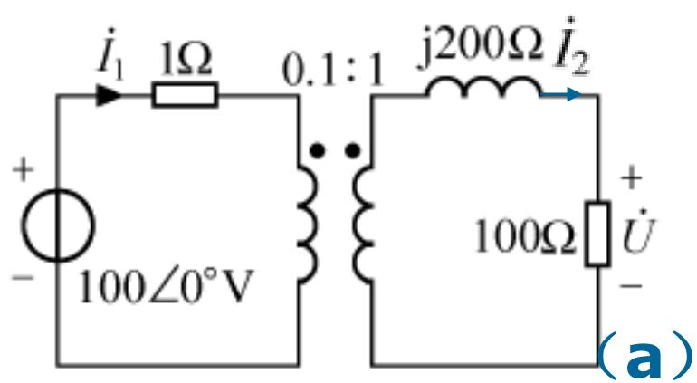

解： 由理想变压器的阻抗变换性，得图（b），则初级电流

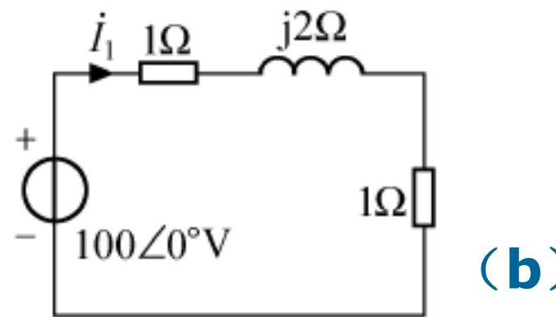

$$
\dot {I} _ {1} = \frac {1 0 0 \angle 0 ^ {\circ}}{1 + j 2 + 1} = 2 5 \sqrt {2} \angle - 4 5 ^ {\circ} \mathrm{A}\tag{b}
$$

次级电流 $i_2 =ni_1=2.5\sqrt{2}\angle−45^\circ \text{ A}$

$$
\dot {U} = 1 0 0 \dot {I} _ {2} = 2 5 0 \sqrt {2} \angle - 4 5 ^ {\circ} \mathrm{V}
$$

$$
\therefore \dot {I} _ {1} = 2 5 \sqrt {2} \angle - 4 5 ^ {\circ} \mathrm{A} \quad \dot {U} = 2 5 0 \sqrt {2} \angle - 4 5 ^ {\circ} \mathrm{V}
$$

## 含全耦合变压器电路的计算举例

作业9-20题图9-20所示的电路原已稳定，t=0时开关K闭合，求t>0时电流 $i _ { 1 } ( t )$ 和电压 $u _ { 2 } ( t )$

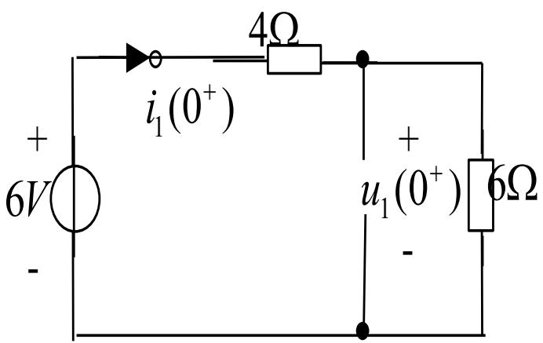

解：由于 $M = \sqrt { L _ { 1 } L _ { 2 } } = 0 . 6 H$ ，故为全耦合变压器，电路等效为如图,其中：

$$
n = \sqrt {\frac {L}{L _ {2}}} = 2: 1
$$

次级线圈的阻抗搬移到初级线圈后的电路模型如下图：

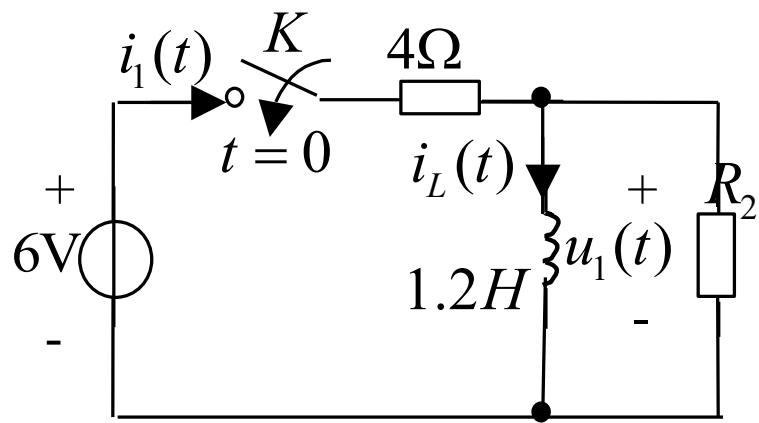

其中：搬移后的电阻为 $R _ { 2 } = n ^ { 2 } \cdot 1 . 5 = 6 \Omega$ 利用三要素法求解：

(1) $t = 0 ^ { - }$ 时， $i _ { \scriptscriptstyle L } ( 0 ^ { - } ) = 0 A$ $t = 0 ^ { + }$ 时 $i _ { L } ( 0 ^ { + } ) = i _ { L } ( 0 ^ { - } ) = 0 . A$ ，则：

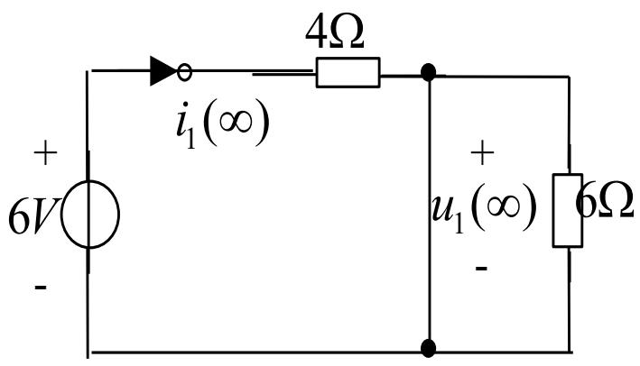

$$
\begin{array}{l} i _ {1} (0 ^ {+}) = \frac {6}{4 + 6} = 0. 6 A \\ u _ {1} (0 ^ {+}) = 6 \times i _ {1} (0 ^ {+}) = 3. 6 V \end{array}
$$

(2) $t \to \infty$ 时的电路图如左图，则可得：

$$
\begin{array}{l} {i _ {1} (\infty) = \frac {6}{4} = 1. 5 A} \\ {u _ {1} (\infty) = 0 V} \end{array}
$$

(3)求时间常数： $R _ { e q } = 4 / / 6 = 2 . 4 \Omega$

$$
\tau = \frac {L _ {1}}{R _ {e q}} = \frac {1 . 2}{2 . 4} = 0. 5 s
$$

(4)全响应为： $i _ { 1 } ( t ) = i _ { 1 } ( \infty ) + [ i _ { 1 } ( 0 ^ { + } ) - i _ { 1 } ( \infty ) ] e ^ { - \frac { t } { \tau } } = 1 . 5 - 0 . 9 e ^ { - 2 t } A , t > 0$ 

$$
\begin{array} { l } { { u _ { 1 } ( t ) = u _ { 1 } ( \infty ) + [ u _ { 1 } ( 0 ^ { + } ) - u _ { 1 } ( \infty ) ] e ^ { - \frac { t } { \tau } } = 3 . 6 e ^ { - 2 t } V , t > 0 } } \\ { { \therefore u _ { 2 } ( t ) = \displaystyle \frac { 1 } { n } u _ { 1 } ( t ) = 1 . 8 e ^ { - 2 t } V , t > 0 } } \end{array}
$$

# 第10章 电路的频率特性

## 1、RLC串联谐振

谐振角频率、品质因数、带宽、
谐振时各元件的电压、电流及相量关系

参考作业：书上例题10-3，习题10-4

## 2、GLC并联谐振

参考作业：10-11

一般电路谐振

## 谐振电路

知识点：[线性时不变电阻的伏安关系（欧姆定律）](../../../topics/电路与电子技术/线性电阻VCR.md)、[基尔霍夫电压定律（KVL）及其应用](../../../topics/电路与电子技术/KVL.md)、[理想电压源与理想电流源的特性](../../../topics/电路与电子技术/独立电源.md)

### RLC串联电路

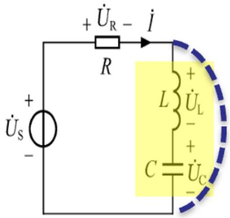

**对偶电路**

**谐振频率**
$$
\omega = \omega_{0} = \frac{1}{\sqrt{L C}}
$$

**谐振时的电压**
$$
\begin{array}{l} 
\dot{U}_{\mathrm{L0}} = \mathrm{j} \omega_{0} L \dot{I}_{0} = \mathrm{j} \frac{\omega_{0} L}{R} \dot{U}_{\mathrm{s}} = \mathrm{j} Q \dot{U}_{\mathrm{s}} \\ 
\dot{U}_{\mathrm{C0}} = \frac{1}{\mathrm{j} \omega_{0} C} \dot{I}_{0} = -\mathrm{j} \frac{1}{\omega_{0} R C} \dot{U}_{\mathrm{s}} = -\mathrm{j} Q \dot{U}_{\mathrm{s}} 
\end{array}
$$

$$
\dot{U}_{\mathrm{R0}} = R \dot{I}_{0} = \dot{U}_{\mathrm{s}}
$$

$$
U_{\mathrm{L0}} = U_{\mathrm{C0}} = Q U_{\mathrm{s}} = Q U_{\mathrm{R0}}
$$

**电压谐振**

$$
Q = \frac{\omega_{0} L}{R} = \frac{1}{\omega_{0} C R} = \frac{\rho}{R} = \frac{1}{R} \sqrt{\frac{L}{C}}
$$

$$
BW = \frac{\omega_{0}}{Q} = \frac{R}{L} \, \mathrm{rad/s}
$$

参考作业：书上例题10-3，习题10-4、10-11

知识点：[四种受控电源（VCVS、VCCS、CCVS、CCCS）的特性](../../../topics/电路与电子技术/受控电源.md)、[基尔霍夫电流定律（KCL）及其应用](../../../topics/电路与电子技术/KCL.md)、[基尔霍夫电压定律（KVL）及其应用](../../../topics/电路与电子技术/KVL.md)

### GCL并联电路

**谐振时的电流**

$$
\dot{I}_{\mathrm{C0}} = \mathrm{j} \omega_{0} C \dot{U}_{0} = \mathrm{j} \frac{\omega_{0} C}{G} \dot{I}_{\mathrm{s}} = \mathrm{j} Q \dot{I}_{\mathrm{s}}
$$

$$
\dot{I}_{\mathrm{L0}} = \frac{1}{\mathrm{j} \omega_{0} L} \dot{U}_{0} = -\mathrm{j} \frac{1}{\omega_{0} L G} \dot{I}_{\mathrm{s}} = -\mathrm{j} Q \dot{I}_{\mathrm{s}}
$$

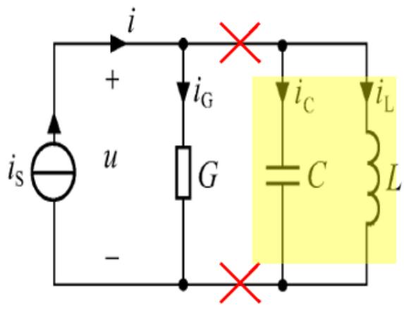

$$
\dot{I}_{\mathrm{G0}} = G \dot{U}_{0} = \dot{I}_{\mathrm{s}}
$$

$$
I_{\mathrm{C0}} = I_{\mathrm{L0}} = Q I_{\mathrm{s}} = Q I_{\mathrm{G0}}
$$

**电流谐振**

$$
Q = \frac{\omega_{0} C}{G}
$$

$$
BW = \frac{\omega_{0}}{Q} = \frac{G}{C} \, \mathrm{rad/s}
$$

## 第11章 二端口网络

Z参数，Y参数的表达式（只含电阻、电容和电感）

**结论：**
1. 对于无源(无受控源)二端口网络，由互易定理可知：互阻抗、互导纳相等，即
   $$
   Z_{12} = Z_{21}, \quad Y_{12} = Y_{21}
   $$
   无源二端口网络只有三个参数是独立的。

2. 对于既无源又对称的二端口网络，由于输入端口和输出端口的阻抗或导纳相等，故四个参数中只有两个是独立的。
   $$
   \begin{array}{ll} 
   Z_{21} = Z_{12} & Y_{12} = Y_{21} \\ 
   Z_{22} = Z_{11} & Y_{22} = Y_{11} 
   \end{array}
   $$

参考作业：习题11-1

知识点：[理想电压源与理想电流源的特性](../../../topics/电路与电子技术/独立电源.md)、[线性时不变电阻的伏安关系（欧姆定律）](../../../topics/电路与电子技术/线性电阻VCR.md)、[四种受控电源（VCVS、VCCS、CCVS、CCCS）的特性](../../../topics/电路与电子技术/受控电源.md)

### 例：T型二端口网络的Z参数求解

试以图示T型二端口网络的端口电流作为自变量，端口电压为应变量，列写网络方程，并求Z参数。

解：由KVL
$$
\dot{U}_{1} = \mathrm{j} I_{1} + 3 (I_{1} + I_{2})
$$
*(注：原件中 $\dot{U}_1$ 前的系数识别为 `j`，结合后续结果 $3+j$ 推断此处应为感抗 $j\Omega$；$\dot{U}_2$ 方程中识别出的 `F_2` 等符号根据上下文及最终结果修正为 $I_2$)*

$$
\dot{U}_{2} = -\mathrm{j} 2 I_{2} + 3 (I_{1} + I_{2})
$$

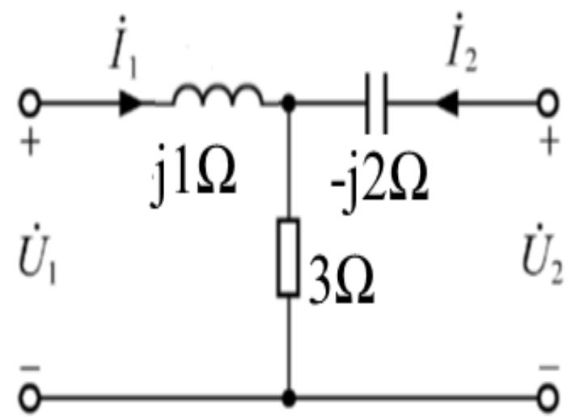

整理的网络方程
$$
\dot{U}_{1} = (3 + \mathrm{j}) I_{1} + 3 I_{2}
$$

$$
\dot{U}_{2} = 3 I_{1} + (3 - \mathrm{j} 2) I_{2}
$$

Z参数矩阵：
$$
[Z] = \begin{bmatrix} 3+\mathrm{j} & 3 \\ 3 & 3-\mathrm{j}2 \end{bmatrix} \, (\Omega)
$$

互易网络: $Z_{12} = Z_{21}$

## 其他章节提示

知识点：[基尔霍夫电压定律（KVL）及其应用](../../../topics/电路与电子技术/KVL.md)、[线性时不变电阻的伏安关系（欧姆定律）](../../../topics/电路与电子技术/线性电阻VCR.md)

### 第5章 非线性

知识点：[基尔霍夫电流定律（KCL）及其应用](../../../topics/电路与电子技术/KCL.md)、[基尔霍夫电压定律（KVL）及其应用](../../../topics/电路与电子技术/KVL.md)

### 第7章 二阶电路

知识点：[基尔霍夫电流定律（KCL）及其应用](../../../topics/电路与电子技术/KCL.md)、[基尔霍夫电压定律（KVL）及其应用](../../../topics/电路与电子技术/KVL.md)
