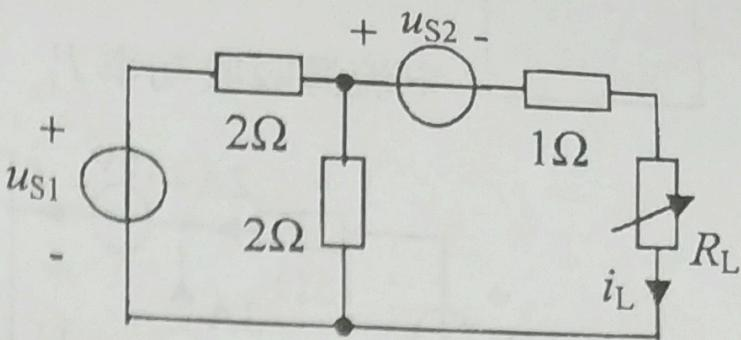
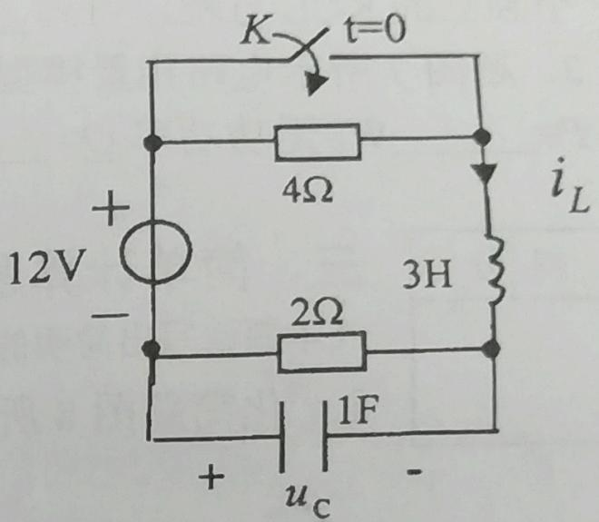
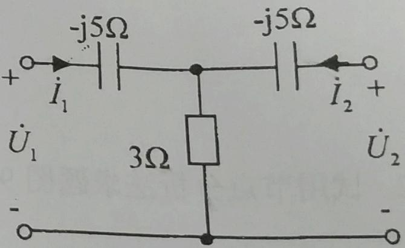
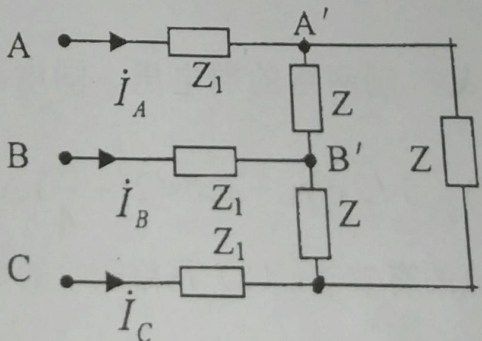

# 南京邮电大学《电路分析基础 A》2014—2015学年第一学期期末试卷（A卷）

原件经识别和整理；“参考解答”是我们补的。

4. 题图 10 所示电路，已知当 $R_{L} = 4 \Omega$ 时电流 $i_{L} = 2 A$。若改变 $R_{L}$，问 $R_{L}$ 为何值时能获最大功率，最大功率为多少？

5. 题图 11 所示电路原已处于稳态，在 $t=0$ 时开关 K 闭合，求 $i_{L}(0^{+})$，$u_{C}(0^{+})$。

6. 求题图 12 所示二端口网络的 Z 参数。

7. 题图 13 所示对称三相电路，设电源线电压 $\dot{U}_{AB} = 380 \angle 0^{\circ} V$，图中负载 $Z = 30 + j30 \Omega$，线阻抗 $Z_{1} = 10 + j10 \Omega$，试求线电流 $\dot{I}_{A}$ 及相电流 $\dot{I}_{A'B'}$。

