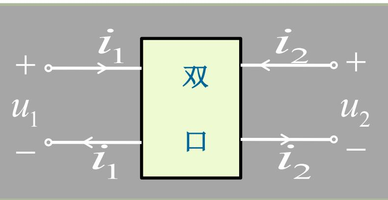

# 南京邮电大学《电路分析基础A》17级复习大纲

原件经识别和整理；“参考解答”是我们补的。

本资料为南京邮电大学电子科学与工程学院《电路分析基础A》课程的复习要点，整理自课程复习大纲原件。

## 第1章 电路基本概念

元件的电流、电压的方向都是指参考方向，可以分别任意指定，当电流与电压参考方向一致时，称为关联参考方向，否则为非关联参考方向。

### 一、线性时不变电阻：VCR - 欧姆定律

知识点：[线性时不变电阻的伏安关系（欧姆定律）](../../../topics/电路与电子技术/线性电阻VCR.md)

### 二、功率的计算

知识点：[元件吸收与产生功率的计算与判断](../../../topics/电路与电子技术/功率计算.md)、[电流、电压的参考方向及关联参考方向](../../../topics/电路与电子技术/参考方向.md)

### 三、基尔霍夫定律

## 第2章 电路分析中的等效变换

两个电路的结构改变，但端口的伏安关系(VCR)完全相同。

知识点：[基尔霍夫电流定律（KCL）及其应用](../../../topics/电路与电子技术/KCL.md)、[基尔霍夫电压定律（KVL）及其应用](../../../topics/电路与电子技术/KVL.md)、[线性时不变电阻的伏安关系（欧姆定律）](../../../topics/电路与电子技术/线性电阻VCR.md)

### 一、常见的等效变换

- 电阻串、并联和混联可简化成一个等效电阻；
- 电源串、并联和混联可简化成一个等效电源；
- 戴维南电路和诺顿电路的等效变换；

知识点：[理想电压源与理想电流源的特性](../../../topics/电路与电子技术/独立电源.md)、[线性时不变电阻的伏安关系（欧姆定律）](../../../topics/电路与电子技术/线性电阻VCR.md)、[基尔霍夫电压定律（KVL）及其应用](../../../topics/电路与电子技术/KVL.md)

### 二、含受控电源电路的等效变换

- 将受控源看作独立源，但在变换过程中控制变量不能消失；
- 采用输入端口加激励法（加流求压法），求出相应的伏安关系，再根据伏安关系画出相应的最简电路。

## 第3章 线性网络的一般分析方法

$n$个节点，$b$条支路的网络，有 $n-1$ 个独立节点，$b-(n-1)$ 个独立回路（网孔）。

知识点：[四种受控电源（VCVS、VCCS、CCVS、CCCS）的特性](../../../topics/电路与电子技术/受控电源.md)、[线性时不变电阻的伏安关系（欧姆定律）](../../../topics/电路与电子技术/线性电阻VCR.md)

### 一、支路电流法 - 适用于所有集中参数电路

设 $b$ 个支路电流为独立的电路变量，列 $n-1$ 个独立节点的KCL方程和 $b-(n-1)$ 个网孔的KVL方程，求解电路的方法。

知识点：[基尔霍夫电流定律（KCL）及其应用](../../../topics/电路与电子技术/KCL.md)、[基尔霍夫电压定律（KVL）及其应用](../../../topics/电路与电子技术/KVL.md)

### 二、网孔分析法 - 只适用于平面网络

以 $b-(n-1)$ 个网孔电流为独立的电路变量，按规定规则直接列写网孔方程求解电路的方法。

知识点：[基尔霍夫电压定律（KVL）及其应用](../../../topics/电路与电子技术/KVL.md)、[基尔霍夫电流定律（KCL）及其应用](../../../topics/电路与电子技术/KCL.md)

### 三、节点分析法 - 适用于所有集中参数电路

以 $n-1$ 个节点电压为独立的电路变量，按规定规则直接列写节点方程求解电路的方法。

## 第4章 网络定理

知识点：[基尔霍夫电流定律（KCL）及其应用](../../../topics/电路与电子技术/KCL.md)、[线性时不变电阻的伏安关系（欧姆定律）](../../../topics/电路与电子技术/线性电阻VCR.md)、[理想电压源与理想电流源的特性](../../../topics/电路与电子技术/独立电源.md)

### 一、叠加定理

知识点：[理想电压源与理想电流源的特性](../../../topics/电路与电子技术/独立电源.md)、[线性时不变电阻的伏安关系（欧姆定律）](../../../topics/电路与电子技术/线性电阻VCR.md)、[基尔霍夫电压定律（KVL）及其应用](../../../topics/电路与电子技术/KVL.md)

### 二、戴维南定理

知识点：[理想电压源与理想电流源的特性](../../../topics/电路与电子技术/独立电源.md)、[线性时不变电阻的伏安关系（欧姆定律）](../../../topics/电路与电子技术/线性电阻VCR.md)、[基尔霍夫电压定律（KVL）及其应用](../../../topics/电路与电子技术/KVL.md)

### 三、诺顿定理

知识点：[理想电压源与理想电流源的特性](../../../topics/电路与电子技术/独立电源.md)、[线性时不变电阻的伏安关系（欧姆定律）](../../../topics/电路与电子技术/线性电阻VCR.md)

### 四、最大功率传输定理

知识点：[基尔霍夫电压定律（KVL）及其应用](../../../topics/电路与电子技术/KVL.md)、[线性时不变电阻的伏安关系（欧姆定律）](../../../topics/电路与电子技术/线性电阻VCR.md)、[元件吸收与产生功率的计算与判断](../../../topics/电路与电子技术/功率计算.md)

### 五、特勒根第二定理

知识点：[基尔霍夫电流定律（KCL）及其应用](../../../topics/电路与电子技术/KCL.md)、[基尔霍夫电压定律（KVL）及其应用](../../../topics/电路与电子技术/KVL.md)

### 六、互易定理

## 第6章 一阶电路分析

知识点：[基尔霍夫电流定律（KCL）及其应用](../../../topics/电路与电子技术/KCL.md)、[基尔霍夫电压定律（KVL）及其应用](../../../topics/电路与电子技术/KVL.md)

### 一、电容和电感 - 线性时不变

| 元件 | 伏安关系 | 储能 | 吸收功率 |
| :--- | :--- | :--- | :--- |
| 电容 | $i_c = \pm C \frac{du_c}{dt}$ | $w_c(t) = \frac{1}{2} Cu_c^2(t)$ | $p(t) = \pm u(t) \cdot i(t)$ |
| 电感 | $u_L = \pm L \frac{di_L}{dt}$ | $w_L(t) = \frac{1}{2} Li_L^2(t)$ | |

知识点：[电流、电压的参考方向及关联参考方向](../../../topics/电路与电子技术/参考方向.md)、[元件吸收与产生功率的计算与判断](../../../topics/电路与电子技术/功率计算.md)、[线性时不变电阻的伏安关系（欧姆定律）](../../../topics/电路与电子技术/线性电阻VCR.md)

### 二、一阶动态电路的零输入响应 - 仅由初始状态引起的响应

任意一阶电路零输入响应的一般形式为：

$$
r_{zi}(t) = r_{zi}(0^{+}) \mathrm{e}^{-\frac{t}{\tau}}, \quad t > 0
$$

- $r_{zi}(0^{+})$: 任意零输入响应的初始值;
- $\tau$: 时间常数, $\tau=RC$ 或 $\tau=L/R;$

知识点：[线性时不变电阻的伏安关系（欧姆定律）](../../../topics/电路与电子技术/线性电阻VCR.md)、[基尔霍夫电压定律（KVL）及其应用](../../../topics/电路与电子技术/KVL.md)

### 三、一阶动态电路的零状态响应 - 仅由独立电源引起的响应 ($u_{C}(0^{-})=0V, i_{L}(0^{-})=0A$)

电容电压和电感电流的零状态响应的一般形式：

$$
\begin{cases} 
u_{C zs}(t) = u_{C}(\infty)(1 - \mathrm{e}^{-\frac{t}{\tau}}), & t \geq 0 \\ 
i_{L zs}(t) = i_{L}(\infty)(1 - \mathrm{e}^{-\frac{t}{\tau}}), & t \geq 0 
\end{cases}
$$

- $u_{c}(\infty)$ ， $i_{L}(\infty)$ ：响应的终值；
- $\tau$: 时间常数, $\tau=RC$ 或 $\tau=L/R;$

注意：此公式仅适用于电容电压和电感电流。

知识点：[基尔霍夫电压定律（KVL）及其应用](../../../topics/电路与电子技术/KVL.md)、[基尔霍夫电流定律（KCL）及其应用](../../../topics/电路与电子技术/KCL.md)、[线性时不变电阻的伏安关系（欧姆定律）](../../../topics/电路与电子技术/线性电阻VCR.md)

### 四、一阶动态电路恒定激励下的全响应 - 由独立电源和动态元件的初始状态共同产生的

恒定激励下一阶动态电路的任意全响应可用三要素法计算：

$$
r(t) = r(\infty) + [r(0^{+}) - r(\infty)] \mathrm{e}^{-t/\tau}, \quad t > 0
$$

- $r(0^{+})$: 响应的初始值;
- $r(\infty)$: 响应的终值;
- $\tau$: 时间常数, $\tau=RC$ 或 $\tau=L/R;$

知识点：[理想电压源与理想电流源的特性](../../../topics/电路与电子技术/独立电源.md)、[线性时不变电阻的伏安关系（欧姆定律）](../../../topics/电路与电子技术/线性电阻VCR.md)、[基尔霍夫电流定律（KCL）及其应用](../../../topics/电路与电子技术/KCL.md)

### 五、一阶动态电路的阶跃响应

## 第8章 正弦激励下电路的稳态分析

知识点：[理想电压源与理想电流源的特性](../../../topics/电路与电子技术/独立电源.md)、[线性时不变电阻的伏安关系（欧姆定律）](../../../topics/电路与电子技术/线性电阻VCR.md)、[基尔霍夫电压定律（KVL）及其应用](../../../topics/电路与电子技术/KVL.md)

### 一、正弦量的三要素

$$
f(t) = F_{\mathrm{m}}\cos(\omega t + \phi) = \sqrt{2} F\cos(\omega t + \phi)
$$

三要素:
- $F_{\mathrm{m}}$ ——振幅;
- $\omega$ ——角频率，rad/s;
- $\varphi$ ——初相， $|\varphi| \leq \pi$ ；

### 二、正弦量的时域表示及相量表示

$$
u(t) = U_{\mathrm{m}} \cos(\omega t + \phi_{\mathrm{u}}) \longleftrightarrow \dot{U}_{\mathrm{m}} = U_{\mathrm{m}} \angle \phi_{\mathrm{u}}, \quad \dot{U} = U \angle \phi_{\mathrm{u}}
$$

$$
i(t) = I_{\mathrm{m}} \cos(\omega t + \phi_{\mathrm{i}}) \longleftrightarrow \dot{I}_{\mathrm{m}} = I_{\mathrm{m}} \angle \phi_{\mathrm{i}}, \quad \dot{I} = I \angle \phi_{\mathrm{i}}
$$

### 三、元件的VCR及阻抗 - 关联参考方向

| 元件 | 时域表示 | 相量形式 | 阻抗 |
| :--- | :--- | :--- | :--- |
| 电阻 | $u = Ri$ | $\dot{U} = R\dot{I}$ | $Z_R = R$ |
| 电容 | $i_c = C \frac{du_c}{dt}$ | $\dot{I}_C = j\omega C\dot{U}_C$ | $Z_C(j\omega) = \frac{1}{j\omega C}$ |
| 电感 | $u_L = L \frac{di_L}{dt}$ | $\dot{U}_L = j\omega L\dot{I}_L$ | $Z_L(j\omega) = j\omega L$ |

在正弦稳态电路中，电阻上的电压和电流同相，电感上的电压超前电流 $90^{\circ}$ ，电容上的电压滞后电流 $90^{\circ}$ 。

一正弦稳态的无源二端网络 $N_0$，在关联参考方向下，总是可以等效为一个阻抗 $Z(j\omega)$ 或导纳 $Y(j\omega)$ :

$$
Z(\mathrm{j}\omega) = \frac{\dot{U}}{\dot{I}} = R + jX = |Z| \angle \theta_{z} (\Omega)
$$

$$
|Z| = \frac{U}{I} = \sqrt{R^{2} + X^{2}}, \quad \angle \theta_{z} = \angle(\varphi_{u} - \varphi_{i}) = \arctan \frac{X}{R}
$$

$$
Y(\mathrm{j}\omega) = \frac{\dot{I}}{\dot{U}} = G + jB = Y \angle \theta_{Y} = Y \angle -\theta_{Z} (S)
$$

其中，$X=0$，网络呈阻性；$X>0$，网络呈感性；$X<0$，网络呈容性。

知识点：[线性时不变电阻的伏安关系（欧姆定律）](../../../topics/电路与电子技术/线性电阻VCR.md)、[电流、电压的参考方向及关联参考方向](../../../topics/电路与电子技术/参考方向.md)

### 四、正弦稳态电路的相量分析法

正弦稳态的无源二端网络推广到相量模型后，所有的元件都用阻抗表示，则可以通过阻抗的串并联计算其等效阻抗或导纳。

知识点：[理想电压源与理想电流源的特性](../../../topics/电路与电子技术/独立电源.md)、[线性时不变电阻的伏安关系（欧姆定律）](../../../topics/电路与电子技术/线性电阻VCR.md)、[基尔霍夫电压定律（KVL）及其应用](../../../topics/电路与电子技术/KVL.md)

### 五、正弦稳态电路的功率

知识点：[元件吸收与产生功率的计算与判断](../../../topics/电路与电子技术/功率计算.md)

### 六、正弦稳态电路的最大功率传输 - 共轭匹配

知识点：[元件吸收与产生功率的计算与判断](../../../topics/电路与电子技术/功率计算.md)、[线性时不变电阻的伏安关系（欧姆定律）](../../../topics/电路与电子技术/线性电阻VCR.md)

### 七、对称三相电路

## 第9章 耦合电感和变压器电路分析

知识点：[基尔霍夫电流定律（KCL）及其应用](../../../topics/电路与电子技术/KCL.md)、[基尔霍夫电压定律（KVL）及其应用](../../../topics/电路与电子技术/KVL.md)

### 一、耦合电感的伏安关系

知识点：[电流、电压的参考方向及关联参考方向](../../../topics/电路与电子技术/参考方向.md)、[线性时不变电阻的伏安关系（欧姆定律）](../../../topics/电路与电子技术/线性电阻VCR.md)

### 二、耦合电感的直接去耦等效

知识点：[线性时不变电阻的伏安关系（欧姆定律）](../../../topics/电路与电子技术/线性电阻VCR.md)、[基尔霍夫电压定律（KVL）及其应用](../../../topics/电路与电子技术/KVL.md)、[电流、电压的参考方向及关联参考方向](../../../topics/电路与电子技术/参考方向.md)

### 三、空芯变压器电路的分析

1. 当成耦合电感直接去耦等效
2. 反映阻抗法

知识点：[理想电压源与理想电流源的特性](../../../topics/电路与电子技术/独立电源.md)、[基尔霍夫电流定律（KCL）及其应用](../../../topics/电路与电子技术/KCL.md)、[基尔霍夫电压定律（KVL）及其应用](../../../topics/电路与电子技术/KVL.md)

### 四、理想变压器电路

1. 理想变压器的伏安关系
2. 理想变压器电路的分析
   - 直接用伏安关系
   - 阻抗搬移

知识点：[理想电压源与理想电流源的特性](../../../topics/电路与电子技术/独立电源.md)、[线性时不变电阻的伏安关系（欧姆定律）](../../../topics/电路与电子技术/线性电阻VCR.md)、[基尔霍夫电压定律（KVL）及其应用](../../../topics/电路与电子技术/KVL.md)

### 五、全耦合变压器电路的分析

推荐：等效成含理想变压器的电路

## 第10章 电路的频率特性

知识点：[理想电压源与理想电流源的特性](../../../topics/电路与电子技术/独立电源.md)、[线性时不变电阻的伏安关系（欧姆定律）](../../../topics/电路与电子技术/线性电阻VCR.md)、[基尔霍夫电压定律（KVL）及其应用](../../../topics/电路与电子技术/KVL.md)

### 一、电路的频率特性与网络函数

电路分析中，电路的频率特性用正弦稳态电路的网络函数来描述，定义为：

$$
H(\mathrm{j}\omega) = \frac{\text{输出相量}}{\text{输入相量}} = |H(\mathrm{j}\omega)| \angle \theta(\omega)
$$

- $|H(j\omega)|$ 一幅频特性；
- $\theta(j\omega)$ 一相频特性

网络函数的计算方法—外加电源法：在输入端加一个电压源或电流源，用正弦稳态分析的任一种方法求出输出的相量表达式，则输出相量与输入相量的比即为相应的网络函数。

知识点：[理想电压源与理想电流源的特性](../../../topics/电路与电子技术/独立电源.md)、[基尔霍夫电压定律（KVL）及其应用](../../../topics/电路与电子技术/KVL.md)、[基尔霍夫电流定律（KCL）及其应用](../../../topics/电路与电子技术/KCL.md)

### 二、RC电路的频率特性

- RC低通滤波网络和RC高通滤波网络
- 转移电压比
- 截止角频率
- 通频带

知识点：[理想电压源与理想电流源的特性](../../../topics/电路与电子技术/独立电源.md)、[线性时不变电阻的伏安关系（欧姆定律）](../../../topics/电路与电子技术/线性电阻VCR.md)、[基尔霍夫电压定律（KVL）及其应用](../../../topics/电路与电子技术/KVL.md)

### 三、RLC串联谐振&GCL并联谐振

- 谐振角频率、品质因数、带宽、
- 谐振时各元件的电压、电流及相量关系

## 第11章 二端口网络

### 一、二端口网络的方程与参数

**参数分类：**

| 参数类型 | 自变量 |
| :--- | :--- |
| Z参数 | $\dot{I}_{1}, \dot{I}_{2}$ |
| Y参数 | $\dot{U}_{1}, \dot{U}_{2}$ |

**参数方程：**

$$
\left\{ \begin{array}{l} 
\dot{U}_{1} = Z_{11} \dot{I}_{1} + Z_{12} \dot{I}_{2} \\ 
\dot{U}_{2} = Z_{21} \dot{I}_{1} + Z_{22} \dot{I}_{2} 
\end{array} \right.
\quad
\left\{ \begin{array}{l} 
\dot{I}_{1} = Y_{11} \dot{U}_{1} + Y_{12} \dot{U}_{2} \\ 
\dot{I}_{2} = Y_{21} \dot{U}_{1} + Y_{22} \dot{U}_{2} 
\end{array} \right.
$$

知识点：[基尔霍夫电压定律（KVL）及其应用](../../../topics/电路与电子技术/KVL.md)、[基尔霍夫电流定律（KCL）及其应用](../../../topics/电路与电子技术/KCL.md)

### 二、求双口网络参数的方法

知识点：[线性时不变电阻的伏安关系（欧姆定律）](../../../topics/电路与电子技术/线性电阻VCR.md)、[基尔霍夫电压定律（KVL）及其应用](../../../topics/电路与电子技术/KVL.md)、[基尔霍夫电流定律（KCL）及其应用](../../../topics/电路与电子技术/KCL.md)
