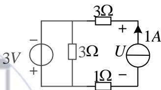
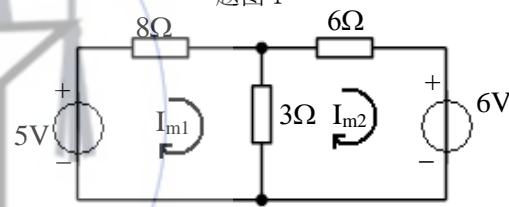
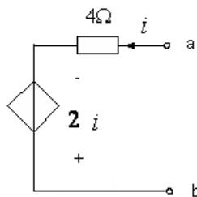
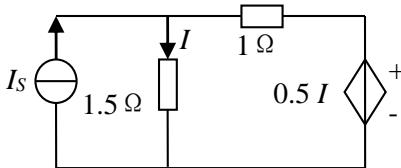
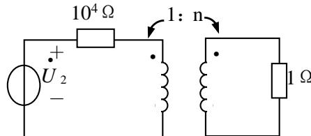
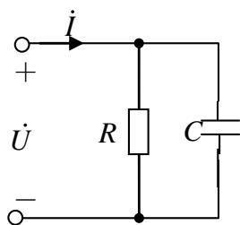
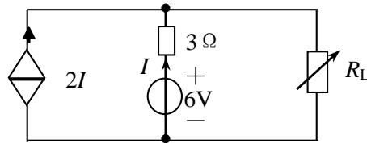
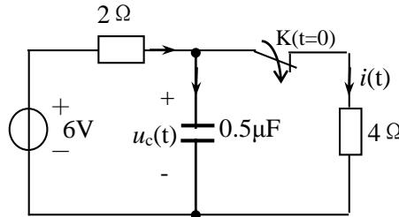
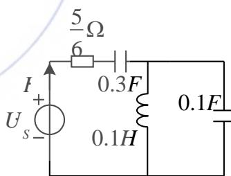

# 南京邮电大学《电路分析基础（A）》期末试卷

原件经识别和整理；“参考解答”是我们补的。

## 一、选择题（每题 2 分，共 10 分）

### 选择 1

题图 1 所示电路，1A 电流源产生功率 $P$ 等于

- A. 1W
- B. 3W
- C. 5W
- D. 7W

知识点：[理想电压源与理想电流源的特性](../../../topics/电路与电子技术/独立电源.md)、[元件吸收与产生功率的计算与判断](../../../topics/电路与电子技术/功率计算.md)、[基尔霍夫电压定律（KVL）及其应用](../../../topics/电路与电子技术/KVL.md)

### 选择 2

电路如题图 2 所示，电路中网孔 1 的网孔电流方程为

- A. $11I_{\mathrm{m}1}-3I_{\mathrm{m}2}=5$
- B. $11I_{\mathrm{m}1}+3I_{\mathrm{m}2}=5$
- C. $11I_{\mathrm{m}1}+3I_{\mathrm{m}2}=-5$
- D. $11I_{\mathrm{m}1}-3I_{\mathrm{m}2}=-5$

知识点：[基尔霍夫电压定律（KVL）及其应用](../../../topics/电路与电子技术/KVL.md)、[理想电压源与理想电流源的特性](../../../topics/电路与电子技术/独立电源.md)、[四种受控电源（VCVS、VCCS、CCVS、CCCS）的特性](../../../topics/电路与电子技术/受控电源.md)

### 选择 3

某电路的有向线图如题图 3 所示，则下面论述正确的是 。

- A. 该电路独立的 KCL 方程数为 2 个
- B. 该电路独立的 KVL 方程数为 2 个
- C. 该电路的有向线图是连通图，它的一个树具有 3 条树枝
- D. 以上说法都不对

知识点：[基尔霍夫电流定律（KCL）及其应用](../../../topics/电路与电子技术/KCL.md)、[基尔霍夫电压定律（KVL）及其应用](../../../topics/电路与电子技术/KVL.md)

### 选择 4

已知某正弦电压 $f=50\,\mathrm{Hz}$，$\varphi=30^\circ$，其有效值为 $100\,\mathrm{V}$，则其瞬时值表达式为

- A. $u=100\cos(50\pi t-60^\circ)\,\mathrm{V}$
- B. $u=141.4\cos(50\pi t-60^\circ)\,\mathrm{V}$
- C. $u=200\cos(100\pi t+30^\circ)\,\mathrm{V}$
- D. $u=141.4\cos(100\pi t+30^\circ)\,\mathrm{V}$

知识点：[理想电压源与理想电流源的特性](../../../topics/电路与电子技术/独立电源.md)、[基尔霍夫电流定律（KCL）及其应用](../../../topics/电路与电子技术/KCL.md)

### 选择 5

题图 4 所示电路的等效电阻 $R_{ab}$ 是 。

- A. 1Ω
- B. 2Ω
- C. 3Ω
- D. 4Ω

## 二、填空题（每空 2 分，共 20 分）

知识点：[线性时不变电阻的伏安关系（欧姆定律）](../../../topics/电路与电子技术/线性电阻VCR.md)、[基尔霍夫电压定律（KVL）及其应用](../../../topics/电路与电子技术/KVL.md)、[基尔霍夫电流定律（KCL）及其应用](../../../topics/电路与电子技术/KCL.md)

### 填空 1

题图 5 所示电路，已知 $I_s=2\,\mathrm{A}$，则受控源吸收功率为 ______ W，1Ω 电阻吸收功率为 ______ W。

知识点：[元件吸收与产生功率的计算与判断](../../../topics/电路与电子技术/功率计算.md)、[四种受控电源（VCVS、VCCS、CCVS、CCCS）的特性](../../../topics/电路与电子技术/受控电源.md)、[基尔霍夫电流定律（KCL）及其应用](../../../topics/电路与电子技术/KCL.md)

### 填空 2

由 RL 串联的正弦稳态电路，已知电阻 R 上电压有效值为 16V，电感 L 上电压有效值为 12V，则电路总电压有效值为 ______ 。

知识点：[线性时不变电阻的伏安关系（欧姆定律）](../../../topics/电路与电子技术/线性电阻VCR.md)、[理想电压源与理想电流源的特性](../../../topics/电路与电子技术/独立电源.md)

### 填空 3

题图 6 所示二端网络，已知 $R=X_{\mathrm{C}}=10\,\Omega$，$U_{AB}=U_{BC}$，且端口电压与电流同相，则阻抗 $Z=$ ______ 。

知识点：[线性时不变电阻的伏安关系（欧姆定律）](../../../topics/电路与电子技术/线性电阻VCR.md)、[基尔霍夫电压定律（KVL）及其应用](../../../topics/电路与电子技术/KVL.md)

### 填空 4

只含有一个动态元件的电路可以用 ______ 方程进行描述，因而称作一阶电路。仅由外激励引起的电路响应称为一阶电路的 ______ 响应；仅由动态元件的初始储能引起的响应称为一阶电路的零输入响应。

知识点：[基尔霍夫电压定律（KVL）及其应用](../../../topics/电路与电子技术/KVL.md)、[基尔霍夫电流定律（KCL）及其应用](../../../topics/电路与电子技术/KCL.md)

### 填空 5

已知关联参考方向下的无源二端网络的端口电压 $u(t)$ 和电流 $i(t)$ 分别为 $u(t)=16\cos(100t+60^\circ)\,\mathrm{V}$，$i(t)=4\cos(100t+120^\circ)\,\mathrm{A}$，则 $P=$ ______ W，$Q=$ ______ Var，$S=$ ______ VA，功率因数 $pf=$ ______ 。

## 三、简单计算题（每题 7 分，共 35 分）

（本题请写出简明的解题步骤）

知识点：[元件吸收与产生功率的计算与判断](../../../topics/电路与电子技术/功率计算.md)、[电流、电压的参考方向及关联参考方向](../../../topics/电路与电子技术/参考方向.md)、[线性时不变电阻的伏安关系（欧姆定律）](../../../topics/电路与电子技术/线性电阻VCR.md)

### 计算 1

求题图 7 所示二端网络的戴维南等效电路。

知识点：[理想电压源与理想电流源的特性](../../../topics/电路与电子技术/独立电源.md)、[线性时不变电阻的伏安关系（欧姆定律）](../../../topics/电路与电子技术/线性电阻VCR.md)、[基尔霍夫电压定律（KVL）及其应用](../../../topics/电路与电子技术/KVL.md)

### 计算 2

题图 8 所示含理想变压器电路中电压有效值相量 $\dot{U}_2=100\angle 0^\circ\,\mathrm{V}$，①试选择合适的匝数比 $n$，使传输到 1Ω 负载上的功率达到最大；②求 1Ω 负载上获得的最大功率。

知识点：[元件吸收与产生功率的计算与判断](../../../topics/电路与电子技术/功率计算.md)、[线性时不变电阻的伏安关系（欧姆定律）](../../../topics/电路与电子技术/线性电阻VCR.md)

### 计算 3

电路如题图 9 所示，已知 $\omega=10\,\mathrm{rad/s}$，$U=12\,\mathrm{V}$，$I=5\,\mathrm{A}$，电路消耗的平均功率为 $48\,\mathrm{W}$。求 $R$ 和 $C$。

知识点：[元件吸收与产生功率的计算与判断](../../../topics/电路与电子技术/功率计算.md)、[基尔霍夫电流定律（KCL）及其应用](../../../topics/电路与电子技术/KCL.md)、[基尔霍夫电压定律（KVL）及其应用](../../../topics/电路与电子技术/KVL.md)

### 计算 4

求题图 10 所示二端口网络的 Z 参数。

知识点：[基尔霍夫电流定律（KCL）及其应用](../../../topics/电路与电子技术/KCL.md)、[基尔霍夫电压定律（KVL）及其应用](../../../topics/电路与电子技术/KVL.md)、[线性时不变电阻的伏安关系（欧姆定律）](../../../topics/电路与电子技术/线性电阻VCR.md)

### 计算 5

试用节点分析法求题图 11 所示电路的电流 $I$。

## 四、综合计算题（每题 10 分，共 30 分）

知识点：[基尔霍夫电流定律（KCL）及其应用](../../../topics/电路与电子技术/KCL.md)、[线性时不变电阻的伏安关系（欧姆定律）](../../../topics/电路与电子技术/线性电阻VCR.md)、[理想电压源与理想电流源的特性](../../../topics/电路与电子技术/独立电源.md)

### 综合 1

题图 12 所示电路，负载电阻 $R_{\mathrm{L}}$ 可调，试问当 $R_{\mathrm{L}}$ 等于多大时可获得最大功率，并求出最大吸收功率 $P_{\mathrm{Lmax}}$。

知识点：[理想电压源与理想电流源的特性](../../../topics/电路与电子技术/独立电源.md)、[线性时不变电阻的伏安关系（欧姆定律）](../../../topics/电路与电子技术/线性电阻VCR.md)、[基尔霍夫电压定律（KVL）及其应用](../../../topics/电路与电子技术/KVL.md)

### 综合 2

题图 13 所示电路原已稳定，$t=0$ 时开关 K 打开，试求 $t>0$ 时的 $u(t)$ 和 $i(t)$。

知识点：[线性时不变电阻的伏安关系（欧姆定律）](../../../topics/电路与电子技术/线性电阻VCR.md)、[理想电压源与理想电流源的特性](../../../topics/电路与电子技术/独立电源.md)、[基尔霍夫电压定律（KVL）及其应用](../../../topics/电路与电子技术/KVL.md)

### 综合 3

题图 14 所示正弦稳态电路，已知 $\dot{U}_s=10\sqrt{2}\angle 0^\circ\,\mathrm{V}$ 为频率可变的正弦交流电源。试求：(1) 当电源角频率为 $\omega=20\,\mathrm{rad/s}$ 时的电流有效值 $I$。(2) 当电源角频率为多大时，电流有效值 $I$ 等于零？(3) 当电源角频率为多大时，电流有效值 $I$ 为最大？并求出最大值 $I_{\mathrm{max}}$。

知识点：[基尔霍夫电压定律（KVL）及其应用](../../../topics/电路与电子技术/KVL.md)
