# 差动放大器（实验）

原件经识别和整理；“参考解答”是我们补的。

## 实验目的

- 熟悉差动放大器电路的组成原理及用途
- 掌握差动放大器静态参数的测量方法
- 掌握差动放大器动态参数的测量方法

普通的晶体管放大电路，由于抗干扰能力弱，会把外部的电磁干扰、温度漂移等因素产生的干扰信号，随着正常信号本身一起放大。这是极为不利的。

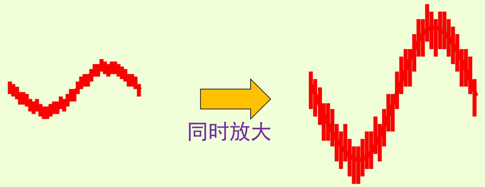

差动放大电路的首要目的，是排除外部环境对信号的干扰，将它们视为共模信号予以消除，从而只对正常信号（差模信号）本身进行放大。

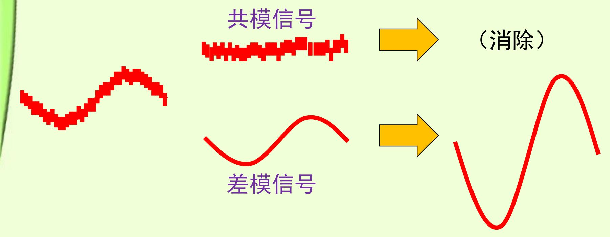

## 差动放大器

- 由两个完全对称的晶体管共射极放大电路构成。
- 抑制共模信号，放大差模信号。
- 广泛应用于集成电路中，用作放大极或中间级。

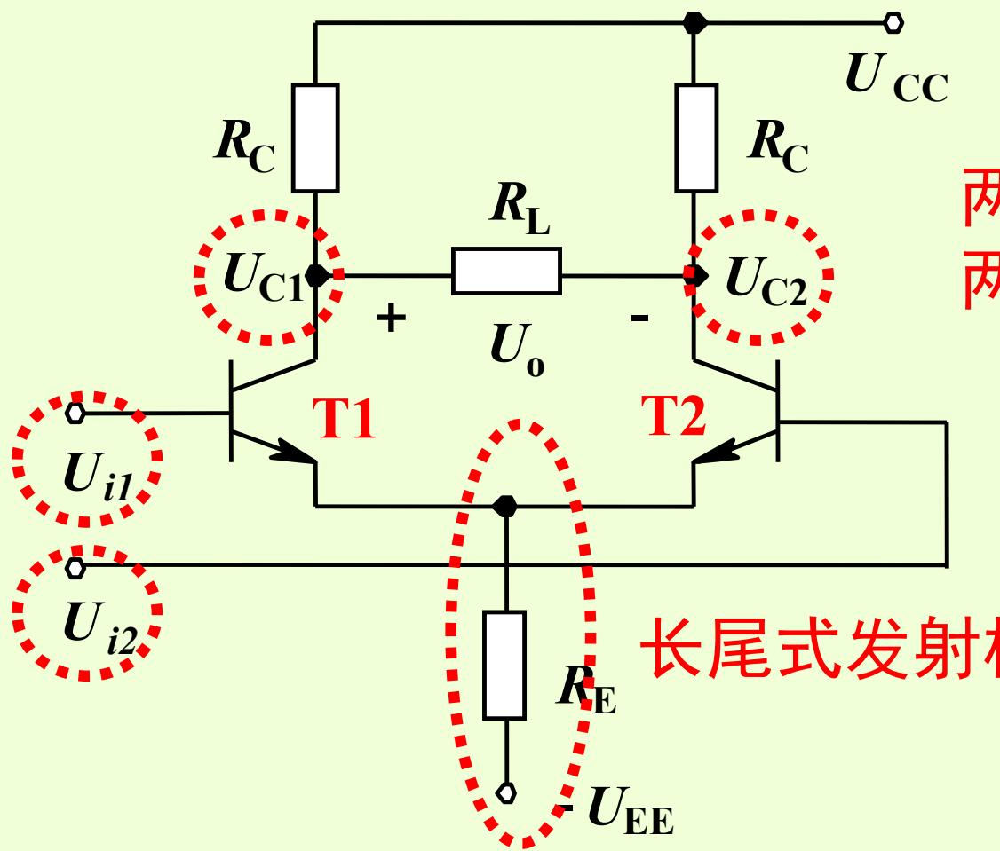

两输入端：$U_{i1}$、$U_{i2}$

两输出端：$U_{C1}$、$U_{C2}$

## 长尾式发射极

两晶体管公用发射极大电阻 $R_E$。它的存在主要是为了抑制共模信号。

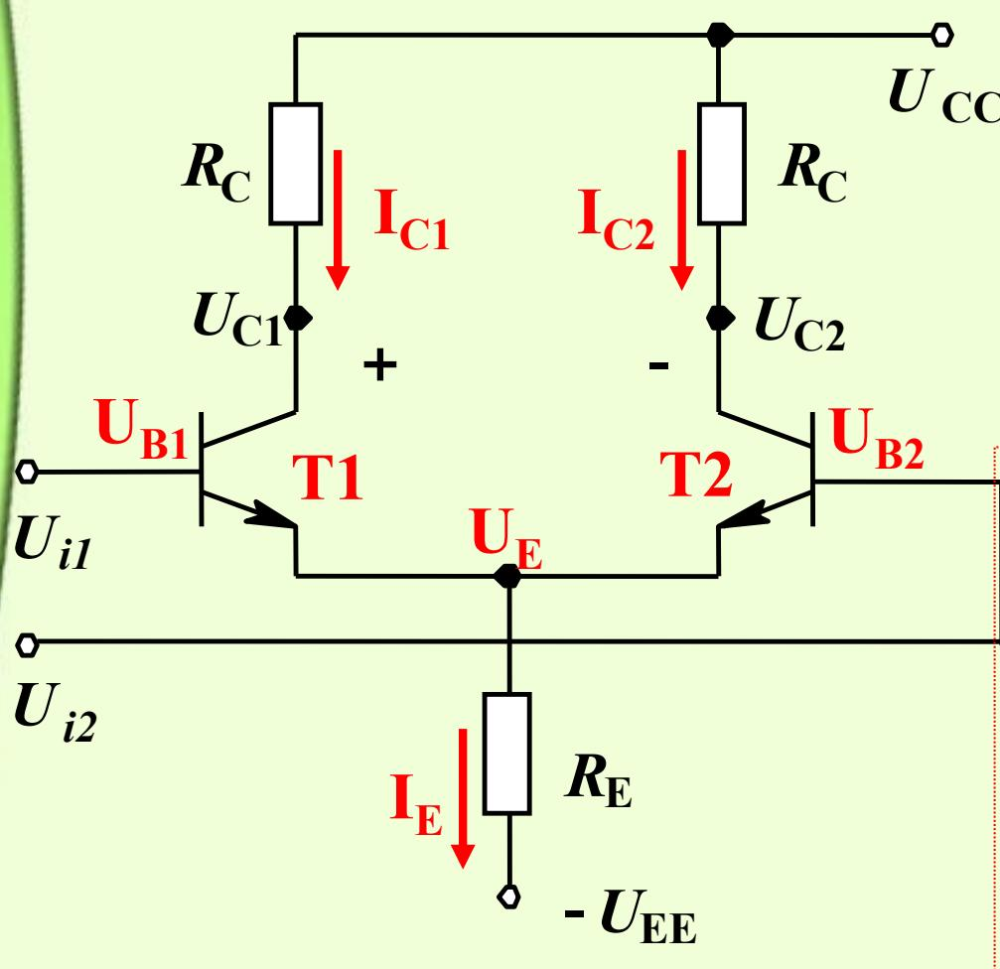

共模信号主要是指电磁、温度干扰，它们对两个晶体管产生同样的影响。

例如，因为温度上升，两边晶体管的集电极电流 $I_C$ 同时上升（大小相等）时：

∵ $I_{C1}$、$I_{C2}$↑ ∴ $I_E$（$=I_{C1}+I_{C2}$）↑ ∴ $U_E$↑；又 $U_{B1}$（$=U_{i1}$）不变，∴ 二极管正向压降 $U_{BE1}$↓ ∴ $I_{B1}$↓ ∴ $I_{C1}$（$=\beta \cdot I_{B1}$）↓。∴ $I_{C1}$ 得到负反馈，数值稳定，共模信号被消除。同理 $I_{C2}$。

对于共模信号，$R_E$ 提供了共模负反馈，可以有效抑制共模信号。对于差模信号，$R_E$ 无影响，可视为短路。

从前述证明过程可以看到，$R_E$ 的作用主要是通过增大 $R_E$ 上的电压 $U_E$ 从而影响 $U_{BE}$，这本质上是在影响三极管的静态工作点。

当 $R_E$ 过大时，会使 $U_{BE}$ 过小，可能会导致三极管不能正常地线性放大。为此在 $R_E$ 下方增加负电源 $-U_{EE}$，提供更大的电压调节范围。今天的实验采用此方法。

但由于大电阻、大电源在集成电路工艺上的困难，更经济的方法是像书上“开关 3”构建一个恒流源电路，使 $I_E$ 恒定，$I_C$ 恒定，更好地实现共模抑制。

差动放大电路共有四种工作方式：

1. 单端输入，单端输出
2. 单端输入，双端输出
3. 双端输入，单端输出
4. 双端输入，双端输出

两个输入信号之间的关系：共模，差模，比较（任意）。

## 差动放大电路的静态分析

无输入信号（输入信号置零）研究三极管静态工作点。

| 静态参数 | T1 | T2 |
| --- | --- | --- |
| $U_{EQ}$ | | |
| $U_{BQ}$ | | |
| $U_{CQ}$ | | |
| $U_{CEQ}$ | | |

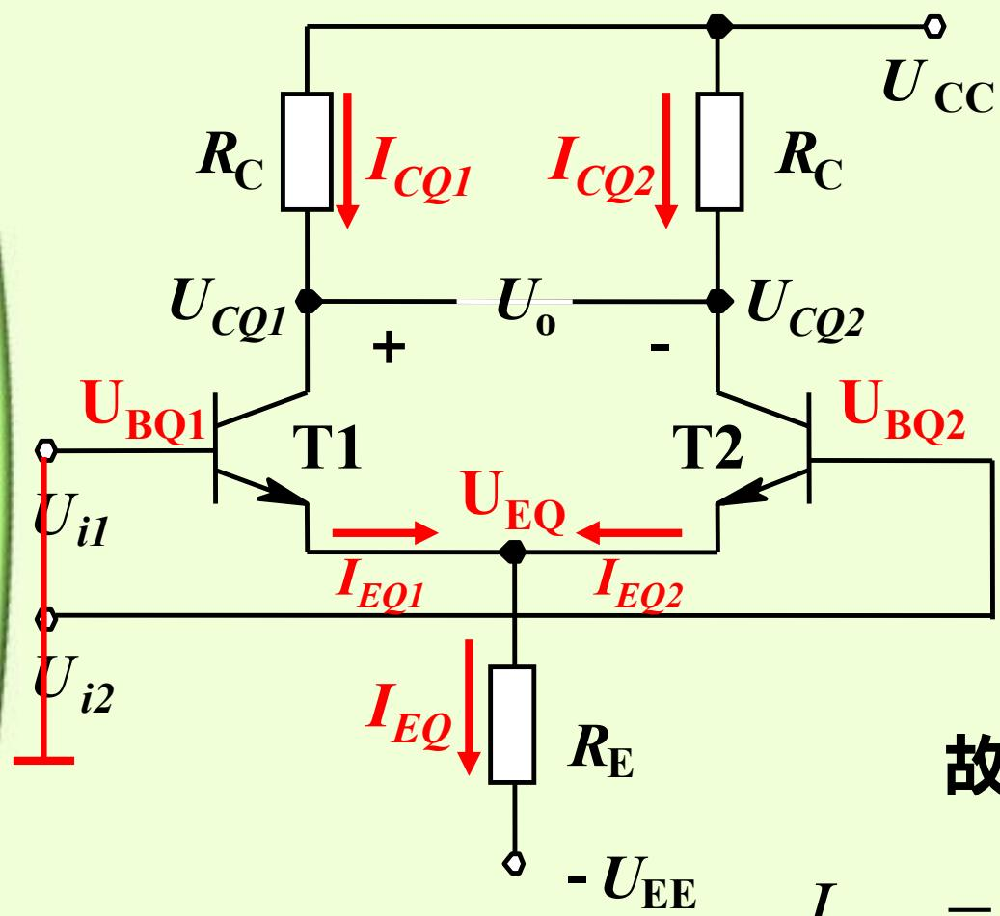

输入端置零

$$
U_{i1} = U_{i2} = U_{BQ1} = U_{BQ2} = 0
$$

$$
U_{EQ} = -U_{BEQ} \approx -0.7V
$$

则流过 $R_E$ 的电流 $I_{EQ}$ 为

（a）双端输出

$$
I_{EQ} = \frac{U_{EQ} - (-U_{EE})}{R_E} = \frac{U_{EE} - 0.7}{R_E}
$$

故有

$$
I_{CQ1} = I_{CQ2} \approx I_{EQ1} = I_{EQ2} = \frac{1}{2} I_{EQ}
$$

可以得到的静态参数：$U_{BQ}$、$U_{EQ}$、$I_E$、$I_{CQ}$。

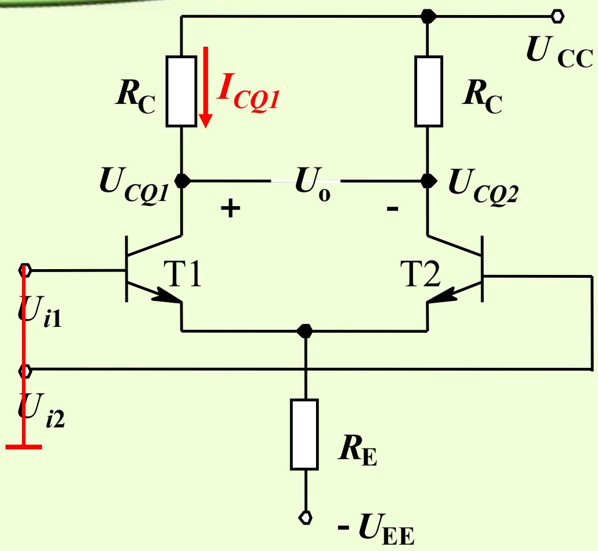

$$
U_{CQ1} = U_{CQ2} = U_{CC} - I_{CQ1} R_C
$$

可以得到的静态参数：$U_{CQ}$。

$$
U_o = U_{CQ1} - U_{CQ2} = 0
$$

静态时，差动放大器两输出端之间的直流电压为零。

这是判断两个三极管完全对称的标志。

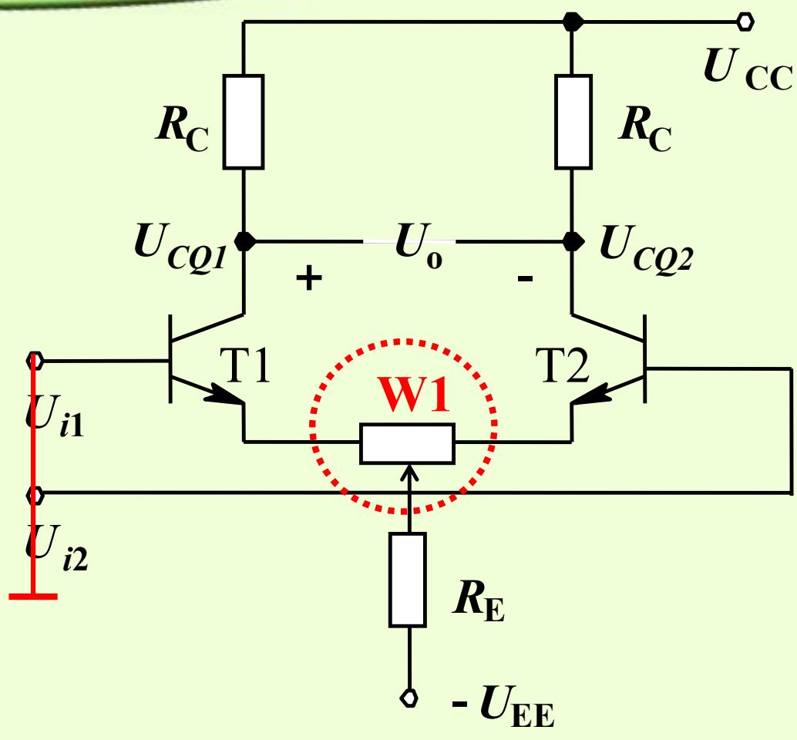

实际搭建的电路中，两边晶体管参数不可能完全一致。为了尽量平衡，在发射极加入可调的电位器 W1（总值 1kΩ）。

将 W1 调整到合适的位置，使 $U_o=0V$，并测出前述各个静态参数的值。

差动放大器的静态参数

$R_C = 4.7k\Omega$，W1 $=1k\Omega$，$R_E = 4.3k\Omega$

| 静态参数 | T1 理论值 | T1 实测值 | T2 理论值 | T2 实测值 |
| --- | --- | --- | --- | --- |
| $U_{EQ}$ | -0.7V | | -0.7V | |
| $U_{BQ}$ | 0V | | 0V | |
| $U_{CQ}$ | 2.8V | | 2.8V | |
| $U_{CEQ}$ | 3.5V | | 3.5V | |

在此基础上才能进行动态信号的放大。

## 差动放大电路的动态分析

三类动态输入信号：

共模信号：$U_{i1}$ 和 $U_{i2}$ 所加的信号大小相等、极性相同。

$$
U_{i1} = U_{i2}
$$

差模信号：$U_{i1}$ 和 $U_{i2}$ 所加的信号大小相等、极性相反。

$$
U_{i1} = -U_{i2}
$$

比较信号：任意的两个信号，总是可以分解为一对共模信号和一对差模信号的叠加。

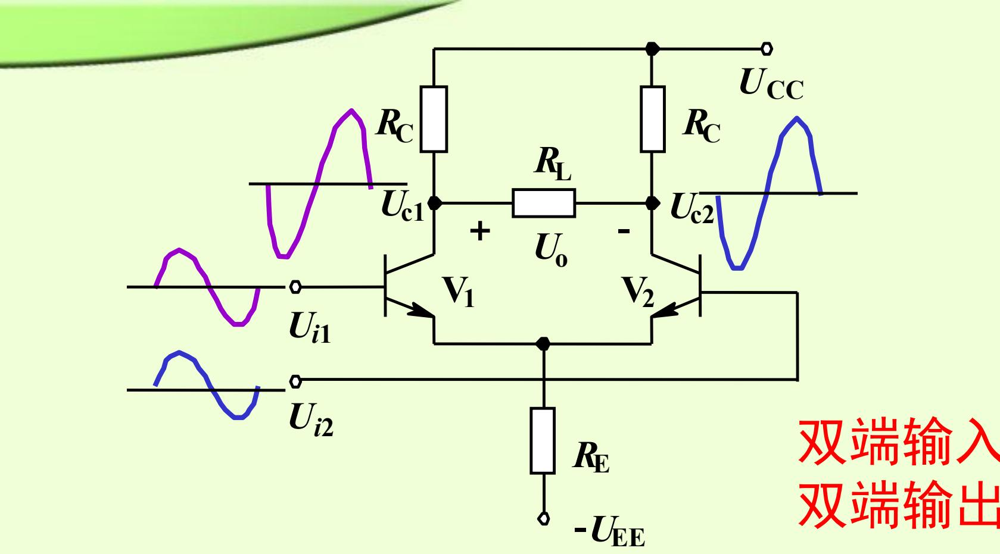

双端输入双端输出

当 $U_{i1} = U_{i2}$ 时

$$
U_{c1} = U_{c2}
$$

$$
U_o = U_{c1} - U_{c2} = 0
$$

共模信号被抑制。

双端输入双端输出

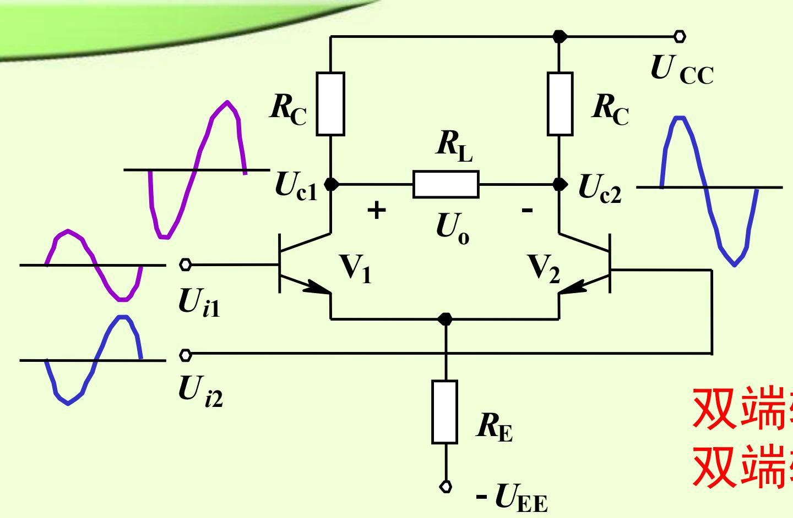

当 $U_{i1} = -U_{i2}$ 时

$$
U_{c1} = -U_{c2}
$$

$$
\begin{array}{rl}
U_o &= U_{c1} - U_{c2} \\
&= U_{c1} - (-U_{c1}) = 2U_{c1}
\end{array}
$$

差模信号被放大。

当两信号是任意信号 $U_{i1}$、$U_{i2}$ 时，它们总是可以分解为差模分量 $U_d$ 和共模分量 $U_c$：

$$
U_d = U_{i1} - U_{i2} \quad U_c = \frac{U_{i1} + U_{i2}}{2}
$$

例如 4V 和 7V 两路信号，可以分解为 3V 的差模分量和 5.5V 的共模分量。

根据叠加原理，经过差动放大器，其中的共模分量将被抑制，差模分量将被放大。所以，最基本的问题，还是共模、差模信号的问题。

## 差模特性分析

双端输入双端输出

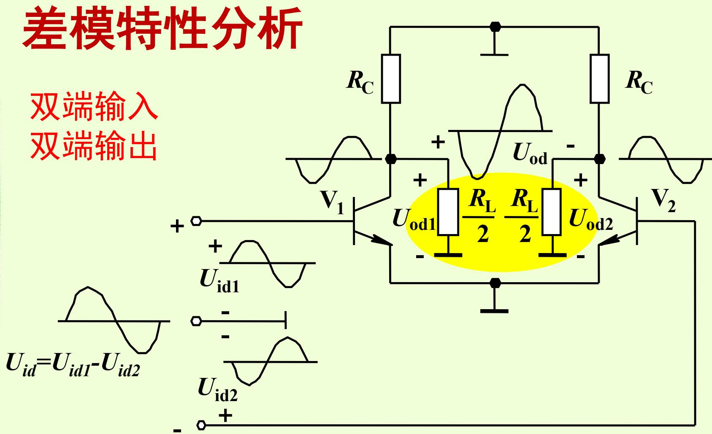

差模电压放大倍数 $A_{ud} = \frac{U_{od}}{U_{id}}$。在双端输入时 $U_{od} = U_{od1} - U_{od2} = 2U_{od1}$，双端输出时 $U_{id} = U_{id1} - U_{id2} = 2U_{id1}$，所以

$$
A_{ud} = \frac{U_{od}}{U_{id}} = \frac{U_{od1}}{U_{id1}} = \frac{U_{od2}}{U_{id2}} = -\frac{\beta R_L'}{R_b + r_{be} + (1+\beta) \cdot \frac{W_1}{2}}
$$

式中：$R_L' = R_C \parallel \frac{1}{2} R_L$（改正书上错误）。

结论：双端输出时的差模电压放大倍数等于单边共射放大器的电压放大倍数。

## 二、差动放大器特性分析

### 差模特性分析

差模信号无论是单端输入（仅从 $U_{i1}$ 输入，$U_{i2}=0$），还是双端输入（$U_{i1} = -U_{i2}$），只要是双端输出时，就有：

$$
A _ {u d} = \frac {U _ {o d 1} - U _ {o d 2}}{U _ {i d 1} - U _ {i d 2}} = - \frac {\beta \cdot (R _ {c} \| \frac {R _ {L}}{2})}{R _ {b} + r _ {b e} + (1 + \beta) \cdot \frac {W _ {1}}{2}} \approx 4.3
$$

$$
\begin{array}{l l} 
R_i = 2[ R _ {b} + r _ {be} +(1+ \beta) W _ {1} / 2] & r _ {b e} = r _ {b} + (1 + \beta) \frac {26 \text{mV}}{I _ {E} (\text{mA})} \approx 5.5 \text{k}\Omega \\ 
R_o = 2R_c & 
\end{array}
$$

差模信号无论是单端输入（从 $U_{i1}$ 输入，$U_{i2}=0$），还是双端输入（$U_{i1} = - U_{i2}$），只要是单端输出时，就有：

$$
\begin{array}{l} 
A _ {u d} = \frac {U _ {o 1}}{U _ {i 1}} = - \frac {\beta \cdot (R _ {c} \parallel R _ {L})}{2 [ R _ {b} + r _ {b e} + (1 + \beta) \frac {W _ {1}}{2} ]} \approx 2.9 \\ 
R_i = 2[R_b+r_{be}+(1+\beta)W_1/2] \\ 
R_o = R_c 
\end{array}
$$

### 共模特性分析

**共模电压放大倍数**

双端输出时：

$$
A _ {u c} = \frac {U _ {o c}}{U _ {i c}} = \frac {U _ {o c 1} - U _ {o c 2}}{U _ {i c}} = 0
$$

单端输出时：

$$
A _ {u c} = - \frac {R _ {C} \parallel R _ {L}}{2 R _ {E} + W _ {1} / 2}
$$

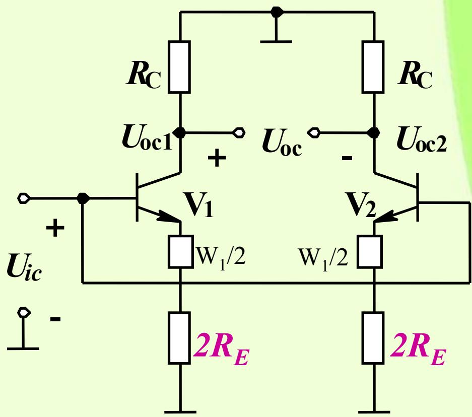

$\approx 0.35$ 图3 长尾式差动放大器的共模等效通路

### 共模抑制比

*   **差模**：需要放大的有用信号，尽可能放大。
*   **共模**：无用的干扰信号，需要抑制。

**定义**：差模放大倍数与共模放大倍数之比的绝对值。

共模抑制比越大，说明电路抗共模干扰能力越强，信号放大质量越好。

$$
K _ {C M R} = \left| \frac {A _ {u d}}{A _ {u c}} \right| \qquad K _ {C M R} = 2 0 \lg \left| \frac {A _ {u d}}{A _ {u c}} \right| (\text{dB})
$$

$K _ { C M R }$ 实质上是反映实际差动电路的对称性。理想情况下，$A _ { u c } = 0$，$K _ { C M R } \to \infty$。

为了定量分析，通常用单端输出的参数来计算 $K _ { C M R }$：

$$
K _ {C M R (\text {单})} = \left| \frac {A _ {u d (\text {单})}}{A _ {u c (\text {单})}} \right| \approx \frac {\beta (2 R _ {E} + W _ {1} / 2)}{2 [ R _ {b} + r _ {b e} + (1 + \beta) W _ {1} / 2 ]} \tag {8.3}
$$

从中我们看到，$R _ { E }$ 越大，$K _ { C M R }$ 越大。也就是说 $R _ { E }$ 越大，共模抑制越强。

## 三、实验内容

按图5.20连接电路，长尾部分只做 $R _ { E }$ 一路，不做微电流源。

### 1. 调节放大器零点

两个交流输入端接地，调节电位器 $W_1$，使 $U_o=0\text{V}$（万用表测量）。

### 2. 测量静态工作点

使用万用表直流电压档测三极管各极的电位，填入表格中。

### 3. 差模电压放大倍数 $\mathbf { A } _ { \mathbf { u d } }$

**单端输入**：
$U _ { i 1 }$ 输入 $0.05\text{Vrms}$，$1\text{kHz}$，无偏置正弦信号，$U _ { i 2 }$ 接地。

**双端输出**：
$U _ { C 1 }$ 和 $U _ { C 2 }$ 之间接负载 $R _ { L } = 10 \text{k}\Omega$。

**观测**：
示波器两通道分别接 $U _ { C 1 } , U _ { C 2 }$。读两个通道的有效值，并记录波形（反相位）。

差模电压放大倍数为：

$$
A _ {u d} = \frac {U _ {o d}}{U _ {i d}} \approx 4
$$

其中：
*   $U _ { o d }$ = 两个输出 $U _ { C 1 } , U _ { C 2 }$ 有效值相加
*   $U _ { i d } = U _ { i 1 }$ 的有效值

用示波器观测 $U _ { C 1 }$ 和 $U _ { C 2 }$ 时，要注意，这个点上的电压其实包含直流成分和交流成分：

*   **直流成分**：从 $+5\text{V}$ 直流电源经过 $R_c$ 分压而得到的直流信号（即 $U _ { C Q }$ 的大小）；
*   **交流成分**：从 $U_i$ 经过三极管放大而得的 $U_o$。

我们要观测 $U_o$，必须用“交流耦合”的方式，屏蔽直流成分。

> **重要**
> 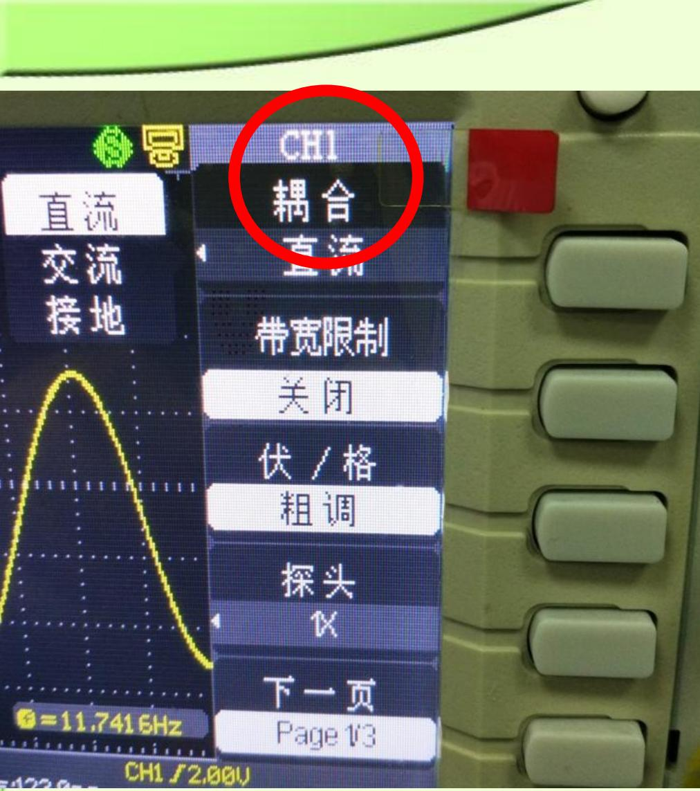

**耦合方式**：
*   **直流耦合**：信号中的直流、交流成分均可通过；
*   **交流耦合**：信号中的交流成分可通过，直流成分被屏蔽；
*   **接地**：直流交流成分均被屏蔽。

### 4. 共模电压放大倍数 $\mathbf { A } _ { \mathbf { u c } }$ 及共模抑制比 $\mathbf { K _ { C M R } }$

**双端输入**：
$U _ { i } 1$ 和 $U _ { i } 2$ 均输入 $0.5\text{Vrms}$，$1\text{kHz}$，无偏置正弦信号。

**双端输出**：
$U _ { C 1 }$ 和 $U _ { C 2 }$ 之间接负载 $R _ { L } = 10 \text{k}\Omega$。

**观测**：
示波器两通道分别接 $U _ { C } 1 , ~ U _ { C } 2$。读两个通道的有效值，并记录波形（同相位）。

$$
A _ {u c} = \frac {U _ {o c}}{U _ {i c}} \quad U _ {i c} = U _ {i 1} = U _ {i 2} \quad U _ {o c} = U _ {c 1} - U _ {c 2}
$$

$$
K _ {C M R} = \left| \frac {A _ {u d}}{A _ {u c}} \right|
$$

其中：
*   $U _ { i c } =$ 两个输出 $U _ { C 1 }$ 或 $U _ { C 2 }$ 的有效值
*   $U _ { o c } =$ 两通道有效值相减

## 四、实验准备

1.  准备两枚9013三极管，注意极性（如何确认？）。
2.  确认每根导线正常。
3.  电路连接要有条理，精简。
4.  注意电源连接方式。
5.  检查 $1\text{k}\Omega$ 电位器是否正常。
6.  连接完成后，先调零，确认静态工作点。

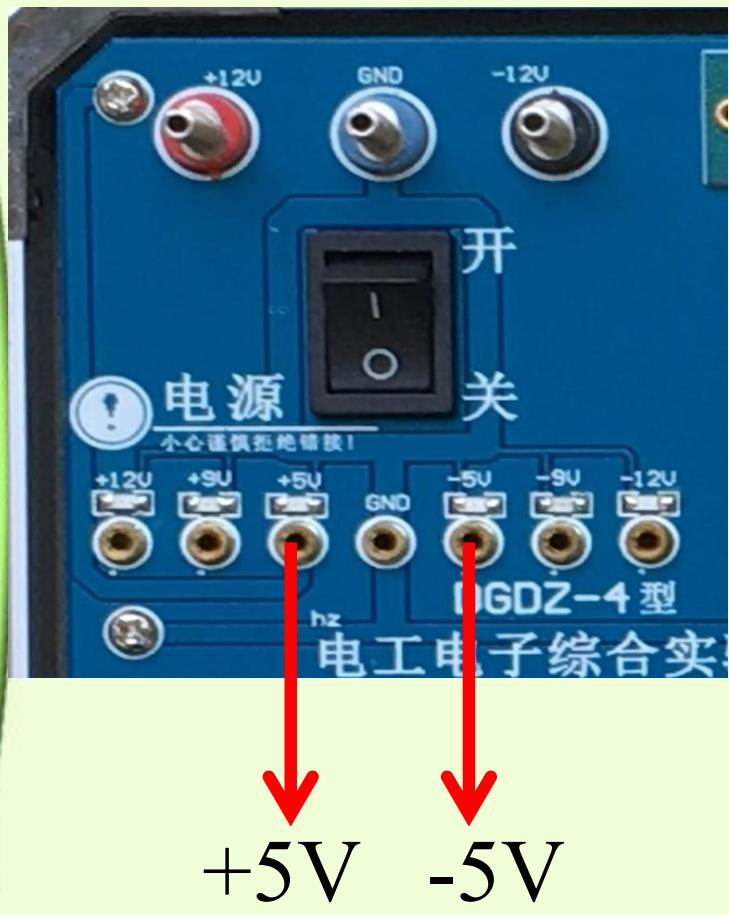

打开实验箱电源，看 $+5\text{V}$ 和 $-5\text{V}$ 指示灯是否亮，用万用表确认电压值是否正确！然后将其引入电路。

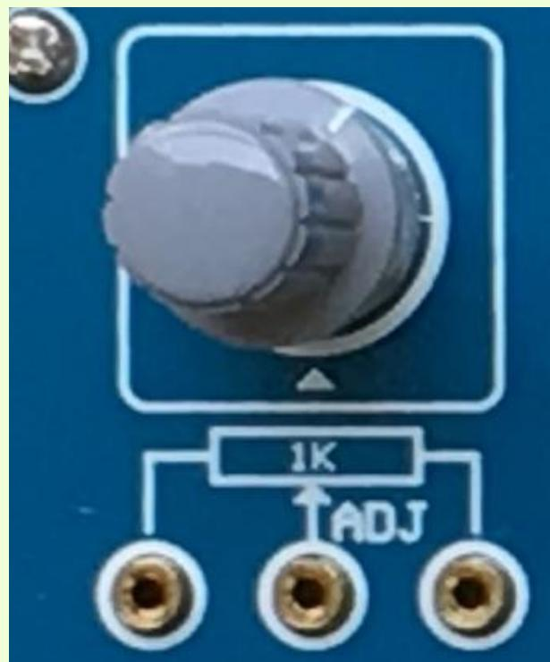

电位器有三个点，旋转旋钮，并用万用表确认每两个点之间的电阻。**任意两个点之间都不能是开路！**

## 五、预习：运算放大器的线性运用

要求：根据 P111 设计要求 2 和 3，设计反相比例器和反相加法器，计算出电路中元件的参数。
