# 《模拟电子技术》第6章 负反馈 习题答案

原件经识别和整理；“参考解答”是我们补的。

# 《模拟电子技术》第6章 负反馈 习题答案（1）

kind: 答案
course: 模拟电子技术

## 一、判断题与计算题

### 判断 1

题干：试判断题图6.1所示各电路的级间反馈类型和反馈极性。

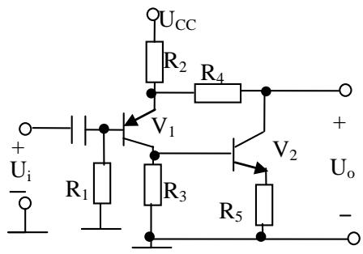

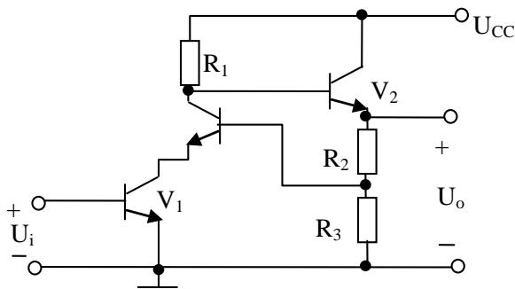

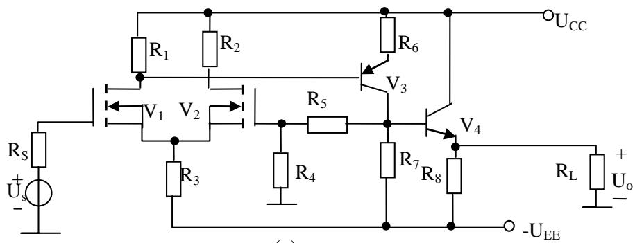

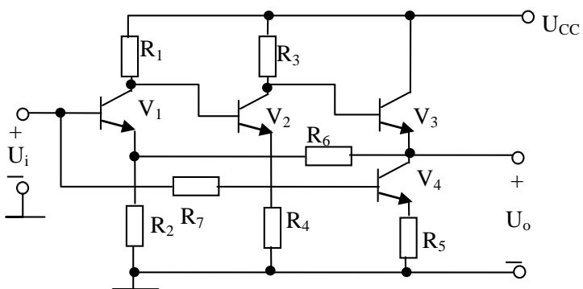

答案：
- 电路(a)为串联电压负反馈。
- 电路(b)为串联电压负反馈。
- 电路(c) $\mathrm{V}_1$ 与 $\mathrm{V}_3$ 间为电压串联负反馈。
- 电路(d)为电压由 $\mathrm{V}_3$ 的射极经 $R_6$ 至 $\mathrm{V}_1$ 的射极组成了电压串联负反馈。

知识点：[四种受控电源（VCVS、VCCS、CCVS、CCCS）的特性](../../../topics/电路与电子技术/受控电源.md)

### 判断 2

题干：试判别6.2所示各电路的反馈类型和反馈极性。

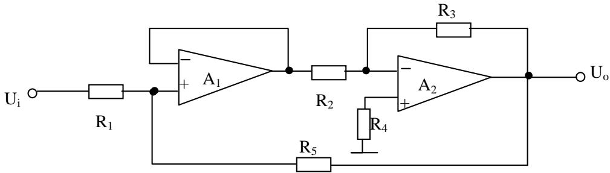

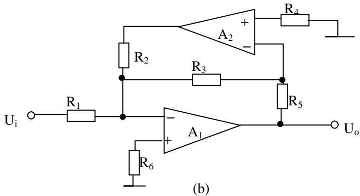

答案：
- 电路(b)：经 $A_2$、$R_2$ 组成电压并联正反馈电路；经 $R_3$ 组成电压并联负反馈电路。

### 计算 1

题干：一电压串联负反馈放大器，其基本放大器的电压增益 $A_u = 100$，反馈网络的反馈系数 $B_u = 0.1$。由于温度变化，$A_u$ 增大到 120，试求负反馈放大电路的电压增益变化率 $\frac{\Delta A_{uf}}{A_{uf}}$

解：

$$
\frac{\Delta A_{vf}}{A_{vf}} = \frac{\Delta A_v}{A_v} \cdot \frac{1}{(1 + A_v + \Delta A_v) B_v} \approx 1.54\%
$$

或

$$
\frac{\Delta A_{vf}}{A_{vf}} = \frac{\Delta A_v}{A_v} \cdot \frac{1}{1 + A_v B_v} \approx 1.8\%
$$

### 计算 2

题干：一放大器的电压放大倍数 $A_u$ 在 150~600 之间变化（变化了 4 倍），现加入负反馈，反馈系数 $F_u = 0.06$，问：闭环放大倍数的最大值和最小值之比是多少？

解：因为 $A_f = \frac{A}{1 + AF}$，所以

$$
A_{f \min} = \frac{A_{\min}}{1 + A_{\min} F} = \frac{150}{1 + 150 \times 0.06} = 15
$$

$$
A_{f \max} = \frac{A_{\max}}{1 + A_{\max} F} = \frac{600}{1 + 600 \times 0.06} \approx 16.2
$$

故 $\frac{A_{f \max}}{A_{f \min}} = \frac{16.2}{15} = 1.08$

### 计算 3

题干：某一电压串联负反馈放大电路，其环路增益 $T=49$，环路增益的变化量 $\Delta T = 25$，设反馈系数 $B_v$ 为常数，试求负反馈放大电路电压增益 $A_{uf}$ 的相对变化量。

解：因为环路增益的变化量较大，负反馈放大电路电压放大倍数相对于环路增益的变化量为

$$
\frac{\Delta A_{uf}}{A_{uf}} = \frac{\Delta A_u}{A_u} \cdot \frac{1}{1 + (A_u + \Delta A_u) B_u}
$$

因为 $T = A_u B_u, \Delta T = \Delta A_u B_u$，所以上式又可写为

$$
\frac{\Delta A_{uf}}{A_{uf}} = \frac{\Delta T}{T} \cdot \frac{1}{1 + A_u B_u + \Delta A_u B_u} = \frac{\Delta T}{T} \cdot \frac{1}{1 + T + \Delta T} = \frac{25}{49} \cdot \frac{1}{1 + 49 + 25} = 0.0068
$$

### 计算 4

题干：一电压并联负反馈放大器开环互阻增益 $A_r = 10^3 k\Omega$，互导反馈系数 $B_g = 0.01 \text{ mS}$，试求：

(1) 当开环互阻增益的相对变化率为 $\frac{\Delta A_r}{A_r} = 20\%$ 时，闭环互阻增益的相对变化率 $\frac{\Delta A_{rf}}{A_{rf}}$

(2) 当信号源内阻 $R_S$ 不变时，闭环电压增益的相对变化率 $\frac{\Delta A_{uf}}{A_{uf}}$

解：
(1) $\frac{\Delta A_{rf}}{A_{rf}} = \frac{\Delta A_r}{A_r} \cdot \frac{1}{1 + (A_r + \Delta A_r) B_g} \approx 1.54\%$

(2) 因为 $A_{uf} = \frac{U_o}{I_s R_s} = A_{rf} \cdot \frac{1}{R_s}$，$R_S$ 不变，则闭环电压增益的相对变化率也为

$\frac{\Delta A_{uf}}{A_{uf}} \approx 1.54\%$

### 计算 5

题干：有一电压串联负反馈放大器，开环基本放大电路的电压放大倍数 $A_u = \frac{U_o}{U_i} = 800$，输入电阻 $R_i = 6 k\Omega$，输出电阻 $R_o = 4 k\Omega$，负载电阻 $R_L = 10 k\Omega$，反馈系数 $B_u = 0.015$，信号源内阻 $R_S = 1 k\Omega$。

(1) 试计算电路的反馈深度 $D$。
(2) 计算反馈电压放大倍数 $A_{uf}$，输入电阻 $R_{if}$ 和源电压增益 $A_{usf}$。
(3) 计算输出电阻 $R_{of}$。

解：

$$
(1) D = 1 + A_u B_u = 1 + 800 \times 0.015 = 13
$$

$$
(2) A_{uf} = \frac{A_u}{1 + A_u B_u} = \frac{800}{13} = 61.5
$$

$$
R_{if} = R_i (1 + A_u B_u) = 6 \times 13 = 78 k\Omega
$$

$$
A_{usf} = A_{uf} \frac{R_{if}}{R_S + R_{if}} = 61.5 \times \frac{78}{1 + 78} = 60.7
$$

$$
(3) R_{of} = \frac{R_o}{1 + A_{uso} B_u}
$$

式中 $A_{uso}$ 是基本放大电路 $R_L$ 开路时的源电压增益

$$
A_{uso} = \frac{R_i}{R_s + R_i} A_{uo} = \frac{R_i}{R_s + R_i} A_u \cdot \frac{R_o}{R_o \| R_L} = \frac{6}{1 + 6} \times 800 \times \frac{4}{4 \| 10} = 960
$$

所以：$R_{of} = \frac{4}{1 + 960 \times 0.015} \approx 260 \Omega$

显然，电压串联负反馈可使电压增益下降，输入电阻增加，输出电阻下降。

参考解答：(1) 反馈深度

$$
D = 1 + A_u B_u = 1 + 800 \times 0.015 = 13
$$

(2) 闭环电压放大倍数

$$
A_{uf} = \frac{A_u}{1 + A_u B_u} = \frac{800}{13} \approx 61.5
$$

串联负反馈使输入电阻增大：

$$
R_{if} = R_i(1 + A_u B_u) = 6\,\text{k}\Omega \times 13 = 78\,\text{k}\Omega
$$

源电压增益考虑信号源内阻分压：

$$
A_{usf} = A_{uf}\frac{R_{if}}{R_S + R_{if}} = 61.5 \times \frac{78}{1 + 78} \approx 60.7
$$

(3) 计算输出电阻需用负载开路时的源电压增益 $A_{uso}$。先求基本放大电路的开路电压放大倍数：

$$
A_{uo} = A_u \cdot \frac{R_o + R_L}{R_L} = 800 \times \frac{4 + 10}{10} = 1120
$$

再计入信号源内阻的影响：

$$
A_{uso} = \frac{R_i}{R_S + R_i} A_{uo} = \frac{6}{1 + 6} \times 1120 = 960
$$

电压负反馈使输出电阻减小：

$$
R_{of} = \frac{R_o}{1 + A_{uso} B_u} = \frac{4\,\text{k}\Omega}{1 + 960 \times 0.015} = \frac{4000}{15.4} \approx 260\,\Omega
$$

**结论**：反馈深度 $D = 13$；闭环电压增益 $A_{uf} \approx 61.5$，输入电阻 $R_{if} = 78\,\text{k}\Omega$，源电压增益 $A_{usf} \approx 60.7$；输出电阻 $R_{of} \approx 260\,\Omega$。可见电压串联负反馈使电压增益降低、输入电阻增大、输出电阻减小。

知识点：[四种受控电源（VCVS、VCCS、CCVS、CCCS）的特性](../../../topics/电路与电子技术/受控电源.md)、[线性时不变电阻的伏安关系（欧姆定律）](../../../topics/电路与电子技术/线性电阻VCR.md)、[理想电压源与理想电流源的特性](../../../topics/电路与电子技术/独立电源.md)

### 计算 6

题干：某放大器的放大倍数 $A(j\omega)$ 为

$$
A(j\omega) = \frac{1000}{1 + j \frac{\omega}{10^6}}
$$

若引入 $F=0.01$ 的负反馈，试问：

(1) 开环中频放大倍数 $A_I$？$f_H = ?$
(2) 闭环中频放大倍数 $A_{If}$？$f_{Hf} = ?$

解：
(1) $A_I = 1000 (60 \text{ dB})$

$$
f_H = \frac{\omega_H}{2\pi} = \frac{10^6}{2\pi} = 159.2 \text{ kHz}
$$

(2) $A_{If} = \frac{A_I}{1 + F A_I} = \frac{1000}{1 + 0.01 \times 1000} = 90.9$

$$
f_{Hf} = (1 + F A_I) f_H = 11 \times 159.2 \times 10^3 = 1.7512 \text{ MHz}
$$

### 分析 1

题干：电路如题图 6.9 所示，试从反馈的角度回答：开关 S 的闭合和打开，对电路性能的影响（包括增益、输入电阻、输出电阻、上限频率、下限频率等）。

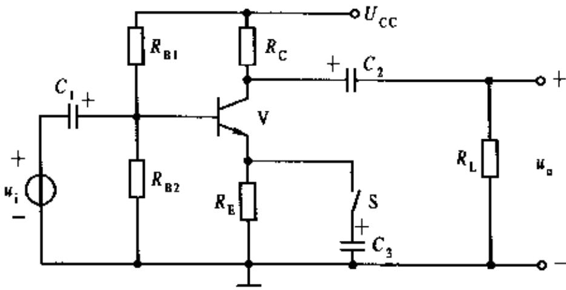

解：S 闭合，电路仅有直流负反馈，S 打开，电路便引入了串联电流负反馈（反馈网络为 $R_E$），那么，增益将减小，输入电阻将增大，输出电阻基本不变（管子一路输出电阻增大，但与 $R_C$ 并联后，总的输出电阻仍近似为 $R_C$），上限频率 $f_H$ 提高，下限频率 $f_L$ 将下降。

### 分析 2

题干：电路如题图 6.10(a)和(b)所示。试问：

(1) 反馈电路的连接是否合理？为发挥反馈效果，两个电路对 $R_S$ 有何要求？
(2) 当信号源内阻变化时，哪个电路的输出电压稳定性好？哪个电路源电压增益的稳定性能力强？
(3) 当负载 $R_L$ 变化时，哪个电路输出电压稳定性好？哪个电路源电压增益稳定能力强？

解：
(1) 图(a)：第一级是电流串联负反馈，第二级是电压并联负反馈，第一级对第二级相当于恒流源激励，对第二级是合理的；对第一级要求恒压源激励，以使电流串联负反馈起作用，

## 简答 1

即 $R_{\mathrm{S}}$ 越小越好。

图(b)：第一级是电压并联负反馈，第二级是电流串联负反馈，第一级对第二级相当于恒压源激励，对第二级是合理的；对第一级要求恒流源激励以使电压并联负反馈起作用，即 $R_{\mathrm{S}}$ 越大越好。

(2) 图(a)：输入端是串联负反馈，$R_{\mathrm{if}}$ 大，$R_{\mathrm{S}}$ 小，而且 $R_{\mathrm{if}} \gg R_{\mathrm{S}}$，当 $R_{\mathrm{S}}$ 变化时，源电压增益的变化不大，即稳定性较好，输出电压当然也就稳定。

图(b)：输入端是并联负反馈，$R_{\mathrm{if}}$ 小，$R_{\mathrm{S}}$ 大，而且 $R_{\mathrm{if}} \ll R_{\mathrm{S}}$，当 $R_{\mathrm{S}}$ 变化时，源电压增益不稳定，输出电压也不稳定。

(3) 图(a)：输入端是电压负反馈，$R_{\mathrm{of}}$ 小，是恒压源，$R_{\mathrm{L}}$ 变化时，输出电压稳定，源电压增益也稳定。

图(b)：输出端是电流负反馈，$R_{\mathrm{of}}$ 大，是恒流源，$R_{\mathrm{L}}$ 变化时，输出电压不稳定，源电压增益也不稳定。

## 计算 1

6.11 反馈放大器电路如题图 6.11 所示，试回答：

（1）判断该电路引入了何种反馈？反馈网络包括哪些元件？工作点的稳定主要依靠哪些反馈？

（2）该电路的输入输出电阻如何变化，是增大还是减少了？

（3）在深反馈条件下，交流电压增益 $A_{\mathrm{uf}} = ?$

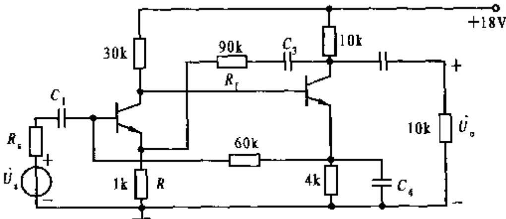

解：（1）90kΩ 电阻和 1kΩ 电阻构成两级之间的交流串联电压负反馈。4kΩ、60kΩ 以及 $\mathrm{V}_1$ 构成两级之间的直流电流负反馈，以保证直流工作点更加稳定。

（2）该电路输入阻抗增大，输出阻抗减小。

(3) 在深反馈条件下：

$$
A_{ui} = \frac{1}{F} = \frac{1k + 90k}{1k} = 91
$$

## 计算 2

6.12 负反馈放大电路如题图 6.12 所示。

(1) 试判别电路中引入了何种反馈？

(2) 为得到低输入电阻和低输出电阻，应采用何种类型的负反馈？电路应如何改接？

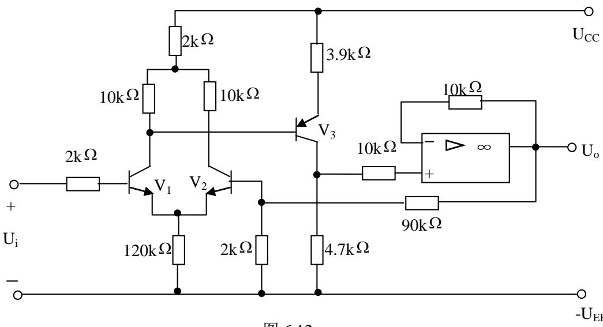

解：(1) 输出信号 $\mathrm{U}_{\mathrm{o}}$ 通过 90kΩ 电阻接至 $\mathrm{V}_2$ 的基极，故构成电压串联负反馈。

(2) 应采用电压并联负反馈。其改接方法为：将 $\mathrm{V}_3$ 的基极由接在 $\mathrm{V}_1$ 的集电极改接到 $\mathrm{V}_2$ 的集电极；将输出端的 90kΩ 电阻，由接在 $\mathrm{V}_2$ 的基极改接到 $\mathrm{V}_1$ 的基极。

## 计算 3

6.13 电路如题图 6.13 所示，试指出电路的反馈类型，并计算开环增益 $A_{\mathrm{u}}$ 和闭环增益 $A_{\mathrm{uf}}$ (已知 $\beta$、$r_{\mathrm{be}}$ 等参数)。

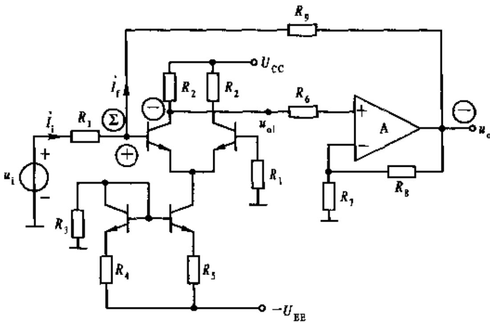

解：（1）该电路第一级为带恒流源的差分放大器，单端输入，单端输出；第二级为同相比例放大器，引入了单级串联电压负反馈。两级之间通过 $R_9$ 和 $R_1$ 构成了并联电压负反馈（瞬时相位示于图 P6－13 中）。

（2）求开环增益（设 $R_9 \gg R_1$）

$$
A_u = \frac{U_{o1}}{U_i} \cdot \frac{U_o}{U_{o1}} = A_{u1} \times A_{u2}
$$

其中，$A_{u1} = \frac{U_{o1}}{U_i} = -\frac{1}{2}\frac{\beta R_2}{R_1 + r_{be}}$（第二级输入电阻为无穷大）

$$
A_{u2} = 1 + \frac{R_8}{R_7}
$$

（3）求闭环增益（引入负反馈的增益）：

$$
A_{uf} = \frac{U_{o1}}{U_i} = -\frac{R_9}{R_1}
$$

因为深反馈条件下有：

$$
I_{\mathrm{i}} \approx I_{f},\quad I_{\mathrm{i}} = \frac{U_i - U_{\Sigma}}{R_1} \approx \frac{U_i}{R_1},\quad I_{f} = \frac{U_{\Sigma} - U_o}{R_9} \approx -\frac{U_o}{R_9}
$$

所以 $A_{uf} = \frac{U_o}{U_i} = -\frac{R_9}{R_1}$

## 计算 4

6.14 电路如题图 6.14 所示，试回答：

（1）集成运放 $A_1$ 和 $A_2$ 各引进什么反馈？

（2）求闭环增益 $A_{uf} = \frac{U_o}{U_i}$。

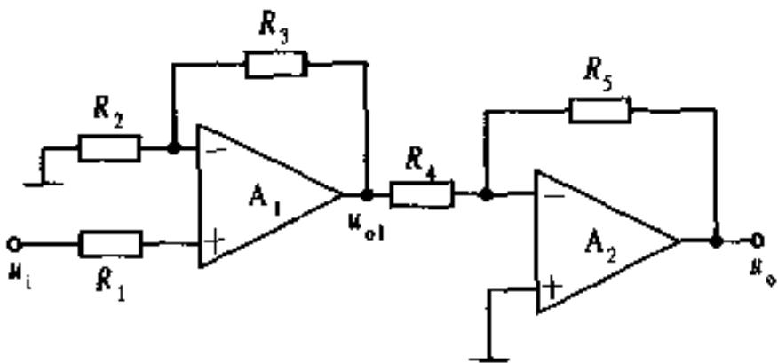

解：（1）运放 $A_1$ 引入了串联电压负反馈；运放 $A_2$ 引入了并联电压负反馈。

（2）闭环增益 $A_{uf}$ 为

$$
A_u = \frac{U_o}{U_i} = \frac{U_{o1}}{U_i} \times \frac{U_o}{U_{o1}} = \left(1 + \frac{R_3}{R_2}\right) \times \left(-\frac{R_5}{R_4}\right) = -\frac{R_5}{R_4}\left(1 + \frac{R_3}{R_2}\right)
$$

## 计算 5

6.15 电路如题图 6.15(a) 和 (b) 所示，各电容对信号可视为短路。

(1) 试分别判断电路级间交流反馈的极性和类型。

(2) 分别写出反馈系数的表达式。

(3) 分别估算满足深度反馈条件下的源电压增益 $A_{usf}$ 的表达式或数值。

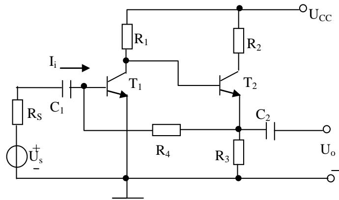

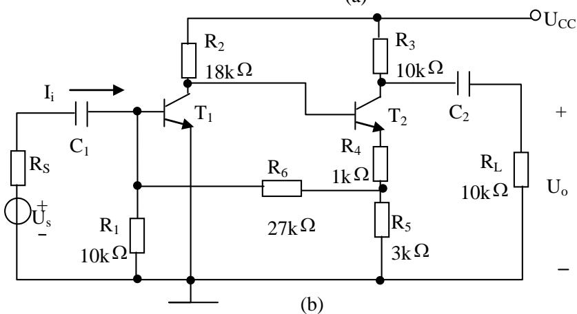

解：(1) 图(a)：电压并联负反馈

图(b)：电流并联负反馈

（2）图(a)：$B_g = \frac{I_f}{U_o} = -\frac{1}{R_4}$

图(b)：$B_i = \frac{I_f}{I_{C2}} = \frac{R_5}{R_5 + R_6}$

(3) 图(a)：$A_{usf} = -\frac{R_4}{R_5}$

图(b)：$A_{usf} = -\frac{R_5 + R_6}{R_5} \times \frac{R_3 \parallel R_L}{R_S} = 50$

## 计算 6

6.16 电路如题图 6.16 所示，判断电路引入何种反馈？计算深度反馈条件下的电压放大倍数 $A_{uf} = U_o / U_i$。

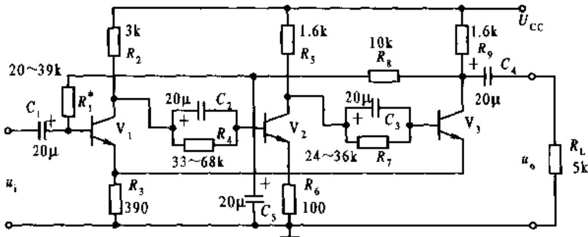

解：该电路第三级发射极与第一级发射极相连，第三级射级电流流过 $R_3$ 构成三级间的串联电流负反馈。另外一路，$R_8$、$C_5$、$R_1$ 构成直流电压负反馈，以稳定工作点。

$$
\begin{array}{l}
A_{uf} = \frac{U_o}{U_i} \approx \frac{-I_{C3}(R_9 \parallel R_L \parallel R_8)}{U_f} \\
= \frac{-I_{C3}(R_9 \parallel R_L \parallel R_8)}{I_{C3} \cdot R_3} \approx -\frac{R_9 \parallel R_L \parallel R_8}{R_3} \\
= \frac{-1.6K \parallel 5K \parallel 10K}{390} = -2.77
\end{array}
$$

## 计算 7

6.17 电路如题图 6.17 所示。

（1）试通过电阻引入合适的交流负反馈，使输入电压 $u_{\mathrm{I}}$ 转换成稳定的输出电流 $i_{\mathrm{L}}$；

（2）若 $u_{\mathrm{I}} = 0 \sim 5\mathrm{V}$ 时，$i_{\mathrm{L}} = 0 \sim 10\mathrm{mA}$，则反馈电阻 $R_F$ 应取多少？

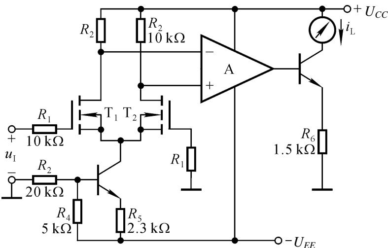

## 6.17

解：（1）引入电流串联负反馈，通过电阻 $R_{\mathrm{f}}$ 将三极管的发射极与 $\mathrm{T}_{2}$ 管的栅极连接起来，如解图P6.19所示。

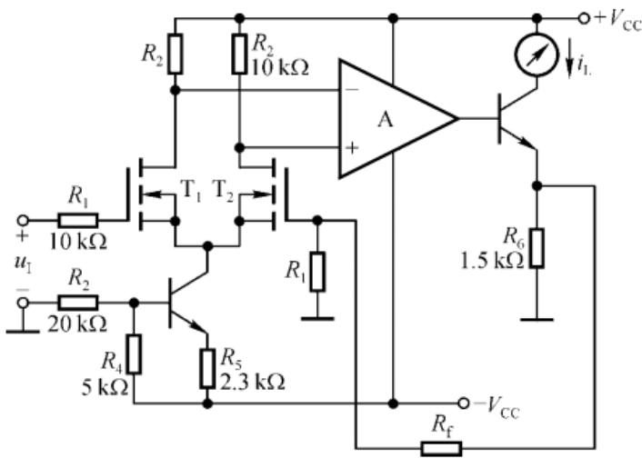

(2)首先求解 $\dot { F }$ ，再根据 $\dot { A } _ { \mathrm { f } } \approx 1 / \dot { F }$ 求解 $R _ { \mathrm { f } }$

$$
\dot {F} = \frac {R _ {\mathrm{l}} R _ {\mathrm{f}}}{R _ {\mathrm{l}} + R _ {\mathrm{f}} + R _ {6}}
$$

$$
\dot {A} _ {\mathrm{f}} \approx \frac {R _ {1} + R _ {\mathrm{f}} + R _ {6}}{R _ {1} R _ {\mathrm{f}}}
$$

代入数据

$$
\frac {1 0 + R _ {\mathrm{f}} + 1 . 5}{1 0 \times 1 . 5} = \frac {1 0}{5}
$$

所以

$$
R _ {\mathrm{f}} = 1 8. 5 \mathrm{k} \Omega
$$

## 6.18

已知某电压串联反馈放大器，其基本放大器的电压增益表达式为

$$
A _ {u} (j f) = \frac {1 0 ^ {4}}{\left(1 + j \frac {f}{1 0 ^ {6}}\right) \left(1 + j \frac {f}{1 0 ^ {7}}\right) ^ {2} \left(1 + j \frac {f}{1 0 ^ {8}}\right)}
$$

(1) 画出 $A _ { u } (j f )$ 的幅频和相频的渐进波特图，并标出每个线段的斜率。

(2) 利用渐进波特图说明在什么频率下，该电路将产生自激？

(3) 为了使电路在闭环后能稳定地工作，并具有 $4 5 ^ { \circ }$ 的相位裕量，利用波特图说明反馈系数的最大值 $\mathrm { B _ { u } }$ 为多少？

(4) 若要求闭环增益 $\mathbf { A } _ { \mathrm { u f } } { = } 1 0 0$ ，有 $4 5 ^ { \circ }$ 的相位裕量，问采用简单电容补偿时的补偿电容值。已知 $| \vec { j } ^ { z }$ 生第一个极点频率的节点呈现的等效电阻 $R _ { 1 } { = } 1 0 0 \mathrm { k } \Omega$ 。

解：(1) $A _ { u f } ( j f )$ 的幅频和相频渐进波特图分别如图 6.18(a)和(b)所示。

(2)由图 6.18(a)可知，在 $\mathrm { f } _ { \pi } { = } 3 1 . 6 \mathrm { M H z }$ 时，反馈放大器将产生自激。

(3)若留有 $4 5 ^ { o }$ 的相位裕量，从图(a)上可以看出，相应的 $2 0 \lg A _ { f } { = } 6 0 \mathrm { d B }$ ，则 $B \approx \frac { 1 } { A _ { f } } = \frac { 1 } { 1 0 ^ { 3 } }$ 。

(4) $20\lg A_f=40\text{dB}$

$$
C _ {1} = \frac {1}{\omega_ {p 1} R _ {1}} = \frac {1}{2 \pi f _ {1} R _ {1}} = \frac {1}{6 . 2 8 \times 1 0 ^ {6} \times 1 0 0 \times 1 0 ^ {3}} = 1. 6 \mathrm{pF}
$$

采用补偿电容后，第一个极点频率移到 $f _ { d }$ ，

$$
f _ {d} = \frac {f _ {p 2}}{A _ {u d} B _ {u}} = \frac {f _ {p 2}}{A _ {u d}} A _ {u f} = \frac {1 0 ^ {7}}{1 0 ^ {4}} \times 1 0 ^ {2} = 1 0 ^ {5}
$$

补偿电容为

$$
C _ {\varphi} = \frac {1}{w _ {d} R _ {1}} - C _ {1} = \frac {1}{2 \pi \times 1 0 ^ {5} \times 1 0 0 \times 1 0 ^ {3}} - 1. 6 = 1 4. 4 (\mathrm{pF})
$$

如果 $A _ { u f } { = } 1$ ，则

$$
\begin{array}{l} {f _ {d} ^ {\prime} = 1 0 ^ {3} \mathrm{Hz}} \\ {C _ {\varphi} \approx 1 6 0 0 \mathrm{pF}} \end{array}
$$

## 6.19

某放大器的开环幅频响应如题图 6.19 所示。

（1）问当施加 $F=0.001$ 的负反馈时，此反馈放大器是否能稳定工作？相位裕度等于多少？

（2）若要求闭环增益为 40dB，为保证相位裕度大于等于 $4 5 ^ { \circ }$ ，试画出密勒电容补偿后的开环幅频特性曲线。

（3）指出补偿后的开环带宽BW＝？闭环带宽 $\mathrm { B W _ { f } } { = } ?$

解：（1） $\mathrm { F } { = } 0 . 0 0 1 , \mathrm { A } _ { \mathrm { f } } { = } 1 / \mathrm { F } { = } 1 0 0 0 ( 6 0 \mathrm { d B } )$ ，如图P6-19’所示，此时有 $4 5 ^ { \circ }$ 相位裕度。

(2)要求 $\scriptstyle \mathbf { A } _ { \mathrm { f } } = 4 0 \mathrm { d B }$ （100），仍有 $4 5 ^ { \circ }$ 的相位裕度，则开环特性要校正为如图中①曲线所示。

（3）补偿后的开环带宽BW=0.1MHz，闭环带宽 $\mathrm { B W _ { f } } { = } 1 0 \mathrm { M H z }$ 。

## 6.20

已知负反馈放大电路的 $\dot { A } = { \frac { 1 0 ^ { 4 } } { ( 1 + \mathrm { j } { \frac { f } { 1 0 ^ { 4 } } } ) ( 1 + \mathrm { j } { \frac { f } { 1 0 ^ { 5 } } } ) ^ { 2 } } } \quad \circ$

试分析：为了使放大电路能够稳定工作（即不产生自激振荡），反馈系数的上限值为多少？

解：根据放大倍数表达式可知，放大电路高频段有三个截止频率，分别 为

$$
f _ {\mathrm{L} 1} = 1 0 ^ {4} \mathrm{Hz} \quad f _ {\mathrm{L} 2} = f _ {\mathrm{L} 3} = 1 0 ^ {5} \mathrm{Hz}
$$

因为 $f _ { \mathrm { L } 2 } = f _ { \mathrm { L } 3 } = 1 0 f _ { \mathrm { L } 1 }$ ，所以，在 $f = f _ { \mathrm { L } 2 } = f _ { \mathrm { L } 3 }$ 时， $\left| \dot { \boldsymbol { A } } \right|$ 约为60dB，附加相移约为 $- 1 8 0 ^ { \circ }$ 。为了使 $f = f _ { \mathrm { L } 2 } = f _ { \mathrm { L } 3 }$ 时的 $2 0 \log | \dot { A } \dot { F } |$ 小于0dB，即不满足自激振荡的幅值条件，反馈系数 $2 0 \log | \dot { F } |$ 的上限值应为一60dB，即 $\dot { F }$ 的上限值为 $1 0 ^ { - 3 }$ 。

## 6.21

已知反馈放大器的环路增益为

$$
A _ {u} (j \omega) F = \frac {4 0 F}{\left(1 + j \frac {\omega}{1 0 ^ {6}}\right) ^ {3}}
$$

（1） 若 $F＝0.1$，该放大器会不会自激？

（2） 该放大器不自激所允许的最大F为何值？

（3） 若要求有 $4 5 ^ { \circ }$ 的相位裕度则最大F应为何值？

解：（1）由题可知，开环放大倍数为

$$
A _ {u} (j \omega) = \frac {4 0}{\left(1 + j \frac {\omega}{1 0 ^ {6}}\right) ^ {3}}
$$

它是一个具有 3 个重极点的放大器，如果每级附加移相为 $- 6 0 ^ { \circ }$ ，则三级共移相 $- 1 8 0 ^ { \circ }$ 那么加反馈后会开始自激。因为每级相移为 $- 6 0 ^ { \circ }$ ，那么有

$$
- \arctan \frac {\omega}{1 0 ^ {6}} = - 6 0 ^ {\circ}
$$

由此可导出所对应的频率为

$$
\left| A _ {u} (j \sqrt {3} \times 1 0 ^ {6}) \right| = \frac {4 0}{\left(\sqrt {1 + (\sqrt {3}) ^ {2}}\right) ^ {3}} = 5
$$

然后再看是否满足振荡条件（即附加相移 $\Delta \psi = - 1 8 0 ^ { \circ }$ 时， $| \mathrm { A } _ { \mathrm { u } } \cdot \mathrm { F } |$ 是否大于等于1）。

$$
\left| A _ {u} (j \omega) \right| _ {\omega = \sqrt {3} \times 1 0 ^ {6}} \times F = 5 \times 0. 1 = 0. 5 <   1
$$

可见，该放大器引入F=0.1的负反馈后不会产生自激振荡。

（2）求该放大器不产生自激的最大允许值 $\mathrm { F } _ { \mathrm { m a x } } { = } ?$

由 $| A _ { _ u }  ( j \omega ) | \times F _ { \mathrm { { m a x } } } = 1$

可得 $F _ { \mathrm { m a x } } = { \frac { 1 } { \left| A _ { u } \left( j \omega \right) \right| } } = { \frac { 1 } { 5 } } = 0 . 2$

（3）若要求有 $4 5 ^ { \circ }$ 的相位裕度，则每级相移为 $- 1 3 5 ^ { \circ } / 3 = - 4 5 ^ { \circ }$ ，所对应的上限频率 $\omega =$ ${ 1 0 } ^ { 6 }$ ，开环增益为

$$
\left. A _ {u} (j \omega) \right| _ {\omega = 1 0 ^ {6}} = \frac {4 0}{\sqrt {1 + \left(\frac {\omega}{1 0 ^ {6}}\right) ^ {3}}} = \frac {4 0}{(\sqrt {2}) ^ {3}} = 1 4. 1 3
$$

那么 $\left| A _ { u } \left( j \omega \right) \right| \times F _ { \mathrm { m a x } } \leq 1$

$$
F \leq \frac {1}{\left| A _ {u} (j \omega) \right|} = \frac {1}{1 4 . 1 3} = 0. 0 7
$$

可见，要求有 $4 5 ^ { \circ }$ 的相位裕度，反馈系数必须小于等于0.07。

## 6.22

已知一个负反馈放大电路的基本放大电路的对数幅频特性如题图 6.22所示，反馈网络由纯电阻组成。试问：若要求电路稳定工作，即不产生自激振荡，则反馈系数的上限值为多少分贝？简述理由。

解：因为 $f ~ = ~ 1 0 ^ { 5 } ~ \mathrm { Hz }$ ，$2 0 \lg \big | \dot { \boldsymbol { A } } \big | = 4 0 \mathsf { d } \mathsf { B }$ ，$\varphi _ { \mathrm { A } } ^ { ^ { \prime } } = - 1 8 0 ^ { \circ }$ ；为使此时$2 0 \lg \big | \dot { A } \dot { F } \big | < 0$ ，则需

$$
2 0 \lg | \dot {F} | <   - 4 0 \mathrm{dB}, \text { 即 } | \dot {F} | <   1 0 ^ {- 2}
$$

## 6.23

图 6.23（a）所示放大电路 $\dot { A } \dot { F }$ 的波特图如题图6.23（b）所示。

（1）判断该电路是否会产生自激振荡？简述理由。

（2）若电路产生了自激振荡，则应采取什么措施消振？要求在图（a）中画出来。

（3）若仅有一个 50pF 电容，分别接在三个三极管的基极和地之间均未能消振，则将其接在何处有可能消振？为什么？

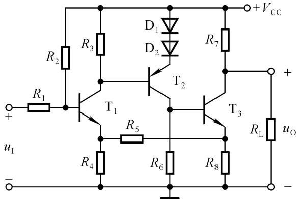

解：（1）电路一定会产生自激振荡。因为在 $f = 1 0 ^ { 3 } \mathrm { H z }$ 时附加相移为$- 4 5 ^ { \circ }$ ，$f = 1 0 ^ { 4 } \mathrm { H z }$ 时附加相移约为 $- 1 3 5 ^ { \circ }$ ，$f = 1 0 ^ { 5 } \mathrm { H z }$ 时附加相移约为$- 2 2 5^{\circ}$ ，因此附加相移为 $- 1 8 0 ^ { \circ }$ 的频率在 $1 0 ^ { 4 } \mathrm { H z } \sim 1 0 ^ { 5 } \mathrm { H z }$ 之间，此时 $\big | \dot { A } \dot { F } \big | > 0$ 故一定会产生自激振荡。

(2）可在晶体管 $\mathrm { T } _ { 2 }$ 的基极与地之间加消振电容。

注：方法不唯一。

（3）可在晶体管 $\mathrm { T } _ { 2 }$ 基极和集电极之间加消振电容。因为根据密勒定理，等效在基极与地之间的电容比实际电容大得多，因此容易消振。

参考解答：## 分析 2（题图 6.10）

### (1) 反馈连接合理性与 $R_S$ 要求

**结论：**
- **图(a)** 连接合理；要求信号源内阻 $R_S$ **越小越好**。
- **图(b)** 连接合理；要求信号源内阻 $R_S$ **越大越好**。

**推理过程：**
- **图(a)**：第一级为电流串联负反馈，输出呈恒流特性，适合作为第二级（电压并联负反馈，需电流激励）的信号源，故级间匹配合理。但第一级输入端为串联负反馈，为使反馈效果充分发挥，需近似恒压源激励，因此要求 $R_S \to 0$。
- **图(b)**：第一级为电压并联负反馈，输出呈恒压特性，适合作为第二级（电流串联负反馈，需电压激励）的信号源，级间匹配合理。但第一级输入端为并联负反馈，需近似恒流源激励，因此要求 $R_S \to \infty$。

---

### (2) $R_S$ 变化时的稳定性

**结论：**
- **图(a)** 输出电压稳定性好，源电压增益稳定性强。
- **图(b)** 两者均不稳定。

**推理过程：**
- 图(a) 输入端为串联负反馈，闭环输入电阻 $R_{if}$ 很大，且设计要求 $R_S$ 很小，满足 $R_{if} \gg R_S$。此时源电压增益 $A_{usf} = A_{uf} \cdot \frac{R_{if}}{R_{if} + R_S} \approx A_{uf}$，$R_S$ 的变化几乎不影响增益和输出电压。
- 图(b) 输入端为并联负反馈，$R_{if}$ 很小，且设计要求 $R_S$ 很大，满足 $R_{if} \ll R_S$。源电压增益受 $\frac{R_S}{R_S + R_{if}}$ 因子影响显著，$R_S$ 变化直接导致增益和输出电压波动。

---

### (3) $R_L$ 变化时的稳定性

**结论：**
- **图(a)** 输出电压稳定性好，源电压增益稳定性强。
- **图(b)** 两者均不稳定。

**推理过程：**
- 图(a) 末级输出端为**电压负反馈**，闭环输出电阻 $R_{of}$ 很小，等效为恒压源，$R_L$ 变化时输出电压基本不变，源电压增益也随之稳定。
- 图(b) 末级输出端为**电流负反馈**，$R_{of}$ 很大，等效为恒流源，输出电流稳定但输出电压 $U_o = I_o R_L$ 随 $R_L$ 正比变化，故输出电压和源电压增益均不稳定。

---

## 计算 1（6.11）

### (1) 反馈类型、网络元件与工作点稳定

**结论：**
- 交流反馈：两级间**电压串联负反馈**，反馈网络由 $90\,\mathrm{k}\Omega$ 和 $1\,\mathrm{k}\Omega$ 电阻构成。
- 直流反馈：两级间**电流负反馈**，由 $4\,\mathrm{k}\Omega$、$60\,\mathrm{k}\Omega$ 及 $\mathrm{V}_1$ 构成，主要依靠此直流反馈稳定工作点。

**推理：** 交流通路中 $90\,\mathrm{k}\Omega$ 将输出电压采样后通过 $1\,\mathrm{k}\Omega$ 串入输入回路，为电压串联负反馈；直流通路中 $60\,\mathrm{k}\Omega$ 将第二级发射极电流反馈至第一级基极，形成直流电流负反馈以稳定静态工作点。

### (2) 输入输出电阻变化

**结论：** 输入阻抗**增大**，输出阻抗**减小**。

**推理：** 串联负反馈使输入电阻增大 $(1+AF)$ 倍；电压负反馈使输出电阻减小为原来的 $\frac{1}{1+AF}$。

### (3) 深反馈条件下的电压增益

**结论：**

$$
A_{uf} = \frac{1}{F} = \frac{1\,\mathrm{k}\Omega + 90\,\mathrm{k}\Omega}{1\,\mathrm{k}\Omega} = 91
$$

**关键步骤：** 深反馈条件下 $A_{uf} \approx 1/F$，反馈系数 $F = \frac{R_1}{R_1 + R_f} = \frac{1}{1+90}$。

---

## 计算 2（6.12）

### (1) 反馈类型判别

**结论：** 电路引入了**电压串联负反馈**。

**推理：** 输出信号 $U_o$ 经 $90\,\mathrm{k}\Omega$ 电阻接至 $\mathrm{V}_2$ 的基极（输入回路），采样对象为输出电压（电压反馈），反馈信号与输入信号在输入端串联叠加（串联反馈），且极性为负。

### (2) 改为低输入电阻和低输出电阻

**结论：** 应采用**电压并联负反馈**。

**改接方法：**
1. 将 $\mathrm{V}_3$ 的基极由接 $\mathrm{V}_1$ 集电极改为接 $\mathrm{V}_2$ 集电极（保证总相移为 $360°$，维持负反馈极性）。
2. 将 $90\,\mathrm{k}\Omega$ 反馈电阻由接 $\mathrm{V}_2$ 基极改为接 $\mathrm{V}_1$ 基极（实现并联反馈以降低输入电阻）。

**推理：** 并联反馈降低输入电阻，电压反馈降低输出电阻；改接后需确保环路总相移仍满足负反馈条件。

---

## 计算 3（6.13）

### (1) 反馈类型

**结论：**
- 第二级内部：单级**电压串联负反馈**（同相比例放大器结构）。
- 两级之间：通过 $R_9$ 和 $R_1$ 构成**电压并联负反馈**。

### (2) 开环增益 $A_u$

**结论：**

$$
A_u = A_{u1} \times A_{u2} = -\frac{\beta R_2}{2(R_1 + r_{be})} \times \left(1 + \frac{R_8}{R_7}\right)
$$

**关键步骤：**
- 差分级单端输出增益（设第二级输入电阻无穷大）：$A_{u1} = \dfrac{U_{o1}}{U_i} = -\dfrac{1}{2} \cdot \dfrac{\beta R_2}{R_1 + r_{be}}$
- 同相比例级增益：$A_{u2} = 1 + \dfrac{R_8}{R_7}$

### (3) 闭环增益 $A_{uf}$

**结论：**

$$
A_{uf} = \frac{U_o}{U_i} = -\frac{R_9}{R_1}
$$

**关键步骤：** 深反馈条件下虚短虚断成立，$U_\Sigma \approx 0$：

$$
I_i = \frac{U_i - U_\Sigma}{R_1} \approx \frac{U_i}{R_1}, \quad I_f = \frac{U_\Sigma - U_o}{R_9} \approx -\frac{U_o}{R_9}
$$

由 $I_i \approx I_f$ 得 $\dfrac{U_i}{R_1} = -\dfrac{U_o}{R_9}$，即 $A_{uf} = -\dfrac{R_9}{R_1}$。

---

## 计算 4（6.14）

### (1) 各运放反馈类型

**结论：**
- $A_1$：引入**电压串联负反馈**（同相放大结构）。
- $A_2$：引入**电压并联负反馈**（反相放大结构）。

### (2) 闭环增益

**结论：**

$$
A_{uf} = \frac{U_o}{U_i} = -\frac{R_5}{R_4}\left(1 + \frac{R_3}{R_2}\right)
$$

**关键步骤：** 两级级联，总增益为各级之积：

$$
A_{uf} = \underbrace{\left(1 + \frac{R_3}{R_2}\right)}_{A_1\text{同相增益}} \times \underbrace{\left(-\frac{R_5}{R_4}\right)}_{A_2\text{反相增益}}
$$

---

## 计算 5（6.15）

### (1) 反馈极性和类型

**结论：**
- **图(a)**：级间**电压并联负反馈**。
- **图(b)**：级间**电流并联负反馈**。

**推理：** 图(a)反馈从输出电压节点引出至输入端并联叠加，瞬时极性判断为负；图(b)反馈从输出电流通路（发射极/集电极电阻）采样，并联至输入端，极性为负。

### (2) 反馈系数表达式

**结论：**
- **图(a)**（互阻反馈系数）：

$$
B_g = \frac{I_f}{U_o} = -\frac{1}{R_4}
$$

- **图(b)**（电流反馈系数）：

$$
B_i = \frac{I_f}{I_{C2}} = \frac{R_5}{R_5 + R_6}
$$

### (3) 深度反馈条件下的源电压增益 $A_{usf}$

**结论：**
- **图(a)**：

$$
A_{usf} = -\frac{R_4}{R_S}
$$

> （注：原题解答写为 $-\dfrac{R_4}{R_5}$，若 $R_5$ 即为信号源内阻 $R_S$ 则一致；一般表达应为 $-R_4/R_S$。）

**关键步骤：** 并联负反馈深反馈下 $R_{if} \to 0$，输入端虚地，$I_s = U_s / R_S \approx I_f = -U_o / R_4$，故 $A_{usf} = U_o / U_s = -R_4 / R_S$。

- **图(b)**：

$$
A_{usf} = -\frac{R_5 + R_6}{R_5} \times \frac{R_3 \parallel R_L}{R_S}
$$

> （原解答末尾截断，此处补全。）

**关键步骤：** 深反馈下 $I_s \approx I_f$，而 $I_f = B_i \cdot I_{C2} = \dfrac{R_5}{R_5 + R_6} I_{C2}$，输出电压 $U_o = -I_{C2}(R_3 \parallel R_L)$，故：

$$
A_{isf} = \frac{I_{C2}}{I_s} = \frac{R_5 + R_6}{R_5}, \quad A_{usf} = \frac{U_o}{U_s} = -A_{isf} \cdot \frac{R_3 \parallel R_L}{R_S}
$$

知识点：[四种受控电源（VCVS、VCCS、CCVS、CCCS）的特性](../../../topics/电路与电子技术/受控电源.md)、[基尔霍夫电流定律（KCL）及其应用](../../../topics/电路与电子技术/KCL.md)、[电流、电压的参考方向及关联参考方向](../../../topics/电路与电子技术/参考方向.md)
