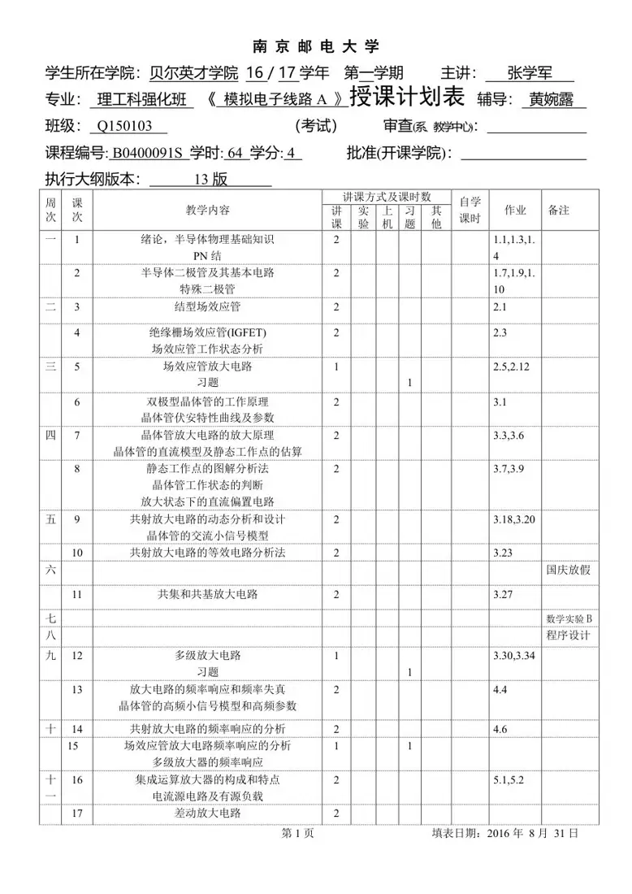
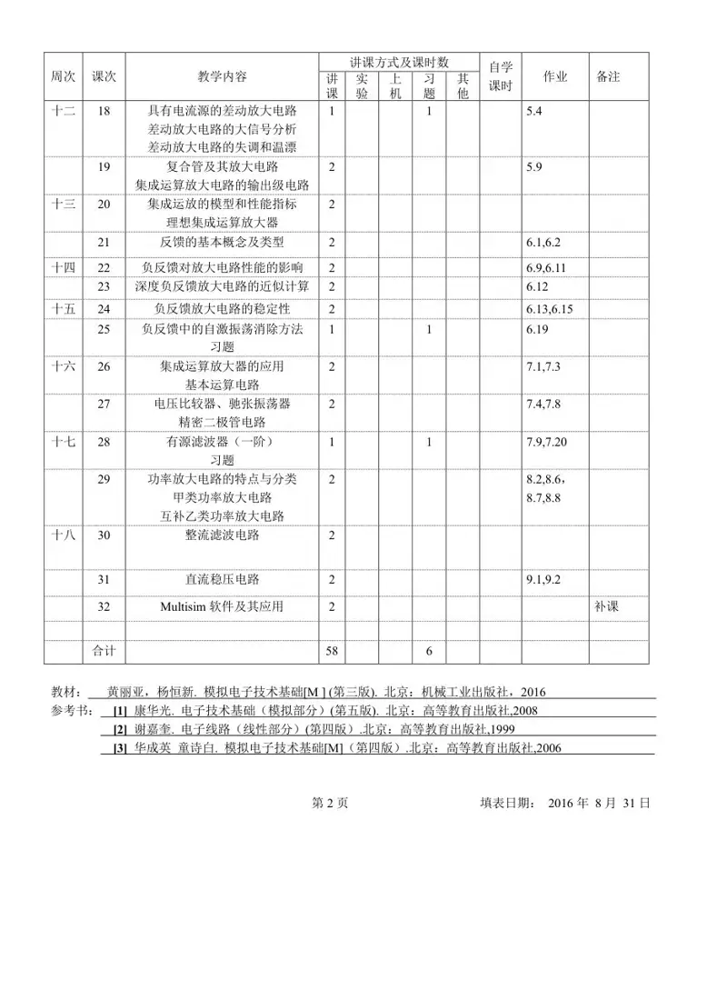

# 《模拟电子线路A》授课计划表（2016-2017学年第一学期）

原件的每一页，下面附识别出的文字。

### 南 京 邮 电 大 学

原文：

南 京 邮 电 大 学

学生所在学院：贝尔英才学院 16 / 17 学年 第一学期 主讲： 张学军

专业： 理工科强化班 《 模拟电子线路 A 》授课计划表 辅导： 黄婉露

班级： Q150103

（考试） 审查(系、教学中心)：

课程编号: B0400091S 学时: 64 学分: 4

批准(开课学院)：

执行大纲版本： 13 版

<table><tr><td rowspan="2">周次</td><td rowspan="2">课次</td><td rowspan="2">教学内容</td><td colspan="5">讲课方式及课时数</td><td rowspan="2">自学课时</td><td rowspan="2">作业</td><td rowspan="2">备注</td></tr><tr><td>讲课</td><td>实验</td><td>上机</td><td>习题</td><td>其他</td></tr><tr><td>一</td><td>1</td><td>绪论,半导体物理基础知识PN结</td><td>2</td><td></td><td></td><td></td><td></td><td></td><td>1.1,1.3,1.4</td><td></td></tr><tr><td></td><td>2</td><td>半导体二极管及其基本电路特殊二极管</td><td>2</td><td></td><td></td><td></td><td></td><td></td><td>1.7,1.9,1.10</td><td></td></tr><tr><td>二</td><td>3</td><td>结型场效应管</td><td>2</td><td></td><td></td><td></td><td></td><td></td><td>2.1</td><td></td></tr><tr><td></td><td>4</td><td>绝缘栅场效应管(IGFET)场效应管工作状态分析</td><td>2</td><td></td><td></td><td></td><td></td><td></td><td>2.3</td><td></td></tr><tr><td>三</td><td>5</td><td>场效应管放大电路习题</td><td>1</td><td></td><td></td><td>1</td><td></td><td></td><td>2.5,2.12</td><td></td></tr><tr><td></td><td>6</td><td>双极型晶体管的工作原理晶体管伏安特性曲线及参数</td><td>2</td><td></td><td></td><td></td><td></td><td></td><td>3.1</td><td></td></tr><tr><td>四</td><td>7</td><td>晶体管放大电路的放大原理晶体管的直流模型及静态工作点的估算</td><td>2</td><td></td><td></td><td></td><td></td><td></td><td>3.3,3.6</td><td></td></tr><tr><td></td><td>8</td><td>静态工作点的图解分析法晶体管工作状态的判断放大状态下的直流偏置电路</td><td>2</td><td></td><td></td><td></td><td></td><td></td><td>3.7,3.9</td><td></td></tr><tr><td>五</td><td>9</td><td>共射放大电路的动态分析和设计晶体管的交流小信号模型</td><td>2</td><td></td><td></td><td></td><td></td><td></td><td>3.18,3.20</td><td></td></tr><tr><td></td><td>10</td><td>共射放大电路的等效电路分析法</td><td>2</td><td></td><td></td><td></td><td></td><td></td><td>3.23</td><td></td></tr><tr><td>六</td><td></td><td></td><td></td><td></td><td></td><td></td><td></td><td></td><td></td><td>国庆放假</td></tr><tr><td></td><td>11</td><td>共集和共基放大电路</td><td>2</td><td></td><td></td><td></td><td></td><td></td><td>3.27</td><td></td></tr><tr><td>七</td><td></td><td></td><td></td><td></td><td></td><td></td><td></td><td></td><td></td><td>数学实验B</td></tr><tr><td>八</td><td></td><td></td><td></td><td></td><td></td><td></td><td></td><td></td><td></td><td>程序设计</td></tr><tr><td>九</td><td>12</td><td>多级放大电路习题</td><td>1</td><td></td><td></td><td>1</td><td></td><td></td><td>3.30,3.34</td><td></td></tr><tr><td></td><td>13</td><td>放大电路的频率响应和频率失真晶体管的高频小信号模型和高频参数</td><td>2</td><td></td><td></td><td></td><td></td><td></td><td>4.4</td><td></td></tr><tr><td>十</td><td>14</td><td>共射放大电路的频率响应的分析</td><td>2</td><td></td><td></td><td></td><td></td><td></td><td>4.6</td><td></td></tr><tr><td></td><td>15</td><td>场效应管放大电路频率响应的分析多级放大器的频率响应</td><td>1</td><td></td><td></td><td>1</td><td></td><td></td><td></td><td></td></tr><tr><td>十一</td><td>16</td><td>集成运算放大器的构成和特点电流源电路及有源负载</td><td>2</td><td></td><td></td><td></td><td></td><td></td><td>5.1,5.2</td><td></td></tr><tr><td></td><td>17</td><td>差动放大电路</td><td>2</td><td></td><td></td><td></td><td></td><td></td><td></td><td></td></tr></table>
填表日期：2016年 8 月 31 日

第 1 页

### 第 2 页

原文：

<table><tr><td rowspan="2">周次</td><td rowspan="2">课次</td><td rowspan="2">教学内容</td><td colspan="5">讲课方式及课时数</td><td rowspan="2">自学课时</td><td rowspan="2">作业</td><td rowspan="2">备注</td></tr><tr><td>讲课</td><td>实验</td><td>上机</td><td>习题</td><td>其他</td></tr><tr><td>十二</td><td>18</td><td>具有电流源的差动放大电路差动放大电路的大信号分析差动放大电路的失调和温漂</td><td>1</td><td></td><td></td><td>1</td><td></td><td></td><td>5.4</td><td></td></tr><tr><td></td><td>19</td><td>复合管及其放大电路集成运算放大电路的输出级电路</td><td>2</td><td></td><td></td><td></td><td></td><td></td><td>5.9</td><td></td></tr><tr><td>十三</td><td>20</td><td>集成运放的模型和性能指标理想集成运算放大器</td><td>2</td><td></td><td></td><td></td><td></td><td></td><td></td><td></td></tr><tr><td></td><td>21</td><td>反馈的基本概念及类型</td><td>2</td><td></td><td></td><td></td><td></td><td></td><td>6.1,6.2</td><td></td></tr><tr><td>十四</td><td>22</td><td>负反馈对放大电路性能的影响</td><td>2</td><td></td><td></td><td></td><td></td><td></td><td>6.9,6.11</td><td></td></tr><tr><td></td><td>23</td><td>深度负反馈放大电路的近似计算</td><td>2</td><td></td><td></td><td></td><td></td><td></td><td>6.12</td><td></td></tr><tr><td>十五</td><td>24</td><td>负反馈放大电路的稳定性</td><td>2</td><td></td><td></td><td></td><td></td><td></td><td>6.13,6.15</td><td></td></tr><tr><td></td><td>25</td><td>负反馈中的自激振荡消除方法习题</td><td>1</td><td></td><td></td><td>1</td><td></td><td></td><td>6.19</td><td></td></tr><tr><td>十六</td><td>26</td><td>集成运算放大器的应用基本运算电路</td><td>2</td><td></td><td></td><td></td><td></td><td></td><td>7.1,7.3</td><td></td></tr><tr><td></td><td>27</td><td>电压比较器、驰张振荡器精密二极管电路</td><td>2</td><td></td><td></td><td></td><td></td><td></td><td>7.4,7.8</td><td></td></tr><tr><td>十七</td><td>28</td><td>有源滤波器(一阶)习题</td><td>1</td><td></td><td></td><td>1</td><td></td><td></td><td>7.9,7.20</td><td></td></tr><tr><td></td><td>29</td><td>功率放大电路的特点与分类甲类功率放大电路互补乙类功率放大电路</td><td>2</td><td></td><td></td><td></td><td></td><td></td><td>8.2,8.6,8.7,8.8</td><td></td></tr><tr><td>十八</td><td>30</td><td>整流滤波电路</td><td>2</td><td></td><td></td><td></td><td></td><td></td><td></td><td></td></tr><tr><td></td><td>31</td><td>直流稳压电路</td><td>2</td><td></td><td></td><td></td><td></td><td></td><td>9.1,9.2</td><td></td></tr><tr><td></td><td>32</td><td>Multisim软件及其应用</td><td>2</td><td></td><td></td><td></td><td></td><td></td><td></td><td>补课</td></tr><tr><td></td><td></td><td></td><td></td><td></td><td></td><td></td><td></td><td></td><td></td><td></td></tr><tr><td></td><td>合计</td><td></td><td>58</td><td></td><td></td><td>6</td><td></td><td></td><td></td><td></td></tr></table>

第 2 页

填表日期： 2016年 8 月 31日
