# 《模拟电子线路A》第1章 电子技术的发展与信号基础（课件）

原件的每一页，下面附识别出的文字。

### 模拟电子线路A 电子科学与工程学院

原文：

模拟电子线路A 电子科学与工程学院

张学军

Mobile:18951896119

Email:zhxj@njupt.edu.cn

QQ群：547355148

### 前言

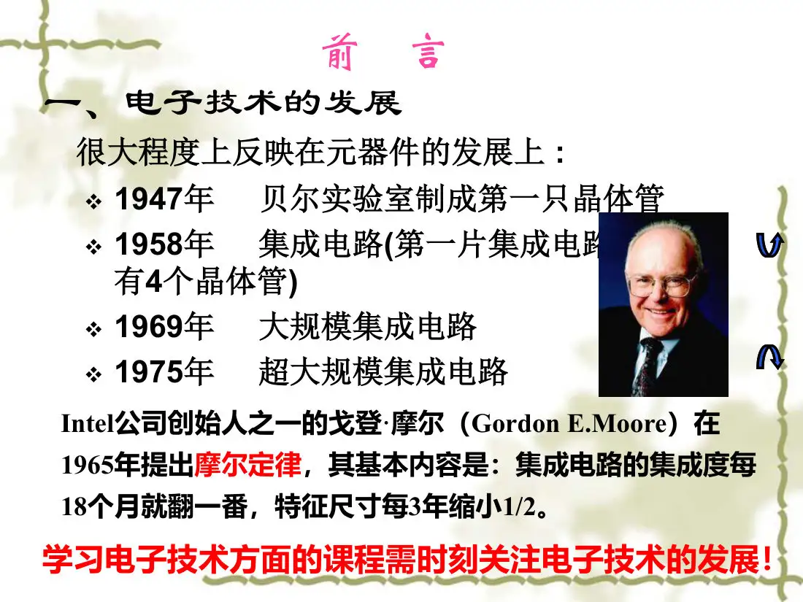

原文：

前言

一、电子技术的发展

很大程度上反映在元器件的发展上：

✿ 1947年 贝尔实验室制成第一只晶体管

✿ 1958年 集成电路(第一片集成电路有4个晶体管)

✿ 1969年 大规模集成电路

✿ 1975年 超大规模集成电路

Intel公司创始人之一的戈登·摩尔（Gordon E.Moore）在1965年提出摩尔定律，其基本内容是：集成电路的集成度每18个月就翻一番，特征尺寸每3年缩小1/2。

学习电子技术方面的课程需时刻关注电子技术的发展!

### 二、模拟信号与模拟电路

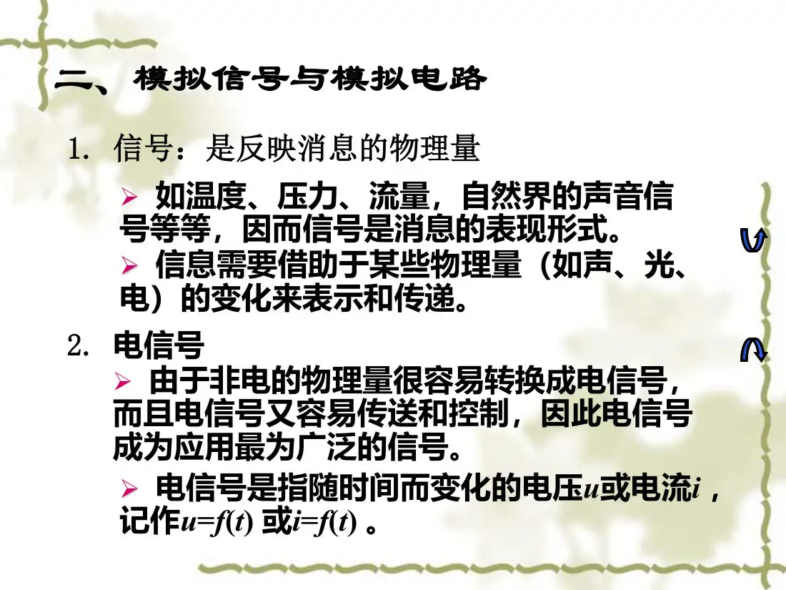

原文：

二、模拟信号与模拟电路

1. 信号：是反映消息的物理量

如温度、压力、流量，自然界的声音信号等等，因而信号是消息的表现形式。

信息需要借助于某些物理量（如声、光、电）的变化来表示和传递。

2. 电信号

由于非电的物理量很容易转换成电信号，而且电信号又容易传送和控制，因此电信号成为应用最为广泛的信号。

电信号是指随时间而变化的电压u或电流i，记作 $u=f(t)$ 或 $i=f(t)$ 。

### 二、模拟信号与模拟电路

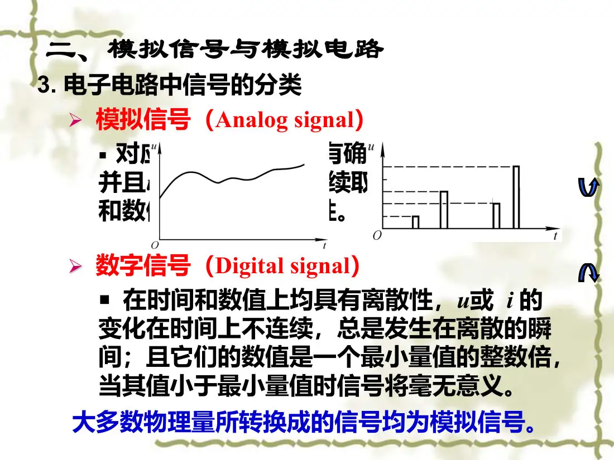

原文：

二、模拟信号与模拟电路

3. 电子电路中信号的分类

模拟信号 (Analog signal)

\- 对应并且和数

数字信号 (Digital signal)

\- 在时间和数值上均具有离散性， $u$ 或 $i$ 的变化在时间上不连续，总是发生在离散的瞬间；且它们的数值是一个最小量值的整数倍，当其值小于最小量值时信号将毫无意义。

大多数物理量所转换成的信号均为模拟信号。

### 二、模拟信号与模拟电路

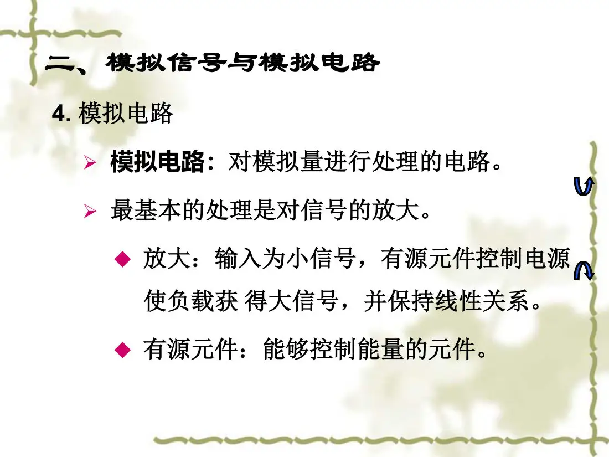

原文：

二、模拟信号与模拟电路

4. 模拟电路

模拟电路：对模拟量进行处理的电路。

最基本的处理是对信号的放大。

放大：输入为小信号，有源元件控制电源使负载获得大信号，并保持线性关系。

有源元件：能够控制能量的元件。

### 二、模拟信号与模拟电路

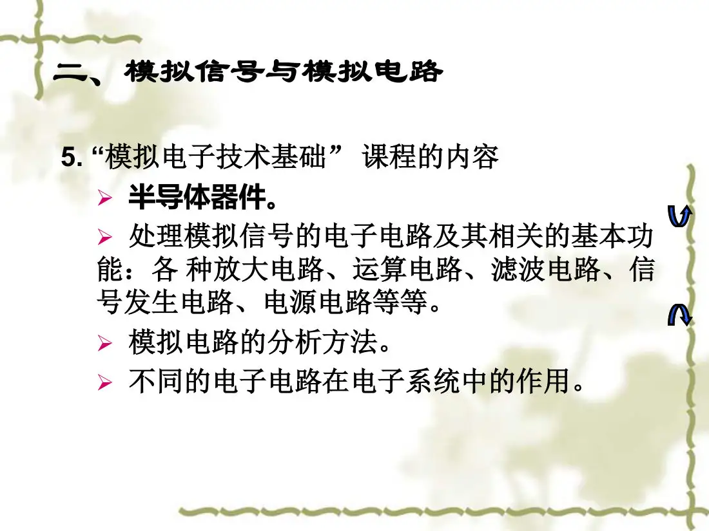

原文：

二、模拟信号与模拟电路

5. “模拟电子技术基础” 课程的内容

半导体器件。

处理模拟信号的电子电路及其相关的基本功能：各种放大电路、运算电路、滤波电路、信号发生电路、电源电路等等。

模拟电路的分析方法。

不同的电子电路在电子系统中的作用。

### 三、课程的特点

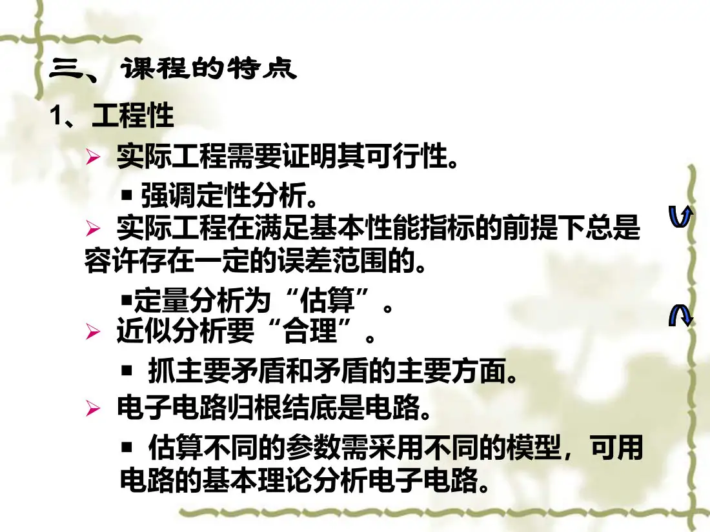

原文：

三、课程的特点

1、工程性

实际工程需要证明其可行性。

■ 强调定性分析。

实际工程在满足基本性能指标的前提下总是容许存在一定的误差范围的。

■定量分析为“估算”。

近似分析要“合理”。

■ 抓主要矛盾和矛盾的主要方面。

电子电路归根结底是电路。

■ 估算不同的参数需采用不同的模型，可用电路的基本理论分析电子电路。

### 三、课程的特点

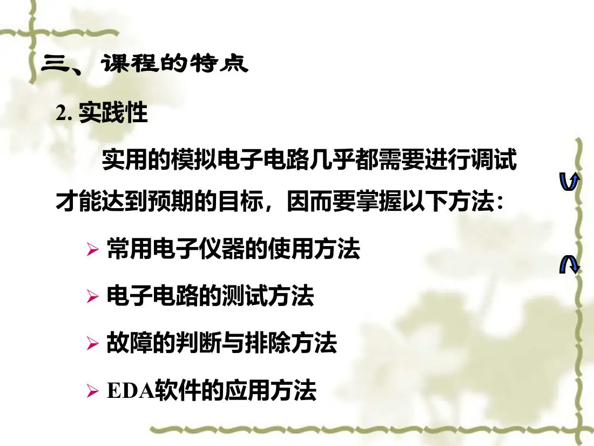

原文：

三、课程的特点

2. 实践性

实用的模拟电子电路几乎都需要进行调试才能达到预期的目标，因而要掌握以下方法：

常用电子仪器的使用方法

电子电路的测试方法

故障的判断与排除方法

EDA软件的应用方法

### 四、如何学习这门课程

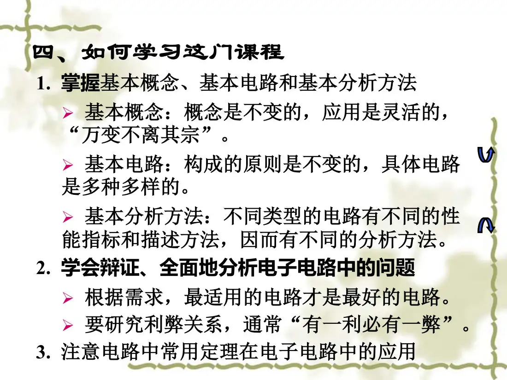

原文：

四、如何学习这门课程

1. 掌握基本概念、基本电路和基本分析方法

基本概念：概念是不变的，应用是灵活的，“万变不离其宗”。

基本电路：构成的原则是不变的，具体电路是多种多样的。

基本分析方法：不同类型的电路有不同的性能指标和描述方法，因而有不同的分析方法。

2. 学会辩证、全面地分析电子电路中的问题

根据需求，最适用的电路才是最好的电路。

要研究利弊关系，通常“有一利必有一弊”。

3. 注意电路中常用定理在电子电路中的应用

### 五、课程的目的

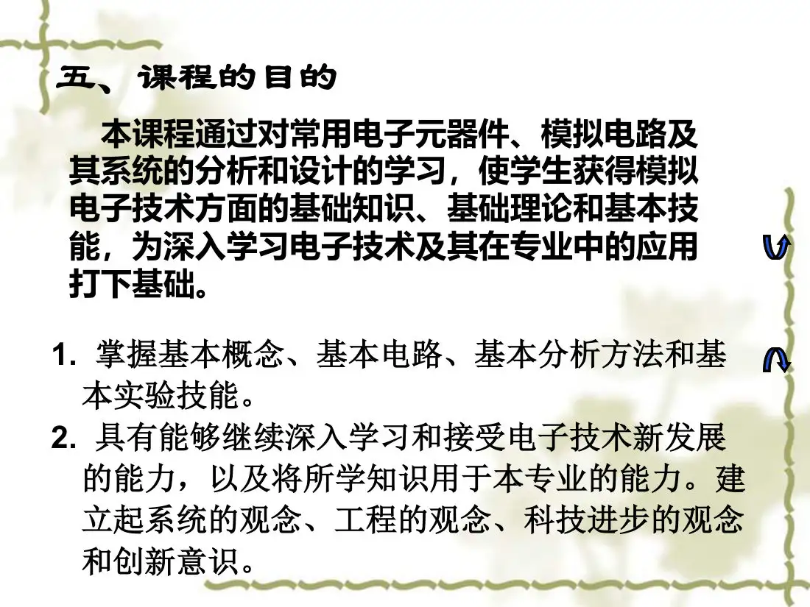

原文：

五、课程的目的

本课程通过对常用电子元器件、模拟电路及其系统的分析和设计的学习，使学生获得模拟电子技术方面的基础知识、基础理论和基本技能，为深入学习电子技术及其在专业中的应用打下基础。

1. 掌握基本概念、基本电路、基本分析方法和基本实验技能。

2. 具有能够继续深入学习和接受电子技术新发展的能力，以及将所学知识用于本专业的能力。建立起系统的观念、工程的观念、科技进步的观念和创新意识。

### 六、“模电”与“数电”

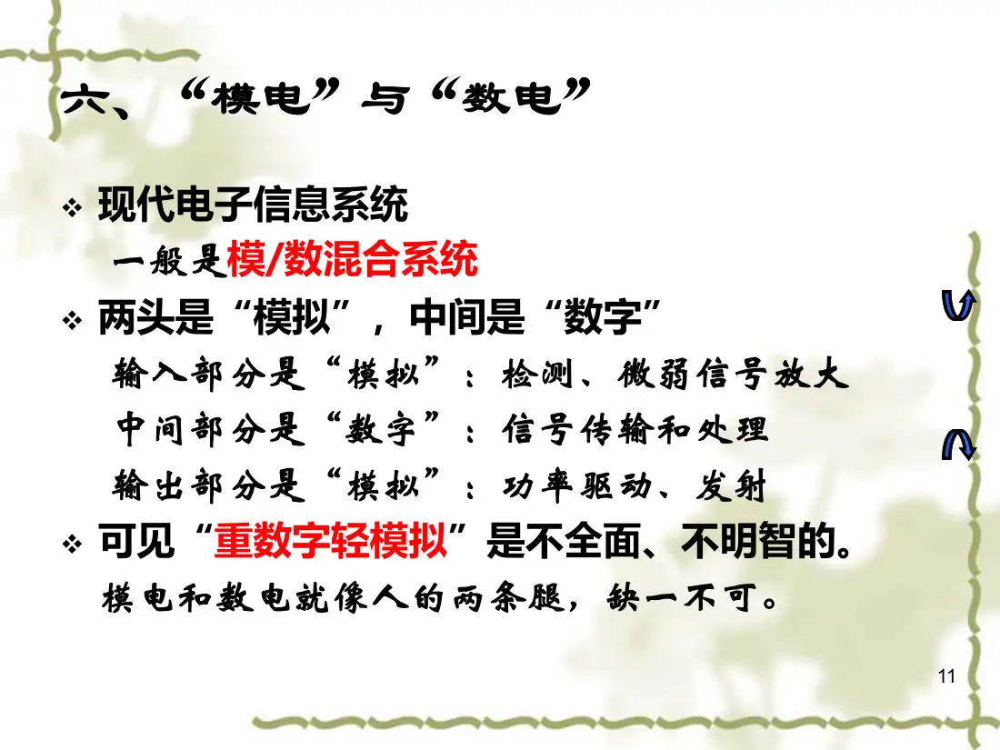

原文：

六、“模电”与“数电”

现代电子信息系统

一般是模/数混合系统

✿ 两头是 “模拟”，中间是 “数字”

输入部分是“模拟”：检测、微弱信号放大

中间部分是“数字”：信号传输和处理

输出部分是“模拟”：功率驱动、发射

可见“重数字轻模拟”是不全面、不明智的。

模电和数电就像人的两条腿，缺一不可。

11

### 七、课程性质

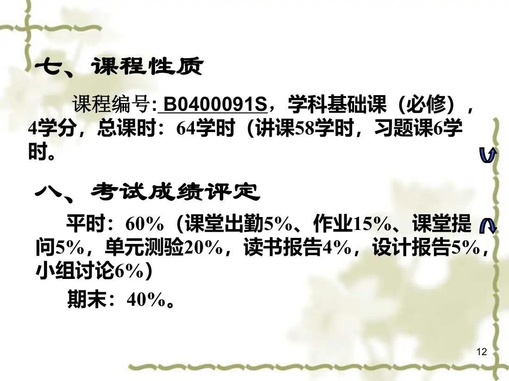

原文：

七、课程性质

课程编号: B0400091S，学科基础课（必修），4学分，总课时：64学时（讲课58学时，习题课6学时。

八、考试成绩评定

平时: 60% (课堂出勤5%、作业15%、课堂提问5%，单元测验20%，读书报告4%，设计报告5%，小组讨论6%)

期末：40%。

12

### 九、作业与答疑

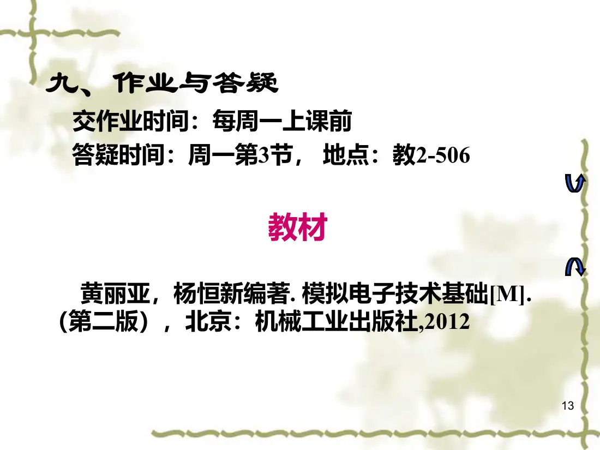

原文：

九、作业与答疑

交作业时间：每周一上课前

答疑时间：周一第3节，地点：教2- 506

教材

黄丽亚，杨恒新编著. 模拟电子技术基础[M]. (第二版)，北京：机械工业出版社,2012

13

### 参考书

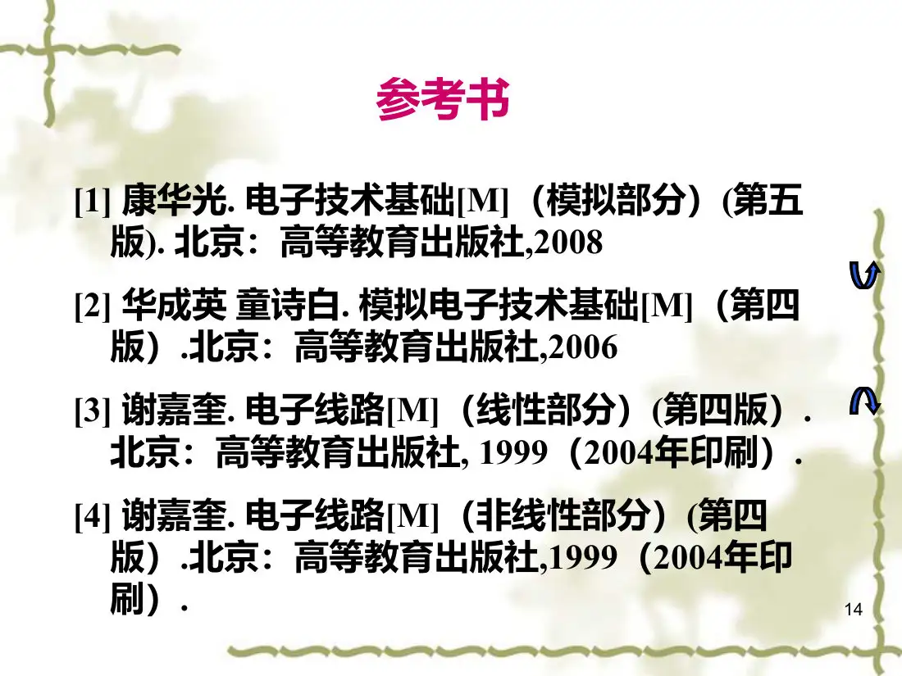

原文：

参考书

[1] 康华光. 电子技术基础[M]（模拟部分）(第五版). 北京：高等教育出版社,2008

[2] 华成英 童诗白. 模拟电子技术基础[M]（第四版）. 北京：高等教育出版社, 2006

[3] 谢嘉奎. 电子线路[M]（线性部分）（第四版）. 北京：高等教育出版社, 1999（2004年印刷）.

[4] 谢嘉奎. 电子线路[M]（非线性部分）（第四版）. 北京：高等教育出版社,1999（2004年印刷）.

14

### 第1章 半导体二极管及其应用

原文：

第1章 半导体二极管及其应用

1—1 半导体物理基础知识
1—2 PN结
1—3 半导体二极管及其基本电路
1—4 特殊二极管

15

### 1-1 半导体物理基础知识

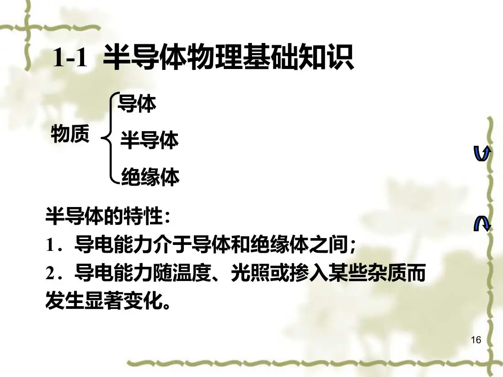

原文：

1-1 半导体物理基础知识

导体

物质

半导体

绝缘体

半导体的特性：

1. 导电能力介于导体和绝缘体之间;

2. 导电能力随温度、光照或掺入某些杂质而发生显著变化。

16

### 1-1-1 本征半导体

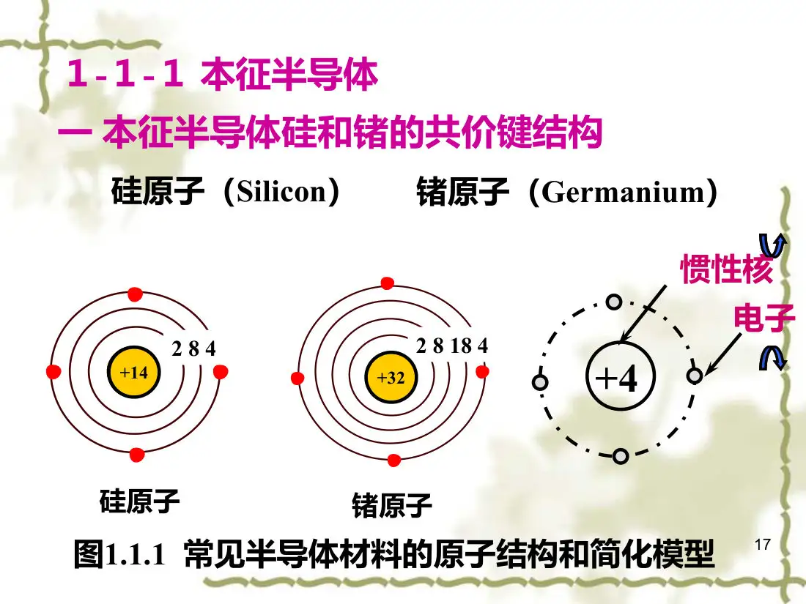

原文：

1-1-1 本征半导体

一 本征半导体硅和锗的共价键结构

硅原子 (Silicon)

锗原子（Germanium）

惯性核

17

### 本征半导体：纯净的（未掺杂）单晶半导体称为本征半导体。

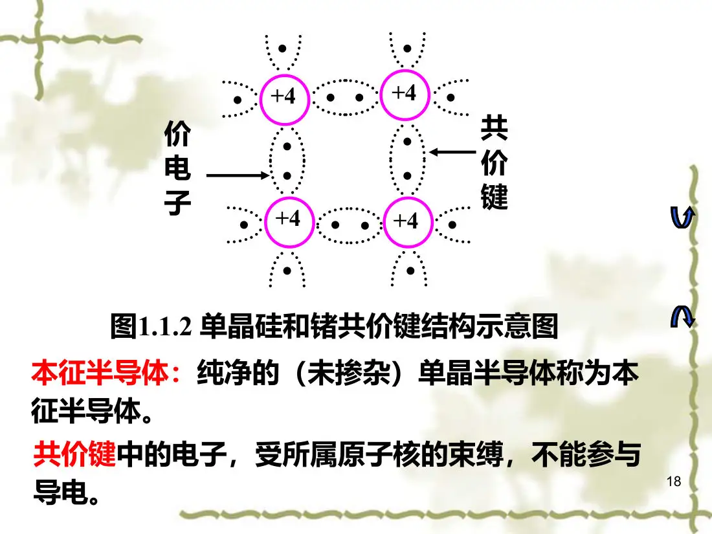

原文：

本征半导体：纯净的（未掺杂）单晶半导体称为本征半导体。

共价键中的电子，受所属原子核的束缚，不能参与导电。

18

### 二、半导体中的载流子

原文：

二、半导体中的载流子

✿ 载流子(Carrier) 指半导体结构中获得运动能量的带电粒子。

❖ 绝对零度（-273°C）时晶体中无自由电子——相当于绝缘体。

✿ 有温度环境就有载流子——本征激发。

19

### 束缚电子

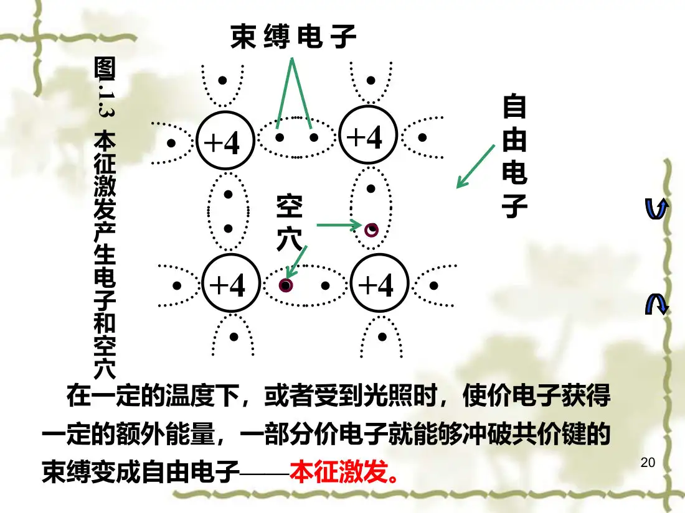

原文：

束缚电子

自由电子

图13 本征激发产生电子和空穴

在一定的温度下，或者受到光照时，使价电子获得一定的额外能量，一部分价电子就能够冲破共价键的束缚变成自由电子——本征激发。

20

### 1、空穴的运动可以看成一个带正电荷的粒子的运动。

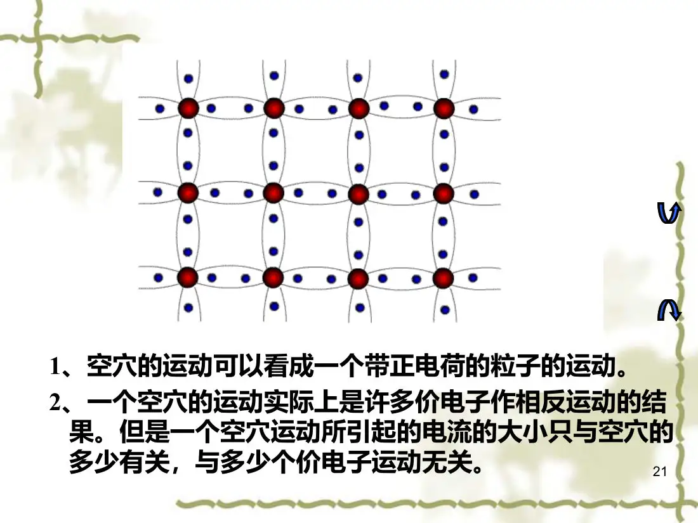

原文：

1、空穴的运动可以看成一个带正电荷的粒子的运动。

2、一个空穴的运动实际上是许多价电子作相反运动的结果。但是一个空穴运动所引起的电流的大小只与空穴的多少有关，与多少个价电子运动无关。

### 结论

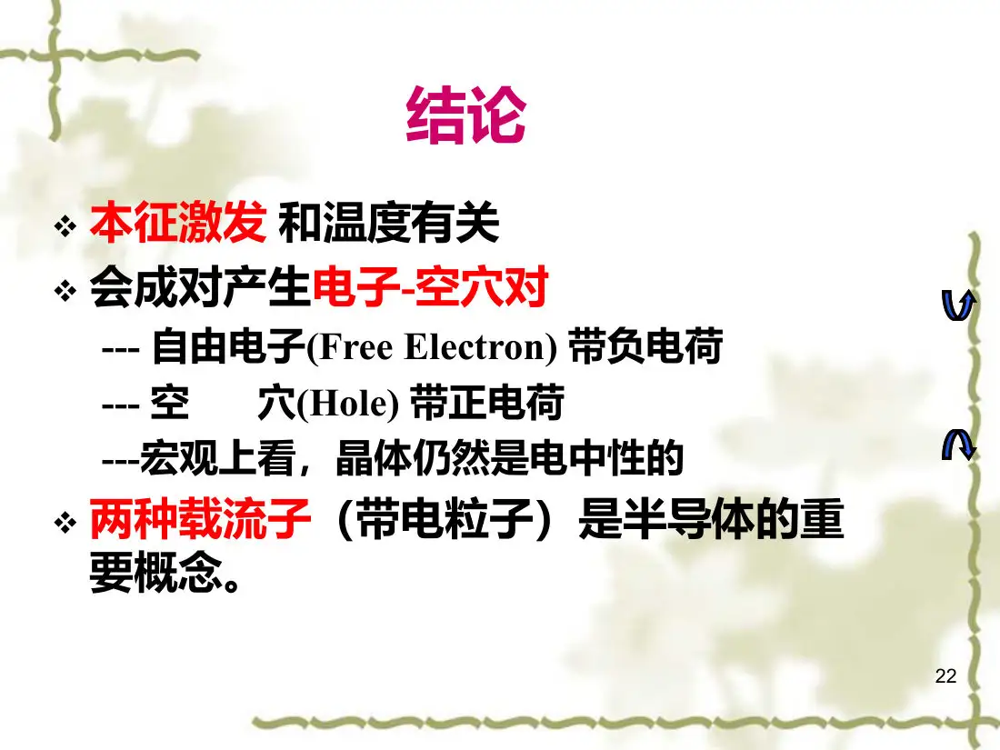

原文：

结论

✿ 本征激发 和温度有关

✿ 会成对产生电子-空穴对

--- 自由电子(Free Electron) 带负电荷

--- 空 穴(Hole) 带正电荷

---宏观上看，晶体仍然是电中性的

✿ 两种载流子（带电粒子）是半导体的重要概念。

22

### 23

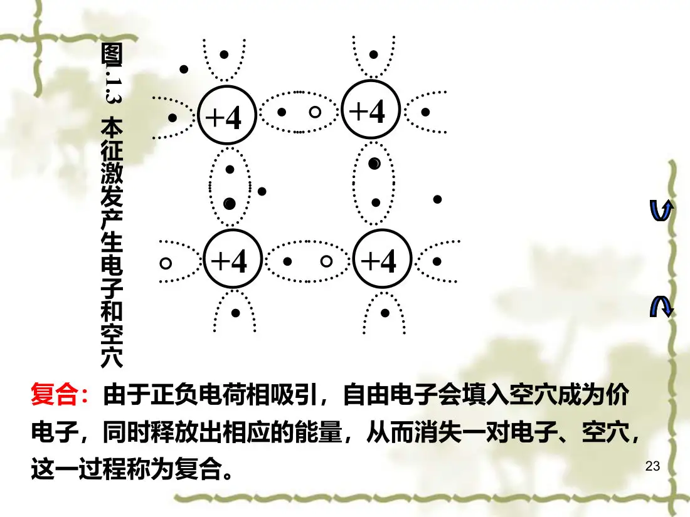

原文：

复合：由于正负电荷相吸引，自由电子会填入空穴成为价电子，同时释放出相应的能量，从而消失一对电子、空穴，这一过程称为复合。

23

### 本征激发:一分为二，载流子浓度增加。

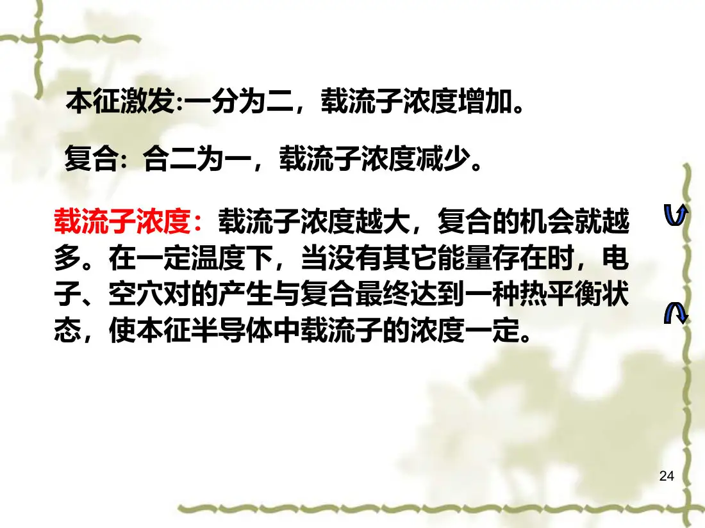

原文：

本征激发:一分为二，载流子浓度增加。

复合：合二为一，载流子浓度减少。

载流子浓度：载流子浓度越大，复合的机会就越多。在一定温度下，当没有其它能量存在时，电子、空穴对的产生与复合最终达到一种热平衡状态，使本征半导体中载流子的浓度一定。

24

### 本征载流子浓度：

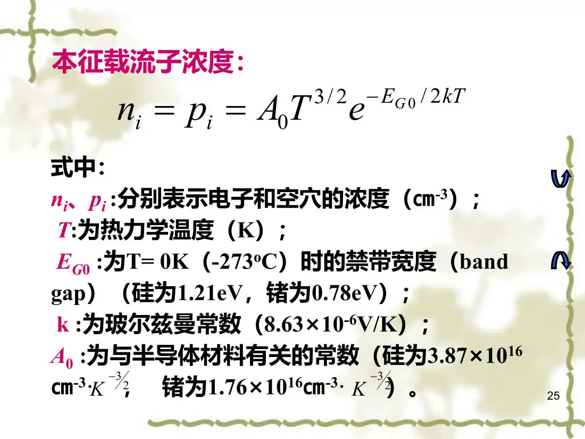

原文：

本征载流子浓度：

$$
n _ {i} = p _ {i} = A _ {0} T ^ {3 / 2} e ^ {- E _ {G 0} / 2 k T}
$$

式中：

$n_{i}$ 、 $p_{i}$ :分别表示电子和空穴的浓度（cm $^{-3}$ ）；

T:为热力学温度（K）；

$E_{G0}$ :为T=0K (-273°C) 时的禁带宽度 (band

gap) (硅为1.21eV，锗为0.78eV)；

k :为玻尔兹曼常数 $(8.63 \times 10^{-6} \text{V/K})$ ;

$A_{0}$ :为与半导体材料有关的常数（硅为 $3.87\times10^{16}$ $cm^{-3}\cdot K^{-3/2}$ ，锗为 $1.76\times10^{16}cm^{-3}\cdot K^{-3/2}$ ）。

25

### 本征载流子浓度:

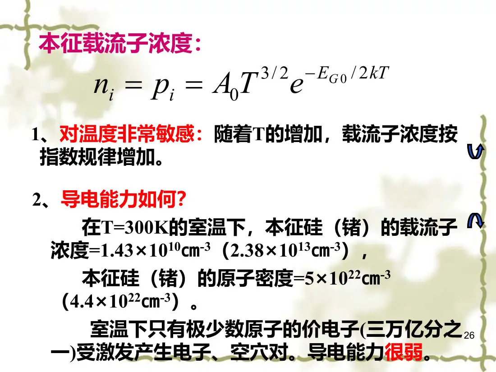

原文：

本征载流子浓度:

$$
n _ {i} = p _ {i} = A _ {0} T ^ {3 / 2} e ^ {- E _ {G 0} / 2 k T}
$$

1、对温度非常敏感：随着T的增加，载流子浓度按指数规律增加。

2、导电能力如何？

在T=300K的室温下，本征硅（锗）的载流子浓度= $1.43\times10^{10}cm^{-3}$ （ $2.38\times10^{13}cm^{-3}$ ），

本征硅（锗）的原子密度= $5 \times 10^{22} cm^{-3}$ $(4.4 \times 10^{22} cm^{-3})$ 。

室温下只有极少数原子的价电子(三万亿分之 $^{26}$ )受激发产生电子、空穴对。导电能力很弱。

### 1-1-2 杂质半导体 (掺杂半导体)

原文：

1-1-2 杂质半导体 (掺杂半导体)

在本征半导体中掺入微量的元素（称为杂质），会使其导电性能发生显著变化。——杂质半导体。

根据掺入杂质的不同，杂质半导体可分为N型半导体和P型半导体。

27

### N型半导体(Negative Type):

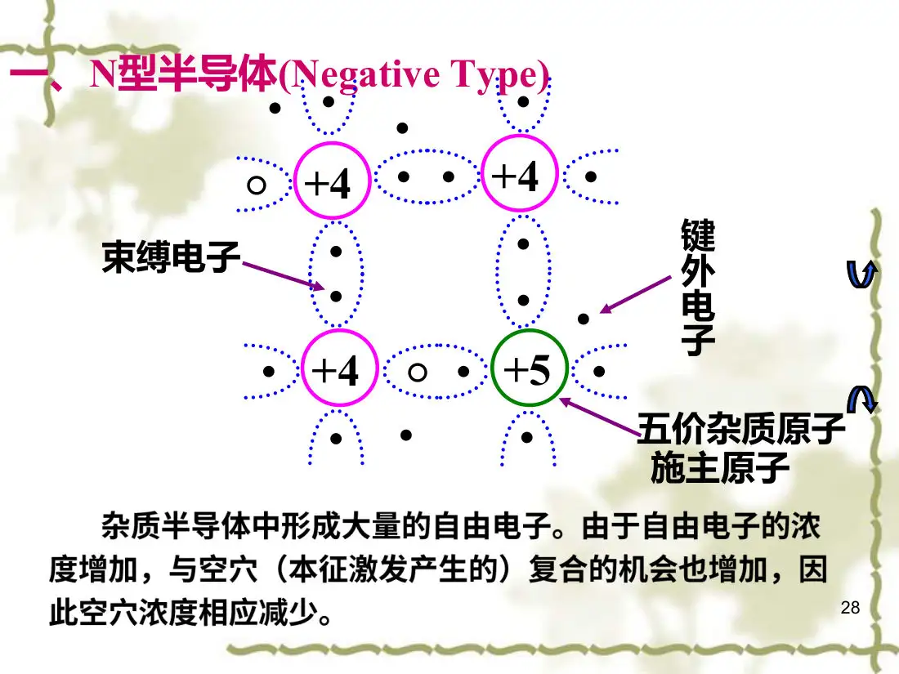

原文：

N型半导体(Negative Type):

束缚电子

五价杂质原子施主原子

杂质半导体中形成大量的自由电子。由于自由电子的浓度增加，与空穴（本征激发产生的）复合的机会也增加，因此空穴浓度相应减少。

28

### N型半导体

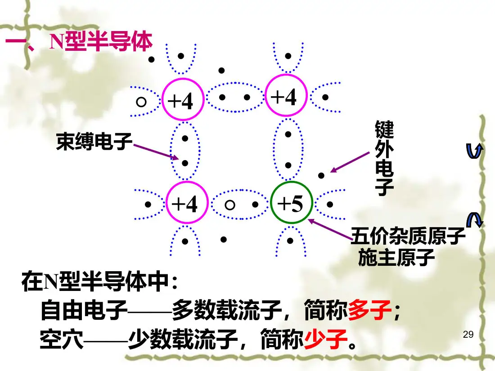

原文：

N型半导体

束缚电子

在N型半导体中:

五价杂质原子施主原子

自由电子——多数载流子，简称多子；空穴——少数载流子，简称少子。

29

### N型半导体

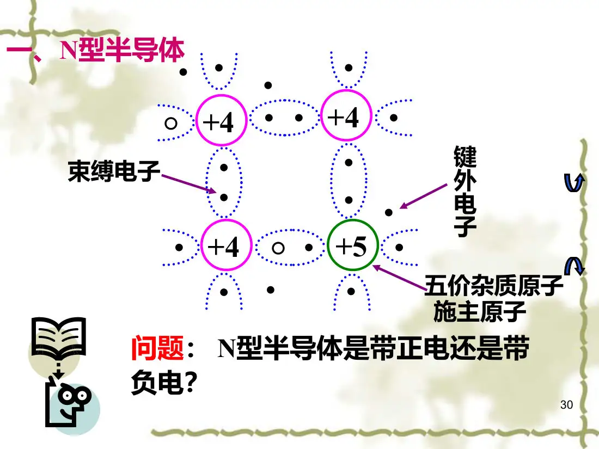

原文：

N型半导体

键外电子

束缚电子

五价杂质原子施主原子

问题：N型半导体是带正电还是带负电？

30

### 问题：N型半导体是带正电还是带负电？

原文：

问题：N型半导体是带正电还是带负电？

答：N型半导体是电中性的。虽然自由电子数远大于空穴数，但由于施主正离子的存在，使正、负电荷数相等，即自由电子数=空穴数+施主正离子

31

### P型半导体 (Positive Type)

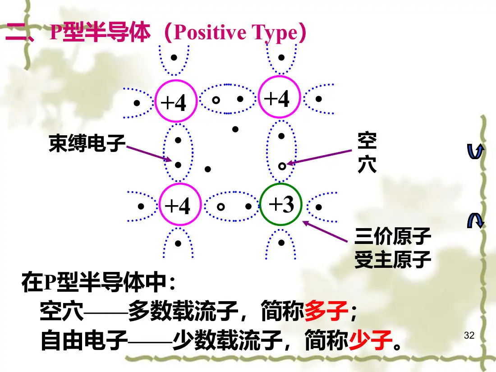

原文：

P型半导体 (Positive Type)

束缚电子

在P型半导体中:

三价原子
受主原子

空穴——多数载流子，简称多子；自由电子——少数载流子，简称少子。

32

### P型半导体是电中性的。

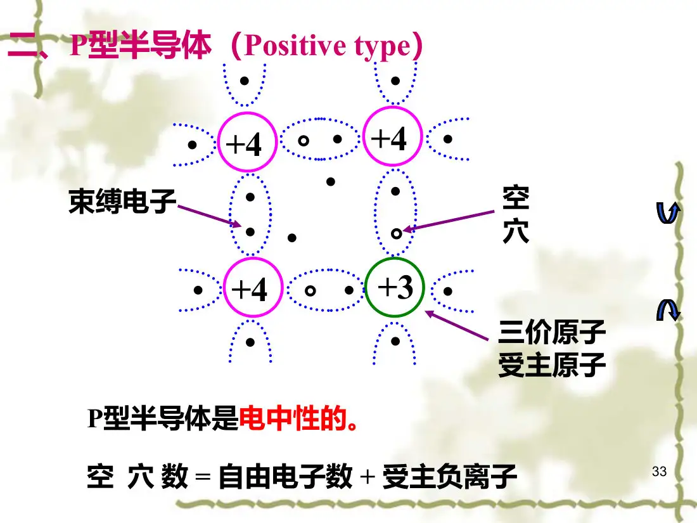

原文：

P型半导体是电中性的。

空穴数 = 自由电子数 + 受主负离子

33

### 三、杂质半导体的载流子浓度

原文：

三、杂质半导体的载流子浓度

多子的浓度

在杂质半导体中，杂质原子所提供的多子数远大于本征激发的载流子数。

结论：多子的浓度主要由掺杂浓度决定。

✿ 少子的浓度

少子主要由本征激发产生，因掺杂不同，会随多子浓度的变化而变化。

34

### N型半导体

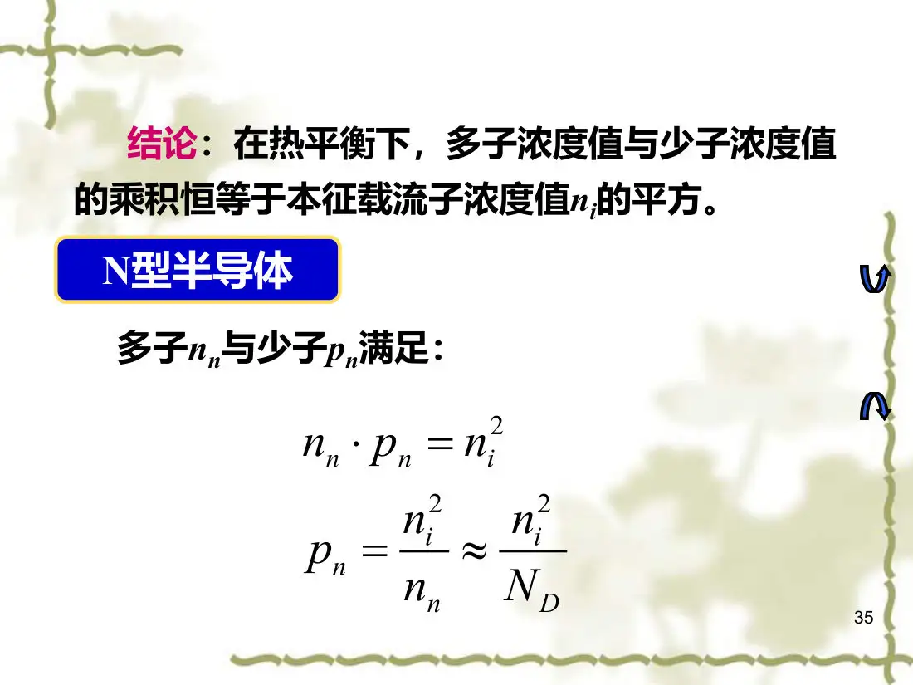

原文：

结论：在热平衡下，多子浓度值与少子浓度值的乘积恒等于本征载流子浓度值 $n_{i}$ 的平方。

N型半导体

多子 $n_{n}$ 与少子 $p_{n}$ 满足：

$$
n _ {n} \cdot p _ {n} = n _ {i} ^ {2}
$$

$$
p _ {n} = \frac {n _ {i} ^ {2}}{n _ {n}} \approx \frac {n _ {i} ^ {2}}{N _ {D}}
$$

35

### P型半导体

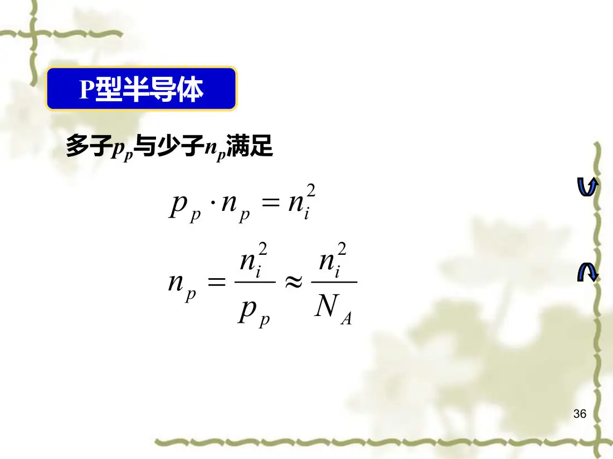

原文：

P型半导体

多子 $p_p$ 与少子 $n_p$ 满足

$$
p _ {p} \cdot n _ {p} = n _ {i} ^ {2}
$$

$$
n _ {p} = \frac {n _ {i} ^ {2}}{p _ {p}} \approx \frac {n _ {i} ^ {2}}{N _ {A}}
$$

36

### 杂质对半导体导电性的影响

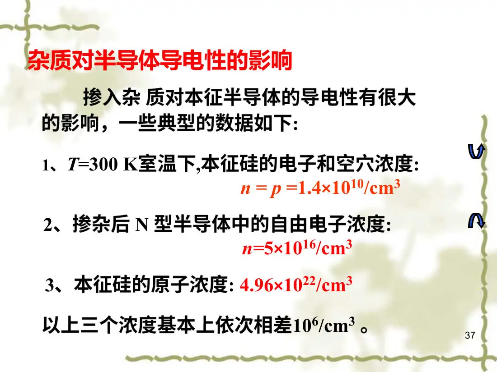

原文：

杂质对半导体导电性的影响

掺入杂质对本征半导体的导电性有很大的影响，一些典型的数据如下：

1、T=300 K室温下,本征硅的电子和空穴浓度:

$$
n = p = 1. 4 \times 1 0 ^ {1 0} / \mathrm{cm} ^ {3}
$$

2、掺杂后 N 型半导体中的自由电子浓度:

$$
n = 5 \times 1 0 ^ {1 6} / \mathrm{cm} ^ {3}
$$

3、本征硅的原子浓度: $4.96 \times 10^{22} / \mathrm{cm}^{3}$

以上三个浓度基本上依次相差 $10^{6}/cm^{3}$ 。

37

### 小结

原文：

小结

1.本征半导体通过掺杂，可以大大改变半导体内载流子的浓度，并使一种载流子多，另一种载流子少。

2. 多子浓度主要取决于杂质的含量，它与温度几乎无关；少子的浓度则主要与本征激发有关，因而它的浓度与温度有十分密切的关系。

38

### 思考题与习题

原文：

思考题与习题

✿ 导体、半导体和绝缘体的区别和在电子线路以及集成电路制造中的作用？

说明半导体材料的特性及其应用

❖ 解释本征半导体、杂质半导体的区别？

❖ 解释N型半导体与P型半导体的区别？

为什么说这两种半导体仍然对外呈电中性？

❖ 解释杂质半导体的多子浓度和少子浓度各由何种因素决定的？

39

### 1-2 PN结

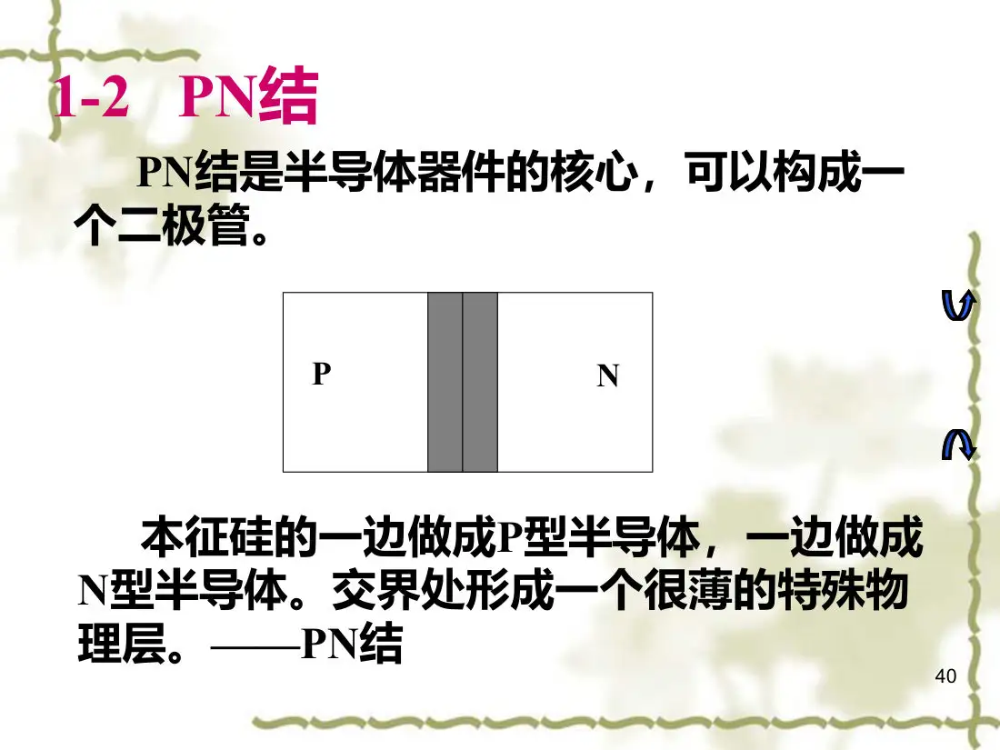

原文：

1-2 PN结

PN结是半导体器件的核心，可以构成一个二极管。

$$
\begin{array}{c c c} \hline P & & N \\ \hline \end{array}
$$

本征硅的一边做成P型半导体，一边做成N型半导体。交界处形成一个很薄的特殊物理层。——PN结

40

### 1.2.1 PN结的形成

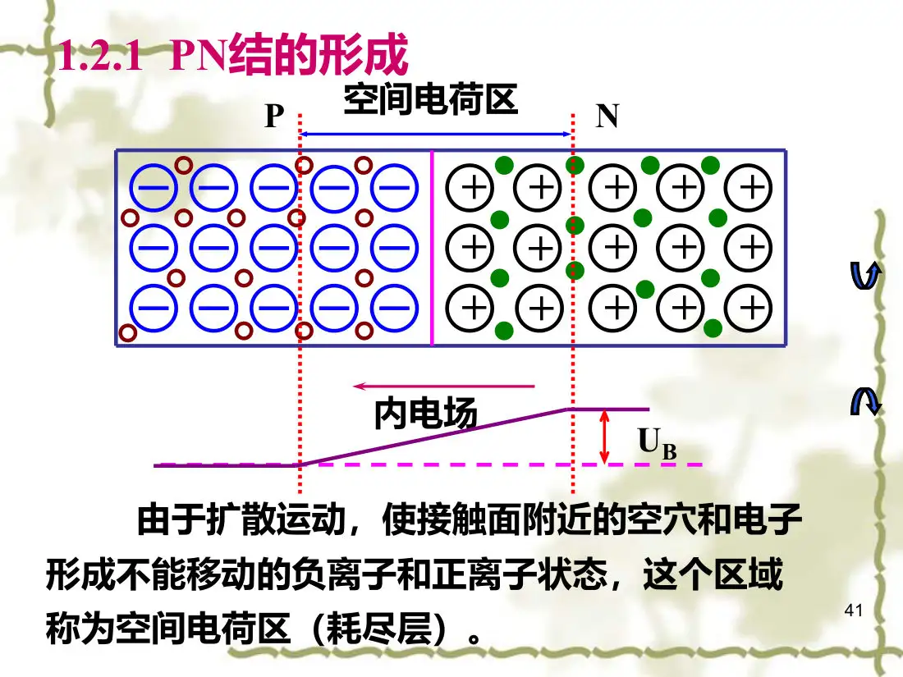

原文：

1.2.1 PN结的形成

空间电荷区

- - - - - - - - - - - - - - - - - - - + + + + + + + + + + + + + + + + + +

内电场

由于扩散运动，使接触面附近的空穴和电子形成不能移动的负离子和正离子状态，这个区域称为空间电荷区（耗尽层）。

41

### PN 结的形成步骤

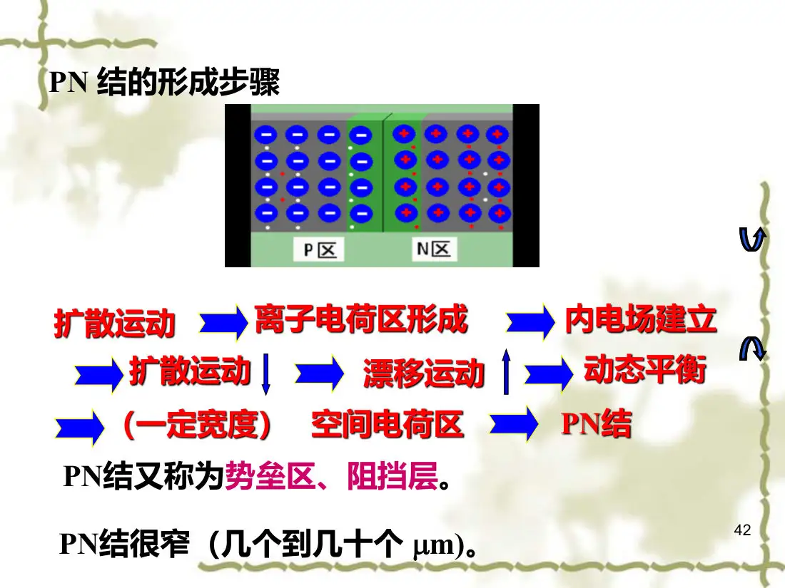

原文：

PN 结的形成步骤

\- - - - - - - - - - - - - - - - - -

P区

\+ + + + + + + + + + + +

N区

扩散运动 → 离子电荷区形成 → 内电场建立

→ 扩散运动 ↓ → 漂移运动 ↑ → 动态平衡

→ (一定宽度) 空间电荷区 → PN结

PN结又称为势垒区、阻挡层。

PN结很窄（几个到几十个 $\mu m$ ）。

42

### 问题：达到动态平衡时，在 PN 结流过的总电流为多少，方向是什么？

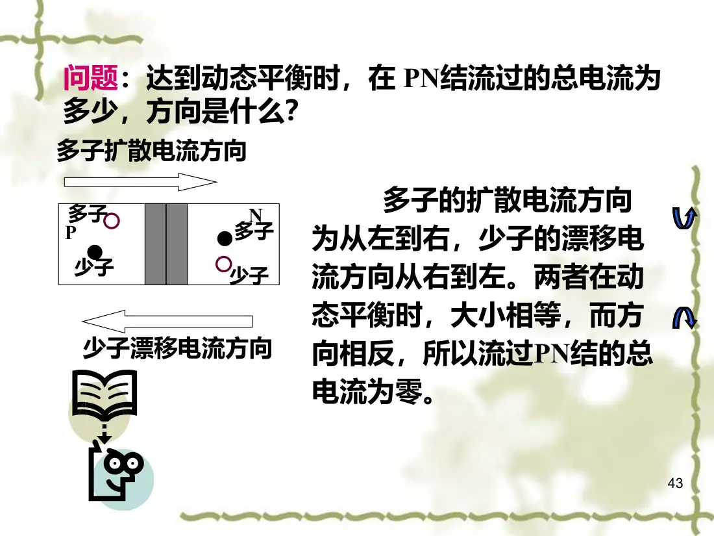

原文：

问题：达到动态平衡时，在 PN 结流过的总电流为多少，方向是什么？
多子扩散电流方向

少子漂移电流方向

多子的扩散电流方向为从左到右，少子的漂移电流方向从右到左。两者在动态平衡时，大小相等，而方向相反，所以流过PN结的总电流为零。

43

### 半导体中的电流

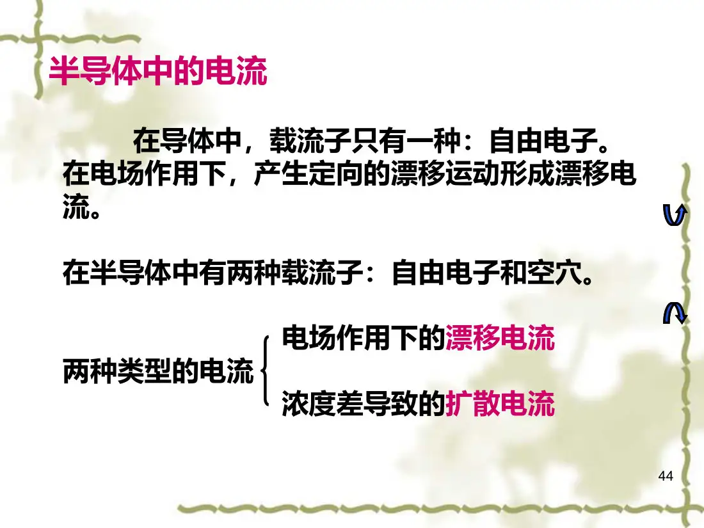

原文：

半导体中的电流

在导体中，载流子只有一种：自由电子。在电场作用下，产生定向的漂移运动形成漂移电流。

在半导体中有两种载流子：自由电子和空穴。

两种类型的电流 $\left\{ \begin{array}{l} \text{电场作用下的漂移电流} \\ \text{浓度差导致的扩散电流} \end{array} \right.$

44

### 此耗尽区主要伸向轻掺杂区一边，

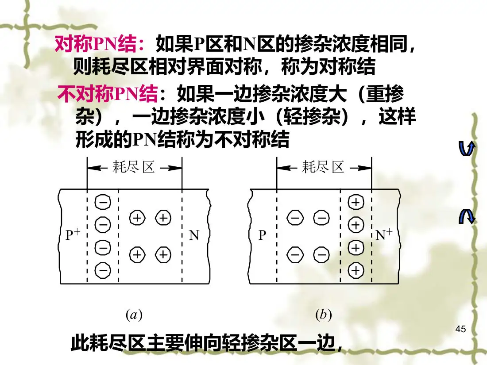

原文：

对称PN结：如果P区和N区的掺杂浓度相同，则耗尽区相对界面对称，称为对称结不对称PN结：如果一边掺杂浓度大（重掺杂），一边掺杂浓度小（轻掺杂），这样形成的PN结称为不对称结

此耗尽区主要伸向轻掺杂区一边，

45

### 问题：为什么PN结伸向轻掺杂区？

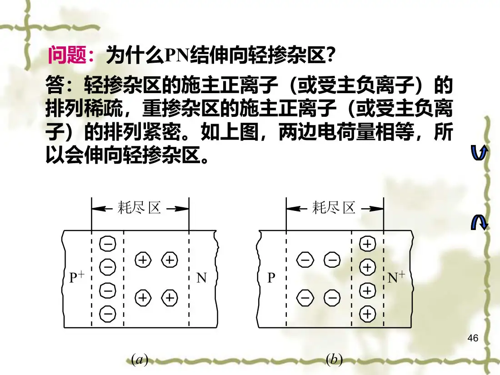

原文：

问题：为什么PN结伸向轻掺杂区？

答：轻掺杂区的施主正离子（或受主负离子）的排列稀疏，重掺杂区的施主正离子（或受主负离子）的排列紧密。如上图，两边电荷量相等，所以会伸向轻掺杂区。

(b)

(a)

46

### 1.2.2 PN结的单向导电特性

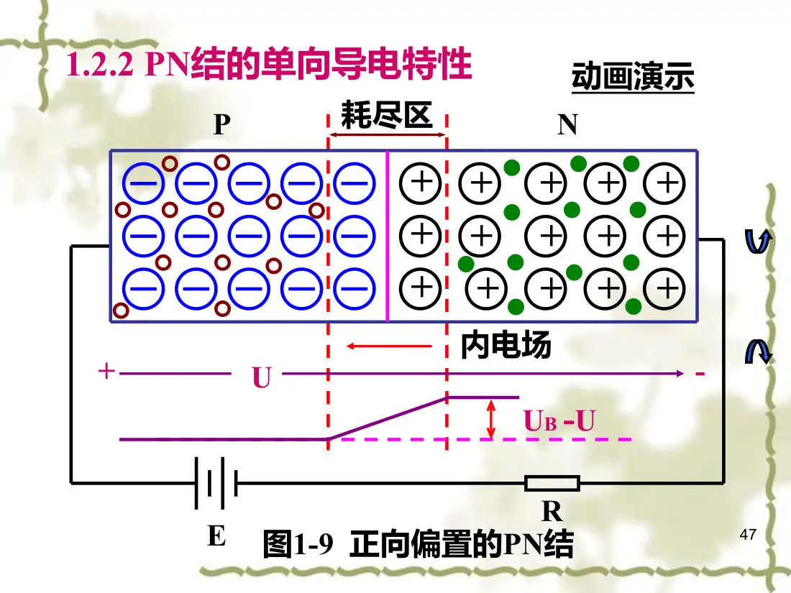

原文：

1.2.2 PN结的单向导电特性

动画演示

47

### PN结加正向电压

原文：

PN结加正向电压

✿ 外加的正向电压大部分降落在PN结区，方向与PN结内电场方向相反，削弱了内电场。

✿ 内电场对多子扩散运动的阻碍减弱，扩散电流加大。扩散电流远大于漂移电流，可忽略漂移电流的影响。

✿ PN结呈现低阻性，有较大的正偏电流。

48

### 二、PN结加反向电压

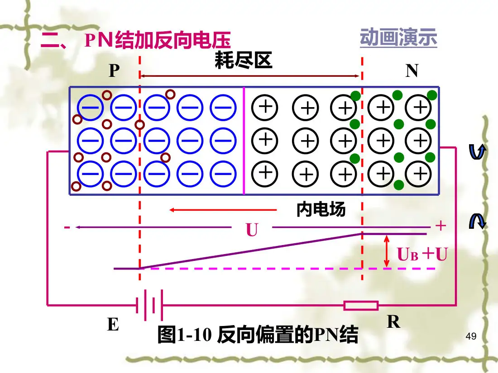

原文：

二、PN结加反向电压

动画演示

- - - - - - + + + + + + + + + + + + +

图1-10 反向偏置的PN结

R

49

### PN结加反向电压

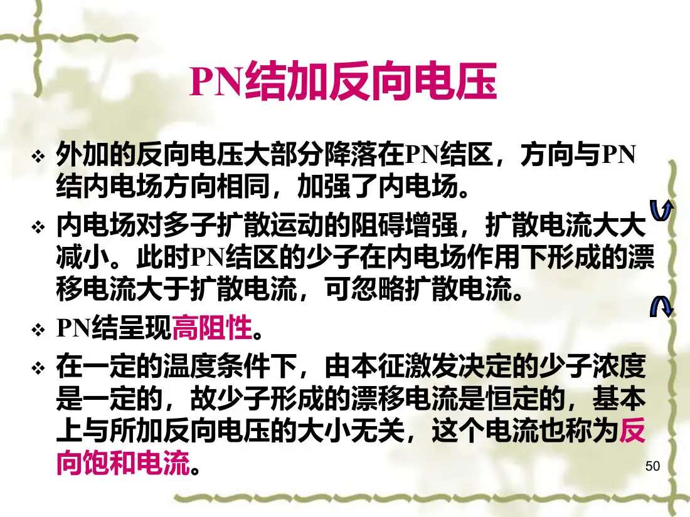

原文：

PN结加反向电压

外加的反向电压大部分降落在PN结区，方向与PN结内电场方向相同，加强了内电场。

✿ 内电场对多子扩散运动的阻碍增强，扩散电流大大减小。此时PN结区的少子在内电场作用下形成的漂移电流大于扩散电流，可忽略扩散电流。

PN结呈现高阻性。

在一定的温度条件下，由本征激发决定的少子浓度是一定的，故少子形成的漂移电流是恒定的，基本上与所加反向电压的大小无关，这个电流也称为反向饱和电流。

50

### 结论：PN结具有单向导电性。

原文：

PN结加正向电压时，呈现低电阻，具有较大的正向扩散电流；PN结加反向电压时，呈现高电阻，具有很小的反向漂移电流。

结论：PN结具有单向导电性。

51

### 三、PN结电流方程

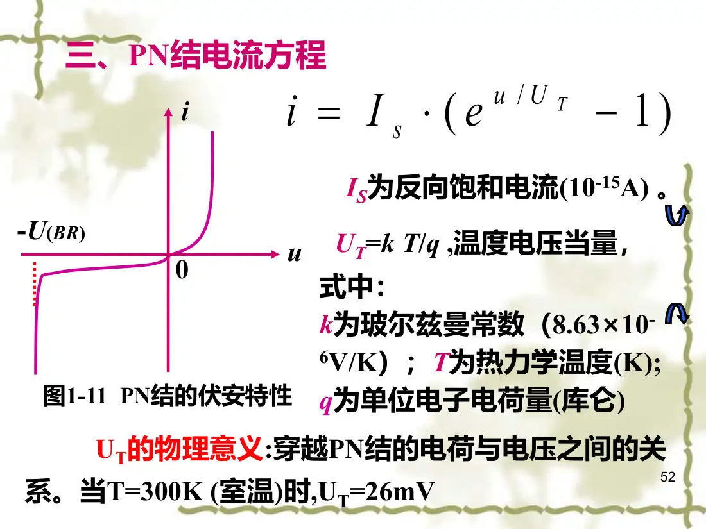

原文：

三、PN结电流方程

$$
i = I _ {s} \cdot (e ^ {u / U _ {T}} - 1)
$$

$I_{S}$ 为反向饱和电流 $(10^{-15}\mathrm{A})$ $U_{T}=k T/q$ ，温度电压当量，
式中：

k为玻尔兹曼常数 $(8.63 \times 10^{-6} \text{V/K})$ ; T为热力学温度(K); q为单位电子电荷量(库仑)

$U_{T}$ 的物理意义:穿越PN结的电荷与电压之间的关系。当T=300K (室温)时, $U_{T}=26mV$ 四、PN结伏安特性 $i = I_s \cdot (e^{u/U_T} - 1)$

### $$

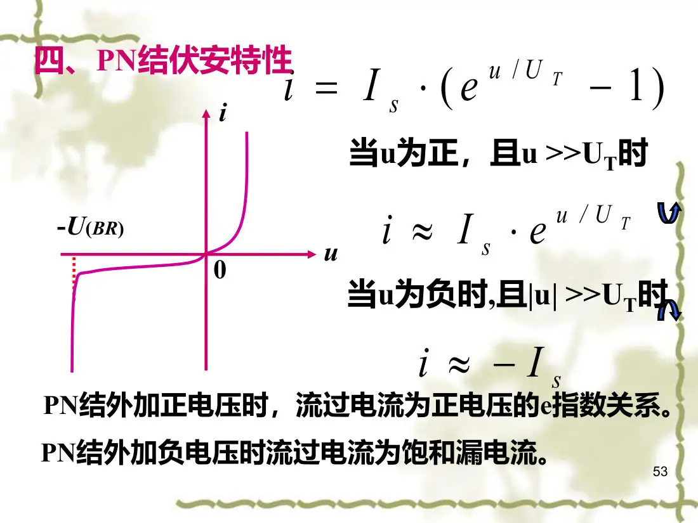

原文：

当u为正，且 $\mathbf{u} >> \mathbf{U}_{\mathrm{T}}$ 时

$$
i \approx I _ {s} \cdot e ^ {u / U _ {T}}
$$

当u为负时,且 $|u| >> U_{T}$ 时

$$
i \approx - I _ {s}
$$

PN结外加正电压时，流过电流为正电压的e指数关系。

PN结外加负电压时流过电流为饱和漏电流。

53

### 五、PN结的温度特性

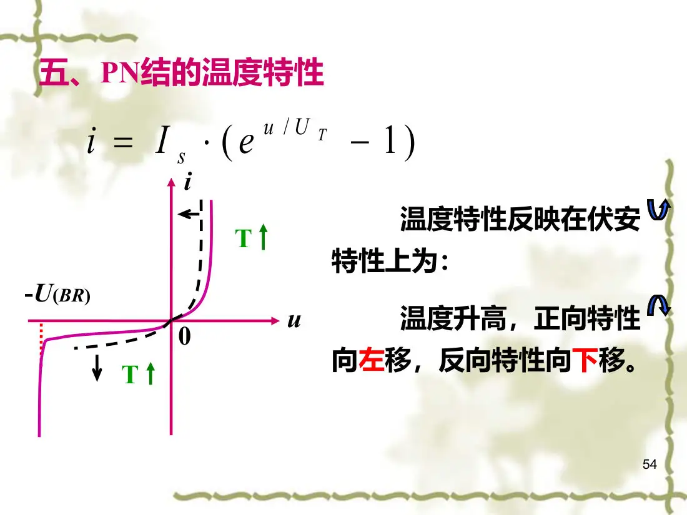

原文：

五、PN结的温度特性

$$
i = I _ {s} \cdot (e ^ {u / U _ {T}} - 1)
$$

温度特性反映在伏安特性上为：

温度升高，正向特性向左移，反向特性向下移。

54

### PN结温度特性的定量关系

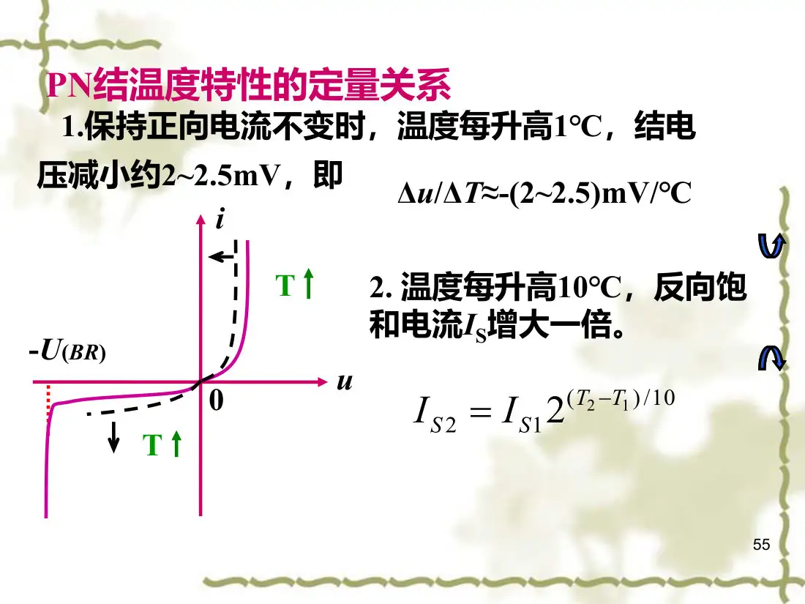

原文：

PN结温度特性的定量关系

1.保持正向电流不变时，温度每升高1°C，结电压减小约2\~2.5mV，即 $\Delta u/\Delta T \approx -(2 \sim 2.5)$ mV/°C

2. 温度每升高10°C，反向饱和电流 $I_{s}$ 增大一倍。

$$
I _ {S 2} = I _ {S 1} 2 ^ {(T _ {2} - T _ {1}) / 1 0}
$$

55

### 1-2-3 PN结的击穿特性

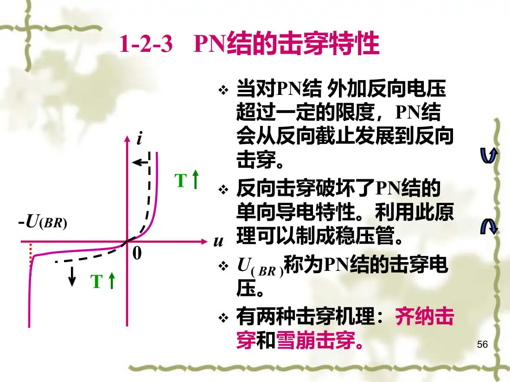

原文：

1-2-3 PN结的击穿特性

✿ 当对PN结 外加反向电压超过一定的限度，PN结会从反向截止发展到反向击穿。

✿ 反向击穿破坏了PN结的单向导电特性。利用此原理可以制成稳压管。

$U_{(BR)}$ 称为PN结的击穿电压。

有两种击穿机理：齐纳击穿和雪崩击穿。

56

### 齐纳击穿

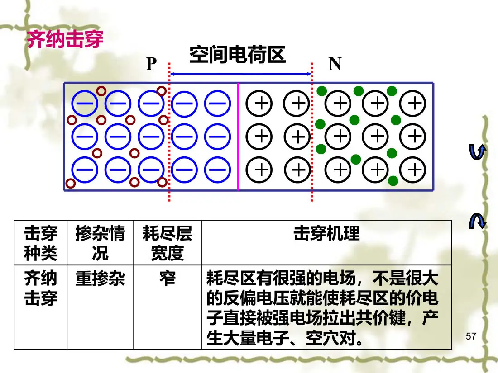

原文：

齐纳击穿

空间电荷区

N

- - - - - - - + + + + + + + + + + + + + +

<table><tr><td>击穿种类</td><td>掺杂情况</td><td>耗尽层宽度</td><td>击穿机理</td></tr><tr><td>齐纳击穿</td><td>重掺杂</td><td>窄</td><td>耗尽区有很强的电场,不是很大的反偏电压就能使耗尽区的价电子直接被强电场拉出共价键,产生大量电子、空穴对。</td></tr></table>

### 雪崩击穿

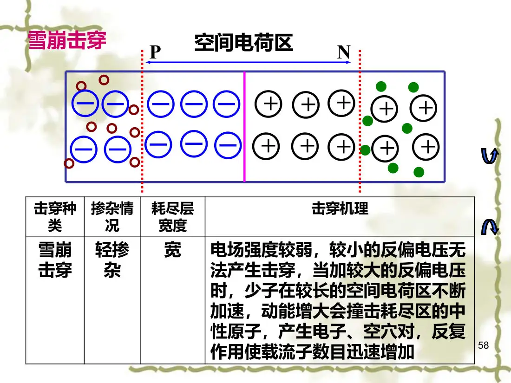

原文：

雪崩击穿

空间电荷区

- - - - - - - + + + + + + + + +

<table><tr><td>击穿种类</td><td>掺杂情况</td><td>耗尽层宽度</td><td>击穿机理</td></tr><tr><td>雪崩击穿</td><td>轻掺杂</td><td>宽</td><td>电场强度较弱,较小的反偏电压无法产生击穿,当加较大的反偏电压时,少子在较长的空间电荷区不断加速,动能增大会撞击耗尽区的中性原子,产生电子、空穴对,反复作用使载流子数目迅速增加</td></tr><tr><td>齐纳击穿</td><td>重掺杂</td><td>窄</td><td>耗尽区有很强的电场,不是很大的反偏电压就能使耗尽区的价电子直接被强电场拉出共价键,产生大量电子、空穴对。</td></tr><tr><td>雪崩击穿</td><td>轻掺杂</td><td>宽</td><td>电场强度较弱,较小的反偏电压无法产生击穿,当加较大的反偏电压时,少子在较长的空间电荷区不断加速,动能增大会撞击耗尽区的中性原子,产生电子、空穴对,反复作用使载流子数目迅速增加</td></tr></table>
一般来说，对硅材料的PN结，

58

### 59

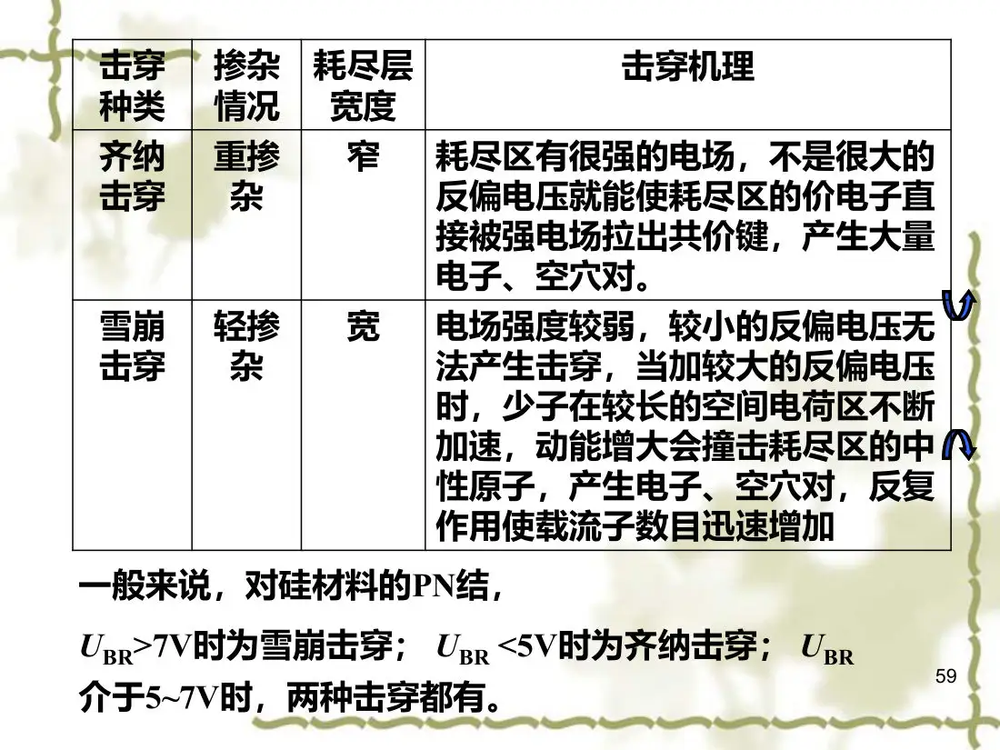

原文：

$U_{BR}>7V$ 时为雪崩击穿； $U_{BR}<5V$ 时为齐纳击穿； $U_{BR}$ 介于5\~7V时，两种击穿都有。

59

### 击穿的可逆性

原文：

击穿的可逆性

✿ 电击穿是 可逆的（可恢复，当有限流电阻时）。

✿ 电击穿后如无限流措施，将发生热击穿现象。

✿ 热击穿会破坏PN结结构 （烧坏）

✿热击穿是 不可逆 的。

60

### 1-2-4 PN结的电容特性

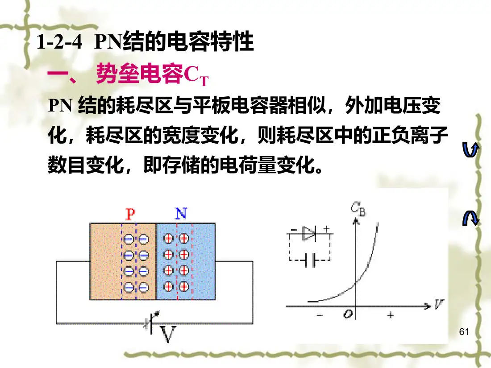

原文：

1-2-4 PN结的电容特性

一、势垒电容 $C_{T}$

PN 结的耗尽区与平板电容器相似，外加电压变化，耗尽区的宽度变化，则耗尽区中的正负离子数目变化，即存储的电荷量变化。

61

### 二、扩散电容 $C_{D}$

原文：

二、扩散电容 $C_{D}$

多子扩散→在对方区形成非平衡少子的浓度分布曲线→偏置电压变化→分布曲线变化→非平衡少子变化→电荷变化。

62

### 63

原文：

63

### 结论

原文：

结论

结电容 $C_{j}=C_{T}+C_{D}$

正偏时以扩散电容 $C_{D}$ 为主， $C_{j}\approx C_{D}$ ，其值通常为几十至几百pF；

反偏时以势垒电容 $C_{T}$ 为主， $C_{j}\approx C_{T}$ ，其值通常为几至几十pF。（如：变容二极管）

因为 $C_{\mathrm{T}}$ 和 $C_{\mathrm{D}}$ 并不大，所以在高频工作时，才考虑它们的影响。

64

### 1.3 半导体二极管及其基本电路

原文：

1.3 半导体二极管及其基本电路

PN结加上电极引线和管壳就形成晶体二极管。

65

### 1-3-1 二极管特性曲线

原文：

1-3-1 二极管特性曲线

二极管特性曲线与PN结基本相同，略有差异。

66

### 1.3.1 二极管的伏安特性曲线

原文：

1.3.1 二极管的伏安特性曲线

一、正向特性

1.导通电压或死区电压

硅: $U_{\mathrm{D(on)}} = 0.7 \, \mathrm{V}$ ;

锗: $U_{\mathrm{D(on)}} = 0.3 \mathrm{~V}$ 。

2. 曲线分段:

指数段（小电流时）、
直线段（大电流时）。

二、反向特性

反向电压加大时，反向电流也略有增大。

67

### 1.3.2 二极管的主要参数

原文：

1.3.2 二极管的主要参数

一、直流电阻

定义：是二极管所加直流电压 $U_{D}$ 与所流过直流电流 $I_{D}$ 之比。

(a)直流电阻 $\mathbf{R}_{\mathrm{D}}$

$$
R _ {D} = U _ {D} / I _ {D}
$$

$R_{D}$ 的几何意义：

Q点到原点直线斜率的倒数。 $R_{D}$ 不是恒定的，正向的 $R_{D}$ 随工作电流增大而减小，反向的 $R_{D}$ 随反向电压的增大而增大。

图1-15 二极管电阻的几何意义

68

### 1-3-2 二极管的主要参数

原文：

1-3-2 二极管的主要参数

一、直流电阻

定义：是二极管所加直流电压 $U_{D}$ 与所流过直流电流 $I_{D}$ 之比。

$$
R _ {D} = U _ {D} / I _ {D}
$$

正向电阻：几百欧姆；

反向电阻：几百千欧姆；

图1-15 二极管电阻的几何意义

69

### 二、交流电阻

原文：

二、交流电阻

二极管在其工作状态 $(U_{\mathrm{DQ}}, I_{\mathrm{DQ}})$ 下的电压微变量与电流微变量之比。

$$
\boldsymbol {r} _ {D} \approx \frac {\Delta U}{\Delta I} \bigg | _ {I _ {D Q}, U _ {D Q}} = \frac {d u}{d i} \bigg | _ {I _ {D Q}, U _ {D Q}}
$$

$$
\boldsymbol {i} = I _ {s} (e ^ {u / U _ {T}} - 1)
$$

(b)交流电阻 $r_{D}$

$r_{D}$ 的几何意义: Q( $U_{DQ}$ , $I_{DQ}$ ) 点处切线斜率的倒数。

70

### 二、交流电阻

原文：

二、交流电阻

$$
\boldsymbol {i} = I _ {S} (e ^ {\boldsymbol {u} / U _ {T}} - \mathbf {1})
$$

(b)交流电阻 $r_{D}$

$$
\boldsymbol {r} _ {D} \approx \frac {\Delta U}{\Delta I} \bigg | _ {I _ {D Q}, U _ {D Q}} = \frac {d u}{d i} \bigg | _ {I _ {D Q}, U _ {D Q}}
$$

$$
= \frac {1}{\left. \frac {d i}{d u} \right| _ {Q}} = \frac {1}{\left. \frac {I _ {s} e ^ {u / U _ {T}}}{U _ {T}} \right| _ {Q}}
$$

$$
\approx \frac {U _ {T}}{I _ {D Q}} \approx \frac {2 6 (m V)}{I _ {D Q} (m A)}
$$

71

### 解：交流电阻

原文：

例: 已知D为 $S_{i}$ 二极管, 流过D的直流电流 $I_{D}=10mA$ , 交流电压 $\Delta U=10mV$ , 求室温下流过D的交流电流 $\Delta I=$ ?

解：交流电阻

$$
\begin{array}{r l} & {r _ {D} \approx \frac {U _ {T}}{I _ {D Q}} \approx \frac {2 6 (m V)}{1 0 (m A)} \quad \bigcup} \\ & {\qquad = 2. 6 \Omega} \end{array}
$$

交流电流为：

$$
\begin{array}{l} \Delta I = \frac {\Delta U}{R + r _ {D}} \\ = \frac {1 0 (m V)}{2 . 6 + 9 3 0 (\Omega)} \\ = 1. 1 \times 1 0 ^ {- 2} m A \end{array}
$$

72

### 三、最大整流电流 $\mathrm{I}_{\mathrm{F}}$

原文：

三、最大整流电流 $\mathrm{I}_{\mathrm{F}}$

允许通过的最大正向平均电流。

四、最大反向工作电压 $U_{RM}$

通常取 $\mathrm{U}_{(\mathrm{BR})}$ 的一半，超过 $\mathrm{U}_{(\mathrm{BR})}$ 容易发生反向击穿。

五、反向电流 $I_{R}$

未击穿时的反向电流。 $I_{R}$ 越小，单向导电性能越好。

73

### 六、最高工作频率 $f_{M}$

原文：

六、最高工作频率 $f_{M}$

工作频率超过 $f_{\mathrm{M}}$ 时，二极管的单向导电性能变坏。

※ 需要指出，手册中给出的一般为典型值，需要时应通过实际测量得到准确值。

74

### 1.3.3 半导体二极管的电路模型

原文：

1.3.3 半导体二极管的电路模型

由于二极管的非线性特性，当电路加入二极管时，便成为非线性电路。实际应用时可根据二极管的应用条件作合理近似，得到相应的等效电路，化为线性电路

$$
\text {非线性} \xrightarrow {\text {近似}} \text {线性}
$$

75

### 一、理想模型

原文：

一、理想模型

可以把二极管想象为一个开关，导通相当于开关闭合，截止相当于开关打开。

应用最为广泛。

76

### 二、恒压降模型

原文：

二、恒压降模型

理想二极管串联电压源的模型

硅管: $U_{\mathrm{D(on)}} = 0.7 \mathrm{~V}$ 锗管: $U_{\mathrm{D(on)}} = 0.3 \mathrm{~V}$

### 三、折线模型

原文：

三、折线模型

理想二极管串联电压源和电阻 $r_{D(on)}$ 的模型 $r_{D(on)}$ 一般为几十欧姆。

78

### 四、小信号模型

原文：

四、小信号模型

$$
\mathbf {r} _ {\mathrm{D}} = \frac {\Delta \mathbf {u} _ {\mathrm{D}}}{\Delta \mathbf {i} _ {\mathrm{D}}}; \mathbf {i} _ {\mathrm{D}} = I _ {\mathrm{S}} \left[ e ^ {\frac {u _ {\mathrm{D}}}{U _ {\mathrm{T}}}} - 1 \right];
$$

$$
\mathbf {g} _ {\mathrm{d}} = \frac {\mathbf {d i} _ {\mathrm{D}}}{\mathbf {d u} _ {\mathrm{D}}} = \frac {\mathbf {d I} _ {\mathrm{S}} \left[ \mathbf {e} ^ {\frac {\mathbf {u} _ {\mathrm{D}}}{\mathbf {U} _ {\mathrm{T}}} - 1} \right]}{\mathbf {d u} _ {\mathrm{D}}}
$$

$$
\mathbf {r} _ {\mathrm{D}} = \frac {1}{\mathbf {g} _ {\mathrm{d}}} = \frac {\mathbf {U} _ {\mathrm{T}}}{\mathrm{I} _ {\mathrm{DQ}}} = \frac {2 6 (\mathrm{mV})}{\mathrm{I} _ {\mathrm{DQ}} (\mathrm{mA})}
$$

79

### 1.3.4 二极管基本应用电路

原文：

1.3.4 二极管基本应用电路

一、二极管整流电路

✿ 把交流电转变为直流电称为“整流”。

反之称为“逆变”。

整流

交流电 ← 直流电
逆变

80

### 二极管近似为理想模型

原文：

二极管近似为理想模型

81

### 思考：二极管近似为恒压降模型的电路输出？

原文：

思考：二极管近似为恒压降模型的电路输出？

82

### 二、二极管限幅电路

原文：

二、二极管限幅电路

又称为：“削波电路”。

✿ 能够把输入电压变化范围加以限制，常用于波形变换和整形。

83

### 二极管近似为恒压降模型

原文：

二极管近似为恒压降模型

84

### 图1-20 二极管上限幅电路及波形

原文：

① 当 $u_{i}>2.7V$ ，V导通， $u_{o}=E+0.7=2.7V$

② 当 $u_{i} \leq 2.7V$ 时，V截止，即开路， $u_{0} = u_{i}$ 。

图1-20 二极管上限幅电路及波形

85

### 三、二极管开关电路

原文：

三、二极管开关电路

可以用来构成数字电路门电路。

表 1.3.1 例 1.3.4 输入、输出电压关系
<table><tr><td rowspan="2"> $u_1$ </td><td rowspan="2"> $u_2$ </td><td colspan="2">二极管工作状态</td><td rowspan="2"> $u_o$ </td></tr><tr><td> $V_1$ </td><td> $V_2$ </td></tr><tr><td>0V</td><td>0V</td><td>导通</td><td>导通</td><td>0V</td></tr><tr><td>0V</td><td>5V</td><td>导通</td><td>截止</td><td>0V</td></tr><tr><td>5V</td><td>0V</td><td>截止</td><td>导通</td><td>0V</td></tr><tr><td>5V</td><td>5V</td><td>截止</td><td>截止</td><td>5V</td></tr></table>

输入只有0V或5V。输入数字量时为与逻辑。

86

### 1.4 特殊二极管

原文：

1.4 特殊二极管

1.4.1 稳压二极管

一、稳压二极管的特性

1. 稳压二极管的正向特性、反向特性与普通二极管基本相同，区别仅在于反向击穿时，特性曲线更加陡峭。

87

### 2. 稳压管在反向击穿后，能通过调节自身电流，实现稳定电压的功能。

原文：

2. 稳压管在反向击穿后，能通过调节自身电流，实现稳定电压的功能。

即当 $I_{Z\min} < I_Z < I_{Z\max}$ 电压几乎不变，为 $U_{Z}$ 。

### 三、稳压二极管主要参数

原文：

三、稳压二极管主要参数

1、稳压电压 $\mathrm{U_Z}$

指管子长期稳定时的工作电压值。

2、额定功耗 Pz

(b) 伏安特性曲线

$$
\mathrm{P} _ {\mathrm{Z}} = \mathrm{U} _ {\mathrm{Z}} \times \mathrm{I} _ {\mathrm{Zmax}}
$$

3、稳定电流 $\mathrm{I}_{\mathrm{z}}$

$$
\mathrm{I} _ {\mathrm{Zmin}} <   \mathrm{I} _ {\mathrm{Z}} <   \mathrm{I} _ {\mathrm{Zmax}},
$$

4、动态电阻 $r_{z}$ ：工作点处的交流电阻，一般为几欧姆到几十欧姆（越小越好）

5、温度系数 $\alpha$

89

### 三、稳压二极管稳压电路

原文：

三、稳压二极管稳压电路

所谓稳压指当 $U_{i}$ 、 $R_{L}$ 变化时， $U_{0}$ 保持恒定。

稳压原理：

若 $U_{i}$ 不变， $R_{L}\downarrow\rightarrow I_{L}\uparrow\rightarrow I_{R}\uparrow\rightarrow U_{O}\downarrow\rightarrow I_{z}\downarrow\rightarrow$

$I_{R}\downarrow\rightarrow U_{R}\downarrow\rightarrow U_{O}\uparrow$ (基本不变)

若 $R_{L}$ 不变， $U_{i} \uparrow \rightarrow U_{o} \uparrow \rightarrow I_{z} \uparrow \rightarrow I_{L} \downarrow$ $\rightarrow U_{o} \downarrow$ (基本不变)

### 限流电阻R的选择：

原文：

限流电阻R的选择：

选择R的限制条件：当 $\mathrm{U_i}$ 、 $\mathbb{R}_{\mathrm{L}}$ 变化时， $\mathrm{I_z}$ 应满足 $\mathrm{I_{zmin} < I_z < I_{zmax}}$

设外界条件为: $U_{imin}<U_i<U_{imax}$ ; $R_{Lmin}<R_L<R_{Lmax}$

91

### 分析过程:

原文：

分析过程:

根据电路: $I_{z} = \frac{u_{i} - U_{z}}{R} - \frac{U_{z}}{R_{L}}$

$I_{z}$ 何时取最大值？—— $u_{i}=U_{imax}$ ， $R_{L}=R_{Lmax}$

92

### $$

原文：

$$
\begin{array}{l} \frac {U _ {i \max} - U _ {Z}}{R} - \frac {U _ {Z}}{R _ {L \max}} <   I _ {Z \max} \\ R > \frac {U _ {i \max} - U _ {Z}}{R _ {L \max} \cdot I _ {Z \max} + U _ {Z}} \cdot R _ {L \max} = R _ {\min} \end{array}
$$

93

### $$

原文：

Iz何时取最小值？—— $u_{i}=U_{imin}$ ， $R_{L}=R_{Lmin}$

$$
\frac {U _ {i \min} - U _ {Z}}{R} - \frac {U _ {Z}}{R _ {L \min}} > I _ {Z \min}
$$

$$
R <   \frac {U _ {i \min} - U _ {Z}}{R _ {L \min} \cdot I _ {Z \min} + U _ {Z}} \cdot R _ {L \min} = R _ {\max}
$$

94

### 因此，可得限流电阻的取值范围是：

原文：

因此，可得限流电阻的取值范围是：

$$
R _ {\mathrm{min}} <   R <   R _ {\mathrm{max}}
$$

95

### 小结

原文：

小结

1. N型半导体中，电子是多子，空穴是少子；P型半导体中，空穴是多子，电子是少子；多子浓度由掺杂浓度决定，少子浓度很小且随温度的变化而变化。

2. PN 结是现代半导体器件的基础。它具有单向导电性、击穿特性和电容特性。

3. 半导体二极管由一个PN结构成，大信号应用时表现为开关特性。

4. 利用PN 结的击穿特性可制作稳压二极管。用稳压二极管构成稳压电路时，首先应保证稳压管反向击穿，另外必须串接限流电阻。

96

### 1.6习题讲解

原文：

1.6习题讲解

$\mathrm{V}_{2}$ 导通， $\mathrm{V}_{1}$ 截止， $\mathrm{U}_{0} = 5\mathrm{V}_{\circ}$

二极管等效为理想模型

$V_{1}$ 导通， $V_{2}$ 截止， $U_{0}=0V$ 。

$V_{1}$ 导通， $V_{2}$ 导通 $U_{0}=1.98V$ 。

97

### 作业

原文：

作业
1.1
1.3
1.4
1.7
1.9
1.10
1.11 (1) (2)
98
