# 《电路分析与电工电子技术》单级放大电路实验指导（第五次课）

原件的每一页，下面附识别出的文字。

### 单级放大电路

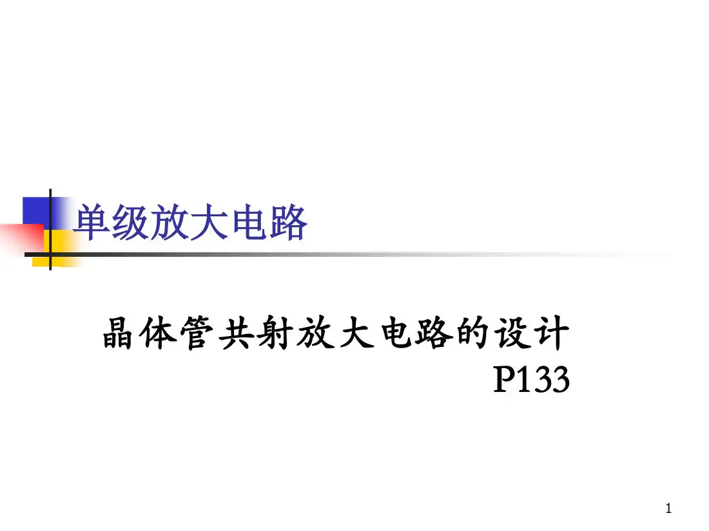

原文：

单级放大电路

晶体管共射放大电路的设计P133

1

### 主要授课内容：

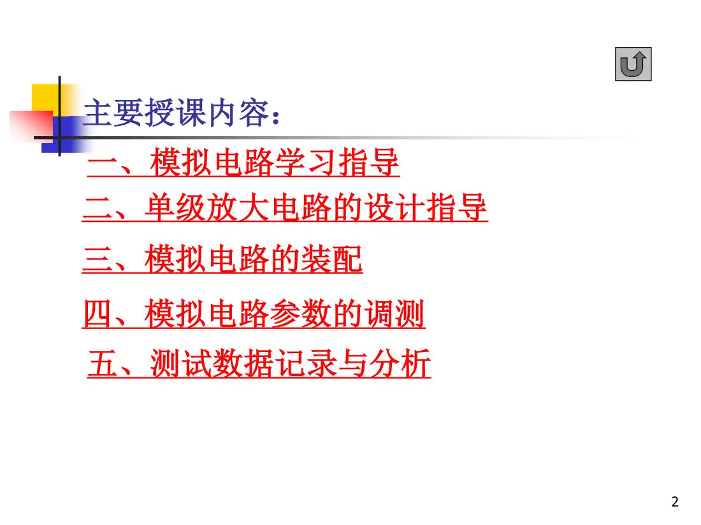

原文：

主要授课内容：

二、模拟电路学习指导
二、单级放大电路的设计指导
三、模拟电路的装配
四、模拟电路参数的调测
五、测试数据记录与分析

U

2

### 一、模拟电路学习指导

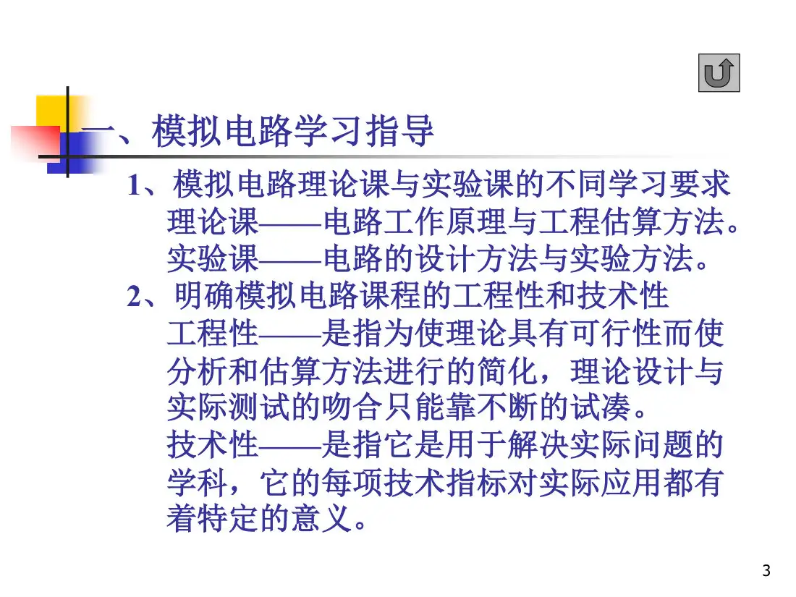

原文：

一、模拟电路学习指导

1、模拟电路理论课与实验课的不同学习要求理论课——电路工作原理与工程估算方法。实验课——电路的设计方法与实验方法。

2、明确模拟电路课程的工程性和技术性工程性——是指为使理论具有可行性而使分析和估算方法进行的简化，理论设计与实际测试的吻合只能靠不断的试凑。技术性——是指它是用于解决实际问题的学科，它的每项技术指标对实际应用都有着特定的意义。

U

3

### 3、明确电路工作原理的物理意义

原文：

3、明确电路工作原理的物理意义

（1） 何为放大、放大的物理意义是什么?它的本质是什么?

放大:是将信号的幅度由小增大。

物理意义:是把小能量变成大能量。

本质:实现能量的控制。

U

4

### （2） 放大的要求是什么?

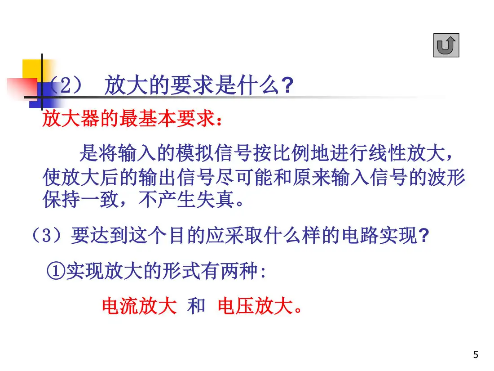

原文：

（2） 放大的要求是什么?

放大器的最基本要求：

是将输入的模拟信号按比例地进行线性放大，使放大后的输出信号尽可能和原来输入信号的波形保持一致，不产生失真。

（3）要达到这个目的应采取什么样的电路实现?

①实现放大的形式有两种:

电流放大 和 电压放大。

U

5

### 共射电路具有电流和电压放大

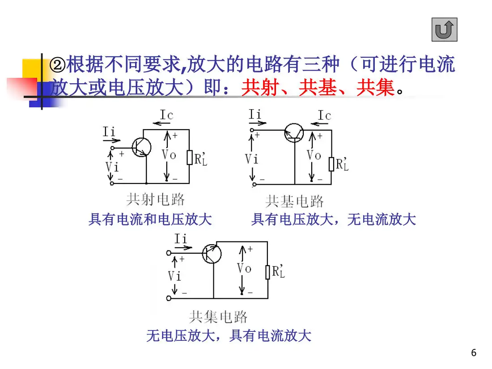

原文：

②根据不同要求,放大的电路有三种（可进行电流放大或电压放大）即：共射、共基、共集。

共射电路具有电流和电压放大

共基电路 具有电压放大，无电流放大

共集电路无电压放大，具有电流放大

U

6

### ③三种基本的放大电路各有什么特点，在什么场合下用什么电路？

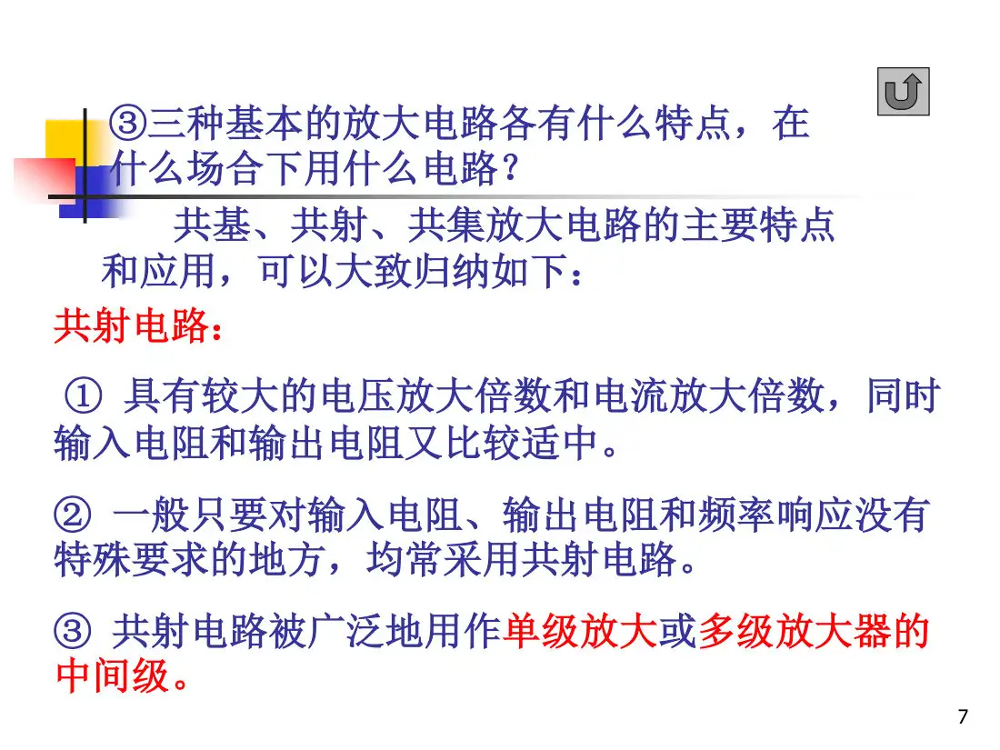

原文：

③三种基本的放大电路各有什么特点，在什么场合下用什么电路？

共基、共射、共集放大电路的主要特点和应用，可以大致归纳如下：

共射电路：

① 具有较大的电压放大倍数和电流放大倍数，同时输入电阻和输出电阻又比较适中。

② 一般只要对输入电阻、输出电阻和频率响应没有特殊要求的地方，均常采用共射电路。

③ 共射电路被广泛地用作单级放大或多级放大器的中间级。

U

7

### 共集电路：

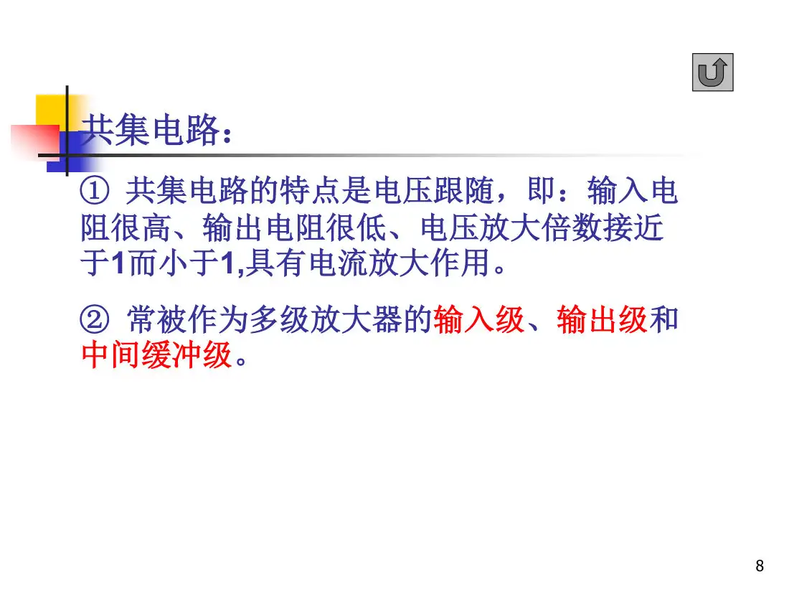

原文：

共集电路：

① 共集电路的特点是电压跟随，即：输入电阻很高、输出电阻很低、电压放大倍数接近于1而小于1,具有电流放大作用。

② 常被作为多级放大器的输入级、输出级和中间缓冲级。

U

8

### 共基电路：

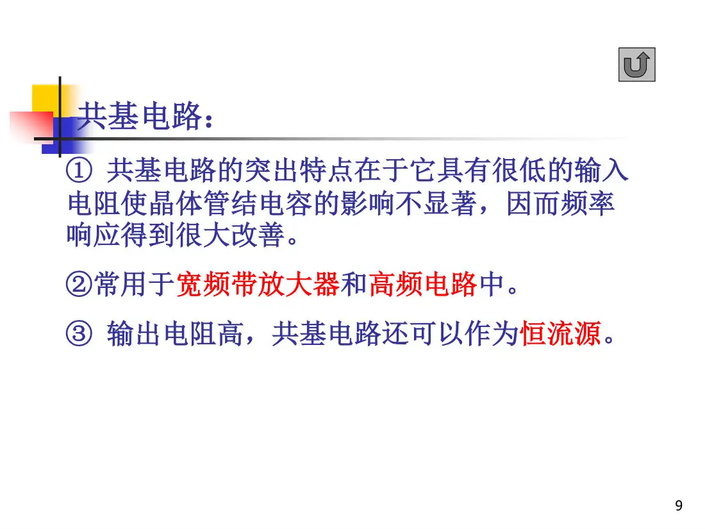

原文：

共基电路：

① 共基电路的突出特点在于它具有很低的输入电阻使晶体管结电容的影响不显著，因而频率响应得到很大改善。

②常用于宽频带放大器和高频电路中。

③ 输出电阻高，共基电路还可以作为恒流源。

U

9

### (4)为什么要设置直流工作点

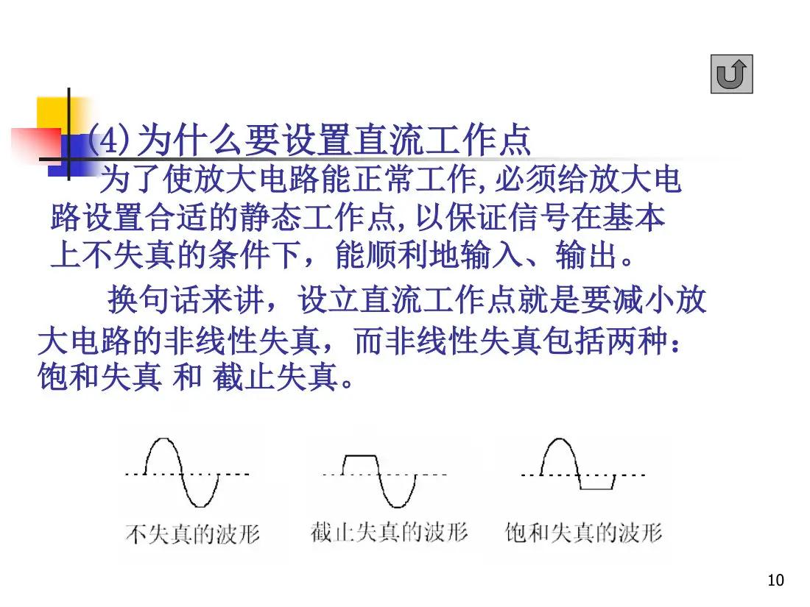

原文：

(4)为什么要设置直流工作点

为了使放大电路能正常工作,必须给放大电路设置合适的静态工作点,以保证信号在基本上不失真的条件下，能顺利地输入、输出。

换句话来讲，设立直流工作点就是要减小放大电路的非线性失真，而非线性失真包括两种：饱和失真 和 截止失真。

U

10

### 工作点偏高：会出现饱和失真；

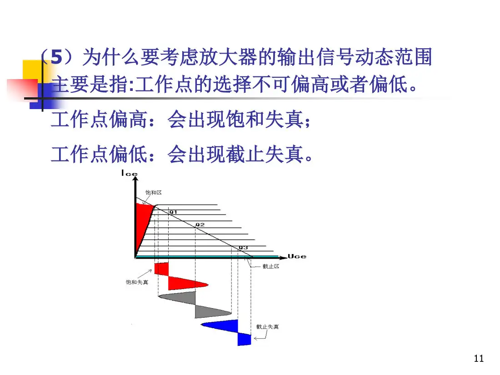

原文：

（5）为什么要考虑放大器的输出信号动态范围主要是指:工作点的选择不可偏高或者偏低。

工作点偏高：会出现饱和失真；

工作点偏低：会出现截止失真。

11

### 4、明确所有电路参数的物理含义以及对应用的影响。

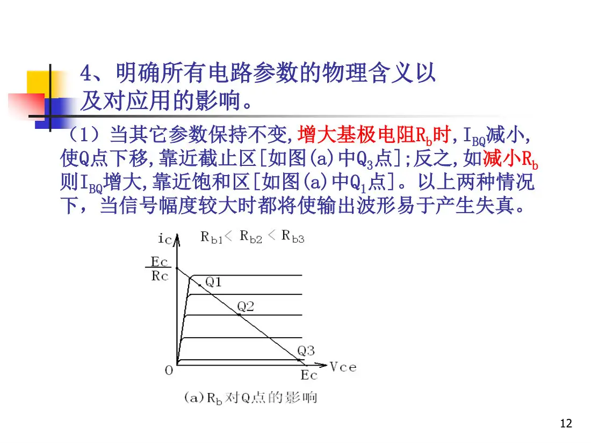

原文：

4、明确所有电路参数的物理含义以及对应用的影响。

（1）当其它参数保持不变,增大基极电阻 $\mathrm { R _ { b } }$ 时, ${ \mathrm { I } } _ { { \mathrm { B } } \Theta }$ 减小,使Q点下移,靠近截止区[如图(a)中 $\mathsf Q _ { 3 }$ 点];反之,如减小 $\mathbb { R } _ { \mathrm { b } }$ 则 ${ \mathrm { I } } _ { \mathsf { B Q } }$ 增大,靠近饱和区[如图(a)中 $\mathsf Q _ { 1 }$ 点]。以上两种情况下，当信号幅度较大时都将使输出波形易于产生失真。

12

### 13

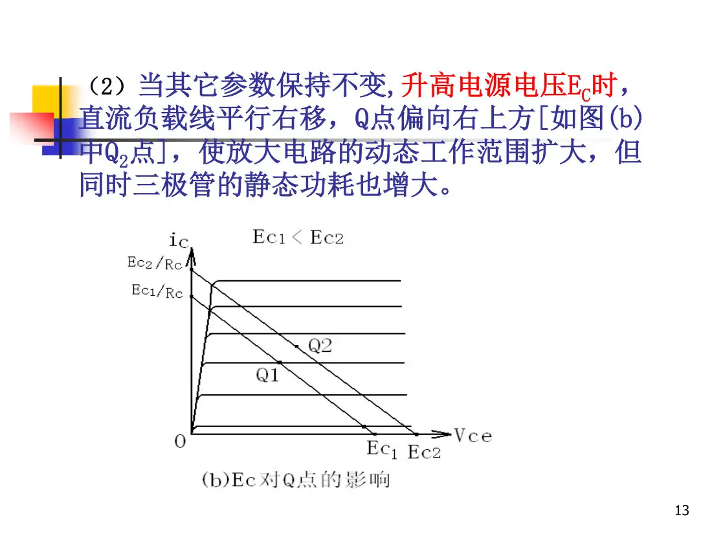

原文：

（2）当其它参数保持不变,升高电源电压 $\mathrm { E _ { C } }$ 时，直流负载线平行右移， $\mathsf { Q } _ { \pmb { \alpha } }$ 点偏向右上方[如图(b)中 $\overline { { \mathbf { Q } _ { 2 } } }$ 点]，使放大电路的动态工作范围扩大，但同时三极管的静态功耗也增大。

13

### 14

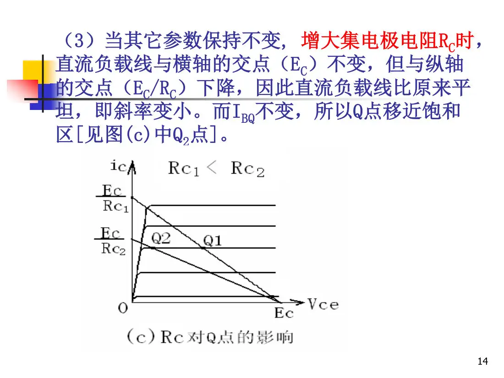

原文：

（3）当其它参数保持不变, 增大集电极电阻 $\mathrm { R _ { C } }$ 时，直流负载线与横轴的交点 $( \mathrm { E _ { C } } )$ 不变，但与纵轴的交点 $( \mathrm { E _ { c } / R _ { c } } )$ 下降，因此直流负载线比原来平坦，即斜率变小。而 $\mathrm { I _ { B Q } }$ 不变，所以Q点移近饱和区[见图(c)中 $\mathbf { Q } _ { 2 }$ 点]。

14

### 15

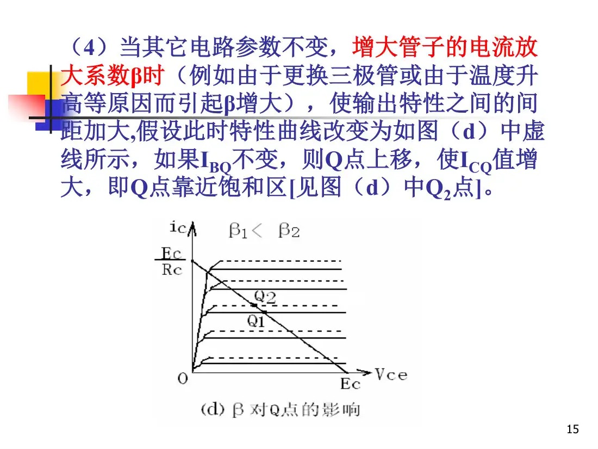

原文：

（4）当其它电路参数不变，增大管子的电流放大系数β时（例如由于更换三极管或由于温度升高等原因而引起β增大），使输出特性之间的间距加大,假设此时特性曲线改变为如图（d）中虚线所示，如果 $\mathbf { I _ { B Q } }$ 不变，则Q点上移，使 $\mathbf { I } _ { \mathbf { C Q } }$ 值增大，即Q点靠近饱和区[见图（d）中 $\mathbf { Q } _ { 2 }$ 点]。

15

### 5、电压放大、电流放大、功率放大倍数对实际应用的意义

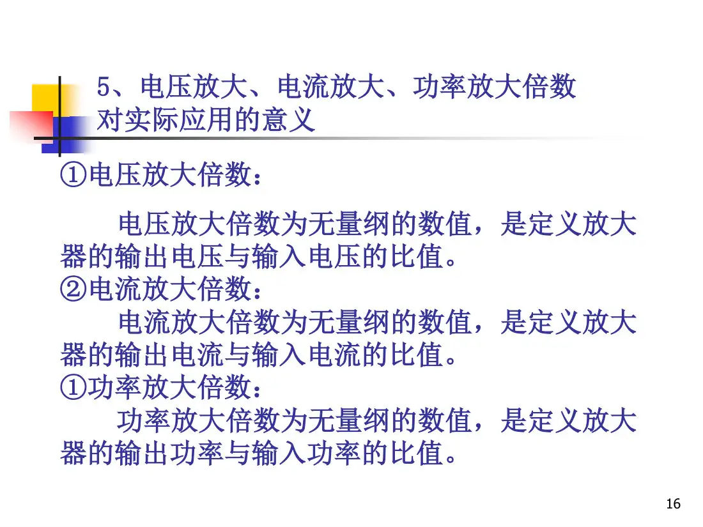

原文：

5、电压放大、电流放大、功率放大倍数对实际应用的意义

①电压放大倍数：

电压放大倍数为无量纲的数值，是定义放大器的输出电压与输入电压的比值。

②电流放大倍数：

电流放大倍数为无量纲的数值，是定义放大器的输出电流与输入电流的比值。

①功率放大倍数：

功率放大倍数为无量纲的数值，是定义放大器的输出功率与输入功率的比值。

16

### 6、输入电阻、输出电阻、幅频特性对实际应用的意义

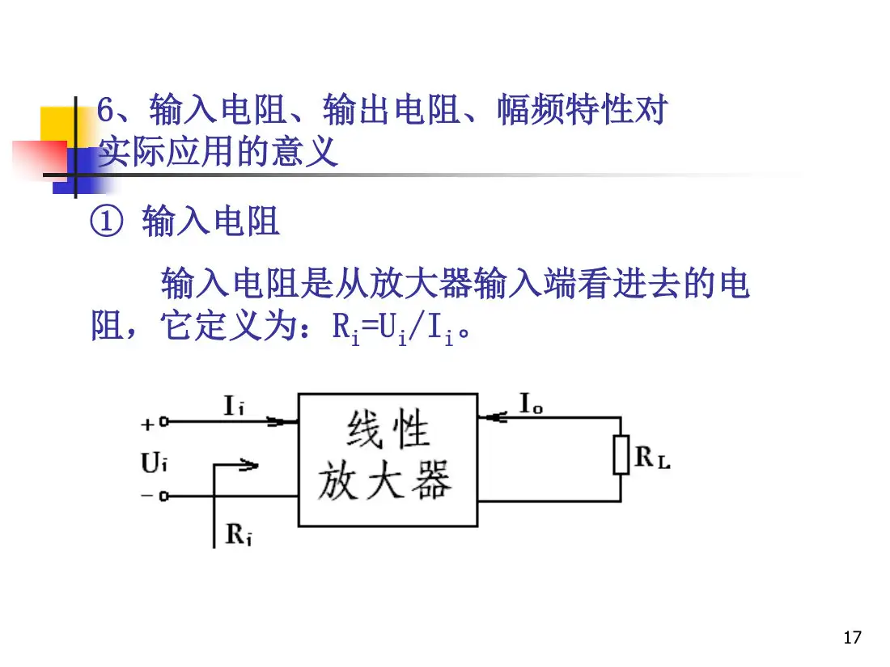

原文：

6、输入电阻、输出电阻、幅频特性对实际应用的意义

① 输入电阻

输入电阻是从放大器输入端看进去的电阻，它定义为： $\mathrm { R _ { i } { = } U _ { i } / I _ { i } }$ 0

17

### R实际应用的意义：

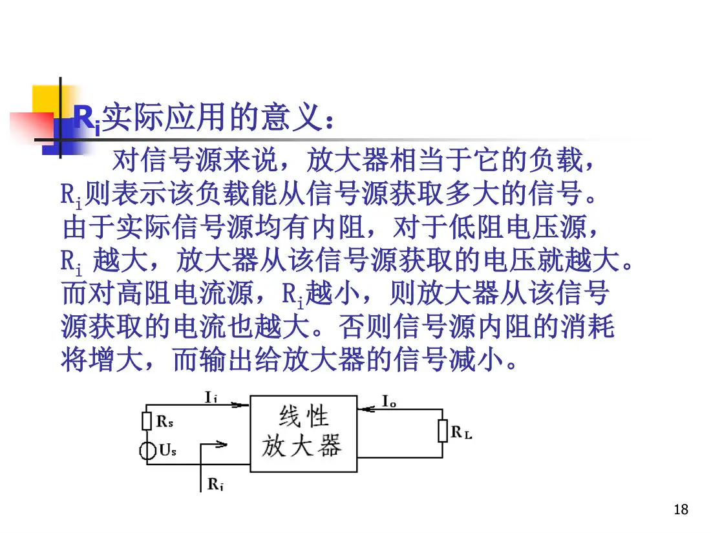

原文：

R实际应用的意义：

对信号源来说，放大器相当于它的负载，$\mathrm { R } _ { \mathrm { i } }$ 则表示该负载能从信号源获取多大的信号。由于实际信号源均有内阻，对于低阻电压源，$\mathrm { R } _ { \mathrm { i } }$ 越大，放大器从该信号源获取的电压就越大。而对高阻电流源， $\mathrm { R } _ { \mathrm { i } }$ 越小，则放大器从该信号源获取的电流也越大。否则信号源内阻的消耗将增大，而输出给放大器的信号减小。

18

### 输出电阻

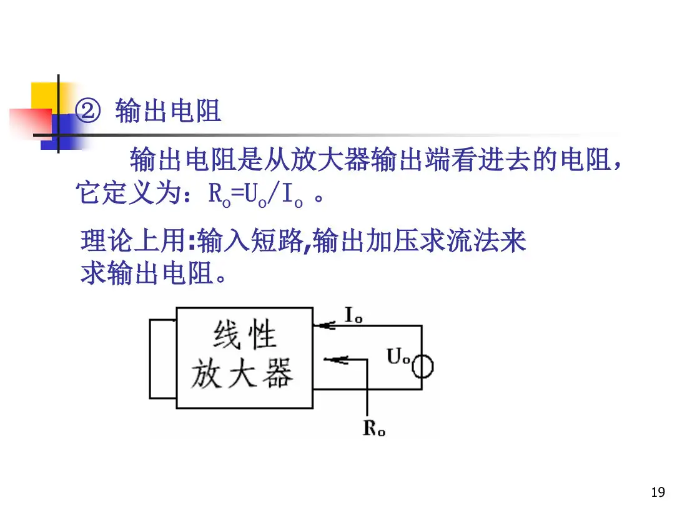

原文：

输出电阻

输出电阻是从放大器输出端看进去的电阻， 它定义为： $\mathrm { R } _ { \mathrm { o } } { = } \mathrm { U } _ { \mathrm { o } } / \mathrm { I } _ { \mathrm { o } }$ o

理论上用:输入短路,输出加压求流法来求输出电阻。

19

### 实际应用的意义：

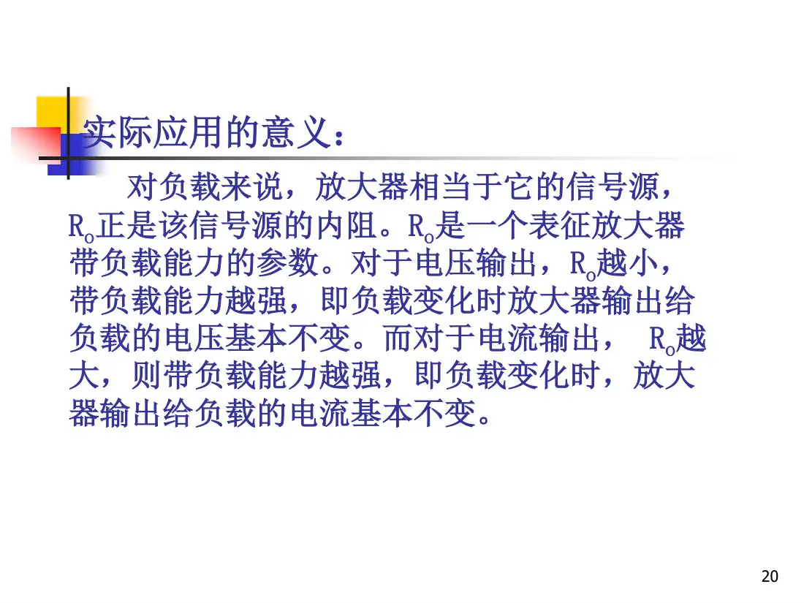

原文：

实际应用的意义：

对负载来说，放大器相当于它的信号源，$\mathrm { R } _ { \mathrm { o } }$ 正是该信号源的内阻。 $\mathrm { R } _ { \mathrm { o } }$ 是一个表征放大器带负载能力的参数。对于电压输出， $\mathrm { R } _ { \mathrm { o } }$ 越小，带负载能力越强，即负载变化时放大器输出给负载的电压基本不变。而对于电流输出， $\mathrm { R } _ { \mathrm { o } }$ 越大，则带负载能力越强，即负载变化时，放大器输出给负载的电流基本不变。

20

### ③ 幅频特性

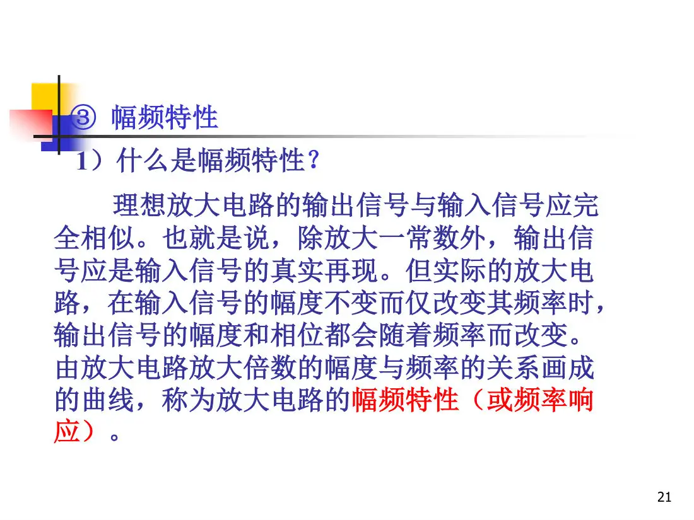

原文：

③ 幅频特性

1）什么是幅频特性？

理想放大电路的输出信号与输入信号应完全相似。也就是说，除放大一常数外，输出信号应是输入信号的真实再现。但实际的放大电路，在输入信号的幅度不变而仅改变其频率时，输出信号的幅度和相位都会随着频率而改变。由放大电路放大倍数的幅度与频率的关系画成的曲线，称为放大电路的幅频特性（或频率响应）。

21

### 2）是什么原因影响了放大器的工作质量？

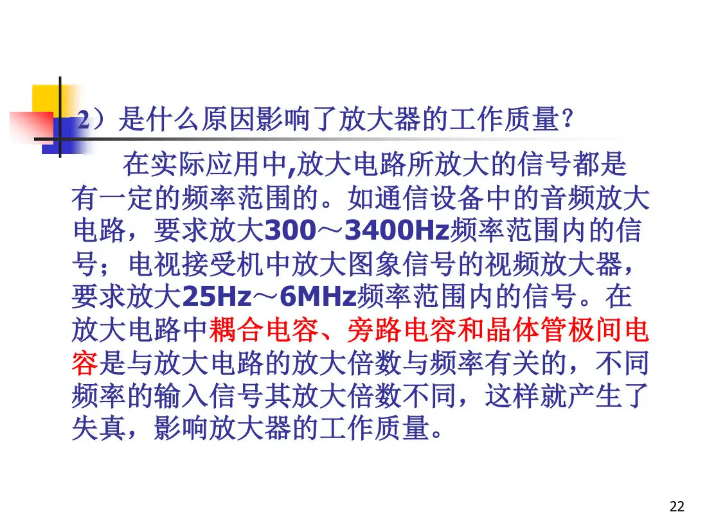

原文：

2）是什么原因影响了放大器的工作质量？

在实际应用中,放大电路所放大的信号都是有一定的频率范围的。如通信设备中的音频放大电路，要求放大300～3400Hz频率范围内的信号；电视接受机中放大图象信号的视频放大器，要求放大25Hz～6MHz频率范围内的信号。在放大电路中耦合电容、旁路电容和晶体管极间电容是与放大电路的放大倍数与频率有关的，不同频率的输入信号其放大倍数不同，这样就产生了失真，影响放大器的工作质量。

22

### 3）幅频特性的分析

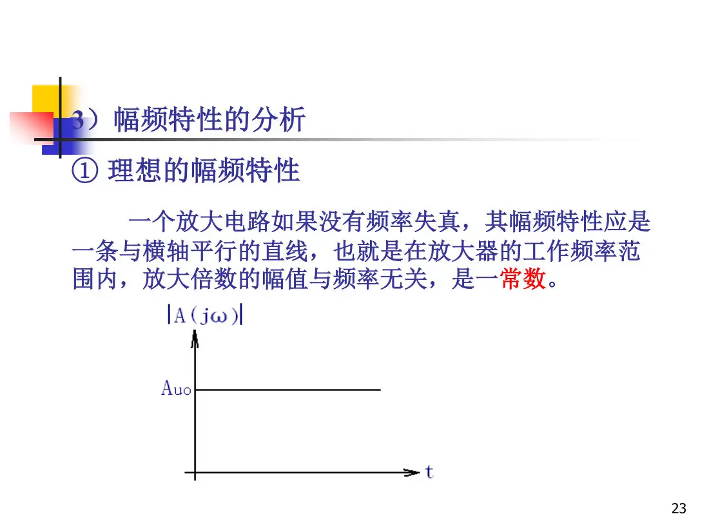

原文：

3）幅频特性的分析

① 理想的幅频特性

一个放大电路如果没有频率失真，其幅频特性应是一条与横轴平行的直线，也就是在放大器的工作频率范围内，放大倍数的幅值与频率无关，是一常数。

23

### ② 实际的幅频特性

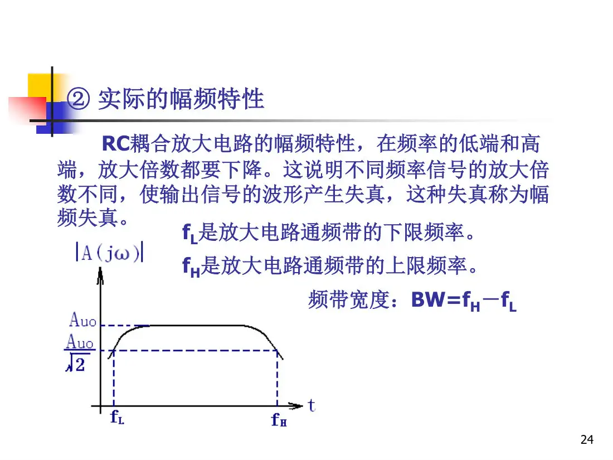

原文：

② 实际的幅频特性

RC耦合放大电路的幅频特性，在频率的低端和高端，放大倍数都要下降。这说明不同频率信号的放大倍数不同，使输出信号的波形产生失真，这种失真称为幅频失真。 目计大中收通频带的下阳频率

${ \sf f } _ { \mathrm { L } }$ 是放大电路通频带的下限频率。

|A (jω)|

f 是放大电路通频带的上限频率。

频带宽度： $\mathsf { B W } { = } \mathsf { f _ { H } } { - } \mathsf { f _ { L } }$

24

### ③ 影响幅频特性的原因是什么？

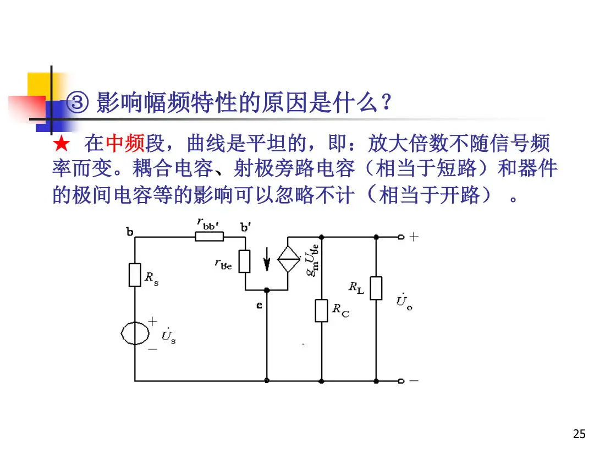

原文：

③ 影响幅频特性的原因是什么？

★ 在中频段，曲线是平坦的，即：放大倍数不随信号频率而变。耦合电容、射极旁路电容（相当于短路）和器件的极间电容等的影响可以忽略不计（相当于开路） 。

25

### 26

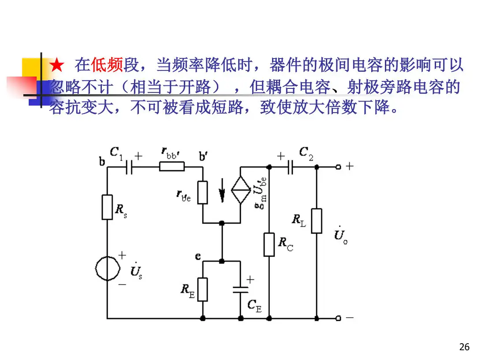

原文：

★ 在低频段，当频率降低时，器件的极间电容的影响可以忽略不计（相当于开路） ，但耦合电容、射极旁路电容的容抗变大，不可被看成短路，致使放大倍数下降。

26

### 27

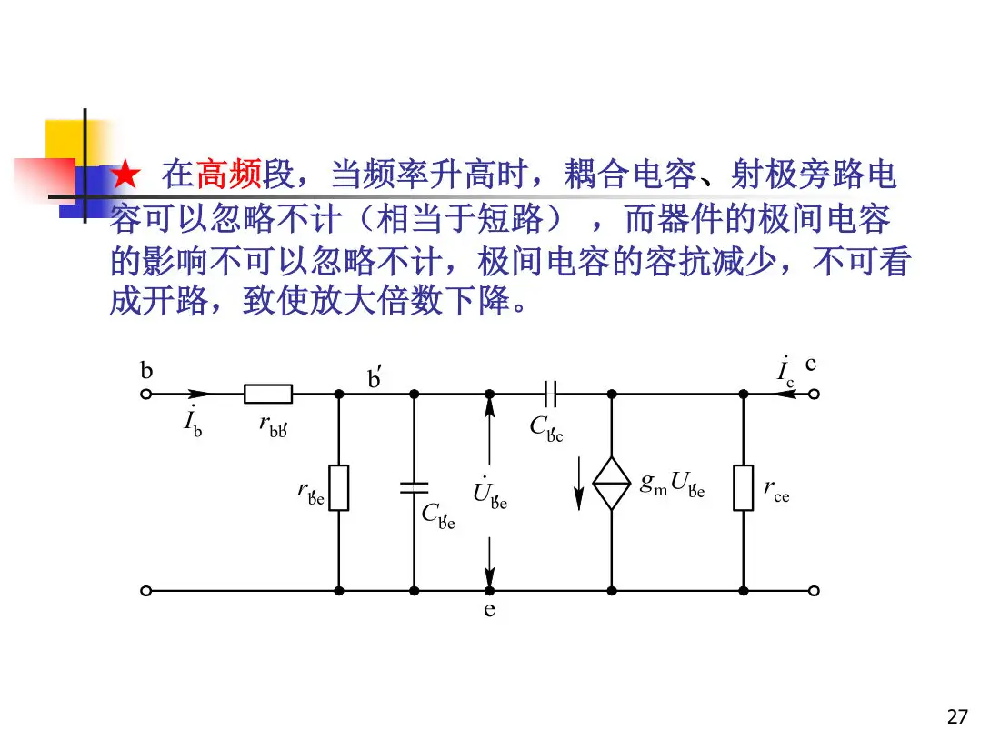

原文：

在高频段，当频率升高时，耦合电容、射极旁路电容可以忽略不计（相当于短路） ，而器件的极间电容的影响不可以忽略不计，极间电容的容抗减少，不可看成开路，致使放大倍数下降。

27

### 7、单级放大电路原理分析举例（P120）

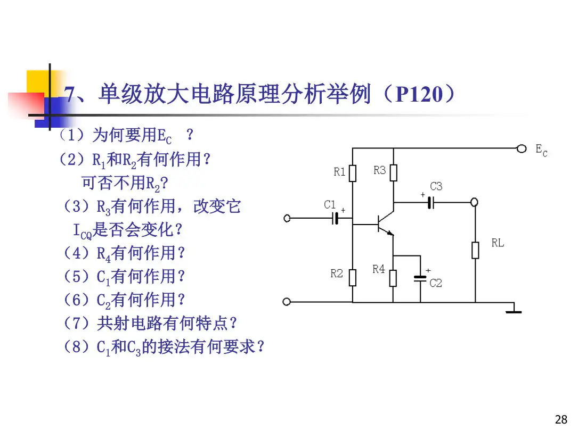

原文：

7、单级放大电路原理分析举例（P120）

（1）为何要用 $\mathrm { E _ { C } }$ ？

（2） $\mathrm { R _ { 1 } }$ 和 $\mathrm { R _ { 2 } }$ 有何作用？可否不用 $\mathrm { R _ { 2 } } ?$

（3） $\mathtt { R } _ { 3 }$ 有何作用，改变它${ \mathrm { I } } _ { \mathrm { C Q } }$ 是否会变化？

（4） $\mathtt { R _ { 4 } }$ 有何作用？

（5） $\mathrm { C _ { 1 } }$ 有何作用？

（6） $\mathrm { C } _ { 2 }$ 有何作用？

（7）共射电路有何特点？

（8） $\mathrm { C _ { 1 } }$ 和 $\mathrm { { C } _ { 3 } }$ 的接法有何要求？

28

### （3）Au偏小应调整哪些元件？

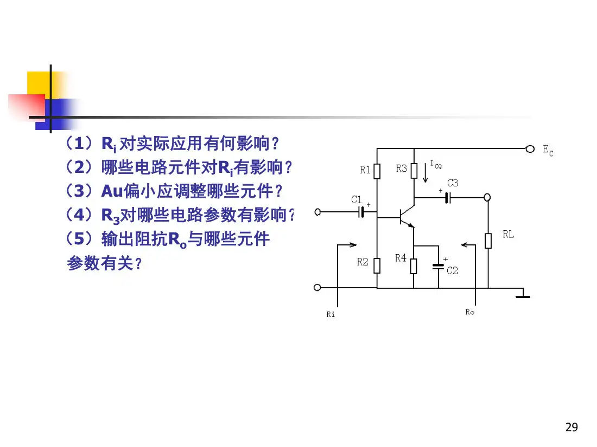

原文：

（1） $\mathbb { R } _ { \mathrm { j } }$ 对实际应用有何影响？

（2）哪些电路元件对 $\mathbb { R } _ { \mathrm { i } }$ 有影响？

（3）Au偏小应调整哪些元件？

（4） $\mathbb { R } _ { 3 }$ 对哪些电路参数有影响？

（5）输出阻抗 $\mathbb { R } _ { \mathfrak { o } }$ 与哪些元件参数有关？

29

### 二、单级放大电路的设计指导

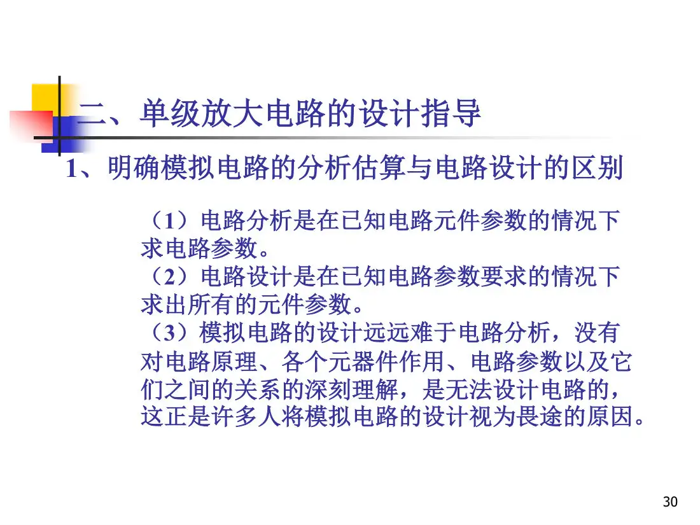

原文：

二、单级放大电路的设计指导

1、明确模拟电路的分析估算与电路设计的区别

（1）电路分析是在已知电路元件参数的情况下求电路参数。

（2）电路设计是在已知电路参数要求的情况下求出所有的元件参数。

（3）模拟电路的设计远远难于电路分析，没有对电路原理、各个元器件作用、电路参数以及它们之间的关系的深刻理解，是无法设计电路的，这正是许多人将模拟电路的设计视为畏途的原因。

30

### 2、模拟电路设计基本思路

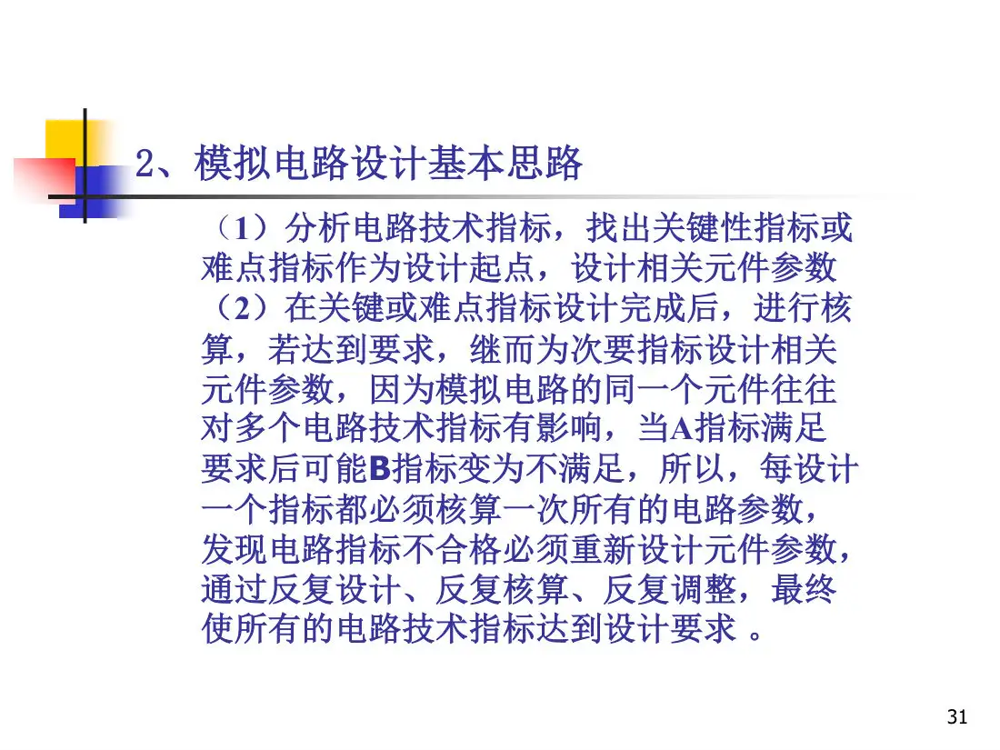

原文：

2、模拟电路设计基本思路

（1）分析电路技术指标，找出关键性指标或难点指标作为设计起点，设计相关元件参数

（2）在关键或难点指标设计完成后，进行核算，若达到要求，继而为次要指标设计相关元件参数，因为模拟电路的同一个元件往往对多个电路技术指标有影响，当A指标满足要求后可能B指标变为不满足，所以，每设计一个指标都必须核算一次所有的电路参数，发现电路指标不合格必须重新设计元件参数，通过反复设计、反复核算、反复调整，最终使所有的电路技术指标达到设计要求 。

31

### 3、模拟电路设计注意事项

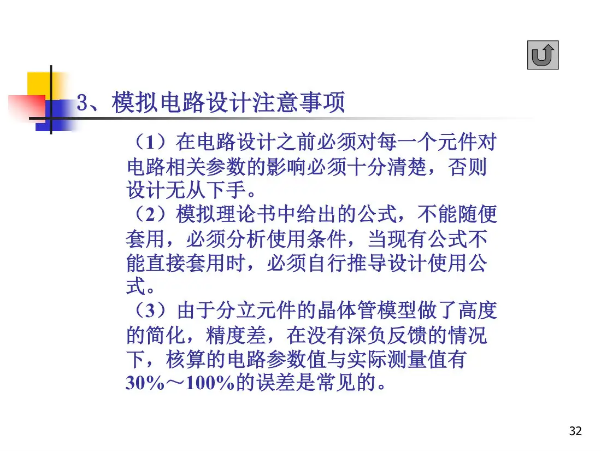

原文：

3、模拟电路设计注意事项

（1）在电路设计之前必须对每一个元件对电路相关参数的影响必须十分清楚，否则设计无从下手。

（2）模拟理论书中给出的公式，不能随便套用，必须分析使用条件，当现有公式不能直接套用时，必须自行推导设计使用公式。

（3）由于分立元件的晶体管模型做了高度的简化，精度差，在没有深负反馈的情况下，核算的电路参数值与实际测量值有30%～100%的误差是常见的。

U

32

### （4）设计说明事项:

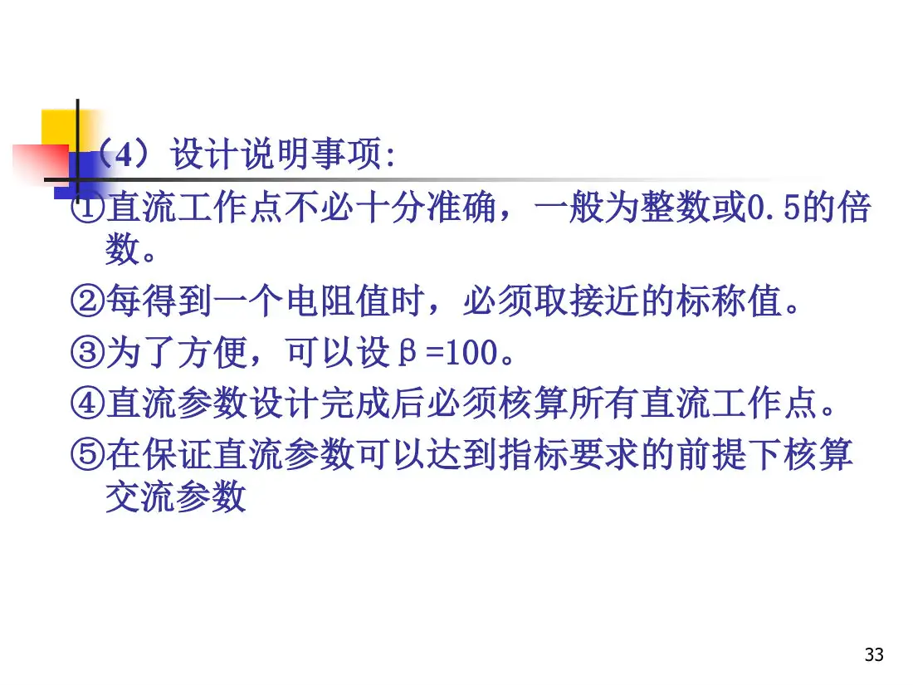

原文：

（4）设计说明事项:

①直流工作点不必十分准确，一般为整数或0.5的倍数。

②每得到一个电阻值时，必须取接近的标称值。

③为了方便，可以设β=100。

④直流参数设计完成后必须核算所有直流工作点。

⑤在保证直流参数可以达到指标要求的前提下核算交流参数

33

### 设计举例：晶体管单级放大电路

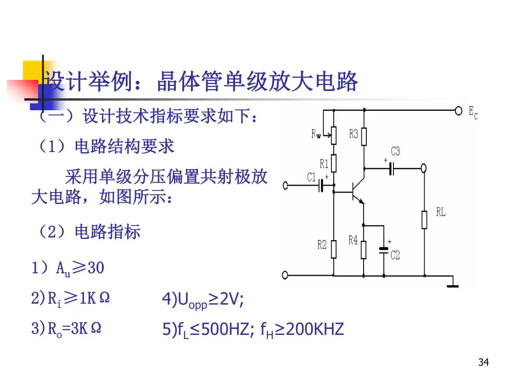

原文：

设计举例：晶体管单级放大电路

（一）设计技术指标要求如下：

（1）电路结构要求

采用单级分压偏置共射极放大电路，如图所示：

（2）电路指标

1） $\mathtt { A _ { u } } \geqslant 3 0$

$$
2) \mathrm {R_ {i}} \geqslant 1 \mathrm{K} \Omega
$$

$$
3) \mathrm{R} _ {\mathrm{o}} = 3 \mathrm{K} \Omega
$$

$$
4) U _ {\mathrm{opp}} \geq 2 V;
$$

$$
5) f _ {L} \leq 5 0 0 H Z; f _ {H} \geq 2 0 0 K H Z
$$

34

### （3）设计条件

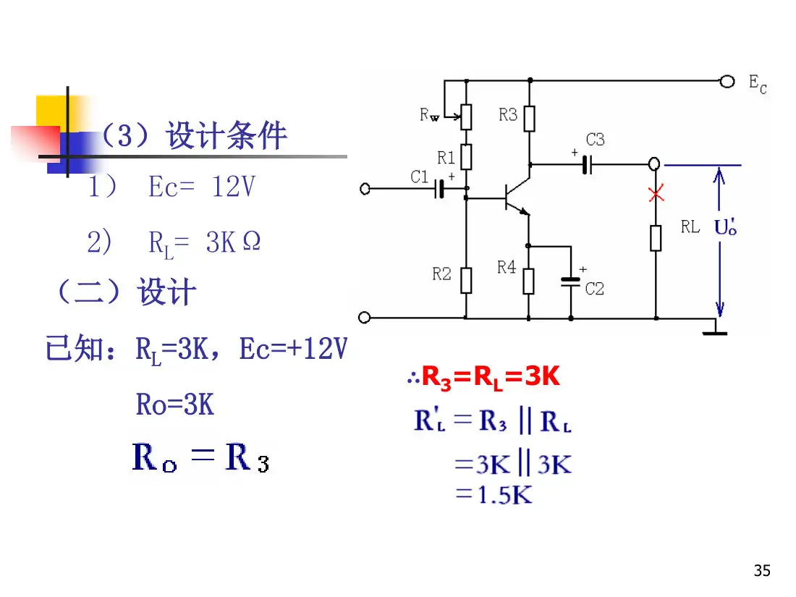

原文：

（3）设计条件

1） $\mathrm { E c } = ~ 1 2 \mathrm { V }$

2) $\mathrm { R _ { L } } ^ { } = \ 3 \mathrm { K } \ \Omega$

（二）设计

已知： $\mathrm { R _ { L } } { = } 3 \mathrm { K }$ 9 $\mathrm { E c = + 1 2 V }$

$$
\mathrm{Ro} = 3 \mathrm{K}
$$

$$
\mathrm{R} _ {0} = \mathrm{R} _ {3}
$$

$$
\therefore R _ {3} = R _ {L} = 3 K
$$

$$
\begin{array}{r l} \mathrm {R_ {L} ^ {\prime}} & = \mathrm {R_ {3}} | | \mathrm {R_ {L}} \\ & = 3 \mathrm{K} | | 3 \mathrm{K} \\ & = 1. 5 \mathrm{K} \end{array}
$$

35

### 从最大的动态范围考虑

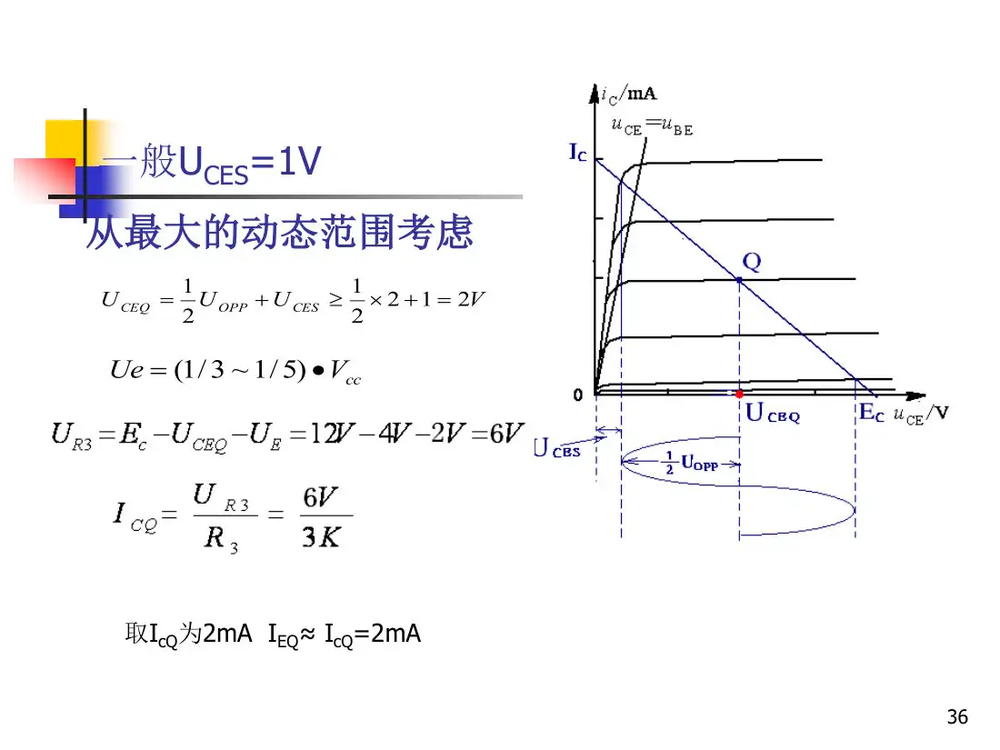

原文：

一般U $\rvert _ { \mathsf { C E S } } = 1 \vee$

从最大的动态范围考虑

$$
U _ {C E Q} = \frac {1}{2} U _ {O P P} + U _ {C E S} \geq \frac {1}{2} \times 2 + 1 = 2 V
$$

$$
U e = (1 / 3 \sim 1 / 5) \bullet V _ {c c}
$$

$$
U _ {R 3} = E _ {c} - U _ {C E Q} - U _ {E} = 1 2 V - 4 V - 2 V = 6 V
$$

$$
I _ {C Q} = \frac {U _ {R 3}}{R _ {3}} = \frac {6 V}{3 K}
$$

$\mathbb { H } \mathbb { \backslash } _ { \mathtt { c Q } }$ 为2mA $\mathtt { I } _ { \mathtt { E Q } } \approx \mathtt { I } _ { \mathtt { c Q } } = 2 \mathtt { m A }$

36

### Re的确立： $\beta = 1 0 0$

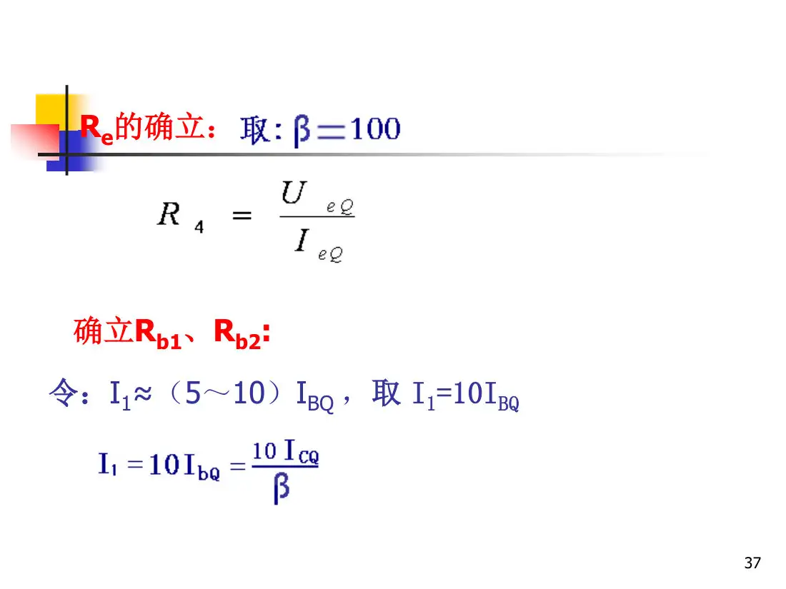

原文：

Re的确立： $\beta = 1 0 0$

$$
R _ {4} = \frac {U _ {e Q}}{I _ {e Q}}
$$

确立 $\mathbb { R } _ { \mathrm { b } 1 } \setminus \mathbb { R } _ { \mathrm { b } 2 } \scriptscriptstyle \equiv$

令： $\mathrm { I } _ { 1 } { \approx } ~ ( 5 { \sim } 1 0 ) ~ \mathrm { I } _ { \mathsf { B Q } }$ ，取 $I _ { 1 } { = } 1 0 \mathrm { I } _ { \mathrm { B Q } }$

$$
\mathrm{I} _ {1} = 1 0 \mathrm{I} _ {\mathrm{bQ}} = \frac {1 0 \mathrm{I} _ {\mathrm{cQ}}}{\beta}
$$

37

### $$

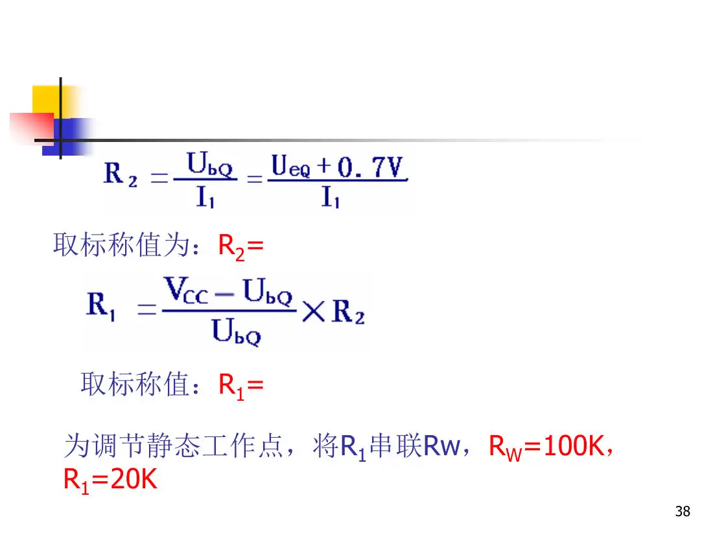

原文：

$$
\mathrm{R} _ {2} = \frac {\mathrm{U} _ {\mathrm{bQ}}}{\mathrm{I} _ {1}} = \frac {\mathrm{U} _ {\mathrm{eq}} + 0 . 7 \mathrm{V}}{\mathrm{I} _ {1}}
$$

取标称值为： $\mathsf { R } _ { 2 } \equiv$

$$
\mathrm{R} _ {1} = \frac {\mathrm{V} _ {\mathrm{CC}} - \mathrm{U} _ {\mathrm{bQ}}}{\mathrm{U} _ {\mathrm{bQ}}} \times \mathrm{R} _ {2}
$$

取标称值： $\mathsf { R } _ { 1 } =$

为调节静态工作点，将 $\mathsf { R } _ { 1 }$ 串联Rw， $\mathsf { R } _ { \mathsf { W } } { = } 1 0 0 \mathsf { K }$ $\mathsf { R } _ { 1 } \mathsf { = } 2 0 \mathsf { K }$

38

### (3)工作点越低，输入阻抗越大，对改善低频响应有好处。

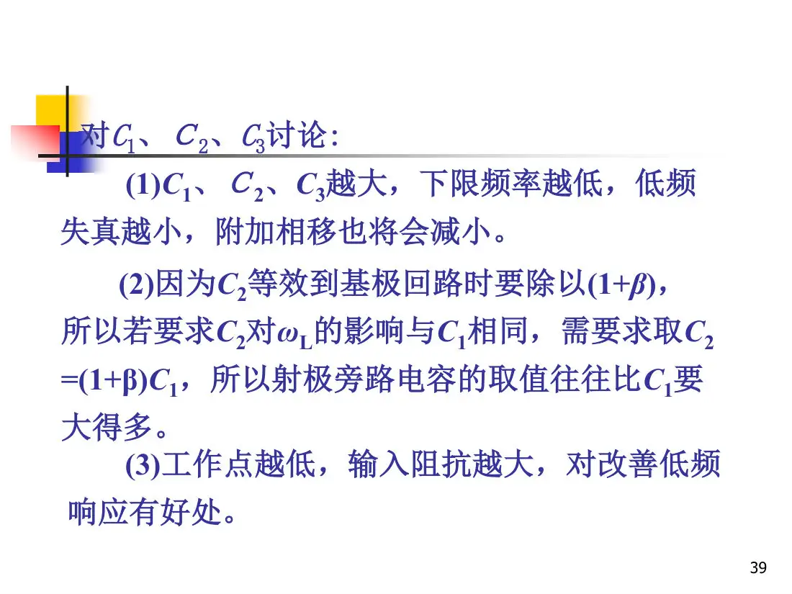

原文：

对 $C _ { 1 }$ 77 $C _ { 2 } .$ $C _ { 3 }$ 讨论:

(1) $C _ { 1 } ,$ 、 $C _ { 2 } .$ $C _ { 3 }$ 越大，下限频率越低，低频失真越小，附加相移也将会减小。

(2)因为 $C _ { 2 }$ 等效到基极回路时要除以 $( 1 + \beta )$ 所以若要求 $C _ { 2 }$ 对 $\mathbf { \omega } _ { \mathrm { L } }$ 的影响与 $C _ { 1 }$ 相同，需要求取 $C _ { 2 }$ $= ( 1 + \beta ) C _ { 1 }$ ，所以射极旁路电容的取值往往比 $C _ { 1 }$ 要大得多。

(3)工作点越低，输入阻抗越大，对改善低频响应有好处。

39

### $$

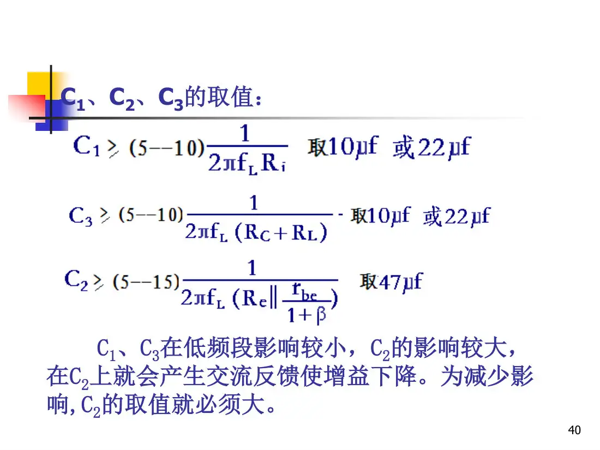

原文：

$\mathsf C _ { 1 } , \mathsf C _ { 2 } , \mathsf C _ { 3 }$ 的取值：

$$
\mathrm{C} _ {1} \geq (5 -- 1 0) \frac {1}{2 \pi f _ {\mathrm{L}} R _ {i}} \text { 取 } 1 0 \mu \mathrm{f} \text { 或 } 2 2 \mu \mathrm{f}
$$

$$
\mathrm{C} _ {3} \geq (5 -- 1 0) \frac {1}{2 \pi f _ {\mathrm{L}} (\mathrm{R} _ {\mathrm{C}} + \mathrm{R} _ {\mathrm{L}})} \cdot \text { 取 } 1 0 \mu \mathrm{f} \text { 或 } 2 2 \mu \mathrm{f}
$$

$$
\mathrm{C} _ {2} \geq (5 -- 1 5) \frac {1}{2 \pi f _ {\mathrm{L}} (\mathrm{Re} \| \frac {\mathbf {r} _ {\mathrm{be}}}{1 + \beta})} \quad \text { 取 } 4 7 \mu \mathrm{f}
$$

$\mathrm { C _ { 1 } , \ C _ { 3 } }$ 在低频段影响较小， $\mathrm { C } _ { 2 }$ 的影响较大，在 $\mathrm { C } _ { 2 }$ 上就会产生交流反馈使增益下降。为减少影响, $\mathrm { C } _ { 2 }$ 的取值就必须大。

40

### 41

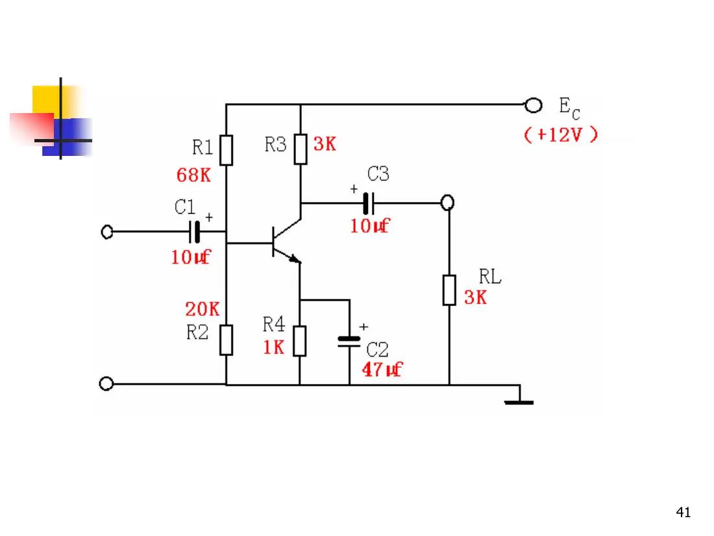

原文：

41

### 将以上值代入验算：

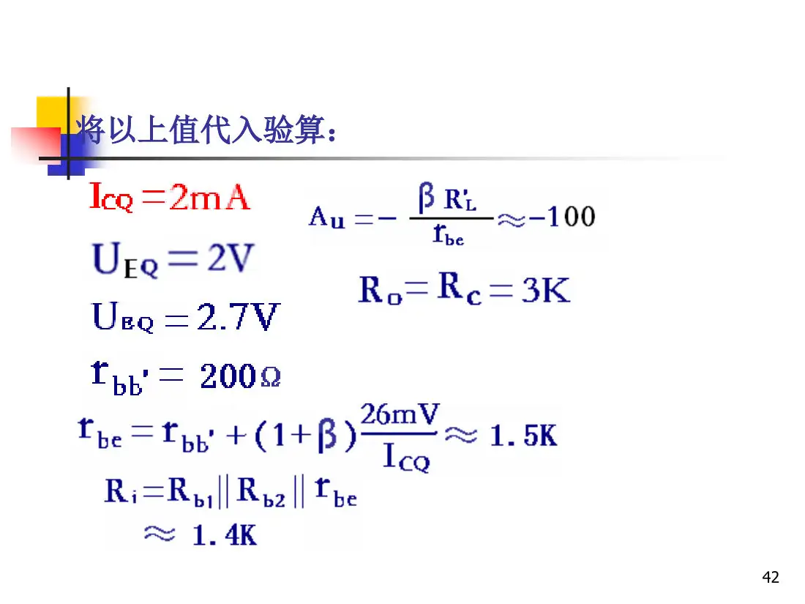

原文：

将以上值代入验算：

$$
\mathrm{Icq} = 2 \mathrm{mA}
$$

$$
\mathrm{Au} = - \frac {\beta \mathrm {R_ {L} ^ {\prime}}}{\mathrm {r_ {be}}} \approx - 1 0 0
$$

$$
\mathrm{U} _ {\mathrm{EQ}} = 2 \mathrm{V}
$$

$$
\mathrm{R} _ {\mathrm{o}} = \mathrm{R} _ {\mathrm{c}} = 3 \mathrm{K}
$$

$$
\mathrm{U} _ {\mathrm{EQ}} = 2. 7 \mathrm{V}
$$

$$
\mathbf {r} _ {\mathrm{bb} ^ {\prime}} = 2 0 0 \Omega
$$

$$
\mathbf {r} _ {\mathrm{be}} = \mathbf {r} _ {\mathrm {bb^ {\prime}}} + (1 + \beta) \frac {2 6 \mathrm{mV}}{\mathrm {I_ {CQ}}} \approx 1. 5 \mathrm{K}
$$

$$
\begin{array}{r l} \mathrm {R_ {i}} & = \mathrm {R_ {b1}} | | \mathrm {R_ {b2}} | | \mathrm {\mathbf {r} _ {be}} \\ & \approx 1. 4 \mathrm{K} \end{array}
$$

42

### ▪ 设计参考公式

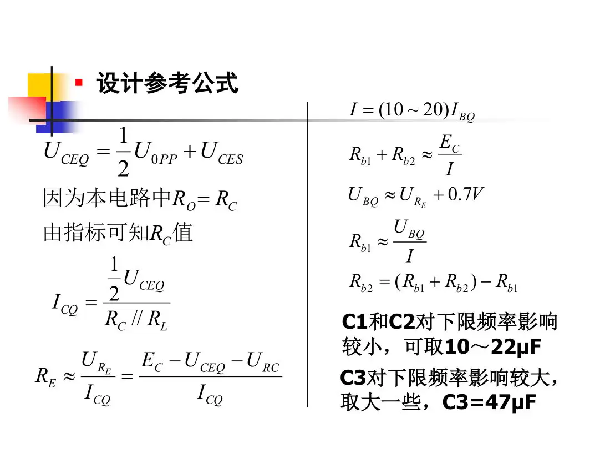

原文：

<table><tr><td></td><td> $I = (10 \sim 20)I_{BQ}$ </td></tr><tr><td> $U_{CEQ} = \frac{1}{2}U_{0PP} + U_{CES}$ </td><td> $R_{b1} + R_{b2} \approx \frac{E_C}{I}$ </td></tr><tr><td>因为本电路中 $R_O = R_C$ </td><td> $U_{BQ} \approx U_{R_E} + 0.7V$ </td></tr><tr><td>由指标可知 $R_C$ 值</td><td> $R_{b1} \approx \frac{U_{BQ}}{I}$ </td></tr><tr><td> $I_{CQ} = \frac{\frac{1}{2}U_{CEQ}}{R_C // R_L}$ </td><td> $R_{b2} = (R_{b1} + R_{b2}) - R_{b1}$ </td></tr><tr><td> $R_E \approx \frac{U_{R_E}}{I_{CQ}} = \frac{E_C - U_{CEQ} - U_{RC}}{I_{CQ}}$ </td><td>C1和C2对下限频率影响较小,可取10~22μF C3对下限频率影响较大,取大一些,C3=47μF</td></tr></table>

▪ 设计参考公式

### 设计过程

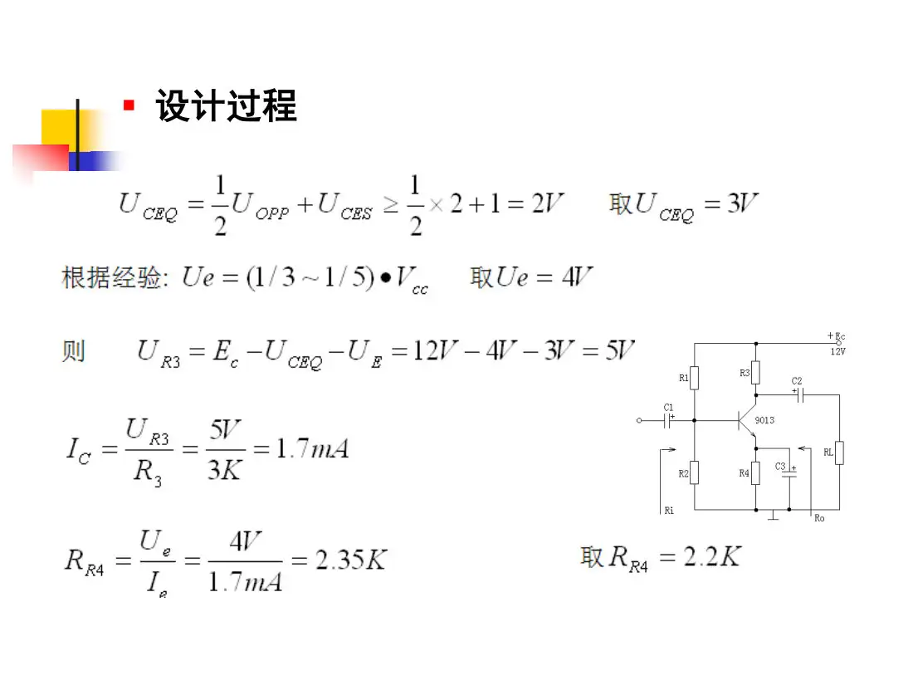

原文：

设计过程

$$
U _ {C E Q} = \frac {1}{2} U _ {O P P} + U _ {C E S} \geq \frac {1}{2} \times 2 + 1 = 2 V \quad \text {取} U _ {C E Q} = 3 V
$$

根据经验: $U e = ( 1 / 3 \sim 1 / 5 ) \bullet V _ { c c } \sharp \chi U e = 4 V$

则

$$
U _ {R 3} = E _ {c} - U _ {C E Q} - U _ {E} = 1 2 V - 4 V - 3 V = 5 V
$$

$$
I _ {C} = \frac {U _ {R 3}}{R _ {3}} = \frac {5 V}{3 K} = 1. 7 m A
$$

$$
R _ {R 4} = \frac {U _ {e}}{I _ {e}} = \frac {4 V}{1 . 7 m A} = 2. 3 5 K
$$

$$
\mathrm{取} R _ {R 4} = 2. 2 K
$$

### ▪ 设计过程

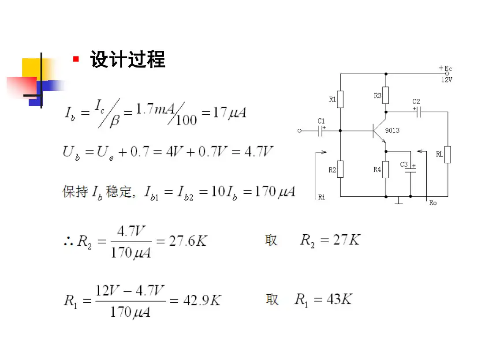

原文：

▪ 设计过程

$$
I _ {b} = \frac {I _ {c}}{\beta} = 1. 7 m A / 1 0 0 = 1 7 \mu A
$$

$$
U _ {b} = U _ {e} + 0. 7 = 4 V + 0. 7 V = 4. 7 V
$$

保持 $I _ { b }$ 稳定， $I _ { b 1 } = I _ { b 2 } = 1 0 I _ { b } = 1 7 0 \mu A$

$$
\therefore R _ {2} = \frac {4 . 7 V}{1 7 0 \mu A} = 2 7. 6 K
$$

$$
\text {取} \quad R _ {2} = 2 7 K
$$

$$
R _ {1} = \frac {1 2 V - 4 . 7 V}{1 7 0 \mu A} = 4 2. 9 K
$$

$$
\text {取} \quad R _ {1} = 4 3 K
$$

### ▪ 设计过程

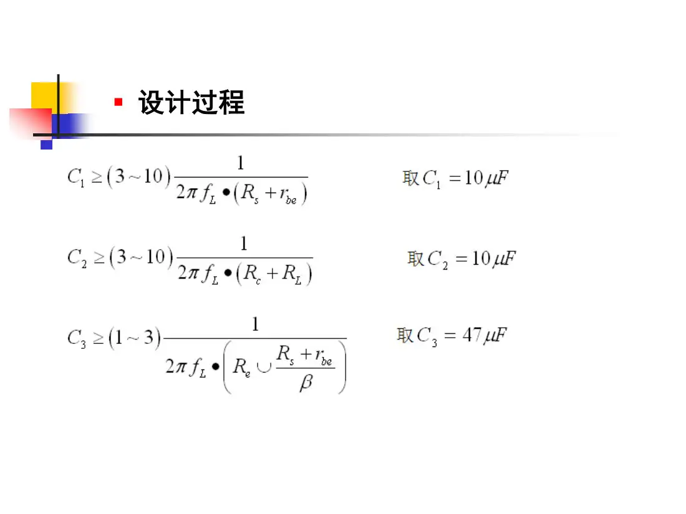

原文：

▪ 设计过程

$$
C _ {1} \geq (3 \sim 1 0) \frac {1}{2 \pi f _ {L} \bullet \left(R _ {s} + r _ {b e}\right)}
$$

$$
C _ {2} \geq (3 \sim 1 0) \frac {1}{2 \pi f _ {L} \bullet \left(R _ {c} + R _ {L}\right)}
$$

$$
C _ {3} \geq (1 \sim 3) \frac {1}{2 \pi f _ {L} \bullet \left(R _ {e} \cup \frac {R _ {s} + r _ {b e}}{\beta}\right)}
$$

$$
\mathrm{取} C _ {1} = 1 0 \mu F
$$

$$
\mathrm{取} C _ {2} = 1 0 \mu F
$$

取 $C _ { 3 } = 4 7 \mu F$

### 三、模拟电路的装配

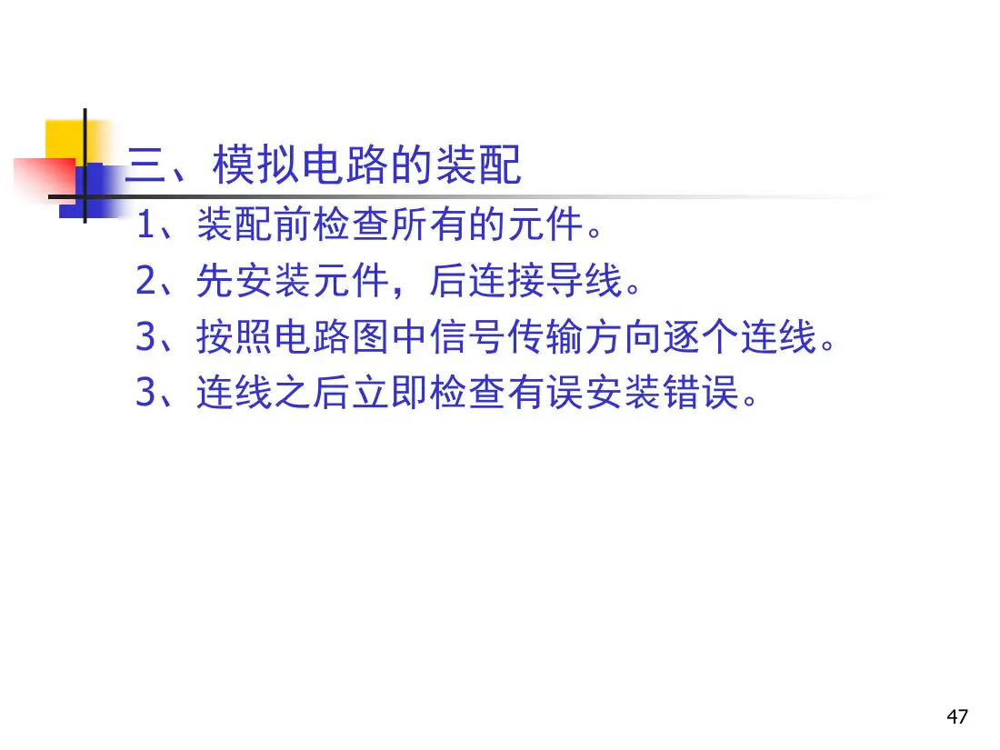

原文：

三、模拟电路的装配

1、装配前检查所有的元件。

2、先安装元件，后连接导线。

3、按照电路图中信号传输方向逐个连线。

3、连线之后立即检查有误安装错误。

47

### 安插元件的方法介绍：

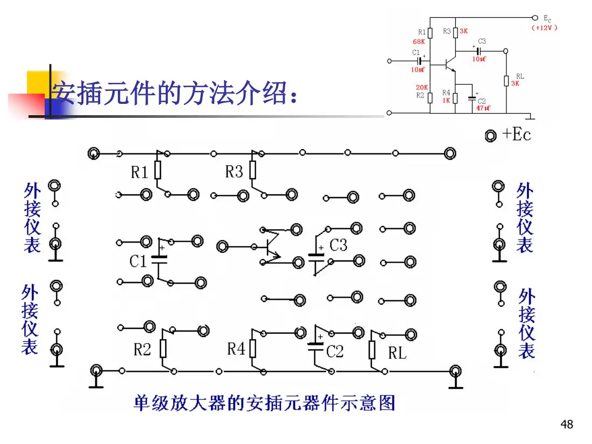

原文：

安插元件的方法介绍：

48

### 电路连线的方法介绍：

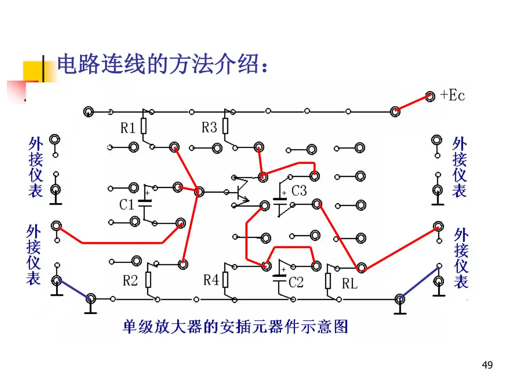

原文：

电路连线的方法介绍：

49

### 注 意 事 项

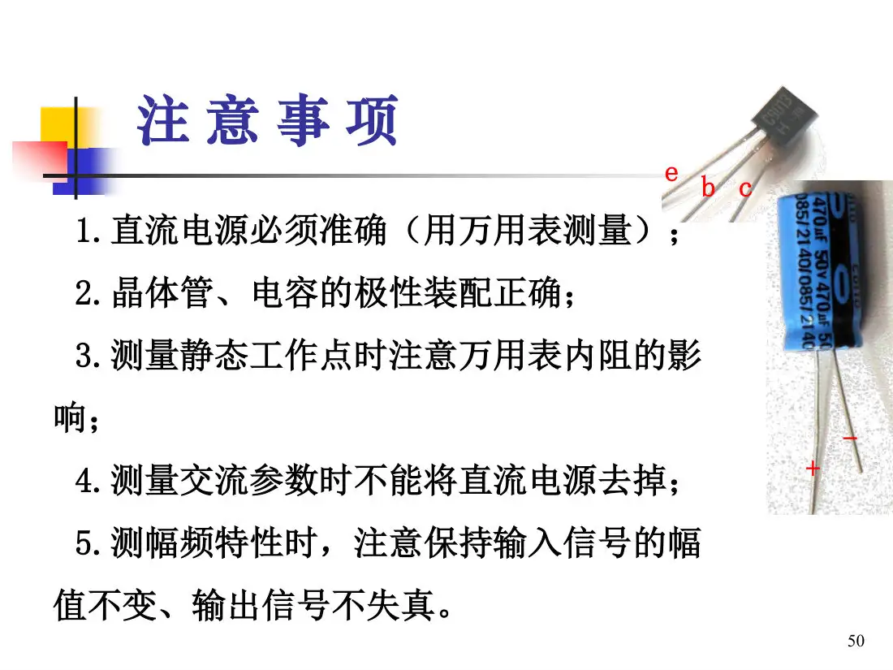

原文：

注 意 事 项

1.直流电源必须准确（用万用表测量）；

2.晶体管、电容的极性装配正确；

3.测量静态工作点时注意万用表内阻的影响；

4.测量交流参数时不能将直流电源去掉；

5.测幅频特性时，注意保持输入信号的幅值不变、输出信号不失真。

50

### 四、模拟电路参数的调测

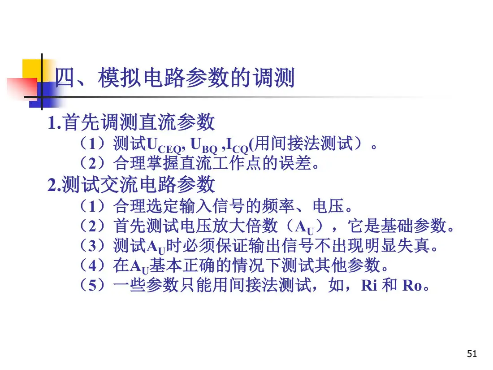

原文：

四、模拟电路参数的调测

1.首先调测直流参数

（1）测试 $\mathbf { U } _ { \mathbf { C E O } } , \mathbf { U } _ { \mathbf { B O } } , \mathbf { I } _ { \mathbf { C O } } ($ (用间接法测试）。

（2）合理掌握直流工作点的误差。

2.测试交流电路参数

（1）合理选定输入信号的频率、电压。

（2）首先测试电压放大倍数 $( \mathbf { A } _ { \mathbf { U } } )$ ，它是基础参数。

（3）测试 $\mathbf { A } _ { \mathbf { I } \mathrm { J } }$ 时必须保证输出信号不出现明显失真。

（4）在 $\mathbf { A _ { U } }$ 基本正确的情况下测试其他参数。

（5）一些参数只能用间接法测试，如，Ri 和 $\mathbf { R 0 }$

51

### .直流工作点测试：

原文：

.直流工作点测试：

<table><tr><td>被测参数名称</td><td> $I_{CQ}$ </td><td> $U_{EQ}$ </td><td> $U_{CEQ}$ </td><td> $U_{bQ}$ </td><td> $I_{EQ}$ </td></tr><tr><td>理论值</td><td></td><td></td><td></td><td></td><td></td></tr><tr><td>实测值</td><td></td><td></td><td></td><td></td><td></td></tr><tr><td>误差</td><td></td><td></td><td></td><td></td><td></td></tr></table>

52

### $$

原文：

注意： $\cdot \mathbf { U _ { b Q } }$ 的电压不可用万用表直接测量，原因是万用表的输入阻抗不够高，导致测量误差大。通常采用测 $\mathbf { \delta U _ { e Q } }$ 加0.7V的方法。即： $\mathbf { U _ { b Q } } = \mathbf { U _ { e Q } } + 0$ .7V

$$
\mathrm{U} _ {\mathrm{CeQ}} = \mathrm{U} _ {\mathrm{CQ}} - \mathrm{U} _ {\mathrm{eQ}}
$$

53

### 2. 交流测量：(条件是U₀不失真)

原文：

2. 交流测量：(条件是U₀不失真)

（1）放大倍数Au

注意:用示波器测量 $A u = \frac { U _ { \tt o p p } } { \mathsf { U } _ { \tt i p p } }$ 用交流毫伏表测量 $A u = \frac { U _ { 0 } } { U _ { i } }$ (有效值)

54

### 交流参数测试：

原文：

交流参数测试：

f=1KHZ

<table><tr><td> $u_{i}$ (有效值)</td><td> $U_{OPP}$ </td><td> $A_u$ </td><td> $f_L$ </td><td> $f_H$ </td><td> $R_i$ </td><td> $R_o$ </td></tr><tr><td>5mV</td><td></td><td></td><td></td><td></td><td></td><td></td></tr></table>

55

### $$

原文：

（2）输入阻抗的测试：（注：用示波器进行监控）没有交流阻抗测试仪表，必须用间接法测试。

$$
R _ {i} = \frac {U _ {i}}{I _ {i}} = \frac {U _ {i}}{\frac {U _ {s} - U _ {i}}{R _ {s}}} = \frac {U _ {i}}{U _ {s} - U _ {i}} \times R _ {s}
$$

56

### 输入阻抗测试注意事项:

原文：

输入阻抗测试注意事项:

不可用万用表电阻档直接测量，因为万用表测的是直流电阻与放大器输入阻抗定义不同测试输入阻抗的辅助电阻R有特定要求，一般应取

$$
\mathrm{Rs} \approx \mathrm{Ri}
$$

(试分析当Rs >> Ri ，或 Rs << Ri 会产生什么情况）

如果 Ri偏差过大，试分析原因。

57

### （3） 输出阻抗的测量

原文：

（3） 输出阻抗的测量

用毫伏表测量 $\mathsf { U } _ { \mathrm { o } } ^ { \prime } ( \mathsf { R } \mathrm { { L } }$ 开路)和U。(RL接上)的示意图

$$
R _ {o} = \left(\frac {U _ {o} ^ {\prime}}{U _ {o}} - 1\right) \times R _ {L}
$$

58

### 59

原文：

（4） $\mathbf { f } _ { \mathrm { L } }$ 和 $\mathbf { f _ { H } }$ 的测量方法：

调测 $\mathrm { U _ { O P P } } { = } 1 \mathrm { V }$ ，减小信号源频率（即:f ↓)，使$\mathrm { U _ { O P P } } \mathrm { = } 0 . 7 0 7 \mathrm { V }$ 时，从信号源上读出的频率f=f ;

调测 $\mathrm { U _ { O P P } } { = } 1 \mathrm { V }$ ，增大信号源频率（即: f ↑) ，使$\mathrm { U _ { O P P } } \mathrm { = } 0 . 7 0 7 \mathrm { V }$ 时，从信号源上读出的频率 $\mathrm { f { = } f _ { H } }$

59

### 60

原文：

幅频测量：当f↓或f个时，Ui有可能会发生变化，为保证U不变，需用示波器监控Ui。

60

### 1KHZ, UoPP=1V

原文：

1KHZ, UoPP=1V

1KHZ, UoPP=1V

61

### 五、测试数据记录与分析

原文：

五、测试数据记录与分析

1、测试前必须核算出预期值，测试出的数据如果没有预期值作为标准，实验将失去意义。

2、直流工作点和交流参数由于模型不准必将会产生一些误差。

3、发现实测数据与预期值不同时，必须及时分析，如果不在容许误差范围内，则应立即找出原因。

4、必须完整记录测到的数据和波形。

本次输出正弦波的上半周有些失真，可请教师帮助判断是否在容许范围内。

62
