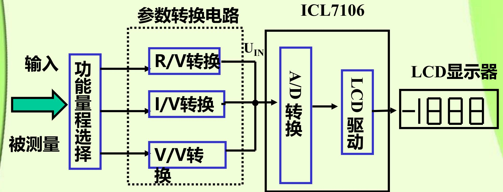
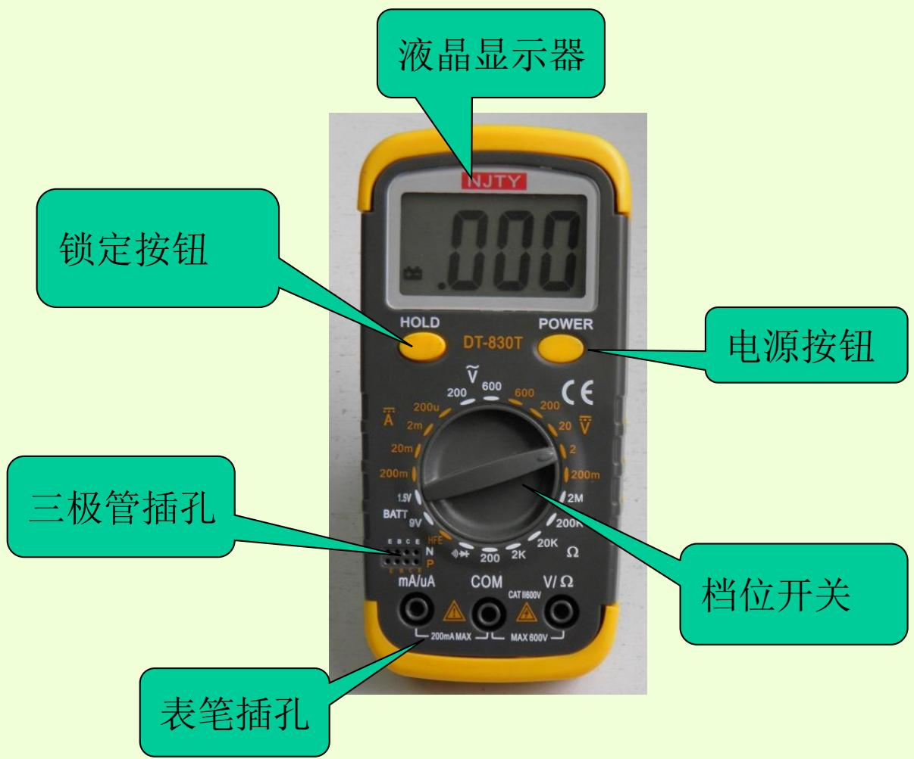
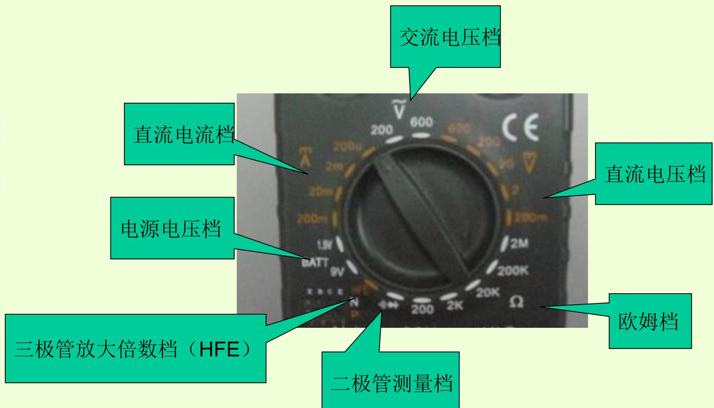
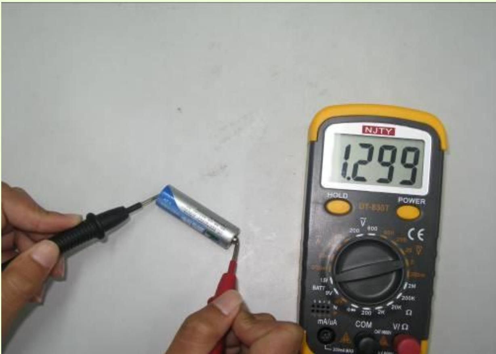
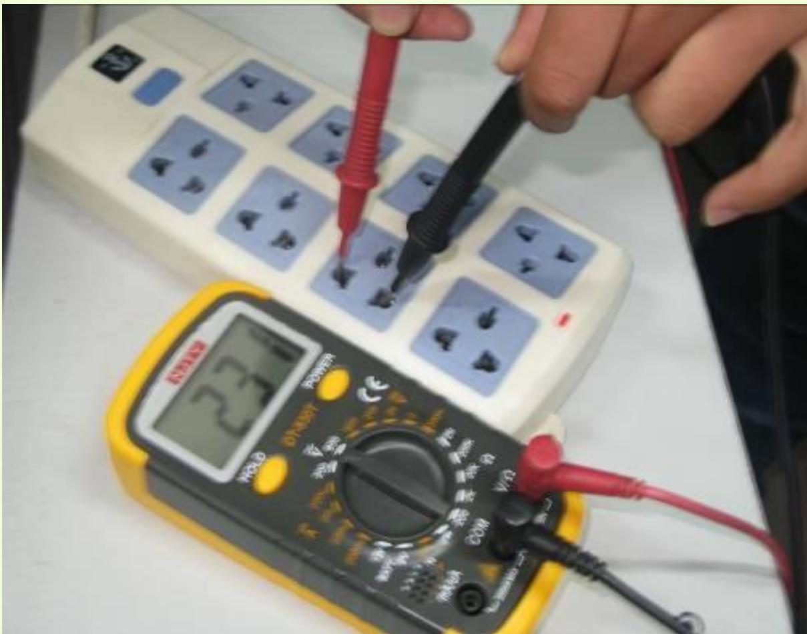
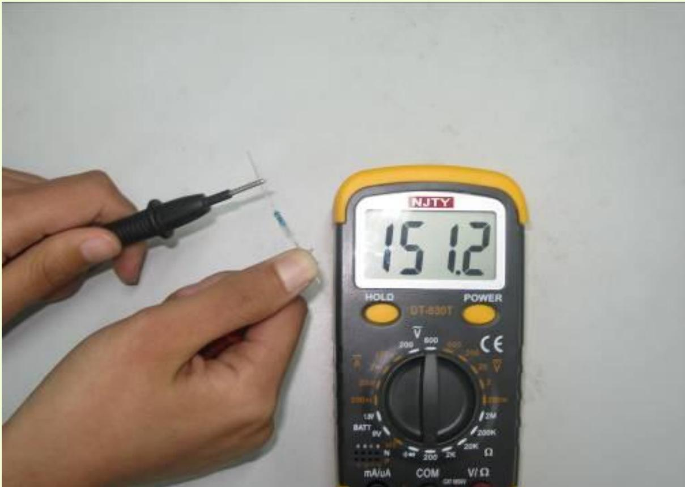
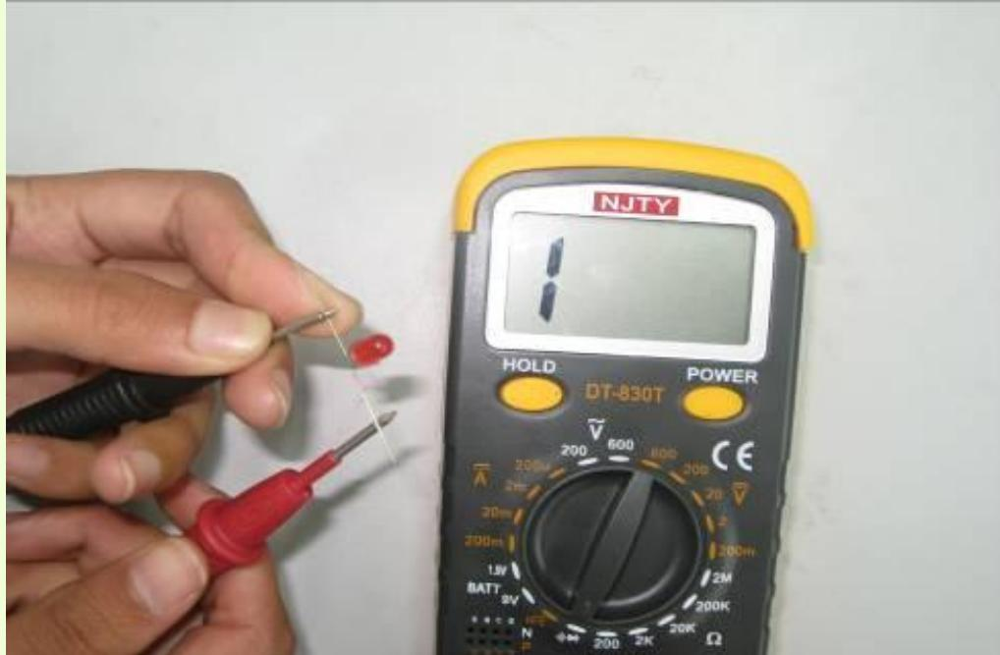
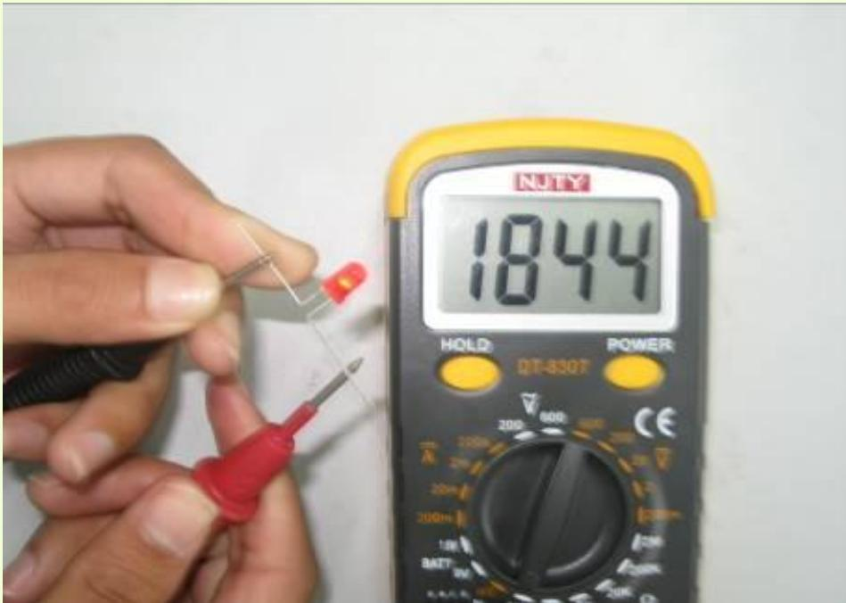
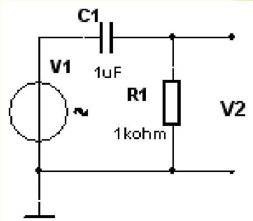

# 《电路分析与电工电子技术》基础实验A第一次课：网络的幅频、相频特性（课件）

原件经识别和整理；“参考解答”是我们补的。

## 基础实验A概述

任课教师：李冰

联系方式：13813976336

## 电工电子基础实验A概述

### 课程性质、目的与任务

性质：是我院电类本科各专业的技术基础课。是一门工程性、技术性、实践性很强的必修课程。

目的：使学生较系统地掌握电路理论实验论证、电路设计和调测、实验技术等方面的知识，初步具有电路设计、装配、测试和调整的能力。

### 课程任务

1. 巩固、深化所学的相关理论知识。
2. 讲授电路设计和实验技术方面的知识。
3. 培养学生在电路装配、仪表使用、电路调测、实验数据分析处理、实验报告撰写等方面的技能。
4. 初步掌握电子电路设计自动化（EDA）软件使用方法。
5. 培养学生在电路方面的工程和技术观点，自觉应用理论知识分析和解决问题的能力，严谨细致的作风和不断创新的能力。

课程内容包括电路分析实验、模拟电路实验。64 课时、4 学分。

### 关于实验操作考试

考题范围：

1. 操作题：设计、实现所有做过的实验（电路、数电）类型之一（占总成绩的 30%）；
2. 实验原理、仪表、仪器使用等问答题（占总成绩的 20%）。

考试方法：

1. 开卷考试，但只可参阅教材和自己实验报告，不准使用复印材料。
2. 在十余种试卷中抽签决定考题。

### 成绩评定

总成绩 = 平时 50% + 期末考试 50%

折算成优、良、中、及格、不及格五档报教务处。及格及以上获得 3 学分。

其中平时成绩：预习 20 分、操作 50 分、实验报告 30 分。

缺做三分之一及以上实验或实验报告，总成绩按不及格处理。

迟到或早退满三次总成绩降档处理。

### 学习要求

1. 认真预习，写出预习报告，无预习报告者不得做实验。

   预习一般包括电路设计、指标核算、拟定实验方案、准备原始数据表，仿真实现等。

   电路实验应在认真预习的基础上按照每个实验中“预习要求”的内容完成预习报告并准备好数据表格。

   数电实验应根据实验任务给出的技术指标设计电路、拟定调测方案、并通过 Multisim 软件仿真。

2. 独立完成实验，动手、动脑并重，注重培养运用理论知识分析问题和解决问题的能力。注意归纳总结，新的体验和经验应留下文字材料，不断积累和提高。实验的过程就是解决问题的过程，只有经历这一过程才能得到训练，才能逐步具备动手能力。动手能力就是解决实际问题的能力。在技术领域，动手能力常指一个人能否解决问题，最终将研究对象做出来（物理实现）的能力，反映的是一个人的综合能力。遇到问题不加思考就向教师或其他同学求助，这无疑是放弃了训练的机会，尽管在他人帮助下完成了实验任务，但并未达到学习的目的。

3. 努力掌握常用仪表、仪器的基本操作方法。主动探索各开关、旋钮的功能，注意听讲、勤学多练、善于比较。

   实验中要求掌握使用方法的仪表有：万用表；直流稳压电源；函数信号发生器；双踪示波器。

4. 认真书写并按时交出实验报告。

   实验报告的格式、内容、书写要求等，在实验指导书中已有详细说明，请仔细阅读并按要求书写。一般要求在下一次实验时交出上一次的实验报告。

   实验报告应有封面，并用实验报告纸书写。

5. 自带万用表、元器件，并妥善保管。

## DT830T 万用表使用

### DT830T 简介

特点：分辨力强、准确度高（±0.5%～±1.5%）、测试功能完善、测量速率快、显示直观、耗电省、过载能力强、便于携带。

发展趋势：自动量程，显示图形“数字/模拟条图”双显示数字万用表克服了不能反映被测量连续度化的不足。

### DT830T 特点

3 1/2（三位半）：最高位只能显示 1，其它位能显示 0～9。

基本量程为 200 mV，表头最大显示值为 199.9，超量程时只显示最高位的“1”。

测量参数：

- DCV：直流电压
- ACV：交流电压
- DCA：直流电流
- R：电阻
- UD：二极管的正向导通电压
- $h_{FE}$：三极管放大倍数
- BATT：电池容量

原理框图：

### DT830T 面板介绍

液晶显示器、锁定按钮、三极管插孔、电源按钮、档位开关、表笔插孔。

档位开关包括：交流电压档、直流电流档、电源电压档、三极管放大倍数档（HFE）、二极管测量档、直流电压档、欧姆档。

### DT830T 的使用

#### 测量直流电压

用测量一节干电池来说明测量直流电压。将档位开关置直流电压 2 V 档，红表笔接电池正极，黑表笔接电池负极。显示屏显示“1.299”左右，被测量的电池的电压值为 1.30 V。万用表与被测信号并联。

#### 测量交流电压

用测量多用插座的电压来说明测量交流电压。将档位开关置 600 V 交流档，红黑表笔分别插入插座上的插孔里。显示屏显示“231”左右，被测量的交流电压为 231 V。

#### 测量直流电流

万用表与被测信号串联。

若显示屏显示为正值，则红表笔接在高电位，黑表笔接在低电位；若显示屏显示为负值，则相反。

#### 测量电阻

首先估算电阻的阻值，然后将档位开关调置接近并大于估算的阻值。红黑表笔分别接被测电阻的两个引脚，在显示屏上可以直接读出阻值。

- 不带电测电阻
- 不在回路中测电阻

#### 测量二极管

将档位开关置二极管测量档，红黑表笔分别接二极管的两个引脚，观察显示屏的数值，然后互换两表笔，再次观察显示屏的数值。若显示屏显示“1”，则说明二极管未导通；若显示屏显示具体数值，则说明二极管导通，且此时的红表笔接的是二极管的正极，黑表笔接的是负极。

## Multisim 仿真软件

启动仿真软件讲解。举例：网络的幅频特性和相频特性。

### 传输网络的幅频和相频特性

传递函数 $H(\omega)$——用来描述电网络频域中的传输特性（输入、输出关系）。

$$
H(\omega) = \frac{\dot{V}_2}{\dot{V}_1} = a + jb
$$

$H(\omega)$ 是一个与频率相关的复数，其中：

$\left| H(\omega) \right| = \sqrt{a^2 + b^2}$ 是一个与频率相关的实数，描述了输出与输入之比值随频率而变的结果，称为幅频特性。

$\varphi(\omega) = \operatorname{arctg}\dfrac{b}{a}$ 是一个与频率相关的角度，描述了输出与输入的相位差随频率而变的结果，称为相频特性。

### 传输网络的幅频和相频特性（例）

例：如图所示高通电路，输入信号 $V_1$ 为频率可变的正弦波。

传递函数：

$$
H(\omega) = \frac{\dot{V}_2}{\dot{V}_1} = \frac{R_1}{R_1 - j\frac{1}{\omega C_1}}
$$

幅频特性：

$$
\left| H(\omega) \right| = \frac{V_2}{V_1} = \frac{1}{\sqrt{1 + \left[ \frac{1}{\omega R_1 C_1} \right]^2}}
$$

相频特性：

$$
\varphi(\omega) = \operatorname{arctg}\frac{1}{\omega R_1 C_1}
$$

$f_0$——称为半功率点频率。

### 实验目的

本实验的目的是利用 Multisim 仿真软件中的虚拟仪器波特图仪（Bode Plotter，可直接显示幅频特性曲线和相频特性曲线）对高通、低通、带通、带阻及双谐振电路的传输特性作初步的研究。

其中高通、低通电路需描绘幅频特性曲线和相频特性曲线，并找出和记录半功率点频率 $f_0$ 及其对应的电压比和相位差。

带通、带阻电路需描绘幅频特性曲线和相频特性曲线，并找出和记录特征点频率 $f_0$ 和两个半功率点频率 $f_1$、$f_2$ 及其对应的电压比和相位差。
