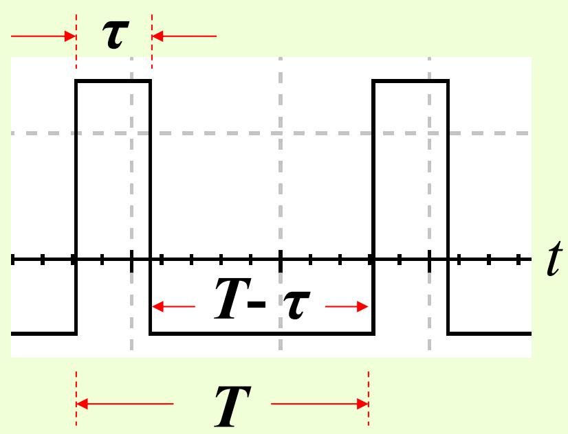
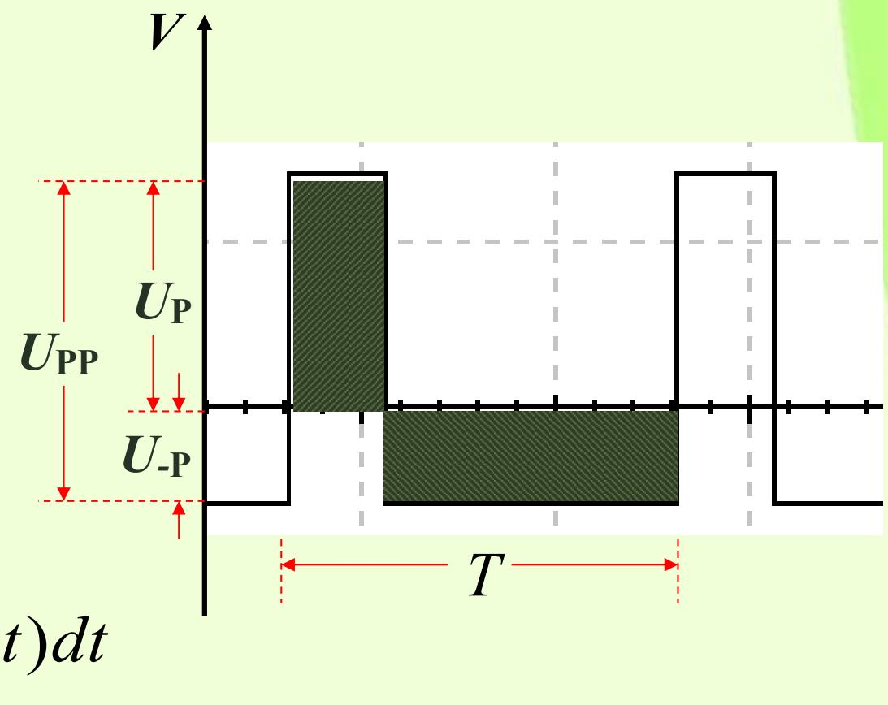
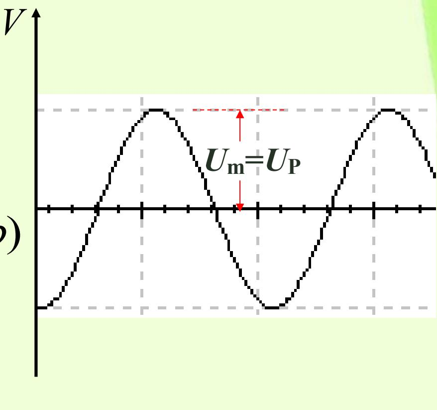

# 《电路分析与电工电子技术》基础实验A第三次课：常用仪表使用方法与周期信号参数测量

原件经识别和整理；“参考解答”是我们补的。

---
title: 2021—2022 学年第二学期《电路分析与电工电子技术》基础实验A第三次课：常用仪表使用方法与周期信号参数测量
kind: 课件
course: 电路分析与电工电子技术
term: 
source: <原件地址或来源路径>
---

# 《电路分析与电工电子技术》基础实验A第三次课：常用仪表使用方法与周期信号参数测量

本资料整理自识别工具读出的实验课件内容，主要涵盖周期信号的参数定义、示波器触发源选择及耦合方式等知识点。

## 一、周期信号的参数

### ➢时间参数

- 周期 $T$
- 频率 $f = 1 / T$
- 正脉宽 $\tau$
- 占空比 $\theta = \tau : ( T - \tau )$

$$
\text{占空比} = \tau / T \times 100 \%
$$

通常将占空比为50%的矩形波称为方波。

### ➢电压参数

- 正峰值 $U_P$
- 负峰值 $U_{-P}$
- 峰峰值 $U_{PP}$
- 平均值 $U$

$$
U = \frac {1}{T} \int_ {0} ^ {T} f (t) d t
$$

平均值亦称作直流分量。

### ➢正弦波参数（对称于横坐标）

- 最大值 $U_m = U_P$
- 瞬时值 $u(t)$

$$
u (t) = U _ {m} \sin (\omega t + \varphi)
$$

- 有效值 $U$

$$
U = \frac {U _ {m}}{\sqrt {2}} = \frac {U _ {P}}{\sqrt {2}} = \frac {U _ {P P}}{2 \sqrt {2}}
$$

### ➢直流偏置

- 将一个周期信号叠加一个直流电压的过程称为直流偏置。
- 直流偏置的结果是使周期信号在坐标系中上移或下移。
- 直流偏置的结果改变了周期信号的平均值。

## 二、示波器使用方法

### 信源选择

1. 只有一个信号源输入，选择输入信号源为触发源。
2. 有两路信号源输入：
    - 如果频率相同，选择较为稳定的信号源为触发源。
    - 如果频率不同：
        - a. 两路信号源的频率成整数倍，选择周期长的信号源为触发源。
        - b. 两路信号源的频率不成整数倍，无法同时稳定，只能用单次触发或者stop按键。

### 耦合方式

- **直流**：显示完整波形。
- **交流**：只显示交流分量。
- **接地**。

**问：示波器输入通道耦合方式有哪三种，说明其主要区别。**

答：有直流、交流、接地三种。

- （1）直流耦合：通过输入信号的交流和直流成分；
- （2）交流耦合：阻挡输入信号的直流成分，通过交流成分；
- （3）接地：断开输入信号。
