# 《电路分析与电工电子技术》基础实验A第二次课（非线性电阻伏安特性、戴维宁定理和诺顿定理）

原件的每一页，下面附识别出的文字。

### 非线性电阻伏安特性戴维宁定理和诺顿定理

原文：

非线性电阻伏安特性戴维宁定理和诺顿定理

### 一、DF1731S直流稳压电源

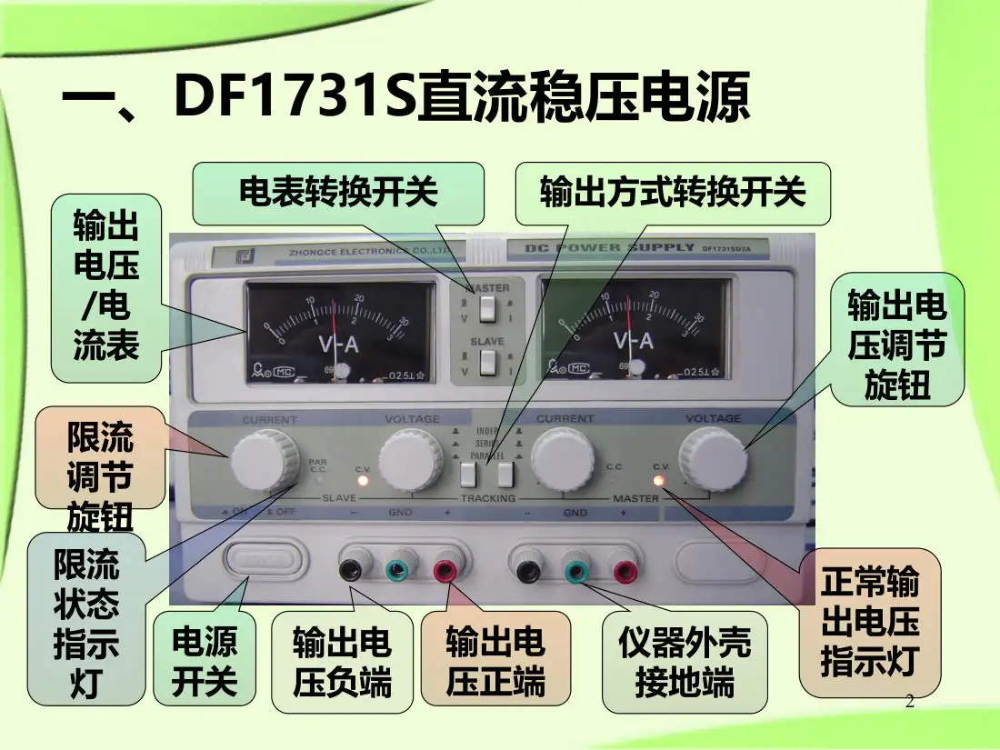

原文：

一、DF1731S直流稳压电源

输出电压/电

限流调节旋钮

限流状态指示 灯 电源 开关

电表转换开关

输出电 压负端

输出方式转换开关

输出电 压正端

仪器外壳 接地端 输出电 压调节 旋钮

正常输出电压指示灯

### DF1731S直流稳压电源

原文：

DF1731S直流稳压电源

➢ 使用注意事项：

✓输出不可短路。

✓接入电路时不可接错极性，务必认清接线柱上方的“+”、“-”号。

✓电压表指示精度差，输出电压值以万用表测量为准。

✓CC灯亮时，已进入限流状态，输出电压将下降。

3

### DF1731S直流稳压电源

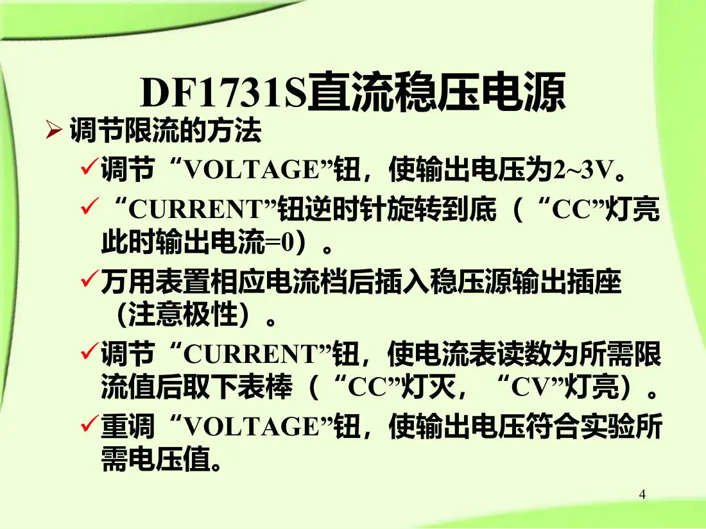

原文：

DF1731S直流稳压电源

➢ 调节限流的方法

✓调节“VOLTAGE”钮，使输出电压为2\~3V。

“CURRENT”钮逆时针旋转到底（“CC”灯亮此时输出电流=0）。

✓万用表置相应电流档后插入稳压源输出插座（注意极性）。

✓调节“CURRENT”钮，使电流表读数为所需限流值后取下表棒（“CC”灯灭，“CV”灯亮）。

✓重调“VOLTAGE”钮，使输出电压符合实验所需电压值。

4

### 二、非线性电阻伏安特性

原文：

二、非线性电阻伏安特性

➢实验 原理

⚫在以电压为横坐标，电流为纵坐标的平面上，非线性器件的伏安特性曲线不是一条通过坐标原点的直线。即其电压与电流的比值不是常数。因此，通常情况下用它的伏安特性曲线来表示其特性。线性和非线性伏安特性曲线分别如图a和b所示。

5

### 非线性电阻伏安特性

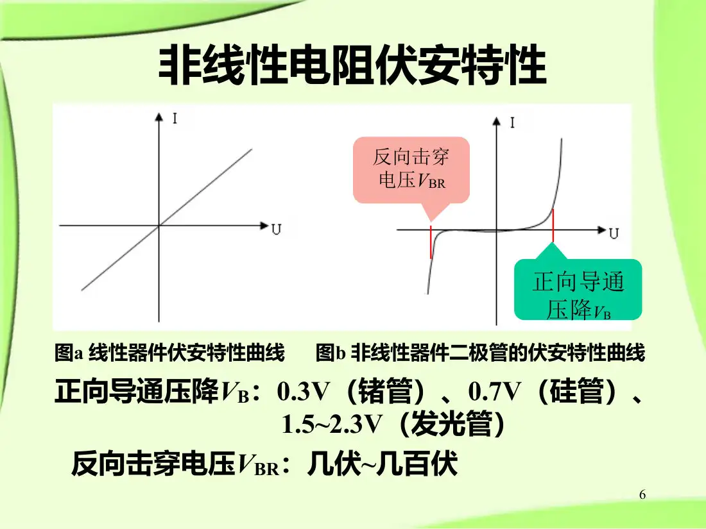

原文：

非线性电阻伏安特性

反向击穿电压VBR

反向击穿电压 $V _ { \mathbf { B R } }$ ：几伏\~几百伏

6

### 用万用表判断二极管的极性

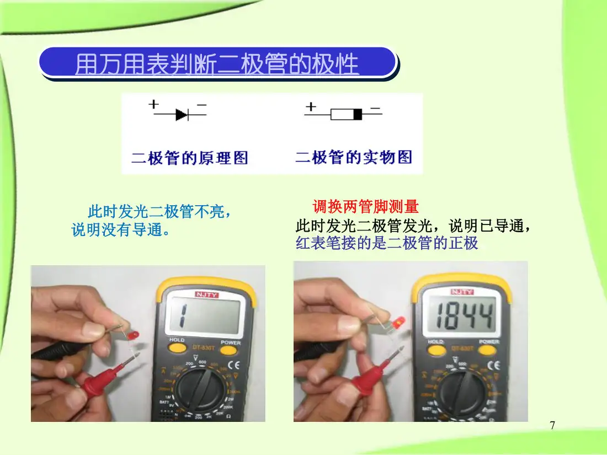

原文：

用万用表判断二极管的极性

二极管的原理图

此时发光二极管不亮，说明没有导通。

二极管的实物图

调换两管脚测量

此时发光二极管发光，说明已导通，红表笔接的是二极管的正极。

7

### 稳压管正、反向特性

原文：

稳压管正、反向特性

稳压管的特性是接正向电压时其等效电阻很小，且电流在较大范围内变化时，其正向电压变化量很小。接反向电压时等效电阻很大，且电压在较大范围内变化时，反向电流变化量很小，当达到某一电压时，电流会增加很快，此时电压在一定范围内基本不变。若能控制电流在一定范围内，这就是所谓的稳压。图5.1.5(a) 是稳压管的正向连接，(b) 是稳压管的反向连接。

8

### 稳压管正、反向连接

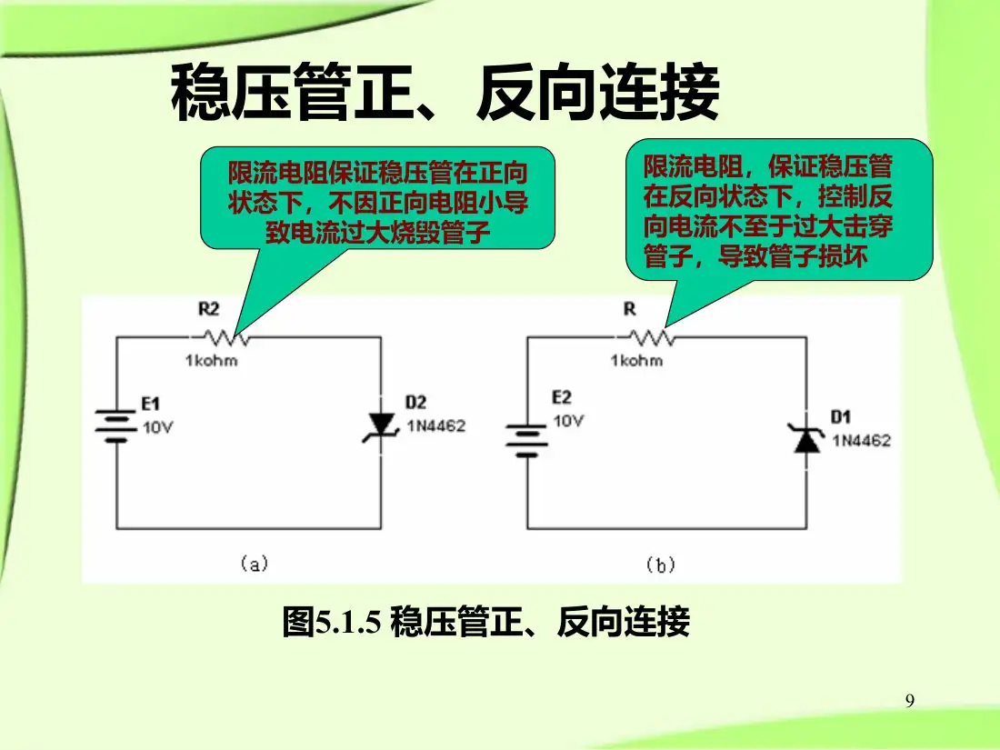

原文：

稳压管正、反向连接

限流电阻保证稳压管在正向状态下，不因正向电阻小导致电流过大烧毁管子

限流电阻，保证稳压管 在反向状态下，控制反 向电流不至于过大击穿 管子，导致管子损坏

9

### 实 验 步 骤

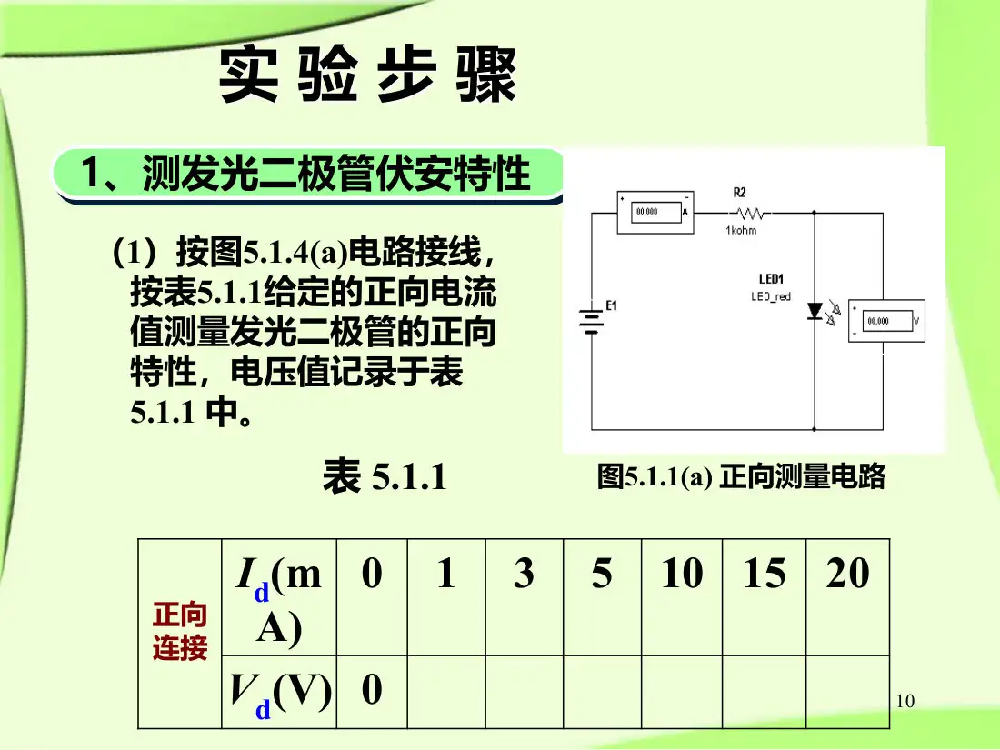

原文：

实 验 步 骤

1、测发光二极管伏安特性

（1）按图5.1.4(a)电路接线，按表5.1.1给定的正向电流值测量发光二极管的正向特性，电压值记录于表5.1.1 中。

<table><tr><td rowspan="2">正向连接</td><td> $I_{\text{d}}$ (mA)</td><td>0</td><td>1</td><td>3</td><td>5</td><td>10</td><td>15</td><td>20</td></tr><tr><td> $V_{\text{d}}$ (V)</td><td>0</td><td></td><td></td><td></td><td></td><td></td><td></td></tr></table>

10

### 实验箱上的接线示意图：

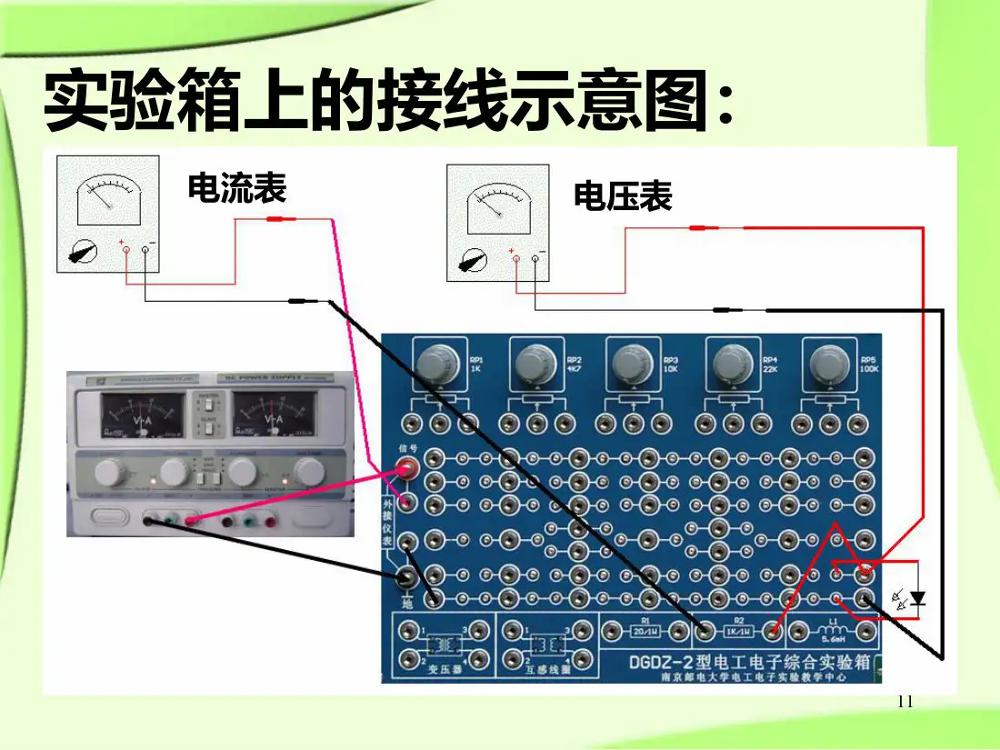

原文：

实验箱上的接线示意图：

电流表

电压表

DGDZ-2型电工电子综合实验箱南京邮电大学电工电子实验教学中心

11

### 测发光二极管伏安特性

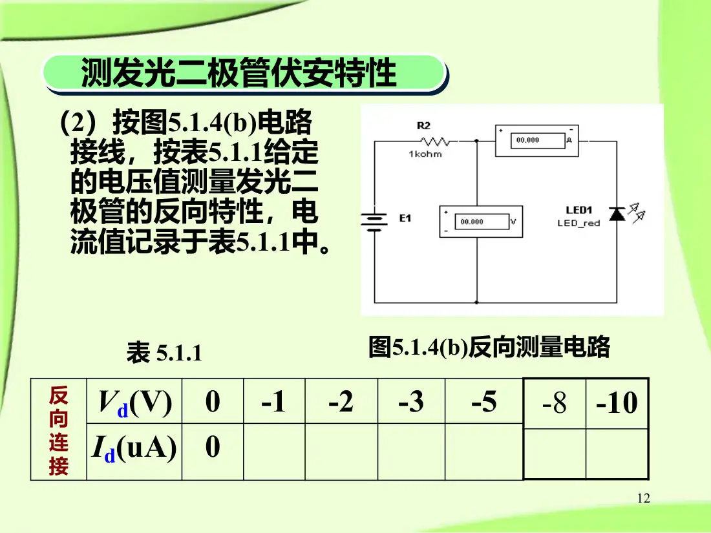

原文：

测发光二极管伏安特性

（2）按图5.1.4(b)电路接线，按表5.1.1给定的电压值测量发光二极管的反向特性，电流值记录于表5.1.1中。

表 5.1.1 图5.1.4(b)反向测量电路
<table><tr><td rowspan="2">反向连接</td><td> $V_{\text{d}}(\text{V})$ </td><td>0</td><td>-1</td><td>-2</td><td>-3</td><td>-5</td><td>-8</td><td>-10</td></tr><tr><td> $I_{\text{d}}(\text{uA})$ </td><td>0</td><td></td><td></td><td></td><td></td><td></td><td></td></tr></table>

12

### 提问：流过电流表的读数与流过发光二极管的电流是否一致。

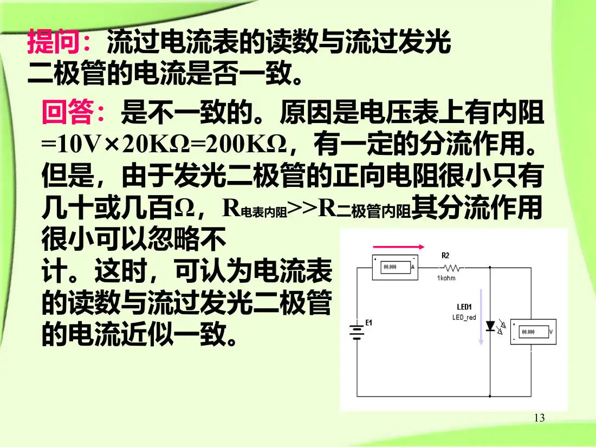

原文：

提问：流过电流表的读数与流过发光二极管的电流是否一致。

回答：是不一致的。原因是电压表上有内阻$\mathbf { - 1 0 V \times } 2 \mathbf { 0 K } \Omega \mathbf { - } 2 \mathbf { 0 0 K } \Omega$ 有一定的分流作用。但是，由于发光二极管的正向电阻很小只有几十或几百Ω，R电表内阻>>R二极管内阻其分流作用很小可以忽略不R2计。这时，可认为电流表 00.000 -WW1kohm的读数与流过发光二极管 LED1的电流近似一致。 E1 LED\_red AA 00.000

13

### 2、测稳压管的伏安特性

原文：

2、测稳压管的伏安特性

（1）用万用表判断稳压管的正、负极性。

注：不能测量带电元件的电阻值、不能测量在路元件的电阻值

14

### 测稳压管的伏安特性

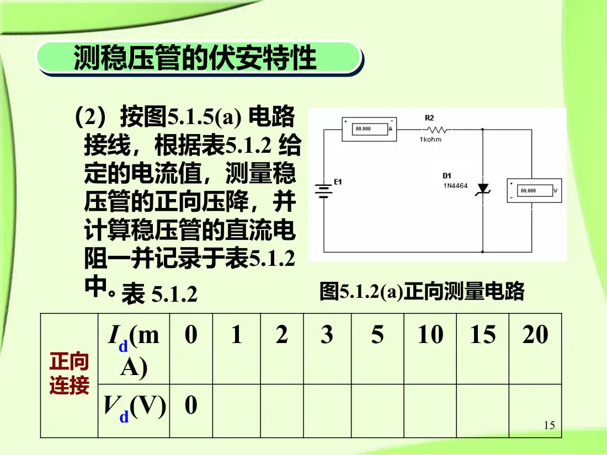

原文：

测稳压管的伏安特性

（2）按图5.1.5(a) 电路接线，根据表5.1.2 给定的电流值，测量稳压管的正向压降，并计算稳压管的直流电阻一并记录于表5.1.2中。表 5.1.2

图5.1.2(a)正向测量电路
<table><tr><td rowspan="2">正向连接</td><td> $I_{\text{d}}$ (mA)</td><td>0</td><td>1</td><td>2</td><td>3</td><td>5</td><td>10</td><td>15</td><td>20</td></tr><tr><td> $V_{\text{d}}$ (V)</td><td>0</td><td></td><td></td><td></td><td></td><td></td><td></td><td>15</td></tr></table>

### 提问：电压表的读数与稳压管上的电压是否一致。

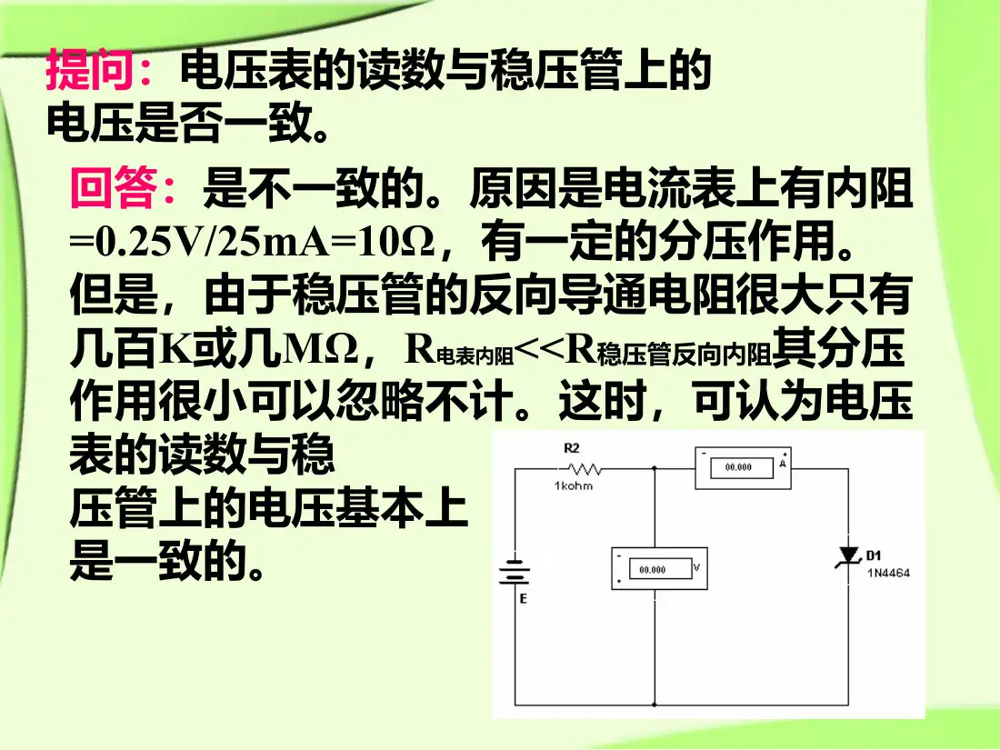

原文：

提问：电压表的读数与稳压管上的电压是否一致。

回答：是不一致的。原因是电流表上有内阻$\mathbf { = 0 . 2 5 V / 2 5 m A { = } 1 0 } \Omega$ 有一定的分压作用。但是，由于稳压管的反向导通电阻很大只有几百K或几MΩ，R电表内阻<<R稳压管反向内阻其分压作用很小可以忽略不计。这时，可认为电压

表的读数与稳压管上的电压基本上是一致的。

### 测稳压管的伏安特性

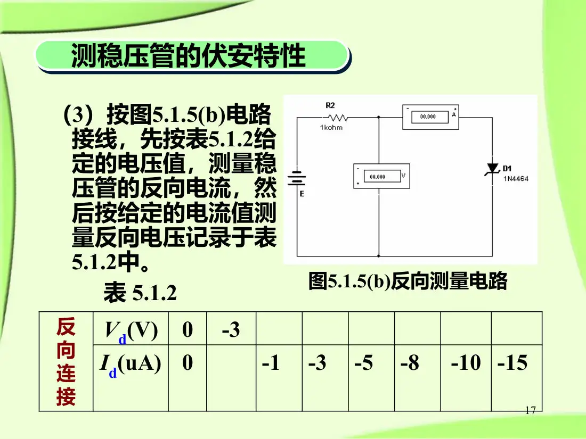

原文：

测稳压管的伏安特性

（3）按图5.1.5(b)电路接线，先按表5.1.2给定的电压值，测量稳压管的反向电流，然后按给定的电流值测量反向电压记录于表5.1.2中。

<table><tr><td rowspan="2">反向连接</td><td> $V_{\text{d}}(\text{V})$ </td><td>0</td><td>-3</td><td></td><td></td><td></td><td></td><td></td><td></td></tr><tr><td> $I_{\text{d}}(\text{uA})$ </td><td>0</td><td></td><td>-1</td><td>-3</td><td>-5</td><td>-8</td><td>-10</td><td>-15</td></tr></table>

### 3、绘制伏安特性曲线

原文：

3、绘制伏安特性曲线

➢根据实际测量的数据，绘制发光二极管和稳压管的伏安特性曲线图。

➢ 正、反向伏安特性绘制在同一坐标系中。正向、反向电压坐标值可采用不同的比例。

纵坐标为电流坐标，横坐标为电压 坐标。

18

### 4、实验注意事项

原文：

4、实验注意事项

➢测量发光管和稳压二极管的正反向特性时，要弄清楚它们的正极和负极。

需用两块万用表，一块作为电流表串联在电路中，一块作为电压表，并联在电路中，要注意正、反向时的表的连接。

19

### 三、戴维宁定理与诺顿定理

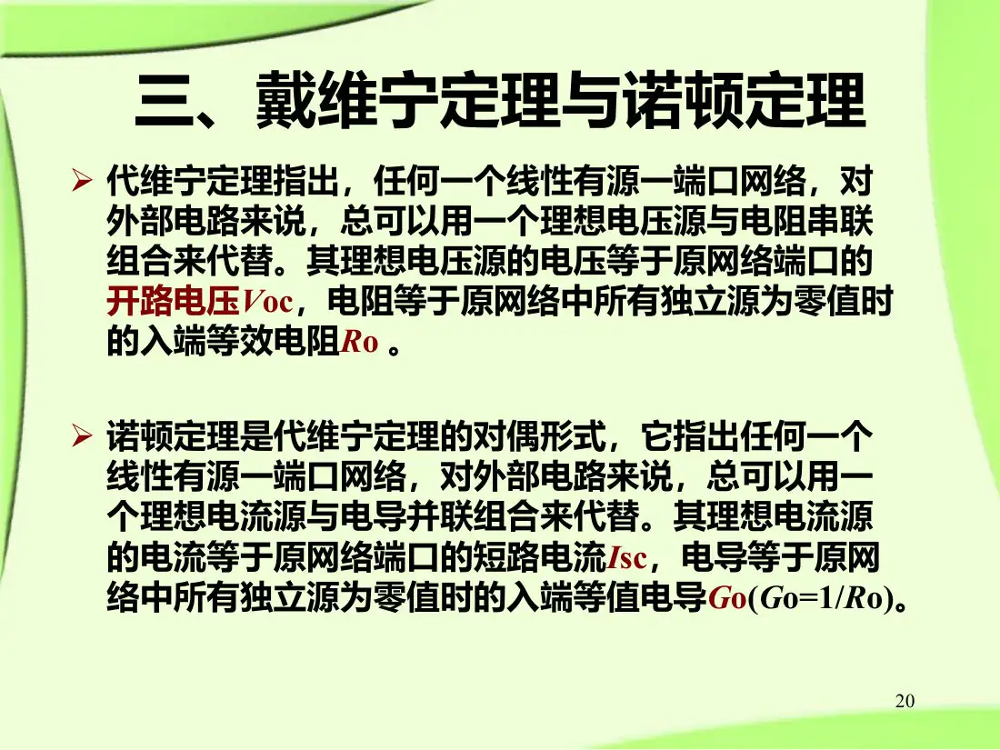

原文：

三、戴维宁定理与诺顿定理

代维宁定理指出，任何一个线性有源一端口网络，对外部电路来说，总可以用一个理想电压源与电阻串联组合来代替。其理想电压源的电压等于原网络端口的开路电压Voc，电阻等于原网络中所有独立源为零值时的入端等效电阻Ro 。

诺顿定理是代维宁定理的对偶形式，它指出任何一个线性有源一端口网络，对外部电路来说，总可以用一个理想电流源与电导并联组合来代替。其理想电流源的电流等于原网络端口的短路电流Isc，电导等于原网络中所有独立源为零值时的入端等值电导Go(Go=1/Ro)。

20

### 实验电路

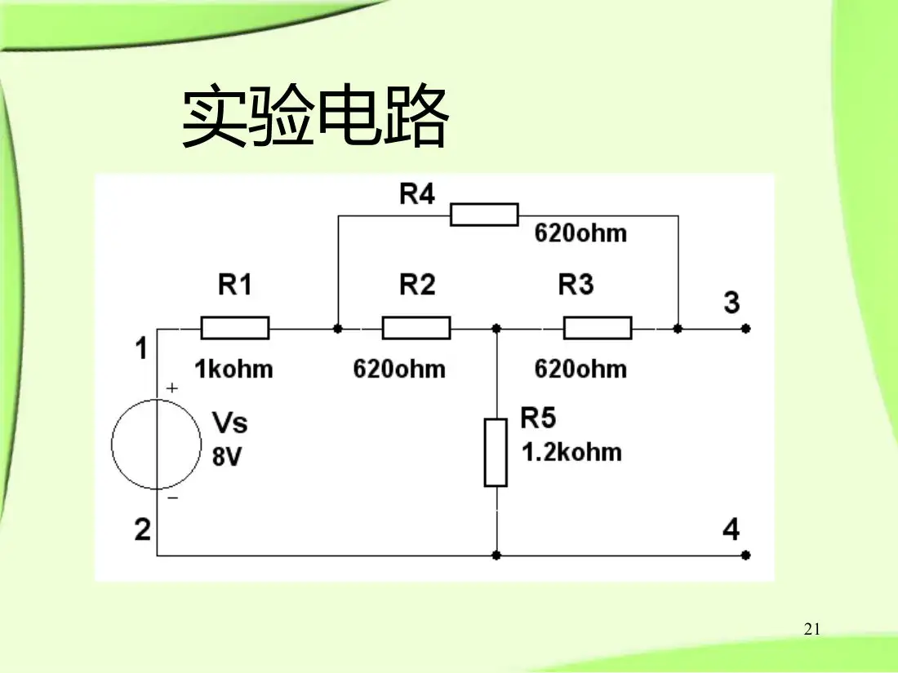

原文：

实验电路

21

### 1、直接测量R0

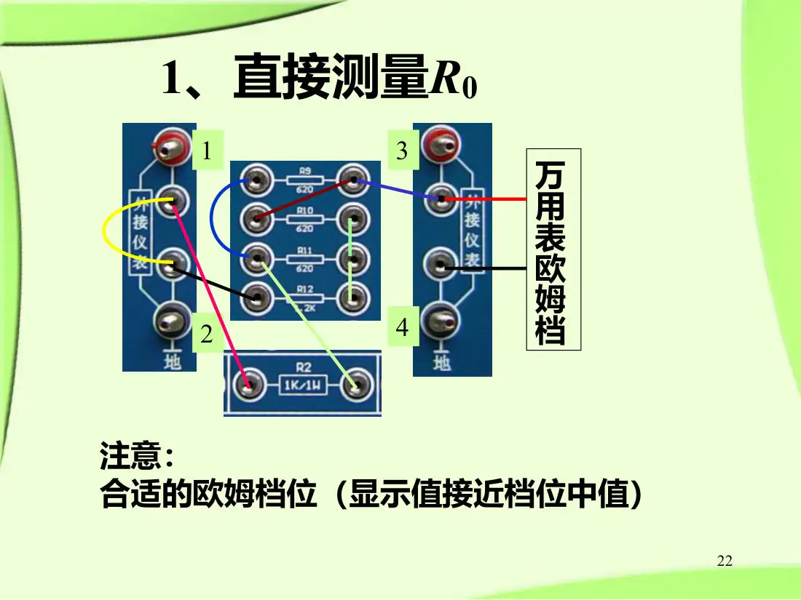

原文：

1、直接测量R0

注意：合适的欧姆档位（显示值接近档位中值）

22

### 2、加压定流

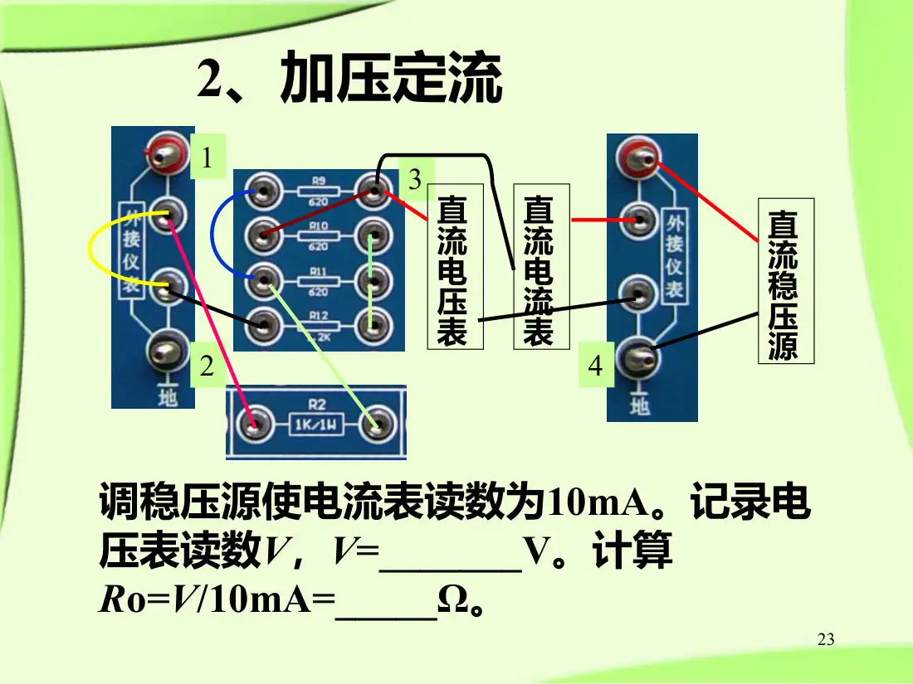

原文：

2、加压定流

调稳压源使电流表读数为 $1 0 \mathrm { m A }$ 记录电 压表读数V， $V = \mathrm { ~  ~ { ~ \mathbf ~ { ~ V ~ } ~ } ~ }$ 。计算 $R \mathbf { 0 } { = } V / 1 0 \mathbf { m } \mathbf { A } { = } \mathbf { \Omega } \Omega$

23

### 3、开、短路法

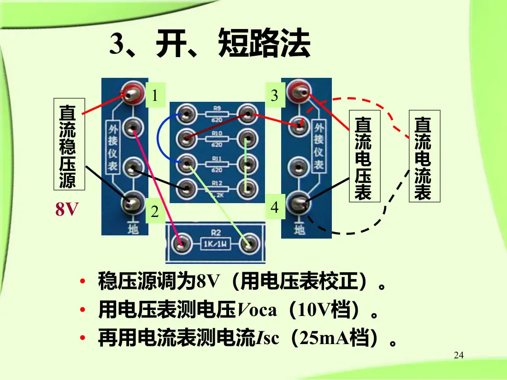

原文：

3、开、短路法

• 稳压源调为8V（用电压表校正）。

• 用电压表测电压Voca（10V档）。

• 再用电流表测电流Isc（25mA档）。

24

### 4、半电压法

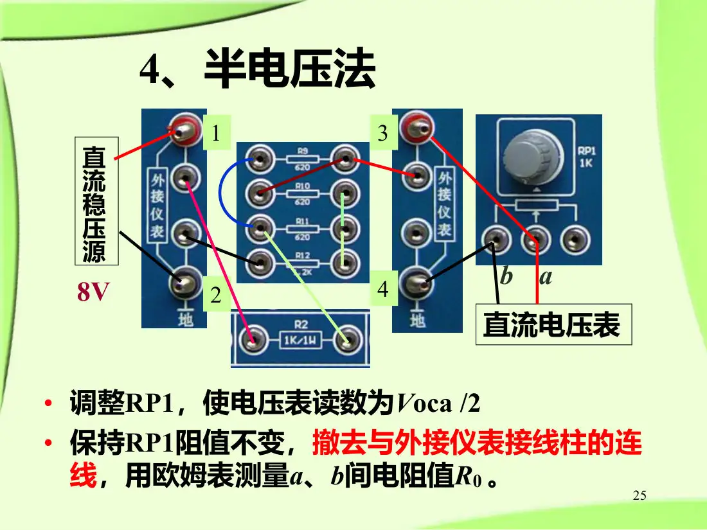

原文：

4、半电压法

• 调整RP1，使电压表读数为Voca /2

• 保持RP1阻值不变，撤去与外接仪表接线柱的连线，用欧姆表测量a、b间电阻值R0 。

25

### 5、消除表内阻影响的测量

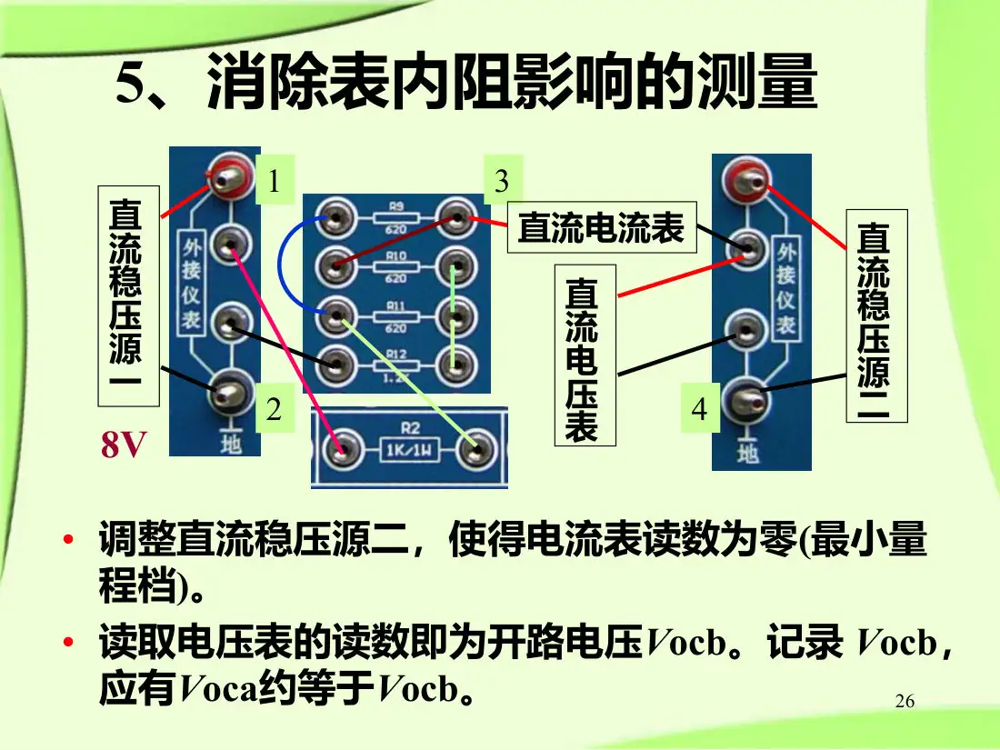

原文：

5、消除表内阻影响的测量

• 调整直流稳压源二，使得电流表读数为零(最小量程档)。

• 读取电压表的读数即为开路电压Vocb。记录 Vocb， 应有Voca约等于Vocb。 26

### 谢 谢！

原文：

谢 谢！

27
