# 《电路分析与电工电子技术》基础实验A第四次课：模拟电路的设计、测试与装配（课件）

原件经识别和整理；“参考解答”是我们补的。

# 模拟电路的设计、测试与装配

## 一、用DT-830T 万用表测量二极管

### 1. 判断极性

将档位开关置二极管测量档，红黑表笔分别接二极管的两个引脚，观察显示屏的数值，然后互换两表笔，再次观察显示屏的数值。若显示屏显示“1”，则说明二极管未导通；若显示屏显示具体数值，则说明二极管导通，且此时的红表笔接的是二极管的正极，黑表笔接的是负极。

### 2. 判断质量

将档位开关置二极管测量档，红黑表笔分别接二极管的两个引脚，观察显示屏的数值，然后互换两表笔，再次观察显示屏的数值。

- 若两次显示屏都显示“1”，则二极管可能开路；
- 若两次显示屏均显示具体数值，则二极管可能短路。

### 3. 判断材料

**测量二极管的正向电压**

将档位开关置二极管测量档，红表笔接二极管的正极，黑表笔接二极管的负极，观察显示屏的数值。

- 锗管为 $300\text{mV}$ 左右
- 硅管为 $700\text{mV}$ 左右

## 二、用DT-830T 万用表测量三极管

### 1. 普通三极管的等效电路

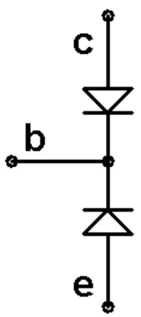

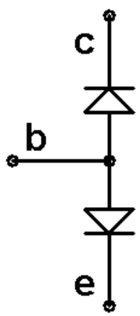

### 2. 确定三极管的基极（b）

**使用二极管档去测基极**

分别测量三极管各极之间的正、反向电压（有3种可能的组合bc、be、ce），有且只有一种组合（ce）的正、反向电压都极大。则正在测量的是c和e极，确定剩下的管脚为b极。

### 3. 确定三极管的类型

**使用二极管档位**

- 红表棒接b极、黑表棒接c或e极，测得电压值较小，反之极大，则为NPN管。
- 黑表棒接b极、红表棒接c或e极，测得电阻值较小，反之极大，则为PNP管。

### 4. 确定三极管的c、e极

**使用HFE档去测c、e 极**

把三极管插到NPN（或PNP）的小孔上，B极对上面的B字母。读数，再把它的另二脚反转，再读数。读数较大的那次极性与表上所标的字母对应。

### 5. 确定三极管的材料类型

**测量三极管的bc间正向电压**

将档位开关置二极管测量档，红表笔接二极管的正极，黑表笔接二极管的负极，观察显示屏的数值。

- 锗管为 $300\text{mV}$ 左右
- 硅管为 $700\text{mV}$ 左右

## 三、模拟电路的学习指导

1. **模拟电路理论课与实验课的不同学习要求**
   - 理论课：电路工作原理和工程估算方法
   - 实验课：电路的设计方法和实验方法

2. **明确模拟电路课程的工程性和技术性**
   - 工程性：是指为使理论具有可行性而使分析和估算方法进行的简化，理论设计与实际测试的吻合只能靠不断的试凑。
   - 技术性：是指它是用于解决实际问题的学科，它的每项技术指标对实际应用都有着特定的意义。

3. **深刻了解电路的工作原理**

4. **明确所有电路参数的物理含义及其对电路应用的影响**
   - 如：电压放大、电流放大、功率放大、输入/输出电阻、幅频特性等

## 四、单级放大电路的设计指导

### 1. 明确模拟电路的分析估算与电路设计的区别

1. 电路分析是在已知电路元件参数的情况下求电路参数。
2. 电路设计是在已知电路参数要求的情况下求出所有的元件参数。
3. 模拟电路的设计远远难于电路分析，没有对电路原理、各个元器件作用、电路参数以及它们之间的关系的深刻理解，是无法设计电路的，这正是许多人将模拟电路的设计视为畏途的原因。

### 2. 模拟电路设计基本思路

1. 分析电路技术指标，找出关键性指标或难点指标作为设计起点，设计相关元件参数。
2. 在关键或难点指标设计完成后，进行核算，若达到要求，继而为次要指标设计相关元件参数。因为模拟电路的同一个元件往往对多个电路技术指标有影响，当A指标满足要求后可能B指标变为不满足，所以，每设计一个指标都必须核算一次所有的电路参数，发现电路指标不合格必须重新设计元件参数，通过反复设计、反复核算、反复调整，最终使所有的电路技术指标达到设计要求。

### 3. 模拟电路设计注意事项

1. 在电路设计之前每一个元件对电路相关参数的影响必须十分清楚，否则设计无从下手。
2. 模拟理论书中给出的公式，不能随便套用，必须分析使用条件，当现有公式不能直接套用时，必须自行推导设计使用公式。
3. 由于分立元件的晶体管模型做了高度的简化，精度差，在没有深负反馈的情况下，核算的电路参数值与实际测量值有 $30\% \sim 100\%$ 的误差是常见的。

### 4. 设计说明事项

1. 直流工作点不必十分准确，一般为整数或 $0.5$ 的倍数。
2. 每得到一个电阻值时，必须取接近的标称值。
3. 为了方便，可以设 $\beta = 100$。
4. 直流参数设计完成后必须核算所有直流工作点。
5. 在保证直流参数可以达到指标要求的前提下核算交流参数。

## 五、单级放大电路的设计与调测

### 1. 实验任务

设计一个单级放大电路，技术指标要求：

| 项目 | 内容 |
| :--- | :--- |
| 电路结构 |  |
| 电路指标 | 见下文 |
| 设计条件 | 见下文 |

#### 1. 电路结构

采用单级分压偏置共射极放大电路，电路如图所示：

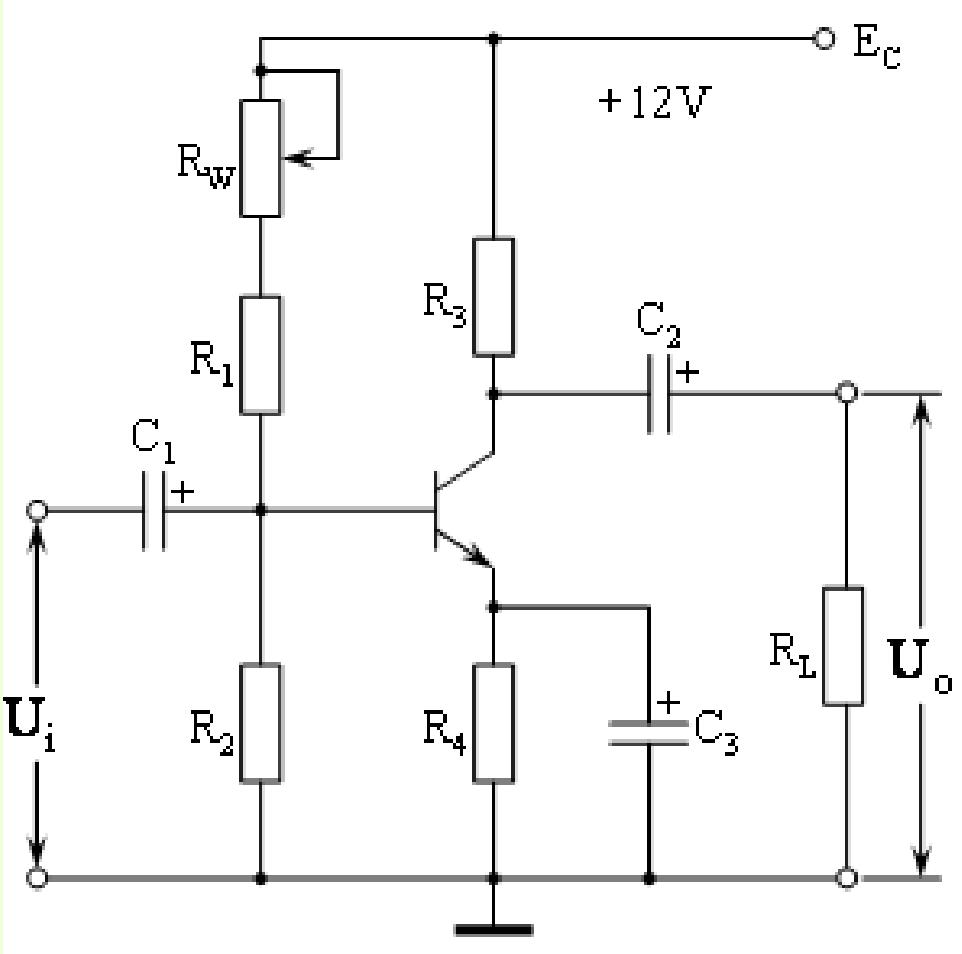

#### 2. 电路指标

1. 电压放大倍数 $A_u = 30$
2. 输入阻抗 $R_i \geqslant 1\text{k}\Omega$
3. 输出阻抗 $R_o = 3\text{k}\Omega$
4. 输出电压峰峰值 $U_{opp} \geqslant 2\text{V}$
5. 幅频特性：$f_L \leqslant 500\text{Hz}$；$f_H \geqslant 200\text{kHz}$

#### 3. 设计条件

1. 电源电压 $+12\text{V}$
2. 负载阻抗 $R_L = 3\text{k}\Omega$

### 2. 单级放大电路设计提示

流程如下：
确定静态工作点 $\rightarrow$ 电阻值选取 $\rightarrow$ 电容值选取 $\rightarrow$ 核算三极管工作点（饱和失真、截止失真）

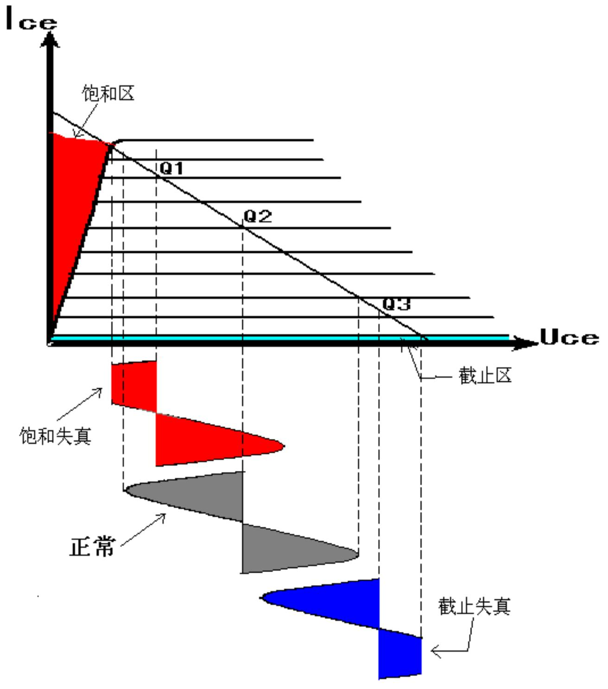

#### 1. 确定静态工作点

**① 确定 $U_{CEQ}$**

$$
U_{CEQ} > \frac{1}{2} U_{opp} + U_{CES}
$$

式中：$U_{opp}$ 为输出电压峰峰值，$U_{CES}$ 为晶体管饱和压降，通常取 $1\text{V}$。

**② 确定 $I_{CQ}$**

$$
I_{CQ} R'_L = U_{CEQ} - U_{CES}
$$

$$
I_{CQ} = \frac{U_{CEQ} - U_{CES}}{R'_L}
$$

#### 2. 电阻值选取

**① 确定 $R_1, R_2$**

$$
R_2 = \frac{U_{BQ}}{I_1} = \frac{U_{BQ}}{(5 \sim 10) I_{BQ}} = \frac{\beta U_{BQ}}{(5 \sim 10) I_{CQ}}
$$

$$
R_1 = \frac{U_{CC} - U_{BQ}}{U_{BQ}} R_2
$$

**② 确定 $R_4$ (发射极电阻)**

$$
R_4 \approx \frac{U_{BQ} - U_{BE(on)}}{I_{CQ}}
$$

式中，$U_{BE(on)}$ 为晶体管的导通电压或死区电压。

**③ 确定 $R_3$ (集电极电阻)**

当设计指标中有 $R_o$ 要求时，$R_3 = R_o$。

当没有 $R_o$ 要求时，可根据 $A_u$ 的要求确定 $R_3$ 的值：

$$
|A_u| = \frac{\beta R'_L}{r_{be}} = \frac{\beta}{r_{be}} (R_L \| R_3)
$$

#### 3. 电容值选取

$$
\begin{aligned}
C_1 &\geqslant (3 \sim 10) \frac{1}{2 \pi f_L (R_S + r_{be})} \\
C_2 &\geqslant (3 \sim 10) \frac{1}{2 \pi f_L (R_3 + R_L)} \\
C_3 &\geqslant (1 \sim 3) \frac{1}{2 \pi f_L R'_S}, \quad R'_S = \frac{R_S + r_{be}}{1 + \beta}
\end{aligned}
$$

#### 4. 核算指标

*(此处原文仅列出标题，具体内容需根据上述计算结果进行验证)*

### 3. 单级放大电路参数测量

分为直流参数测量和交流参数测量。

#### 1. 直流参数测量

**前提：撤去交流信号**

**① $U_{BQ}$ 的测量**
为了减小万用表内阻的影响可用间接法测量，即先测 $U_{EQ}$ 和 $U_{BEQ}$，再由 $U_{BQ} = U_{EQ} + U_{BEQ}$ 导出 $U_{BQ}$ 的值。

**② $U_{CEQ}$ (或 $U_{CQ}$) 的测量**
可用万用表直接测出，但必须考虑万用表内阻的影响。

**③ $I_{CQ}$ 的测量**
- **直接测量**：将电流表串接在集电极电路中直接测 $I_{CQ}$。
- **间接测量**：先测出射极电阻 $R_4$ 上的压降 $U_{R_4}$ 或集电极电阻 $R_3$ 上的压降 $U_{R_3}$，然后由 $I_{CQ} \approx U_{R_4} / R_4$ 或 $I_{CQ} = U_{R_3} / R_3$ 算出 $I_{CQ}$ 的值。

#### 2. 交流参数测量

**前提：直流电源保留**

**① 电压放大倍数 $A_u$ 的测量**
由 $A_u = U_o / U_i$，测量电路如下图：

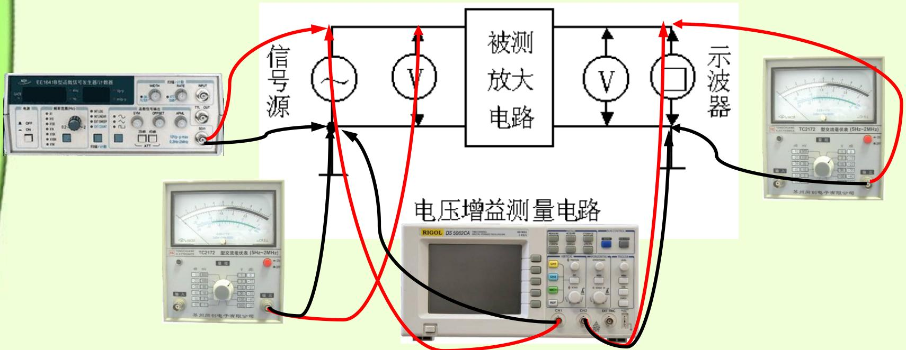

**② 输入阻抗 $R_i$ 的测量**
$R$ 为附加串联电阻，估算 $R \approx R_i$。

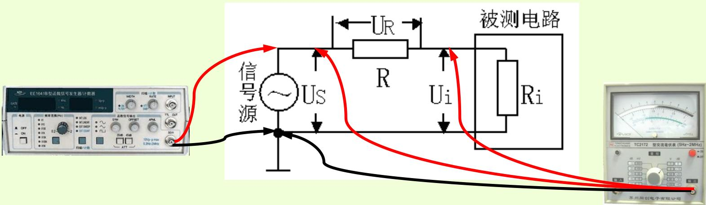

$$
R_i = \frac{U_i}{I_i} = \frac{U_i R}{U_R} = \frac{U_i}{U_s - U_i} R
$$

**③ 输出阻抗 $R_o$ 的测量**
开路电压法测量的电路如下图示，$R$ 为测量用的外接附加电阻，取 $R \approx R_o$。

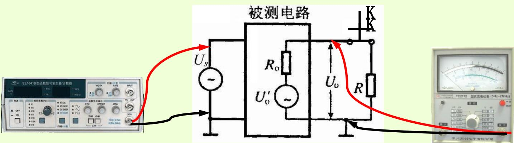

$$
R_o = \left( \frac{U'_o}{U_o} - 1 \right) R
$$

### 参数测量

#### 幅频特性测量

测量电路如下图示。保持输入信号幅度不变，改变输入信号频率，测量相应的输出电压值，计算放大倍数，可绘出幅频特性曲线。

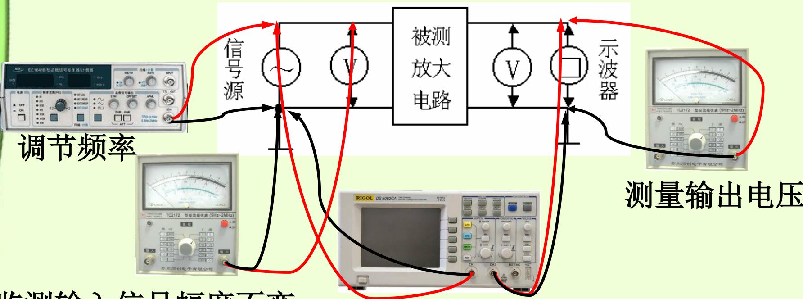

#### 最大不失真输出电压测量

测量电路如下图示。频率在中频段，不断增大输入信号幅度，示波器监测输出电压波形，保证不失真时所能达到的最大输出电压峰－峰值 $U_{op-p}$。

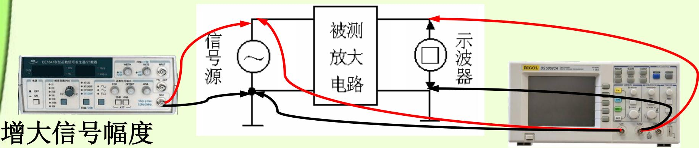

### 实验注意事项

#### 单级放大电路

1. 直流电源必须准确（用万用表测量）。
2. 晶体管、电容的极性装配正确；
3. 测量静态工作点时注意万用表内阻的影响；
4. 测量交流参数时不能将直流电源去掉；
5. 测幅频特性时，注意保持输入信号的幅值不变、输出信号不失真；
6. 交流毫伏表的幅频特性的影响。

## 串联谐振电路

### 实验目的

1. 研究 RLC 串联谐振电路的幅频特性。
2. 加深对品质因数 Q 与电路其他参量关系的理解。

### 实验仪器

*   双踪示波器
*   函数信号发生器
*   DGDZ-2 型电工电子综合实验箱

### 实验原理

总阻抗：

$$
Z = (R_t + R_r) + j \omega L + \frac{1}{j \omega C}
$$

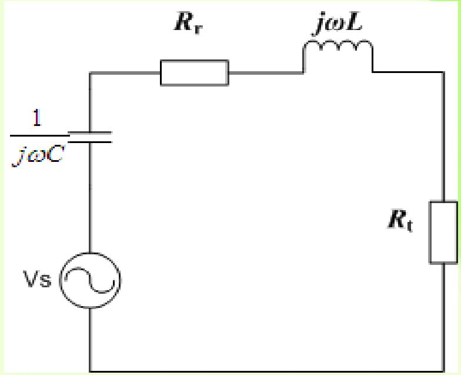

当电路发生谐振时：

$$
j \omega L + \frac{1}{j \omega C} = 0
$$

$$
f_0 = \frac{1}{2 \pi \sqrt{L C}}
$$

此时阻抗最小，为纯电阻：

$$
Z = R_t + R_r
$$

元件参数参考值：
*   $R_t = 20 \, \Omega$
*   $L = 5.6 \, \text{mH}$
*   $C = 0.1 \, \mu\text{F}$

谐振时电流最大：

$$
I_{o \max} = \frac{V_s}{R_r + R_t}
$$

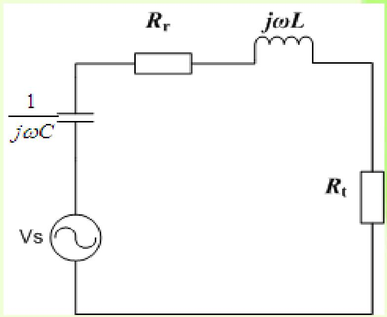

谐振时电感与电容上的电压：

$$
V_{Lo} = V_{Co} = Q V_S
$$

品质因数定义：

$$
Q = f_0 / (f_2 - f_1)
$$

半功率点频率：$f_1, f_2$

在半功率点处：

$$
I_o = 0.707 I_{o \max}
$$

$$
\varphi = 45^{\circ}
$$

### 实验任务和步骤

#### 1. 测谐振频率 $f_0$

**方法一：** 利用谐振时回路电流最大的特点

$$
I_o = I_{o \max} \quad \longrightarrow \quad V_{Rt} = V_{Rt \max}
$$

**方法二：** 利用谐振时阻抗为纯阻性

$$
\varphi = 0^{\circ}
$$

#### 2. 测半功率点频率 $f_1, f_2$

**方法：** 利用半功率点处 $\varphi = 45^{\circ}$

#### 3. 计算验证 Q 值

$$
Q = V_{C0} / V_s = V_{L0} / V_s
$$

$$
Q = f_0 / (f_2 - f_1)
$$

#### 4. 测量和绘制谐振曲线

| $f(\text{kHz})$ | 2.0 | | | $f_1$ | | $f_0$ | | $f_2$ | | | | 20 |
| :--- | :--- | :--- | :--- | :--- | :--- | :--- | :--- | :--- | :--- | :--- | :--- | :--- |
| $V_{Rt}(\text{V})$ | | | | | | | | | | | | |
| $I_o (\text{mA})$ | | | | | | | | | | | | |

**注意：**

1. 每次改变频率后校正输入信号 $V_S$ 有效值为 100mV。
2. 频率依次从高到低，注意选择测试点应遵循的原则。
3. 在测量 $V_{L0}$ 和 $V_{C0}$ 时，注意信号电源和测量仪器公共地线的接法。

### 具体操作步骤

#### 1. 测谐振频率 $f_0$

(1) 按图接线，信号源输出为正弦波，f 任意，始终保持 $V_s = 100 \, \text{mV}$ （有效值）。

(2) 调整信号频率，根据谐振时回路电流最大，电阻 $R_t$ 上电压最大，找出谐振频率 $f_0$。

(3) 将 $V_s$ 和 $V_{Rt}$ 分别送入示波器的两个通道，采用双迹法，观察两个信号相位差为 0 时，找出谐振频率 $f_0'$。

(4) 始终保持 $V_s = 100 \, \text{mV}$ （有效值）。测量谐振时的 $V_{Rto}, V_{Co}, V_{Lo}$。

#### 2. 测半功率点频率 $f_1, f_2$

**方法：** 利用半功率点处 $\varphi = 45^{\circ}$

(1) 将 $V_s$ 和 $V_{Rt}$ 分别送入示波器的两个通道，采用双迹法，减小信号频率，观察 $\varphi = 45^{\circ}$ 时，读出半功率点 $f_1$ 及对应的 $V_{Rt1}$。

(2) 增大信号频率，观察 $\varphi = 45^{\circ}$ 时，读出半功率点 $f_2$ 及对应的 $V_{Rt2}$。

(3) 验证 $V_{Rt1}$ 和 $V_{Rt2}$ 是否等于 $0.707 V_{Rt0}$。
