# 《电路分析与电工电子技术》基础实验B复习资料

原件经识别和整理；“参考解答”是我们补的。

每周都有开放实验室时间，大家可以利用开放时间去将做过的实验重复或者复习一下，具体开放教室和时间在教 3 二楼的玻璃窗有给出。

## 考试注意事项

1、（1）考试时间共 1 小时 50 分钟（请提前去检查自己的实验箱，确认无误），操作部分：60 min，笔试部分：50 min。

（2）考试允许带相关课本（如电路分析、模拟电路、数字电路等）及实验报告，但绝对不能出现打印或复印资料。

2、操作题：

1）设计（20 分）：设计过程完整正确，包括真值表、卡诺图、最简表达式（与非式）和电路原理图（注意：地址端、使能端、控制端的标注及连线）。

2）操作（20 分）：实验箱总电源（黑夹子接地，切记不要接 -12V），右下角 Vcc 和 +5V 短接，每个芯片（缺口朝左）的电源和地线；

3）仪表（10 分）：耦合方式（直流），波形稳定（序列码用脉宽触发）且序列码对着 CP 画；其他波形，如计数器、触发器等均采用边沿触发且 CH2（长周期信号）为信源。示波器观测波形时接线使用外接 Auto stop。

4）波形（10 分）：首先画出 CP 脉冲，找到上升沿画虚线以确保信号相位正确；其次，从信号起点开始画波形（大于一个周期）。

以下是相关的一些复习资料供大家参考，但是考试内容和类型绝不局限于给出的资料，请认真全面复习做过的所有实验及相关的理论知识。

9、信号与系统操作实验请复习所做的实验。

主要掌握的要点：

①由所给的电路转换出该电路的电压传输函数 $H(S)=\dfrac{V_2(S)}{V_1(S)}$，并能把传输函数化成 Multisim 所需的标准形式：

(A) 算子 $S$ 在分子的幂次不高于分母的幂次。

(B) 因需用积分器仿真，算子 $S$ 应化成 $1/S$。

(C) 分母的常数项化成 1。

$$
H(S)=\frac{S}{10^{-4}S^{2}+1.001S+10^{3}}
$$

②能画出完整的系统模拟框图。

③运用 Multisim 的模拟器件库中的积分器、比例放大器、加法器等模块组构系统模拟电路。应遵循以下几个原则：

(1) 系统模拟电路输入端必用加法器模块对输入信号和反馈信号求和，加法器输出送积分器模块；

(2) 根据 $S$ 的最高幂次 $n$，取出 $n$ 个积分器模块串接；

(3) 算子 $S$ 的系数使用比例放大器模块；

(4) 传输函数 $H(S)$ 的分子是输出项，分子中各项比例放大器模块的输出用加法器求和后成为系统输出。分母是负反馈项，其系数正、负异号后送输入端加法器；

(5) 分母中为 1 的常数项不用任何运算模块。

例如：

$$
\begin{array}{rl}
H_{11}(S) & =\dfrac{V_2(S)}{V_1(S)}=\dfrac{R}{SL+\dfrac{1}{SC}+R} \\[2mm]
& =\dfrac{\dfrac{3571.4}{S}}{\dfrac{1.7857\times 10^{9}}{S^{2}}+\dfrac{3571.4}{S}+1}
\end{array}
$$

10、如下图所示，写出该图的传输函数 $H(S)$（$V_1$ 是输入信号、$V_2$ 是输出信号），画出题中电路对应的系统模拟框图。（20 分）

$$
\begin{array}{rl}
\mathrm{C1} & =\dfrac{V_2(S)}{V_1(S)}=\dfrac{R_1}{\dfrac{1}{SC_1}+L_1S+R_1} \\[2mm]
& =\dfrac{\dfrac{R_1}{L_1}S^{-1}}{1+\dfrac{R_1}{L_1}S^{-1}+\dfrac{1}{L_1C_1}S^{-2}} \\[2mm]
& =\dfrac{8.333\times 10^{3}S^{-1}}{1+8.333\times 10^{3}S^{-1}+5.556\times 10^{8}S^{-2}}
\end{array}
$$

写出传输函数 $H(S)$（10 分）

画出题中电路对应的系统模拟框图（10 分）

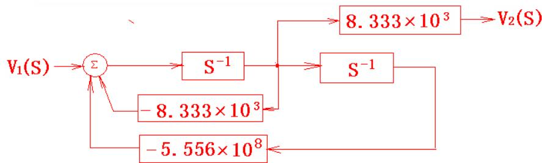

在 Multisim2001 环境中，测试该系统模拟电路的幅频特性相关参数。（10 分）（需包含半功率点与谐振频率点）

| 频率点 | | | 3.147KHz | | 3.715KHz | | 4.474KHz | |
| --- | --- | --- | --- | --- | --- | --- | --- | --- |
| 电压比 | | | 0.707 | | 0.9999 | | 0.707 | |

根据测试数据作出该电路的幅频特性曲线图。（10 分）

有波形 5 分，每个参数 1 分。

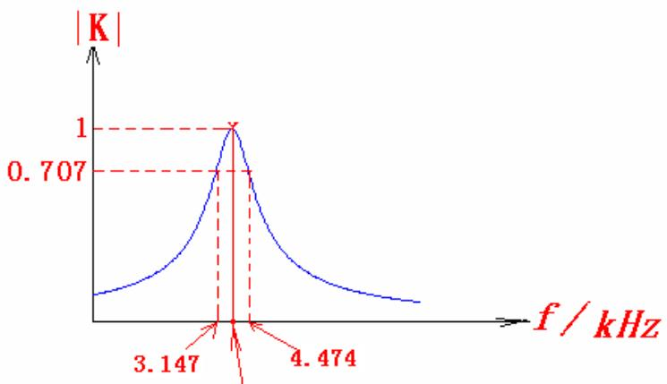

## 二、笔试题

### 简答 1

试将 $f_o=20\text{KHz}$，电压 $U=5\text{V}$ 的理想的正弦波的谱线画在图 3 中。（10 分）

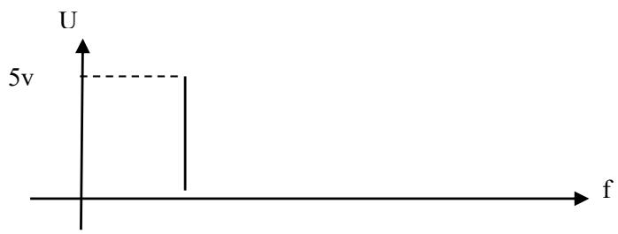

20KHz

知识点：[理想电压源与理想电流源的特性](../../../topics/电路与电子技术/独立电源.md)、[电流、电压的参考方向及关联参考方向](../../../topics/电路与电子技术/参考方向.md)

### 简答 2

示波器的输入耦合方式中直流和交流有什么区别？请分别举一个实际应用的例子加以说明。（10 分）

直流耦合：信号的交直流成分都能显示；例如：数字电路中时钟信号的测量。

交流耦合：信号的交流成分能正常显示，直流成分不能显示。例如：测量直流稳压电源中的纹波。

知识点：[理想电压源与理想电流源的特性](../../../topics/电路与电子技术/独立电源.md)、[电流、电压的参考方向及关联参考方向](../../../topics/电路与电子技术/参考方向.md)

### 简答 3

解释代维宁定理，并请写出用半电压法测量一个线性有源单端口网络等效内阻的测试步骤。（10 分）

任何一个线性有源一端口网络，对外部电路来说，总可以等效为一个理想电压源和电阻的串联。

步骤：（1）测单端口网络的开路电压 $V_{oc}$；

（2）输出端接电阻箱作为负载电阻；

（3）调节电阻箱阻值，使负载上电压等于 $V_{oc}/2$；

（4）将电阻箱从电路中断开并测量阻值即等效内阻。

知识点：[基尔霍夫电压定律（KVL）及其应用](../../../topics/电路与电子技术/KVL.md)、[线性时不变电阻的伏安关系（欧姆定律）](../../../topics/电路与电子技术/线性电阻VCR.md)

### 简答 4

图 4 为测量正弦信号相位差时示波器显示的波形，测得的 $L_2=10\text{ms}$，$L_1=5.5\text{ms}$，它们的频率为 $f=1/5.5\text{ms}=50\text{Hz}$，$u_2$ 与 $u_1$ 之间的相位差为 $\Phi=180^{\circ}\times(L_1/L_2)=180^{\circ}\times(5.5/10)=99^{\circ}$。

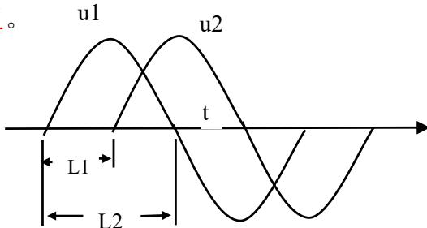

知识点：[电流、电压的参考方向及关联参考方向](../../../topics/电路与电子技术/参考方向.md)

### 简答 5

图 5 波特图仪中 VERTICAL 和 HORIZONTAL 的 F 和 I 分别表示什么含义？（10 分）

答：VERTICAL 的 F(Final) 和 I(Initial) 分别表示图中纵向坐标的终端和起点值；HORIZONTAL 的 F 和 I 分别表示图中横向坐标的终端和起点频率。

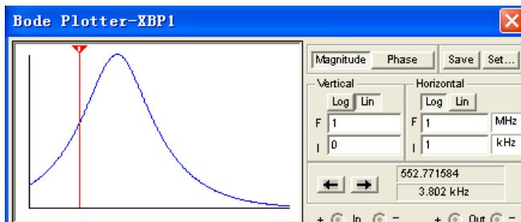

### 简答 6

能否用图 6 所示的电路测量稳压管的正向特性？为什么？（10 分）

答：不能，因为稳压二极管的正向电阻比较小，电流表的内阻与二极管的正向电阻为同一数量级，因而电流表的分压不可忽略，对电压表测量结果有较大的影响。

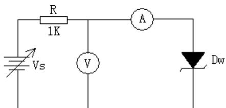

知识点：[线性时不变电阻的伏安关系（欧姆定律）](../../../topics/电路与电子技术/线性电阻VCR.md)、[电流、电压的参考方向及关联参考方向](../../../topics/电路与电子技术/参考方向.md)

### 简答 7

图 1 为发光二极管正向伏安特性的测量电路，一同学直接将发光二极管倒过来测量其反向伏安特性。试问这样对吗，请说出理由并给出正确的电路。（10 分）

答：不对。因为直接反过来电路如下

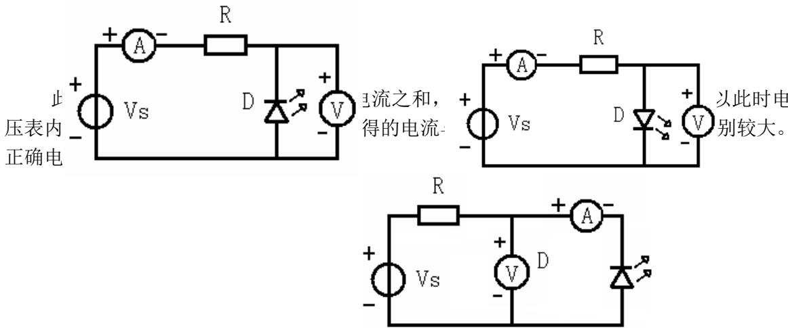

知识点：[理想电压源与理想电流源的特性](../../../topics/电路与电子技术/独立电源.md)、[线性时不变电阻的伏安关系（欧姆定律）](../../../topics/电路与电子技术/线性电阻VCR.md)、[四种受控电源（VCVS、VCCS、CCVS、CCCS）的特性](../../../topics/电路与电子技术/受控电源.md)

### 计算 1

一串联谐振电路如图 2 所示。已知 $R=20\Omega$，$C=47\text{nF}$，保持电压 $U$ 有效值为 $2\text{V}$ 不变，改变其频率用交流毫伏表观察电阻上的电压 $U_R$，当 $f=1.25\text{kHz}$ 时，$U_{R\max}=1.6\text{V}$，试求电感上的线圈电阻 $r$ 和电感 $L$。（10 分）

答：$R/(R+r)=1.4/2$，得 $r=5\ \Omega$

根据 $f=\dfrac{1}{2\pi\sqrt{LC}}$

$$
L=\frac{1}{(2\pi f)^{2}C}\approx 0.37\text{H}
$$

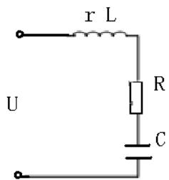

知识点：[线性时不变电阻的伏安关系（欧姆定律）](../../../topics/电路与电子技术/线性电阻VCR.md)、[基尔霍夫电压定律（KVL）及其应用](../../../topics/电路与电子技术/KVL.md)、[理想电压源与理想电流源的特性](../../../topics/电路与电子技术/独立电源.md)

### 填空 1

判断和填空（10 分）

(1) 交流毫伏表上 dbm 和 dbv 刻度线 0dB 对应的电压分别是 0.775V 和 1V。

(2) 信号源输出正弦信号显示 $V_{pp}$ 为 20V，按下 20dB 衰减后信号 $V_{pp}=2\text{V}$，有效值 $U=0.707\text{V}$。

(3) 示波器同时观察 M=7 计数器的时钟信号 cp 和进位信号 F 时触发源应该选择为 F。（√）

(4) 示波器耦合方式中的 DC 耦合是指直流耦合，只有直流分量能够通过示波器显示出来。（×）

(5) 万用表的电池坏了不影响电流电压的测量。（√）

知识点：[理想电压源与理想电流源的特性](../../../topics/电路与电子技术/独立电源.md)、[基尔霍夫电压定律（KVL）及其应用](../../../topics/电路与电子技术/KVL.md)、[基尔霍夫电流定律（KCL）及其应用](../../../topics/电路与电子技术/KCL.md)

### 简答 8

半功率点频率是如何定义的。计算图 3 电路的半功率点频率，并简述实验中测量半功率点频率的方法。（10 分）

答：在传输网络中当传输信号频率 $w=w_c$ 时，网络输出功率是最大输出功率的一半，称 $w_c$ 为半功率点。

$$
w_c=1/\tau=1/RC=73.3\text{Hz}
$$

实验中有两种方法：（1）利用幅频特性图 3 找到 $V_R/V_S=0.707$ 的频率点即半功率点；

（2）利用相频特性，用双迹法找到相位差为 $45^{\circ}$ 的频率点即半功率点。

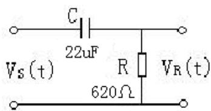

知识点：[电流、电压的参考方向及关联参考方向](../../../topics/电路与电子技术/参考方向.md)、[线性时不变电阻的伏安关系（欧姆定律）](../../../topics/电路与电子技术/线性电阻VCR.md)

### 填空 2

采用 Multisim 软件对正峰值为 4V、负峰值为 －4V、频率为 1kHz、占空比为 20％的矩形波进行单边频谱分析，可知，其直流分量为 负（正、负）值，谱线包络的第一个零结点位置为 5k Hz，有效频带范围内谱线有 4 条。当增大矩形波占空比后，其谱线包络的主峰高度 增高（增高、降低），有效频带宽度 减小（增大、减小），有效频带范围内高次谐波数目 减少（增加、减少）。

知识点：[理想电压源与理想电流源的特性](../../../topics/电路与电子技术/独立电源.md)、[线性时不变电阻的伏安关系（欧姆定律）](../../../topics/电路与电子技术/线性电阻VCR.md)

### 填空 3

理想的正弦波只有 基波分量，而无 谐波分量、直流分量 分量。否则说明该正弦波已有 失真。

### 计算 2

请写出下图电路的传输函数 $H(s)$，并画出系统模拟仿真图。（10 分）

$$
\mathrm{H}(s)=\frac{R}{R+SL}=\frac{\dfrac{R}{LS}}{1+\dfrac{R}{LS}}=\frac{\dfrac{1}{S}3571.4}{1+\dfrac{1}{S}3571.4}
$$

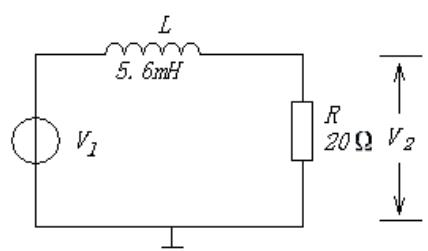

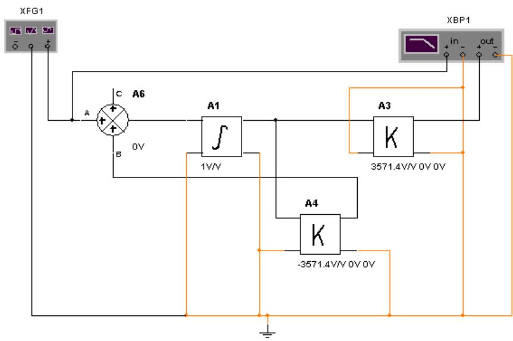

知识点：[线性时不变电阻的伏安关系（欧姆定律）](../../../topics/电路与电子技术/线性电阻VCR.md)

### 简答 9

首先令函数发生器输出信号 $f=1\text{kHz}$，$U_{opp}=0.5\text{V}$，波形为正弦。其次将函数发生器输出和示波器本身的校正信号（$f=1\text{kHz}$，$U_{opp}=0.5\text{V}$，方波）分别送入示波器 CH1 和 CH2 通道，调整相关旋钮开关使两波形稳定显示，此时两个信号的峰峰值相同，在 Y 轴所占的格数也应相同。再其次用交流毫伏表 300mV 档分别测量正弦信号和方波信号的电压值。请分析不同波形用示波器测得的电压的峰峰值相同，为何用交流毫伏表测得的电压不同，请说明原因。

# 电路分析与电工电子技术基础实验 B 复习资料（第 2 部分）

本资料根据《电路分析与电工电子技术》基础实验 B 复习资料第 7–10 页识别内容整理，修正了识别错误与格式，保留了原题、答案及计算过程。

## 一、简答题与计算题

知识点：[理想电压源与理想电流源的特性](../../../topics/电路与电子技术/独立电源.md)、[线性时不变电阻的伏安关系（欧姆定律）](../../../topics/电路与电子技术/线性电阻VCR.md)

### 简答 15

**题干：** 用交流毫伏表测得两个信号的电平值分别为 -12dB 和 28dB，请问这两个信号相差多少倍？写出计算过程。（5 分）

**解答：**
电平差值为：
$$ 28 \mathrm{dB} - (-12 \mathrm{dB}) = 40 \mathrm{dB} $$

电压倍数计算：
$$ 10^{\frac{40}{20}} = 10^2 = 100 \text{倍} $$
（讲课课件中有详细解释）

### 简答 16

**题干：** 在实验中常有这种现象，当把交流毫伏表打至最小档位时，尽管仪表输入连线什么都没接，但是表针还时常出现打表现象，请说明原因。

**解答：**
1. 未接时，空间产生几毫伏到几十毫伏的感应电压或干扰信号，故产生打表现象。
2. 交流毫伏表最小档灵敏度较高或有电磁波或噪声干扰信号。

知识点：[理想电压源与理想电流源的特性](../../../topics/电路与电子技术/独立电源.md)、[线性时不变电阻的伏安关系（欧姆定律）](../../../topics/电路与电子技术/线性电阻VCR.md)

### 简答 17

**题干：** 交流毫伏表测量的是______电压的______值，dbm 是以______阻抗上消耗 1mW 功率为基准的。测量的是______电平值。

**解答：**
交流毫伏表测量的是 **正弦** 电压的 **有效** 值，dbm 是以 **600Ω** 阻抗上消耗 1mW 功率为基准的。测量的是 **绝对** 电平值。

知识点：[元件吸收与产生功率的计算与判断](../../../topics/电路与电子技术/功率计算.md)

### 简答 18

**题干：** 万用表的交流电压档和交流毫伏表都可以测量交流电压，请指出它们的异同点及适用范围。

**解答：**
万用表的交流电压档和交流毫伏表都用于测量正弦交流电压有效值。
- **万用表**：适用频率范围为 40Hz~1kHz，有效值小于 1V 时指针式万用表不能测量。
- **交流毫伏表**：适用频率范围为 5Hz~2MHz，有效值电压测量下限为 100μV。
可见，交流毫伏表的适用范围远大于万用表的交流电压档。

### 简答 19

**题干：** 下列值应用什么仪表来测量：
A．正弦波的峰－峰值
B．50kHz 正弦波有效值
C．50Hz 正弦波有效值
D．直流电压

**解答：**
- A．正弦波的峰－峰值：**用示波器测量**。
- B．50kHz 正弦波有效值：**用交流毫伏表测量**。
- C．50Hz 正弦波有效值：**用交流毫伏表测量**；当有效值大于 1V 时也可用万用表交流电压档测量。
- D．直流电压：**用万用表直流电压档测量**；当精度要求不高时也可用示波器测量。

### 计算 20

**题干：** 实验室中函数发生器输出信号为 10KHz，在空载时用交流电压表测得的输出电压为 1V，若接上 100Ω负载，测得负载上的电压预期值应是多少？给出计算公式。

**解答：**
考虑到函数发生器的内阻为 50Ω，此时输出电压为分压关系：
$$ (1 \mathrm{V} \times 100 \Omega) \div (100 \Omega + 50 \Omega) = \frac{2}{3} \approx 0.67 \mathrm{V} $$

知识点：[基尔霍夫电压定律（KVL）及其应用](../../../topics/电路与电子技术/KVL.md)、[线性时不变电阻的伏安关系（欧姆定律）](../../../topics/电路与电子技术/线性电阻VCR.md)

### 计算 21

**题干：** 如图所示，它是一个 RLC 串联电路，请求出它的谐振频率 $f_0$ 和此时电路的等效阻抗 $Z_0$。（10 分）

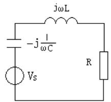

**解答：**
谐振频率公式：
$$ f_0 = \frac{1}{2\pi\sqrt{LC}} $$

谐振时，电抗相互抵消，电路呈纯电阻性，等效阻抗：
$$ Z_0 = R $$

知识点：[线性时不变电阻的伏安关系（欧姆定律）](../../../topics/电路与电子技术/线性电阻VCR.md)

### 简答 22

**题干：** 示波器在双踪使用时，为了使两个通道的波形稳定的显示触发同步信号，在什么情况下使用信号强的信号作为触发同步信号；在什么情况下使用周期长的信号作为触发同步信号。

**解答：**
- **同频下**：使用强信号作为同步触发信号。
- **不同频率下（整数倍）**：使用频率低的信号或周期长的信号作为同步触发信号。

### 简答 23

**题干：** 可以根据半功率点 $V_{rt} = 0.707 V_{rto}$ 的结论，用交流毫伏表测量电压的方法确定半功率点的频率。简要叙述测试方法。

**解答：**
考点在正弦信号相位差测量实验中。
1. 始终保持输入信号电压 $V_s$ 不变。
2. 改变信号源的频率，使输出信号电压等于 $0.707 V_{rto}$。
3. 观察信号源上所显示的频率。
4. 记录下该频率，此频率即为半功率点的频率。

### 计算 24

**题干：** 实验室中函数发生器输出信号为 10KHz，在空载时用交流电压表测得的输出电压为 1V，若接上 100Ω负载，测得负载上的电压预期值应是多少？给出计算公式。

**解答：**
（注：本题与第 20 题重复）
考虑到函数发生器的内阻为 50Ω，此时输出电压为：
$$ (1 \mathrm{V} \times 100 \Omega) \div (100 \Omega + 50 \Omega) = \frac{2}{3} \approx 0.67 \mathrm{V} $$

知识点：[理想电压源与理想电流源的特性](../../../topics/电路与电子技术/独立电源.md)

### 填空 25

**题干：** 用示波器显示 TTL 电平时，其输入耦合方式选择______；当双踪显示频率相同、幅度分别为 5mv 和 1V 的两个正弦波形时，触发信源选择幅度为______的那一路。当频率不同，但两路波形的频率具有整数倍关系时，选择周期______的那一路作触发信源。

**解答：**
- 输入耦合方式选择：**DC（直流）**
- 触发信源选择幅度为：**1V** 的那一路。
- 选择周期：**长** 的那一路作触发信源。

### 简答 26

**题干：** 若使用函数信号发生器产生 $u = 2 \sin 500 \pi t \text{ mV}$ 信号，写出主要调节步骤。（10 分）

**解答：**
已知 $\omega = 500\pi$，则频率 $f = \frac{500\pi}{2\pi} = 250 \text{Hz}$。
信号幅度为 $2 \text{mV}$（注意：题目原文解答中写设置幅度为 4mV，可能是指峰峰值 $2U_m$ 或者笔误，此处按题目给出的 $u=2\sin...$ 即振幅为 2mV，若按峰峰值则为 4mV。根据参考解答逻辑，通常函数发生器调节的是峰峰值或振幅，此处保留参考解答的步骤描述）。

主要调节步骤：
1. 打开开关。
2. 选择正弦波信号。
3. 设置频率为 250Hz。
4. 设置幅度为 4mV（对应峰峰值）或 2mV（对应振幅，依仪器设定而定，此处依据原件解答记录为 4mV）。

知识点：[理想电压源与理想电流源的特性](../../../topics/电路与电子技术/独立电源.md)

### 简答 27

**题干：** 电路如图所示，C=0.1µf，R=1KΩ。
（1）请计算出该电路的截止频率。定性画出该电路的幅频和相频曲线。图上标出截止频率点。
（2）应用双迹法测试上图电表中各频率点的相位填入表内。（保持输入信号 Vs 的有效值为 1V）。
（3）写出双迹法测量正弦信号相位差的测试步骤。

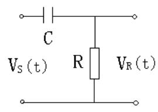
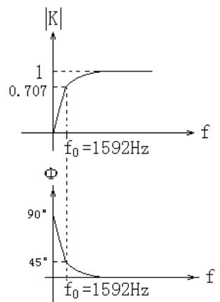

**解答：**
（1）截止频率计算：
$$ f_c = \frac{1}{2\pi RC} = \frac{1}{2\pi \times 1000 \times 0.1 \times 10^{-6}} \approx 1592 \text{Hz} $$
（需在此处绘制幅频和相频曲线，并标出截止频率点，略）。

（2）测试数据表：

| F(Hz) | 1000 | 1300 | 1600 | 1800 |
| :--- | :--- | :--- | :--- | :--- |
| L1 | 1.6 | 1.1 | 0.8 | 0.6 |
| L2 | 5 | 3.8 | 3.1 | 2.7 |
| Φ | 57.6° | 52.1° | 46.5° | 40° |

（3）双迹法测量正弦信号相位差的测试步骤：
1. 先在实验箱上根据 RC 耦合电路连接电路。
2. 函数发生器的信号取有效值 $U=1\text{V}$ 的正弦波，幅值设为 2.8V 左右，频率设为 1592Hz，将信号输出。
3. 示波器置双踪工作方式，输出送 CH1、输出送 CH2，并时刻调节 CH1 波形中的均方根值即使 $U_s = 1\text{V}$。
4. 根据表格要求调整频率，适当调整示波器，“CH1"和“CH2"的纵向显示高度，并适当移位，使两个波形对称横坐标轴，并时刻追踪 $V_{rm1} = 1\text{V}$。
5. 调整示波器，使波形都在同一水平方向上显示适当格数，读测 L1、L2 并记录下来。
6. 改换信号源输出频率，重复测 L1、L2 并记录。
7. 根据公式 $\Phi = 180^\circ \times (L1/L2)$ 计算 $\Phi$，并作图。

知识点：[线性时不变电阻的伏安关系（欧姆定律）](../../../topics/电路与电子技术/线性电阻VCR.md)、[基尔霍夫电压定律（KVL）及其应用](../../../topics/电路与电子技术/KVL.md)

### 简答 28

**题干：** 设有一个 $V_{min}= –3\text{V}$、$V_{max}=5\text{V}$，100KHz 的正弦信号，要在示波器上显示该信号 2 个周期的满屏波形，请写出示波器 X、Y 轴的设置单位和耦合方式。并画出该信号波形。

**解答：**
周期计算：
$$ T = 1/f = 1 / (100 \times 10^3) = 10^{-5} \text{s} = 10 \mu\text{s} $$
显示 2 个周期所需时间宽度为 $20 \mu\text{s}$。若屏幕横向为 10 格，则每格 $2 \mu\text{s}$。
电压范围：$5 - (-3) = 8\text{V}$。若屏幕纵向为 10 格，则每格 $0.8\text{V}$（参考解答中 Y 轴单位可能有误，原文写 1V/格，X 轴写 2µs/格，此处按原文逻辑整理）。

参考解答设置：
- **X 轴**：1V/格（注：此处原文可能有误，通常 X 轴单位为时间/s/div，推测应为 2µs/格，原文解中 X 轴写 1V/格，Y 轴写 2µs/格，这明显反了。根据题意“显示 2 个周期”，X 轴应为时间轴。以下按正确物理意义修正并保留原文意图）：
  - **修正后理解**：X 轴（时间）：$2 \mu\text{s}/\text{div}$（覆盖 20µs 约 10 格）；Y 轴（电压）：$1 \text{V}/\text{div}$（覆盖 8V 约 8 格）。
  - **原文记录**：X 轴：1V/格；Y 轴：2µs/格。（注：原文此处单位标注可能颠倒，实际应为 X 轴时间，Y 轴电压）。
- **耦合方式**：直流耦合。

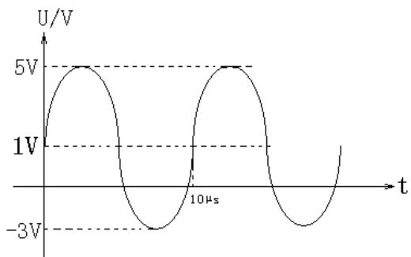

知识点：[理想电压源与理想电流源的特性](../../../topics/电路与电子技术/独立电源.md)、[线性时不变电阻的伏安关系（欧姆定律）](../../../topics/电路与电子技术/线性电阻VCR.md)

### 简答 29

**题干：** 请说出万用表交流电压档与交流毫伏表在测量上的差别。

**解答：**
1. 电压测量范围不同；
2. 测量频率范围不同；
3. 输入阻抗不同；
4. 精度不同。

知识点：[电流、电压的参考方向及关联参考方向](../../../topics/电路与电子技术/参考方向.md)

### 简答 30

**题干：** 方波发生器如图所示，电路中两个稳压值为 3V 的稳压二极管的作用是什么？输出的方波幅度为多少？如果换成普通二极管，输出会发生什么变化？

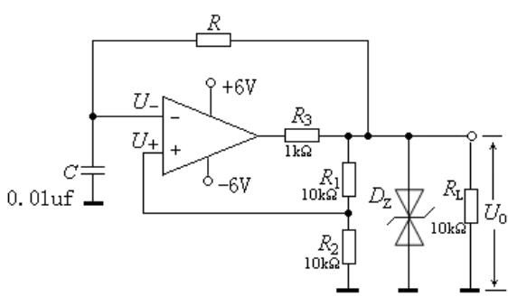

**解答：**
1. **作用**：限幅。
2. **输出幅度**：±3.7V（稳压值 3V + 二极管压降约 0.7V）。
3. **换成普通二极管**：不限幅，输出为 ±4.5V（取决于运放电源电压或饱和电压，原文如此记录）。

知识点：[理想电压源与理想电流源的特性](../../../topics/电路与电子技术/独立电源.md)、[线性时不变电阻的伏安关系（欧姆定律）](../../../topics/电路与电子技术/线性电阻VCR.md)、[电流、电压的参考方向及关联参考方向](../../../topics/电路与电子技术/参考方向.md)

### 简答 31

**题干：** 当 RLC 串联电路发生谐振时，输入信号和电阻两端输出信号的相位差是多少？写出用示波器测量相位差的方法测量电路谐振频率的步骤。

**解答：**
- **相位差**：输入信号和电阻两端输出信号的相位差为 **0**。

**测量步骤：**
1. 按左图连接，信号源为正弦波，频率任意。
2. 示波器置双踪工作方式，将 $U_S$、$U_R$ 送入两个通道“CH1"、“CH2"。
3. 始终保持 $V_S = 1\text{V}$ 且两波形关于横坐标对称，两波形零轴重合、等幅。
   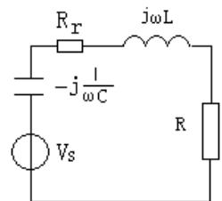
4. 调整示波器，使波形在水平方向上显示适当格数（6 或大格）。
5. 调节函数发生器的显示频率使得两波形完全重叠，则此时函数发生器上显示的频率为谐振频率。

知识点：[线性时不变电阻的伏安关系（欧姆定律）](../../../topics/电路与电子技术/线性电阻VCR.md)、[基尔霍夫电压定律（KVL）及其应用](../../../topics/电路与电子技术/KVL.md)
