# 《电路分析与电工电子技术》复习习题

原件经识别和整理；“参考解答”是我们补的。

# 电路分析与电工电子技术复习习题

本资料由识别工具读取《电路分析与电工电子技术》复习习题第 1–11 页内容整理而成，已修正明显的排版错误、乱码及断行问题，公式已转换为 LaTeX 格式。

## 一、电路等效与方程列写

### 选择 1

**题干**：仅含受控源和电阻的电路最终等效成一个电阻。设端口上的电压为 $U$，电流为 $I$，方向如图所示，取关联参考。对网孔 1（广义回路）列 KVL 方程，对节点 A 列 KCL 方程，消去中间变量后求等效电阻 $R_{ab}$。

**已知条件与推导过程**：
- 对网孔 1（广义回路）列 KVL 方程：
  $$ u = 2 i_1 $$
- 网孔 2 列 KVL 方程：
  $$ -2i_1 + 4i_2 + r i_1 = 0 $$
- 对节点 A 列 KCL 方程：
  $$ i_1 + i_2 - i = 0 $$
- 消去 $i_1, i_2$ 得：
  $$ R_{ab} = \frac{u}{i} = \frac{8}{6 - r} $$

答案：无（原题未提供选项，此为计算结果）。

---

知识点：[四种受控电源（VCVS、VCCS、CCVS、CCCS）的特性](../../../topics/电路与电子技术/受控电源.md)、[基尔霍夫电压定律（KVL）及其应用](../../../topics/电路与电子技术/KVL.md)、[基尔霍夫电流定律（KCL）及其应用](../../../topics/电路与电子技术/KCL.md)

### 计算 2-9

**题干**：化简电路为戴维南等效电路。

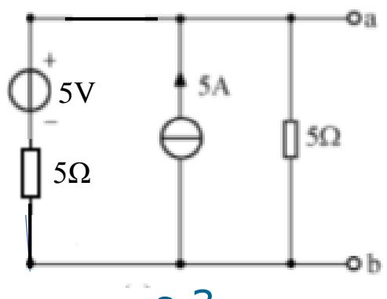

*(注：此处原图包含多张步骤图，分别为求解开路电压、短路电流及等效电阻的过程示意图)*

---

知识点：[理想电压源与理想电流源的特性](../../../topics/电路与电子技术/独立电源.md)、[线性时不变电阻的伏安关系（欧姆定律）](../../../topics/电路与电子技术/线性电阻VCR.md)、[基尔霍夫电压定律（KVL）及其应用](../../../topics/电路与电子技术/KVL.md)

### 计算 2-16b

**题干**：化为诺顿等效电路。

**解题步骤**：

1. **求短路电流 $i_{sc}$**
   对两网孔列 KVL 方程：
   $$ -25 + 10i_1 + 5i_1 + 10i_2 = 0 $$
   $$ 6i_{sc} - 10i_2 - 5i_1 = 0 $$
   对节点列 KCL：
   $$ -i_1 + i_2 + i_{\mathrm{sc}} = 0 $$
   
   解得：
   $$ i_{\mathrm{sc}} = 1.5 \mathrm{A} $$

2. **求等效电阻 $R_0$（加压求流法）**
   设端口电流为 $i$，电压为 $u$。
   对两回路列 KVL，对节点列 KCL：
   $$ -6i + u - 10i_2 - 5i_1 = 0 $$
   $$ -i - i_1 + i_2 = 0 $$
   
   解得：
   $$ R_0 = 10 \Omega $$

**结论**：诺顿等效电路参数为 $I_N = 1.5 \mathrm{A}$，$R_N = 10 \Omega$。

---

知识点：[基尔霍夫电流定律（KCL）及其应用](../../../topics/电路与电子技术/KCL.md)、[基尔霍夫电压定律（KVL）及其应用](../../../topics/电路与电子技术/KVL.md)、[理想电压源与理想电流源的特性](../../../topics/电路与电子技术/独立电源.md)

### 计算 3-5(b)

**题干**：电路如题图 3-5 所示，试列网孔方程。

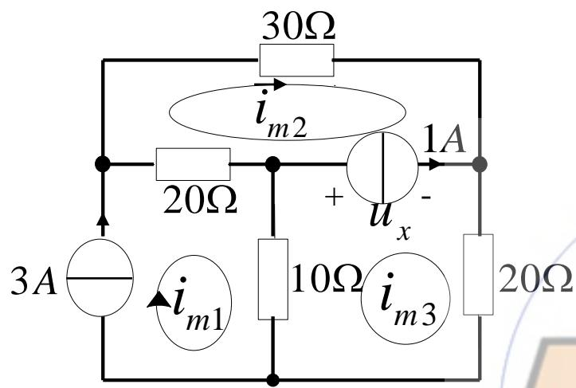

**解**：
设电流源两端电压为 $u_x$，网孔电流如图所示。

$$
\left\{ 
\begin{array}{l} 
i_{m1} = 3 \\ 
-20i_{m1} + (20 + 30)i_{m2} = u_x \\ 
-10i_{m1} + (10 + 20)i_{m3} = -u_x \\ 
i_{m3} - i_{m2} = 1 
\end{array} 
\right.
$$

整理得：
$$
\therefore \left\{ 
\begin{array}{l} 
i_{m1} = 3 \\ 
-20i_{m1} + 50i_{m2} = u_x \\ 
-10i_{m1} + 30i_{m3} = -u_x \\ 
i_{m3} - i_{m2} = 1 
\end{array} 
\right.
$$

---

知识点：[基尔霍夫电压定律（KVL）及其应用](../../../topics/电路与电子技术/KVL.md)、[理想电压源与理想电流源的特性](../../../topics/电路与电子技术/独立电源.md)

### 计算 3-9

**题干**：电路如题所示，用节点分析法求电压 $u$。

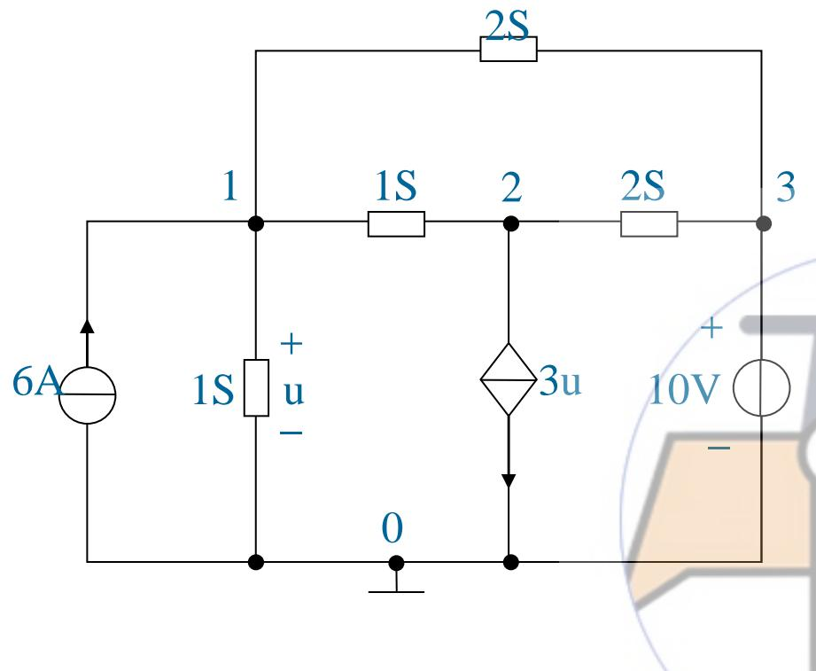

**解**：
设节点 0 为参考节点，对节点 1、2 列节点方程。
已知关系式：
$$
\left\{ 
\begin{array}{l} 
4u - u_{n2} = 26 \\ 
2u + 3u_{n2} = 20 
\end{array} 
\right.
$$

根据电路结构列出的完整节点方程组为：
$$
\left\{ 
\begin{array}{l} 
(1 + 1 + 2)u_{n1} - u_{n2} - 2u_{n3} = 6 \\ 
-u_{n1} + (1 + 2)u_{n2} - 2u_{n3} = -3u \\ 
u_{n3} = 10 \mathrm{V} \\ 
u_{n1} = u 
\end{array} 
\right.
$$

解得：
$$ u = 7 \mathrm{V} $$

---

知识点：[基尔霍夫电流定律（KCL）及其应用](../../../topics/电路与电子技术/KCL.md)、[四种受控电源（VCVS、VCCS、CCVS、CCCS）的特性](../../../topics/电路与电子技术/受控电源.md)、[基尔霍夫电压定律（KVL）及其应用](../../../topics/电路与电子技术/KVL.md)

### 计算 3-13

**题干**：求题图所示电路中的电压 $u_{ab}$。

**解**：
用节点分析法。设 b 为参考节点，对节点 a、c 分别列节点方程。

解得：
$$ u_{ab} = 4 \mathrm{V}, \quad u_{cb} = 4 \mathrm{V} $$

---

## 二、线性网络性质与叠加定理

知识点：[理想电压源与理想电流源的特性](../../../topics/电路与电子技术/独立电源.md)、[基尔霍夫电流定律（KCL）及其应用](../../../topics/电路与电子技术/KCL.md)、[线性时不变电阻的伏安关系（欧姆定律）](../../../topics/电路与电子技术/线性电阻VCR.md)

### 计算 4-5

**题干**：
(1) 题图 4-5 所示线性网络 N，只含电阻。若 $i_{S1}=8\mathrm{A}, i_{S2}=12\mathrm{A}$ 时， $u_x=80\mathrm{V}$；若 $i_{S1}=-8\mathrm{A}, i_{S2}=4\mathrm{A}$ 时， $u_x=0\mathrm{V}$。求当 $i_{S1}=i_{S2}=20\mathrm{A}$ 时， $u_x$ 为多少？

(2) 若所示网络含有独立电源，当 $i_{S1} = i_{S2} = 0\mathrm{A}$ 时， $u_x = -40\mathrm{V}$，且所有 (1) 的数据仍有效。求当 $i_{S1} = i_{S2} = 20\mathrm{A}$ 时，电压 $u_x$ 为多少？

**解**：

**(1) 网络只含电阻**
由线性网络的齐次性和叠加性，可设：
$$ u_x = k_1 i_{S1} + k_2 i_{S2} $$

代入已知条件：
$$
\left\{ 
\begin{array}{l} 
8k_1 + 12k_2 = 80 \\ 
-8k_1 + 4k_2 = 0 
\end{array} 
\right.
$$

解得：
$$ k_1 = 2.5, \quad k_2 = 5 $$

当 $i_{S1} = i_{S2} = 20\mathrm{A}$ 时：
$$ u_x = 2.5 \times 20 + 5 \times 20 = 150\mathrm{V} $$

**(2) 网络含有独立电源**
设其所有独立电源的作用为 $\sum e_s$，则：
$$ u_x = p_1 i_{S1} + p_2 i_{S2} + p_3 \sum e_s $$

将 $i_{S1}=i_{S2}=0\mathrm{A}$ 时， $u_x=-40\mathrm{V}$ 代入：
$$ p_3 \sum e_s = -40 $$

再将 (1) 中的条件代入（此时 $p_1=k_1, p_2=k_2$）：
$$
\left\{ 
\begin{array}{l} 
8p_1 + 12p_2 - 40 = 80 \\ 
-8p_1 + 4p_2 - 40 = 0 
\end{array} 
\right.
$$

解得：
$$ p_1 = 0, \quad p_2 = 10 $$

故，当 $i_{S1}=i_{S2}=20\mathrm{A}$ 时：
$$ u_x = 0 \times 20 + 10 \times 20 - 40 = 160\mathrm{V} $$

---

知识点：[四种受控电源（VCVS、VCCS、CCVS、CCCS）的特性](../../../topics/电路与电子技术/受控电源.md)、[基尔霍夫电流定律（KCL）及其应用](../../../topics/电路与电子技术/KCL.md)、[线性时不变电阻的伏安关系（欧姆定律）](../../../topics/电路与电子技术/线性电阻VCR.md)

### 计算 4-10(b)

**题干**：试求题图 4-10 所示二端网络诺顿等效电路。

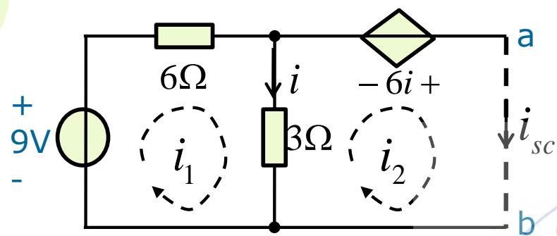

**解**：

**(1) 先求短路电流 $i_{sc}$**
令端口 ab 短路，网孔法有：
$$
\left\{ 
\begin{array}{l} 
9i_1 - 3i_2 = 9 \\ 
-3i_1 + 3i_2 = 6i \\ 
i = i_1 - i_2 
\end{array} 
\right.
$$

解得：
$$ i_{sc} = i_2 = 1.5 \mathrm{A} $$

*另解*：
由电路分析可知 $6i = -3i$，故 $i=0$。
$$ i_{sc} = \frac{9}{6} = 1.5 \mathrm{A} $$

**(2) 求输出电阻 $R_0$**
**方法一：加压求流法**
令独立电压源短路。设端口电压为 $u'$，电流为 $i'$。
$$
\left\{ 
\begin{array}{l} 
u' = 6i + 3i = 9i \\ 
i = \frac{6}{6+3}i' 
\end{array} 
\right.
$$
$$
\therefore u' = 9 \times \frac{6}{6+3} i' = 6i'
$$
$$
R_0 = \frac{u'}{i'} = 6 \Omega
$$

**方法二：开路电压法**
求开路电压 $U_{oc}$，方向为 a→b。
$$ u_{oc} = 6i + 3i = 9i $$
$$ i = \frac{9}{6+3} = 1 \mathrm{A} \quad \therefore u_{oc} = 9 \mathrm{V} $$
$$
\therefore R_0 = \frac{u_{oc}}{i_{sc}} = \frac{9}{1.5} = 6 \Omega
$$

**结论**：诺顿等效电路为 $I_N = 1.5 \mathrm{A}$，$R_N = 6 \Omega$。

# 《电路分析与电工电子技术》复习习题（第 2 部分）

本资料由识别工具从《电路分析与电工电子技术》复习习题第 12–20 页整理而成，主要包含戴维南定理应用、一阶电路暂态分析及叠加原理等计算题。

## 一、计算题

知识点：[理想电压源与理想电流源的特性](../../../topics/电路与电子技术/独立电源.md)、[四种受控电源（VCVS、VCCS、CCVS、CCCS）的特性](../../../topics/电路与电子技术/受控电源.md)、[基尔霍夫电压定律（KVL）及其应用](../../../topics/电路与电子技术/KVL.md)

### 计算 1

**题干：** 4-11 用戴维南定理求题图 4-11 电路的电压 $u$。

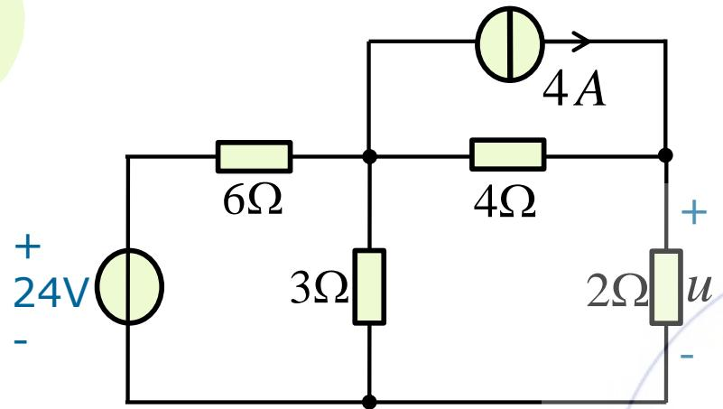
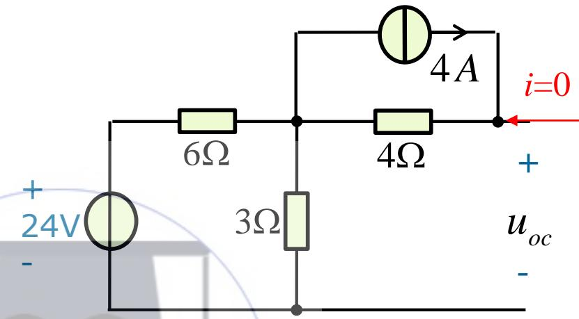

**解：**

(1) 求开路电压 $u_{oc}$

$$
u_{oc} = 4 \times 4 + 24 \times \frac{3}{6 + 3} = 24 \text{ V}
$$

(2) 求输出电阻 $R_0$

$$
R_0 = 6 // 3 + 4 = 6 \, \Omega
$$

由此可得：

$$
\therefore u = 24 \times \frac{2}{6 + 2} = 6 \text{ V}
$$

答案：$6 \text{ V}$

---

知识点：[基尔霍夫电流定律（KCL）及其应用](../../../topics/电路与电子技术/KCL.md)、[基尔霍夫电压定律（KVL）及其应用](../../../topics/电路与电子技术/KVL.md)

### 计算 2

**题干：** 4-14(b) 电路如题图 4-14 所示，其中电阻 $R_L$ 可调，试问 $R_L$ 为何值时能获得最大功率？最大功率为多少？

**解：** 将 $R_L$ 左端电路化为戴维南等效电路：

(1) 先求开路电压 $u_{oc}$

$\because i = 0$，受控电流源 $2i$ 为 0，相当于开路。
$$
u_{oc} = -8 \text{ V}
$$

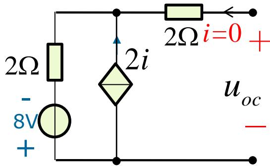

(2) 求输出电阻 $R_0$

令电压源短路，则：

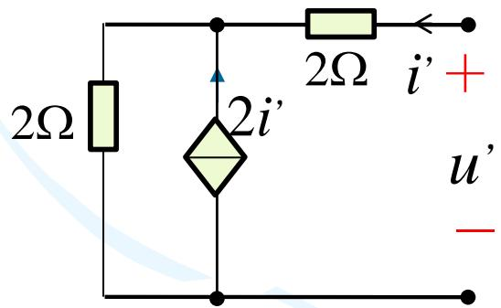

$$
\begin{array}{r l}
u^{\prime} & = 2 i^{\prime} + (2 i^{\prime} + i^{\prime}) \times 2 = 8 i^{\prime} \\
\therefore R_0 & = 8 \, \Omega
\end{array}
$$

(3) 求最大功率

当 $R_L = R_0$ 时有最大功率，为：

$$
p_{\max} = \frac{u_{oc}^2}{4 R_0} = \frac{(-8)^2}{4 \times 8} = 2 \text{ W}
$$

答案：$R_L = 8 \, \Omega$ 时获得最大功率，最大功率为 $2 \text{ W}$。

---

知识点：[理想电压源与理想电流源的特性](../../../topics/电路与电子技术/独立电源.md)、[四种受控电源（VCVS、VCCS、CCVS、CCCS）的特性](../../../topics/电路与电子技术/受控电源.md)

### 计算 3

**题干：** 6-2 二端网络如题图 6-2 所示，其中 $R = 5 \, \Omega$，$L = 0.1 \text{ H}$（注：原题识别为 $I=0.1\mathrm{H}$，根据单位及上下文修正为电感 $L$）。若已知电感电流 $i_{\mathrm{L}}(t) = \mathrm{e}^{-50t} + \mathrm{e}^{-25t} \text{ A}$，求端电流 $i(t)$。

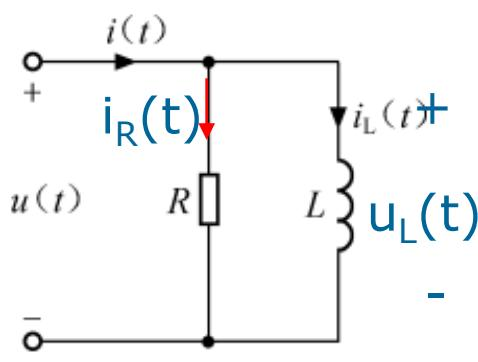

*(注：原题未提供具体解答过程图片，仅给出题目和元件参数。根据电路结构通常 $i(t) = i_R(t) + i_L(t)$，需结合电容或电阻并联关系计算，此处仅整理题目信息)*

答案：待补充完整解答步骤。

---

知识点：[四种受控电源（VCVS、VCCS、CCVS、CCCS）的特性](../../../topics/电路与电子技术/受控电源.md)、[基尔霍夫电压定律（KVL）及其应用](../../../topics/电路与电子技术/KVL.md)、[线性时不变电阻的伏安关系（欧姆定律）](../../../topics/电路与电子技术/线性电阻VCR.md)

### 计算 4

**题干：** 6-10 题图所示电路原已稳定，开关 K 在 $t=0$ 时闭合，试求 $0^{+}$ 时的电容电流和电感电压，即 $i_C(0^+)$、$u_L(0^+)$ 和 $i(0^+)$。（注：原题标题写 $i(0+)$，但正文求解了 $i_C$ 和 $u_L$，此处以正文为准）

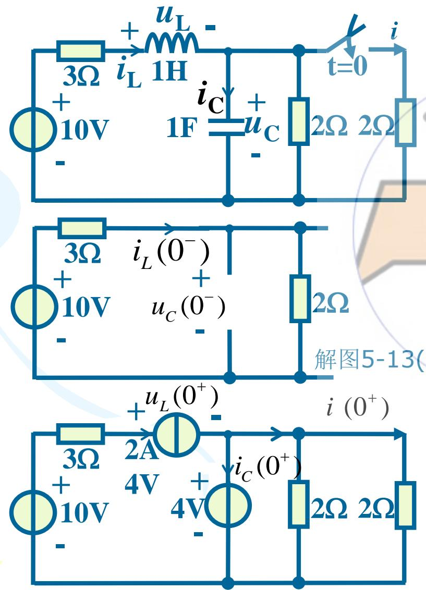

**解：**

$t < 0$ 时电路已稳定，则电容开路，电感短路，电路图如解图 5-13(a)-1：

$$
\begin{array}{l}
i_L (0^-) = \frac{10}{2 + 3} = 2 \text{ A} = i_L (0^+) \\
u_C (0^-) = \frac{2}{2 + 3} \times 10 = 4 \text{ V} = u_C (0^+)
\end{array}
$$

则得 $t > 0$ 的电路如解图 5-13(a)-2：

$$
\begin{array}{r l}
& u_L (0^+) = 10 - 4 - 3 \times 2 = 0 \text{ V} \\
& i_C (0^+) = 2 - \frac{4}{2 // 2} = -2 \text{ A} \\
& i (0^+) = \frac{4}{2} = 2 \text{ A}
\end{array}
$$

答案：
$u_L(0^+) = 0 \text{ V}$
$i_C(0^+) = -2 \text{ A}$
$i(0^+) = 2 \text{ A}$

---

知识点：[理想电压源与理想电流源的特性](../../../topics/电路与电子技术/独立电源.md)、[线性时不变电阻的伏安关系（欧姆定律）](../../../topics/电路与电子技术/线性电阻VCR.md)

### 计算 5

**题干：** 6-14(c) 等效电阻电路如图 c1 所示，求等效电阻 $R_{eq}$ 及时间常数 $\tau$。

**解：**

(c) 等效电阻电路如图 c1，加压求流，得：

$$
2 i_1 + 3 \times (-i_1) + 2 i_1 - u = 0
$$

整理得：
$$
(2 - 3 + 2)i_1 = u \implies i_1 = u
$$

$$
R_{eq} = u / i_1 = 1 \, \Omega
$$

假设电容 $C = 0.1 \mu \text{F}$（根据后续 $\tau$ 计算反推）：

$$
\tau = R_{eq} C = 1 \times 0.1 \times 10^{-6} = 0.1 \, \mu \text{s}
$$

答案：$R_{eq} = 1 \, \Omega$，$\tau = 0.1 \, \mu \text{s}$。

---

知识点：[基尔霍夫电压定律（KVL）及其应用](../../../topics/电路与电子技术/KVL.md)、[基尔霍夫电流定律（KCL）及其应用](../../../topics/电路与电子技术/KCL.md)、[理想电压源与理想电流源的特性](../../../topics/电路与电子技术/独立电源.md)

### 计算 6

**题干：** 6-26 题图所示电路原已稳定，在 $t=0$ 时开关 K 闭合。
试求：
(1) $u_{s2}=6\text{V}$ 时的 $u_C(t)$ ($t>0$)；
(2) $u_{s2}=?$ 时，换路后不出现过渡过程。

**解：** 先求 $u_C(t)$ :

$t<0$ 时电路已稳定，则电容开路，有：

$$
u_C (0^+) = u_C (0^-) = \frac{40}{60 + 40} \times 10 = 4 \text{ V}
$$

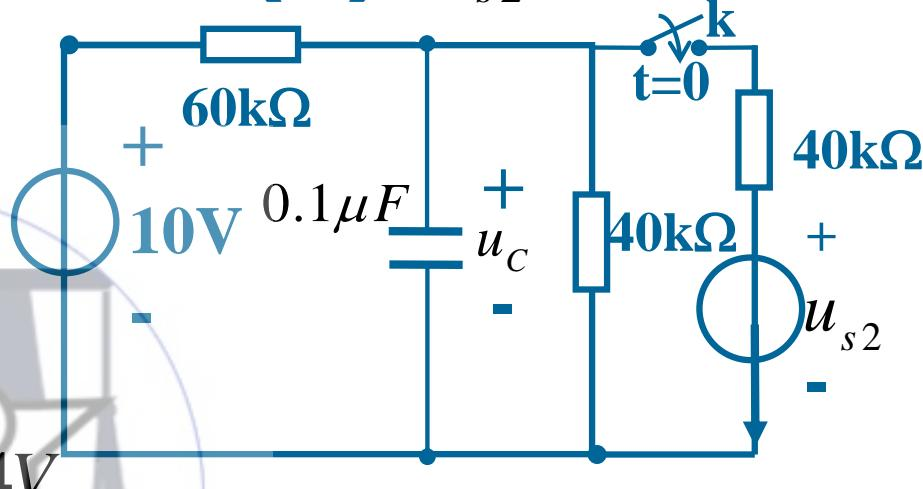

$t \rightarrow \infty$ 时电路已稳定，则电容开路，用叠加法求 $u_C(\infty)$

$$
\begin{array}{r l}
u_C (\infty) & = \frac{40 // 40}{40 // 40 + 60} \times 10 + \frac{60 // 40}{60 // 40 + 40} \times u_{s2} \\
& = \frac{10}{4} + \frac{3}{8} u_{s2}
\end{array}
$$

$$
R_0 = 40 // 40 // 60 = 15 \, \text{k}\Omega
$$

$$
\therefore \tau = R_0 C = 15 \times 10^3 \times 0.1 \times 10^{-6} = 1.5 \text{ ms}
$$

全响应公式：

$$
\begin{array}{r}
u_C (t) = u_C (\infty) + [ u_C (0^+) - u_C (\infty) ] e^{-\frac{t}{\tau}} \\
= \frac{10}{4} + \frac{3}{8} u_{s2} + (4 - \frac{10}{4} - \frac{3}{8} u_{s2}) e^{-\frac{t}{1.5 \times 10^{-3}}}
\end{array}
$$

*(注：原题指数部分识别有误，$\frac{1}{\tau} = \frac{1}{1.5 \times 10^{-3}} = \frac{2}{3} \times 10^3$)*

$$
= \frac{10}{4} + \frac{3}{8} u_{s2} + (4 - \frac{10}{4} - \frac{3}{8} u_{s2}) e^{-\frac{2}{3} \times 10^3 t}
$$

**(1)** $u_{s2}=6\text{V}$ 时:

$$
\begin{array}{r l}
& u_c (t) = \frac{10}{4} + \frac{3}{8} \times 6 + (4 - \frac{10}{4} - \frac{3}{8} \times 6) e^{-\frac{2}{3} \times 10^3 t} \\
& = 4.75 - 0.75 e^{-\frac{2}{3} \times 10^3 t}, \quad t \geq 0
\end{array}
$$

**(2)** 若要换路后不出现过渡过程，则指数项系数为 0：

$$
4 - \frac{10}{4} - \frac{3}{8} u_{s2} = 0 \quad \therefore u_{s2} = 4 \text{ V}
$$

答案：
(1) $u_C(t) = 4.75 - 0.75 e^{-\frac{2}{3} \times 10^3 t} \text{ V}, \quad t \geq 0$
(2) $u_{s2} = 4 \text{ V}$

---

知识点：[理想电压源与理想电流源的特性](../../../topics/电路与电子技术/独立电源.md)

### 计算 7

**题干：** 6-27 题图 5-27 所示电路原已稳定，$t=0$ 时开关 K 打开，试求 $i_L(t)$。

**解：**

1) 求初始值:

$t<0$ 时电路已稳定，则电感短路，有：

$$
i_L (0^+) = i_L (0^-) = \frac{4}{1} = 4 \text{ A}
$$

2) 求稳态值:

$t \rightarrow \infty$ 时电路稳定，电感短路：

$$
i_L (\infty) = 5 + \frac{4}{1} = 9 \text{ A}
$$

3) 求 $\tau$ 值:

$$
\therefore R_0 = 1 \, \Omega \quad \tau = \frac{L}{R_0} = 0.2 \text{ s}
$$

$$
\begin{array}{r l}
& {i_L (t) = i_L (\infty) + [ i_L (0^+) - i_L (\infty) ] e^{-\frac{t}{\tau}}} \\
& {\qquad = 9 + (4 - 9) e^{-\frac{t}{0.2}} = 9 - 5 e^{-5 t} \text{ A}, \quad t \geq 0}
\end{array}
$$

答案：$i_L(t) = 9 - 5 e^{-5 t} \text{ A}, \quad t \geq 0$

---

知识点：[线性时不变电阻的伏安关系（欧姆定律）](../../../topics/电路与电子技术/线性电阻VCR.md)、[基尔霍夫电压定律（KVL）及其应用](../../../topics/电路与电子技术/KVL.md)

### 计算 8

**题干：** 6-33 题图 5-36(a) 电路中，已知 $i_L(0^-) = 1\text{A}$，其 $u_S(t)$ 波形如图 (b) 所示，试求 $i_L(t)$。

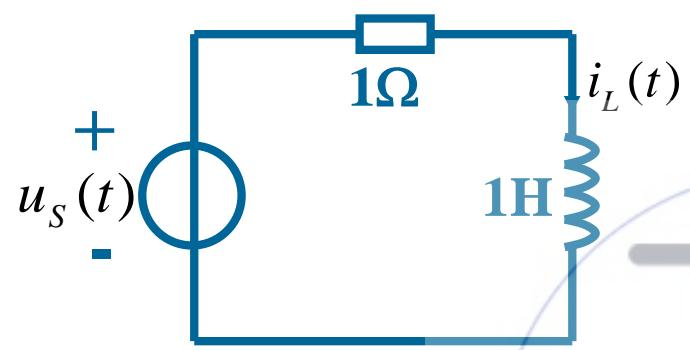

**解：**

1) 求零输入响应:

由换路定则可知: $i_L(0^+) = i_L(0^-) = 1\text{A}$ ,

$\tau = 1\text{s}$ $\therefore i_{Lzi}(t) = e^{-t}\text{A}, t\geq 0$

2) 求零状态响应:

当 $u_S(t) = \varepsilon (t)$ 时， $i_L(\infty) = 1\text{A}$; $\therefore i_{Lzs\_step}(t) = (1 - e^{-t})\varepsilon (t)$

当 $u_s(t) = \varepsilon (t - 2) + \varepsilon (t - 4) - 2\varepsilon (t - 5)$ 时，利用线性系统的时不变性和叠加性：

$$
\therefore i_{Lzs} (t) = \left[ 1 - e^{- (t - 2)} \right] \varepsilon (t - 2) + \left[ 1 - e^{- (t - 4)} \right] \varepsilon (t - 4) - 2 \left[ 1 - e^{- (t - 5)} \right] \varepsilon (t - 5)
$$

*(注：总响应 $i_L(t) = i_{Lzi}(t) + i_{Lzs}(t)$，题目仅给出了零状态响应的推导片段)*

答案：见上述零状态响应表达式及零输入响应表达式。

# 电路分析与电工电子技术复习习题（第3部分）

本资料由识别工具读取《电路分析与电工电子技术》复习习题第 21–31 页内容整理而成，包含计算题及综合应用题的解答过程。

## 一、计算题

知识点：[线性时不变电阻的伏安关系（欧姆定律）](../../../topics/电路与电子技术/线性电阻VCR.md)

### 计算 1

**题干：**
求全响应：已知电感电流 $i_L(t)$ 由零输入响应和零状态响应组成，具体表达式需根据给定的激励信号推导。

**解：**

$$
\begin{array}{l} \therefore i _ {L} (t) = i _ {L z i} (t) + i _ {L z s} (t) \\ = e ^ {- t} + [ 1 - e ^ {- (t - 2)} ] \varepsilon (t - 2) + [ 1 - e ^ {- (t - 4)} ] \varepsilon (t - 4) - 2 [ 1 - e ^ {- (t - 5)} ] \varepsilon (t - 5) \, \mathrm{A} \\ \qquad \qquad \qquad \qquad \qquad \qquad \qquad \qquad , \, t \geq 0 \end{array}
$$

---

知识点：[基尔霍夫电流定律（KCL）及其应用](../../../topics/电路与电子技术/KCL.md)、[基尔霍夫电压定律（KVL）及其应用](../../../topics/电路与电子技术/KVL.md)

### 计算 2

**题干：**
8-10 电路如题图7-10所示，已知 $u = 100 \cos (10 t + 4 5 ^ {\circ}) \, \mathrm{V}$，$i _ {1} = i = 1 0 \cos (1 0 t + 4 5 ^ {\circ}) \, \mathrm{A}$，$i_{2}=20\cos(10t+135^{\circ}) \, \mathrm{A}$。试判断元件1,2,3的性质及数值。

**解：**
本题利用KCL及元件VCR相量形式分析。

已知相量为：
$$
\dot {U} _ {m} = 1 0 0 \angle 4 5 ^ {\circ} \, \mathrm{V},
$$
$$
\dot {\mathrm{I}} _ {\mathrm{m}} = \dot {I} _ {1 m} = 1 0 \angle 4 5 ^ {\circ} \, \mathrm{A},
$$
$$
\dot {I} _ {2 m} = 2 0 \angle 1 3 5 ^ {\circ} \, \mathrm{A}
$$

由KCL相量形式得：
$$
\dot {I} _ {3 m} = \dot {I} _ {m} - \dot {I} _ {1 m} - \dot {I} _ {2 m} = 1 0 \angle 4 5 ^ {\circ} - 1 0 \angle 4 5 ^ {\circ} - 2 0 \angle 1 3 5 ^ {\circ}
$$
$$
= - 2 0 \angle 1 3 5 ^ {\circ} = 2 0 \angle - 4 5 ^ {\circ} \, \mathrm{A}
$$

对于元件1：
$$
\dot {U} _ {m} = 1 0 0 \angle 4 5 ^ {\circ} \, \mathrm{V},
$$
$$
\dot {I} _ {1 m} = 1 0 \angle 4 5 ^ {\circ} \, \mathrm{A},
$$
由于其电压电流同相，故其为电阻元件，且
$$
R = \frac {\dot {U} _ {m}}{\dot {I} _ {1 m}} = \frac {1 0 0 \angle 4 5 ^ {\circ}}{1 0 \angle 4 5 ^ {\circ}} = 1 0 \, \Omega
$$

对于元件2：
$$
\dot {U} _ {m} = 1 0 0 \angle 4 5 ^ {\circ} \, \mathrm{V},
$$
$$
\dot {I} _ {2 m} = 2 0 \angle 1 3 5 ^ {\circ} \, \mathrm{A},
$$
由于其电流超前电压 $90^{\circ}$，故其为电容元件，且
$$
\omega C = \frac {I _ {m}}{U _ {m}} = \frac {2 0}{1 0 0} = \frac {1}{5} \, \mathrm{S} \quad (\text{注：原题单位误写为}\Omega\text{，导纳单位为S}), \quad C = \frac {1}{50} \, \mathrm{F}
$$

对于元件3：
$$
\dot {U} _ {m} = 1 0 0 \angle 4 5 ^ {\circ} \, \mathrm{V},
$$
$$
\dot {I} _ {3 m} = 2 0 \angle - 4 5 ^ {\circ} \, \mathrm{A},
$$
由于其电流滞后电压 $90^{\circ}$，故其为电感元件，且
$$
\omega L = \frac{U_m}{I_{3m}} = \frac{100}{20} = 5 \, \Omega, \quad L = 0.5 \, \mathrm{H}
$$

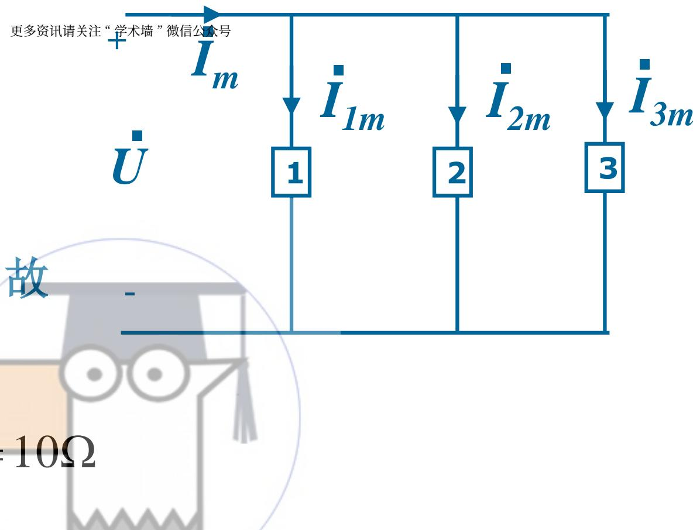
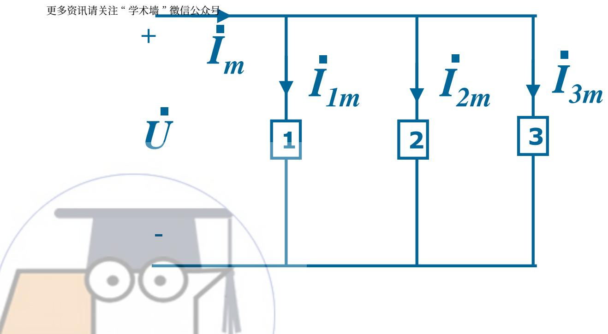

---

知识点：[理想电压源与理想电流源的特性](../../../topics/电路与电子技术/独立电源.md)、[四种受控电源（VCVS、VCCS、CCVS、CCCS）的特性](../../../topics/电路与电子技术/受控电源.md)

### 计算 3

**题干：**
8-15 (a) 试求题图 8-15 所示各二端网络的输入阻抗。（已知 $\omega=10^{6}\mathrm{rad/s}$）

**解：**
作题图8-15（a）的向量模型如解图8-15（a）所示。由于电路中含有受控源，故用加压求流法求其等效阻抗。设在解图7-15（a）端子上加电压 $\dot{U}$，此时端子上电流为 $\dot{I}$，参考方向如图所示，由KVL得：

$$
\begin{array}{r l} \dot {U} & = \dot {I} + 1 / / (- j 1) \times (\dot {I} + 2 \dot {I}) \\ & = \dot {I} + \frac {- j 1}{1 - j 1} \times 3 \dot {I} = \frac {1 - j 4}{1 - j 1} \dot {I} \end{array}
$$

故
$$
Z _ {\mathrm{sh}} = \frac {\dot {U}}{\dot {I}} = \frac {1 - \mathrm{j} 4}{1 - \mathrm{j} 1} = \frac {5}{2} - \mathrm{j} \frac {3}{2} \, \Omega
$$

---

知识点：[四种受控电源（VCVS、VCCS、CCVS、CCCS）的特性](../../../topics/电路与电子技术/受控电源.md)、[基尔霍夫电压定律（KVL）及其应用](../../../topics/电路与电子技术/KVL.md)、[线性时不变电阻的伏安关系（欧姆定律）](../../../topics/电路与电子技术/线性电阻VCR.md)

### 计算 4

**题干：**
8-16 在题图7-16所示电路中，已知 $U_{C}=15\mathrm{V}, U_{L}=12\mathrm{V}, U_{R}=4\mathrm{V}$，求电压U为多少？

**解：**
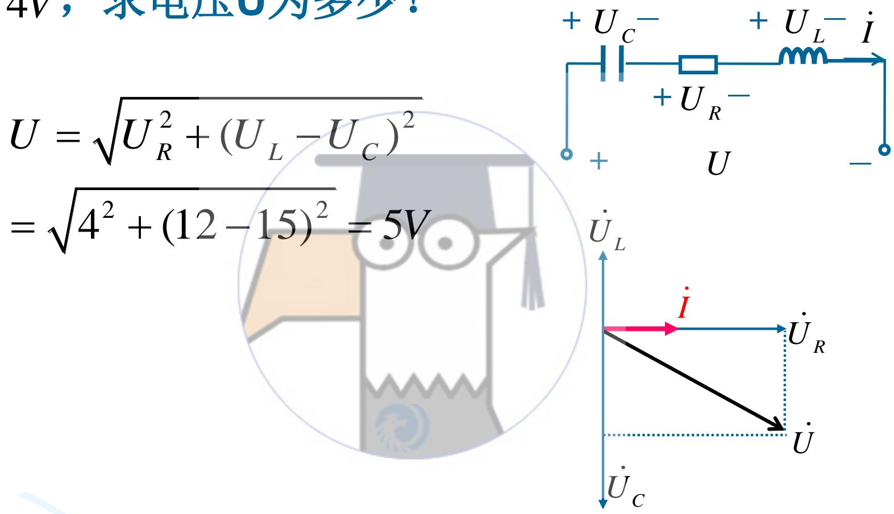

*(注：原题未给出最终标量结果，通常此类串联谐振附近或非谐振情况需用相量合成。若仅求幅值关系，需明确相位。此处保留原题解题起始步骤)*

---

知识点：[理想电压源与理想电流源的特性](../../../topics/电路与电子技术/独立电源.md)、[线性时不变电阻的伏安关系（欧姆定律）](../../../topics/电路与电子技术/线性电阻VCR.md)

### 计算 5

**题干：**
8-22(b) 试分别列写下列电路的网孔方程和节点方程，各图中 $u_{S} = 10 \cos 2t\,\mathrm{V}$ ， $i_{S} = 0.5 \cos (2t - 30^{\circ})\,\mathrm{A}$ 。

**解：**
注：此题答案用的是振幅相量，最好改为有效值相量做。

(1) 列网孔方程:
$$
\left\{ \begin{array}{l} (2 - j 0. 5) \dot {I} _ {1 m} - (2 - j 0. 5) \dot {I} _ {3 m} = 1 0 \angle 0 ^ {\circ} - \dot {U} _ {x m} \\ (1 + j 2) \dot {I} _ {2 m} - j 2 \dot {I} _ {3 m} = \dot {U} _ {x m} \\ - (1 - j 0. 5) \dot {I} _ {1 m} - j 2 \dot {I} _ {2 m} + (3 + j 1. 5) \dot {I} _ {3 m} = 0 \\ \dot {I} _ {2 m} - \dot {I} _ {1 m} = 0. 5 \angle - 3 0 ^ {\circ} \end{array} \right.
$$

(2) 列节点方程:
*(注：原题此处截断，未给出完整节点方程解答)*

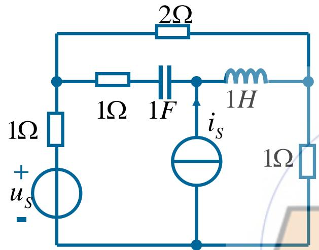
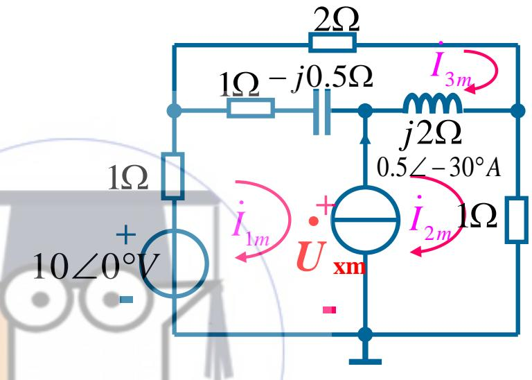

---

知识点：[基尔霍夫电压定律（KVL）及其应用](../../../topics/电路与电子技术/KVL.md)、[基尔霍夫电流定律（KCL）及其应用](../../../topics/电路与电子技术/KCL.md)、[理想电压源与理想电流源的特性](../../../topics/电路与电子技术/独立电源.md)

### 计算 6

**题干：**
8-27 二端网络如题图7-27所示，已知 $\dot{U}_{S}=50\angle0^{\circ}\mathrm{V}$，电源提供的平均功率为312.5W，试求 $X_{C}$ 的数值。

**解：**
将电路等效为诺顿模型，并设各支路电流和电压如相量模型图所示，其中：

$$
\dot {I} _ {s} = \frac {U _ {s}}{j 8} = 6. 2 5 \angle - 9 0 ^ {\circ} \, \mathrm{A}
$$

$$
P = I _ {R} ^ {2} R = 3 1 2. 5 \Rightarrow I _ {R} = 6. 2 5 \, \mathrm{A}
$$

$$
\because \dot {I} _ {S} = \dot {I} _ {R} + \dot {I} _ {C} + \dot {I} _ {L} \quad \text{即} \, I _ {\mathrm{S}} = \sqrt {\left(\mathrm{I} _ {\mathrm{C}} - \mathrm{I} _ {\mathrm{L}}\right) ^ {2} + \mathrm{I} _ {\mathrm{R}} ^ {2}} \text{且} \because \mathrm{I} _ {\mathrm{R}} = \mathrm{I} _ {\mathrm{S}}
$$

$$
\therefore \mathrm{I} _ {\mathrm{C}} = \mathrm{I} _ {\mathrm{L}} \quad \text{而} \, \mathrm{I} _ {\mathrm{C}} = \frac {\mathrm{U}}{\mathrm{X} _ {\mathrm{C}}}, \, \mathrm{I} _ {\mathrm{L}} = \frac {\mathrm{U}}{8} \quad \therefore \mathrm{X} _ {\mathrm{C}} = 8 \, \Omega
$$

---

知识点：[理想电压源与理想电流源的特性](../../../topics/电路与电子技术/独立电源.md)

### 计算 7

**题干：**
8-30 电路如题图7-30所示，试求负载 $Z_{L}$ 为何值时可获得最大功率？最大功率 $P_{\max}$ 为多少？

**解：**
$$
\dot{U}_{oc} = 2\dot{I}_{10}(0.5 - j1) + \sqrt{2}\angle 0^{\circ}
$$

$$
\dot {I} _ {1 0} = \frac {\sqrt {2} \angle 0 ^ {\circ}}{1} = \sqrt {2} \angle 0 ^ {\circ} \, \mathrm{A}
$$

$$
\therefore \dot {U} _ {o c} = 2 \sqrt {2} - j 2 \sqrt {2} = 4 \angle - 4 5 ^ {\circ} \, \mathrm{V}
$$

$$
\dot {I} _ {1} = 0 \, \mathrm{A} \Rightarrow 2 \dot {I} _ {1} = 0 \quad \therefore Z _ {0} = 0. 5 - j 1 \, \Omega
$$

当 $Z_{L} = Z_{0}^{*} = 0.5 + j1\,\Omega$ 时，可获得最大功率：
$$
P_{\mathrm{max}} = \frac{U_{oc}^2}{4R_0} = \frac{4^2}{4 \times 0.5} = 8 \, \mathrm{W}
$$

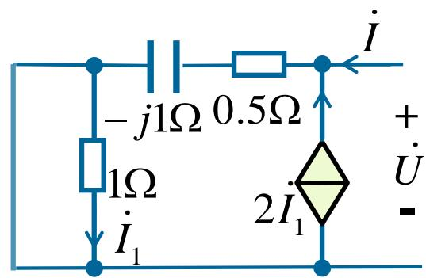

---

知识点：[线性时不变电阻的伏安关系（欧姆定律）](../../../topics/电路与电子技术/线性电阻VCR.md)、[基尔霍夫电压定律（KVL）及其应用](../../../topics/电路与电子技术/KVL.md)

### 计算 8

**题干：**
8-31 已知三相电路中星形连接的三相负载每相阻抗 $Z = 12 + j16\,\Omega$，接至对称三相电源，其线电压为 $380 \mathrm{~V}$。若端线阻抗忽略不计，试求线电流及负载吸收的功率；若将此三相负载改为三角形连接，线电流及负载吸收的功率将变成多少？

**解：**
**(1) 星形连接时：**

相电压 $U_P = \frac{380}{\sqrt{3}} \approx 220 \, \mathrm{V}$。
假设 $\dot{U}_A = 220 \angle -30^{\circ} \, \mathrm{V}$ (相对于线电压参考系，具体角度取决于参考点，此处依原题解)。

$$
\dot {I} _ {A} = \frac {\dot {U} _ {A}}{Z} = \frac {2 2 0 \angle - 3 0 ^ {\circ}}{1 2 + j 1 6} = \frac {2 2 0 \angle - 3 0 ^ {\circ}}{2 0 \angle 5 3 . 1 ^ {\circ}} = 1 1 \angle - 8 3. 1 ^ {\circ} \, \mathrm{A}
$$

$$
\therefore I _ {l} = I _ {P} = 1 1 \, \mathrm{A}
$$

$$
P = 3 U _ {P} I _ {P} \cos \theta_ {Z} = 3 \times 2 2 0 \times 1 1 \times \cos 5 3. 1 ^ {\circ} = 4 3 5 6 \, \mathrm{W}
$$

**(2) 三角形连接时：**
*(注：原题内容在此处截断，未给出三角形连接的计算结果。通常三角形连接时，相电压等于线电压380V，相电流增大$\sqrt{3}$倍，线电流增大3倍，功率变为原来的3倍)*

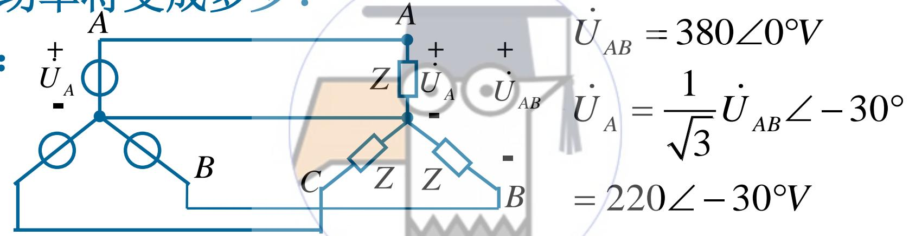

## 9-2(c) 写出题图9-2各耦合电感的伏安关系。

自感电压根据电压电流是否关联，关联取“+”，反之取“-”；互感电压根据电压的正极性端与电流的流入端是否为同名端，同名取“+”，反之取“-”。

解：因为 $u_1$ 与 $i_1$ 不关联，故 $L_1$ 的自感电压取负；又因为 $u_1$ 的正极性端与电流 $i_2$ 的流入端为同名端，故 $L_1$ 的互感电压取正；因为 $u_2$ 与 $i_2$ 关联，故 $L_2$ 的自感电压取正；又因为 $u_2$ 的正极性端与电流 $i_1$ 的流入端为异名端，故 $L_2$ 的互感电压取负；即：

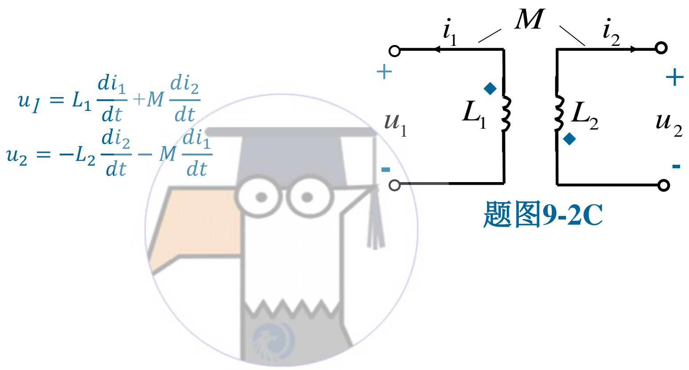

## 9-3 试求题图9-3中的电压 $u_2$。

解：

(a) $\because i_2=0$，故：

$$
u_2 = -M\frac{\mathrm{d}i_1}{\mathrm{d}t} = -2\frac{\mathrm{d}\left[3(1-e^{-2t})\right]}{\mathrm{d}t} = -12e^{-2t}\ \mathrm{V}
$$

(b) $\because i_2=0$，故：$\dot{I}_1 = \dfrac{5\sqrt{2}\angle 0^\circ}{5+j5} = 1\angle -45^\circ\ \mathrm{A}$，$\therefore \dot{U}_2 = j\omega M\dot{I}_1 = 3\angle 45^\circ\ \mathrm{V}$，$u_2 = 3\sqrt{2}\cos(t+45^\circ)\ \mathrm{V}$

## 9-4b 耦合电感 $L_1=6\,\mathrm{H}$，$L_2=4\,\mathrm{H}$，$M=2\,\mathrm{H}$，试求题图8-4中三种连接时的等效电感。

(b) $L_1$ 和 $L_2$ 为同名端相连的三端连接，去耦等效如解图9-4(b)，则等效电感为：

$$
\begin{aligned}
L_{eq} &= (L_1-M) + (L_2-M) \parallel M \\
&= L_1 - M + \frac{M(L_2-M)}{L_2-M+M} = 5\ \mathrm{H}
\end{aligned}
$$

## 9-6 电路如题图8-6所示，$\omega=10^3\,\mathrm{rad/s}$，$L_1=L_2=1\,\mathrm{H}$，$M=0.5\,\mathrm{H}$，$C_1=C_2=1\,\mu\mathrm{F}$，试求 $Z_{ab}$ 和 $Z_{ad}$。

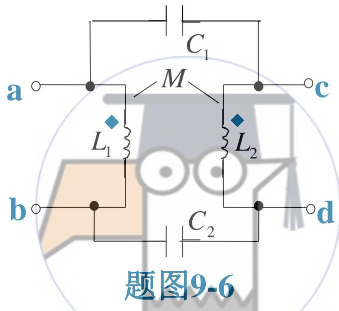

解：

(1) 求 $Z_{ab}$：

从 a、b 两端看入，因为 c、d 端上电流为 0，故原电路可等效为如解图9-6(1)-(a)所示，而 $L_1$ 和 $L_2$ 为同名端相连的三端连接，经去耦等效后如解图9-6(1)-(b)，则：

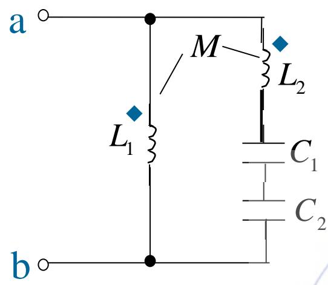

解图9-6（1）

$$
\begin{aligned}
Z_{ab} &= j\omega M + j\omega(L_1-M) \parallel \left[j\omega(L_2-M) + \frac{1}{j\omega C_1} + \frac{1}{j\omega C_2}\right] \\
&= j500 + j500 \parallel [j500 - j1000 - j1000] \\
&= j1250\ \Omega
\end{aligned}
$$

(2) 求 $Z_{ad}$：

从 a、d 两端看入，因为 b、c 端上电流为 0，故原电路可等效为如解图9-6(2)-(a)所示，而 $L_1$ 和 $L_2$ 为同名端相连的三端连接，经去耦等效后如解图9-6(2)-(b)；

$$
\begin{aligned}
Z_{ad} &= j\omega M + \left[j\omega(L_1-M) + \frac{1}{j\omega C_2}\right] \parallel \left[j\omega(L_2-M) + \frac{1}{j\omega C_1}\right] \\
&= j500 + [j500 - j1000] \parallel [j500 - j1000] \\
&= j250\ \Omega
\end{aligned}
$$

## 9-8 在题图9-8所示电路中，已知 $R_1=R_2=10\,\Omega$，$\omega L_1=30\,\Omega$，$\omega L_2=20\,\Omega$，$\omega M=20\,\Omega$，$\dot{U}_s=100\angle0^\circ\ \mathrm{V}$。试求电压相量 $\dot{U}_2$。

解：$L_1$ 和 $L_2$ 为同名端相连的三端连接，经去耦等效后如解图9-8：

设网孔电流分别为 $\dot{I}_1$、$\dot{I}_2$，则网孔方程为：

$$
\begin{cases}
\left[R_1 + j\omega(L_1-M) + j\omega M\right]\dot{I}_1 - j\omega M\dot{I}_2 = \dot{U}_s \\
-j\omega M\dot{I}_1 + \left[R_2 + j\omega(L_2-M) + j\omega M\right]\dot{I}_2 = 0
\end{cases}
$$

$$
\dot{U}_2 = \dot{I}_2 R_2 = 39.2\angle -11.3^\circ\ \mathrm{V}
$$

## 9-11 题图9-11所示电路中，试求当 $Z_L$ 为多大时可获得最大功率，以及它获得的最大功率为多少？

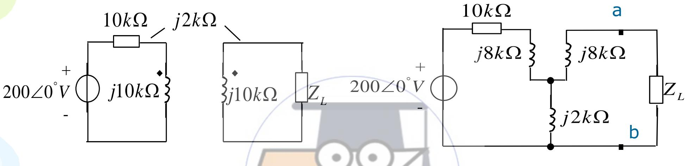

解：去耦等效后的电路如图：

(1) 求 $Z_L$ 以左的开路电压 $\dot{U}_{oc}$

$$
\dot{U}_{oc} = 200\angle0^\circ \times \frac{j2}{10+j8+j2} = 20\sqrt{2}\angle45^\circ\ \mathrm{V}
$$

(2) 求 $Z_L$ 以左的等效阻抗 $Z_0$：

$$
Z_0 = (10+j8) \parallel j2 + j8 = (0.2+j9.8)\ \mathrm{k}\Omega
$$

故 $Z_L = Z_0^* = (0.2-j9.8)\ \mathrm{k}\Omega$ 时，可获得最大功率。

故 $Z_L$ 可获得的最大功率为：

$$
P_{L\max} = \frac{U_{oc}^2}{4R_0} = \frac{(20\sqrt{2})^2}{4\times0.2\times10^3} = 1\ \mathrm{W}
$$

## 9-13 试求题图9-13所示的正弦稳态电路中的 $i(t)$ 和 $u(t)$。

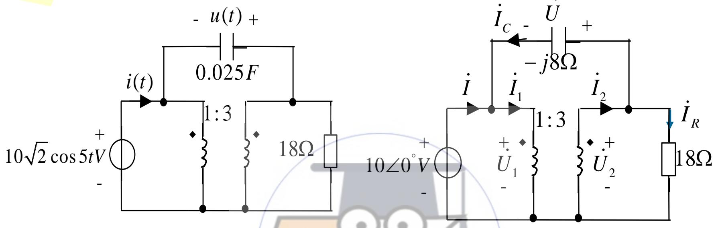

解：电路的相量模型如解图9-13；

$$
\dot{U} = \dot{U}_2 - \dot{U}_1 = 2\dot{U}_1 = 20\angle0^\circ
$$

$$
\dot{I}_1 = 3\dot{I}_2 = 5 + j7.5\ \mathrm{A}
$$

$$
\dot{I}_C = \frac{\dot{U}}{-j8} = \frac{5}{2}\angle90^\circ\ \mathrm{A},\quad \dot{I}_R = \frac{\dot{U}_2}{18} = \frac{5}{3}\angle0^\circ\ \mathrm{A}
$$

$$
\therefore \dot{I} = \dot{I}_1 - \dot{I}_C = 5 + j5 = 5\sqrt{2}\angle45^\circ\ \mathrm{A}
$$

$$
\therefore u(t) = 20\sqrt{2}\cos 5t\ \mathrm{V}
$$

$$
\therefore \dot{I}_2 = \dot{I}_R + \dot{I}_C = \frac{5}{3} + j\frac{5}{2}\ \mathrm{A}
$$

$$
i(t) = 10\cos(5t+45^\circ)\ \mathrm{A}
$$

## 第9章 变压器与耦合电感电路

知识点：[线性时不变电阻的伏安关系（欧姆定律）](../../../topics/电路与电子技术/线性电阻VCR.md)

### 计算 16
**题号：9-16**

电路如题图 9-16 所示，试确定理想变压器的匝比，使 $20\Omega$ 电阻获得的功率最大。

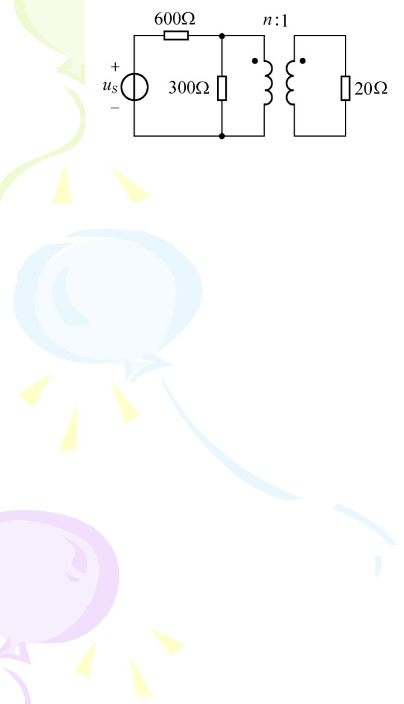

解：次级阻抗搬移到初级端，得
此时，$20\Omega$ 获得的最大功率即为 $20n^{2}$ 最大功率。

则，ab 以左的戴维南模型等效电阻为:

$$
R _ {0} = 6 0 0 / / 3 0 0 = 2 0 0 \Omega ,
$$

当 $20 \times n^{2} = R_{0}$ ，即 $n = \sqrt{10} \approx 3$ 时, $20\Omega$ 电阻获得最大功率。

知识点：[理想电压源与理想电流源的特性](../../../topics/电路与电子技术/独立电源.md)、[基尔霍夫电压定律（KVL）及其应用](../../../topics/电路与电子技术/KVL.md)、[线性时不变电阻的伏安关系（欧姆定律）](../../../topics/电路与电子技术/线性电阻VCR.md)

### 计算 18
**题号：9-18**

电路如题图9-18所示, 已知 $R_{1} = R_{2} = 5\Omega, R_{L} = 1k\Omega, C = 0.25\mu F, L_{1} = 1H,$ $L_{2} = 4H, M = 2H, u_{s} = 120\cos 1000tV$ 求电流 $\pmb{i}$ 。

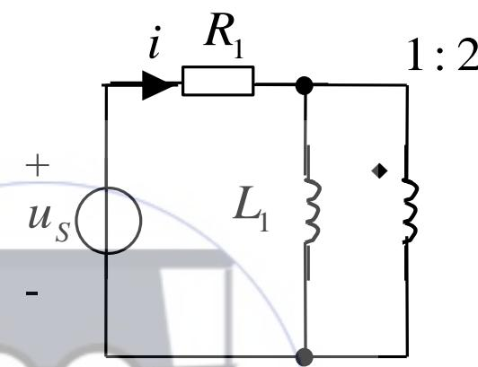

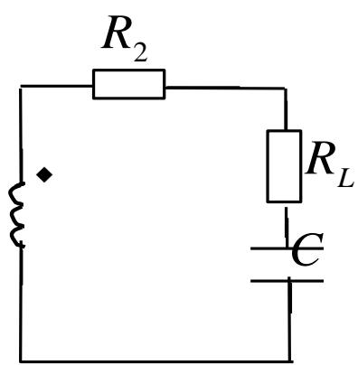

解: 由于 $M = \sqrt{L_{1} L_{2}} = 2 H$ , 故为全耦合变压器, 电路等效为解图; 其中: $n = \sqrt{\frac{L_{1}}{L_{2}}} = 0.5: 1$

另解: $L_{1}$ 和 $L_{2}$ 为同名端相连的三端连接, 经去耦等效后如下图:

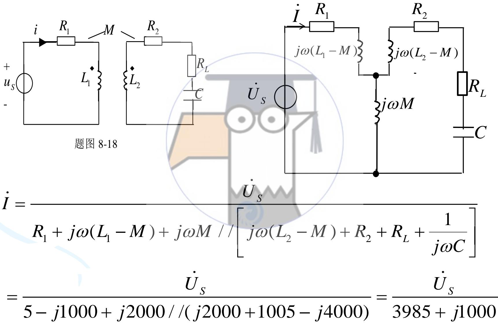

## 第10章 谐振电路

知识点：[基尔霍夫电压定律（KVL）及其应用](../../../topics/电路与电子技术/KVL.md)、[基尔霍夫电流定律（KCL）及其应用](../../../topics/电路与电子技术/KCL.md)

### 计算 4
**题号：10-4**

RLC 串联谐振电路，已知 $L = 160 \mu \mathrm{H}$ ， $C = 250 \mathrm{pF}$ ， $R = 10 \Omega$ ，电源电压 $U_{\mathrm{S}} = 1 \mathrm{mV}$ 。试求 $f_{0} 、 Q 、 B W 、 I_{0} 、 U_{\mathrm{L0}} 、 U_{\mathrm{C0}}$ 。

$$
f _ {0} = \frac {1}{2 \pi \sqrt {L C}} = 0. 7 9 6 M H Z
$$

$$
Q = \frac {\omega_ {0} L}{R} = 8 0
$$

$BW = \frac{f_{0}}{Q} = 9.97\text{kHz}$ , 或者 $BW = \frac{\omega_{0}}{Q}$ 单位是 $rad / s$

$$
I _ {0} = \frac {U _ {s}}{R} = 0. 1 \mathrm{mA}
$$

$$
\mathrm{U} _ {\mathrm{L0}} = \mathrm{U} _ {\mathrm{C0}} = Q U _ {s} = 8 0 \mathrm{mV}
$$

知识点：[理想电压源与理想电流源的特性](../../../topics/电路与电子技术/独立电源.md)、[线性时不变电阻的伏安关系（欧姆定律）](../../../topics/电路与电子技术/线性电阻VCR.md)

### 计算 7
**题号：10-7**

题图10-7是应用串联谐振原理测量线圈电阻r和电感L的电路。已知 $R = 10\Omega, C = 0.1\mu F$ ，保持外加电压U有效值为1V不变，而改变频率f，同时用电压表测量电阻R的电压 $U_{R}$ ，当 $f = 800Hz$ 时， $U_{Rmax} = 0.8V$ ，试求电阻r和电感L。

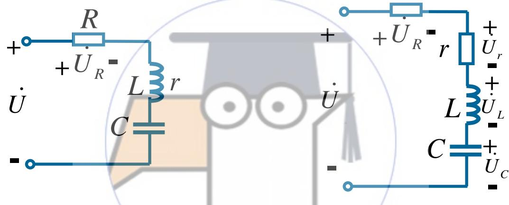

解: 等效电路如图所示;

由于 $f = 800 \mathrm{~Hz}$ 时，电路发生串联谐振，即：

$\dot{U}_{L0} + \dot{U}_{C0} = 0$ 故有： $U_{R\max} + U_{r0} = U\Rightarrow U_{r0} = 1 - 0.8 = 0.2V$

$$
\frac {U _ {R \max}}{R} = \frac {U _ {r 0}}{r} \Rightarrow r = \frac {U _ {r 0}}{U _ {R \max}} \times R = 2. 5 \Omega
$$

$$
\because \omega L = \frac {1}{\omega C}
$$

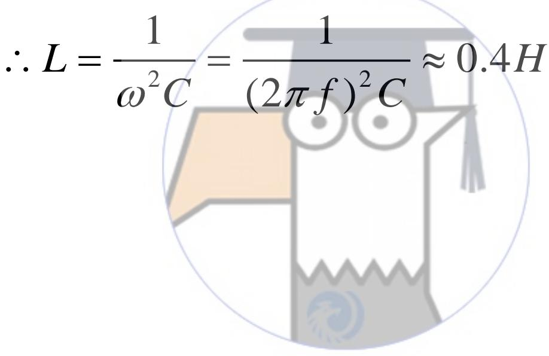

知识点：[线性时不变电阻的伏安关系（欧姆定律）](../../../topics/电路与电子技术/线性电阻VCR.md)、[基尔霍夫电压定律（KVL）及其应用](../../../topics/电路与电子技术/KVL.md)

### 计算 8
**题号：10-8**

RLC 并联谐振电路的 $\left|Z\right| \sim \omega$ 的特性曲线如图10-8所示，试求：（1）带宽 BW 和品质因数 Q；（2）R、L、C。

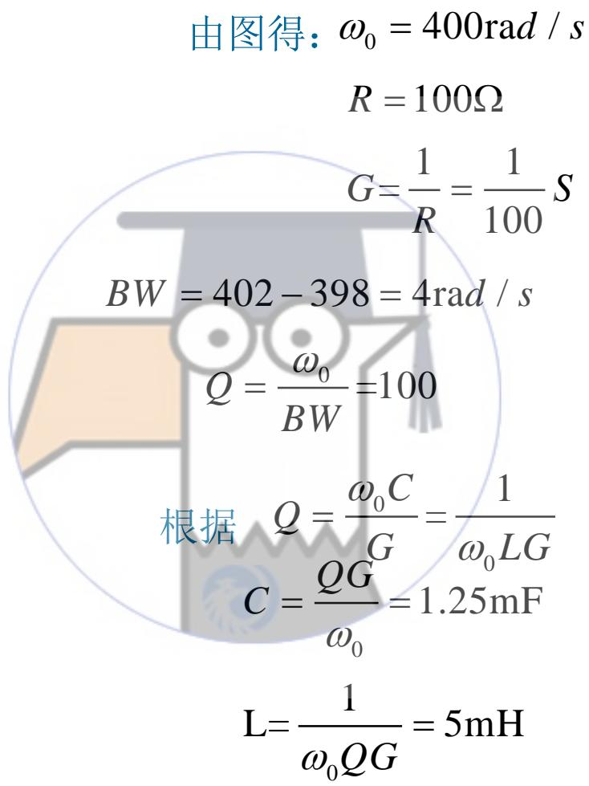

知识点：[线性时不变电阻的伏安关系（欧姆定律）](../../../topics/电路与电子技术/线性电阻VCR.md)

### 计算 9
**题号：10-9**

题图10-9所示电路中，已知 $U = 220V, R_{1} = R_{2} = 50\Omega, L_{1} = 0.2H, L_{2} = 0.1H, C_{1} = 5\mu F, C_{2} = 10\mu F$ ，理想电流表 $A_{1}$ 读数为零，试求理想电流表 $A_{2}$ 的读数。

解: 因为表 $A_{1}$ 的读数为 $\mathbf{0A}$ , 即 $L_{2}$ 和 $C_{2}$ 发生并联谐振, 则: $\omega_0 = \frac{1}{\sqrt{L_2 C_2}} = 10^3 \text{ rad/s}$
$\because \omega_0 L_1 = \frac{1}{\omega_0 C_1} = 200 \Omega$ ( $L_{1}$ 和 $C_{1}$ 发生串联谐振。)

此时 $\omega_0L_1 = \frac{1}{\omega_0C_1} = 200\Omega$ （ $L_{1}$ 和 $C_1$ 发生串联谐振。）

设 $\dot{U} = 220\angle 0^{\circ}$ ，则：

$$
\dot {I} = \frac {\dot {U}}{R _ {1} + R _ {2} + \mathrm{j} \omega_ {0} L + \frac {1}{\mathrm{j} \omega_ {0} C}} = \frac {\dot {U}}{R _ {1} + R _ {2}} = \frac {2 2 0 \angle 0 ^ {\circ}}{1 0 0} = 2. 2 \angle 0 ^ {\circ} \mathrm{A}
$$

$$
\dot {U} _ {1} = \dot {I} \times (R _ {2} + \frac {1}{j \omega_ {0} C _ {1}}) = 4 5 0 \angle - 7 6 ^ {\circ} \mathrm{V}
$$

$$
\therefore \dot {I} _ {2} = \frac {\dot {U} _ {1}}{j \omega_ {0} L _ {2}} = 4. 5 \angle - 1 6 6 ^ {\circ} A
$$

$$
P = I ^ {2} \left(R _ {1} + R _ {2}\right) = 4 8 4 \mathrm{W}
$$

故表 $A_{2}$ 的读数为4.5A

知识点：[理想电压源与理想电流源的特性](../../../topics/电路与电子技术/独立电源.md)、[线性时不变电阻的伏安关系（欧姆定律）](../../../topics/电路与电子技术/线性电阻VCR.md)、[基尔霍夫电压定律（KVL）及其应用](../../../topics/电路与电子技术/KVL.md)

### 计算 15
**题号：10-15**

题图10-15所示电路中，已知
$$
u _ {s} (t) = 1 0 \cos 3 1 4 t + 2 \cos 3 \times 3 1 4 t V, u _ {0} (t) = 2 \cos 3 \times 3 1 4 t V, C = 9. 4 \mu F
$$
试求 $L_{1}$ 和 $L_{2}$ 的值。

解: $\omega_{1} = 314$ 时, $u_{s}(t)$ 的该频率分量在R上的电压为零,故,相当于ab端在该频率时开路,即LC回路发生并联谐振,则: $\omega_{1} = 314 = \frac{1}{\sqrt{(L_{1} + L_{2})C}} \Rightarrow L_{2} = 0.96H$

$\omega_{2}=3\times314$ 时， $u_{s}(t)$ 的该频率分量全部作用在R上，故，此时LC回路发生串联谐振，即相当于ab端在该频率时短路，则： $\omega_{2}=3\times314=\frac{1}{\sqrt{L_{1}C}}\Rightarrow L_{1}=0.12H$

## 第11章 二端口网络

知识点：[理想电压源与理想电流源的特性](../../../topics/电路与电子技术/独立电源.md)、[线性时不变电阻的伏安关系（欧姆定律）](../../../topics/电路与电子技术/线性电阻VCR.md)、[基尔霍夫电压定律（KVL）及其应用](../../../topics/电路与电子技术/KVL.md)

### 计算 1(a)
**题号：11-1(a)**

求题图11-1所示二端网络的Z参数。

解：利用Z参数的定义求解。设端口电压、电流如图，则有：

$$
Z _ {1 1} = \frac {U _ {1}}{\dot {I} _ {1}} \Bigg | _ {\dot {I} _ {2} = 0} = (1 + 2) / / (2 + 1) = 1. 5 \Omega
$$

$\dot{I}_{1}=0$ 时等效电路如右图，则有：

$$
Z _ {1 2} = \left. \frac {\dot {U} _ {1}}{\dot {I} _ {2}} \right| _ {\dot {I} _ {1} = 0} = \frac {\frac {I _ {2}}{2} \times 2 - \frac {I _ {2}}{2} \times 1}{\dot {I} _ {2}} = 0. 5 \Omega
$$

因原网络是线性无源二端网络，有： $Z_{21}=Z_{12}=0.5\Omega$

知识点：[线性时不变电阻的伏安关系（欧姆定律）](../../../topics/电路与电子技术/线性电阻VCR.md)、[基尔霍夫电压定律（KVL）及其应用](../../../topics/电路与电子技术/KVL.md)

### 计算 1(b)
**题号：11-1(b)**

求题图11-1所示二端口网络的Z参数。

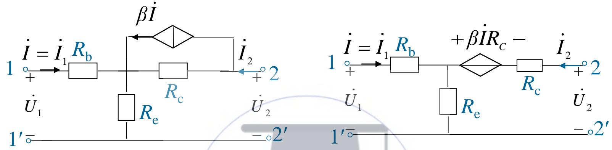

解：利用Z参数的物理意义求解。

设图所示二端口网络端子上电压、电流参考方向，则

$$
Z _ {1 1} = \frac {\dot {U} _ {1}}{\dot {I} _ {1}} \bigg | _ {\dot {I} _ {2} = 0} = \frac {(R _ {b} + R _ {e}) \dot {I} _ {1}}{\dot {I} _ {1}} \bigg | _ {\dot {I} _ {2} = 0} = R _ {b} + R _ {e}
$$

$$
Z _ {1 2} = \frac {\dot {U} _ {1}}{\dot {I} _ {2}} \Bigg | _ {\dot {I} _ {1} = 0} = \frac {R _ {e} \dot {I} _ {2}}{\dot {I} _ {2}} \Bigg | _ {\dot {I} _ {1} = 0} = R _ {e}
$$

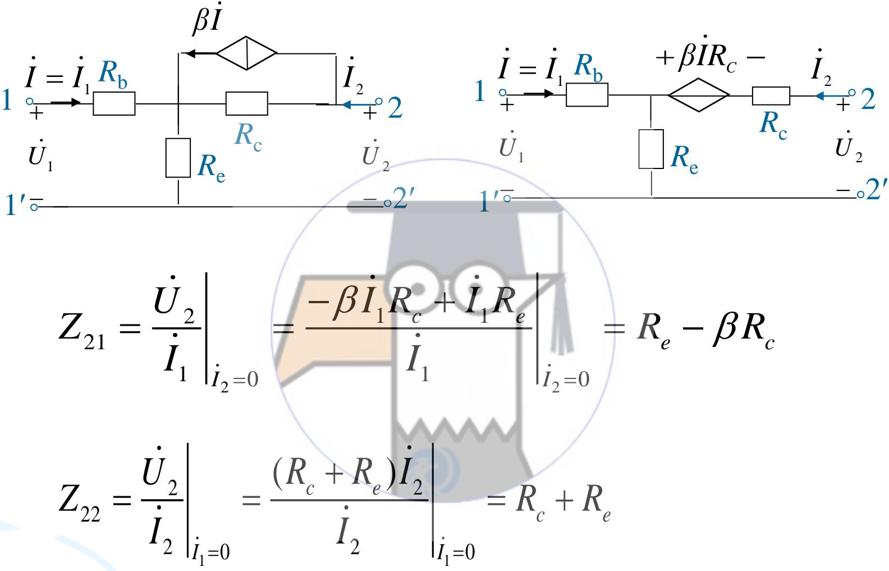

知识点：[线性时不变电阻的伏安关系（欧姆定律）](../../../topics/电路与电子技术/线性电阻VCR.md)、[电流、电压的参考方向及关联参考方向](../../../topics/电路与电子技术/参考方向.md)

### 计算 1

求题图得11-2所示二端口网络的Y参数。

知识点：[基尔霍夫电流定律（KCL）及其应用](../../../topics/电路与电子技术/KCL.md)、[基尔霍夫电压定律（KVL）及其应用](../../../topics/电路与电子技术/KVL.md)

### 计算 2

求题图11-2所示二端口网络的Y参数。

知识点：[理想电压源与理想电流源的特性](../../../topics/电路与电子技术/独立电源.md)、[四种受控电源（VCVS、VCCS、CCVS、CCCS）的特性](../../../topics/电路与电子技术/受控电源.md)
